# FLGHT403 — Architecture Diagram Documentation

> Generated: 2026-10-29  
> Understand scan: 2026-10-29 (0 days ago)  
> Libraries: FLGHT403 (dev) + FLGHT400 (production)

---

## Overview

The **Flight Reservation System (FRS)** is an IBM i interactive application with:

| Type | Count |
|---|---|
| OPM RPG programs | 50 |
| ILE RPGLE programs | 22 |
| OPM CLP programs | 18 |
| Physical Files (PF) | 28 |
| Logical Files (LF) | 52 |
| Display Files (DSPF) | 56 |
| Menus | 6 |

---

## Menus (Entry Points)

All objects prefixed with **FLGHT403_**

| Nom | Description |
|---|---|
| FLGHT403_FRSMAIN | Menu principal — Flight Reservation System |
| FLGHT403_FRSMANT | Menu maintenance — Flight Schedule, Cities, Agents |
| FLGHT403_FRSREPT | Menu rapports |

---

## Logon & Initialisation

| Objet | Type | Description |
|---|---|---|
| FLGHT403_FRS000 | OPM RPG | Logon — point d'entrée principal; appelle FRS001, FRS009, FRS401 |
| FLGHT403_FRS000DF | DSPF | Écran de logon |
| FLGHT403_BFLGHT | OPM RPG | Construction du fichier FLIGHTS (test data) |
| FLGHT403_BCUST | OPM RPG | Construction du fichier CUSTOMERS (test data) |
| FLGHT403_BLDCST | OPM CLP | Pilote de construction clients |

---

## Programmes de Réservation

| Objet | Type | Description | Fichiers ouverts |
|---|---|---|---|
| FLGHT403_FRS001 | OPM RPG | Nouvelle réservation (New Order) | ORDERS, CUSTOMERS (via CUSTNAME/CUSTOMER LFs), FLIGHTSZ, FRCITY, TOCITY, FNEXTO |
| FLGHT403_FRS001CL | OPM CLP | Pilote CL pour nouvelle réservation (OVRDBF CUSTOMERS → FLGHT400) | — |
| FLGHT403_FRS001DF | DSPF | Écran saisie nouvelle réservation | — |
| FLGHT403_FRS009 | OPM RPG | Sélection/recherche d'une commande | ORDERSZ |
| FLGHT403_FRS009DF | DSPF | Écran sélection commande | — |
| FLGHT403_FRS002 | OPM RPG | Mise à jour d'une réservation (Update Order) — 15 dépendances sortantes | — |
| FLGHT403_FRS003 | ILE RPGLE | Traitement réservation (fonction non documentée dans scan) | — |
| FLGHT403_FRS004 | ILE RPGLE | Traitement réservation (fonction non documentée dans scan) | — |
| FLGHT403_FRS005 | OPM RPG | Envoi réservation par FAX | — |
| FLGHT403_FRS010 | OPM RPG | Sélection commande — version alternative | — |
| FLGHT403_FRS024 | ILE RPGLE | Maintenance clients — version modernisée | — |

---

## Programmes de Maintenance

| Objet | Type | Description | Fichiers ouverts |
|---|---|---|---|
| FLGHT403_FRS021 | OPM RPG | Maintenance planning des vols (Flight Schedule) | FLIGHTS (via FLIGHTSZ), FRCITY, TOCITY, AIRLINE/AIRLINEL |
| FLGHT403_FRS021DF | DSPF | Écran maintenance vols | — |
| FLGHT403_FRS022 | OPM RPG + SQL | Maintenance table des villes (City Table) | FRCITY, FRCITYL, TOCITY, TOCITYL, AIRLINEL |
| FLGHT403_FRS022DF | DSPF | Écran maintenance villes | — |
| FLGHT403_FRS023 | OPM RPG | Maintenance table des agents | AGENTS (via AGENTSL/AGENTSZ) |
| FLGHT403_FRS023DF | DSPF | Écran maintenance agents | — |

---

## Sous-programmes & Utilitaires

| Objet | Type | Description | Appelé par |
|---|---|---|---|
| FLGHT403_FRS401 | ILE RPGLE | Sélection agent (subfile modernisé) | FRS000, FRS023 |
| FLGHT403_FRS401DF | DSPF | Écran sélection agent | — |
| FLGHT403_FRS402 | ILE RPGLE | Sélection ville (City subfile — free-format ILE) | FRS001, FRS021, FRS022 |
| FLGHT403_FRS403 | OPM RPG | Sélection ville de destination | FRS001, FRS021 |
| FLGHT403_FRS404 | OPM RPG | Sélection vol depuis liste | FRS001 |
| FLGHT403_FRS405 | OPM RPG | Sélection client depuis liste | FRS001 |
| FLGHT403_FRS406 | OPM RPG | Fenêtre confirmation commande | FRS001 |
| FLGHT403_FRS407 | OPM RPG | Sélection par date de commande | FRS009 |
| FLGHT403_FRS408 | ILE RPGLE | Sélection client depuis liste de commandes | FRS009 |
| FLGHT403_FRS409 | OPM RPG | Fenêtre confirmation modification commande | FRS002 |
| FLGHT403_FRS410 | OPM RPG | Fenêtre confirmation suppression commande | FRS002 |
| FLGHT403_FRS411 | ILE RPGLE | Fenêtre confirmation FAX (modernisée) | FRS005 |
| FLGHT403_FRS412 | ILE RPGLE | Sélection compagnie aérienne (subfile) | FRS021, FRS022 |
| FLGHT403_FRS413 | OPM RPG | Sélection tous les vols | FRS021 |
| FLGHT403_GTOJCV | OPM RPG | Conversion date Grégorienne → Julienne | FRS001 |
| FLGHT403_RTDOFW | OPM RPG | Jour de la semaine | FRS001 |
| FLGHT403_RTRAND | OPM RPG | Générateur de nombre aléatoire | BCUST, BFLGHT |
| FLGHT403_FAXDLY | OPM CLP | Simulation délai FAX | FRS005 |
| FLGHT403_JTOGCV | OPM RPG | Conversion Julian → Grégorien | — |
| FLGHT403_RTSEED | OPM CLP | Seed générateur aléatoire | RTRAND |
| FLGHT403_MSGPRG | OPM CLP | Affichage messages confirmation | — |
| FLGHT403_MSGPRGH | OPM CLP | Affichage messages (avec DCLF FLGHT400/MSGPANEL) | — |
| FLGHT403_USECLEAR | OPM CLP | Demo opcode CLEAR | — |
| FLGHT403_USERESET | OPM CLP | Demo opcode RESET | — |

---

## Fichiers Physiques (PF)

| Objet | Description | Inbound deps |
|---|---|---|
| FLGHT403_CUSTOMERS | Clients compagnie aérienne | **12** |
| FLGHT403_FRCITY | Table villes départ | **11** |
| FLGHT403_ORDERS | Commandes/réservations | **10** |
| FLGHT403_TOCITY | Table villes arrivée | **10** |
| FLGHT403_AGENTS | Agents de réservation | 5 |
| FLGHT403_FLIGHTS | Planning des vols | 5 |
| FLGHT403_AIRLINE | Table compagnies aériennes | 4 |
| FLGHT403_FNEXTO | Prochain numéro de commande | 3 |
| FLGHT403_FNAME | Table prénoms (données test) | 1 |
| FLGHT403_LNAME | Table noms de famille (données test) | 1 |

> Aucune clé étrangère (FK), aucun trigger, aucun journal enregistré dans l'application.

---

## Fichiers Logiques (LF) — Principaux

| Objet | Description | Base PF | Inbound |
|---|---|---|---|
| FLGHT403_FLIGHTSZ | Vols — binaire converti en zoned (compatibilité OPM) | FLIGHTS | **9** |
| FLGHT403_CUSTOMER | Clients — ordre décroissant par numéro | CUSTOMERS | 7 |
| FLGHT403_CUSTNAME | Clients — trié par nom | CUSTOMERS | 6 |
| FLGHT403_ORDNAME | Join ORDERS + CUSTOMERS par numéro commande | ORDERS+CUSTOMERS | 4 |
| FLGHT403_AGENTSL | Agents — trié par nom | AGENTS | 3 |
| FLGHT403_ORDERSZ | Commandes — binaire converti en zoned | ORDERS | 3 |
| FLGHT403_AIRLINEL | Compagnies — trié par initiales | AIRLINE | 2 |
| FLGHT403_ORDDATE | Join ORDERS + CUSTOMERS par date | ORDERS+CUSTOMERS | 1 |
| FLGHT403_CUSTORD | Join CUSTOMERS + ORDERS par nom client | CUSTOMERS+ORDERS | 1 |
| FLGHT403_CUSTOMRZ | Clients — binaire converti en zoned | CUSTOMERS | 1 |
| FLGHT403_AGENTSZ | Agents — binaire converti en zoned | AGENTS | 1 |
| FLGHT403_FLIGHTSL | Vols — par ville départ, arrivée, jour | FLIGHTS | 1 |
| FLGHT403_FRCITYL | Villes départ — liste | FRCITY | 1 |
| FLGHT403_TOCITYL | Villes arrivée — liste | TOCITY | 1 |

---

## Dépendance critique : Bibliothèque FLGHT400

Les programmes font référence en dur à `FLGHT400` pour :

| Objet FLGHT400 | Type | Usage |
|---|---|---|
| FRSMSGF | *MSGF | Fichier messages — utilisé par **tous** les programmes FRS |
| CUSTOMERS | *FILE | Destination de `OVRDBF CUSTOMER` dans FRS001CL |
| FRS411DF | *FILE | `DCLF` direct dans FRS411CL |
| MSGPANEL | *FILE | `DCLF FILE(FLGHT400/MSGPANEL)` dans MSGPRGH |
| FLDS | *DTAARA | Créé/mis à jour par USECLEAR et USERESET |
| FRSMANT | *MENU | Appelé par `GO FLGHT400/FRSMANT` depuis FRS000 |
| FRSREPT | *MENU | Menu rapports |

---

## Diagramme Mermaid (flux principal)

```mermaid
flowchart TD
    FRSMAIN["FLGHT403_FRSMAIN\n(MENU Principal)"]
    FRSMANT["FLGHT403_FRSMANT\n(MENU Maintenance)"]
    FRSREPT["FLGHT403_FRSREPT\n(MENU Reports)"]

    FRS000["FLGHT403_FRS000\nLogon (OPM RPG)"]
    FRS001["FLGHT403_FRS001\nNew Order (OPM RPG)"]
    FRS009["FLGHT403_FRS009\nSelect Order (OPM RPG)"]
    FRS401["FLGHT403_FRS401\nAgent Selection (ILE)"]

    FRS002["FLGHT403_FRS002\nUpdate Order (OPM RPG)"]
    FRS003["FLGHT403_FRS003 (ILE)"]
    FRS004["FLGHT403_FRS004 (ILE)"]
    FRS005["FLGHT403_FRS005\nFAX Order (OPM RPG)"]

    FRS402["FLGHT403_FRS402\nCity Subfile (ILE)"]
    FRS403["FLGHT403_FRS403\nSelect ToCity"]
    FRS404["FLGHT403_FRS404\nSelect Flights"]
    FRS405["FLGHT403_FRS405\nSelect Customer"]
    FRS406["FLGHT403_FRS406\nConfirmation"]

    FRS021["FLGHT403_FRS021\nFlight Maint (OPM RPG)"]
    FRS022["FLGHT403_FRS022\nCity Maint (OPM+SQL)"]
    FRS023["FLGHT403_FRS023\nAgents Maint (OPM RPG)"]
    FRS024["FLGHT403_FRS024\nCustomer Maint (ILE)"]

    CUSTOMERS[("FLGHT403_CUSTOMERS\nPF")]
    ORDERS[("FLGHT403_ORDERS\nPF")]
    FLIGHTS[("FLGHT403_FLIGHTS\nPF")]
    AGENTS[("FLGHT403_AGENTS\nPF")]
    FRCITY[("FLGHT403_FRCITY\nPF")]
    TOCITY[("FLGHT403_TOCITY\nPF")]
    AIRLINE[("FLGHT403_AIRLINE\nPF")]

    FRSMAIN --> FRS000
    FRS000 --> FRS001
    FRS000 --> FRS009
    FRS000 --> FRS401

    FRS001 --> FRS402 & FRS403 & FRS404 & FRS405 & FRS406
    FRS001 --- ORDERS & CUSTOMERS & FRCITY & TOCITY

    FRS009 --> FRS002 & FRS003 & FRS004 & FRS005 & FRS407 & FRS408
    FRS009 --- ORDERS

    FRSMANT --> FRS021 & FRS022 & FRS023 & FRS024
    FRS021 --> FRS402 & FRS403 & FRS412 & FRS413
    FRS021 --- FLIGHTS & FRCITY & AIRLINE
    FRS022 --> FRS402 & FRS412
    FRS022 --- FRCITY & TOCITY
    FRS023 --> FRS401
    FRS023 --- AGENTS
```

---

## Notes de modernisation

- **68 programmes OPM** (RPG/400 et CLP) sur 92 au total — priorité haute de modernisation
- **22 programmes ILE RPGLE** déjà modernisés (FRS401, FRS402, FRS408, FRS411, FRS412, FRS024…)
- Aucun SQL dynamique détecté
- **22 objets avec autorité adoptée** — à vérifier avant migration
- Aucune clé étrangère déclarée — les relations sont implicites (logiques sur ORDERS+CUSTOMERS)
- Les LF `*Z` (FLIGHTSZ, ORDERSZ, AGENTSZ, CUSTOMRZ) existent uniquement pour compatibilité OPM RPG avec les champs binaires — peuvent être supprimés lors de la modernisation en SQLRPGLE

---

*Fichier draw.io : `/home/ITZUSER/FLGHT400-architecture.drawio`*
