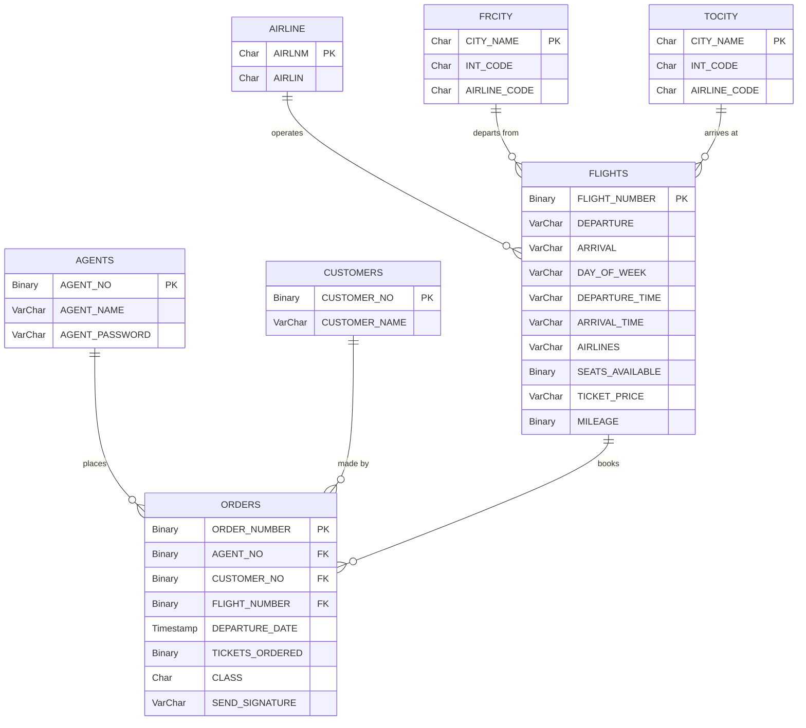

# FLGHT400 – Architecture Overview

## High-Level Description

**Flight 400** is a classic IBM i interactive application that implements a complete
airline reservation system. It is structured as a collection of OPM RPG III programs
(in `QRPGSRC`) with a parallel set of modernized ILE RPGLE free-format equivalents
(in `QRPGLESRC`). The application uses 5250 display files (DSPF) for all user
interaction and DDS physical/logical files for all data persistence.

The system supports:
- Agent authentication and session routing
- Flight schedule and reference data maintenance
- Full reservation lifecycle: create, update, display, delete, and FAX confirmation
- Subfile-based selection windows for flights, cities, customers, agents, and orders

There are no service programs, no binding directories, and no SQL tables — all
programs are compiled as single-module bound programs (`CRTBNDRPG` / `CRTRPGPGM`)
and all data is stored in DDS physical files.

---

## Architecture Diagram

```mermaid
graph TD
    MENU["FRSMAIN\n(Main Menu)"]
    MANT["FRSMANT\n(Maintenance Menu)"]
    REPT["FRSREPT\n(Reports Menu)"]

    FRS000["FRS000\nLogon Screen\n(authenticates via AGENTSL)"]

    FRS000 -->|RUNTYP=CREATE| FRS001
    FRS000 -->|RUNTYP=UPDATE/DSPLAY/DELETE/FAX| FRS009
    FRS000 -->|RUNTYP=MAINT| MANT
    FRS000 -->|RUNTYP=REPORT| REPT

    MANT --> FRS021["FRS021\nFlight Schedule Maintenance"]
    MANT --> FRS022["FRS022\nCity Table Maintenance"]
    MANT --> FRS023["FRS023\nAgents Table Maintenance"]
    MANT --> FRS024["FRS024\nCustomers Table Maintenance"]
    MANT --> FRS025["FRS025\nAirline Table Maintenance"]

    FRS009["FRS009\nOrder Selection\n(dispatcher by RUNTYP)"]
    FRS009 -->|F4 select by customer| FRS408
    FRS009 -->|F5 select by date| FRS407
    FRS009 -->|RUNTYP=UPDATE| FRS002
    FRS009 -->|RUNTYP=DSPLAY| FRS003
    FRS009 -->|RUNTYP=DELETE| FRS004
    FRS009 -->|RUNTYP=FAX| FRS005

    FRS001["FRS001\nNew Reservation\n(data entry)"]
    FRS002["FRS002\nUpdate Reservation"]
    FRS003["FRS003\nDisplay Reservation"]
    FRS004["FRS004\nDelete Reservation"]
    FRS005["FRS005\nFAX Reservation"]

    FRS001 -->|F4 select agent| FRS401
    FRS001 -->|F6 select flight| FRS404
    FRS001 -->|F7 select customer| FRS405
    FRS001 -->|confirmation| FRS406

    FRS002 -->|F4 select agent| FRS401
    FRS002 -->|F6 select flight| FRS404
    FRS002 -->|F7 select customer| FRS405

    FRS021 -->|F6 from city| FRS402
    FRS021 -->|F7 to city| FRS403
    FRS021 -->|F8 airline| FRS412

    subgraph "Selection Windows (Subfile Programs)"
        FRS401["FRS401\nAgent Selection"]
        FRS402["FRS402\nFrom-City Selection"]
        FRS403["FRS403\nTo-City Selection"]
        FRS404["FRS404\nFlight Selection"]
        FRS405["FRS405\nCustomer Selection"]
        FRS406["FRS406\nOrder Confirmation Window"]
        FRS407["FRS407\nSelect Order by Date"]
        FRS408["FRS408\nSelect Order by Customer"]
        FRS411["FRS411\nFAX Status Window"]
        FRS412["FRS412\nAirline Selection"]
        FRS413["FRS413\nFlight Selection (all)"]
    end

    FRS005 -->|FAX progress| FRS411

    subgraph "Utility Programs"
        GTOJCV["GTOJCV\nGregorian-to-Julian"]
        JTOGCV["JTOGCV\nJulian-to-Gregorian"]
        RTDOFW["RTDOFW\nDay-of-Week"]
        RTRAND["RTRAND\nRandom Number Generator"]
        RTSEED["RTSEED (CL)\nRandom Seed (QTIME)"]
    end

    FRS001 --> GTOJCV
    FRS001 --> RTDOFW
    RTRAND --> RTSEED

    subgraph "Data Build Programs"
        BFLGHT["BFLGHT\nBuild Flights file"]
        BCUST["BCUST\nBuild Customers file"]
        BLDCST["BLDCST (CL)\nInvoke BCUST"]
    end

    BLDCST --> BCUST
```



---

## Program Flows

### 1. Logon Flow

```
FRSMAIN menu
  └─> FRS000 (logon: agent name + password)
        ├─ validates against AGENTSL (by name, then password)
        ├─ F4 → FRS401 (lookup agent name)
        ├─ F10 + RUNTYP=CREATE  → FRS001
        ├─ F10 + RUNTYP=UPDATE/DSPLAY/DELETE/FAX → FRS009
        ├─ F10 + RUNTYP=MAINT   → GO FLGHT400/FRSMANT
        └─ F10 + RUNTYP=REPORT  → GO FLGHT400/FRSREPT
```

The `RUNTYP` parameter is passed from the menu to `FRS000`, which routes all
subsequent work. The agent number is passed as a 9-char parameter to all
downstream programs.

### 2. New Reservation Flow (FRS001)

```
FRS001 (new order - data entry)
  ├─ F4 → FRS401 (select agent)
  ├─ F6 → FRS404 (select flight from FRS/FRCITY/TOCITY/FLIGHTSZ)
  │         validates: from-city, to-city, day-of-week, departure date
  │         calculates: class multiplier, ticket price, 4% tax, total
  ├─ F7 → FRS405 (select or create customer)
  ├─ GTOJCV  (date validation: Gregorian → Julian)
  ├─ RTDOFW  (compute day of week for departure date)
  ├─ F10 (save): writes to CUSTOMER (if new) and ORDERS
  └─ FRS406  (order confirmation window after save)
```

`FRS001CL` is a CL wrapper that applies `OVRDBF FILE(CUSTOMER) TOFILE(FLGHT400/CUSTOMERS)`
before calling `FRS001`, because the program opens the file under the name `CUSTOMER`.

### 3. Order Management Flow (FRS009)

```
FRS009 (order selection dispatcher)
  ├─ Enter order number manually
  ├─ F4 → FRS408 (select by customer name)
  ├─ F5 → FRS407 (select by order date)
  └─ F10 (process) dispatches by RUNTYP:
        UPDATE → FRS002 (update order)
        DSPLAY → FRS003 (display order)
        DELETE → FRS004 (delete order)
        FAX    → FRS005 → FRS411 (FAX status window)
```

### 4. Maintenance Flow (FRS021-FRS025)

```
FRSMANT menu
  ├─ FRS021 Flight Schedule   → FLIGHTS (update/add/delete)
  │     ├─ F6 → FRS402 (From-City lookup via FRCITY)
  │     ├─ F7 → FRS403 (To-City lookup via TOCITY)
  │     └─ F8 → FRS412 (Airline lookup via AIRLINEL)
  ├─ FRS022 City Table        → FRCITY / TOCITY
  ├─ FRS023 Agents Table      → AGENTS
  ├─ FRS024 Customers Table   → CUSTOMERS (via CUSTNAME + CUSTOMRZ)
  └─ FRS025 Airline Table     → AIRLINE
```

---

## Key Programs and Their Roles

| Program | Source | Role | Key Files Used |
|---|---|---|---|
| **FRS000** | QRPGSRC | Logon; authenticates agent; routes by RUNTYP | AGENTSL (LF over AGENTS) |
| **FRS001** | QRPGSRC | New reservation data entry; writes CUSTOMER + ORDERS | FRCITY, TOCITY, CUSTOMER, CUSTNAME, ORDERS, FLIGHTSZ |
| **FRS002** | QRPGSRC | Update existing reservation | FRCITY, TOCITY, CUSTOMER, CUSTNAME, ORDNAME, ORDERSZ, FLIGHTSZ |
| **FRS003** | QRPGSRC | Display reservation (read-only) | ORDNAME, FLIGHTSZ |
| **FRS004** | QRPGSRC | Delete reservation | ORDERSZ |
| **FRS005** | QRPGSRC | FAX reservation confirmation | ORDNAME, FLIGHTSZ |
| **FRS009** | QRPGSRC | Order selection dispatcher (UPDATE/DSPLAY/DELETE/FAX) | ORDERSZ |
| **FRS021** | QRPGSRC/QRPGLESRC | Flight schedule maintenance (add/update/delete) | AIRLINE, AIRLINEL, FLIGHTSZ, FRCITY, TOCITY |
| **FRS022** | QRPGSRC | City table maintenance | FRCITY, TOCITY |
| **FRS023** | QRPGSRC | Agents table maintenance | AGENTS |
| **FRS024** | QRPGSRC/QRPGLESRC | Customers table maintenance | CUSTNAME, CUSTOMRZ |
| **FRS025** | QRPGSRC | Airline table maintenance | AIRLINE |
| **FRS401** | QRPGLESRC | Agent selection subfile window | AGENTSL (LF) |
| **FRS402** | QRPGLESRC | From-city selection subfile window | FRCITY |
| **FRS403** | QRPGSRC | To-city selection subfile window | TOCITY |
| **FRS404** | QRPGSRC | Flight selection subfile window | FLIGHTSZ |
| **FRS405** | QRPGSRC | Customer selection subfile window | CUSTOMERS |
| **FRS406** | QRPGLESRC | Order confirmation popup window | ORDERS |
| **FRS407** | QRPGSRC | Select order by date | ORDDATE (LF) |
| **FRS408** | QRPGLESRC | Select order by customer name | CUSTORD (LF) |
| **FRS411** | QRPGLESRC | FAX status simulation window (uses DLYJOB) | — |
| **FRS412** | QRPGLESRC | Airline selection subfile window | AIRLINE |
| **FRS413** | QRPGLESRC | Full flight selection subfile | FLIGHTSZ |
| **GTOJCV** | QRPGSRC | Gregorian → Julian date conversion utility | — |
| **JTOGCV** | QRPGSRC | Julian → Gregorian date conversion utility | — |
| **RTDOFW** | QRPGSRC | Compute day of week from date | — |
| **RTRAND** | QRPGSRC | Random number generator | — |
| **BFLGHT** | QRPGSRC | Populate FLIGHTS file from FRCITY × TOCITY | FRCITY, TOCITY, FLIGHTS |
| **BCUST** | QRPGSRC | Populate CUSTOMERS file from FNAME/LNAME tables | FNAME, LNAME, CUSTOMERS |

---

## Database Tables

### Physical Files (PF)

| File | Key | Description | Notable Fields |
|---|---|---|---|
| **AGENTS** | AGENT_NO (9B) | Agent master: number, name, password | AGENT_NO, AGENT_NAME, AGENT_PASSWORD (all VARLEN) |
| **AIRLINE** | AIRLNM | Airline reference: name + 3-char initials | AIRLNM (16A), AIRLIN (3A) |
| **CUSTOMERS** | CUSTO00001 (CUSTOMER_NO, 9B) | Customer master | CUSTOMER_NO, CUSTOMER_NAME (64A VARLEN) |
| **FLIGHTS** | FLIGH00001 (FLIGHT_NUMBER, 9B) | Flight schedule | Departure/Arrival city & initials, day of week, times, airline, seats, price (all VARLEN), mileage |
| **ORDERS** | ORDER00001 (ORDER_NUMBER, 9B) | Reservation orders | ORDER_NUMBER, AGENT_NO, CUSTOMER_NO, FLIGHT_NUMBER, DEPARTURE_DATE (Z), TICKETS_ORDERED, CLASS, SEND_SIGNATURE (VARLEN) |
| **FRCITY** | (keyed) | From-city reference table | City name, international code, airline code |
| **TOCITY** | (keyed) | To-city reference table | City name, international code, airline code |
| **FNEXTO** | — | Next order number sequence counter | — |
| **FNAME** | — | First name table (used by BCUST) | — |
| **LNAME** | — | Last name table (used by BCUST) | — |

> **Binary fields note:** `FLIGHTS` and `ORDERS` store numeric keys as binary
> (`9B 0`). OPM programs access them via I-spec DS overlays. The `*Z` logical
> files below expose pre-converted zoned views for OPM compatibility.

### Logical Files (LF)

| File | Base PF(s) | Purpose |
|---|---|---|
| **FLIGHTSL** | FLIGHTS | Keyed by departure city / arrival city / day / flight# |
| **FLIGHTSZ** | FLIGHTS | All fields as zoned (binary→zoned conversion for OPM RPG) |
| **ORDERSZ** | ORDERS | All fields as zoned |
| **CUSTOMRZ** | CUSTOMERS | Binary→zoned conversion |
| **AGENTSL** | AGENTS | Keyed by agent name (used for logon lookup + subfile) |
| **AGENTSZ** | AGENTS | Binary→zoned conversion |
| **AIRLINEL** | AIRLINE | Keyed by airline initials |
| **CUSTOMER** | CUSTOMERS | Customers in descending number order |
| **CUSTNAME** | CUSTOMERS | Customers keyed by name |
| **FRCITYL** | FRCITY | From-city keyed view |
| **TOCITYL** | TOCITY | To-city keyed view |
| **CUSTORD** | ORDERS + CUSTOMERS | Join: order + customer details by customer name |
| **ORDNAME** | ORDERS + CUSTOMERS | Join: order + customer details by order number |
| **ORDDATE** | ORDERS + CUSTOMERS | Join: order + customer details by date |

### Data Relationships



---

## Modernization Status

This codebase is a **teaching/demo application** actively used to demonstrate
OPM → ILE RPG modernization. Both the original OPM and modernized ILE versions
coexist in the library:

| Generation | Location | Style |
|---|---|---|
| OPM RPG III original | `QRPGSRC/*.RPG` | Fixed-format, indicators, subroutines, CALL/PARM |
| ILE step 1 (via CVTRPGSRC) | Some members in `QRPGLESRC` | Fixed-format ILE (e.g. FRS406, FRS003) |
| ILE step 2 (modernized) | `QRPGLESRC/*.RPGLE` | `**FREE`, DCL-*, procedures, named booleans |
| ILE step 3 (SQL modernized) | `QRPGLESRC/X2FRS024.RPGLE` | `**FREE` + embedded SQL (`EXEC SQL`) |

> `X2FRS024.RPGLE` must be compiled with `CRTSQLRPGI`, not `CRTBNDRPG`.

---

## Menus

| Menu | Source | Description |
|---|---|---|
| **FRSMAIN** | QMNUSRC | Main entry menu; options route to FRS000 with different RUNTYP values |
| **FRSMANT** | QMNUSRC | Maintenance sub-menu (FRS021–FRS025) |
| **FRSREPT** | QMNUSRC | Reports sub-menu |

---

## System APIs Used

All programs call IBM system APIs directly via `CALL`/prototypes (no service programs):

| API | Purpose | Used By |
|---|---|---|
| `QMHSNDPM` | Send program message to message queue | FRS000, FRS001, FRS002, FRS009, FRS401, FRS408, FRS413 |
| `QMHRMVPM` | Remove program messages | Same as above |
| `QUSCMDLN` | Display CL command line (F9) | FRS000, FRS001, FRS009, FRS021 |
| `QCMDEXC` | Execute CL command string | FRS000 (GO menu), FRS411 (DLYJOB) |

Message IDs (e.g. `FRS0021`, `FRS0040`, `FRS0050`–`FRS0091`) are stored in the
message file **`FRSMSGF`** in library `FLGHT400`. This file must be in `*LIBL`
for all programs to run correctly.
