# FLGHT403 — Architecture Documentation (Bibliothèque Dev)

> Generated: 2026-10-29  
> Understand scan: 2026-10-29 (0 j)  
> Bibliothèque source : **FLGHT403** (développement)  
> Bibliothèque production : FLGHT400 (même structure, objets compilés)

---

## Inventaire global

| Type | Attribut | Modèle | Nombre |
|---|---|---|---|
| PGM | RPG | OPM | 50 |
| PGM | RPGLE | ILE | 22 |
| PGM | CLP | OPM | 18 |
| PGM | DFU | ILE | 2 |
| FILE | PF | — | 28 |
| FILE | LF | — | 52 |
| FILE | DSPF | — | 56 |
| MENU | DSPF | — | 6 |
| MODULE | RPGLE | ILE | 6 |

---

## Menus (Points d'entrée)

| Objet | Description |
|---|---|
| FLGHT403_FRSMAIN | Menu principal — Flight Reservation System |
| FLGHT403_FRSMANT | Menu maintenance — Vols, Villes, Agents |
| FLGHT403_FRSREPT | Menu rapports |

---

## Logon & Initialisation

| Objet | Type | Description |
|---|---|---|
| FLGHT403_FRS000 | OPM RPG | Logon — point d'entrée ; appelle FRS001, FRS009, FRS401 |
| FLGHT403_FRS000DF | DSPF | Écran de logon |
| FLGHT403_BFLGHT | OPM RPG | Construction du fichier FLIGHTS (données test) |
| FLGHT403_BCUST | OPM RPG | Construction du fichier CUSTOMERS (données test) |
| FLGHT403_BLDCST | OPM CLP | Pilote CL pour construction clients (OVRDBF vers FLGHT400) |
| FLGHT403_AGENTDFU | ILE DFU | Utilitaire DFU pour la table AGENTS |

---

## Programmes de Réservation

| Objet | Type | Dep. sortantes | Description |
|---|---|---|---|
| FLGHT403_FRS001 | OPM RPG | 15 | Nouvelle réservation (New Order) — programme le plus couplé |
| FLGHT403_FRS001DF | DSPF | — | Écran saisie nouvelle réservation |
| FLGHT403_FRS001CL | OPM CLP | 3 | Pilote CL (OVRDBF CUSTOMER → FLGHT400/CUSTOMERS) |
| FLGHT403_FRS001T | OPM RPG | 15 | Variante 2004 de FRS001 |
| FLGHT403_FRS001U | OPM RPG | 15 | Variante 2004 de FRS001 |
| FLGHT403_FRS009 | OPM RPG | 8 | Sélection / recherche d'une commande |
| FLGHT403_FRS009DF | DSPF | — | Écran sélection commande |
| FLGHT403_FRS010 | OPM RPG | 8 | Sélection commande (version alternative) |
| FLGHT403_FRS002 | OPM RPG | 15 | Mise à jour réservation |
| FLGHT403_FRS003 | ILE RPGLE | 4 | Traitement réservation (nom non documenté dans scan) |
| FLGHT403_FRS004 | ILE RPGLE | 4 | Traitement réservation (nom non documenté dans scan) |
| FLGHT403_FRS005 | OPM RPG | 4 | Envoi par FAX |
| FLGHT403_FRS024 | ILE RPGLE | 4 | Maintenance clients — version modernisée |

---

## Programmes de Maintenance (FRSMANT)

| Objet | Type | Description | Fichiers ouverts |
|---|---|---|---|
| FLGHT403_FRS021 | OPM RPG | Maintenance planning vols | FLIGHTS (via FLIGHTSZ), FRCITY, TOCITY, AIRLINE/AIRLINEL |
| FLGHT403_FRS021DF | DSPF | Écran maintenance vols | — |
| FLGHT403_FRS022 | OPM RPG + SQL | Maintenance table des villes | FRCITY, FRCITYL, TOCITY, TOCITYL, AIRLINEL |
| FLGHT403_FRS022DF | DSPF | Écran maintenance villes | — |
| FLGHT403_FRS023 | OPM RPG | Maintenance table agents | AGENTS, AGENTSL, AGENTSZ |
| FLGHT403_FRS023DF | DSPF | Écran maintenance agents | — |

---

## Sous-programmes & Utilitaires

### Sélection (appelés par les programmes de réservation et maintenance)

| Objet | Type | Dep. entrantes | Description | Appelé par |
|---|---|---|---|---|
| FLGHT403_FRS401 | ILE RPGLE | 2 | Sélection agent (subfile modernisé) | FRS000, FRS023 |
| FLGHT403_FRS401DF | DSPF | — | Écran sélection agent | — |
| FLGHT403_FRS402 | ILE RPGLE | **6** | Sélection ville (City subfile free-format) | FRS001, FRS021, FRS022 |
| FLGHT403_FRS403 | OPM RPG | **5** | Sélection ville destination | FRS001, FRS021 |
| FLGHT403_FRS404 | OPM RPG | 4 | Sélection vol depuis liste | FRS001 |
| FLGHT403_FRS405 | OPM RPG | **5** | Sélection client depuis liste | FRS001 |
| FLGHT403_FRS406 | OPM RPG | 3 | Fenêtre confirmation commande | FRS001 |
| FLGHT403_FRS407 | OPM RPG | 2 | Sélection par date de commande | FRS009 |
| FLGHT403_FRS408 | ILE RPGLE | 2 | Sélection client depuis liste de commandes | FRS009 |
| FLGHT403_FRS409 | OPM RPG | 1 | Fenêtre confirmation modification | FRS002 |
| FLGHT403_FRS410 | OPM RPG | 1 | Fenêtre confirmation suppression | FRS002 |
| FLGHT403_FRS411 | ILE RPGLE | 1 | Fenêtre confirmation FAX (modernisée) | FRS005 |
| FLGHT403_FRS411CL | OPM CLP | 0 | Pilote CL FAX (`DCLF FLGHT400/FRS411DF`) | — |
| FLGHT403_FRS412 | ILE RPGLE | 2 | Sélection compagnie aérienne (subfile) | FRS021, FRS022 |
| FLGHT403_FRS413 | OPM RPG | 1 | Sélection tous les vols | FRS021 |
| FLGHT403_FAXDLY | OPM CLP | 0 | Simulation délai FAX | FRS005 |

### Utilitaires Date / Aléatoire

| Objet | Type | Dep. entrantes | Description |
|---|---|---|---|
| FLGHT403_GTOJCV | OPM RPG | 4 | Conversion Grégorienne → Julienne |
| FLGHT403_RTDOFW | OPM RPG | 4 | Jour de la semaine |
| FLGHT403_RTRAND | OPM RPG | 2 | Générateur nombre aléatoire |
| FLGHT403_JTOGCV | OPM RPG | 0 | Conversion Julienne → Grégorienne |
| FLGHT403_RTSEED | OPM CLP | 1 | Seed pour générateur aléatoire |
| FLGHT403_MSGPRG | OPM CLP | 0 | Affichage messages confirmation |
| FLGHT403_MSGPRGH | OPM CLP | 0 | Affichage messages (DCLF FLGHT400/MSGPANEL) |
| FLGHT403_USECLEAR | OPM CLP | 1 | Demo opcode CLEAR |
| FLGHT403_USERESET | OPM CLP | 1 | Demo opcode RESET |

---

## Fichiers Physiques (PF) — FLGHT403

| Objet | Description | Dep. entrantes | Remarque |
|---|---|---|---|
| FLGHT403_CUSTOMERS | Clients | **12** | Fichier le plus référencé |
| FLGHT403_FRCITY | Villes départ | **11** | — |
| FLGHT403_ORDERS | Réservations | **10** | — |
| FLGHT403_TOCITY | Villes arrivée | **10** | — |
| FLGHT403_AGENTS | Agents | 5 | — |
| FLGHT403_FLIGHTS | Planning vols | 5 | Champs binaires → LF FLIGHTSZ pour OPM |
| FLGHT403_AIRLINE | Compagnies aériennes | 4 | — |
| FLGHT403_FNEXTO | Prochain n° commande | 3 | Compteur séquentiel |
| FLGHT403_FNAME | Prénoms (données test) | 1 | — |
| FLGHT403_LNAME | Noms (données test) | 1 | — |

> Aucune clé étrangère, aucun trigger, aucun journal enregistré dans l'application.  
> Champs binaires dans FLIGHTS, ORDERS, AGENTS, CUSTOMERS → LF `*Z` pour compatibilité OPM.

---

## Fichiers Logiques (LF) Clés — FLGHT403

| Objet | Base PF | Description | Dep. entrantes |
|---|---|---|---|
| FLGHT403_FLIGHTSZ | FLIGHTS | Champs binaires → zoned (compat. OPM) | **9** |
| FLGHT403_CUSTOMER | CUSTOMERS | Ordre décroissant par n° | 7 |
| FLGHT403_CUSTNAME | CUSTOMERS | Trié par nom | 6 |
| FLGHT403_ORDNAME | ORDERS+CUSTOMERS | Join par n° commande | 4 |
| FLGHT403_AGENTSL | AGENTS | Trié par nom | 3 |
| FLGHT403_ORDERSZ | ORDERS | Champs binaires → zoned | 3 |
| FLGHT403_AIRLINEL | AIRLINE | Trié par initiales | 2 |
| FLGHT403_CUSTORD | CUSTOMERS+ORDERS | Join par nom client | 1 |
| FLGHT403_ORDDATE | ORDERS+CUSTOMERS | Join par date | 1 |
| FLGHT403_CUSTOMRZ | CUSTOMERS | Binaire → zoned | 1 |
| FLGHT403_AGENTSZ | AGENTS | Binaire → zoned | 1 |
| FLGHT403_FLIGHTSL | FLIGHTS | Trié par ville départ/arrivée/jour | 1 |
| FLGHT403_FRCITYL | FRCITY | Liste villes départ | 1 |
| FLGHT403_TOCITYL | TOCITY | Liste villes arrivée | 1 |

---

## Dépendance critique : FLGHT400 (runtime)

Tous les programmes référencent `FLGHT400` en dur :

| Objet FLGHT400 | Type | Usage dans FLGHT403 |
|---|---|---|
| FRSMSGF | *MSGF | Fichier messages — tous les programmes FRS |
| CUSTOMERS | *FILE | `OVRDBF CUSTOMER` dans FRS001CL |
| FRS411DF | *FILE | `DCLF` direct dans FRS411CL |
| MSGPANEL | *FILE | `DCLF FILE(FLGHT400/MSGPANEL)` dans MSGPRGH |
| FLDS | *DTAARA | Créé/mis à jour par USECLEAR et USERESET |
| FRSMANT | *MENU | `GO FLGHT400/FRSMANT` depuis FRS000 |
| FRSREPT | *MENU | Menu rapports |

---

## Diagramme Mermaid — Flux principal FLGHT403

```mermaid
flowchart TD
    FRSMAIN["FLGHT403_FRSMAIN\n(MENU Principal)"]
    FRSMANT["FLGHT403_FRSMANT\n(MENU Maintenance)"]
    FRSREPT["FLGHT403_FRSREPT\n(MENU Reports)"]

    subgraph Logon
        FRS000["FLGHT403_FRS000\nLogon (OPM RPG)"]
        FRS000DF["FLGHT403_FRS000DF\nDSPF"]
    end

    subgraph Reservation
        FRS001["FLGHT403_FRS001\nNew Order (OPM RPG)\n15 dep sortantes"]
        FRS009["FLGHT403_FRS009\nSelect Order (OPM RPG)"]
        FRS002["FLGHT403_FRS002\nUpdate Order"]
        FRS003["FLGHT403_FRS003 (ILE)"]
        FRS004["FLGHT403_FRS004 (ILE)"]
        FRS005["FLGHT403_FRS005\nFAX Order"]
        FRS024["FLGHT403_FRS024\nCust Maint (ILE)"]
    end

    subgraph Maintenance
        FRS021["FLGHT403_FRS021\nFlight Schedule (OPM)"]
        FRS022["FLGHT403_FRS022\nCity Table (OPM+SQL)"]
        FRS023["FLGHT403_FRS023\nAgents (OPM)"]
    end

    subgraph Selection["Sub-programs Selection"]
        FRS401["FLGHT403_FRS401 (ILE)\nAgent"]
        FRS402["FLGHT403_FRS402 (ILE)\nCity Subfile\n6 inbound"]
        FRS403["FLGHT403_FRS403\nTo City\n5 inbound"]
        FRS404["FLGHT403_FRS404\nFlights"]
        FRS405["FLGHT403_FRS405\nCustomer\n5 inbound"]
        FRS406["FLGHT403_FRS406\nConfirmation"]
        FRS407["FLGHT403_FRS407\nBy Date"]
        FRS408["FLGHT403_FRS408 (ILE)\nCust Orders"]
        FRS411["FLGHT403_FRS411 (ILE)\nFAX Confirm"]
        FRS412["FLGHT403_FRS412 (ILE)\nAirline"]
        FRS413["FLGHT403_FRS413\nAll Flights"]
    end

    subgraph DB["Database PF (FLGHT403)"]
        CUSTOMERS[("CUSTOMERS\n12 inbound")]
        ORDERS[("ORDERS\n10 inbound")]
        FLIGHTS[("FLIGHTS\n5 inbound")]
        AGENTS[("AGENTS\n5 inbound")]
        FRCITY[("FRCITY\n11 inbound")]
        TOCITY[("TOCITY\n10 inbound")]
        AIRLINE[("AIRLINE\n4 inbound")]
        FNEXTO[("FNEXTO\n3 inbound")]
    end

    FRSMAIN --> FRS000
    FRS000 --> FRS001 & FRS009 & FRS401

    FRS001 --> FRS402 & FRS403 & FRS404 & FRS405 & FRS406
    FRS001 -. FILE_OPEN .-> ORDERS & CUSTOMERS & FRCITY & TOCITY & FNEXTO

    FRS009 --> FRS002 & FRS003 & FRS004 & FRS005 & FRS407 & FRS408
    FRS009 -. FILE_OPEN .-> ORDERS

    FRS005 --> FRS411

    FRSMANT --> FRS021 & FRS022 & FRS023 & FRS024
    FRS021 --> FRS402 & FRS403 & FRS412 & FRS413
    FRS021 -. FILE_OPEN .-> FLIGHTS & FRCITY & AIRLINE
    FRS022 --> FRS402 & FRS412
    FRS022 -. FILE_OPEN .-> FRCITY & TOCITY
    FRS023 --> FRS401
    FRS023 -. FILE_OPEN .-> AGENTS
```

---

## Points de modernisation

- **68 programmes OPM** sur 92 — priorité haute
- **22 programmes ILE RPGLE** déjà modernisés (FRS401, FRS402, FRS408, FRS411, FRS412, FRS024...)
- Aucun SQL dynamique
- **22 objets avec autorité adoptée** — à auditer avant migration
- LF `*Z` (FLIGHTSZ, ORDERSZ, AGENTSZ, CUSTOMRZ) : compat. OPM → supprimables lors passage SQLRPGLE
- Pas de clés étrangères — relations implicites via LF jointure (ORDNAME, ORDDATE, CUSTORD)

---

*Fichier draw.io : `/home/ITZUSER/FLGHT403-architecture.drawio`*
