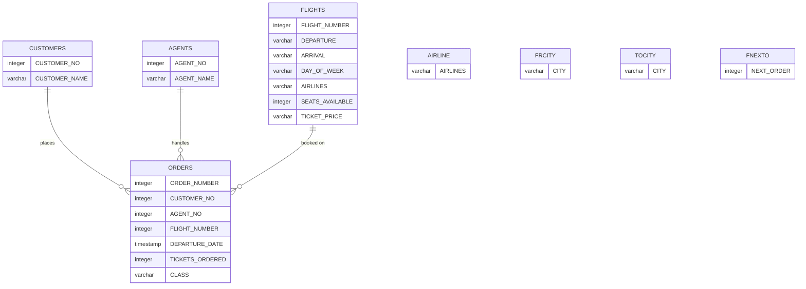

# FLGHT403 — Flight Reservation System: Architecture Overview

> **Source**: Understand scan of libraries `FLGHT403` and `FLGHT400`, last scanned 2026-10-29.
> Both libraries are part of the same application: `FLGHT403` is the development library; `FLGHT400` is the runtime/production deployment target.

---

## 1. High-Level Description

The **Flight Reservation System (FRS)** is an IBM i interactive application built to manage airline reservations. It was originally developed in the late 1990s using OPM RPG/400 and CL, and has been incrementally modernized over time with ILE RPG (free-format RPGLE). The application is entirely menu-driven and 5250-based.

| Dimension | Detail |
|---|---|
| Total programs | 92 (across both libraries, counted once per name) |
| OPM programs | 68 (RPG/400 and OPM CL) |
| ILE programs | 22 (RPGLE + 2 DFU) |
| Display files (DSPF) | 56 |
| Physical files (PF) | 28 |
| Logical files (LF) | 52 |
| No service programs or binding directories | — |
| No foreign keys, no triggers, no journaling on app files | — |

The application runs interactively: the large number of DSPFs (56) confirms it is a 5250 green-screen application. There are no service programs — all reusable logic is shared via direct program calls.

---

## 2. Application Layers

```
+---------------------------------------------------------+
|  MENUS (QMNUSRC)                                        |
|  FRSMANT (Maintenance) | FRSREPT (Reports)              |
|  Entry point via FRS000 (Logon) -> GO FLGHT400/FRSMANT |
+------------------------+--------------------------------+
|  TRANSACTION PROGRAMS  |  MAINTENANCE PROGRAMS         |
|  FRS001 New Order      |  FRS021 Flight Schedule       |
|  FRS002 Update Order   |  FRS022 City Table            |
|  FRS003 Display Order  |  FRS023 Agents Table          |
|  FRS004 Delete Order   |  FRS024 Customer Maintenance  |
|  FRS005 FAX Order      |                               |
|  FRS009 Select Order   |                               |
+------------------------+--------------------------------+
|  SELECTION / SUBFILE HELPERS                            |
|  FRS401 Agent select   | FRS402 From-City subfile      |
|  FRS403 To-City select | FRS404 Flight select          |
|  FRS405 Customer sel.  | FRS407 Order by Date          |
|  FRS408 Customer/Order | FRS412 Airline select         |
|  FRS413 All flights    |                               |
+------------------------+--------------------------------+
|  CONFIRMATION / UTILITY WINDOWS                         |
|  FRS406 Order confirm  | FRS409 Modify confirm         |
|  FRS410 Delete confirm | FRS411 FAX confirm (ILE)      |
+------------------------+--------------------------------+
|  DATE / UTILITY PROGRAMS                                |
|  GTOJCV Julian<-Greg   | JTOGCV Greg<-Julian           |
|  RTDOFW Day-of-Week    | RTRAND Random Number          |
+------------------------+--------------------------------+
|  DATABASE (Db2 for i Physical Files)                    |
|  CUSTOMERS | ORDERS | FLIGHTS | AGENTS                 |
|  FRCITY | TOCITY | AIRLINE | FNEXTO                    |
+---------------------------------------------------------+
```

---

## 3. Main Program Flows

### 3.1 System Entry

`FRS000` (Logon) is the application entry point. It opens a sign-on display, validates the user, and routes to the main menu `FRSMANT` in `FLGHT400`. From the maintenance menu, users navigate to reservation or maintenance functions.

### 3.2 New Order Flow

The most functionally rich flow — `FRS001` has 15 outbound dependencies (8 files, 7 program calls).

```
FRSMANT menu
  └─> FRS001 (New Order entry)
        ├─> FRS402 / FRS403  (select From City / To City)
        ├─> FRS404           (select Flight from filtered list)
        ├─> FRS405           (select Customer)
        ├─> FRS401           (select Agent)
        ├─> RTDOFW           (validate day-of-week)
        ├─> GTOJCV           (date conversion)
        ├─> FRS406           (order confirmation window)
        └─> writes ORDERS PF, updates FNEXTO (next order#)
```

### 3.3 Order Management Flow

`FRS009` (Select Order) is the hub for all post-booking operations. It presents a list of existing orders and dispatches to the relevant sub-program.

```
FRSMANT menu
  └─> FRS009 (Select Order)
        ├─> FRS407           (filter by date)
        ├─> FRS408           (filter by customer)
        ├─> FRS002           (Update Order)
        │     ├─> FRS402–FRS405, FRS401 (re-use selection helpers)
        │     └─> FRS409     (modification confirmation)
        ├─> FRS003           (Display Order — read-only view)
        ├─> FRS004           (Delete Order)
        │     └─> FRS410     (deletion confirmation)
        └─> FRS005           (FAX Order)
              └─> FRS411     (FAX confirmation — ILE)
```

### 3.4 Flight / Data Maintenance Flow

Accessed via `FRSMANT` menu, directly callable programs with no inbound program dependencies:

```
FRSMANT menu
  ├─> FRS021  Flight Schedule Maintenance  (10 outbound deps)
  ├─> FRS022  City Table Maintenance       (8 outbound deps, embedded SQL)
  ├─> FRS023  Agents Table Maintenance     (4 outbound deps)
  └─> FRS024  Customer Name Maintenance    (ILE, 4 outbound deps)
```

### 3.5 Data Build / Setup Flow

Used to populate master files with test data:

```
BLDCST CLP  (Build Customers)
  └─> BCUST RPG  (builds CUSTOMERS file using FNAME, LNAME, RTRAND, RTSEED)

BFLGHT RPG  (Build Flights file)
  └─> uses FRCITY, TOCITY, AIRLINE, FLIGHTS
```

---

## 4. Key Programs and Their Roles

| Program | Type | Role |
|---|---|---|
| `FRS000` | OPM RPG | System logon and entry point — routes to main menu |
| `FRS001` | OPM RPG | **New order entry** — most coupled program (15 deps) |
| `FRS002` | OPM RPG | **Update order** — same scope as FRS001 (15 deps) |
| `FRS003` | ILE RPGLE | Display order (read-only) |
| `FRS004` | ILE RPGLE | Delete order |
| `FRS005` | OPM RPG | FAX order |
| `FRS009` | OPM RPG | **Select/dispatch orders** — hub for all post-booking operations |
| `FRS021` | OPM RPG | Flight schedule maintenance (highest outbound coupling: 10) |
| `FRS022` | OPM RPG | City table maintenance — uses embedded SQL (`CRTSQLRPGI`) |
| `FRS023` | OPM RPG | Agent table maintenance |
| `FRS024` | ILE RPGLE | Customer name maintenance — modernized |
| `FRS401` | ILE RPGLE | Agent selection subfile — modernized |
| `FRS402` | ILE RPGLE | From-city selection subfile — most-depended-on program (6 inbound) |
| `FRS403` | OPM RPG | To-city selection |
| `FRS404` | OPM RPG | Flight selection from filtered list |
| `FRS405` | OPM RPG | Customer selection (5 inbound — shared by new and update flows) |
| `FRS406` | OPM RPG | Order confirmation popup |
| `FRS411` | ILE RPGLE | FAX confirmation window — modernized |
| `FRS412` | ILE RPGLE | Airline selection subfile |
| `GTOJCV` | OPM RPG | Gregorian-to-Julian date conversion (4 inbound) |
| `RTDOFW` | OPM RPG | Day-of-week retrieval (4 inbound) |
| `BFLGHT` | OPM RPG | Populate `FLIGHTS` with test data |
| `BCUST` | OPM RPG | Populate `CUSTOMERS` with test data |

---

## 5. Architecture Diagram

```mermaid
flowchart TD
    subgraph ENTRY["Entry"]
        FRS000["FRS000\nLogon"]
        FRSMANT["FRSMANT\nMain Menu"]
    end

    subgraph RESERVATION["Reservation Management"]
        FRS001["FRS001\nNew Order"]
        FRS009["FRS009\nSelect Order"]
        FRS002["FRS002\nUpdate Order"]
        FRS003["FRS003\nDisplay Order"]
        FRS004["FRS004\nDelete Order"]
        FRS005["FRS005\nFAX Order"]
    end

    subgraph HELPERS["Selection Helpers"]
        FRS402["FRS402\nFrom-City ILE"]
        FRS403["FRS403\nTo-City"]
        FRS404["FRS404\nFlight List"]
        FRS405["FRS405\nCustomer"]
        FRS401["FRS401\nAgent ILE"]
        FRS407["FRS407\nOrder by Date"]
        FRS408["FRS408\nCustomer/Order ILE"]
        FRS412["FRS412\nAirline ILE"]
    end

    subgraph CONFIRM["Confirmation Windows"]
        FRS406["FRS406\nOrder Confirm"]
        FRS409["FRS409\nModify Confirm"]
        FRS410["FRS410\nDelete Confirm"]
        FRS411["FRS411\nFAX Confirm ILE"]
    end

    subgraph MAINTENANCE["Data Maintenance"]
        FRS021["FRS021\nFlight Schedule"]
        FRS022["FRS022\nCity Table SQL"]
        FRS023["FRS023\nAgents"]
        FRS024["FRS024\nCustomers ILE"]
    end

    subgraph UTILS["Utilities"]
        GTOJCV["GTOJCV\nGreg-Julian"]
        RTDOFW["RTDOFW\nDay-of-Week"]
        RTRAND["RTRAND\nRandom"]
    end

    subgraph DB["Database (Db2 for i PFs)"]
        CUSTOMERS[("CUSTOMERS")]
        ORDERS[("ORDERS")]
        FLIGHTS[("FLIGHTS")]
        AGENTS[("AGENTS")]
        FRCITY[("FRCITY\nFrom City")]
        TOCITY[("TOCITY\nTo City")]
        FNEXTO[("FNEXTO\nNext Order#")]
        AIRLINE[("AIRLINE")]
    end

    FRS000 --> FRSMANT
    FRSMANT --> FRS001
    FRSMANT --> FRS009
    FRSMANT --> FRS021
    FRSMANT --> FRS022
    FRSMANT --> FRS023
    FRSMANT --> FRS024

    FRS001 --> FRS402
    FRS001 --> FRS403
    FRS001 --> FRS404
    FRS001 --> FRS405
    FRS001 --> FRS401
    FRS001 --> FRS406
    FRS001 --> GTOJCV
    FRS001 --> RTDOFW

    FRS009 --> FRS002
    FRS009 --> FRS003
    FRS009 --> FRS004
    FRS009 --> FRS005
    FRS009 --> FRS407
    FRS009 --> FRS408

    FRS002 --> FRS402
    FRS002 --> FRS403
    FRS002 --> FRS404
    FRS002 --> FRS405
    FRS002 --> FRS409
    FRS004 --> FRS410
    FRS005 --> FRS411

    FRS001 --> ORDERS
    FRS001 --> FNEXTO
    FRS001 --> FRCITY
    FRS001 --> TOCITY
    FRS002 --> ORDERS
    FRS009 --> ORDERS
    FRS021 --> FLIGHTS
    FRS022 --> FRCITY
    FRS022 --> TOCITY
    FRS023 --> AGENTS
    FRS024 --> CUSTOMERS
```



---

## 6. Database Tables

### Physical Files (PFs) — by dependency count

| PF | Description | Inbound Deps | Key Logical Files |
|---|---|---|---|
| `CUSTOMERS` | Airline customers | 12 | `CUSTNAME` (by name), `CUSTOMER` (by desc. number), `CUSTOMRZ` (zoned for OPM), `CUSTORD` (join w/ORDERS) |
| `FRCITY` | From-city reference table | 11 | — |
| `TOCITY` | To-city reference table | 10 | — |
| `ORDERS` | Airline orders (reservations) | 10 | `ORDERSZ` (zoned for OPM), `ORDDATE` (join by date), `ORDNAME` (join by order#), `CUSTORD` (join by customer) |
| `AGENTS` | Airline agents | 5 | `AGENTSL` (by name), `AGENTSZ` (zoned for OPM) |
| `FLIGHTS` | Flight schedule | 5 | `FLIGHTSL` (by from/to/day), `FLIGHTSZ` (zoned for OPM) |
| `AIRLINE` | Airline validation table | 4 | — |
| `FNEXTO` | Next order number sequence | 3 | — |
| `FNAME` | First names (test data build) | 1 | — |
| `LNAME` | Last names (test data build) | 1 | — |
| `FCITY` | From-city (test data build) | 0 | — |
| `TCITY` | To-city (test data build) | 0 | — |

### Notable Database Observations

- **No foreign keys** — relationships between `ORDERS`, `CUSTOMERS`, `FLIGHTS`, and `AGENTS` are implied by field naming conventions only (`CUSTOMER_NO`, `AGENT_NO`, `FLIGHT_NUMBER`), not enforced at the database level.
- **Binary (B) numeric fields in PFs** — `FLIGHTS`, `ORDERS`, `CUSTOMERS` use binary fields. OPM RPG programs access these via zoned equivalents (`FLIGHTSZ.LF`, `ORDERSZ.LF`, `CUSTOMRZ.LF`). ILE programs access the PFs directly.
- **Variable-length (VARLEN) fields** with `CCSID(37)` in `FLIGHTS` and `ORDERS`.
- **No journaling recorded** on application files within the scanned libraries.
- **`FNEXTO`** acts as a manual sequence generator for order numbers — updated by `FRS001` at each new reservation.

### Entity Relationship (implied)



> Relationships above are inferred from field names — no FK constraints are defined at the database level.

---

## 7. Modernization Signals

| Signal | Count | Notes |
|---|---|---|
| OPM programs | 68 | RPG/400 and OPM CL — primary modernization target |
| ILE programs | 22 | Mostly RPGLE free-format, no service programs |
| Programs with no inbound dependencies | 40 | Includes entry points (menus, logon), data-build utilities, and potential dead code — verify before decommissioning |
| Programs not used in 365+ days | 46 | Many are FLGHT403 dev copies not actively run; FLGHT400 counterparts are active |
| Dynamic SQL | 0 | No dynamic SQL detected |
| Files without journaling | 28 | All application PFs — confirm whether journaled outside scanned libraries |

---

*Generated from Understand scan — FLGHT403 / FLGHT400 — 2026-10-29*
