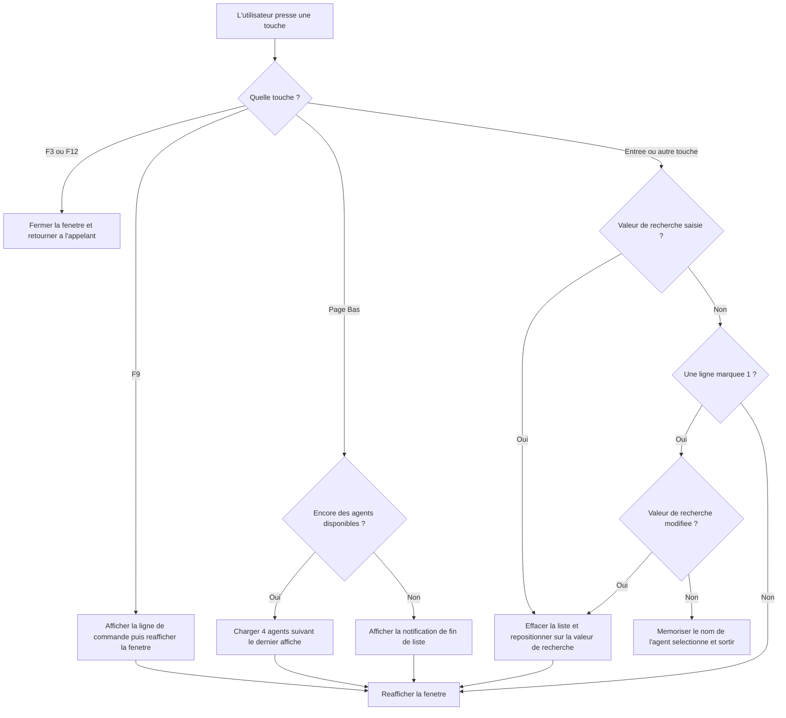
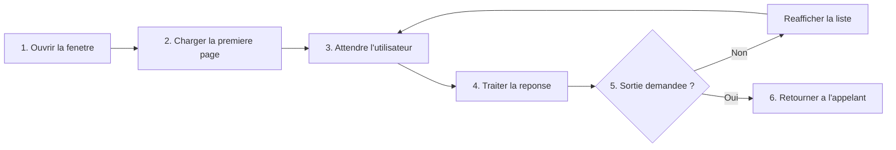

# Rapport d'extraction des règles métier — FRS401-FR

**Programme :** FRS401 (Fenêtre de sélection d'agent)
**Bibliothèque :** FLGHT400
**Source :** QRPGLESRC/FRS401.RPGLE
**Date :** 2026-10-23

---

# 1. Résumé exécutif

FRS401 est une fenêtre contextuelle interactive qui permet à l'utilisateur de choisir un agent dans la liste des agents. Elle affiche les agents (numéro et nom) par ordre alphabétique, quatre par page. L'utilisateur peut avancer dans les pages, sauter à une position en tapant un nom, et choisir un agent en saisissant `1` en face de sa ligne. Lorsqu'un agent est sélectionné, le programme retourne son nom au programme appelant et se ferme. L'utilisateur peut aussi quitter sans choisir, avec F3 (Fin) ou F12 (Annuler). Le comportement documenté indique qu'un annuler retourne un nom d'agent vide.

**Fonctions métier principales**
- Afficher la liste triée et paginée des agents, en commençant aux noms débutant par « A ».
- Permettre à l'utilisateur de rechercher en tapant un nom (« Positionner à ») pour sauter au premier agent dont le nom est égal ou postérieur alphabétiquement.
- Avancer dans la liste et informer l'utilisateur lorsque la fin est atteinte.
- Accepter une sélection et retourner le nom de l'agent choisi à l'appelant.
- Rejeter les saisies invalides dans le champ de sélection.
- Permettre à l'utilisateur d'ouvrir une ligne de commande système avec F9.
- Effacer les anciens messages et en envoyer de nouveaux via la file de messages du programme.

**Contexte métier :** FRS401 est une étape de consultation dans un processus métier plus large, probablement un système de réservations de vols. Il garantit que la transaction appelante reçoit un agent valide issu du fichier des agents. Il ne crée, ne modifie ni ne supprime aucune donnée agent.

---

# 2. Règles métier détaillées

## 2.1 Domaine : Général

### 2.1.1 Catégorie : Processus métier (Cycle de vie de la fenêtre)

#### La fenêtre reste ouverte jusqu'à la sortie ou la sélection
**Catégorie :** Processus métier
**Domaine :** Général

**Description :** La liste des agents est affichée et actualisée après chaque réponse de l'utilisateur. Elle reste ouverte jusqu'à ce que l'utilisateur sélectionne un agent ou choisisse de quitter.

**Conditions de déclenchement :**
- La fenêtre est ouverte et attend l'utilisateur.
- L'utilisateur appuie sur F3 (Fin), F12 (Annuler), ou sélectionne un agent.

**Résultat métier :**
- La fenêtre, la barre de touches de fonction et la zone de messages sont réaffichées après chaque réponse jusqu'à ce qu'une sortie soit demandée.
- Sur F3 ou F12, la fenêtre se ferme et le contrôle retourne à l'appelant.
- Le comportement documenté indique qu'un annuler retourne un nom d'agent vide. La partie du programme qui effectue cela n'était pas disponible pour la revue.

**Données associées :** Nom de l'agent (`AGENTSL.AGNAME`) ; affichage de la liste (`FRS401DF.SFLCTL`)

---

#### Liste d'agents actualisée à chaque ouverture
**Catégorie :** Processus métier
**Domaine :** Général

**Description :** À chaque ouverture de la fenêtre, les anciens messages sont effacés et la liste des agents est vidée puis rechargée depuis le fichier agents, de sorte que l'utilisateur ne voit jamais de données périmées.

**Conditions de déclenchement :**
- Le programme démarre.

**Résultat métier :**
- Les messages précédents sont supprimés.
- La liste est effacée et reconstruite à partir du fichier agents, triée par nom d'agent.
- La liste est positionnée en utilisant la clé nom d'agent.

**Données associées :** `AGENTSL.AGNAME`, `AGENTSL.AGNMBR`, `AGENTS.AGENT_NAME`, `AGENTS.AGENT_NO`

---

#### Position initiale sur les noms commençant par « A »
**Catégorie :** Processus métier
**Domaine :** Général

**Description :** La liste s'ouvre sur le premier agent dont le nom est « A » ou postérieur alphabétiquement. Les alarmes d'erreur et l'indicateur de sortie sont réinitialisés, et les compteurs de lignes sont remis à zéro.

**Conditions de déclenchement :**
- La fenêtre de sélection d'agent s'ouvre.

**Résultat métier :**
- L'utilisateur voit le début de la liste alphabétique.
- Toute alarme d'erreur ou demande de sortie antérieure est effacée.

**Données associées :** `AGENTSL.AGNAME`

---

### 2.1.2 Catégorie : Processus métier (Affichage et navigation dans la liste)

#### Affichage de quatre agents par page
**Catégorie :** Processus métier
**Domaine :** Général

**Description :** La liste est affichée en pages de quatre agents au maximum, triées par nom. Chaque ligne indique le numéro et le nom de l'agent, avec l'option de sélection vide.

**Conditions de déclenchement :**
- Des agents restent à lire dans le fichier agent.
- Une page contient au maximum quatre agents.

**Résultat métier :**
- Jusqu'à quatre agents sont chargés par page.
- Le dernier nom affiché est mémorisé pour la pagination et le repositionnement.
- La liste est masquée si aucun agent n'est trouvé, et affichée dans le cas contraire.
- L'utilisateur est informé de la présence ou non d'autres agents.
- Le mot de passe de l'agent est lu avec l'enregistrement mais n'est jamais affiché.

**Données associées :** `AGENTSL.AGNMBR`, `AGENTSL.AGNAME`, `AGENTS.AGENT_NO`, `AGENTS.AGENT_NAME`

---

#### Avancement uniquement si des agents existent
**Catégorie :** Processus métier
**Domaine :** Général

**Description :** La touche Page Bas ne passe à la page suivante que s'il reste des agents. La page suivante commence strictement après le dernier agent affiché.

**Conditions de déclenchement :**
- L'utilisateur appuie sur Page Bas.

**Résultat métier :**
- S'il reste des agents, quatre autres sont chargés, en commençant après le dernier nom affiché.
- Si la fin est atteinte, l'utilisateur est informé de la fin de liste.
- L'écran définit un message « Touche de défilement non autorisée », probablement lié à la condition de fin de liste, mais cela n'est pas confirmé.

**Données associées :** `AGENTSL.AGNAME`, `FRS401DF.SFLCTL`

---

#### Repositionnement par recherche (« Positionner à »)
**Catégorie :** Processus métier
**Domaine :** Général

**Description :** L'utilisateur peut taper un nom dans le champ « Positionner à » pour sauter au premier agent dont le nom est égal ou postérieur à la saisie. Le champ n'est pas soumis à vérification de casse. La liste est entièrement effacée avant d'être rechargée.

**Conditions de déclenchement :**
- L'utilisateur saisit ou modifie une valeur de recherche.
- Si la valeur de recherche est vide, la liste est repositionnée à partir du dernier nom mémorisé.

**Résultat métier :**
- La liste est vidée et ses compteurs réinitialisés.
- Le fichier agents est positionné sur la valeur de recherche, ou sur le dernier nom affiché en l'absence de recherche.
- Une nouvelle page de quatre agents est chargée.

**Données associées :** `FRS401DF.SEARCH`, `AGENTSL.AGNAME`

---

#### Gestion de la touche Entrée : la recherche a la priorité sur la sélection
**Catégorie :** Décision
**Domaine :** Général

**Description :** Appuyer sur Entrée (ou toute touche autre que les touches de fonction spéciales) est traité comme une recherche ou une sélection. Une valeur de recherche a toujours la priorité. Si la valeur de recherche change pendant l'examen des sélections, la liste est repositionnée et la sélection n'est pas prise en compte.

**Conditions de déclenchement :**
- Champ de recherche non vide : la recherche s'exécute.
- Champ de recherche vide : les lignes de sélection sont examinées.
- Valeur de recherche modifiée pendant le traitement des sélections : le repositionnement l'emporte.

**Résultat métier :**
- L'alarme d'erreur est réinitialisée et les messages précédents sont effacés.
- La liste est repositionnée si une recherche a été utilisée ou modifiée.

**Données associées :** `FRS401DF.SEARCH`, `FRS401DF.SELIO`, `AGENTSL.AGNAME`

---

### 2.1.3 Catégorie : Processus métier (Sélection)

#### Sélection d'un agent par l'option « 1 »
**Catégorie :** Processus métier
**Domaine :** Général

**Description :** L'utilisateur sélectionne un agent en tapant `1` en face de cet agent. Le nom de l'agent est retourné à l'appelant et la fenêtre se ferme.

**Conditions de déclenchement :**
- L'option sur la ligne d'un agent est `1`.

**Résultat métier :**
- Le nom de l'agent sélectionné est mémorisé comme résultat.
- Une sortie de la fenêtre est demandée.
- Seule la première ligne marquée `1` est utilisée. Les lignes suivantes ne sont pas examinées.
- Toute autre valeur d'option est ignorée sans message d'erreur dans la logique du programme. L'écran bloque les valeurs invalides en amont (voir section 3).

**Données associées :** `AGENTSL.AGNAME`, `FRS401DF.SELIO`

---

### 2.1.4 Catégorie : Processus métier (Ligne de commande et messages)

#### Accès à la ligne de commande (F9)
**Catégorie :** Processus métier
**Domaine :** Général

**Description :** F9 ouvre une ligne de commande système depuis la fenêtre de sélection. La barre de touches affichée à l'écran n'indique que F3=Fin, donc F9 est une fonctionnalité cachée.

**Conditions de déclenchement :**
- L'utilisateur appuie sur F9.

**Résultat métier :**
- Une ligne de commande est affichée.
- La fenêtre de sélection d'agent est ensuite réaffichée.

**Données associées :** `FRS401DF.SEARCH`

---

#### Effacement et envoi de messages
**Catégorie :** Processus métier
**Domaine :** Général

**Description :** Les messages de programme précédents sont effacés avant chaque traitement de sélection. Le programme peut également envoyer un message identifié, avec un texte optionnel, à l'utilisateur via sa file de messages. Cette capacité d'envoi est marquée « pour usage futur », et aucun message métier n'est défini dans le code analysé.

**Conditions de déclenchement :**
- Un traitement de sélection démarre (effacement).
- Un message d'information ou d'erreur doit être communiqué (envoi).

**Résultat métier :**
- Tous les messages de programme précédents sont supprimés.
- Un message avec un identifiant et des données optionnelles (vides par défaut) peut être envoyé.

**Données associées :** File de messages du programme ; fichier de messages `FRSMSGF`

---

## 2.2 Tableau récapitulatif

| Règle | Déclencheur | Résultat | Données associées |
|-------|-------------|----------|-------------------|
| Fenêtre ouverte jusqu'à sortie ou sélection | Fenêtre ouverte ; F3 ou F12 | Fenêtre réaffichée jusqu'à sortie ; puis retour à l'appelant | Affichage de la liste agents |
| Liste actualisée à l'ouverture | Démarrage du programme | Messages effacés ; liste effacée et rechargée | Fichier agents |
| Position initiale sur « A » | Ouverture de la fenêtre | Liste commençant au premier nom >= « A » | Nom de l'agent |
| Affichage de quatre agents par page | Des agents restent à lire | Jusqu'à 4 agents affichés ; liste masquée si aucun | Numéro agent, nom agent |
| Avancement de page | Page Bas | 4 agents suivants, ou notification de fin de liste | Nom de l'agent |
| Repositionnement par recherche | Valeur de recherche saisie ou modifiée | Liste effacée et rechargée depuis la valeur de recherche | Champ de recherche, nom de l'agent |
| Priorité de la recherche sur Entrée | Appui sur Entrée | Recherche en premier ; sinon traitement des sélections | Champ de recherche, champ option |
| Sélection d'agent avec « 1 » | Option `1` sur une ligne | Nom retourné ; fenêtre fermée | Nom de l'agent, champ option |
| Ligne de commande | F9 | Ligne de commande affichée, puis fenêtre réaffichée | Aucune |
| Effacement et envoi de messages | Démarrage d'une sélection ; message nécessaire | Messages effacés ; message envoyable | File de messages |

---

# 3. Validations et exceptions

## 3.1 Validation de la qualité des données

| Validation | Règle | Réponse | Impact métier |
|------------|-------|---------|---------------|
| ✅ Valeur du champ option de sélection | Le champ option en face d'un agent accepte uniquement vide (pas de sélection) ou `1` (sélectionner). | Toute autre valeur est rejetée avec le message FRS0028 du fichier de messages. L'utilisateur doit corriger la saisie. | Empêche les choix invalides ou ambigus d'atteindre la logique de sélection. |

Cette validation est appliquée par la définition de l'écran, non par la logique du programme.

## 3.2 Exceptions métier et réponses système

| Situation | Réponse système | Impact métier |
|-----------|-----------------|---------------|
| ⚠️ Aucun agent trouvé | La liste est masquée. | L'utilisateur voit une fenêtre vide et aucun agent ne peut être sélectionné. |
| ⚠️ Fin de liste atteinte lors de Page Bas | L'utilisateur est informé de la fin de liste. Un message « Touche de défilement non autorisée » est défini à l'écran. | L'utilisateur sait qu'il n'existe pas d'autres agents. |
| ⚠️ Valeur de recherche modifiée pendant une sélection | Le repositionnement a la priorité et la sélection n'est pas prise en compte. | L'utilisateur doit ressaisir la sélection après actualisation de la liste. |
| ⚠️ Plusieurs lignes marquées `1` | Seule la première est utilisée. | L'utilisateur obtient le premier agent marqué sans avertissement concernant les autres. |
| ⚠️ Valeurs d'option non supportées | Ignorées par la logique du programme, sans message. En pratique, l'écran les bloque en premier. | Aucun impact si la validation écran est active. |
| ✅ Annuler ou Quitter (F3, F12) | La fenêtre se ferme. Le comportement documenté indique qu'un nom d'agent vide est retourné en cas d'annuler. | L'appelant doit traiter un nom vide comme « aucun agent sélectionné ». |

## 3.3 Messages d'erreur

| Message | Signification | Quand affiché |
|---------|---------------|---------------|
| FRS0028 | Option de sélection invalide (seuls vide ou `1` sont autorisés) | L'utilisateur tape toute autre valeur d'option. |
| « Touche de défilement non autorisée » | Défilement non autorisé | Probablement en fin de liste (non confirmé). |

---

# 4. Règles de calcul

FRS401 n'effectue aucun calcul financier ou arithmétique. Il dérive quelques valeurs qui contrôlent le positionnement et la pagination.

| Calcul | Formule | Entrées | Résultat | Justification |
|--------|---------|---------|----------|---------------|
| Position initiale de la liste | Démarrer au premier agent dont le nom est « A » ou postérieur | Valeur de départ fixe « A » ; noms d'agents | Point de départ de la liste | Donne une vue alphabétique prévisible dès l'ouverture. |
| Taille de page | Charger les agents un par un jusqu'à ce que 4 soient chargés ou que le fichier se termine | Fichier agents ; limite de 4 par page | Une page d'au plus 4 agents | Maintient la fenêtre contextuelle petite et lisible. |
| Clé de repositionnement | Si une valeur de recherche existe, l'utiliser. Sinon utiliser le dernier nom d'agent affiché. | Champ de recherche ; dernier nom mémorisé | Position dans le fichier agents | Permet à une recherche de sauter n'importe où. Une recherche vide conserve la position de l'utilisateur. |
| Début de la page suivante | Commencer strictement après le dernier nom d'agent affiché | Dernier nom affiché | Premier agent de la page suivante | Évite de répéter le dernier agent à la page suivante. |
| Indicateur « autres agents » | Basé sur l'atteinte ou non de la fin du fichier agents | État du fichier agents | Indicateur de présence ou absence de données supplémentaires | Informe l'utilisateur de l'utilité du défilement vers l'avant. |

---

# 5. Logique de décision

## 5.1 Décisions principales de la fenêtre

| Point de décision | Conditions évaluées | Résultats possibles | Impact métier |
|-------------------|---------------------|---------------------|---------------|
| Que faire après la réponse de l'utilisateur | Quelle touche a été pressée | F3 ou F12 ferme la fenêtre. F9 ouvre une ligne de commande. Page Bas avance d'une page. Toute autre touche est traitée comme Entrée. | Contrôle la navigation. |
| Recherche ou sélection sur Entrée | Si une valeur de recherche est saisie | Recherche saisie : repositionner la liste. Vide : traiter les sélections. | La recherche a toujours la priorité. |
| Page suivante ou fin de liste | Si la fin du fichier agents est atteinte | Plus d'agents : charger les quatre suivants. Sinon : afficher une notification de fin de liste. | Empêche de dépasser les données. |
| Afficher ou masquer la liste | Si des agents ont été chargés | Au moins un : afficher la liste. Aucun : la masquer. | Évite d'afficher une liste vide. |
| Source de repositionnement | Si le champ de recherche est vide | Non vide : utiliser la valeur de recherche. Vide : utiliser le dernier nom affiché. | Conserve la position de l'utilisateur en l'absence de nouvelle recherche. |
| Agent sélectionné | Si l'option est `1` | `1` : mémoriser le nom et sortir. Sinon : ignorer. | Retourne le choix à l'appelant. |

---

# 6. Règles d'intégrité des données

FRS401 accède uniquement en lecture. Aucune mise à jour, suppression ou contrainte appliquée par la base de données n'apparaît dans les règles analysées.

| Règle | Description | Raison métier |
|-------|-------------|---------------|
| 📝 Tri et clé des agents | Les agents sont accédés via une vue triée et indexée par nom d'agent. | Donne aux utilisateurs une liste alphabétique prévisible et rend les recherches par nom possibles. |
| 📝 Valeurs de sélection autorisées | Le champ de sélection accepte uniquement vide ou `1`, appliqué par la définition de l'écran. | Empêche les saisies invalides avant qu'elles n'atteignent le programme. |
| 📝 Accès en lecture seule | Le numéro, le nom et le mot de passe de l'agent sont lus, mais rien n'est modifié. | Les données du fichier agents ne peuvent pas être altérées via cette fenêtre. |
| 📝 Protection du mot de passe | Le mot de passe de l'agent est lu avec l'enregistrement mais n'est jamais affiché. | Évite d'exposer des informations sensibles. |
| 📝 État de liste actualisé | La liste est effacée avant chaque rechargement et les compteurs réinitialisés. | Empêche les lignes dupliquées ou périmées. |
| 📝 Pagination cohérente | Le dernier nom affiché est mémorisé et la page suivante commence strictement après lui. | Maintient une pagination continue sans répétition d'agents. |

Aucune limite de transaction ni scénario de rollback n'est présent, car aucune donnée n'est écrite.

---

# 7. Flux du processus métier

1. **Ouvrir la fenêtre**
   - Le programme démarre et efface les messages et alarmes précédents.
   - Il réinitialise l'indicateur de sortie et les compteurs.
   - Il positionne le fichier agents sur le premier nom à partir de « A ».

2. **Charger et afficher la liste des agents**
   - Jusqu'à quatre agents sont chargés, avec numéro et nom affichés et l'option vide.
   - La liste est masquée si aucun agent n'est trouvé.
   - L'utilisateur est informé de la présence ou non d'autres agents.

3. **Attendre l'utilisateur**
   - La fenêtre, la barre de touches de fonction et la zone de messages sont affichées.
   - L'utilisateur peut taper un nom de recherche, saisir `1` en face d'un agent, avancer d'une page, appuyer sur F9, ou quitter avec F3 ou F12.

4. **Traiter la réponse**
   - F3 ou F12 demande la sortie. Un annuler est documenté pour retourner un nom d'agent vide.
   - F9 affiche une ligne de commande.
   - Page Bas charge la page suivante ou affiche une notification de fin de liste.
   - Entrée traite la recherche en premier. En l'absence de recherche, elle traite la sélection.
   - Les valeurs d'option invalides sont rejetées par l'écran avec le message FRS0028.

5. **Résultat de la sélection**
   - La première ligne marquée `1` détermine l'agent choisi.
   - Le nom de l'agent est mémorisé comme résultat et une sortie est demandée.

6. **Retour à l'appelant**
   - La fenêtre se ferme et l'appelant reçoit le nom de l'agent sélectionné, ou un vide en cas d'annuler (selon le comportement documenté).

**Points d'intégration**
- Fichier agents (vue alphabétique et fichier maître).
- Définition de l'écran de la fenêtre, avec son message de validation.
- Fichier de messages `FRSMSGF` pour le message FRS0028.
- File de messages du programme et services de gestion des messages.
- Ligne de commande système, accessible via F9.
- Le programme appelant, qui reçoit le nom de l'agent.

---

# 8. Hypothèses et remarques

## 8.1 Règles explicites (certaines)
- ✅ Le champ de sélection accepte uniquement vide ou `1` ; d'autres valeurs déclenchent le message FRS0028. Appliqué par la définition de l'écran.
- ✅ La liste s'ouvre positionnée sur les noms à partir de « A ».
- ✅ Les pages contiennent au maximum quatre agents, triés par nom.
- ✅ Page Bas charge la page suivante uniquement si la fin du fichier n'est pas atteinte, en commençant strictement après le dernier agent affiché.
- ✅ Une valeur de recherche repositionne la liste sur le premier nom égal ou postérieur à la saisie. Une recherche vide utilise le dernier nom affiché.
- ✅ La recherche a la priorité sur la sélection lors de l'appui sur Entrée.
- ✅ L'option `1` mémorise le nom de l'agent, demande la sortie et arrête l'examen des autres lignes.
- ✅ Les autres valeurs d'option sont ignorées sans message d'erreur dans la logique du programme.

## 8.2 Règles inférées
- 🔄 L'effacement et le rechargement de la liste au démarrage, ainsi que l'effacement et l'envoi de messages, sont inférés des noms des procédures et de la clé du fichier logique, car les corps de ces procédures n'ont pas été entièrement analysés.
- 🔄 F9 affiche une ligne de commande puis réaffiche la fenêtre. Inféré du nom de la procédure appelée.
- 🔄 Page Bas est probablement la cause du message « Touche de défilement non autorisée » en fin de liste. Non confirmé.
- 🔄 La fenêtre est un service de consultation appelé par un autre programme.

## 8.3 Hypothèses
- Le programme appelant traite un nom retourné vide comme « aucune sélection ».
- Les utilisateurs sont supposés connaître F9 même si la barre de touches ne l'affiche pas.
- Quatre agents par page est la taille de fenêtre prévue.

## 8.4 Ambiguïtés nécessitant une clarification métier
- ⚠️ **Comportement d'annuler :** La documentation indique qu'un annuler retourne un nom vide. Le code qui effectue cela n'a pas été vu, et la logique de sélection ne définit le nom que lors de l'option `1`. Confirmer qu'un vide est bien retourné après F3 ou F12.
- ⚠️ **Indicateur de fin de liste :** Après le chargement de la page, un enregistrement agent supplémentaire est lu pour tester la présence d'autres données. Cela peut sauter un agent lors de la pagination, bien que le positionnement après le dernier nom affiché semble compenser. L'effet exact sur l'indicateur « données disponibles » reste ambigu.
- ⚠️ **Ligne de commande F9 cachée :** Confirmer si donner à tous les utilisateurs accès à une ligne de commande est intentionnel, et si la touche doit être affichée ou restreinte.
- ⚠️ **Options invalides ignorées :** La logique du programme ignore silencieusement les options invalides, tandis que l'écran les rejette. Confirmer que la validation écran est toujours active.
- ⚠️ **Sélections multiples :** Seule la première ligne marquée `1` est utilisée. Confirmer que les autres sont bien ignorées sans avertissement.
- ⚠️ **Démarrage fixe à « A » :** Confirmer que démarrer à « A » est souhaité, et ce qui doit se passer si aucun nom d'agent ne commence à partir de « A ».
- ⚠️ **Sensibilité à la casse :** Le champ de recherche n'est pas soumis à une vérification de casse. Confirmer si les saisies en minuscules doivent correspondre aux noms en majuscules.

## 8.5 Limitations techniques nécessitant une revue métier
- La taille de page de quatre est une limite fixe, ce qui peut être insuffisant pour une grande population d'agents.
- La pagination est possible vers l'avant uniquement. Aucune règle de défilement vers l'arrière n'a été identifiée.
- L'envoi de messages est marqué « pour usage futur », donc aucun message métier n'est actuellement défini au-delà de FRS0028 et la notification de fin de liste.
- Le mot de passe de l'agent est lu avec chaque enregistrement même s'il n'est pas affiché. Il est recommandé de vérifier s'il est nécessaire de le récupérer.
- Certaines procédures (effacement, chargement, gestion des messages) ont été décrites à partir de leurs noms et de la logique environnante. Une revue complète est recommandée avant de s'appuyer sur ces règles à des fins de conformité.
