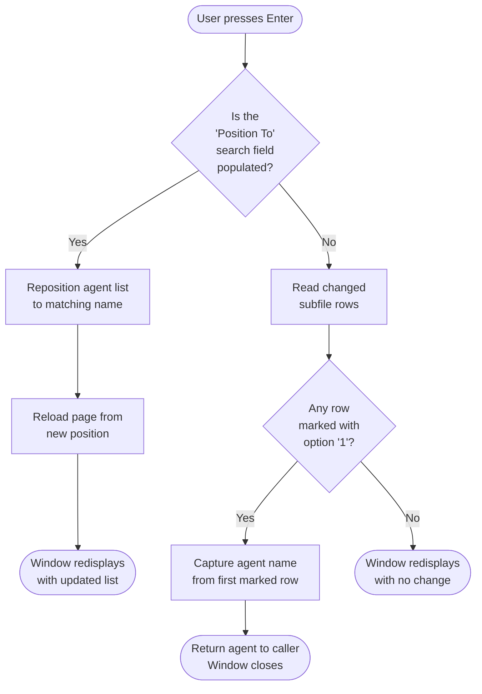
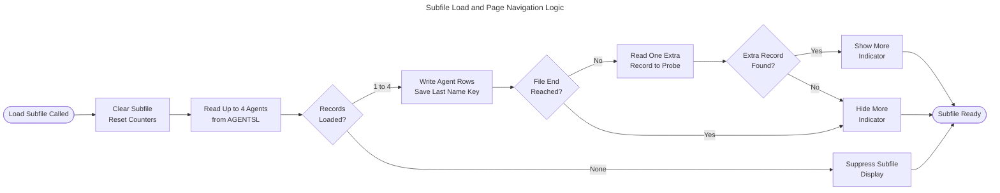
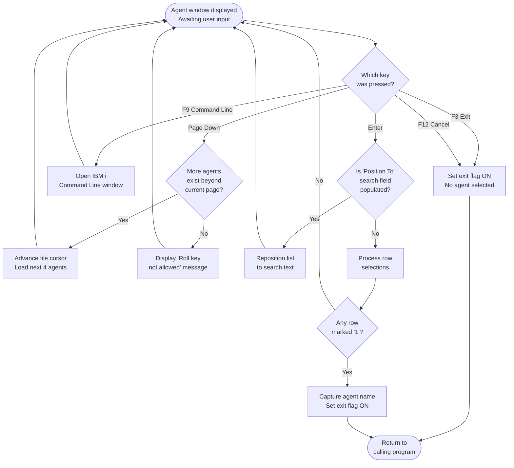
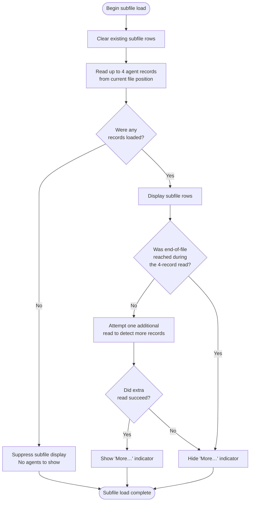
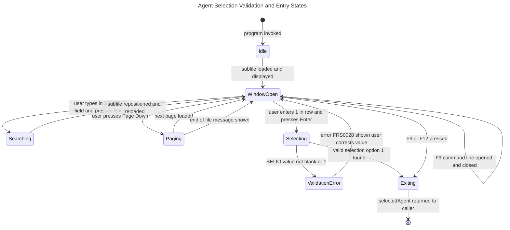
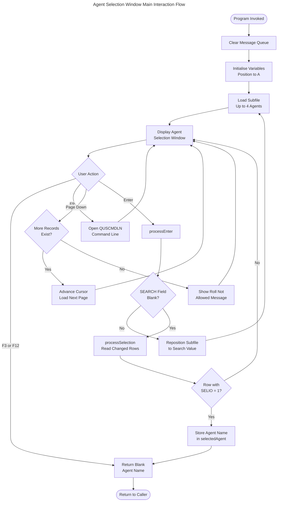

# FRS401 — Agent Selection Window

## Business Rules Report

---

# 1. Executive Summary

**Program Name:** FRS401 — Agent Selection Window

**Business Purpose:**
FRS401 is a reusable agent lookup and selection utility that presents users with a searchable, pageable list of agents. It is invoked by other programs within the application whenever a user must identify and choose an agent. The program accepts no pre-selected agent as input; instead, it opens an interactive window, allows the user to browse or search for the correct agent, and then returns the chosen agent's name to the calling program. If the user exits without selecting, a blank value is returned, allowing the caller to handle the "no selection" scenario appropriately.

**Key Business Functions:**
FRS401 provides four core capabilities. First, it displays a paginated, alphabetically ordered agent list — showing up to four agents per page — that the user can scroll through using the Page Down key. Second, it enables positional searching, allowing users to type a partial or full agent name to jump directly to the relevant section of the list. Third, it enforces a strict single-selection model: a user selects an agent by placing an option code of `1` next to the desired row, and the first such selection is immediately returned to the caller. Fourth, it provides clean session management by clearing stale messages at startup and validating the selection field in real time.

**Overall Business Context:**
This program functions as a shared service component — a popup agent picker — embedded within the broader application's workflow. Whenever an upstream process (such as order entry, reporting, or account management) requires an agent to be identified, it calls FRS401 to present the agent window. The result — an agent name — flows back to the calling process to drive downstream logic. FRS401 does not create, modify, or delete agent records; it is a read-only selection interface backed by the agent master file.

---

# 2. Detailed Business Rules

## 2.1 Program Startup and Display

### Agent Selection Window Initialization
**Category:** Business Process
**Domain:** General

**Description:** When FRS401 is called, it prepares a clean environment and displays the agent selection window. The program clears any leftover messages from previous sessions, resets the list to the beginning of the alphabet, loads the first page of agents, and waits for the user to act.

**Trigger Conditions:**
- The program is invoked by a calling program that requires an agent to be selected

**Business Outcome:**
- A window opens displaying an alphabetically ordered list of agents, ready for user interaction
- The calling program waits until the user either selects an agent or cancels

**Related Data:** `AGENTSL.AGNAME`, `AGENTSL.AGNMBR`

---

### Default Starting Position
**Category:** Business Process
**Domain:** General

**Description:** On first display, the agent list is automatically positioned to agents whose names begin with the letter **"A"**, ensuring the user sees the beginning of the alphabetical list without needing to scroll back.

**Trigger Conditions:**
- Program is loading for the first time (not as a result of a search or page action)

**Business Outcome:**
- The first page displays agents starting from "A" onwards
- All internal page counters and position markers are reset to zero

**Related Data:** `AGENTSL.AGNAME`

---

### Message Queue Cleanup
**Category:** Business Process
**Domain:** General

**Description:** Before the agent window is shown, any error or informational messages left over from a previous interaction are automatically removed. This prevents outdated messages from confusing users during a fresh session.

**Trigger Conditions:**
- Program begins a new processing cycle

**Business Outcome:**
- The message area at the bottom of the screen is blank when the window opens
- Users see only messages relevant to their current interaction

---

## 2.2 Navigation and Search

### Alphabetical Search / Position To
**Category:** Business Process
**Domain:** General

**Description:** Users can jump to a specific section of the agent list by typing a partial or full agent name into the **"Position To"** field. The list immediately repositions to the first agent whose name is alphabetically greater than or equal to the text entered.

**Trigger Conditions:**
- User types text into the "Position To" search field and presses Enter

**Business Outcome:**
- The subfile is refreshed and displays agents starting from the closest matching name
- If the search field is left blank and Enter is pressed, the system processes any row selections instead (see Section 2.4)

**Related Data:** `FRS401DF.SFLCTL.SEARCH`, `AGENTSL.AGNAME`

---

### Page Down Navigation
**Category:** Business Process
**Domain:** General

**Description:** Users navigate through the agent list one page at a time using the Page Down key. Each page shows up to four agents. Paging is only permitted when more agents exist beyond the current page.

**Trigger Conditions:**
- User presses Page Down while the agent list is displayed

**Business Outcome:**
- If more agents exist: the next group of up to four agents is loaded and displayed
- If the end of the list has been reached: a **"Roll key not allowed"** message is displayed and no page change occurs

**Related Data:** `AGENTSL.AGNAME`, `AGENTSL.AGNMBR`

---

### More Records Indicator
**Category:** Business Process
**Domain:** General

**Description:** The system automatically detects whether additional agents exist beyond the currently displayed page. When more records are available, a **"More…"** indicator is shown on screen; when the last page is displayed, the indicator is removed.

**Trigger Conditions:**
- Each time the agent list is loaded or refreshed

**Business Outcome:**
- Users have a clear, accurate visual signal of whether paging is possible
- The indicator is suppressed only when the very last available agent record is on screen

**Related Data:** `AGENTSL.AGNAME`

---

## 2.3 Exit Options

The table below summarises the ways a user can leave the agent selection window:

| Action | Key Pressed | Outcome | Agent Returned to Caller |
|---|---|---|---|
| Exit the window | F3 | Window closes immediately | Blank (no selection) |
| Cancel the window | F12 | Window closes immediately | Blank (no selection) |
| Access system command line | F9 | IBM i command line opens temporarily; agent window redisplays on close | No change |
| Select an agent | Enter (with option 1) | Agent name captured and window closes | Selected agent name |
| Search / reposition | Enter (with search text) | List repositions; window remains open | No change yet |

---

## 2.4 Agent Selection

### Selecting an Agent by Option Code
**Category:** Business Process
**Domain:** General

**Description:** To select an agent, the user enters the value **"1"** in the option column to the left of the desired agent row and presses Enter. The program reads through the changed rows, identifies the first row marked with "1", captures that agent's name, and returns it to the calling program. The window then closes automatically.

**Trigger Conditions:**
- User presses Enter while the search field is blank
- At least one row has been marked with option "1"

**Business Outcome:**
- The selected agent's name is passed back to the calling program
- The agent selection window closes
- Processing control returns to the caller

**Related Data:** `AGENTSL.AGNAME`, `AGENTSL.AGNMBR`, `FRS401DF.SFL.SELIO`

---

### Enter Key Behaviour — Search vs. Selection
**Category:** Decision
**Domain:** General

**Description:** Pressing Enter triggers different behaviour depending on whether the search field contains text. The system evaluates the search field first and routes the action accordingly.

---

# 3. Validations and Exceptions

## 3.1 Selection Option Field Validation

| Validation | Field | Allowed Values | Invalid Entry Response |
|---|---|---|---|
| Selection option must be blank or "1" | Option column (`SELIO`) | Blank (no action) or `1` (select) | Error message **FRS0028** is displayed; user must correct before proceeding |

**Business Impact:** Prevents users from entering meaningless or erroneous option codes. The field-level check fires immediately when the user moves off the field, before any processing takes place. The user cannot proceed until the value is corrected or cleared.

---

## 3.2 Page Boundary Validation

| Validation | Trigger | Response |
|---|---|---|
| No more records to page | User presses Page Down at end of list | **"Roll key not allowed"** message is displayed on screen; list does not change |

**Business Impact:** Prevents a confusing or misleading navigation experience. Users receive immediate, clear feedback that they have reached the last page of agents.

---

## 3.3 No-Selection Exit

| Scenario | Result |
|---|---|
| User presses F3 or F12 without selecting an agent | Blank agent name is returned to the caller |

**Business Impact:** The calling program receives a blank value and is responsible for handling the case where no agent was chosen (e.g., aborting the current transaction or prompting again).

---

## 3.4 Error Message Infrastructure

The program uses a centralised message-sending mechanism that:
- Requires a valid **7-character message identifier** (sourced from message file `FRSMSGF` in library `FLGHT400`)
- Optionally accepts up to **80 characters of substitution data** to personalise the message text
- Sends messages to the program's own message queue for display at the bottom of the screen
- Clears all existing messages before each new interaction cycle to prevent stale messages from misleading users

---

# 4. Calculation Rules

FRS401 is a selection and navigation program; it does not perform financial, statistical, or derived-value calculations. The table below documents the positional and counting logic that drives list behaviour:

| Calculation | Purpose | Formula | Inputs | Output |
|---|---|---|---|---|
| **Page Size** | Limits records per page to maintain window readability | Fixed constant of 4 records per load cycle | Sequential file reads, capped at 4 | Up to 4 agent rows displayed per page |
| **Reposition Key (Search)** | Determines file start position when user searches | First agent name ≥ search text entered by user | `SEARCH` field value | File cursor position |
| **Reposition Key (Blank Search)** | Determines file start position when re-entering from blank search | Last agent name from the previously displayed page | `endKey.name` (last loaded agent name) | File cursor position |
| **More Records Detection** | Determines whether a "More…" indicator should appear | After loading up to 4 records, attempt one additional read; if successful, more records exist | End-of-file status after extra read | "More…" indicator on/off |
| **Page Forward Position** | Advances the file cursor to the correct starting point for the next page | Position to record immediately after the last agent name on the current page (greater-than key) | `endKey.name` (last visible agent) | Starting point for next page load |

---

# 5. Decision Logic

#### ---

## 5.1 Function Key Routing

When the agent window is displayed, the program evaluates which key the user pressed and routes processing accordingly:

---

## 5.2 Subfile Load Decision

Each time the agent list is loaded, the program decides whether to show or hide the list and the "More…" indicator:

---

# 6. Data Integrity Rules

## 6.1 Agent Master File — Unique Agent Number

| Rule | File | Field | Constraint | Business Rationale |
|---|---|---|---|---|
| Each agent must have a unique identifier | `AGENTS` (physical file) | `AGENT_NO` | Unique key — duplicate values are rejected by the system | Prevents two different agents from sharing the same agent number, which would cause ambiguity in any downstream process that references agents by number |

**Business Impact:** This constraint is enforced at the database level, meaning no application program — including FRS401 — can accidentally create or allow duplicate agent records. Any attempt to store a second record with an existing agent number is automatically rejected.

---

## 6.2 Agent Logical File — Alphabetical Access Path

| Rule | File | Key Field | Purpose |
|---|---|---|---|
| Agents are accessed in alphabetical name order | `AGENTSL` (logical file over `AGENTS`) | `AGNAME` | Supports the alphabetical display, search, and positional navigation features of the selection window |

**Business Impact:** The logical file ensures that all browsing and searching operations return agents in a predictable, user-friendly order. Without this access path, "Position To" searching and consistent page-by-page navigation would not be possible.

---

## 6.3 Selection Field Constraint

| Rule | Screen Field | Allowed Values | Enforcement Point |
|---|---|---|---|
| Option field accepts only blank or "1" | `SELIO` | Blank, `1` | Display file field-level validation (before program logic runs) |

**Business Impact:** Invalid option codes are caught at the earliest possible point — at field entry — before any server-side processing is triggered. This reduces unnecessary round-trips and prevents corrupted selection state.

---

## 6.4 Read-Only Access Model

FRS401 opens the agent files in **input-only mode**. The program reads agent records but does not insert, update, or delete any data. This means:
- ✅ Agent data is never modified by the selection window
- ✅ The program can run concurrently without locking agent records
- ✅ Data integrity of the agent master file is fully protected during selection activity

---

# 7. Business Process Flow

#### ---

#### ---

## Overview

FRS401 executes as a modal selection window called from within another business process. The complete interaction follows these steps:

---

**1. Program Called by an Upstream Process**
- A calling program (e.g., order entry or account management) invokes FRS401, passing a placeholder for the agent name to be returned.
- FRS401 takes full control of the user's screen session until a selection is made or cancelled.

---

**2. Environment Preparation**
- All messages from previous sessions are cleared from the program message queue.
- Internal counters, flags, and position markers are reset to their starting values.
- The agent file cursor is positioned to the first agent name beginning with "A".

---

**3. Initial Page Load**
- Up to four agents are read from the agent logical file (`AGENTSL`) starting from "A".
- The system checks whether additional agents exist beyond this first page and sets the "More…" indicator accordingly.
- The agent selection window is displayed to the user.

---

**4. User Interaction Loop**
The program enters a continuous interaction loop, repeating until the user exits or makes a selection:

| User Action | System Response | Loop Continues? |
|---|---|---|
| Presses F3 | Exit flag set; blank agent returned | ❌ No — exits |
| Presses F12 | Exit flag set; blank agent returned | ❌ No — exits |
| Presses F9 | IBM i command line shown; window redisplays after close | ✅ Yes |
| Presses Page Down (more records exist) | Next page of agents loaded | ✅ Yes |
| Presses Page Down (at end of list) | "Roll key not allowed" message shown | ✅ Yes |
| Types in search field, presses Enter | List repositions to matching agent name | ✅ Yes |
| Presses Enter (blank search, no "1" marked) | No change; window redisplays | ✅ Yes |
| Presses Enter (blank search, "1" on a row) | Agent captured; exit flag set | ❌ No — exits |

---

**5. Agent Selection**
- When the user marks a row with option `1` and presses Enter (with a blank search field):
  - The program reads through all changed rows sequentially.
  - The first row marked with `1` is treated as the selection.
  - The agent name from that row is stored in the output parameter.
  - The exit flag is set, ending the interaction loop.

---

**6. Return to Calling Program**
- The interaction loop ends.
- Control and the selected agent name (or blank, if cancelled) are returned to the calling program.
- The calling program is responsible for all subsequent business logic based on the returned value.

---

**Integration Points:**

| External Component | Role |
|---|---|
| Calling business program | Invokes FRS401; receives selected agent name on return |
| `AGENTS` physical file | Master source of agent records (read-only) |
| `AGENTSL` logical file | Alphabetical access path used for display and searching |
| `FRSMSGF` message file (library `FLGHT400`) | Source of all user-facing error and informational messages |
| IBM i `QMHRMVPM` system API | Clears program message queue at startup |
| IBM i `QUSCMDLN` system program | Presents the system command line when F9 is pressed |

---

# 8. Assumptions and Notes

## ✅ Explicit Rules (Confirmed in Code)

| Rule | Basis |
|---|---|
| Page size is exactly 4 records | Hard-coded loop limit in `loadSubfile` |
| F3 and F12 both return a blank agent name | Both keys set the same exit flag with no agent captured |
| `SELIO` field only accepts blank or "1" | Display file `VALUES` constraint with message `FRS0028` |
| Agent number (`AGENT_NO`) must be unique | `UNIQUE` keyword on the `AGENTS` physical file |
| Default starting position is "A" | Hard-coded `startKey = 'A'` in `initialize` |
| F9 opens `QUSCMDLN` | Explicit external program call |
| Message file is `FRSMSGF` in library `FLGHT400` | Declared in the message-sending procedure |
| Program is read-only with respect to agent data | No write, update, or delete operations are present |

---

## 🔄 Inferred Rules (Deduced from Code Patterns)

| Inferred Rule | Reasoning |
|---|---|
| FRS401 is always called as a subprogram, never run standalone | It accepts an output parameter for the selected agent; standalone execution would return a blank with no useful result |
| Only the **first** row marked with "1" is processed | The selection loop exits immediately after finding the first "1"; subsequent marked rows are ignored |
| The "Position To" search performs a **prefix / starts-with** match | The file is repositioned using a greater-than-or-equal key set (`SETLL`) on agent name, not an exact match |
| Blank search field on Enter means "process selections, not search" | The branching logic explicitly checks for blank vs. non-blank search before deciding action |
| The calling program handles the blank-return case | FRS401 makes no distinction between F3 and F12; both return blank — the caller must decide how to respond |

---

## ⚠️ Assumptions Made During Analysis

| Assumption | Notes |
|---|---|
| `AGENTSL` is a logical file built over `AGENTS`, keyed by agent name | Consistent with the separate physical file (`AGENTS`, keyed by `AGENT_NO`) and the logical file used for display (`AGENTSL`, keyed by `AGNAME`) |
| The application library is `FLGHT400` | Referenced explicitly in the message file path; assumed to be the production library |
| "Agent name" returned to the caller is the agent's display name (`AGNAME`), not the agent number | Confirmed by the `selectedAgent = OAGNTN` assignment, where `OAGNTN` is the name field |

---

## 📝 Ambiguities Requiring Business Stakeholder Clarification

| Question | Impact |
|---|---|
| **What happens when multiple rows are marked with "1"?** | Only the first is processed; remaining selections are silently ignored. Is this the intended behaviour, or should the user be warned? |
| **Is there a maximum number of agents in the system?** | With 4 records per page, a large agent base could require many page-down actions. Is a larger page size or direct-search feature needed? |
| **What does the calling program do with a blank return value?** | FRS401 returns blank for both F3 and F12 exits. If the caller needs to distinguish between "user cancelled" and "user pressed exit", the current design does not support that differentiation. |
| **Is the "A" default start position a business requirement or a technical convenience?** | If the most frequently selected agents start with letters other than "A", a different default (e.g., the most recently selected agent) might improve usability. |
| **Are agents ever inactive or disabled?** | FRS401 displays all records from `AGENTSL` with no status filter. If inactive agents exist in the file, they would appear in the selection list. |