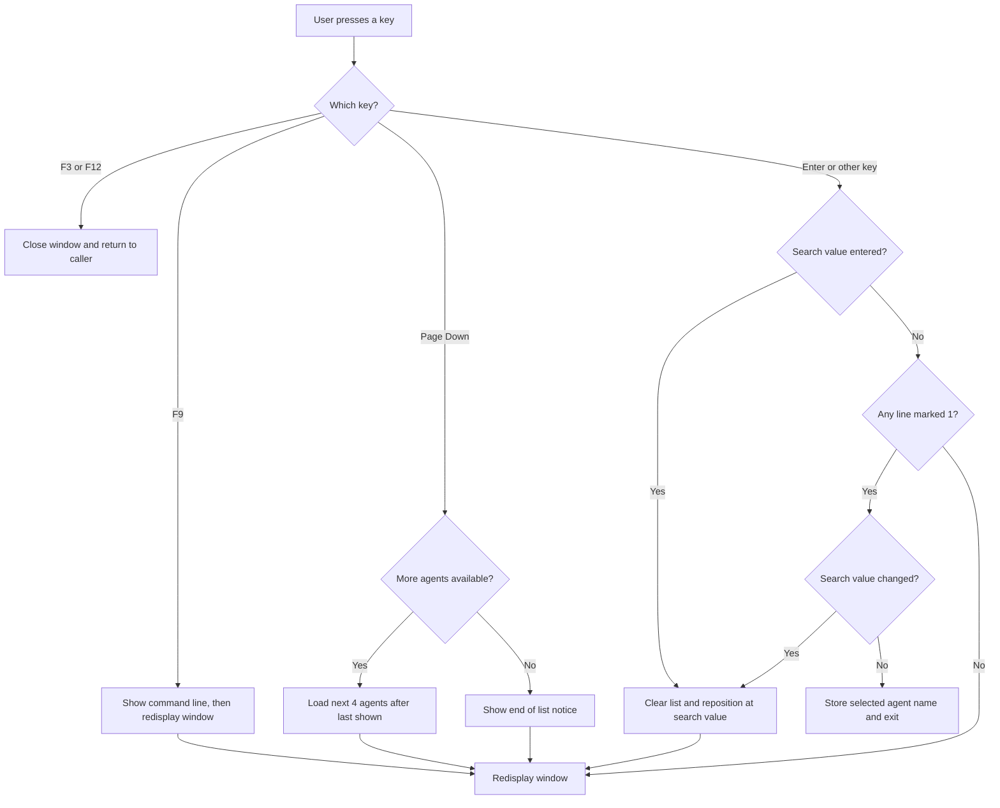
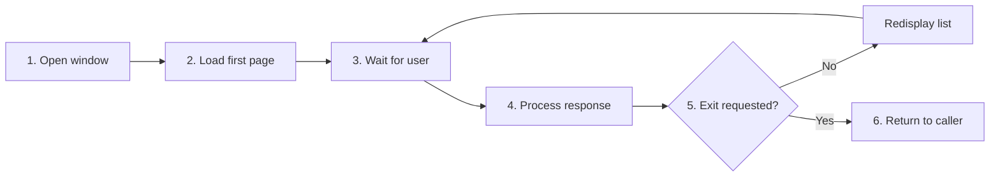
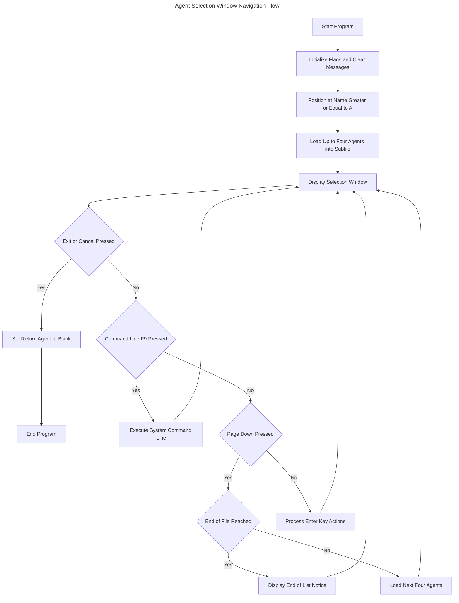
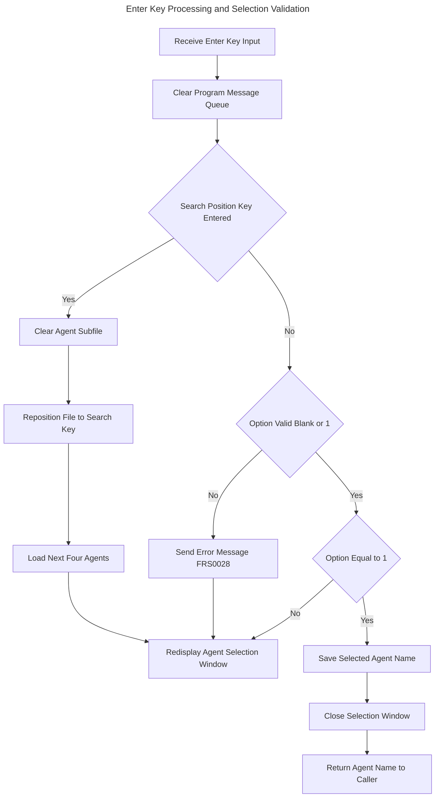

# 1. Executive Summary

**Program:** FRS401 (Agent Selection Window)

FRS401 is an interactive pop-up window that lets a user pick one agent from the agent master list. It shows the agents (number and name) in alphabetical order by name, four to a page. The user can page forward, jump to a position by typing a name, and choose an agent by entering `1` next to it. When an agent is chosen, the program returns that agent's name to the calling program and closes. The user can also leave without choosing, with F3 (Exit) or F12 (Cancel). The documented behavior is that a cancel returns a blank agent name.

**Key business functions**
- Display a sorted, paged list of agents, starting at names beginning with "A".
- Let the user search by typing a name ("Position To") to jump to the first agent whose name is equal to or later in the alphabet.
- Page forward through the list and tell the user when the end is reached.
- Accept a selection and return the chosen agent's name to the caller.
- Reject invalid entries in the selection field.
- Let the user open a system command line with F9.
- Clear old messages and send new ones through the program's message queue.

**Business context:** FRS401 is a supporting lookup step in a larger business process, probably a flight or reservation system. It makes sure the calling transaction receives a valid agent from the agent file. It does not create, change or delete agent data.

---

# 2. Detailed Business Rules

## 2.1 Domain: General

### 2.1.1 Category: Business Process (Window Lifecycle)

### Agent Window Stays Open Until the User Exits or Selects
**Category:** Business Process
**Domain:** General

**Description:** The agent list is shown repeatedly and refreshed after each user response. It stays open until the user selects an agent or chooses to leave.

**Trigger Conditions:**
- The window is open and waiting for the user.
- The user presses F3 (Exit) or F12 (Cancel), or selects an agent.

**Business Outcome:**
- The window, function key bar and message area are redisplayed after every response until an exit is requested.
- On F3 or F12 the window closes and control returns to the caller.
- The documented behavior is that a cancel returns a blank agent name. The part of the program that does this was not available for review.

**Related Data:** Agent name (`AGENTSL.AGNAME`); agent list display (`FRS401DF.SFLCTL`)

### Fresh Agent List on Every Opening
**Category:** Business Process
**Domain:** General

**Description:** Each time the window opens, old messages are cleared and the agent list is emptied and reloaded from the agent file, so the user never sees stale data.

**Trigger Conditions:**
- The program starts.

**Business Outcome:**
- Previous messages are removed.
- The list is cleared and rebuilt from the agent file, ordered by agent name.
- The list is positioned using the agent name key.

**Related Data:** `AGENTSL.AGNAME`, `AGENTSL.AGNMBR`, `AGENTS.AGENT_NAME`, `AGENTS.AGENT_NO`

### Initial Starting Position at Names Beginning with "A"
**Category:** Business Process
**Domain:** General

**Description:** The list opens at the first agent whose name is "A" or later alphabetically. Error alarms and the exit flag are reset, and line counters are zeroed.

**Trigger Conditions:**
- The agent selection window opens.

**Business Outcome:**
- The user sees the start of the alphabetical list.
- Any earlier error alarm or exit request is cleared.

**Related Data:** `AGENTSL.AGNAME`

### 2.1.2 Category: Business Process (List Display and Navigation)

### Four-Agent Page Display
**Category:** Business Process
**Domain:** General

**Description:** The list is shown in pages of at most four agents, sorted by name. Each line shows the agent number and name, with the selection option blank.

**Trigger Conditions:**
- Agents remain to be read from the agent file.
- A page holds no more than four agents.

**Business Outcome:**
- Up to four agents are loaded per page.
- The last name shown is remembered for paging and repositioning.
- The list is hidden if no agents are found, and shown otherwise.
- The user is told whether more agents remain.
- The agent password is read with the agent record but is never displayed.

**Related Data:** `AGENTSL.AGNMBR`, `AGENTSL.AGNAME`, `AGENTS.AGENT_NO`, `AGENTS.AGENT_NAME`

### Page Forward Only When More Agents Exist
**Category:** Business Process
**Domain:** General

**Description:** Page Down moves to the next page only if agents remain. The next page starts strictly after the last agent shown.

**Trigger Conditions:**
- The user presses Page Down.

**Business Outcome:**
- If more agents exist, four more are loaded, starting after the last name displayed.
- If the end has been reached, the user is told the end of the list is reached.
- The screen definition has a "Roll key not allowed" message. It is likely tied to the end-of-list condition, but this is unconfirmed.

**Related Data:** `AGENTSL.AGNAME`, `FRS401DF.SFLCTL`

### Search ("Position To") Repositioning
**Category:** Business Process
**Domain:** General

**Description:** The user can type a name in the "Position To" field to jump to the first agent whose name is equal to or later than the entry. The field is not case-checked. The list is fully cleared before it is reloaded.

**Trigger Conditions:**
- The user enters or changes a search value.
- If the search value is blank, the list is repositioned from the last name remembered.

**Business Outcome:**
- The list is emptied and its counters reset.
- The agent file is positioned at the search value, or at the last displayed name if no search is given.
- A new page of four agents is loaded.

**Related Data:** `FRS401DF.SEARCH`, `AGENTSL.AGNAME`

### Enter Key Handling: Search Takes Priority Over Selection
**Category:** Decision
**Domain:** General

**Description:** Pressing Enter (or any key other than the special function keys) is treated as a search or a selection. A search value always takes priority. If the search value changes while selections are being examined, the list is repositioned and the selection is not acted on.

**Trigger Conditions:**
- Search field is not blank: search runs.
- Search field is blank: selection lines are examined.
- Search value changed during selection processing: repositioning wins.

**Business Outcome:**
- The error alarm is reset and previous messages are cleared.
- The list is repositioned if a search was used or changed.

**Related Data:** `FRS401DF.SEARCH`, `FRS401DF.SELIO`, `AGENTSL.AGNAME`

### 2.1.3 Category: Business Process (Selection)

### Agent Selection by Option "1"
**Category:** Business Process
**Domain:** General

**Description:** The user selects an agent by typing `1` next to that agent. The agent's name is returned to the caller and the window closes.

**Trigger Conditions:**
- The option on an agent line is `1`.

**Business Outcome:**
- The selected agent's name is stored as the result.
- An exit from the window is requested.
- Only the first line marked `1` is used. Remaining lines are not examined.
- Any other option value is ignored without an error message in the program logic. The display file blocks invalid values earlier (see Section 3).

**Related Data:** `AGENTSL.AGNAME`, `FRS401DF.SELIO`

### 2.1.4 Category: Business Process (Command Line and Messages)

### Command Line Access (F9)
**Category:** Business Process
**Domain:** General

**Description:** F9 opens a system command line from the selection window. The on-screen key bar advertises only F3=Exit, so F9 is effectively a hidden feature.

**Trigger Conditions:**
- The user presses F9.

**Business Outcome:**
- A command line is shown.
- Afterwards, the agent selection window is shown again.

**Related Data:** `FRS401DF.SEARCH`

### Message Clearing and Sending
**Category:** Business Process
**Domain:** General

**Description:** Earlier program messages are cleared before each selection is processed. The program can also send an identified message, with optional text, to the user through its message queue. This sending capability is marked "for future use", and no business message is defined in the reviewed code.

**Trigger Conditions:**
- A selection process starts (clearing).
- An information or error message must be communicated (sending).

**Business Outcome:**
- All previous program messages are removed.
- A message with an ID and optional data (empty by default) can be sent.

**Related Data:** Program message queue; message file `FRSMSGF`

## 2.2 Summary Table

| Rule Name | Trigger | Outcome | Related Data |
|-----------|---------|---------|--------------|
| Window stays open until exit or selection | Window open; F3 or F12 pressed | Window redisplayed until exit; then control returns to the caller | Agent list display |
| Fresh agent list on opening | Program starts | Messages cleared; list cleared and reloaded | Agent file |
| Initial position at "A" | Window opens | List starts at first name >= "A" | Agent name |
| Four-agent page display | Agents remain to be read | Up to 4 agents shown; list hidden if none | Agent number, agent name |
| Page forward | Page Down | Next 4 agents, or an end-of-list notice | Agent name |
| Search repositioning | Search value entered or changed | List cleared and reloaded from the search value | Search field, agent name |
| Search takes priority on Enter | Enter pressed | Search first; otherwise selections processed | Search field, option field |
| Select agent with "1" | Option `1` on a line | Name returned; window closes | Agent name, option field |
| Command line | F9 | Command line shown, then window redisplayed | None |
| Message clear and send | Selection starts; message needed | Messages cleared; message can be sent | Message queue |

---

# 3. Validations and Exceptions

## 3.1 Data Quality Validation

| Validation | Rule | Response | Business Impact |
|------------|------|----------|-----------------|
| ✅ Selection option value | The option field next to an agent accepts only blank (no selection) or `1` (select). | Any other value is rejected with message FRS0028 from the message file. The user must correct the entry. | Prevents invalid or ambiguous choices from reaching the selection logic. |

This validation is enforced by the screen definition, not by the program logic.

## 3.2 Business Exceptions and System Responses

| Situation | System Response | Business Impact |
|-----------|-----------------|-----------------|
| ⚠️ No agents found | The list is hidden. | The user sees an empty window and no agent can be selected. |
| ⚠️ End of list reached on Page Down | The user is informed the end of the list is reached. A "Roll key not allowed" message is defined on the screen. | The user knows no further agents exist. |
| ⚠️ Search value changes during selection | Repositioning takes priority and the selection is not acted on. | The user must re-enter the selection after the list refreshes. |
| ⚠️ Multiple lines marked `1` | Only the first is used. | The user gets the first marked agent and no warning about the others. |
| ⚠️ Unsupported option values | Ignored by the program logic, with no message. In practice the screen blocks them first. | No impact when the screen validation is active. |
| ✅ Cancel or Exit (F3, F12) | The window closes. The documented behavior is that a blank agent name is returned on cancel. | The caller must treat a blank name as "no agent selected". |

## 3.3 Error Messages

| Message | Meaning | When Shown |
|---------|---------|------------|
| FRS0028 | Invalid selection option (only blank or `1` allowed) | The user types any other option value. |
| "Roll key not allowed" | Paging not permitted | Probably at the end of the list (unconfirmed). |

---

# 4. Calculation Rules

FRS401 performs no financial or arithmetic calculations. It derives a few values that control positioning and paging.

| Calculation | Formula | Inputs | Output | Rationale |
|-------------|---------|--------|--------|-----------|
| Initial list position | Start at the first agent whose name is "A" or later | Fixed starting value "A"; agent names | Starting point of the list | Gives a predictable alphabetical starting view. |
| Page size | Load agents one by one until 4 are loaded or the file ends | Agent file; page limit of 4 | One page of up to 4 agents | Keeps the pop-up window small and readable. |
| Repositioning key | If a search value exists, use it. Otherwise use the last displayed agent name. | Search field; remembered last name | Position in the agent file | Lets a search jump anywhere. A blank search keeps the user's place. |
| Next page start | Begin strictly after the last displayed agent name | Last displayed name | First agent of the next page | Avoids repeating the last agent on the next page. |
| "More agents" indicator | Based on whether the end of the agent file has been reached | Agent file status | Indicator that more data exists or not | Tells the user whether paging forward is useful. |

---

# 5. Decision Logic

## 5.1 Main Window Decisions

| Decision Point | Conditions Evaluated | Possible Outcomes | Business Impact |
|----------------|----------------------|-------------------|-----------------|
| What to do after the user responds | Which key was pressed | F3 or F12 closes the window. F9 opens a command line. Page Down pages forward. Any other key is treated as Enter. | Controls navigation. |
| Search or selection on Enter | Whether a search value is entered | Search entered: reposition the list. Blank: process selections. | Search always takes priority. |
| Next page or end of list | Whether the end of the agent file has been reached | More agents: load the next four. Otherwise: show an end-of-list notice. | Prevents paging past the data. |
| Show or hide the list | Whether any agents were loaded | At least one: show the list. None: hide it. | Avoids showing an empty list. |
| Reposition source | Whether the search field is blank | Not blank: use the search value. Blank: use the last displayed name. | Keeps the user's place when there is no new search. |
| Agent selected | Whether the option is `1` | `1`: store the name and exit. Otherwise: ignore. | Returns the choice to the caller. |

---

# 6. Data Integrity Rules

FRS401 only reads data. No updates, deletions or database-enforced constraints appear in the reviewed rules.

| Rule | Description | Business Reason |
|------|-------------|-----------------|
| 📝 Agent ordering and key | Agents are accessed through a view keyed and sorted by agent name. | Gives users a predictable alphabetical list and makes name searches possible. |
| 📝 Allowed selection values | The selection field accepts only blank or `1`, enforced by the screen definition. | Prevents invalid input before it reaches the program. |
| 📝 Read-only access | Agent number, name and password are read, but nothing is changed. | The agent master data cannot be altered through this window. |
| 📝 Password protection | The agent password is read with the agent record but never displayed. | Avoids exposing sensitive information. |
| 📝 Fresh list state | The list is cleared before every reload and counters are reset. | Prevents duplicate or stale lines. |
| 📝 Consistent paging | The last displayed name is remembered and the next page starts strictly after it. | Keeps paging continuous without repeating agents. |

There are no explicit transaction boundaries or rollback scenarios, because no data is written.

---

# 7. Business Process Flow

1. **Open the Window**
   - The program starts and clears previous messages and alarms.
   - It resets the exit flag and counters.
   - It positions the agent file at the first name from "A" onward.

2. **Load and Display the Agent List**
   - Up to four agents are loaded, with number and name shown and the option blank.
   - The list is hidden if no agents are found.
   - The user is told whether more agents remain.

3. **Wait for the User**
   - The window, function key bar and message area are shown.
   - The user can type a search name, enter `1` next to an agent, page down, press F9, or leave with F3 or F12.

4. **Process the Response**
   - F3 or F12 requests exit. A cancel is documented to return a blank agent name.
   - F9 shows a command line.
   - Page Down loads the next page or shows an end-of-list notice.
   - Enter handles a search first. If there is no search, it handles the selection.
   - Invalid option values are rejected by the screen with FRS0028.

5. **Selection Outcome**
   - The first line marked `1` determines the chosen agent.
   - The agent name is stored as the result and an exit is requested.

6. **Return to the Caller**
   - The window closes and the caller receives the selected agent name, or a blank on cancel (per the documented behavior).

**Integration points**
- Agent file (alphabetical view and master file).
- Screen definition for the window, with its validation message.
- Message file `FRSMSGF` for message FRS0028.
- Program message queue and message handling services.
- System command line facility, reached through F9.
- The calling program, which receives the agent name.

---

#### ---

#### ---

# 8. Assumptions and Notes

## 8.1 Explicit Rules (Certain)
- ✅ The selection field accepts only blank or `1`; other values raise message FRS0028. This is enforced by the screen definition.
- ✅ The list opens positioned at names from "A" onward.
- ✅ Pages hold a maximum of four agents, sorted by name.
- ✅ Page Down loads the next page only if the end of the file has not been reached, starting strictly after the last displayed agent.
- ✅ A search value repositions the list at the first name equal to or later than the entry. A blank search uses the last displayed name.
- ✅ Search takes priority over selection on Enter.
- ✅ Option `1` stores the agent name, requests exit, and stops examining further lines.
- ✅ Other option values are ignored without an error message in the program logic.

## 8.2 Inferred Rules
- 🔄 Clearing and reloading the list on startup, and the clearing and sending of messages, are inferred from procedure names and the file key, because those procedure bodies were not fully reviewed.
- 🔄 F9 shows a command line and then redisplays the window. This is inferred from the procedure call name.
- 🔄 Page Down is probably the cause of the "Roll key not allowed" message at the end of the list. This is not confirmed.
- 🔄 The window is a lookup service called by another program.

## 8.3 Assumptions
- The calling program treats a blank returned name as "no selection".
- Users are expected to know about F9 even though the key bar does not show it.
- Four agents per page is the intended window size.

## 8.4 Ambiguities Requiring Business Clarification
- ⚠️ **Cancel behavior:** The documentation says a cancel returns a blank name. The code that does this was not seen, and the selection logic only sets the name when option `1` is used. Confirm that a blank is returned after F3 or F12.
- ⚠️ **End-of-list indicator:** After the page load, one extra agent record is read to test for more data. This may skip an agent during paging, although positioning after the last shown name appears to compensate. The effect on the "more data" indicator is unclear.
- ⚠️ **Hidden F9 command line:** Confirm whether giving all users a command line is intended, and whether the key should be advertised or restricted.
- ⚠️ **Ignored invalid options:** The program logic ignores invalid options silently, while the screen rejects them. Confirm the screen validation is always active.
- ⚠️ **Multiple selections:** Only the first line marked `1` is used. Confirm that silently ignoring the rest is acceptable.
- ⚠️ **Fixed start at "A":** Confirm that starting at "A" is desired, and what should happen if no agent names fall at or after "A".
- ⚠️ **Case sensitivity:** The search field is not case-checked. Confirm whether lowercase entries should match uppercase names.

## 8.5 Technical Limitations Needing Business Review
- The page size of four is a fixed limit, which may be small for large agent populations.
- Paging goes forward only. No backward paging rule was identified.
- Message sending is marked "for future use", so no business messages are currently defined beyond FRS0028 and the end-of-list notice.
- The agent password is read with each record even though it is not displayed. Consider whether it needs to be retrieved at all.
- Some procedures (such as the sub-routines for clearing, loading and message handling) were described from their names and surrounding logic. A full review is recommended before relying on these rules for compliance purposes.