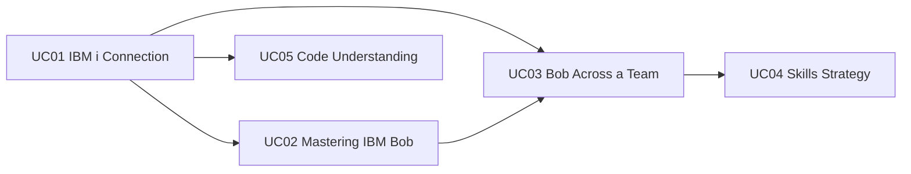

# UC 01 — Connecting Bob to IBM i and Optional Third-Party MCPs

> **Category:** Using Bob
>
> **Phase:** Phase 0 — Onboarding (absolute physical prerequisite for all other UCs)
>
> **Estimated duration:** 30 to 60 minutes (IBM i connection) + variable depending on IT token availability (third-party MCPs)
>
> **Bob modes used:** IBM i Developer, IBM i Database

---

## ⭐ IBM i Premium Package used

The IBM i connection is **native to the IBM i Premium Package**: it is configured once, then used by the IBM i Developer and IBM i Database modes:

| Capability | Mechanism | Role in this UC |
|---|---|---|
| **IBM i Developer mode** | Built-in native tools (list: UC00 §5.1) | Full access to source members, libraries, compilation — no `mcp.json` required |
| **IBM i Database mode** | Built-in native tools (list: UC00 §5.1) | Db2 SQL execution, `QSYS2` views — no `mcp.json` required |

> No Premium workflow, slash command or skill is required for this UC (see UC00 §6). Workspaces (Local, Library List, IFS Working Directory), IBM i tools, documentation search (RAG) and guardrails: see UC00 §0 and §5.

> The connection is configured **once** in the Code for IBM i extension settings. Once active, all IBM i modes (Developer, Database) use this connection automatically.

> Third-party MCPs (JIRA, Confluence) remain optional and are configured separately in `~/.bob/settings/mcp.json`.

**Official documentation:** [Bob for IBM i — Workspaces](https://bob.ibm.com/docs/ide/premium-packages/bob-for-i/workspaces)

---

## Objective

Establish the connection between Bob and the test IBM i, and optionally configure third-party MCPs (JIRA, Confluence) for teams that have them available. Without this connection, Bob cannot access source members, Db2 for i, or QSYS libraries — all IBM i UCs (UC02 to UC19) are unusable.

## Prerequisites

- **Phase:** Phase 0 — Onboarding
- **Required preceding UCs:** None — this is the absolute starting point
- **Required deliverables:** None
- **Recommended Bob level:** Beginner
- **Estimated Bob Coins:** ● ○ ○ (configuration, no code generation)
- **Required materials:**
  - Test IBM i accessible via SSH (TechZone or client LPAR)
  - IBM i user profile with `*USE` / `*CHANGE` rights on source libraries
  - SSH private key (recommended) or IBM i password
  - Code for IBM i extension installed in VS Code / Bob IDE

## Concrete example — FLGHT400 Lab

Once the connection was established on the FLGHT403 instance, the `/init` command (see UC02) automatically produced:

- [`../labs_FLGHT400_results/FLGHT403_init_report.md`](../labs_FLGHT400_results/FLGHT403_init_report.md) — full report: 122 source members read via the IBM i Developer native tools, ILE architecture documented, cross-library dependencies detected (`FLGHT400/FRSMSGF`)
- [`../labs_FLGHT400_results/FLGHT403_AGENTS.md`](../labs_FLGHT400_results/FLGHT403_AGENTS.md) — AGENTS.md generated in `FLGHT403/QBOBSRC/AGENTS.MD` — all of this without any `mcp.json`

**What this connection unlocks:** the native tools `read_member`, `execute_sql_statement`, `execute_cl_command` are active as soon as the Code for IBM i connection is configured and the Premium Package is activated.

---

## 1. IBM i connection architecture

```
Bob (IBM i Developer / IBM i Database modes)
        │
        │  Native Premium tools
        │  (read_member, execute_sql, execute_cl…)
        ▼
Code for IBM i Extension
        │
        │  SSH (port 22) + private key
        ▼
IBM i LPAR (QSYS, Db2 for i, IFS)
```

**No `mcp.json` file is needed for the IBM i connection.** The Code for IBM i extension acts as the bridge — once the native connection is configured, the IBM i Developer and IBM i Database modes use it automatically.

---

## Prompts

### Prompt 0 — Verify connection prerequisites

**Objective:** ensure the workstation environment is ready before configuration.

**When to use:** before any configuration, Day 1 of the POC.

**Workspace:** Local (developer workstation terminal)

**Prompt:**

```
Before configuring the IBM i connection in Bob, help me verify the following
prerequisites on my workstation:

1. The "Code for IBM i" extension is installed in VS Code
   → ID: `HalcyonTechLtd.code-for-ibmi`
   → Check in Extensions (Ctrl+Shift+X)

2. IBM i profile {IBMI_USER} is operational
   → Required rights: *USE and *CHANGE on source libraries ({appId})
   → DO NOT use an *ALLOBJ profile for Bob — create a dedicated POC profile

3. SSH connection to {IBMI_HOST} (port 22) is accessible from this workstation
   → Test: `ssh {IBMI_USER}@{IBMI_HOST} "WRKUSRJOB"`

4. The SSH private key is available (recommended over a password)
   → Usual location: `~/.ssh/id_rsa` or `~/.ssh/id_ed25519`

Return a validation table (✅ OK / ⚠️ To check / ❌ Blocking) for each point,
with corrective actions where needed.
Save the result in bob-reports/{appId}-connexion-prereqs-{YYYYMMDD-HHmm}.md
```

**Workspace:** Local
**Produced deliverable:** `bob-reports/{appId}-connexion-prereqs-{YYYYMMDD-HHmm}.md`

---

### Prompt 1 — Configure the connection in Code for IBM i

**Objective:** create and validate the IBM i connection in the Code for IBM i extension.

**When to use:** after validating prerequisites.

**Workspace:** Local (VS Code interface)

**Configuration steps (performed in the VS Code interface):**

> ⚠️ **IBM i (IBMers — TechZone):** the TechZone connection requires the **IBM VPN** to reach the LPAR. Make sure the VPN is active before configuring.

**Method 1 — from the IBM i Premium Package welcome page:**
1. Open the **IBM i** icon in the VS Code left sidebar
2. Click **"Connect to an IBM i"** (blue button at the top of the welcome page)
3. The **IBM i Login** window opens with the following fields:
   - **Connection Name:** free-form name (e.g. `Flight 4nn Demo`, `ACME-DEV`)
   - **Host or IP Address:** `{IBMI_HOST}` (IP or hostname of the LPAR)
   - **Port (SSH):** `22` (default value — do not change unless there is an exception)
   - **Username:** `{IBMI_USER}` (e.g. `ITZUSER` for TechZone)
   - **Password:** leave empty if a private key is used
   - **Private Key:** click **"Select File"** → select the private key file (OpenSSH, RFC4716 or PPK formats)
   - **Key Passphrase:** enter the passphrase if the key is protected
4. Click **Save** then **Connect** (▶ to the right of the connection in the tree)

**Method 2 — from the SERVERS tree:**
1. In the **SERVERS** section (bottom of the IBM i panel), click **"+"** to the right of "SERVERS"
2. Fill in the same fields as above
3. The connection appears in the list with the ✗ icon (disconnected) → click ▶ to connect

**Expected result:** the connection changes from ✗ to ✓ in the SERVERS tree and the server name displays `{IBMI_USER}@{IBMI_HOST}`.

**Validation prompt after connection:**

```
My IBM i connection is configured in Code for IBM i.
I am in IBM i Developer mode, IBM i Libraries workspace.

Run these 3 validation tests:

Test 1 — Read source member:
List the first 5 members in {appId}/QRPGSRC with their type.

Test 2 — SQL execution:
Execute: SELECT TABLE_NAME, TABLE_TYPE FROM QSYS2.SYSTABLES WHERE TABLE_SCHEMA = '{appId}' FETCH FIRST 5 ROWS ONLY

Test 3 — CL command:
Execute: DSPOBJD OBJ({appId}/*ALL) OBJTYPE(*PGM)
(list of compiled programs in the library)

If all 3 tests succeed, return a confirmation with the results.
Save the validation report in bob-reports/{appId}-connexion-validation-{YYYYMMDD-HHmm}.md
```

**Workspace:** IBM i QSYS
**Produced deliverable:** `bob-reports/{appId}-connexion-validation-{YYYYMMDD-HHmm}.md`

---

### Prompt 2 — Configure optional third-party MCPs (JIRA, Confluence)

**Objective:** add JIRA and/or Confluence as supplementary tools accessible to Bob.

**When to use:** only when API tokens are available — optional for the IBM i POC.

**Workspace:** Local

> ⚠️ **Action to take at kick-off:** JIRA/Confluence API tokens often have the longest provisioning delays. Submit the request to the IT team at the start of Phase 0, even if the configuration is deferred.

> ⚠️ **Unified rule for secrets and third-party MCP management:**
> 1. **Referenced environment variables / secrets (`${env:VARIABLE_NAME}`)**: in a shared/versioned `mcp.json` (e.g., `.bob/mcp.json`), reference tokens using the `${env:JIRA_API_TOKEN}` / `${env:CONFLUENCE_API_TOKEN}` syntax. No token is stored in plain text in the file. The Bob documentation recommends environment variables but does not document the `${env:…}` syntax: **to be validated until the functional test has succeeded** (see below).
>
> **Functional test (on the target installation):** define the variable on the workstation, restart Bob, check that the MCP initializes without an authentication error, then read a test JIRA ticket / Confluence page. Until this test has succeeded, the point remains "to be validated".
>
> 2. **Plain-text stored tokens**: if `~/.bob/settings/mcp.json` contains real token values, this file is strictly personal and must **never be versioned or committed to Git**.
> 3. **Secrets in a prompt (prohibited)**: never pass real tokens or passwords in plain text within a prompt. Define environment variables locally or use `/manage-secrets set <KEY> <VALUE>`.
>
> Third-party MCPs do not replace the native IBM i connection in any way (which requires no `mcp.json`).

**Prompt:**

```
I want to add JIRA and/or Confluence MCP servers to Bob.
These MCPs will allow me to read JIRA tickets from the chat
and publish documentation to Confluence.

Configuration parameters (without plain-text tokens):
- JIRA: URL={JIRA_URL}, email={JIRA_EMAIL}, token referenced via ${env:JIRA_API_TOKEN}
- Confluence: URL={CONFLUENCE_URL}, email={CONFLUENCE_EMAIL}, token referenced via ${env:CONFLUENCE_API_TOKEN}

Create or update the MCP configuration file (`~/.bob/settings/mcp.json` for personal
non-versioned use, or `.bob/mcp.json` for team sharing) with these servers.

⚠️ Secrets management rule:
- Reference tokens using the `${env:VARIABLE_NAME}` syntax (or configure via `/manage-secrets set`)
- A file containing plain-text tokens must NEVER be committed to Git
- NEVER pass real tokens in plain text in a prompt

⚠️ Verify npm package names on bob.ibm.com before use
— they may change between versions.

After configuration, provide the command to store secrets (/manage-secrets set ...)
and suggest a validation prompt for each activated MCP.
```

**Workspace:** Local
**Produced deliverable:** `~/.bob/settings/mcp.json` (not versioned)

---

## Symptoms of a misconfigured connection

| Symptom | Likely cause | Fix |
|---|---|---|
| Bob responds "I don't have access to source members" in IBM i Developer mode | Code for IBM i connection inactive or no active library | Check connection status in Code for IBM i, activate a library |
| "IBM i Libraries" workspace does not appear in Bob | Code for IBM i extension not installed or not connected | Install `HalcyonTechLtd.code-for-ibmi`, connect |
| `/init` finds no members | Wrong active library in the Library List | Add `{appId}` to the Code for IBM i Library List |
| Bob can read but not write | `*USE` rights only — `*CHANGE` missing | Request `*CHANGE` rights on source libraries |
| SSH `Permission denied` error | Private key not recognized | Check the key path in Code for IBM i Settings, add the public key to `~/.ssh/authorized_keys` on IBM i |
| JIRA MCP "connection refused" | Expired token or incorrect URL | Regenerate the token in JIRA → API tokens |

---

## Deliverables of this UC

| File produced | Naming pattern | Consumed by |
|---|---|---|
| Prerequisites report | `bob-reports/{appId}-connexion-prereqs-{YYYYMMDD-HHmm}.md` | Technical team |
| Connection validation report | `bob-reports/{appId}-connexion-validation-{YYYYMMDD-HHmm}.md` | UC02 to UC19 |

> `~/.bob/settings/mcp.json` is a personal configuration file — not versioned, not included in the deliverables.

## Dependencies



---

## UC 01 Validation Checklist

Before moving to UC02, verify each point:

- [ ] The Code for IBM i extension is installed and shows the test IBM i as **Connected**
- [ ] Library `{appId}` is active in the Library List
- [ ] Test 1 passed: listing QRPGSRC members returns results in IBM i Developer mode
- [ ] Test 2 passed: SQL query on `QSYS2.SYSTABLES` returns results in IBM i Database mode
- [ ] Test 3 passed: CL command `DSPOBJD` executes without error
- [ ] The IBM i profile used is NOT `*ALLOBJ` — rights limited to the POC libraries
- [ ] Validation report saved in `bob-reports/`
- [ ] *(Optional)* JIRA MCP: test ticket read successful if token available
- [ ] *(Optional)* Confluence MCP: test page read successful if token available
- [ ] The IT team has been contacted for JIRA/Confluence tokens if not yet available

---

*UC01 sheet — revised 2026-10-30 — native IBM i connection via Premium Package + optional third-party MCPs*
