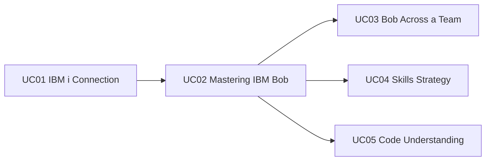

# UC 02 — Mastering IBM Bob

> **Category:** Using Bob
> **Phase:** Phase 0 — Onboarding (absolute prerequisite for all other UCs)
> **Estimated duration:** 1 to 2 days depending on the team's initial level
> **Bob modes used:** ASK, IBM i Developer, IBM i Database, Agent

---

## ⭐ IBM i Premium Package used

> Premium capabilities come into play from the very first hands-on session with Bob for IBM i. This UC is the moment to learn how to activate them.

| Premium capability | Role in this UC |
|---|---|
| **`/init`** slash command | Automatically generates the IBM i library's `AGENTS.md` — first concrete Premium action |
| **`/erd`** slash command | Generates the database ERD diagram — slash command discovery exercise |
| **`/review_SQL`** slash command | Reviews a SQL query — slash command exercise in IBM i Database mode |
| **Understand Dashboard** | Application scanner — discovering application mapping without prompts (see UC00 §2) |
| **RPG Modernization workflow** | First guided workflow (*Start Workflow* button) — FRS409 modernization exercise |
| **SQL Index Strategy Advisor workflow** | Second workflow (*Start Workflow* button, Library List only) — SQL optimization exercise |
| **71 IBM i skills** | Automatically activated as soon as IBM i Developer mode is selected |

**Official documentation:** [Slash Commands](https://bob.ibm.com/docs/ide/premium-packages/bob-for-i/slash-commands) · [Understand Dashboard](https://bob.ibm.com/docs/ide/premium-packages/bob-for-i/understand) · [Workflows](https://bob.ibm.com/docs/ide/premium-packages/bob-for-i/workflows) · [IBM i Skills](https://bob.ibm.com/docs/ide/premium-packages/bob-for-i/skills)

---

## Objective

Make every team member autonomous on Bob **before tackling any other UC**: understand modes, scope, workflows, slash commands, and Premium skills. Practice on the real IBM i application from the Flight400 lab.

Without this initial mastery, all subsequent UCs will be underutilized.

---

## Prerequisites

- **Phase:** Phase 0 — Onboarding
- **Required preceding UCs:** None
- **Required deliverables:** None
- **Required Bob level:** Beginner (this is the starting point)
- **Estimated Bob Coins:** ● ○ ○ (discovery exercises, low consumption)
- **Required materials:** Accessible IBM i test system (TechZone or client IBM i) + FLGHT400 lab deployed

---

## Concrete Example — FLGHT400 Lab

The Flight400 lab is the official hands-on support for this UC. The results below were produced during a real session on the FLGHT403 instance:

- [`FLGHT403_init_report.md`](../labs_FLGHT400_results/FLGHT403_init_report.md) — result of `/init` on FLGHT403: 122 source members documented, ILE architecture, cross-library dependencies
- [`FLGHT403_AGENTS.md`](../labs_FLGHT400_results/FLGHT403_AGENTS.md) — the AGENTS.md file automatically generated by `/init`
- [`FLGHT403_erd.md`](../labs_FLGHT400_results/FLGHT403_erd.md) — Mermaid ERD produced by `/erd FLGHT400`
- [`FRS409-Modernisation-report.md`](../labs_FLGHT400_results/FRS409-Modernisation-report.md) — RPG modernization report produced by the RPG Modernization workflow
- [`FLGHT403_sql-review-bottleneck-analysis.md`](../labs_FLGHT400_results/FLGHT403_sql-review-bottleneck-analysis.md) — SQL analysis produced by `/review_SQL` + the SQL Index Strategy Advisor workflow

---

## 1. Accessing the Flight400 Lab

### Official references

- **Lab:** [IBM i Application Modernization with Bob — Flight400](https://github.com/bmarolleau/flight400-demo)
- **Deployment guide:** [`labs_FLGHT400/FICHE-REDEPLOIEMENT.en.md`](../labs_FLGHT400/FICHE-REDEPLOIEMENT.en.md)

### Accessing an IBM i for the lab

| Situation | Action |
|---|---|
| The IBM i admin grants rights on the test IBM i | Use it directly. Verify: user profile, libraries, `*USE`/`*CHANGE` rights, SSH port open. |
| Test IBM i not accessible | Provision an IBM i on TechZone (see below). |

### Provisioning an IBM i on TechZone

1. Go to [techzone.ibm.com](https://techzone.ibm.com) → search **"IBM i"** → select **IBM i 7.6 - Sandbox**
2. **Reserve**: purpose *Practice / Self-Education*, minimum duration 8 h, closest region
3. Within a few minutes: hostname, port, user profile and password by email

> ⚠️ Maximum duration: 4 to 6 weeks with a valid OPPY. Request an extension before it expires — do not wait.

---

## 2. Initial Bob Configuration

| Step | Action | What you learn |
|---|---|---|
| C1 | Open a local folder (`File → Open Folder`) | Bob always works in a local workspace — mandatory before anything else. |
| C2 | Install the **IBM i Premium Package** from the Bob Marketplace | The Premium Package activates the IBM i Developer and IBM i Database modes, the 71 skills, the workflows and the slash commands. |
| C3 | Install the **Code for IBM i** extension and configure the SSH connection | The IBM i connection is the foundation — test it immediately. If the connection is down, nothing works. |
| C4 | Install the **IBM i Languages** extension | RPG, CL, DDS, COBOL syntax highlighting in the editor. |
| C5 | Configure the **Library List** in Code for IBM i | Add `FLGHT400` (or the project library). Bob looks for source members in this list. |
| C6 | Check **Bob Coins** in the TechZone profile settings | Every LLM call consumes Coins. Monitor the counter from the start. |

---

## 3. The Three Bob × IBM i Workspaces — First Choice to Make

> **This choice conditions everything**: the available tools, the accessible files, the deliverables produced, and even Bob's ability to read source members. It is the first decision to make in every new conversation.

When you open a new Bob conversation with an active IBM i connection, three workspaces are available:

---

### Workspace 1 — Local workspace (workstation)

**What it is:** the folder open in Bob on the local workstation (`File → Open Folder`). Bob sees the markdown files, skills, rules and deliverables produced in previous sessions.

**What Bob can do:**
- Read and write local files (`.md`, `.json`, configs)
- Access the `.bob/` skills and rules
- Load existing UC deliverables as context (`*-comprehension-*.md` files, etc.)

**What Bob CANNOT do:**
- Read RPG/CL/DDS source members directly from QSYS
- Run IBM i or CL commands
- Compile programs

**When to use it:** to work on UC guides, plans, local documentation, and to create skills/rules. Not for IBM i code.

---

### Workspace 2 — IBM i Libraries (QSYS) ⭐ Main workspace for the POC

**What it is:** direct access to IBM i libraries via the Code for IBM i extension. Bob navigates QSYS like a file explorer: compiled objects, RPG/CL/DDS source members, physical and logical files.

**How to activate it:** `+` button (scope) in the Bob panel → **Library List** → select `FLGHT400` (or the project library).

**What Bob can do:**
- Read RPG, CL, DDS source members directly (`read_member`)
- Run SQL queries on Db2 for i (`execute_sql_statement`)
- Compile programs (`execute_compile_action`)
- Run CL commands (`execute_cl_command`)
- Use the slash commands `/init`, `/erd`, `/review_rpg`, `/review_SQL`
- Launch the Premium workflows (RPG Modernization, SQL Index Strategy Advisor, RPGUnit, Business Rules Extraction)
- Scan the application with the Understand Dashboard

**When to use it:** for **virtually all exercises and labs** — it is the default workspace for the POC. In the FLGHT400 lab, the `FLGHT400` library is always opened in this workspace.

> ⚠️ **Without this workspace activated, Bob's IBM i tools are inoperative.** `/init` stops, workflows cannot find the sources, compilations fail.

**FLGHT400 lab example:** all exercises 1 through 7 in the [`FICHE-REDEPLOIEMENT.en.md`](../labs_FLGHT400/FICHE-REDEPLOIEMENT.en.md) run in this workspace, library `FLGHT400` (or `FLGHT403` for the instance 403 demo).

---

### Workspace 3 — $HOME IFS (personal directory on IBM i)

**What it is:** the IFS directory (`/home/ITZUSER/` or `/home/{USER}/`) on the IBM i. Bob reads and writes files there via the integrated file system (IFS).

**How to activate it:** `+` button (scope) in the Bob panel → **IFS** → select `/home/{USER}/` or the project folder.

**What Bob can do:**
- Write markdown deliverables to the IFS (reports, plans, AGENTS.md)
- Read configuration or data files stored in the IFS
- Deploy shell scripts (`.sh`) and Node/Vite apps for the React exercises
- Read the AGENTS.md file created by `/init` (in QSYS or IFS)

**When to use it:** for workflow output deliverables (Business Rules reports, RPGUnit plans), for React/Web apps (lab exercises 7–8), for deployment scripts.

> 💡 `/init` writes AGENTS.md to `{LIBRARY}/QBOBSRC/AGENTS.MD` (in QSYS) or to `{IFS directory}/.bob/AGENTS.md` (in IFS). A copy at `/home/{USER}/AGENTS.md` was observed in the FLGHT400 lab (not documented by IBM). The official locations are injected automatically into subsequent conversations.

---

### Summary table — Which workspace for which task?

| Task | Recommended workspace |
|---|---|
| Read an RPG source member (`FRS409`) | **IBM i Libraries** (QSYS) |
| Run `/init`, `/erd`, `/review_rpg` | **IBM i Libraries** (QSYS) |
| Launch a Premium workflow | **IBM i Libraries** (QSYS) |
| Scan with Understand | **IBM i Libraries** (QSYS) |
| Write a modernization report | **$HOME IFS** |
| Deploy a React/Node app | **$HOME IFS** |
| Read/edit a local UC guide | **Local workspace** |
| Create or modify a skill/rule | **Local workspace** |
| Combine IBM i sources + local deliverables | **IBM i Libraries** + local file loaded via `Add File to Chat` |

---

### First action in every new IBM i conversation

1. Check that the IBM i connection is active (status icon in Code for IBM i)
2. Right-click the target library → **Set as Current Library** (e.g. `FLGHT400`)
3. `+` button → **Library List** → confirm that `FLGHT400` is present
4. Select the appropriate Bob mode (IBM i Developer for code, IBM i Database for SQL)
5. Start the prompt

> 💡 If Bob replies "I can't see this program" or "I can't access this library" — first check that the IBM i Libraries workspace is activated (step 3).

---

## 4. Discovering Bob Modes

### Modes to know

| Mode | When to use it |
|---|---|
| **ASK** | General questions, documentation, explanations without IBM i access |
| **IBM i Developer** | All work on RPG, CL, DDS, COBOL code — main mode for the POC |
| **IBM i Database** | SQL, Db2 for i, performance analysis, DDL generation |
| **Agent** | Autonomous multi-step actions: file writing, compilations, complex sequences |
| **Plan** | Planning, design, architecture — before coding |

> ⚠️ Never stay in ASK mode to generate IBM i code — switch to IBM i Developer.

### Mode discovery exercise

From the FLGHT400 lab, open `FLGHT400/QRPGSRC(FRS409)` in the editor, then try:

```
[ASK mode] "What is OPM RPG?"
[IBM i Developer mode] "What does this program do?"
[IBM i Database mode] "What is the structure of the FLIGHTS table?"
[Agent mode] "Generate a markdown file with the list of programs in the FLGHT400 library."
```

Compare the results — the mode dramatically changes the quality of answers on IBM i.

---

## 5. Scope and Context

### Implicit context vs explicit scope

| Mechanism | How it works | When to use it |
|---|---|---|
| **Implicit context** | The active file in the editor is passed to Bob automatically | One-off questions about the open program |
| **Explicit scope** | `+` button → Library List, QSYS, IFS folder | Multi-source work, dependencies, architecture |

**Common mistakes:**
- Scope too broad (all of QSYS) → slowdown, diluted results
- Forgetting the scope for a multi-source task → Bob answers only about the open file
- Changing the active file without noticing → the implicit context changes silently

**Best practice:** At the start of a session, open the target file AND set the Library List scope.

### `@mention` syntax

In prompts, `@NAME` explicitly anchors an object in the context:

```
"Generate the documentation for @FRS409 and list its dependencies in @FLGHT400."
"Compare the fields of @FLIGHTS with those used in @FRS021."
```

> ⚠️ Only use `@NAME` for objects that are in the defined scope — otherwise Bob cannot find them.

### Managing the context window

**The Context indicator** is the progress bar displayed at the top of the Bob panel (or via the circle icon at the bottom right of the chat area). It shows the percentage of the context window used — it is not a count of human messages, but a total token volume including the system prompt, tool definitions, rules, skills and **all Bob-to-tool exchanges** (tool calls) that happen without any visible human intervention.

**Practical thresholds:**

| Context indicator | Situation | Recommended action |
|---|---|---|
| < 40% | Green zone — all good | Continue normally |
| 40–60% | Yellow zone — keep an eye on it | Avoid starting long or multi-step tasks |
| > 60% | Orange zone — act now | See the options below |
| > 80% | Red zone — likely degradation | Bob starts losing decisions made early in the session |

**When the indicator exceeds 60% — two options:**

**Option A — Start a new session directly** (if the task can be wrapped up quickly):
1. Save the deliverable in progress (switch to Agent, ask for the save)
2. Open a new conversation (`+` button)
3. Re-define the scope and mention the file produced in the previous conversation

**Option B — Context transfer document** (if the task must continue):

```
"Prepare a context transfer document on [CURRENT TOPIC]:
 - What has been analyzed / produced so far
 - The important decisions made
 - The open questions identified
 - The planned next steps
 - The IBM i skills to activate in the new session
 Save this document in bob-reports/ under the name
 {appId}-context-transfer-{topic}-{YYYYMMDD-HHmm}.md"
```

Then open a new conversation, load this document as context and say: *"Resume from [STEP] — the summary of the previous session is in [FILE_NAME]."*

**Quick symptoms and remedies:**

| Symptom | Cause | Remedy |
|---|---|---|
| Vague answer on precise code | Scope too broad | Narrow it down to the relevant file or library |
| Truncated documentation | Program too long | Split it up, program by program |
| Bob "forgets" earlier decisions | Context > 60% | Option A or B above |
| Bob proposes solutions already ruled out | Decisions pushed out of the window | Option B — context transfer |

---

## 6. ⭐ Premium Slash Commands — Practical Exercises

### Exercise `/init` — Generate AGENTS.md automatically

1. **User Library List** view → right-click `FLGHT400` → **Set as Current Library**
2. Mode **IBM i Developer**, scope *Library List*
3. In the chat: `/init`
4. Bob analyzes the library and creates `FLGHT400/QBOBSRC/AGENTS.MD` (or `{IFS directory}/.bob/AGENTS.md` in an IFS workspace; a copy at `/home/USER/AGENTS.md` was observed in the FLGHT400 lab, not documented by IBM).

> ⚠️ Without a current library defined, `/init` stops without creating the file.

**What you learn:** AGENTS.md is injected automatically into every subsequent Bob conversation — it is the project's persistent memory.

**Example result:** [`FLGHT403_init_report.md`](../labs_FLGHT400_results/FLGHT403_init_report.md)

---

### Exercise `/erd` — Generate the ERD diagram

1. Mode **IBM i Database**
2. In the chat: `/erd FLGHT400`
3. Bob generates the Mermaid ERD diagram of all the tables

**What you learn:** one command, zero manual SQL, a complete ERD with PK/FK/cardinalities.

**Example result:** [`FLGHT403_erd.md`](../labs_FLGHT400_results/FLGHT403_erd.md)

---

### Exercise `/review_SQL` — Review a SQL query

1. Mode **IBM i Database**
2. In the chat: `/review_sql` then paste the query from lab exercise 4 (`ORDERS × FLIGHTS × AGENTS` query)
3. Bob detects the intentional issue (`ORDER BY` on a column outside the `GROUP BY`) and proposes the corrected SQL

**Example result:** [`FLGHT403_sql-review-bottleneck-analysis.md`](../labs_FLGHT400_results/FLGHT403_sql-review-bottleneck-analysis.md)

---

## 7. ⭐ Understand Dashboard — Application Mapping

> Understand is the application mapping component of the Premium Package. See UC00 §2 for full details on installation, the 6 tools and the 3 Understand skills.

### Activation

1. Prerequisite: Understand installed on the IBM i (see UC00 §2 for configuring the dedicated library via `vscode-ibmi-bob.understand.installLibrary`)
2. *Open Understand Dashboard* command or the Dashboard icon in the Bob chat title bar
3. **New Application** → name `FLGHT400`, library `FLGHT400`, metadata library `UNDERSTAND` → **Scan**
4. Scan takes ~30–60 s for ~100 members

### Questions to ask after the scan

```
"What are the high-level functional areas of FLGHT400?"
"Which programs will be affected if I modify the FLIGHTS table?"
"Which objects in FLGHT400 haven't been used in the last 5 years?"
```

**What you learn:** application mapping without manually reading each source — impact analysis in seconds.

**Example result:** [`FLGHT403_functional_areas.md`](../labs_FLGHT400_results/FLGHT403_functional_areas.md)

---

## 8. ⭐ Premium Workflows — Practical Exercises

### Exercise: RPG Modernization workflow

1. Open `FLGHT400/QRPGSRC(FRS409)` in the editor
2. IBM i Developer mode (supported workspaces: Local, Library List — see UC00 §1)
3. **Start Workflow** button at the top of the chat → **RPG Modernization** (or ask in the chat: `"Can you modernize this program?"` → Bob suggests the workflow)
4. Enter the parameters: source library `FLGHT400`, file `QRPGSRC`, member `FRS409`, output `FLGHT400/QRPGLESRC/FRS409.RPGLE`

**What you learn:** two approaches exist — workflow (structured, guided) vs agent (flexible, iterative). The workflow is recommended for known patterns.

**Example result:** [`FRS409-Modernisation-report.md`](../labs_FLGHT400_results/FRS409-Modernisation-report.md)

---

### Exercise: SQL Index Strategy Advisor workflow

1. Mode **IBM i Database**, **Library List** workspace only (the only supported workspace — see UC00 §1)
2. **Start Workflow** button at the top of the chat → **SQL Index Strategy Advisor**
3. Parameters: Data Source = `Capture New Performance Data`, Output Library = `FLGHT400`, Top N = 20
4. Bob analyzes the Plan Cache and proposes the priority indexes
5. Validate: *"Apply the highest-priority index only for FLGHT400"*

**Example result:** [`FLGHT403_sql-review-bottleneck-analysis.md`](../labs_FLGHT400_results/FLGHT403_sql-review-bottleneck-analysis.md)

---

## 9. Workflows vs Agent vs Slash Commands

| Level | When to use it | Examples |
|---|---|---|
| **Slash commands** | Quick actions, immediate result | `/init`, `/erd`, `/review_rpg`, `/review_SQL` |
| **Workflows** | Structured guided tasks, known patterns | RPG Modernization, SQL Index Advisor, RPGUnit |
| **Agent** | Autonomous multi-step sequences, complex tasks | End-to-end field addition, React app generation |

> 💡 Start with slash commands and workflows for known tasks — keep Agent for tasks that need adaptability.

---

## 10. Skills

A Skill is a Markdown file (`.md`) stored in `.bob/skills/` that injects persistent context into every session. The 71 IBM i skills of the Premium Package activate automatically.

**Create an ACME Skill:** in Agent mode, ask Bob to create a skill with ACME's RPG development standards. This skill will be reused in all the following UCs.

> 💡 See UC04 (Skills Strategy) for rolling out skills across the project.

---

## 11. Managing Bob Coins and Context Economy

**Where to monitor Bob Coins:** TechZone profile settings → Bob Coins counter.

**Consumption by mode / action:**

| Mode / Action | Consumption |
|---|---|
| ASK, simple questions | ● ○ ○ |
| IBM i Developer, standard prompts | ● ○ ○ |
| Workflows (RPG Modernization, etc.) | ● ● ○ |
| Agent, long sequences | ● ● ○ to ● ● ● |
| Application generation (React, Web) | ● ● ● |

**Economy strategies — apply from day one:**

| Strategy | Impact | How |
|---|---|---|
| Use **Ask** or **IBM i Developer** mode (not Agent) for reading/understanding tasks | Medium | Agent consumes more coins because it can run tool calls in a loop |
| Keep sessions short and focused | High | One session = one program or one precise goal. Do not "keep going" indefinitely. |
| Watch the Context indicator (see § Managing the context window) | High | Going past 60% = risk of degraded answers AND waste on new questions |
| Close unused files in the editor | Low | The active file in the editor is passed as implicit context |
| Prefer slash commands over free-form prompts for known tasks | Medium | `/init`, `/review_rpg`, `/review_SQL` are optimized — fewer tokens than the equivalent free-form prompt |
| Ask Bob to save **before** launching the next task | High | Avoids regenerating a lost deliverable if the session ends badly |
| Use a precise `@mention` rather than "all the files in the library" | Medium | Targeted scope = fewer tokens in the context window |

> 💡 On a 5-day POC, context management is as important as prompt quality — a developer who opens new sessions regularly will move faster than one who piles up 3 hours of conversation in a single session.

---

## 12. Approving Actions in Agent Mode

In Agent mode, Bob asks for **confirmation before each irreversible action** (file write, compilation, CL command). Always read:

| Checkpoint | Question to ask |
|---|---|
| Destination path | Right library / right member? |
| Action type | Write? Replace? Delete? |
| CL command | Correct and free of side effects? |
| Scope | Is Bob touching more objects than requested? |

> ⚠️ Never approve everything without reading — risk of overwriting a source or compiling on the wrong LPAR.

---

## 13. Environment Customization: Native IBM i Developer Mode and Rules

> ⚠️ **Important — custom modes vs IBM i Developer:**
> Do not create a custom mode competing with IBM i Developer. A custom mode is standalone — it does not inherit Premium tools (workflows, slash commands, 71 skills). The correct approach: use **IBM i Developer** as the base mode and inject ACME standards through **rules** (`.bob/rules/` and `.bob/rules-ibm-i-developer/`), which apply to all modes or to this specific mode, complemented by the `AGENTS.md` generated by `/init`.

To integrate enterprise context and standards:
- Use the native **IBM i Developer** mode for all RPG, CL, DDS, COBOL code work
- Inject RPG development standards and naming conventions through rules (detailed in UC03 and UC04)
- Document business context and architecture in `AGENTS.md` (via `/init`)

Creating a custom mode remains an explicitly validated exception (specific non-IBM i needs), and is not a standard onboarding step.

---

## Deliverables of this UC

> ⚠️ **Important — where does Bob write?**
> `/init` writes AGENTS.md **on the IBM i** (`{LIBRARY}/QBOBSRC/AGENTS.MD` in QSYS and `{IFS directory}/.bob/AGENTS.md` in IFS; a copy at `/home/{USER}/AGENTS.md` was observed in the FLGHT400 lab, not documented by IBM), not locally.
> To keep a local report in `bob-reports/`, explicitly ask Bob after `/init`:
> ```
> "Save the full report of this /init run in the bob-reports/ folder
>  under the name {app}-init-report-{YYYYMMDD-HHmm}.md"
> ```

| File produced | Where it is created | How to get it | Consumed by |
|---|---|---|---|
| `{LIBRARY}/QBOBSRC/AGENTS.MD` | IBM i — QSYS | Object Browser → `QBOBSRC` → member `AGENTS` | Injected automatically into Bob conversations |
| `{IFS directory}/.bob/AGENTS.md` | IBM i — IFS (IFS workspace) | File created by `/init` in an IFS workspace | Injected automatically into Bob conversations |
| `/home/{USER}/AGENTS.md` *(observed in the lab)* | IBM i — IFS | Download via Code for IBM i SFTP if needed locally (copy observed in the FLGHT400 lab, not documented by IBM) | Injected automatically if present |
| `bob-reports/{app}-init-report-{date}.md` *(optional)* | Local — `bob-reports/` | Ask Bob to save after `/init` | Project documentation, team reference |
| `bob-reports/{app}-erd-all-{date}.md` *(optional)* | Local — `bob-reports/` | Ask Bob to save the diagram after `/erd` | UC07, UC09, UC16 |

---

## Dependencies



---

## UC 02 Validation Checklist

Before moving to UC03, every team member must be able to answer **yes** to each point:

- [ ] I can tell the three workspaces apart (local workspace, IBM i libraries QSYS, $HOME IFS) and pick the right one for the task
- [ ] I know how to activate the IBM i Libraries workspace (`+` button → Library List → `FLGHT400`) before any exercise
- [ ] I can switch between the ASK, IBM i Developer, IBM i Database and Agent modes
- [ ] I have installed and activated the IBM i Premium Package
- [ ] I have run `/init` on the lab library — AGENTS.md is created
- [ ] I have run `/erd` — the ERD diagram is produced
- [ ] I have run at least one workflow (RPG Modernization or SQL Index Strategy Advisor)
- [ ] I have scanned the application with Understand and asked an architecture question
- [ ] I know how to add a scope (Library List) before a prompt
- [ ] I know how to read the "File Changed" panel to validate a diff
- [ ] I understand the difference between implicit context and explicit scope
- [ ] I know how to use the `@mention` syntax in a prompt
- [ ] I know how to recognize the symptoms of a saturated context
- [ ] I know how to read the approval plan in Agent mode before approving
- [ ] I understand Bob Coins management and where to monitor them
- [ ] I use the native IBM i Developer mode enriched with enterprise rules and AGENTS.md (without creating a competing custom mode)

---

*UC02 guide — revised 2026-10-30 — IBM i Premium Package integration*
