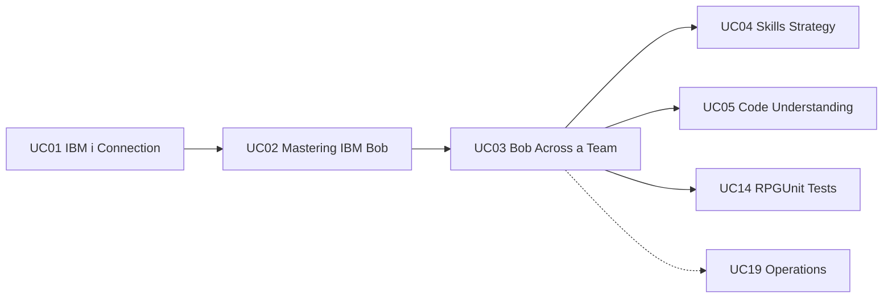

# UC 03 — Using Bob Across a Development Team: Shared Development Workspace

> **Category:** Using Bob
> **Phase:** Phase 0 — Onboarding (after UC02 — Bob mastery in place)
> **Initial setup time:** 2 to 4 hours — enterprise workspace, rules, /init
> **New developer onboarding time:** 30 to 45 minutes
> **Bob modes used:** IBM i Developer, IBM i Database, Agent

---

## ⭐ IBM i Premium Package used

| Premium capability | Role in this UC |
|---|---|
| **`/init`** slash command | Automatically generates the IBM i project's `AGENTS.md` — persistent collective context |
| **IBM i Developer mode** | Base mode to use on IBM i — ACME standards are injected into it via rules |
| **71 IBM i skills** | Automatically activated with IBM i Developer mode — shared with no configuration |

**Official documentation:** [Slash Commands](https://bob.ibm.com/docs/ide/premium-packages/bob-for-i/slash-commands) · [IBM i Skills](https://bob.ibm.com/docs/ide/premium-packages/bob-for-i/skills)

> ⚠️ **Important — custom modes vs IBM i Developer:**
> Do not create a custom mode that competes with IBM i Developer. A custom mode is independent — it does not inherit the Premium tools (workflows, slash commands, 71 skills). The right approach: use **IBM i Developer** as the base mode and inject ACME standards via **rules** (`.bob/rules/`), which apply to all modes without exception.

---

## Objective

Industrialize the use of Bob within an IBM i team, making sure that **every developer works with the same standards, the same tools and the same project context**, whatever their machine.

This UC addresses three concrete problems:
1. **Inconsistency** — without a shared framework, each developer configures Bob differently.
2. **Context loss** — Bob is stateless: without an `AGENTS.md`, it rediscovers the project at every session.
3. **Wasted time** — onboarding a new developer without a shared workspace takes hours.

---

## Prerequisites

- **Phase:** Phase 0 — Onboarding
- **Required preceding UCs:** UC02 — Mastering IBM Bob
- **Required deliverables:** None
- **Recommended Bob level:** Intermediate
- **Estimated Bob Coins:** ● ● ○ (enterprise workspace, rules, /init)

---

## Concrete Example — FLGHT400 Lab

The FLGHT400 lab illustrates this UC with a complete IBM i workspace:

- [`FLGHT403_AGENTS.md`](../labs_FLGHT400_results/FLGHT403_AGENTS.md) — the `AGENTS.md` generated by `/init` on `FLGHT403`: 122 members documented, ILE architecture, cross-library dependencies, code conventions, critical gotchas. This is the expected outcome after this UC.
- [`FLGHT403_init_report.md`](../labs_FLGHT400_results/FLGHT403_init_report.md) — full `/init` report: source inventory, ILE analysis, compilation rules. A template report to save locally after each `/init`.

---

## The 4 Bob Configuration Levels

```
Level 1 — Developer workstation (~/.bob/)
  Scope: one workstation, one developer
  Versioned: NO — never
  Contents: personal preferences, real third-party MCP tokens

Level 2 — Enterprise workspace (shared Git repo)
  Scope: the whole company, all projects
  Versioned: YES — git clone by every developer
  Contents: ACME standards converted into Bob rules, MCP without tokens

Level 3 — Project workspace (application repo)
  Scope: a single application project
  Versioned: YES — inside the project repo
  Contents: project context, specific rules, .bobignore

Level 4 — IBM i project initialized with /init  ⭐ Premium
  Scope: a single IBM i project, all Bob sessions
  Versioned: YES — via a Git copy of AGENTS.md (source: QBOBSRC in QSYS or .bob/ in IFS)
  Contents: context generated by /init + manually enriched
```

**Configuration priority:**
- Rules: workspace > global — [doc](https://bob.ibm.com/docs/ide/configuration/rules#rule-priority)
- Skills: project > global — [doc](https://bob.ibm.com/docs/ide/features/skills#skill-locations)
- MCP: project > global — [doc](https://bob.ibm.com/docs/ide/configuration/mcp/mcp-in-bob#configuration-levels)

> **IBM i workspace note:** When the active workspace is **IBM i Libraries (QSYS)**, the local workspace and its `.bob/` folder are **not loaded**. The active rules and skills are those of the global `~/.bob/` and of the local workspace open in parallel (if a local folder is open). The IBM i AGENTS.md (`{LIBRARY}/QBOBSRC/AGENTS.MD` in QSYS or `{IFS directory}/.bob/AGENTS.md` in IFS) is injected automatically.

---

## Prompts

---

### Prompt 0 — Create the enterprise workspace

**Objective:** Initialize the shared Git repo containing the ACME standards converted into Bob rules.

**When to use:** Once, during the team's initial setup.

**Required input:** Existing ACME standards (e.g. `NORMES/ACME-Normes Programmation.md`)

**Workspace:** Local workspace (workstation)
**Mode:** Agent
**Key skills used:** None (local configuration)

**Prompt:**

```
In Agent mode, local workspace:
1. Create the following folder structure:
   acme-bob-commons/.bob/rules/
   acme-bob-commons/.bob/rules-ibm-i-developer/
   acme-bob-commons/.bob/skills/
   acme-bob-commons/.bob/commands/

2. Open @NORMES/ACME-Normes Programmation.md and convert these company standards
   into actionable Bob directives — short, imperative instructions, not documentation
   to read. Save the result in acme-bob-commons/.bob/rules/coding-standards.md.

3. Create acme-bob-commons/.bob/rules-ibm-i-developer/specific-standards.md with
   the directives that apply only when working in IBM i Developer mode
   (e.g. compilation conventions, ILE structure, use of procedures vs subroutines).

4. Save the report of this initialization in
   bob-reports/acme-workspace-init-{YYYYMMDD-HHmm}.md in the local workspace.
```

**Deliverable produced:** `bob-reports/acme-workspace-init-{YYYYMMDD-HHmm}.md`

> 💡 Rules in `.bob/rules/` apply to **all modes** (IBM i Developer, IBM i Database, Agent, Ask). Rules in `.bob/rules-ibm-i-developer/` apply only when that mode is active. This is the correct mechanism for customizing IBM i Developer without replacing it.

**Documentation:** [Rules — mode-specific](https://bob.ibm.com/docs/ide/configuration/rules#mode-specific-rules) · [Team standardization](https://bob.ibm.com/docs/ide/configuration/rules#team-standardization)

---

### Prompt 1 — ⭐ Initialize an IBM i project with `/init`

> **Premium-first rule:** `/init` is the first step on any new IBM i project. It replaces any manual project-description prompt.

**Objective:** Automatically generate the `AGENTS.md` file describing the architecture, sources and conventions of the IBM i library.

**When to use:** As soon as you arrive on an IBM i project, before any development session.

**Required input:**
- Active IBM i connection (Code for IBM i)
- Current library defined (e.g. `FLGHT403` via right-click → *Set as Current Library*)
- IBM i Libraries workspace activated (`+` button → Library List)

**Workspace:** IBM i Libraries (QSYS) — main workspace
**Mode:** IBM i Developer (or IBM i Database)
**Key skills used:** None (`/init` slash command)

**Prompt:**

```
/init
```

Bob scans the current library and automatically creates:

| Deliverable | IBM i location | Loaded automatically by Bob |
|---|---|---|
| Main `AGENTS.md` (QSYS) | `{LIBRARY}/QBOBSRC/AGENTS.MD` — QSYS | ✅ Yes — injected in every session |
| Main `AGENTS.md` (IFS) | `{IFS directory}/.bob/AGENTS.md` — IFS | ✅ Yes — injected in an IFS workspace |
| IFS copy *(FLGHT400 lab)* | `/home/{USER}/AGENTS.md` | Observed in the FLGHT400 lab, not documented by IBM |

> ⚠️ **Where Bob writes:** `/init` writes **on the IBM i** (`{LIBRARY}/QBOBSRC/AGENTS.MD` in QSYS or `{IFS directory}/.bob/AGENTS.md` in IFS; a copy at `/home/{USER}/AGENTS.md` was observed in the FLGHT400 lab, not documented by IBM), **not locally**. To keep a local report, explicitly add in the conversation after `/init`:

```
Save the full report of this /init run in a local file
named {app}-init-report-{YYYYMMDD-HHmm}.md in the bob-reports/ folder of the local workspace.
```

**Deliverable produced:** `bob-reports/{app}-init-report-{YYYYMMDD-HHmm}.md` (local report, on explicit request)

**Documentation:** [Start a project with /init](https://bob.ibm.com/docs/ide/getting-started/tutorials/start-a-project) · [AGENTS.md](https://bob.ibm.com/docs/ide/getting-started/tutorials/start-a-project#mode-specific-agentsmd-files)

---

### Prompt 2 — Enrich the AGENTS.md generated by `/init`

**Objective:** Add the business rules and dependencies that `/init` cannot infer automatically, and save a local copy.

**When to use:** Immediately after `/init` — this section always needs to be completed.

**Required input:** `AGENTS.md` generated by `/init` (injected automatically)

**Workspace:** IBM i Libraries (QSYS) — in the same session as Prompt 1, or the next session
**Mode:** IBM i Developer
**Key skills used:** None (markdown enrichment of AGENTS.md)

**Prompt:**

```
The AGENTS.md for {appId} has just been generated by /init. It describes the technical
structure well. Help me enrich it with this information that /init cannot deduce:

Key business rules:
- [e.g. "Pending orders (STATUS='A') must never be modified by a batch job"]

Application dependencies not visible in the sources:
- [e.g. "TRC0018 calls TRC0018R via CALLB — never change the signature without adapting the caller"]

ACME development workflow:
- [e.g. "Develop in ACME_DEV, RPGUnit tests, promote via the source manager only"]

Documentation references:
- [e.g. "Specifications: OKF/acme/GEE/TRI/{appId}/spec-fonc.md"]

1. Generate the Markdown sections to add to AGENTS.md.
2. Save the complete enriched content in a local file named
   {app}-agents-enriched-{YYYYMMDD-HHmm}.md in the bob-reports/ folder of the local workspace.
```

**Deliverable produced:** `bob-reports/{app}-agents-enriched-{YYYYMMDD-HHmm}.md`

> 💡 After the enrichment, version the IBM i AGENTS.md. The source file lives on the IBM i (`QBOBSRC/AGENTS.MD` or `.bob/AGENTS.md` in IFS), not in the Git repo: `git add` only applies to a **local copy**. Synchronize QSYS/IFS → repo first:
> 1. Copy the IBM i AGENTS.md to `AGENTS.md` at the root of the local project repo (e.g. by asking Bob to read it on the IBM i and write it locally, or by manual copy via Code for IBM i).
> 2. Commit: `git add AGENTS.md && git commit -m "feat: Bob /init context + manual enrichment"`
>
> The IBM i remains the source of truth (it is what Bob injects): edit the AGENTS.md on the IBM i side, then re-synchronize to Git after each `/init` or enrichment — never edit the local copy alone.

---

### Prompt 3 — Configure shared MCPs (no tokens)

**Objective:** Create the company's `mcp.json` file with the JIRA MCP reference (and Confluence if used), without any token in clear text.

**When to use:** When setting up the enterprise workspace.

**Required input:** URL of the company's JIRA MCP server (the IBM i connection is native and does not go through `mcp.json`)

**Workspace:** Local workspace (workstation)
**Mode:** Agent
**Key skills used:** None (MCP configuration)

**Prompt:**

```
In Agent mode, local workspace, create the file acme-bob-commons/.bob/mcp.json
with the following shared MCP configuration (environment variables only,
never tokens in clear text):
- JIRA MCP: URL via ${env:JIRA_URL}, token via ${env:JIRA_TOKEN} (references only — I am not
  giving you any token value in this conversation)

Also create the file acme-bob-commons/.gitignore with the entries
needed to never commit credentials.

Save the configuration report in
acme-mcp-setup-{YYYYMMDD-HHmm}.md in the bob-reports/ folder of the local workspace.
```

**Deliverable produced:** `bob-reports/acme-mcp-setup-{YYYYMMDD-HHmm}.md`

> ⚠️ **Single rule for MCP secrets** (same as UC01 Prompt 2):
> - **(a) Referenced environment variable (`${env:VARIABLE_NAME}`)** — `mcp.json` contains only the reference (`${env:JIRA_TOKEN}`), never the value, which is set on each workstation: the file can be versioned. The Bob docs recommend environment variables but do not document the `${env:…}` syntax: **to be validated until the operational test succeeds** (set the variable on the workstation, restart Bob, verify error-free initialization and read a test JIRA ticket).
> - **(b) Token actually stored** in an `mcp.json` (e.g. `~/.bob/settings/mcp.json`) — personal file, **never versioned**.
> - **(c) Secret passed in a prompt** — to be avoided: it would end up in the conversation and in the `bob-reports/` reports.

**Documentation:** [MCP — configuration levels](https://bob.ibm.com/docs/ide/configuration/mcp/mcp-in-bob#configuration-levels) · [MCP security](https://bob.ibm.com/docs/ide/configuration/mcp/understanding-mcp#common-questions)

---

### Prompt 4 — Onboarding a new developer

**Objective:** Guide a new developer so that they are operational in 30–45 minutes.

**When to use:** Each time a new developer joins the IBM i project.

**Required input:** Accessible `acme-bob-commons` repo + application project repo

**Workspace:** Local workspace (workstation) then IBM i Libraries (QSYS)
**Mode:** Agent (step 1) then IBM i Developer (step 2)
**Key skills used:** None (developer onboarding)

**Prompt:**

```
I'm new to this IBM i project (library {appId}).
Guide me step by step to:

Step 1 (local workspace):
- Clone acme-bob-commons and activate the ACME rules in Bob
- Define my MCP environment variables (JIRA_URL, JIRA_TOKEN) on my workstation — or, failing that, my token in ~/.bob/settings/mcp.json (never versioned); never have me type it into this chat
- Check that IBM i Developer mode is properly installed (Premium Package)

Step 2 (IBM i Libraries workspace — QSYS):
- Activate the IBM i Libraries workspace: + button → Library List → {appId}
- Read the existing AGENTS.md and summarize the project in 5 key points
- Ask a first validation question:
  "What are the main programs in {appId} and their dependencies?"

At the end, save a verification checklist in
{app}-onboarding-checklist-{YYYYMMDD-HHmm}.md in the bob-reports/ folder of the local workspace.
```

**Deliverable produced:** `bob-reports/{app}-onboarding-checklist-{YYYYMMDD-HHmm}.md`

---

## Target Structures

### On the workstation — local workspace

> Active when a local folder is open in Bob (`File → Open Folder`).

```
acme-bob-commons/                      ← enterprise Git repo — cloned on each workstation
├── .bob/
│   ├── rules/
│   │   ├── coding-standards.md        ← ACME standards → all modes
│   │   ├── naming-conventions.md
│   │   └── source-manager-conventions.md
│   ├── rules-ibm-i-developer/
│   │   └── specific-standards.md      ← standards specific to IBM i Developer mode
│   ├── skills/                        ← shared skills (UC05, UC07, UC14…)
│   └── mcp.json                       ← MCP without tokens (environment variables)
├── .bobignore.template
├── .gitignore
└── README.md

acme/TRC0018/                          ← application project repo
├── .bob/
│   └── rules/
│       └── project-context.md         ← TRC0018 specifics (libraries, constraints)
├── bob-reports/                       ← deliverables produced by Bob (git-ignored or versioned)
│   ├── {app}-init-report-{date}.md
│   ├── {app}-agents-enriched-{date}.md
│   └── {app}-onboarding-checklist-{date}.md
├── AGENTS.md                          ← versioned local copy of the IBM i AGENTS.md (synchronized from QSYS/IFS)
├── acme-trc0018.code-workspace        ← multi-root workspace QSYS + acme-bob-commons (→ UC04 Prompt 6)
└── .bobignore
```

### On the IBM i — IBM i Libraries workspace (QSYS)

> Main workspace for all work on IBM i code. The local structures above are **not active** in this workspace unless a local workspace is open in parallel.
> **Recommended approach (to be validated on your installation): the multi-root workspace** (`.code-workspace` file) that combines the QSYS workspace and `acme-bob-commons` in the same Bob window, so that the local ACME skills and rules are loaded in addition to the QSYS content. The `.code-workspace` references the QSYS root through an `iseries://QSYS/…` URI: its exact behavior in Bob is not documented by IBM (the docs only state that Bob can work across multiple workspaces) and must be confirmed. See [UC04 — "Multi-root workspace" section](./UC04-strategie-skills-en.md#multi-root-workspace-qsys--local-folder) and UC04 Prompt 6.
> **Validation test:** open the `.code-workspace` (active IBM i connection), check in Bob Settings that the rules and skills from `acme-bob-commons` are listed, then ask a question whose answer depends on an ACME rule. If they are not loaded, open `acme-bob-commons` as a local workspace in parallel.

```
{LIBRARY}.LIB                          ← e.g. FLGHT403.LIB or TRC0018.LIB
├── QBOBSRC.SRCPF
│   └── AGENTS.MD                      ← created by /init (official QSYS location) — injected automatically
├── QRPGLESRC.SRCPF                    ← ILE RPGLE sources
├── QRPGSRC.SRCPF                      ← OPM RPG sources
├── QDDSSRCF.SRCPF                     ← physical and logical DDS
├── QDDSSRCD.SRCPF                     ← display DDS
└── QCLPSRC.SRCPF                      ← CL sources

{IFS directory}/                       ← IFS — working directory or $HOME
├── .bob/
│   └── AGENTS.md                      ← created by /init in an IFS workspace (official IFS location)
├── AGENTS.md                          ← IFS copy observed in the FLGHT400 lab (not documented by IBM)
└── bob-reports/                       ← deliverables produced by Bob in the IFS
    ├── {app}-init-report-{date}.md    ← /init report (on explicit request)
    └── {app}-agents-enriched-{date}.md ← enriched AGENTS.md (on explicit request)
```

### On the workstation — personal level (`~/.bob/`)

> Never versioned. Personal credentials and preferences only.

```
~/.bob/
├── rules/
│   └── personal-preferences.md        ← language, verbosity, response style
└── settings/
    └── mcp.json                        ← REAL tokens: JIRA, Confluence
```

---

## Security Rules — Tokens and Credentials

> ⚠️ **Absolute rule** ([MCP security doc](https://bob.ibm.com/docs/ide/configuration/mcp/understanding-mcp#common-questions)):
> Never commit tokens, passwords or API keys in a versioned file.

| What goes where | Versioned? | Reason |
|---|---|---|
| `~/.bob/settings/mcp.json` (real JIRA, Confluence tokens) | ❌ No | Personal credentials |
| `acme-bob-commons/.bob/mcp.json` (URLs and `${env:VARIABLE_NAME}` references — no token value) | ✅ Yes | Shareable config |
| `acme-bob-commons/.bob/rules/*.md` (ACME standards) | ✅ Yes | Team standards |
| `{LIBRARY}/QBOBSRC/AGENTS.MD` on IBM i | ✅ Via a local copy in the Git repo (QSYS → Git synchronization, see Prompt 2) | Project context |

---

## Pitfalls to Avoid

| Pitfall | Consequence | Solution |
|---|---|---|
| Creating a custom mode that competes with IBM i Developer | Loss of the 71 skills and Premium workflows | Use IBM i Developer + injected ACME rules |
| Putting tokens in the versioned `mcp.json`, or typing them in a prompt | Credentials exposed in Git or in the conversation | `${env:VARIABLE_NAME}` references in the versioned file; values set on each workstation (environment variable, or token in the unversioned `~/.bob/settings/mcp.json`) |
| Not running `/init` when arriving on a project | Bob rediscovers the project every session | `/init` — non-negotiable onboarding step |
| Rules that are too long | Bob truncates beyond the context window | Max 100 lines per file — 1 file = 1 topic |
| Mixing up the active workspace (IBM i vs local) | Bob can't find the sources or doesn't load the rules | Check the workspace before each session |
| Working in the QSYS workspace without a multi-root workspace | ACME rules and skills not loaded — missing behaviors | Create the multi-root `.code-workspace`, then verify that the rules/skills are loaded — see UC04 Prompt 6 |
| Not re-running `/init` after a major change | Outdated context | Re-run after adding a module or changing the architecture |

---

## Deliverables of this UC

| File produced | Naming pattern | Workspace | Consumed by |
|---|---|---|---|
| Workspace initialization report | `bob-reports/acme-workspace-init-{YYYYMMDD-HHmm}.md` | Local | Team reference |
| /init report | `bob-reports/{app}-init-report-{YYYYMMDD-HHmm}.md` | Local (explicit request) | UC03, UC05 |
| Enriched AGENTS.md | `bob-reports/{app}-agents-enriched-{YYYYMMDD-HHmm}.md` | Local (explicit request) | All UCs (including UC18, UC19) |
| MCP configuration | `bob-reports/acme-mcp-setup-{YYYYMMDD-HHmm}.md` | Local | Team reference |
| Onboarding checklist | `bob-reports/{app}-onboarding-checklist-{YYYYMMDD-HHmm}.md` | Local | Each new developer |

---

## Dependencies



---

## UC 03 Validation Checklist

Before moving to UC04, verify each point:

- [ ] The `acme-bob-commons` repo is created and accessible to the whole team
- [ ] The ACME company standards are converted into Bob rules in `.bob/rules/`
- [ ] The IBM i Developer mode-specific rules exist in `.bob/rules-ibm-i-developer/`
- [ ] No custom mode competing with IBM i Developer has been created
- [ ] The shared `mcp.json` contains only `${env:VARIABLE_NAME}` references — no token value in clear text, neither in a versioned file nor in a prompt
- [ ] `/init` has been run on at least one IBM i project — `AGENTS.MD` present in QBOBSRC or `.bob/AGENTS.md` in IFS
- [ ] The `AGENTS.md` has been manually enriched with business rules and dependencies
- [ ] A local copy of the IBM i `AGENTS.md` is synchronized (QSYS/IFS → Git repo) and then versioned in the project repo
- [ ] The difference between local workspace and IBM i workspace is understood by the whole team
- [ ] The multi-root workspace `{app}.code-workspace` is created and versioned in the project repo (→ UC04 Prompt 6), and the ACME rules/skills have actually been verified as loaded
- [ ] Onboarding has been tested with at least one new developer

---

*UC03 sheet — revised 2026-10-30 — IBM i Premium Package integration — multi-root workspace ref → UC04*
