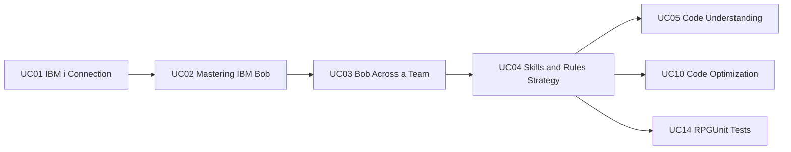

# UC 04 — Skills and Rules Strategy: industrializing Bob use cases

> **Category:** Using Bob
> **Phase:** Phase 0 — Onboarding (after UC03 — enterprise workspace in place)
> **Initial setup time:** 1 to 2 hours per skill/rule — writing the SKILL.md or rule.md, testing on a pilot component, versioning
> **Usage time:** low — the skill can activate automatically depending on context and the rule applies to every prompt, with no recurring developer effort
> **Bob modes used:** Agent (creating skills and rules), IBM i Developer (using skills)

---

## ⭐ IBM i Premium Package used

| Premium capability | Role in this UC |
|---|---|
| **71 IBM i skills** | Foundation **not** to be duplicated — ACME skills complement this foundation, they never replace it |
| **IBM i Developer mode** | Base mode in which ACME skills activate — carries the 71 Premium skills |

**Official documentation:** [IBM i Skills — full list](https://bob.ibm.com/docs/ide/premium-packages/bob-for-i/skills) · [Bob Skills — general documentation](https://bob.ibm.com/docs/ide/features/skills) · [Bob Rules](https://bob.ibm.com/docs/ide/configuration/rules)

> ⚠️ **Critical rule — do not recreate what already exists:**
> Before creating an ACME skill, check whether one of the 71 Premium skills already covers the need. The 71 skills cover RPG (22), CL (4), DDS (5), COBOL (12), Db2 (19), IWS (5), Understand (3) and Unit Testing (1). An ACME skill brings what Premium does not know: company standards, naming conventions, source manager constraints, business rules and the UC execution sequence.

---

## Objective

Turn the UCxx.md files into **reusable Bob skills** and define **infrastructure rules** that automate cross-cutting behaviors — so that Bob applies the ACME standards without the developer having to repeat them every session.

This UC solves three concrete problems:
1. **Usage friction** — without a skill, running UC10 means opening the file, reading the sequence and copy-pasting each prompt one by one. With a skill, the developer says *"Optimize FRS409"* and Bob orchestrates everything.
2. **Inconsistency between developers** — each developer runs the prompts slightly differently. The skill helps enforce a consistent sequence, the same rules and the same deliverables for everyone.
3. **Dual maintenance** — without a strategy, business rules get duplicated between the UCxx file and the skill. This UC defines a "single source of truth" architecture that eliminates the problem.

---

## Prerequisites

- **Phase:** Phase 0 — Onboarding
- **Required previous UCs:** UC02 — Mastering IBM Bob, UC03 — Using Bob Across a Development Team
- **Required deliverables:** `bob-reports/acme-workspace-init-{date}.md` (enterprise workspace in place — UC03)
- **Recommended Bob level:** Intermediate
- **Estimated Bob Coins:** ● ● ○ (skill creation, testing, versioning)

---

## Concrete example — FLGHT400 Lab

The `poc-ibmi-premium-uc-writer` skill is a concrete example of what this UC produces, applied to this POC itself.

- [`.bob/skills/poc-ibmi-premium-uc-writer/SKILL.md`](../.bob/skills/poc-ibmi-premium-uc-writer/SKILL.md) — skill created to industrialize the writing of the POC's UC files. Its SKILL.md illustrates all the components of a well-designed skill: frontmatter with a precise trigger, pointer to the source of truth, absolute rules, startup section.

For IBM i code-oriented skills, the FLGHT400 lab illustrates the end of the chain:
- [`FLGHT403_FRS409_modernization_report.md`](../labs_FLGHT400_results/FLGHT403_FRS409_modernization_report.md) — report produced by an optimization session on `FRS409`. This is the kind of structured, reproducible, ACME-compliant deliverable that the UC10 skill (optimization) must produce automatically, without the developer driving the sequence by hand.

---

## Fundamental principle: single source of truth

The `UCxx-*.md` files remain the **source of truth**. They contain the business rules, prompts, checklists, conventions and pitfalls. The skill **never** duplicates this content — it **points** to the UCxx.md and adds the orchestration workflow on top.

```
UC10-optimisation-code.md          ← source of truth (never modify for the skill)
         ↑
         pointed to by @UC10-optimisation-code.md
         ↓
.bob/skills/uc10-optimisation-rpg/SKILL.md   ← driver: workflow + absolute rules + pointer
```

**Direct consequence:** if a UCxx.md evolves (new prompt, new pitfall detected), the skill takes it into account on a later activation, provided its SKILL.md actually loads the referenced file (see test below). Rules are not duplicated, which reduces the duplication of maintenance effort.

**Single-source test:** after creating the skill, explicitly verify:
1. that `@UCxx-slug.md` resolves to the source file (correct path from the skill folder);
2. that Bob actually loads the content, for example by asking it to quote a specific prompt from the UCxx;
3. that after a passage of the UCxx is modified in a test environment, the skill's next answer reflects that change, without modifying the SKILL.md.

---

## How a Bob skill works

When Bob receives a request, it analyzes the `description` of each available skill to decide which one to activate. If the description matches the request, Bob loads the `SKILL.md` into context and follows its instructions.

**Key points:**
- A skill loads **only once per conversation** — no duplicates
- Bob can activate the skill **automatically** from its description — no explicit invocation needed, but activation depends on context and may require approval. A skill guides Bob: it does not guarantee deterministic execution
- Supporting files in the skill folder are accessible to Bob once the skill is activated
- By default Bob asks for confirmation before activating a skill — this can be disabled in *Settings → Auto-Approve → Skills*

### Auto-activation and multilingual behavior (FR / EN)

A frequent question from development teams: **do skills with an English description activate when the prompt is in French?**

**Yes, in most cases, for three reasons:**
1. **Cross-lingual semantic matching by the LLM:** The model underlying Bob performs a conceptual semantic analysis (embedding / attention) and directly maps an intent expressed in French (e.g. *« transpose la DATA DIVISION et gère les REDEFINES »*) to the skill's English description (`cobol-data-division`).
2. **Invariance of IBM i technical vocabulary:** Key terms are never translated (`QRPGLESRC`, `QCBLSRC`, `DATA DIVISION`, `WORKING-STORAGE`, `**FREE`, `CTL-OPT`, `DCL-DS`, `OVERLAY`, `CRTBNDRPG`, `QSYS2.SYSTABLES`). Their presence in the prompt or in the source member open in the editor favors activation.
3. **Best practices for ACME enterprise skills:**
   - Write the YAML frontmatter `description` with bilingual or explicit triggers (e.g. *« Utiliser pour optimiser du RPGLE / Use when refactoring RPG »*).
   - Use precise technical vocabulary in prompts rather than vague wording.
   - When an explicit call is needed, the developer can invoke `@skill-name` directly in the chat.

> 📚 Doc: [How skills work](https://bob.ibm.com/docs/ide/features/skills#how-skills-work) · [Approving skills](https://bob.ibm.com/docs/ide/features/skills#approving-skills)

---

## Skill locations — 2 levels

| Level | Location | Scope | Versioned |
|---|---|---|---|
| **Global** | `~/.bob/skills/` | All projects on the workstation | No — personal |
| **Project** | `.bob/skills/` in the repo | This project only | Yes — in Git |

**Priority rule:** if a skill with the same name exists at both levels, the project skill takes precedence over the global skill.

In the ACME context, skills are placed in the **enterprise repo** `acme-bob-commons/.bob/skills/` (see UC03) so they are shared with the whole team via Git.

> ⚠️ **Impact on the IBM i QSYS workspace:**
> When the active workspace is **IBM i Libraries (QSYS)**, the local workspace and its `.bob/skills/` are **not loaded**. Only `~/.bob/skills/` (global, workstation-wide) is active.
> Consequence: ACME skills versioned in `acme-bob-commons/.bob/skills/` are **not automatically available** in the QSYS workspace.
>
> **The same applies to rules**: `.bob/rules/` is only loaded when a local workspace is open. In a pure QSYS workspace, only the rules in `~/.bob/rules/` are active.
>
> **Recommended solution: multi-root workspace QSYS + local folder** → see the section below and Prompt 6.

> 📚 Doc: [Skill locations](https://bob.ibm.com/docs/ide/features/skills#skill-locations) · [IBM i Workspaces](https://bob.ibm.com/docs/ide/premium-packages/bob-for-i/workspaces)

---

## Multi-root workspace: QSYS + local folder

### Why the multi-root workspace?

The official Bob IBM i documentation states:
> *"In some cases, Bob can work outside a workspace or even **across multiple workspaces** if needed and with the appropriate permissions granted."*

The **VS Code multi-root workspace** (`.code-workspace` file) is the standard solution for combining the IBM i Libraries workspace (QSYS) and a local folder in the same Bob window. Once configured, **the skills and rules of the local folder should be loaded even when the QSYS workspace is the main active workspace** (behavior to be validated on a real installation, see the test below).

**Official documentation:**
- [IBM i Workspaces — Bob Premium](https://bob.ibm.com/docs/ide/premium-packages/bob-for-i/workspaces)
- [Multi-root Workspaces — VS Code](https://code.visualstudio.com/docs/editing/workspaces/multi-root-workspaces)

### How to create it (once per project)

**Step 1 — Open the QSYS workspace**
1. In Bob: `+` button at the bottom → *Library List*
2. Select the current library (e.g. `TRC0018`)

**Step 2 — Add the local `acme-bob-commons` folder**
```
File → Add Folder to Workspace...
```
→ Select the locally cloned `acme-bob-commons/` folder

The Explorer now shows two roots:
```
📁 TRC0018 (Library List — QSYS)
📁 acme-bob-commons (local)
```

**Step 3 — Save the workspace**
```
File → Save Workspace As...
```
→ Name the file `acme-{app}.code-workspace` and save it in the local project folder (e.g. `acme/TRC0018/`)

The generated file looks like this:
```json
{
  "folders": [
    {
      "name": "TRC0018 — QSYS",
      "uri": "iseries://QSYS/TRC0018"
    },
    {
      "name": "acme-bob-commons",
      "path": "../acme-bob-commons"
    }
  ]
}
```

> 💡 Relative paths in `.code-workspace` are relative to the location of the file itself.

### How to reload this workspace

| Method | How to do it |
|---|---|
| **Double-click** | Double-click `acme-trc0018.code-workspace` from Finder / Explorer |
| **From Bob** | `File → Open Workspace from File...` → select the `.code-workspace` file |
| **Recent** | `File → Open Recent` → workspaces appear with the `(Workspace)` suffix |

> ⚠️ **Prerequisite for reloading:** the IBM i connection (Code for IBM i) must be active before opening the workspace, otherwise the QSYS root will appear empty.

### What changes for skills and rules

| Situation | Skills `acme-bob-commons/.bob/skills/` | Rules `acme-bob-commons/.bob/rules/` |
|---|---|---|
| QSYS workspace only | ❌ Not loaded | ❌ Not loaded |
| Local workspace only | ✅ Loaded (if folder = `acme-bob-commons`) | ✅ Loaded |
| **Multi-root: QSYS + `acme-bob-commons`** | ✅ **Loaded** (to be validated) | ✅ **Loaded** (to be validated) |

**Multi-root validation test:** after opening the `.code-workspace`, check that the expected skills and rules from `acme-bob-commons` appear in the Skills tab of Bob Settings, and ask Bob to quote a specific rule or skill to confirm they are taken into account. If not, do not consider the workspace valid and record the finding.

### What Bob sees in the multi-root Explorer

- QSYS members are browsable and can be `@`-mentioned directly
- Local files (`.bob/rules/`, `.bob/skills/`, `UC/*.md`) are accessible and can be `@`-mentioned
- Bob can write to IBM i (QSYS or IFS) **and** locally in the same session
- The IBM i AGENTS.md (`QBOBSRC/AGENTS`) is injected automatically

### Versioning the `.code-workspace`

```bash
cd acme/TRC0018/
git add acme-trc0018.code-workspace
git commit -m "feat(workspace): add multi-root workspace QSYS + acme-bob-commons"
git push
```

Every developer can open exactly the same workspace after `git pull`.

> ⚠️ The `acme-bob-commons` path in the `.code-workspace` must be **relative** so the file is portable across workstations. Adjust it if the repos are in different folders from one machine to another.

---

## Rules: automatic cross-cutting behaviors

### What is a Bob rule?

A **rule** is a Markdown file in `.bob/rules/` that injects instructions into **every prompt** sent to Bob — without the developer having to repeat them. Unlike a skill (activated on demand), a rule is always active as long as the workspace is open.

| Mechanism | When active | Trigger | Use case |
|---|---|---|---|
| **Skill** | On demand — Bob activates it if the description matches | Description in frontmatter | UC workflow (sequence, prerequisites, deliverables) |
| **Rule** | Permanently — injected into every prompt | Presence of the file in `.bob/rules/` | Cross-cutting standards, default behaviors, conventions |

### Two types of rules

```
.bob/rules/                        ← active in ALL modes
    normes-rpg.md                  → ACME code standards (naming, opcodes, structure)
    source-manager-conventions.md  → source manager constraints (workflow, diff markers)
    livraison-bob-reports.md       → deliverable save behavior

.bob/rules-ibm-i-developer/        ← active ONLY in IBM i Developer mode
    normes-specifiques.md          → ILE conventions, compilation, procedures
    mirror-qsys-ifs.md             ← ⭐ example: QSYS → IFS mirror rule
```

> 📚 Doc: [Rules — mode-specific](https://bob.ibm.com/docs/ide/configuration/rules#mode-specific-rules) · [Team standardization](https://bob.ibm.com/docs/ide/configuration/rules#team-standardization)

### Concrete example — "Mirror QSYS → IFS" rule

This rule illustrates an infrastructure behavior: whenever Bob creates or modifies a Markdown deliverable in the QSYS workspace, it automatically copies it to the IFS using the ACME naming convention.

**File content** `.bob/rules-ibm-i-developer/mirror-qsys-ifs.md`:

```markdown
# Rule: Mirror IBM i QSYS → IFS

When you create or modify a Markdown source member in QSYS
(e.g. QBOBSRC, QRPGLESRC), automatically copy its content to
/home/{USER}/bob-reports/ using the ACME convention:
{appId}-{function}-{component}-{type}-{YYYYMMDD-HHmm}.md

Ask the user for their IBM i {USER} if not known.
Use IBM i Developer mode (native IBM i connection) to write to the IFS.
```

> **Limitations to be aware of:**
> - A rule **guides** Bob's behavior but does not trigger an automatic system action — Bob must be in Agent mode and approve the IFS write
> - This is **not** an automatic IBM i trigger (no `CRTJOBSCD`) — it is an instruction that Bob follows **within the conversation**
> - The rule is only active if a local workspace is open (see the QSYS workspace warning above)

### Rule authoring guidelines

- **Short** — max 80-100 lines per file. Beyond that, Bob truncates the injected context.
- **1 file = 1 behavior** — do not mix topics in the same file.
- **Imperative** — write them as direct instructions, not as documentation.
- **No complex conditions** — a rule does not replace a skill. If the logic is conditional, use a skill.

---

## Prompts

---

### Prompt 0 — Inventory the Premium skills before creating

**Objective:** Identify which of the 71 Premium skills already cover the need before creating an ACME skill. Avoids duplication and competition with Premium.

**When to use:** Before creating any new ACME skill, for each targeted UC.

**Required input:** List of UCs to industrialize, access to the IBM i Premium Package

**Workspace:** Local workspace (workstation)
**Mode:** Agent (or ASK)
**Key skills used:** None (analysis of Bob skills)

**Prompt:**

```
I am preparing the creation of ACME skills to industrialize the IBM i UCs.
Here are the UCs concerned: [list of UCs — e.g. UC05 Code Understanding, UC06 Business Logic, UC10 Optimization]

For each UC:
1. Identify which IBM i Premium skills (among the 71) are already active for this domain.
   List them by category (RPG, CL, DDS, COBOL, Db2/SQL, IWS, Understand).
2. Identify what the Premium skills do NOT cover: ACME standards, naming conventions,
   source manager constraints, specific prompt sequence, expected deliverables.
3. For each UC, propose an ACME skill title and its trigger description (3-5 lines
   describing when and why Bob should activate this skill).

Save the result in
bob-reports/acme-skills-inventory-{YYYYMMDD-HHmm}.md in the local workspace.
```

**Deliverable produced:** `bob-reports/acme-skills-inventory-{YYYYMMDD-HHmm}.md`

---

### Prompt 1 — Create an ACME skill for a UC

**Objective:** Generate the `SKILL.md` of an ACME skill that points to an existing UCxx.md.

**When to use:** For each UC you want to industrialize, after Prompt 0.

**Required input:**
- The target `UCxx-[slug].md` file (e.g. `UC/UC10-optimisation-code.md`)
- The inventory produced at Prompt 0

**Workspace:** Local workspace (workstation)
**Mode:** Agent
**Key skills used:** None (Bob skill generation)

**Prompt:**

```
In Agent mode, local workspace.
I want to create a Bob skill to industrialize @UC/[UCxx-slug].md.

According to the inventory @bob-reports/acme-skills-inventory-{date}.md,
the Premium skills [list] already cover the basics of this domain.
My ACME skill must only add: [specific standards, sequence, ACME deliverables].

Create the file acme-bob-commons/.bob/skills/[skill-slug]/SKILL.md with:
1. A `name` + `description` frontmatter (precise trigger — when, for what, on what)
2. A "Source of truth" section pointing to @UCxx-slug.md using the @ syntax
3. An "Absolute rules" section (5 rules max — the ACME non-negotiables)
4. A "Startup" section that asks the user for the minimum context:
   target program, library, available prerequisite deliverables
5. A "Premium prerequisites" section listing the complementary active Premium skills

Do not duplicate the content of UCxx.md in the SKILL.md — only point to it.
Keep the SKILL.md under 150 lines.

Save the creation report in
bob-reports/acme-skill-[slug]-creation-{YYYYMMDD-HHmm}.md in the local workspace.
```

**Deliverable produced:** `bob-reports/acme-skill-[slug]-creation-{YYYYMMDD-HHmm}.md`

> 💡 The generated SKILL.md is in `acme-bob-commons/.bob/skills/[slug]/SKILL.md`. To test it immediately locally, copy the folder into `.bob/skills/[slug]/` of the current project and restart Bob.

**Documentation:** [Creating a skill — Basic setup](https://bob.ibm.com/docs/ide/features/skills#basic-setup) · [SKILL.md format](https://bob.ibm.com/docs/ide/features/skills#skillmd-format) · [Writing effective skills](https://bob.ibm.com/docs/ide/features/skills#writing-effective-skills)

---

### Prompt 2 — Test a skill on a pilot component

**Objective:** Verify that Bob correctly activates the skill and follows the expected sequence on a real program.

**When to use:** Immediately after creating the skill, before distributing it to the team.

**Required input:**
- Skill created and placed in `.bob/skills/[slug]/` (local or cloned acme-bob-commons)
- Pilot IBM i program available (e.g. `FRS409` in `FLGHT403`)
- Active IBM i connection

**Workspace:** IBM i QSYS + Local (mixed workspace — local workspace open + IBM i connection)
**Mode:** IBM i Developer
**Key skills used:** `rpg-code-review`, `rpg-rla-to-sql` (or the skills of the domain of the component being tested)

**Prompt:**

```
[Phrase naturally what the skill should trigger — e.g.:]
Optimize program FRS409 in library FLGHT403.
```

Bob must automatically activate the skill `[skill-slug]` — check in the chat that Bob mentions the activated skill.

If Bob does not activate the skill automatically, diagnose with:

```
Which skills are currently loaded in this workspace?
```

Then adjust the SKILL.md description to improve detection.

**Deliverable produced:** deliverable specific to the activated skill (e.g. `bob-reports/flght403-optimisation-frs409-report-{date}.md`)

> 📚 Doc: [Skills settings tab](https://bob.ibm.com/docs/ide/features/skills#skills-settings-tab) · [Tips and best practices](https://bob.ibm.com/docs/ide/features/skills#tips-and-best-practices)

---

### Prompt 3 — Create the optional supporting files

**Objective:** Enrich the skill with supporting files that Bob consults automatically once the skill is activated — checklist, deliverable template, severity guide.

**When to use:** Optional — when the SKILL.md alone is not enough to guide Bob on the details.

**Required input:** Existing SKILL.md, feedback from Prompt 2 (missing points identified)

**Workspace:** Local workspace (workstation)
**Mode:** Agent
**Key skills used:** None (technical documentation writing)

**Prompt:**

```
In Agent mode, local workspace.
The skill @acme-bob-commons/.bob/skills/[slug]/SKILL.md is in place.
Following the tests, Bob lacks information on: [e.g. variable naming convention,
severity grid for detected issues].

Create the following supporting files in acme-bob-commons/.bob/skills/[slug]/:
1. checklist-validation.md — checklist that Bob must tick before delivering the result
2. conventions-nommage.md — quick reference of the ACME conventions for this domain

These files must be short (< 50 lines) and referenceable in the SKILL.md
via the @checklist-validation.md syntax.

Save the report in
bob-reports/acme-skill-[slug]-supports-{YYYYMMDD-HHmm}.md in the local workspace.
```

**Deliverable produced:** `bob-reports/acme-skill-[slug]-supports-{YYYYMMDD-HHmm}.md`

> 📚 Doc: [Adding supporting files](https://bob.ibm.com/docs/ide/features/skills#adding-supporting-files)

---

### Prompt 4 — Version and distribute

**Objective:** Commit the skill to `acme-bob-commons` for distribution to the whole team.

**When to use:** After the skill has been validated on a pilot component.

**Required input:** Skill tested and validated in `.bob/skills/[slug]/`

**Workspace:** Local workspace (workstation)
**Mode:** Agent
**Key skills used:** None (git commands)

**Prompt:**

```
In Agent mode, local workspace.
The skill [skill-slug] is validated. Guide me to version it in acme-bob-commons:

1. Check that the folder acme-bob-commons/.bob/skills/[slug]/ contains:
   - SKILL.md
   - (supporting files if created at Prompt 3)
2. Update the README.md of the acme-bob-commons repo with the new skill entry:
   | [skill-slug] | [targeted UC] | [trigger in one line] | ✅ Validated |
3. Generate the git commands to run:
   cd acme-bob-commons
   git add .bob/skills/[slug]/
   git add README.md
   git commit -m "feat(skills): add skill [skill-slug] — UC[N] [title]"
   git push

Save the release note in
bob-reports/acme-skill-[slug]-release-{YYYYMMDD-HHmm}.md in the local workspace.
```

**Deliverable produced:** `bob-reports/acme-skill-[slug]-release-{YYYYMMDD-HHmm}.md`

> 💡 Each developer receives the skill via `git pull` in their local clone of `acme-bob-commons` — no manual action on their part.

---

## Skill structure — reference

### Typical tree structure

```
acme-bob-commons/.bob/skills/
├── uc10-optimisation-rpg/
│   ├── SKILL.md                    ← required — workflow + frontmatter
│   ├── checklist-validation.md     ← optional — validation checklist
│   └── conventions-nommage.md      ← optional — ACME quick reference
├── uc05-comprehension-rpg/
│   └── SKILL.md
└── uc14-rpgunit/
    └── SKILL.md
```

### SKILL.md format — concrete example

```markdown
---
name: UC10 — Optimisation RPG IBM i
description: >
  Optimizes an IBM i RPG program without changing its functional logic.
  Applies the ACME UC10 methodology: renaming cryptic variables,
  replacing obsolete opcodes (MOVE, SETON, GOTO…), extracting
  subroutines into Free RPG procedures, according to the ACME standards.
  Activate when the user asks to optimize, modernize, refactor
  or improve the readability of an RPG program.
---

## Source of truth

This skill applies the methodology defined in @UC10-optimisation-code.md.
Read this file in full before starting — it contains prompts P0 to P5,
the mode rules, the naming conventions and the validation checklist.

## Premium prerequisites

Complementary Premium skills active in IBM i Developer mode:
- `rpg-code-review` — quality review and modernization
- `rpg-rla-to-sql` — conversion of RLA access to SQL
- `rpg-fixed-to-free` — fixed-format → free-format conversion
These skills enrich Bob's answers — do not redefine them in this SKILL.md.

## Absolute rules

1. Always start with UC10 Prompt 0 — never go straight to renaming.
2. Stay in Ask mode during Prompts 0 to 4 (analysis, diffs).
   Switch to Agent only for compilation and saving.
3. Check the prerequisites before starting:
   - *-comprehension-*.md (UC05) available → MANDATORY
   - *-regles-*.md (UC06) available → MANDATORY
   - Native IBM i connection active
4. Name the deliverables: {appId}-{function}-{component}-{type}-{YYYYMMDD-HHmm}.md
5. Source manager mention in every diff: ⚠️ Source manager reintegration — to be done manually

## Startup

Ask the user:
- Which RPG program should be optimized? (name + library)
- Are the *-comprehension-*.md and *-regles-*.md files in the workspace?

If the prerequisites are missing, recommend a UC05 session (30 min) before continuing.
```

---

## ACME skill creation roadmap

| Priority | UC | Skill slug | Premium foundation activated | Status |
|---|---|---|---|---|
| 0 | This POC itself | `poc-ibmi-premium-uc-writer` | — | ✅ Created — reference example |
| 1 | UC10 — Code optimization | `uc10-optimisation-rpg` | `rpg-code-review`, `rpg-rla-to-sql` | ✅ Created (pilot) |
| 2 | UC05 — Program understanding | `uc05-comprehension-rpg` | `understand-app-overview`, `understand-program-explainer` | To create |
| 3 | UC06 — Business logic | `uc06-logique-metier` | `rpg-code-review`, `cobol-procedure-division` | To create |
| 4 | UC08 — DDS to DDL | `uc08-dds-vers-ddl` | `db2-dds-to-ddl`, `dds-physical-files` | To create |
| 5 | UC07 — Documentation | `uc07-documentation` | `db2-system-catalog`, `understand-impact-analysis` | To create |
| 6 | UC11 — Restructuring | `uc11-restructuration-rpg` | `rpg-fixed-to-free`, `rpg-refactor-legacy` | To create |
| 7 | UC09 — Embedded SQL | `uc09-sql-embarque` | `rpg-rla-to-sql`, `rpg-embedded-sql` | To create |
| 8 | UC14 — RPGUnit tests | `uc14-rpgunit` | `rpgunit-testing`, `rpg-debugging-techniques` | To create |

---

### Prompt 5 — Create an infrastructure rule

**Objective:** Create a rule that automates a cross-cutting behavior (deliverable naming, QSYS→IFS mirror, source manager markers…) applied to all prompts.

**When to use:** When a behavior must be permanently active, not only during a specific UC.

**Required input:** Standards or behavior to automate, target scope (all modes or IBM i Developer only)

**Workspace:** Local workspace (workstation)
**Mode:** Agent
**Key skills used:** None (Bob rule generation)

**Prompt:**

```
In Agent mode, local workspace.
I want to create a Bob rule that automates the following behavior:
[describe the behavior — e.g. "Always copy the Markdown deliverables
created in the QSYS workspace to /home/{USER}/bob-reports/ using the convention
{appId}-{function}-{component}-{type}-{YYYYMMDD-HHmm}.md"]

This behavior must be active:
- [ ] In all modes (.bob/rules/)
- [ ] Only in IBM i Developer mode (.bob/rules-ibm-i-developer/)

Create the rule file in acme-bob-commons/.bob/rules[suffix]/:
1. Short, descriptive title (H1)
2. Imperative instructions (no documentation — just directives)
3. Max 80 lines — if longer, create several thematic files

Save the creation report in
bob-reports/acme-rule-[slug]-creation-{YYYYMMDD-HHmm}.md in the local workspace.
```

**Deliverable produced:** `bob-reports/acme-rule-[slug]-creation-{YYYYMMDD-HHmm}.md`

> 💡 After creation, test it immediately: send any prompt to Bob and check that it follows the behavior defined in the rule.

**Documentation:** [Rules](https://bob.ibm.com/docs/ide/configuration/rules) · [Mode-specific rules](https://bob.ibm.com/docs/ide/configuration/rules#mode-specific-rules)

---

### Prompt 6 — Create the multi-root workspace QSYS + local folder

**Objective:** Generate and version the `.code-workspace` file that combines the IBM i QSYS workspace and the local `acme-bob-commons` folder, so that ACME skills and rules are available whichever workspace is active.

**When to use:** Once per IBM i project, after cloning `acme-bob-commons` and configuring the IBM i connection.

**Required input:**
- Active IBM i connection (Code for IBM i)
- `acme-bob-commons` cloned locally
- Current library defined (e.g. `TRC0018`)

**Workspace:** Local workspace (workstation) → switches to the multi-root workspace
**Mode:** Agent
**Key skills used:** None (multi-root workspace configuration)

**Prompt:**

```
In Agent mode, local workspace.
I want to create a Bob multi-root workspace that combines:
- The IBM i Libraries workspace (QSYS) — library {appId}
- The local acme-bob-commons folder (path: {local-path}/acme-bob-commons)

1. Create the file {appId}-workspace.code-workspace in the local
   project folder (e.g. acme/{appId}/) with:
   - An entry for the IBM i QSYS workspace (uri iseries://QSYS/{appId})
   - An entry for acme-bob-commons (relative path from the file location)
   - Display names: "{appId} — QSYS" and "acme-bob-commons"

2. Check that the relative path to acme-bob-commons is correct
   (relative to the folder where the .code-workspace is saved).

3. Generate the git commands to version this file:
   git add {appId}-workspace.code-workspace
   git commit -m "feat(workspace): multi-root workspace QSYS + acme-bob-commons"

4. Save the reload instructions in
   bob-reports/acme-workspace-multiroot-{YYYYMMDD-HHmm}.md in the local workspace:
   - How to open this workspace (3 methods)
   - Prerequisites (active IBM i connection)
   - What the workspace loads (skills, rules, AGENTS.md)
```

**Deliverable produced:** `bob-reports/acme-workspace-multiroot-{YYYYMMDD-HHmm}.md`

> 💡 Once the multi-root workspace is saved, daily use is simple: double-click the `.code-workspace` file in Finder (or `File → Open Recent` in Bob). Bob loads both workspaces simultaneously.

**Documentation:** [IBM i Workspaces — Bob Premium](https://bob.ibm.com/docs/ide/premium-packages/bob-for-i/workspaces) · [Multi-root Workspaces — VS Code](https://code.visualstudio.com/docs/editing/workspaces/multi-root-workspaces)

---

## Pitfalls to avoid

| Pitfall | Consequence | Solution |
|---|---|---|
| Vague description (`"skill UC10"`) | Bob never activates the skill | Write a description that states the **trigger** — when, for what, on what |
| Duplicating the UCxx rules in the SKILL.md | Dual maintenance — the two files diverge | Point to `@UCxx.md` — never copy-paste the rules |
| Recreating an existing Premium skill | Conflict, inconsistency, pointless maintenance | Check the 71 Premium skills before creating — complement, do not replace |
| SKILL.md too long (> 150 lines) | Bob truncates the instructions at the end of the file | Keep the SKILL.md short — move the detail into supporting files |
| Forgetting the "Startup" section | Bob starts without collecting the prerequisites | Always include a section that asks for the minimum context |
| Skill only in `~/.bob/skills/` | Skill not shared — every developer has to recreate it | Team skills in `acme-bob-commons` |
| Rule too long (> 100 lines) | Bob truncates the context injected at every prompt | Max 80-100 lines — 1 file = 1 behavior |
| Rule with complex conditional logic | Rule ignored or misinterpreted | Conditional logic → skill, not rule |
| Skills/rules inactive in the QSYS workspace | Local `.bob/` not loaded — ACME skills and rules missing | Use the multi-root workspace (Prompt 6) |
| Absolute path in `.code-workspace` | Workspace not portable across workstations | Always use relative paths in `.code-workspace` |
| `.code-workspace` not versioned | Every developer recreates their own workspace | Version it in the project repo — `git add *.code-workspace` |
| Opening the multi-root workspace without an active IBM i connection | Empty QSYS root — members not accessible | Start Code for IBM i and connect before opening the `.code-workspace` |
| Creating a custom mode to customize IBM i Developer | Loss of the 71 Premium skills and workflows | Skills + mode-specific rules — never a competing custom mode |

---

## UC Deliverables

| Produced file | Naming pattern | Creation workspace | Consumed by |
|---|---|---|---|
| Skills inventory | `bob-reports/acme-skills-inventory-{YYYYMMDD-HHmm}.md` | Local | Team reference |
| Skill creation report | `bob-reports/acme-skill-{slug}-creation-{YYYYMMDD-HHmm}.md` | Local | Skill reference |
| Supporting files report | `bob-reports/acme-skill-{slug}-supports-{YYYYMMDD-HHmm}.md` | Local | Skill maintenance |
| Skill release note | `bob-reports/acme-skill-{slug}-release-{YYYYMMDD-HHmm}.md` | Local | Team / changelog |
| Rule creation report | `bob-reports/acme-rule-{slug}-creation-{YYYYMMDD-HHmm}.md` | Local | Rule reference |
| Multi-root workspace guide | `bob-reports/acme-workspace-multiroot-{YYYYMMDD-HHmm}.md` | Local | Developer onboarding |
| Workspace file | `{appId}-workspace.code-workspace` | Local (versioned) | Every QSYS session |

---

## Dependencies



---

## UC 04 Validation Checklist

Before moving on to UC05, check each point:

**Skills:**
- [ ] The inventory of the 71 Premium skills was consulted before creating each ACME skill
- [ ] At least one ACME skill is created and versioned in `acme-bob-commons/.bob/skills/`
- [ ] The SKILL.md points to the UCxx.md via `@` — no duplicated rules
- [ ] The single-source test was performed (resolution and loading of `@UCxx.md`, taking a modification into account)
- [ ] The skill was tested on a pilot program — Bob activated it automatically
- [ ] The SKILL.md is under 150 lines
- [ ] The "Startup" section is present and asks for the minimum context
- [ ] The "Premium prerequisites" section lists the complementary Premium skills

**Rules:**
- [ ] At least one infrastructure rule is created in `acme-bob-commons/.bob/rules/` or `.bob/rules-ibm-i-developer/`
- [ ] Each rule is under 100 lines — 1 file = 1 behavior
- [ ] The rule's behavior was tested (a prompt sent, behavior verified)

**Multi-root workspace:**
- [ ] The `{appId}-workspace.code-workspace` file is created with a relative path to `acme-bob-commons`
- [ ] The `.code-workspace` file is versioned in the project repo
- [ ] The workspace was reloaded via double-click — both roots (QSYS + local) are visible
- [ ] ACME skills and rules are visible in the Skills tab of Bob Settings with the multi-root workspace open
- [ ] The multi-root validation test was performed (expected skills and rules effectively taken into account)

**Common:**
- [ ] No custom mode competing with IBM i Developer has been created
- [ ] The `acme-bob-commons` repo is up to date and the teams have access via `git pull`

---

*UC04 sheet — revised 2026-10-30 — IBM i Premium Package integration — Skills, Rules and Multi-root Workspace*
