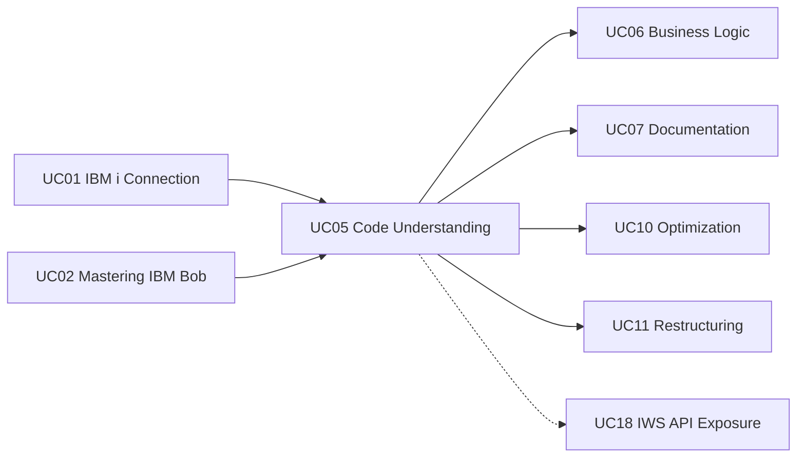

# UC 05 — Code and Application Understanding

> **Phase:** Phase 1 — Understand before modernizing

---

## ⭐ IBM i Premium Package used

- **Understand Dashboard** → [Understand](https://bob.ibm.com/docs/ide/premium-packages/bob-for-i/understand) — application mapping, impact analysis, dead objects. Opened with the *Open Understand Dashboard* command (`vscode-ibmi-bob.openUnderstandDashboard`) or the Dashboard icon in the Bob chat title bar. Installation, scan, tabs and limitations: see UC00 §2 (not repeated here).
- **Slash Command `/init`** → [Slash Commands Bob for IBM i](https://bob.ibm.com/docs/ide/premium-packages/bob-for-i/slash-commands) — generates the contextual `AGENTS.md` before any understanding prompt (IBM i Developer and IBM i Database modes)
- **Business Rules Extraction workflow** → [Business Rules Extraction](https://bob.ibm.com/docs/ide/premium-packages/bob-for-i/workflows) — entry point into UC06 (business logic). Launched with the **Start Workflow** button at the top of the chat. Scope: **RPG sources only** (COBOL and CL: manual prompts and `cobol-*` / `cl-*` skills, see UC06). Supported workspaces: Local, IFS Working Directory, Library List.
- **Auto-activated skills:** `understand-app-overview`, `understand-program-explainer`, `understand-impact-analysis` (active only if Understand is installed), `rpg-code-review`, `rpg-indicators`, `db2-system-catalog`. For a COBOL program: `cobol-opm-understanding`, `cobol-ile-understanding`.

---

## Objective

Quickly understand unknown or poorly documented IBM i legacy code: the functional role of a program, its inputs/outputs, its dependencies, its processing logic.

This is the **mandatory entry point before any modernization**. Without an understanding of the existing code, no architecture, refactoring or migration decision is reliable.

**Expected deliverable:** One program understanding report per analyzed program — role, data flows, dependencies, key considerations — ready to feed UC06 (business logic), UC07 (documentation), UC10 (optimization) and UC11 (restructuring).

---

## Prerequisites

- **Phase:** Phase 1 — Understand before modernizing
- **Required previous UCs:** UC01 (IBM i connection), UC02 (Bob mastery)
- **Required deliverables:** `AGENTS.md` generated by `/init` (see UC02 and UC00 §3.1) — optional but strongly recommended
- **Recommended Bob level:** Intermediate
- **Estimated Bob Coins:** ● ● ○

---

## Concrete example — FLGHT400 Lab

Three files produced by Bob on the `FLGHT403` application directly illustrate this UC:

- [`../labs_FLGHT400_results/FLGHT403_FRS409_explanation.md`](../labs_FLGHT400_results/FLGHT403_FRS409_explanation.md) — Complete analysis of program `FRS409` (OPM RPG/400): functional role, DDS interface, input/output parameters, detailed execution flow, subroutines. Produced with Prompt 1 (general understanding).

- [`../labs_FLGHT400_results/FLGHT403_architecture.md`](../labs_FLGHT400_results/FLGHT403_architecture.md) — Complete application architecture of FLGHT403: 92 programs (68 OPM, 22 ILE), 56 DSPFs, 28 PFs, 52 LFs, Mermaid flow diagram, table of modernization signals. Produced via Understand Dashboard + `understand-app-overview` skills.

- [`../labs_FLGHT400_results/FLGHT403_functional_areas.md`](../labs_FLGHT400_results/FLGHT403_functional_areas.md) — Functional areas identified (reservations, flight scheduling, customers, reporting, utilities). Produced via Understand scan.

> These three deliverables show the natural progression of this UC: understanding an isolated program (FRS409) → application view (Understand) → map of functional areas.

---

## Premium-first strategy: where to start?

Before any free-form prompt, two Premium elements speed up and structure the understanding.

### Step 1 — Run `/init` to give Bob context

**Workspace:** IBM i QSYS (Library List workspace)

**When:** at the start of the session, before any understanding prompt.

The `/init` command analyzes the current library and automatically generates an `AGENTS.md` file documenting the ILE architecture, naming conventions, DDS/SQL objects and project standards. This file is then injected into the context of every Bob conversation.

**How:**
1. Make sure the application library is set as the **current library** (right-click → *Set as Current Library* in the User Library List view) — without a current library, `/init` stops without creating anything
2. In the Bob chat input box, type `/init`
3. Bob scans the library and generates the `AGENTS.md` at the official location:
   - `{LIBRARY}/QBOBSRC/AGENTS.MD` — QSYS workspace
   - `{IFS directory}/.bob/AGENTS.md` — IFS workspace

> 📝 The FLGHT400 lab also produced a copy `/home/ITZUSER/AGENTS.md`, observed in the FLGHT400 lab and not documented by IBM — do not rely on it. Details: UC00 §3.1.

**Result:** see [`../labs_FLGHT400_results/FLGHT403_init_report.md`](../labs_FLGHT400_results/FLGHT403_init_report.md) for an example on FLGHT403 — 122 members scanned, dual OPM/ILE architecture identified, critical `FLGHT400` dependency detected.

> 💡 Without `/init`, Bob will ignore the naming conventions and cross-library dependencies. It may answer correctly but with less contextual precision.

---

### Step 2 — Open Understand Dashboard for the application view

**Workspace:** IBM i QSYS (Understand must be installed and an application scanned — see UC00 §2)

**When:** to map an entire application, identify the most coupled programs, dead objects, and the recommended modernization order.

**How:**
1. In VS Code / Bob IDE, open the command palette (`Cmd+Shift+P`)
2. Type `vscode-ibmi-bob.openUnderstandDashboard` (*Open Understand Dashboard*) — or click the Dashboard icon in the Bob chat title bar
3. Select the application to analyze (created and scanned in the **Applications** tab)

> 💡 The scan reads the **compiled objects**, not the source, and captures neither dynamic calls nor dynamic SQL: these limitations are detailed in UC00 §2.

**What the Dashboard produces:**
- Complete dependency graph between programs
- Hotspot table (most coupled programs)
- OPM → ILE modernization maturity indicator
- List of dead objects (unused)
- Impact analysis: which objects are affected when an element is changed

> ⚠️ The Understand Dashboard requires prior installation on the IBM i (see UC00 §2). If Understand is not available, use Prompt 2 (manual dependencies) as an alternative.

---

## Impact of program size on the analysis strategy

With the IBM i tools active (IBM i Developer mode), Bob accesses sources through targeted tool calls — it does not load the entire source into memory at once. This lets it navigate large programs. **Raw size is therefore not the only limiting factor.**

The real factors that degrade analysis quality:
- **Logic density**: 800 lines of nested financial calculations are harder than 2,000 lines of repetitive I/O
- **Unresolved copybooks**: if the `/COPY` members are not in scope, Bob works on an incomplete program
- **Dynamic calls**: `CALL` with a program-name variable — invisible statically
- **Indicators shared** between subroutines (`*IN50`, `*IN51`…)

| Size | Strategy | Prompt to use |
|---|---|---|
| < 1,000 lines | Direct analysis | Prompt 1 as is |
| 1,000 to 3,000 lines | Analysis focused on structure | Extended Prompt 1 |
| 3,000 to 8,000 lines | Two-pass analysis | Pass 1 (mapping) + Pass 2 (targeted detail) |
| > 8,000 lines | Analysis by functional module | Modules prompt → UC11 (restructuring) |

---

## Starting a Bob session

**Mode to select:** `IBM i Developer` (IBM i Premium Package)

Each program analysis session must start in a **new Bob conversation** (`+` button). Do not analyze two different programs in the same conversation.

**Exception:** when chaining the analysis of several **related programs** (Prompt 2 — application view), staying in the same conversation leverages the dependency history.

**Before the first prompt:**
1. Open the RPG program in the editor (right-click the member → **Open in Editor** in the IBM i — Object Browser panel)
2. Also open the copybooks referenced via `/COPY` if present in scope
3. Open the DDS display files if the program is interactive

> ⚠️ UC 05 is **read-only** on the IBM i — never allow writes to IBM i sources or objects. If Bob proposes a `write_member` action, decline it. Saving the markdown report locally remains authorized.

---

## Prompts

### Prompt 0 — Initialize the context with `/init`

**Objective:** generate the library's contextual `AGENTS.md` before any understanding prompt.

**When to use:** at the very start of a session, before Prompt 1, if `/init` has not yet been run on this library.

**Workspace:** IBM i QSYS

**Required input:** application library set as the current library

**Key skills used:** — (Premium slash command, see UC00 §3.1)

**Prompt:**

```
/init
```

**Deliverable produced:** `AGENTS.md` on the IBM i — `{LIBRARY}/QBOBSRC/AGENTS.MD` (QSYS workspace) or `{IFS directory}/.bob/AGENTS.md` (IFS workspace)

> 💡 This prompt is [Replaced by the Premium Slash Command `/init` — see ⭐ Premium Package above].

---

### Prompt 1 — General understanding of a program

**Objective:** produce a complete program understanding report for a program: functional role, language, inputs/outputs, dependencies, areas of concern, open questions.

**When to use:** for any program under 3,000 lines, or as a first pass on larger programs.

**Workspace:** IBM i QSYS

**Required input:** program open in the editor, copybooks in scope

**Key skills used:** `rpg-code-review`, `rpg-indicators` (and `cobol-opm-understanding` / `cobol-ile-understanding` if the program is COBOL)

**Prompt:**

```
The program [PROGRAM_NAME] is in library [LIB_NAME]/QRPGSRC.

Analyze this program and answer the following points in English, in markdown:
1. Functional role in 3 sentences maximum (for a non-technical reader)
2. Language and style (RPG III / RPG IV fixed / RPG Free / COBOL / CL)
3. Inputs: parameters received, files read, screens used
4. Outputs: parameters returned, files written/updated, printed output
5. Dependencies: called programs (CALL), subroutines (EXSR), copybooks (/COPY)
6. Areas of concern: complex code, indicators, heavy conditional logic
7. Open questions: what you cannot determine without additional context
```

**Important notes:**
- Point 7 "Open questions" → **anti-hallucination safeguard**. Forces Bob to flag what it does not know rather than invent.
- Point 5 "Dependencies" → the point most often forgotten in a manual analysis — critical for modernization.
- `Language and style` → essential on IBM i, where several generations of RPG coexist.

**Deliverable produced:** `{appId}-comprehension-{component}-report-{YYYYMMDD-HHmm}.md`

---

### Prompt 1-bis — Programs of 1,000 to 3,000 lines

**Objective:** analysis focused on structure, in particular subroutines and control flow.

**Workspace:** IBM i QSYS

**Key skills used:** `rpg-code-review`, `rpg-indicators` (and `cobol-opm-understanding` / `cobol-ile-understanding` if the program is COBOL)

**Prompt:**

```
The program [PROGRAM_NAME] in [LIB_NAME]/QRPGSRC is about [N] lines long.

Analyze this program and answer in English in markdown:
1. Overall functional role in 3 sentences (for a non-technical reader)
2. Language and style (RPG III / RPG IV fixed / RPG Free / COBOL / CL)
3. Inputs and outputs: parameters, files, screens
4. List of subroutines / procedures with their assumed role and what triggers them
5. Dependencies: external CALL / CALLP, /COPY, shared files
6. Areas of concern: indicators shared between subroutines, complex conditional logic
7. Open questions: what you cannot determine without additional context
```

**Deliverable produced:** `{appId}-comprehension-{component}-report-{YYYYMMDD-HHmm}.md`

---

### Prompt 1-ter — Programs of 3,000 to 8,000 lines (two-pass analysis)

**Objective:** map the structure before going deeper into the sections of interest.

**Workspace:** IBM i QSYS

**Key skills used:** `rpg-code-review`, `rpg-indicators`

**Pass 1 — Structural mapping:**

```
The program [PROGRAM_NAME] in [LIB_NAME]/QRPGSRC is about [N] lines long.

Pass 1 — mapping only, do not go into the detail of the code:
1. List all subroutines (EXSR / SR) with their name and assumed role
2. List all files declared in F specifications (or DCL-F in free format)
3. List all CALL / CALLP to external programs
4. Identify the main data structures (DS) and their likely role
5. Describe the main execution flow in 5 to 10 steps

Do not detail the code of each subroutine in this pass.
```

**Pass 2 — Targeted analysis of the sections of interest:**

```
Based on the mapping we just did for [PROGRAM_NAME],
analyze the following subroutines in detail: [SR1], [SR2], [SR3].

For each subroutine:
- Precise functional role
- Data read and modified
- Conditional logic and indicators used
- Any external calls
```

**Deliverable produced:** `{appId}-comprehension-{component}-report-{YYYYMMDD-HHmm}.md`

---

### Prompt 2 — Understand dependencies between programs (application view)

**Objective:** produce a Mermaid diagram of the calls between programs and the shared files.

**When to use:** to understand a complete business function involving several related programs.

**Workspace:** IBM i QSYS

**Required input:** list of programs to analyze (3 to 5 max per conversation)

**Key skills used:** `understand-app-overview` (if Understand is available)

**Prompt:**

```
In library [LIB_NAME], analyze the relationships between the following
programs: [PROG1], [PROG2], [PROG3].

For each program, identify:
- The programs it calls (CALL, CALLB, CALLP)
- The physical and logical files it reads or modifies
- The parameters exchanged between programs

Then produce a Mermaid flowchart diagram showing the calls between programs,
with the shared files as intermediate nodes.
Do not invent relationships that are not visible in the source code.
```

> ⚠️ Without the last line, Bob may infer plausible relationships from program names even though they are not visible in the code — this is a structural hallucination.

> 💡 **Alternative with Understand Dashboard:** if Understand is available, Prompt 2 is complementary — Understand produces the full application view, Prompt 2 drills into a specific subset of programs.

**Deliverable produced:** `{appId}-comprehension-all-report-{YYYYMMDD-HHmm}.md`

---

### Prompt 3 — Understand a program without its source (compiled object only)

**Objective:** extract the metadata of a program whose source has been lost.

**When to use:** when a program's source cannot be found (compiled object with no source in QSYS).

**Workspace:** IBM i QSYS

**Required input:** program name and library, native IBM i connection active (IBM i Database mode)

**Key skills used:** `db2-system-catalog`

**Prompt:**

```
The program [PROGRAM_NAME] in [LIB_NAME] has no source available
(compiled object only).

Use the available information to give me:
1. Creation date and last use: QSYS2.OBJECT_STATISTICS
2. Creation language: QSYS2.PROGRAM_INFO (PROGRAM_TYPE attribute)
3. References to other objects: run DSPPGMREF OUTPUT(*OUTFILE) on this program
   and query the output file to list the files and programs referenced
4. If ILE program: bound modules via QSYS2.BOUND_MODULE_INFO

DSPPGMREF is preferable to the QSYS2 views for OPM programs (RPG III / RPG400)
because these programs return nothing in BOUND_MODULE_INFO.

State clearly what you cannot determine without the source.
```

> ⚠️ `QSYS2.BOUND_MODULE_INFO` returns **nothing** for OPM programs (RPG III, RPG400, OPM COBOL). On a production IBM i with programs from the 80s-90s, that is the majority of the estate. `DSPPGMREF` is the only reliable command on these objects.

> ⚠️ Never ask Bob to "decompile" an IBM i program — it could generate a fictitious source that looks like the real one without being it.

**Deliverable produced:** `{appId}-comprehension-{component}-report-{YYYYMMDD-HHmm}.md`

---

### Prompt 3-bis — Inventory of obsolete programs

**Objective:** produce a table of programs not recompiled for N years to prioritize modernization.

**Workspace:** IBM i QSYS

**Complement to Prompt 3 — usable on any library.**

**Key skills used:** `db2-system-catalog`

**Prompt:**

```
In library [LIB_NAME], identify the programs that have not been recompiled
for [N] years (counting from today's date).

Use QSYS2.OBJECT_STATISTICS with the following filters:
- OBJECT_LIBRARY = '[LIB_NAME]'
- OBJECT_TYPE = '*PGM'
- OBJCREATED < CURRENT_DATE - [N] YEARS

For each program identified, produce a table with:
| Program name | Creation date (OBJCREATED) | Language (PROGRAM_TYPE) | Estimated age (years) |

Sort by OBJCREATED ascending (oldest first).
Report the total number of programs in the library and the percentage considered obsolete.
Do not conclude on whether modernizing is relevant without additional business information.
```

> ⚠️ `OBJCREATED` is the **recompilation** date, not the date the source was written. Cross-check with `LAST_USED_TIMESTAMP` to detect programs that have not been used recently.

**Deliverable produced:** `{appId}-comprehension-all-report-{YYYYMMDD-HHmm}.md`

---

### Prompt 4 — Executive summary for management

**Objective:** produce a 10-line summary for a non-developer manager.

**When to use:** after Prompt 1, to prepare a Phase 1 review meeting with management.

**Workspace:** IBM i QSYS + Local (generated in the chat, saved locally)

**Key skills used:** `rpg-code-review`

**Prompt:**

```
Based on the analysis of program [PROGRAM_NAME] we have just done,
write an executive summary in English of 10 lines maximum, aimed at a
non-developer IT manager.

The summary must include:
- What the program does in business terms
- Its importance in the system (critical / secondary / standalone)
- Its technical state (modern / legacy / to be modernized as a priority)
- The risk if this program is modified without precaution

Do not use RPG or IBM i technical terms without explaining them.
```

**Deliverable produced:** included in `{appId}-comprehension-{component}-report-{YYYYMMDD-HHmm}.md`

---

### Prompt 5 — Understand analysis of a specific program

**Objective:** use the `understand-program-explainer` skill to obtain the ILE composition, bound modules, exports, files used and callers.

**When to use:** on ILE programs, to complement the Prompt 1 analysis with Understand data.

**Workspace:** IBM i QSYS (Understand required)

**Key skills used:** `understand-program-explainer`

**Prompt:**

```
Using the Understand data available for library [LIB_NAME],
give me for program [PROGRAM_NAME]:
1. ILE composition: is it an OPM program, a module or a service program?
2. Bound modules (if ILE): list of modules with their source file
3. Exports: procedures exported by this program or service program
4. Files used: PFs, LFs and SQL tables
5. Callers: programs that directly call [PROGRAM_NAME]
6. Modification risk level: low / medium / high — justification
```

> 💡 This prompt uses the `understand-program-explainer` skill, which is activated automatically in the IBM i modes when Understand is installed and an application has been scanned (see UC00 §2).

**Deliverable produced:** included in `{appId}-comprehension-{component}-report-{YYYYMMDD-HHmm}.md`

---

### Prompt 6 — Impact analysis before modification

**Objective:** identify all the objects affected by modifying a program or a file.

**When to use:** before any modification of a program or shared file, to assess the risk.

**Workspace:** IBM i QSYS (Understand required for the full analysis)

**Key skills used:** `understand-impact-analysis`

**Prompt:**

```
Before modifying [OBJECT_NAME] in [LIB_NAME], analyze the impact of this change.

1. Direct dependents: programs that call or read [OBJECT_NAME]
2. Indirect dependents: programs that depend on the direct dependents
3. Shared files: which data files are used by [OBJECT_NAME]
   and by how many other programs?
4. Overall risk level: low / medium / high
5. Recommended rebuild order if recompilation is needed

Use QSYS2 for OPM programs if Understand is not available.
```

> 💡 This prompt uses the `understand-impact-analysis` skill when Understand is configured.

**Deliverable produced:** `{appId}-comprehension-{component}-report-{YYYYMMDD-HHmm}.md`

---

### Note — Chaining prompts in a continuous conversation

UC 05 is practiced as a **continuous conversation**, not as isolated prompts. Once Prompt 1 has been sent, dig deeper without resubmitting everything:

```
[After the answer to Prompt 1]
"You mentioned that the program calls CALCREMISE.
 Can you analyze that program the same way?"

"Point 6 (areas of concern) mentions indicators *IN50 and *IN51.
 Explain their precise role in the logic of this program."

"Rephrase point 1 (functional role) emphasizing the impact
 on the customer order process."
```

> 💡 Bob keeps the context of the analyzed program throughout the conversation. Saves Bob Coins.

> ⚠️ **Watch the Context indicator**: as soon as the % goes above 60%, open a new session or ask for a context transfer document. See UC02 §5 — Scope and context for the complete strategy.

**Saving the sheet (local report):** once the analysis is finalized in IBM i Developer mode, switch to **Agent** mode (authorized for local file creation) and ask:

```
Save the program understanding report of this program in a markdown file
named according to the convention: {appId}-comprehension-{component}-report-{YYYYMMDD-HHmm}.md
in the bob-reports/ folder.
Example: flght403-comprehension-frs409-report-20261030-1400.md
```

> 💡 **Link with UC06:** when Bob lists the subroutines in Prompt 1 (point 4 or 5), **note that list immediately** — it becomes the navigation guide for business rules extraction in UC06.

---

## Pitfalls to avoid

| Pitfall | What happens | How to avoid it |
|---|---|---|
| Analyzing without defining the Library List scope | Bob misses the copybooks and files linked in other members | Always define the scope → Library List before the first prompt |
| Analyzing an entire library in one prompt | Context window saturation, truncated result | Analyze program by program, or in groups of 3 to 5 max |
| Not providing the copybooks included via `/COPY` | Bob analyzes an incomplete program | Also open the copybooks in the editor |
| Accepting a result without the "Open questions" point | Bob fills the gray areas with assumptions | Always include the request to flag unknowns (point 7) |
| Asking Bob to "decompile" a program without source | Bob may generate a plausible but false fictitious source | Use Prompt 3 (analysis via QSYS2) |
| Using Agent or Code mode for code analysis | Risk of accidentally modifying IBM i sources | Perform analysis in **IBM i Developer** mode (read-only on IBM i) — Agent mode is only used for local report saving |
| Confusing logical files and physical files | The dependency analysis is skewed | Explicitly ask for the PF/LF distinction |

---

## UC Deliverables

| Produced file | Naming pattern | Consumed by |
|---|---|---|
| Program understanding report | `{appId}-comprehension-{component}-report-{YYYYMMDD-HHmm}.md` | UC06, UC07, UC10, UC11, UC18 |
| Dependency diagram (application view) | included in the report or separate file | UC07, UC11 |
| Inventory of obsolete programs | `{appId}-comprehension-all-report-{YYYYMMDD-HHmm}.md` | UC10, UC11 |

All local deliverables → `bob-reports/` folder (versioned in the project repo).

**FLGHT400 examples:**
- `flght403-comprehension-frs409-report-20261030-1400.md`
- `flght403-comprehension-all-report-20261030-1500.md`

---

## Dependencies



---

## UC 05 Validation Checklist

Before moving on to UC06, check each point:

- [ ] `/init` run on the application library — `AGENTS.md` generated on the IBM i
- [ ] At least 3 representative programs analyzed with Prompt 1 (1 critical, 1 core business, 1 utility)
- [ ] A dependency diagram (Prompt 2) produced for at least one application — or Understand Dashboard used
- [ ] The copybooks of the analyzed programs identified and opened in scope
- [ ] Programs without source handled with Prompt 3 (if applicable)
- [ ] An executive summary (Prompt 4) produced for at least one program
- [ ] Program understanding reports saved using the `{appId}-comprehension-{component}-report-{YYYYMMDD-HHmm}.md` convention in `bob-reports/`
- [ ] The "Open questions" identified by Bob noted — they will feed UC06

---

*UC 05 sheet — Living document to be updated throughout the POC.*
