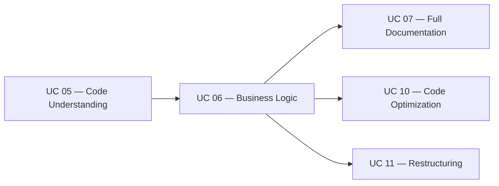

# UC 06 — Code Explanation and Business Logic Extraction

> **Category:** Documentation
>
> **Position in the learning path:** 6 — builds on the program understanding reports produced in UC 05
>
> **Recommended Bob modes:** **IBM i Developer** (primary mode for extraction and workflow), **IBM i Database** (if querying parameter tables via SQL), **Agent** (for saving local reports). Without the Premium Package: Ask.

---

## ⭐ IBM i Premium Package used

- **Workflow: Business Rules Extraction** → [Official documentation](https://bob.ibm.com/docs/ide/premium-packages/bob-for-i/workflows)
  Automatically analyzes the execution flow and the calculation specifications of **RPG** sources to isolate and document business rules, validations and decision-making calculation rules. Launched with the **Start Workflow** button at the top of the chat. Official scope: RPG only; for COBOL and CL, use the manual prompts below and the `cobol-*` / `cl-*` skills. Supported workspaces: Local, IFS Working Directory, Library List.
- **Understand** → [Official documentation](https://bob.ibm.com/docs/ide/premium-packages/bob-for-i/understand) — optional, to locate the callers, files and dependencies of a program before extraction (see UC00 §2, not repeated here).
- **Auto-activated skills:** `rpg-code-review`, `cobol-procedure-division`, `db2-system-catalog`, `rpg-embedded-sql`, `rpg-indicators`, `rpg-cycle-explained`, `understand-program-explainer` (if Understand is installed)

> The **Business Rules Extraction** workflow is the main accelerator of this UC.
> The manual prompts (notably Prompt 5 — business validation document) bring irreplaceable complementary value for validation by a business expert — not covered by the workflow.

---

## Objective

Extract the **business logic buried in the code**: calculation rules, conditions, thresholds, formulas, validations, decisions — everything that represents the customer's functional knowledge hard-coded in RPG, COBOL or CL. These rules are often not documented anywhere else and represent a major risk when the system is replaced or modernized.

**This UC goes further than UC 05**: UC 05 describes *what* a program does. UC 06 extracts *why* and *how* — the precise business rules, usable by a business analyst or to feed a functional specification.

**Expected deliverable:** a catalog of business rules per functional domain (calculations, validations, decision flows), written in natural language, verifiable by a business expert, and directly reusable for the modernization UCs.

---

## Prerequisites

- **Phase:** Phase 1 — Understand
- **Required previous UCs:** UC 05 — Code and Application Understanding
- **Required deliverables:** `{appId}-comprehension-{component}-report-{YYYYMMDD-HHmm}.md` — subroutine and dependency map produced in UC 05
- **Recommended Bob level:** Intermediate
- **Estimated Bob Coins:** ⚠️ *To be calibrated after the UC 06 lab on FLGHT400.*

---

## Concrete example — FLGHT400 Lab

The file [`../labs_FLGHT400_results/FRS401-business-rules-FR.md`](../labs_FLGHT400_results/FRS401-business-rules-FR.md) illustrates what the Business Rules Extraction workflow produces on the `FRS401` program (agent selection window, `FLGHT400/QRPGLESRC`).

The report covers: business rules for navigation and pagination, input validations, decision logic on function keys, calculation rules (page size, repositioning), integrity rules (read-only access, agent password protection) — all structured with **certain**, **inferred** and **assumption** statuses.

The English version is available in [`../labs_FLGHT400_results/FRS401-business-rules.md`](../labs_FLGHT400_results/FRS401-business-rules.md).

---

## Start with a program whose business rules you know

Same principle as UC 05: **start with a program whose business rules are known to an expert on the team**. The goal is to check that Bob extracts the real rules correctly — not plausible but wrong rules.

Ideally, have the following in the room for this session:
- A developer who knows the code
- A business subject-matter expert (SME) who can confirm that the extracted rules match operational reality

If a rule extracted by Bob is wrong or incomplete, fix the prompt immediately (more context, copybooks provided, parameters made explicit) before moving on to less familiar programs.

---

## Impact of program size — See UC 05

The analysis strategies by size defined in UC 05 apply in full here — see the section **"Impact of program size on the analysis strategy"** of the UC 05 sheet for the thresholds and the matching approaches (< 1,000 lines, 1,000–3,000, 3,000–8,000, > 8,000 lines).

**Two important differences compared with UC 05:**

**1. Rule extraction is more sensitive to size than general understanding.**
UC 05 can produce an acceptable overview even on a large program in a single pass. UC 06 requires a close reading of the code — a misread rule is a wrong rule in the catalog. On programs of more than 1,000 lines, **always apply the splitting strategy**, even if UC 05 could be done in a single direct pass.

**2. Extracting rules subroutine by subroutine is more reliable than a global extraction.**
Whatever the size of the program, asking Bob to extract the rules **subroutine by subroutine** (using the map produced in UC 05 as a guide) gives more precise and more traceable results than a one-shot extraction. Example sequence:

```
"Based on the map of [PROGRAM_NAME], extract the business rules
 of subroutine [SR_PRICE_CALC] only."

[After validation]
"Now extract the rules of subroutine [SR_DISCOUNTS]."
```

> 💡 This subroutine-by-subroutine approach leverages the map produced in UC 05 — which is why UC 05 must be completed before UC 06.

> ⚠️ On a program of more than 3,000 lines, never run Prompt 1 on the whole program in a single pass — Bob will produce an incomplete list of rules without flagging it.

---

## Starting a Bob session

> **Read before each UC 06 session — new conversation or resumption.**

### 1. Workspace to select

**Mode to select:** `IBM i Developer` (primary mode for code analysis; switch to `IBM i Database` to query parameter tables, and to `Agent` for local report saving)

**Workspace:** IBM i QSYS — select `Library List` and choose the application library from the list offered.

> 💡 **What the Library List workspace changes:** Bob directs its IBM i tools (`read_member`, `search_qsys`, `execute_compile_action`) to the libraries configured in the Code for IBM i extension. The `.bob/rules/` rules, the IBM i Premium skills and the local markdown files **remain accessible** — the VS Code workspace stays open in parallel. The IBM i workflows (**Start Workflow** button at the top of the Bob chat) become visible as soon as an IBM i connection is active.

UC 06 can take place in the **same conversation** as UC 05 if the comprehension analysis has just been done (Bob still has the program in context). In that case, continue directly with the UC 06 prompts without opening a new session.

If UC 05 was done in a **previous** session: start a new Bob conversation (`+` button) and load the program understanding report into context before starting.

> 💡 **Before the first UC 06 session:** check that the User Library List (Code for IBM i panel → Library List in VS Code) includes the application source library **and** the libraries containing the copybooks used by the program. This avoids global scans of the whole `*LIBL`.

### 2. Open the source files in the editor (Open in Editor)

Open the RPG source program in the editor — Bob needs it to refine the extracted rules against the exact code.

**Procedure:** in the **IBM i — Object Browser** panel, right-click the member → **Open in Editor**.

Files to open for each UC 06 session:
- The RPG source program (`[LIB_NAME]/QRPGSRC([PROGRAM_NAME])`)
- The referenced copybooks (if present in scope)
- The DDS display file if the program is interactive (input validations are sometimes coded there)

### 3. Context files to load

These files produced by UC 05 must be loaded **before starting** if the session is new. Use **Add File to Chat** (paperclip icon) or open them in the editor.

| File | Produced by | Mandatory / Recommended |
|------|-------------|--------------------------|
| `{appId}-comprehension-{component}-report-{date}.md` | UC 05 | **Mandatory** — subroutine map, navigation guide for rule-by-rule extraction |
| `{appId}-logique-{component}-regles-{date}.md` | UC 06 (previous session) | **If resuming** — partial catalog already produced, to complete without starting over |

> 💡 If the `*-comprehension-*-report-*.md` file is not available, start with a quick UC 05 session on the target program — 20 minutes of subroutine mapping avoids extracting rules in a haphazard order.

> ⚠️ **Context reduction risk — intermediate save recommended:** a UC 06 session with several extraction passes can reach the context limit on STANDARD or COMPLEX programs. If Bob seems to forget a decision taken at Prompt 1 (rule status, formulas identified, parameter tables flagged), that is a sign of context compression. Save the deliverable in progress after each major prompt — not only at the end of the session. Each time you resume a pass, start the prompt with: "The file [FILE_NAME] contains the decisions taken — continue from [STEP]."

---

## Premium-first strategy: Business Rules Extraction workflow

> Available from the **Start Workflow** button at the top of the Bob chat,
> in **IBM i Developer** mode, active IBM i connection required.
> Supported workspaces: Local, IFS Working Directory, Library List.
> (Source: [Bob IBM i Documentation — Business Rules Extraction](https://bob.ibm.com/docs/ide/premium-packages/bob-for-i/workflows))

**What this workflow does** (details: UC00 §1.5):
1. Analyzes **RPG sources only** (RPG II, RPG III, RPG/400, RPGLE, SQLRPGLE) — COBOL and CL are not covered: use the manual prompts below and the `cobol-*` / `cl-*` skills
2. Extracts business rules, decision logic, validations and calculation rules, and identifies external dependencies (files, programs, service programs, copy members, SQL)
3. Processes the sections of the source (procedures, subroutines, mainline) with parallel sub-agents
4. Produces a Markdown report in 8 sections, with up to 3 Mermaid diagrams, saved locally or in the IFS

**How to launch it:** **Start Workflow** → choose the workspace → **Start** on *Business Rules Extraction* → enter library, source file, member and output path.

**Understand (optional):** if the application has been scanned, the `understand-program-explainer` skill provides the callers, files used and exports of a program without re-reading the whole source (see UC05 Prompt 5 and UC00 §2).

**Recommended sequence:**
1. **Run the workflow first** on the target program for a quick initial extraction
2. **Refine with the UC 06 manual prompts** — in particular Prompt 5 (business validation document) for the meeting with the business expert

| Approach | Advantage | Recommended use case |
|---|---|---|
| **Business Rules Extraction workflow** | Guided step by step, self-structured, robust on unknown programs | First extraction on an unknown program, STANDARD to COMPLEX programs |
| **UC 06 manual prompts** | Precise control subroutine by subroutine, "certain/probable/to confirm" status, business validation document | Validation by a business expert, ambiguous rules, programs with many parameter tables |

> 💡 **UC 06 → UC 07 link:** the workflow report and the manual prompts feed the functional specification of UC 07 (Prompt 2); they are also consumed by UC 10 and UC 11.

---

## Prompts

### Prompt 1 — Business rules extraction for a program

**Objective:** produce a structured catalog of all the business rules of a program or subroutine.

**When to use:** as a complement to the workflow, or for simple programs (< 1,000 lines) where fine-grained control is needed.

**Required input:** the RPG source program open in the editor + the `*-comprehension-*-report-*.md` file from UC 05 loaded in context.

**Workspace:** IBM i QSYS + Local

**Key skills used:** `rpg-code-review`, `rpg-indicators`, `rpg-embedded-sql`, `rpg-cycle-explained` (cycle programs), `cobol-procedure-division` (if the program is COBOL)

**Prompt:**

```
The program [PROGRAM_NAME] in [LIB_NAME]/QRPGSRC has been the subject of a program understanding report.
[If new session: load the file {appId}-comprehension-{component}-report-*.md into the context before this prompt]

Now extract all the implicit business rules contained in this program.
A business rule is a decision, a calculation, a validation or a condition
that reflects a company policy or practice — not a technical constraint.

For each rule identified, provide in markdown:
- Number and short title of the rule
- Description in natural language (understandable by a non-developer)
- Trigger: in which situation does this rule apply?
- Precise formula or logic: reproduce the calculation or condition in clear pseudo-code
- Data involved: fields, files or parameters used in the rule
- Origin: line number or subroutine name in the source
- Status: certain (visible in the code) / probable (inferred) / to confirm (ambiguous)

If a rule depends on values stored in a parameter table (not hard-coded),
flag it and name the table concerned.
```

**Deliverable produced:** rules catalog — feeds the file `{appId}-logique-{component}-regles-{YYYYMMDD-HHmm}.md`

> ⚠️ **Pitfall avoided:** without the "certain / probable / to confirm" status, Bob presents all the rules with the same level of confidence. Rules inferred from partial context (missing copybook, parameter table not read) pass for certain.

---

### Prompt 2 — Extraction of calculation rules and formulas

**Objective:** produce an exhaustive catalog of business calculations and formulas with their exact formulas and readable rewordings.

**When to use:** after Prompt 1, to dig deeper into financial calculations, rates and coefficients.

**Required input:** RPG program open in the editor.

**Workspace:** IBM i QSYS + Local

**Key skills used:** `rpg-embedded-sql`, `db2-system-catalog` (parameter tables), `cobol-procedure-division` (if the program is COBOL)

**Prompt:**

```
In program [PROGRAM_NAME] of [LIB_NAME], identify all the business
calculations and formulas.

For each calculation:
- Name of the calculation (infer a functional name if the code has none)
- Exact mathematical formula, with the field names as they appear in the code
- Formula reworded with readable names (if the field names are cryptic)
- Units and types: is it an amount? a percentage? a quantity? a duration?
- Precision and rounding: how is the result rounded or truncated?
- Conditions of application: in which case is this calculation executed?

Flag any calculation whose result depends on a value read from the database
(rate, coefficient, threshold) rather than hard-coded.
```

**Deliverable produced:** "Calculations and formulas" section in the file `{appId}-logique-{component}-regles-{YYYYMMDD-HHmm}.md`

> 💡 **Variant — query the parameter table directly:** if Bob identifies a table of rates or thresholds, follow up immediately with:
> ```
> "Query the table [TABLE_NAME] in [LIB_NAME] and display the current
>  values of the rates / thresholds used in this calculation."
> ```
> IBM i Database mode (or the SQL tool in IBM i Developer) executes the SQL query in real time — the actual values appear in the chat.

---

### Prompt 3 — Extraction of validation rules and input controls

**Objective:** identify all the business validations (to be distinguished from format validations).

**When to use:** for interactive programs (associated DDS display file) or data-entry programs.

**Required input:** RPG program + DDS display file open in the editor.

**Workspace:** IBM i QSYS + Local

**Key skills used:** `dds-display-files`, `rpg-indicators` (and `cobol-procedure-division` if the program is COBOL)

**Prompt:**

```
In program [PROGRAM_NAME] of [LIB_NAME], identify all the validation
and control rules applied to incoming data.

For each validation:
- What is checked (which field, which value, which combination)
- The rejection condition: when does the validation fail?
- The message or behavior on failure (error message, blocking, default value)
- The severity: blocking (the user cannot continue) or warning?
- The origin in the code (subroutine, line)

Distinguish format validations (type, length, mandatory)
from business validations (business rule, consistency between fields, existence in a reference table).
```

**Deliverable produced:** "Validations and controls" section in the file `{appId}-logique-{component}-regles-{YYYYMMDD-HHmm}.md`

> ⚠️ **Pitfall avoided:** validations on a 5250 screen are often in the DDS display file (`CHECK`, `RANGE`, `VALUES`) **and** in the RPG program. If you only analyze the RPG program, you miss the DDS-side validations. Always include the display file in the scope for this UC.

---

### Prompt 4 — Decision flows (decision trees) [Complement — not covered by the Premium workflow]

**Objective:** identify the main business decision points and represent them as trees a business expert can read.

**When to use:** for programs with complex conditional logic (several distinct business paths). Complements the Business Rules Extraction workflow, which identifies the decisions but does not structure them as a tree.

**Required input:** RPG program open in the editor + catalog of rules in progress (Prompts 1–3).

**Workspace:** IBM i QSYS + Local

**Key skills used:** `rpg-code-review`, `rpg-indicators` (and `cobol-procedure-division` if the program is COBOL)

**Prompt:**

```
In program [PROGRAM_NAME] of [LIB_NAME], identify the main business
decision points — the places where the program chooses between several paths
depending on a business condition.

For the 3 to 5 most important decisions:
- The decision condition in natural language
- The possible branches and their business effect
- The data that influences the decision
- Represent the decision as a tree in markdown (nested lists)

Do not include purely technical decisions (SQL error handling,
file read loops, end of program).
```

**Deliverable produced:** "Decision flows" section in the file `{appId}-logique-{component}-regles-{YYYYMMDD-HHmm}.md`

> 💡 The decision trees extracted here can be used directly in the functional specifications produced in UC 07.

> 💡 **Explicit limit of 3–5 decisions**: without this limit, Bob lists every IF/ELSE condition of the program — dozens on a legacy program. We want the decisions with business value, not exhaustiveness.

---

### Prompt 5 — Synthesis: business validation document

**Objective:** produce a document in pure natural language, meant to be read and validated by a business expert — without any IBM i or RPG technical term.

**When to use:** after the rules have been extracted (Prompts 1–4), before the validation meeting with the business expert. This is the main deliverable of this UC.

**Required input:** catalog of rules partly consolidated in the chat + UC 05 program understanding report loaded.

**Workspace:** Local

**Key skills used:** — (writing from the catalog already extracted; no specific IBM i skill)

**Prompt:**

```
Based on the business rules extracted for [PROGRAM_NAME], write a synthesis
document in English to be validated by a [CLIENT_NAME] business expert.

The document must be written without any RPG or IBM i technical term.
Structure:
1. Context: which business process does this program take part in?
2. Business rules: numbered list of the extracted rules, in pure natural language
3. Key calculations: the formulas reworded in business terms
   (e.g. "Net price = gross price × (1 - discount rate)")
4. Points to validate: rules marked "probable" or "to confirm" that need
   confirmation by a business expert
5. Rules depending on parameters: rules whose values are in the database
   (to be checked against the current values)

At the end of the document, add a "Questions for the business expert" section with
3 to 5 precise questions on the ambiguous points identified.
```

**Deliverable produced:** `{appId}-logique-{component}-validation-{YYYYMMDD-HHmm}.md`

> 💡 This document structures the validation meeting with the business team and feeds directly into UC 07 (full documentation — functional specifications).

> 💡 **Save the rules catalog:** once the synthesis has been validated by the business expert, switch to Agent mode (authorized for local file creation) and ask Bob to save the document:
> ```
> "Save this rules catalog in a markdown file
>  named {appId}-logique-{component}-regles-{YYYYMMDD-HHmm}.md
>  Example: flght403-logique-frs401-regles-20261030-1400.md"
> ```

---

## Tools to use

| Tool | Usage in this UC |
|-----|------------------|
| **Native IBM i tools — IBM i Developer mode** | Reading RPG, CL, DDS source members (display files for validations) |
| **Native IBM i tools — IBM i Database mode** | Querying the parameter tables referenced in the rules (rates, codes, thresholds) |
| **Confluence MCP** *(if available)* | Publishing the rules catalog and the validation document to the POC space |

> 💡 The IBM i tools are **native to the Premium Package** — they use the IBM i connection configured in UC 01 and require no configuration in `mcp.json`. They are available as soon as that connection is active, in IBM i Developer mode as well as in IBM i Database mode. List of IBM i tools, safeguards and settings: see UC00 §5.

---

## Pitfalls to avoid

| Pitfall | What happens | How to avoid it |
|-------|----------------|-----------------|
| Analyzing the RPG program without its associated DDS display file | Screen-side input validations are missing — the rules catalog is incomplete | Include the display file in the scope, or open it in the editor before the prompt |
| Not distinguishing certain rules from inferred ones | All the rules look reliable — wrong rules go unnoticed | Always include the "certain / probable / to confirm" status (Prompt 1) |
| Forgetting the parameter tables | Rules that read rates or thresholds from the database are extracted with null or invented values | Ask Bob to flag the table dependencies, then query them in IBM i Database mode |
| Presenting the extracted rules directly to management without business validation | Wrong or incomplete rules get validated as specifications — major risk for the following UCs | Always go through Prompt 5 (validation document) and a review session with a business expert |
| Confusing UC 06 and UC 05 | A general understanding is produced instead of a precise catalog of rules | UC 06 = actionable business rules with precise formulas and conditions. UC 05 = overview. The two are distinct and complementary. |
| Extracting business rules from CL programs | CL programs rarely contain business rules — they orchestrate calls | Focus on RPG and COBOL programs for this UC; CL programs belong to architecture (UC 07) |
| Running Prompt 1 on a program of more than 3,000 lines in a single pass | Bob produces an incomplete list of rules without flagging it | Split by subroutine using the UC 05 map |

---

## UC Deliverables

| Produced file | Naming pattern | Consumed by |
|---|---|---|
| Business rules catalog | `{appId}-logique-{component}-regles-{YYYYMMDD-HHmm}.md` | UC 07 — Prompt 2 (functional specification), UC 10 (optimization), UC 11 (restructuring) |
| Business validation document | `{appId}-logique-{component}-validation-{YYYYMMDD-HHmm}.md` | Business expert validation meeting → UC 07 (functional specifications) |

**FLGHT400 examples:**
- `flght403-logique-frs401-regles-20261023-1400.md`
- `flght403-logique-frs401-validation-20261023-1600.md`

---

## Dependencies



---

## UC 06 Validation Checklist

Before moving on to UC 07 (see `uc-en/UC07-documentation-complete-en.md`), check each point:

- [ ] The Business Rules Extraction workflow has been run on at least one core business program
- [ ] At least one core business program has been analyzed with Prompts 1 and 2
- [ ] The key calculations (prices, discounts, taxes, quantities…) have been extracted with formulas and units
- [ ] Business validations (not only format validations) have been identified
- [ ] Dependencies on parameter tables have been identified and queried in IBM i Database mode
- [ ] The synthesis document (Prompt 5) has been produced for at least one business domain
- [ ] The document has been submitted to a business expert for validation
- [ ] The "to confirm" rules have been reviewed and clarified (or explicitly left open)
- [ ] The validated rules catalog is saved with the naming convention `{appId}-logique-{component}-regles-{YYYYMMDD-HHmm}.md`

---

*UC 06 sheet — Living document to be updated throughout the POC.*
