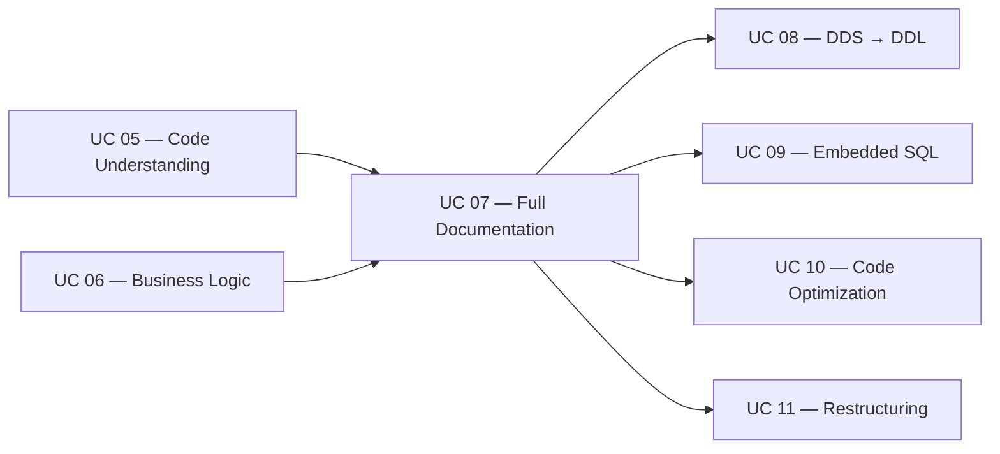

# UC 07 — Full Documentation

> **Category:** Documentation
>
> **Position in the learning path:** 7 — builds on the deliverables of UC 05 and UC 06
>
> **Recommended Bob mode:** IBM i Developer (IBM i Premium Package) — main mode. `/erd` is available in IBM i Developer and IBM i Database (see UC00 §3.2). Without the Premium Package: Ask.

---

## ⭐ IBM i Premium Package used

- **Slash Command: `/erd`** → [Official documentation](https://bob.ibm.com/docs/ide/premium-packages/bob-for-i/slash-commands)
  Generates a Mermaid Entity-Relationship diagram (ERD) directly from the Db2 for i catalog (`QSYS2.SYSTABLES`, `QSYS2.SYSCOLUMNS`, `QSYS2.SYSCST`, `QSYS2.SYSREFCST`). Replaces the manual ERD generation prompt.
- **Slash Command: `/init`** → [Official documentation](https://bob.ibm.com/docs/ide/premium-packages/bob-for-i/slash-commands)
  Automatically generates an `AGENTS.md` file documenting the ILE architecture, naming conventions and DDS/SQL objects — usable as the baseline context for the whole documentation corpus. Official locations: `{current library}/QBOBSRC/AGENTS.MD` (QSYS) or `{IFS directory}/.bob/AGENTS.md` (IFS).
- **Understand Dashboard** → [Official documentation](https://bob.ibm.com/docs/ide/premium-packages/bob-for-i/understand)
  Application mapping, impact analysis, dead object identification — takes precedence for the global architecture view. Installation, scan and limits: see UC00 §2 (not repeated here).
- **Auto-activated skills:** `understand-app-overview`, `understand-impact-analysis` (active only if Understand is installed), `db2-system-catalog`, `db2-services-catalog`, `rpg-code-review`

> The `/erd` and `/init` slash commands, as well as the Understand dashboard, take precedence over manual architecture prompts.
> The UC 07 prompts (functional specification, technical specification, cross-reference matrix, summary sheet) bring irreplaceable complementary value not covered by these tools.

---

## Objective

Produce **structured, durable and actionable documentation** of the application from everything understood in UC 05 and extracted in UC 06: architecture models, functional and technical specifications, diagrams of the relationships between programs and data, cross-reference matrices.

**This UC is the convergence point of Phase 1.** UC 05 provided program-by-program understanding. UC 06 extracted the business rules. UC 07 assembles them into a coherent, navigable documentation corpus that can be used directly as input for the modernization phases.

**Without UC 07, the following phases start blind.** A developer who tackles UC 10 (optimization) or UC 11 (restructuring) without reference documentation has no safety net to check that the logic has not been broken.

**Expected deliverable:** one documentation folder per application, including an architecture model (component diagram + data flow), a functional specification, a technical specification, an ERD of the data relationships, and a program-file-rule cross-reference matrix.

---

## Prerequisites

- **Phase:** Phase 1 — Understand (consolidation)
- **Required previous UCs:** UC 05 — Code Understanding, UC 06 — Business Logic
- **Required deliverables:**
  - `{appId}-comprehension-{component}-report-{YYYYMMDD-HHmm}.md` — UC 05 program understanding reports
  - `{appId}-logique-{component}-regles-{YYYYMMDD-HHmm}.md` — rules catalogs **validated** by a business expert (UC 06)
- **Recommended Bob level:** Intermediate
- **Estimated Bob Coins:** ⚠️ *To be calibrated after the UC 07 lab on FLGHT400.*

> ⚠️ **Blocking prerequisite:** do not start UC 07 without at least one validated `*-comprehension-*-report-*.md` file **and** one `*-logique-*-regles-*.md` file validated by a business expert for the target application.

---

## Concrete example — FLGHT400 Lab

The following files illustrate what UC 07 produces on the FLGHT400 application:

| Deliverable | Lab file | Produced by |
|---|---|---|
| Full ERD (`/erd` command) | [`../labs_FLGHT400_results/FLGHT403_erd_report.md`](../labs_FLGHT400_results/FLGHT403_erd_report.md) | `/erd FLGHT403` — tables, columns, Mermaid diagram |
| ERD diagram only | [`../labs_FLGHT400_results/FLGHT403_erd.md`](../labs_FLGHT400_results/FLGHT403_erd.md) | `/erd FLGHT403` |
| Application architecture | [`../labs_FLGHT400_results/FLGHT403_architecture.md`](../labs_FLGHT400_results/FLGHT403_architecture.md) | Understand + skill `understand-app-overview` (see UC00 §7, exercise 1d) — starting point of UC 07 Prompt 1 |
| Init report (`/init` context) | [`../labs_FLGHT400_results/FLGHT403_init_report.md`](../labs_FLGHT400_results/FLGHT403_init_report.md) | `/init` slash command |
| Functional areas | [`../labs_FLGHT400_results/FLGHT403_functional_areas.md`](../labs_FLGHT400_results/FLGHT403_functional_areas.md) | Understand scan (see UC00 §7, exercise 1c) |

The FLGHT400 ERD report highlights a typical IBM i case: no formal FK constraints (DDS files) — the relationships between `ORDERS`, `AGENTS`, `CUSTOMERS`, `FLIGHTS` are inferred from the shared fields (`AGENT_NO`, `CUSTOMER_NO`, `FLIGHT_NUMBER`).

---

## Start with an application whose UC 05 and UC 06 deliverables you already have

UC 07 produces nothing good on an application that has not been analyzed beforehand. Firm rule: **only start UC 07 on applications whose program understanding reports and rules catalogs are complete and validated**.

UC 07 assembles existing information — it does not discover. If the sources are incomplete or not validated, the documentation produced will propagate the errors to the following UCs.

**Recommended progression:**

| Step | Starting point | Document to produce |
|-------|----------------|---------------------|
| 0 | Active IBM i connection | `/init` → `AGENTS.md` + `/erd [LIB_NAME]` → ERD |
| 1 | `*-comprehension-*-report-*.md` files | Architecture (Prompt 1) → `*-doc-architecture-*.md` |
| 2 | Validated `*-logique-*-regles-*.md` files | Functional spec (Prompt 2) → `*-doc-spec-fonc-*.md` |
| 3 | `*-comprehension-*-report-*.md` files (F-specs + dependencies) | Technical spec + ER model (Prompt 3) → `*-doc-spec-tech-*.md` |
| 4 | Program understanding reports (full program list) | Cross-reference matrix (Prompt 4) → `*-doc-matrice-*.md` |
| 5 | All Prompt 1–4 deliverables | Summary sheet (Prompt 5) → `*-doc-synthese-*.md` |

---

## Starting a Bob session

> **Read before each UC 07 session — new conversation or resumption.**

### 1. Workspace to select

UC 07 works on a whole application. Start in a **new Bob conversation** (`+` button) dedicated to the application to document.

**Mode to select:** `IBM i Developer` for Prompts 1 to 5.

**Workspace:** IBM i QSYS (Library List workspace) + Local

> 💡 **Mode for `/erd`:** the command is available in IBM i Developer **and** in IBM i Database (UC00 §3.2); switching to IBM i Database is therefore not mandatory. It remains handy for the `QSYS2` queries of the technical specification (Prompt 3).

> 💡 **Run `/init` first** on the application library before any prompt. The generated `AGENTS.md` file will be injected automatically into the context for the whole session — it avoids repeating the application context in every prompt.

### 2. Context files to load

These files are the direct inputs of each UC 07 prompt. Load them into the chat via **Add File to Chat** (paperclip icon) before running the corresponding prompt.

| File | Produced by | Used in |
|---------|-------------|-------------|
| `{appId}-comprehension-{component}-report-{date}.md` | UC 05 | **Mandatory** — Prompts 1, 3, 4 |
| `{appId}-logique-{component}-regles-{date}.md` | UC 06 | **Mandatory** — Prompts 2 and 4 |
| `{appId}-doc-architecture-{date}.md` | UC 07 Prompt 1 | Available for Prompts 2 to 5 |
| `{appId}-doc-spec-fonc-{date}.md` | UC 07 Prompt 2 | Input of Prompt 5 |
| `{appId}-doc-spec-tech-{date}.md` | UC 07 Prompt 3 | Input of **UC 08** (DDS→DDL) and **UC 09** (embedded SQL) |
| `{appId}-doc-matrice-{date}.md` | UC 07 Prompt 4 | Input of **UC 10** (Optimization) and **UC 11** (Restructuring) |

> ⚠️ **Context reduction risk:** a multi-prompt UC 07 session can reach the context limit on large applications. Save the deliverable in progress after each prompt — not only at the end of the session.

> 💡 UC 07 can run over several sessions (one prompt per session if the application is large). Open the partial deliverables at the start of each resumed session.

---

## Premium-first strategy

### Step 0 — `/init` to contextualize the session

```
/init
```

**What it produces:** an `AGENTS.md` file documenting the ILE architecture, naming conventions, DDS/SQL objects and project standards. Injected automatically into the context without manual reloading.

**Workspace:** IBM i QSYS

**Location of the generated `AGENTS.md`:** `{LIBRARY}/QBOBSRC/AGENTS.MD` (QSYS workspace) or `{IFS directory}/.bob/AGENTS.md` (IFS workspace). A current library (or an IFS working directory) must be defined, otherwise `/init` stops without creating anything (see UC00 §3.1).

> 💡 `/init` is to be run **only once per application** at the start of the first UC 07 session. Later sessions reuse the `AGENTS.md` already present.

### Step 1 — `/erd` for the Entity-Relationship diagram

```
/erd [LIB_NAME]
```

**What it produces:** a Mermaid `erDiagram` from the real Db2 for i catalog — tables, columns (type, null), FK constraints, cardinalities. Replaces manual ERD generation.

**Workspace:** IBM i QSYS (Library List workspace) — IBM i Developer or IBM i Database

> ⚠️ **Limit with DDS files:** DDS PFs have no FK constraints in the SQL catalog — `/erd` shows the tables without formal FK relationships. Complete manually the relationships inferred from the shared fields (see Prompt 3).

> 💡 **FLGHT400 lab:** see [`../labs_FLGHT400_results/FLGHT403_erd_report.md`](../labs_FLGHT400_results/FLGHT403_erd_report.md) for a complete example of the `/erd FLGHT403` output.

### Understand Dashboard — application architecture view

Open the dashboard with the *Open Understand Dashboard* command (`vscode-ibmi-bob.openUnderstandDashboard`) or the Dashboard icon in the Bob chat title bar. Prerequisites (installation, scanned application): see UC00 §2.

**What it provides:** mapping of program calls, usage of DDS PF/LF files, service program bindings, dead objects — directly usable as a source for Prompt 1. The **Insights** tab offers the **Explore the Application with Bob** button.

> ⚠️ The scan reads the compiled objects (not the source) and captures neither dynamic calls nor dynamic SQL: flag them as incomplete areas in Prompt 1.

> 💡 Understand Dashboard takes precedence over code inferences for the global architecture view. Use its data as the starting point of Prompt 1 rather than starting from scratch.

---

## Prompts

### Prompt 1 — General application architecture

**Objective:** produce the application's architecture model — component diagram, processing flow, integration points.

**When to use:** first, after `/init` and the Understand dashboard (if available). Basis of all the following prompts.

**Required input:** `*-comprehension-*-report-*.md` files loaded into the context + Understand Dashboard data (if available).

**Workspace:** IBM i QSYS + Local

**Key skills used:** `understand-app-overview`, `understand-impact-analysis` (if Understand is installed)

**Prompt:**

```
Based on the program understanding reports ({appId}-comprehension-*-report-*.md)
for the application [APPLICATION_NAME] in [LIB_NAME],
generate the architecture documentation in English, in markdown.

[If new session: load the *-comprehension-*-report-*.md files into the context before this prompt]

Produce the following sections:

## 1. Application overview
- Business role of the application in 3 sentences (for a non-technical reader)
- Functional scope: which business processes does this application cover?
- Application size and object counts: number of programs, physical files, logical files, screens

## 2. Component diagram (Mermaid)
Generate a Mermaid diagram of type `graph TD` representing:
- The main programs as nodes (PGM)
- The shared physical files as nodes (PF)
- The interfaces with other applications or systems as nodes (EXT)
- The CALLs between programs as arrows →
- The read accesses to PFs as dotted arrows -.->
- The write/update accesses as arrows =>
Limit to 15 nodes maximum — if the application is larger,
represent only the central components (the most called or the most shared).

## 3. Main processing flow
Describe in 5 to 8 steps the end-to-end processing flow:
from the user input (5250 screen or batch trigger)
to the production of the output (database update, printing, external call).

## 4. Integration points
List the interfaces with the outside:
- Other IBM i applications called or calling
- Interface files (input / output) with third-party systems
- Batch triggers (JOBSCD, submission CL)

Do not invent components that are not visible in the program understanding reports.
Explicitly flag the areas where the scope is incomplete or uncertain.
```

**Deliverable produced:** `{appId}-doc-architecture-{YYYYMMDD-HHmm}.md`

> ⚠️ **Pitfall avoided:** without the 15-node constraint, Bob generates Mermaid diagrams that exceed the rendering capacity. Always limit, even if it means producing a second diagram for the secondary components.

> ⚠️ **Anti-hallucination safeguard:** the "Do not invent components that are not visible" instruction is critical — a relationship invented in an architecture diagram propagates false information throughout all the following documentation.

---

### Prompt 2 — Functional specification

**Objective:** produce the application's functional specification, based on the use cases and the validated business rules.

**When to use:** after Prompt 1, relying on the UC 06 rules catalog, which **must be validated** by a business expert.

**Required input:** `*-comprehension-*-report-*.md` + `*-logique-*-regles-*.md` (validated) files loaded into the context.

**Workspace:** Local

**Key skills used:** — (writing from the UC 05 and UC 06 deliverables; no specific IBM i skill)

**Prompt:**

```
Based on the program understanding reports ({appId}-comprehension-*-report-*.md)
and the validated rules catalog ({appId}-logique-*-regles-*.md) for
[APPLICATION_NAME] / [FUNCTIONAL_DOMAIN], write a functional
specification in English, in markdown.

[If new session: load the *-comprehension-*-report-*.md AND *-logique-*-regles-*.md files
 into the context before this prompt — both sources are required]

Expected structure:

## Functional specification — [APPLICATION_NAME] / [DOMAIN]

### 1. Context and scope
- Business process covered
- Actors: who triggers the processing? who consumes the result?
- Volume and frequency: single-record processing or batch? daily / weekly / on demand?

### 2. Use cases
For each identified use case:
- Name and 2-sentence summary
- Preconditions: what must be true for the processing to be triggered?
- Nominal flow: the processing steps in the normal case
- Alternative flows: the special cases identified in the code (conditions, exceptions)
- Post-conditions: what is the state of the system at the end of the processing?

### 3. Business rules
Report here the rules of the rules catalog (*-logique-*-regles-*.md), organized by use case.
For each rule:
- Identifier and title (keep the catalog numbering)
- Description in natural language
- Use case to which it applies

### 4. User messages and behaviors
List of the messages displayed on screen (IBM i message codes, MSGF texts),
with their trigger and their severity (information / warning / blocking error).

### 5. Interfaces and exchanged data
- Input data: fields, formats, sources
- Output data: fields, formats, destinations
- Input → output mapping rules

Do not reproduce the RPG code in this document.
Flag in a note the points that could not be determined from the available sources.
```

**Deliverable produced:** `{appId}-doc-spec-fonc-{component}-{YYYYMMDD-HHmm}.md`
*(if the spec covers the whole application: `{appId}-doc-spec-fonc-all-{YYYYMMDD-HHmm}.md`)*

> 💡 **Mandatory dual source:** the use cases come from the program understanding reports; the business rules come from the validated rules catalog. Only one of the two produces an incomplete spec.

> 💡 The alternative flows often match the decision trees extracted in UC 06 Prompt 4 — loading them into the context makes them directly usable here.

---

### Prompt 3 — Technical specification and physical data model

**Objective:** produce the application's technical specification — object inventory, physical data model (completed by `/erd`), program interfaces, technical dependencies.

**When to use:** after Prompt 1, relying on the program understanding reports and the ERD produced by `/erd`.

**Required input:** `*-comprehension-*-report-*.md` files + `/erd` ERD loaded into the context.

**Workspace:** IBM i QSYS + Local

**Key skills used:** `db2-system-catalog`, `dds-physical-files`, `dds-logical-files`

**Prompt:**

```
Based on the program understanding reports ({appId}-comprehension-*-report-*.md)
for [APPLICATION_NAME] in [LIB_NAME], generate a technical specification
in English, in markdown.

[If new session: load the *-comprehension-*-report-*.md files into the context before this prompt]
[Also load the ERD report produced by /erd if available]

## Technical specification — [APPLICATION_NAME]

### 1. Object inventory
Produce a table:
| Object name | Type (PGM / PF / LF / DSPF / PRTF / CL) | Library | Role | Programs using this object |

### 2. Physical data model
For each physical file (PF) of the application:
- File name and library
- Functional role (what each record represents)
- Main fields: name, type, length, assumed role
- Primary key (UNIQUE field or first key field)
- Associated logical files (LF) and selection/sort criterion of each LF

Then generate a Mermaid `erDiagram` representing the relationships
between the physical files of the application (foreign keys inferred
from the fields shared between files).
If the /erd report is available in the context, use it as a basis and add
the implicit relationships not visible in the SQL catalog.

### 3. Program interfaces (signatures)
For each program of the application called from outside (incoming CALL):
- Program name
- List of parameters with type, length and direction (input / output / input-output)
- Return values or status codes

### 4. Technical dependencies
- Shared copybooks (/COPY) and their content (structures, constants, prototypes)
- Data areas (*DTAARA) used
- Data queues (*DTAQ) used
- User spaces (*USRSPC) used

### 5. Identified technical constraints
- Indicators shared between programs
- Global variables or shared data structures
- Dynamic calls (CALL with a variable name — not statically resolvable)
- Programs without available source (compiled objects only)

Explicitly flag the information that cannot be determined from the available sources.
```

**Deliverable produced:** `{appId}-doc-spec-tech-{component}-{YYYYMMDD-HHmm}.md`

> ⚠️ **Do not confuse LF and PF in the ER model:** logical files (LF) are indexes/views, not entities — place them in "Associated logical files", never in the `erDiagram` diagram.

> 💡 **Useful QSYS2 queries (IBM i Database mode):**
> ```sql
> -- Columns of a physical file
> SELECT COLUMN_NAME, DATA_TYPE, LENGTH, NUMERIC_SCALE, IS_NULLABLE, COLUMN_TEXT
> FROM QSYS2.SYSCOLUMNS
> WHERE TABLE_SCHEMA = '[LIB_NAME]' AND TABLE_NAME = '[PF_NAME]'
> ORDER BY ORDINAL_POSITION;
>
> -- Logical files (LF) based on a PF
> -- (SYSTABLES.BASE_TABLE_NAME is only populated for aliases: use SYSFILES)
> SELECT F.TABLE_SCHEMA, F.TABLE_NAME, F.SYSTEM_TABLE_NAME
> FROM QSYS2.SYSFILES F,
>      JSON_TABLE(F.BASED_ON_FILES, 'lax $.BASED_ON_FILES'
>                 COLUMNS(LIBRARY CHAR(10), FILE CHAR(10))) B
> WHERE F.NATIVE_TYPE = 'LOGICAL'
>   AND B.LIBRARY = '[LIB_NAME]' AND B.FILE = '[PF_NAME]';
> ```

---

### Prompt 4 — Cross-reference matrix

**Objective:** produce a programs × files, programs × business rules, and programs × programs matrix — a map of the cross dependencies.

**When to use:** after Prompts 1 and 2, once the architecture and the rules are consolidated.

**Required input:** `*-comprehension-*-report-*.md` + `*-logique-*-regles-*.md` files loaded into the context.

**Workspace:** Local

**Key skills used:** `understand-impact-analysis` (if Understand is installed)

**Prompt:**

```
Based on the program understanding reports ({appId}-comprehension-*-report-*.md)
and the rules catalog ({appId}-logique-*-regles-*.md) for the application
[APPLICATION_NAME] in [LIB_NAME], generate a cross-reference matrix
in markdown.

[If new session: load the *-comprehension-*-report-*.md AND *-logique-*-regles-*.md files
 into the context before this prompt]

## Cross-reference matrix — [APPLICATION_NAME]

### 1. Programs × Files matrix
Produce a markdown table:
- Rows: all the programs of the application (one program per row)
- Columns: all the physical files of the application (one PF per column)
- Cell: R (read only) / W (write only) / RW (read+write) / - (no access)

### 2. Programs × Business rules matrix
Produce a table:
- Rows: all the programs of the application
- Columns: the numbered business rules of the rules catalog
- Cell: ✓ (rule implemented in this program) / - (not concerned)

### 3. Programs × Programs matrix (calls)
Produce a table:
- Rows: calling programs
- Columns: called programs
- Cell: CALL / CALLP / EXSR / - (no direct call)

### 4. Shared objects index
List the physical files used by more than one program,
with for each shared PF:
- Number of programs reading
- Number of programs writing
- Programs writing (contention risk)
- Criticality level: High (written by 3+ programs) / Medium / Low

For tables with more than 8 columns, use abbreviations for the column
names and provide an abbreviation index below the table.
```

**Deliverable produced:** `{appId}-doc-matrice-{YYYYMMDD-HHmm}.md`

> 💡 **Large matrix:** on an application of 50+ programs, build the matrix domain by domain in several passes — never run the global matrix in a single pass.

> 💡 **Incremental update:** the matrix will be updated over the following UCs (UC 10, 11, 12…). Bob can update a row or a column on instruction — faster than regenerating from scratch.

> 💡 **Link with UC 11 (Restructuring):** the "Criticality level" column identifies the PFs to encapsulate first in service procedures.

---

### Prompt 5 — Application summary sheet (final UC 07 deliverable)

**Objective:** produce a one-page application sheet, intended for management and new team members — executive summary, key indicators, key considerations, links to the detailed deliverables.

**When to use:** last, once all the deliverables of Prompts 1 to 4 have been produced and validated.

**Required input:** all the `*-doc-*.md` deliverables of Prompts 1–4 loaded into the context.

**Workspace:** Local

**Key skills used:** — (summary from the deliverables already produced; no specific IBM i skill)

**Prompt:**

```
Based on all the documentation generated for [APPLICATION_NAME]
(files *-doc-architecture-*.md, *-doc-spec-fonc-*.md, *-doc-spec-tech-*.md, *-doc-matrice-*.md),
generate an application summary sheet in English, in markdown.

[If new session: load all the application's documentation files
 into the context before this prompt]

This sheet is intended to be:
- Published on the home page of the POC Confluence space
- Distributed to every new team member joining this scope
- Used as a reference during steering meetings

Structure:

## Application sheet — [APPLICATION_NAME]
**Date:** [today's date]
**Status:** Documented as part of the Bob × [CLIENT_NAME] POC
**Author:** Generated by Bob — to be validated by the [CLIENT_NAME] team

### Executive summary (5 lines max)
What the application does, its importance in the IS, its technical state,
and the main modernization recommendation from the analysis.

### Key indicators
| Indicator | Value |
|------------|--------|
| Number of programs | ? |
| Number of physical files | ? |
| Number of documented business rules | ? |
| Main language | ? |
| Overall complexity | Low / Medium / High |
| Modernization priority | High / Normal / Low |

### Key considerations
The 3 to 5 points that require particular attention
during the modernization phases (UC 08 to UC 17).

### Links to the detailed deliverables
- [ ] Architecture: {appId}-doc-architecture-{YYYYMMDD-HHmm}.md
- [ ] Functional specification: {appId}-doc-spec-fonc-{component}-{YYYYMMDD-HHmm}.md
- [ ] Technical specification: {appId}-doc-spec-tech-{component}-{YYYYMMDD-HHmm}.md
- [ ] Cross-reference matrix: {appId}-doc-matrice-{YYYYMMDD-HHmm}.md
- [ ] Business rules catalog: {appId}-logique-{component}-regles-{YYYYMMDD-HHmm}.md
- [ ] Program understanding reports: {appId}-comprehension-{component}-report-{YYYYMMDD-HHmm}.md
```

**Deliverable produced:** `{appId}-doc-synthese-{YYYYMMDD-HHmm}.md`

> 💡 **This prompt is the Phase 1 presentation deliverable.** The application sheet is what you show at the POC mid-point review with management.

> 💡 Always include the `Status: to be validated by the [CLIENT_NAME] team` banner until the formal review.

---

## Tools to use

| Tool | Usage in this UC |
|-----|------------------|
| **Native IBM i tools — IBM i Developer mode** | Reading the sources to complete or check the information from the program understanding reports |
| **Native IBM i tools — IBM i Database mode** | `/erd` command, querying `QSYS2.SYSCOLUMNS`, `QSYS2.SYSTABLES`, `QSYS2.SYSINDEXES` to enrich the technical specs |
| **Confluence MCP** *(if available)* | Direct publication of each deliverable to the POC space as they are produced |

> 💡 The IBM i tools are **native to the Premium Package** — they use the IBM i connection configured in UC 01 and require no configuration in `mcp.json`. List of IBM i tools, RAG and safeguards: see UC00 §5.

---

## Pitfalls to avoid

| Pitfall | What happens | How to avoid it |
|-------|----------------|-----------------|
| Starting UC 07 without the `*-comprehension-*` and `*-logique-*-regles-*` files | The documentation is generated without a factual basis — it reflects what Bob assumes | Check that all the program understanding reports and rules files are present and validated before starting |
| Using an unvalidated rules catalog in the functional spec | Erroneous rules are formalized as specifications — they will feed the modernization UCs with wrong inputs | Source the functional spec only from the catalog marked "validated" in its header |
| Producing a Mermaid diagram of 30+ nodes | The diagram causes a rendering error or is unreadable | Limit to 15 nodes — produce several diagrams by layer if needed |
| Confusing LF and PF in the ER model | The matrix and the ER diagram represent indexes as entities | Explicitly separate PF and LF — LFs go in "Associated logical files", never in the `erDiagram` diagram |
| Running `/erd` without an IBM i connection or a target library | Bob asks for the schema to analyze or the command fails | Check the Code for IBM i connection, then `/erd [LIB_NAME]` (available in IBM i Developer and IBM i Database) |
| Generating all the deliverables in a single session without an intermediate review | Errors from Prompt 1 propagate into all the following prompts | Validate each deliverable with a developer before moving on to the next prompt |
| Publishing the documentation without a "to be validated" mention | Management considers it final before the formal review | Always include the `Status: to be validated by the [CLIENT_NAME] team` banner |

---

## Deliverables of this UC

| Produced file | Naming pattern | Consumed by |
|---|---|---|
| Architecture | `{appId}-doc-architecture-{YYYYMMDD-HHmm}.md` | UC 07 following prompts, UC 11 |
| Functional specification | `{appId}-doc-spec-fonc-{component}-{YYYYMMDD-HHmm}.md` | Acceptance testing, UC 10, UC 11 |
| Technical specification | `{appId}-doc-spec-tech-{component}-{YYYYMMDD-HHmm}.md` | **UC 08** (DDS→DDL), **UC 09** (embedded SQL) |
| Cross-reference matrix | `{appId}-doc-matrice-{YYYYMMDD-HHmm}.md` | **UC 10** (Optimization), **UC 11** (Restructuring) |
| Summary sheet | `{appId}-doc-synthese-{YYYYMMDD-HHmm}.md` | Management, Confluence |

**FLGHT400 examples:**
- `flght403-doc-architecture-20261030-0900.md`
- `flght403-doc-spec-fonc-frs401-20261030-1045.md`
- `flght403-doc-spec-tech-all-20261030-1200.md`
- `flght403-doc-matrice-20261030-1300.md`
- `flght403-doc-synthese-20261030-1400.md`

---

## Dependencies



---

## UC 07 validation checklist

Before moving on to the Phase 2 UCs (UC 08, UC 09), validate each point:

- [ ] `/init` has been run on the application library — `AGENTS.md` present
- [ ] `/erd [LIB_NAME]` has been run — ERD diagram produced and saved
- [ ] The architecture diagram (Prompt 1) has been reviewed and validated by a developer who knows the application — all the important components are present, no fictitious node
- [ ] The functional specification (Prompt 2) has been reviewed by the business expert who validated the `*-logique-*-regles-*` files — the rules are correctly referenced
- [ ] The technical specification (Prompt 3) lists all the PFs and LFs of the application — check against `QSYS2.SYSTABLES` via IBM i Database mode
- [ ] The ER model (Prompt 3) correctly represents the relationships between PFs — the implicit foreign keys have been confirmed by a developer
- [ ] The cross-reference matrix (Prompt 4) covers all the programs of the program understanding reports — no orphan program
- [ ] The shared objects index (Prompt 4) identifies the at-risk PFs — noted as key considerations for UC 08/10/11
- [ ] The summary sheet (Prompt 5) has been produced and reviewed by the POC project manager
- [ ] All the deliverables are saved with the convention `{appId}-doc-{type}-{YYYYMMDD-HHmm}.md`

---

*UC 07 sheet — Living document to be updated throughout the POC.*
