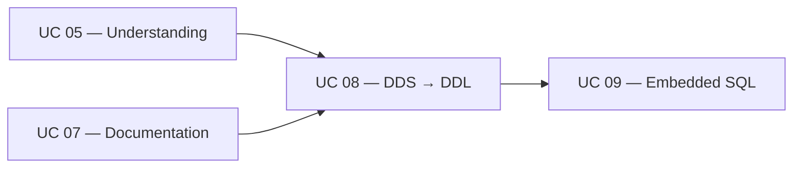

# UC 08 — DDS → DDL Conversion

> **Category:** Database modernization
>
> **Position in the learning path:** 8 — first UC of Phase 2, prerequisite for UC 09
>
> **Recommended Bob mode:** IBM i Developer (IBM i Premium Package) for Prompt 0 (qualification), then **switch to IBM i Database from Prompt 0-bis onward** and for all following prompts (1 to 6, including `/erd`) — see the mode-switch table in "Starting a Bob session".

---

## ⭐ IBM i Premium Package used

- **Slash Command: `/erd`** → [Official documentation](https://bob.ibm.com/docs/ide/premium-packages/bob-for-i/slash-commands)
  Used **after the migration** to validate that the DDL structure created matches the expected relationships. Queries `QSYS2.SYSTABLES`, `QSYS2.SYSCOLUMNS`, `QSYS2.SYSCST` and `QSYS2.SYSREFCST` and generates the Mermaid ERD diagram of the SQL tables created (details: UC00 §3.2).
- **Auto-activated skills:**
  - `db2-dds-to-ddl` — DDS → SQL DDL migration: tables, views, conversion strategies
  - `db2-ddl-generation` — DDL syntax: columns, PK, FK, CHECK, UNIQUE constraints, indexes, views
  - `dds-physical-files` — PF physical files: field specifications, keys, record formats
  - `dds-logical-files` — LF logical files: joins, SELECT/OMIT, derived fields
  - `dds-primer-basics` — DDS fundamentals to read and interpret DDS sources
  - `db2-dds-understanding` — reading legacy DDS files: PF, LF and key access paths
  - `db2-system-catalog` — QSYS2 catalogs for post-creation validation
  - `db2-journaling-commitment` — journal and commitment control (journaling status of Prompt 0-bis)
  - `db2-security-best-practices` — authority models and SQL privileges (authorities to recreate, Prompt 0-bis)

> The DDS and DDL skills activate automatically as soon as Bob reads a DDS source file or generates a `CREATE TABLE`. The `/erd` command runs **in IBM i Database mode** after the tables are created — it validates the result, it does not replace the conversion prompts.

> According to UC00 §4, `db2-ddl-generation`, `db2-dds-understanding` and `db2-journaling-commitment` are **reserved to IBM i Database mode**: they do not activate in IBM i Developer mode. For the prompts that list them, switch to IBM i Database. No workflow is used by this UC; IBM i tools, RAG and safeguards: see UC00 §5.

---

## Objective

Convert the IBM i **DDS physical files (PF) and logical files (LF)** into **SQL DDL statements** (`CREATE TABLE`, `CREATE INDEX`, `CREATE VIEW`) compliant with Db2 for i.

**UC 08 is the entry point of Phase 2 — Modernization of the database layer.** It comes before UC 09 (embedded SQL) because the SQL queries of UC 09 must target correctly typed DDL tables. Converting the accesses before converting the structures amounts to writing queries against poorly defined targets.

**This UC differs from UC 07 (Documentation) on a fundamental point:** UC 07 documents what exists to understand and preserve it. UC 08 produces executable code intended to **replace** the DDS definitions — it carries a real execution risk. Every generated DDL must be reviewed and tested before any production use.

**Expected deliverable:** SQL DDL scripts (`CREATE TABLE` + `CREATE INDEX` + optionally `CREATE VIEW`) for each converted PF/LF, with traceability comments, validated by `/erd` after creation, ready to be submitted on the test IBM i.

---

## Prerequisites

- **Phase:** Phase 2 — Database modernization
- **Required previous UCs:** UC 05 — Code Understanding, UC 07 — Full Documentation (recommended)
- **Required deliverables:**
  - `{appId}-comprehension-{component}-report-{YYYYMMDD-HHmm}.md` — UC 05 program understanding reports (list of the PF/LF used by each program)
  - `{appId}-doc-spec-tech-{YYYYMMDD-HHmm}.md` — UC 07 object inventory (recommended — identifies the shared PFs and their criticality)
  - `{appId}-doc-matrice-{YYYYMMDD-HHmm}.md` — UC 07 cross-reference matrix (recommended)
- **Recommended Bob level:** Intermediate
- **Estimated Bob Coins:** ⚠️ *To be calibrated after the UC 08 lab on FLGHT400.*

> ⚠️ **Blocking prerequisite:** do not start UC 08 on a critical PF without the UC 07 cross-reference matrix (`*-doc-matrice-*.md`) — it identifies the PFs shared by many programs, and therefore the files to handle with Prompt 0-bis.

> ⚠️ **A DBA or senior developer must be available** to settle the ambiguous type decisions (pseudo-date fields, COMP-3, REFLD). Bob identifies the ambiguities but cannot decide alone.

---

## Concrete example — FLGHT400 Lab

The FLGHT403 application illustrates a typical IBM i case: **all the tables are DDS physical files with no formal FK constraint**. No rows in `QSYS2.SYSCST` or `QSYS2.SYSREFCST` — the relationships between `ORDERS`, `AGENTS`, `CUSTOMERS` and `FLIGHTS` are implicit (fields `AGENT_NO`, `CUSTOMER_NO`, `FLIGHT_NUMBER`).

| Deliverable | Lab file | Produced by |
|---|---|---|
| Post-migration ERD | [`../labs_FLGHT400_results/FLGHT403_erd_report.md`](../labs_FLGHT400_results/FLGHT403_erd_report.md) | `/erd FLGHT403` — DDL tables, columns, Mermaid diagram |
| ERD diagram only | [`../labs_FLGHT400_results/FLGHT403_erd.md`](../labs_FLGHT400_results/FLGHT403_erd.md) | `/erd FLGHT403` |

This ERD report illustrates exactly what the `/erd` validation produces after UC 08: tables discovered, columns and SQL types, Mermaid diagram of the inferred relationships. On FLGHT403, the 7 application tables (`AGENTS`, `CUSTOMERS`, `AIRLINE`, `FLIGHTS`, `ORDERS`, `FRCITY`, `TOCITY`) correspond to as many DDS PFs to convert.

---

## Start with a known DDS file

> **Strong recommendation before tackling the application's critical files.**

Start with a **physical file the team knows well** — a simple PF, with few fields, whose structure is known to at least one developer able to validate Bob's output.

Why? Because the first conversion is used to **calibrate the level of precision**:
- Does Bob produce the right SQL types for the DDS fields (`6S2` → `DECIMAL(6,2)`, `10A` → `VARCHAR(10)` or `CHAR(10)`)?
- Is the primary key correctly inferred?
- Are the logical files converted to `CREATE INDEX` or `CREATE VIEW` according to their nature?
- Does Bob flag the fields whose type is ambiguous or the constraints that cannot be expressed in DDL?

**Recommended progression:**

> 💡 For each file, **start with Prompt 0** — it gives the category (SIMPLE / STANDARD / COMPLEX) and the exact sequence to follow. Do not go straight to Prompt 1.

| Step | File to choose | Expected category | Goal |
|---|---|---|---|
| 1 | Simple PF, < 20 fields, obvious key | SIMPLE | Calibrate the type mapping; check that Prompt 0 classifies correctly |
| 2 | Core business PF with several associated LFs | STANDARD | Validate the conversion of the LFs to `CREATE INDEX` and `CREATE VIEW` |
| 3 | PF with special fields (dates, decimal zones, COMP) | STANDARD to COMPLEX | Identify the cases requiring a manual decision on the target SQL type |
| 4 | PF shared by many programs (UC 07 matrix) | COMPLEX + risk | Validate against the cross-reference matrix before any change |

---

## Impact of the DDS file size on the conversion strategy

Size is not measured in lines, but in **number of fields** and **number of associated LFs**.

Key complexity factors are:
- **COMP-3 (packed decimal) or COMP (binary) fields** — several possible SQL equivalents
- **Date fields in numeric format** (`8S0` stored as `YYYYMMDD`) — convert to `DATE` or leave as `DECIMAL` depending on usage
- **LFs with SELECT/OMIT** — `CREATE INDEX` with a filter or `CREATE VIEW` depending on the nature of the access
- **Multi-format LFs (joins)** — cannot be converted to indexes; become views
- **REFLD** (fields referenced from another file) — to be resolved before any DDL generation

| Category | Criteria | Sequence |
|---|---|---|
| **SIMPLE** | < 20 fields, 1 to 3 LFs without SELECT/OMIT, no REFLD | Prompt 0 → Prompt 1 → Prompt 2 → Prompt 3-bis → Prompt 3 (LF) → Prompt 3-bis |
| **STANDARD** | 20 to 50 fields, or simple LFs, or a few ambiguous types | Prompt 0 → type decisions → Prompt 1 → Prompt 2 → Prompt 3-bis → Prompt 3 → Prompt 3-bis |
| **COMPLEX** | > 50 fields, or LFs with SELECT/OMIT, or unresolved REFLDs | Prompt 0 → full Prompt 1 → decisions → Prompt 2 → Prompt 3-bis → Prompt 3 LF by LF → Prompt 3-bis |

> ⚠️ An unresolved REFLD produces a `CREATE TABLE` with incorrect types — data can be inserted without error but with silent truncation.

---

## Starting a Bob session

### 1. New Bob conversation

Start each session in a **new Bob conversation** (`+` button). Do not reuse a conversation from a previous UC — the accumulated context pollutes the answers.

**Mode to select at startup:** `IBM i Developer` (Prompt 0 only)

> ⚠️ From Prompt 0-bis onward, switch to **IBM i Database**: this mode activates the `execute_sql_statement` tools and the skills reserved to it (`db2-ddl-generation`, `db2-dds-understanding`, `db2-journaling-commitment`, see UC00 §4).

**Mode switch, prompt by prompt:**

| Prompt | Mode | Reason |
|---|---|---|
| Prompt 0 — Qualification | `IBM i Developer` | Reading the DDS member; `dds-*` and `db2-dds-to-ddl` skills |
| Prompt 0-bis — Impact report | `IBM i Database` | SQL queries (`execute_sql_statement`); `db2-journaling-commitment` is reserved to this mode |
| Prompt 1 — DDS analysis | `IBM i Database` | `db2-dds-understanding` is reserved to this mode |
| Prompts 2, 3 and 4 — DDL generation | `IBM i Database` | `db2-ddl-generation` is reserved to this mode |
| Prompt 3-bis — Creation test | `IBM i Database` | DDL execution via `execute_sql_statement` |
| Prompt 5 — QSYS2 validation | `IBM i Database` | Catalog queries; `db2-dds-understanding` is reserved to this mode |
| Prompt 6 — `/erd` | `IBM i Database` | Slash command run in IBM i Database |

### 2. Open the source files in the editor

Before Prompt 0, open the DDS files to analyze in the Bob editor via the **IBM i — Object Browser** panel: right-click the DDS member → **Open in Editor**.

Files to open for each UC 08 session:
- The target DDS source file (`[LIB_NAME]/QDDSSRC([PF_OR_LF_NAME])` or `QDDSSRCD`)
- The referenced DDS files (`REFLD`) if any

### 3. Context files to load

| File | Produced by | Priority |
|---|---|---|
| `{appId}-comprehension-{component}-report-{date}.md` | UC 05 | **Recommended** — list of the PF/LF used per program |
| `{appId}-doc-spec-tech-{date}.md` | UC 07 | **Recommended** — complete inventory of the objects and shared PFs |
| `{appId}-doc-matrice-{date}.md` | UC 07 | **Recommended** — criticality of the shared PFs |

> 💡 If these files are not available, UC 08 still works — but Prompt 0 cannot identify the high-risk shared PFs or the REFLDs between files outside the scope.

> ⚠️ **Context compression risk:** a session with several STANDARD or COMPLEX files can reach the context limit. If Bob seems to forget a decision made at Prompt 0, save the deliverable in progress (Agent mode) after each major prompt. On each resumption: "The file [FILE_NAME] contains the decisions made — continue from [STEP]."

---

## Prompts

### Prompt 0 — Qualification and strategy choice

**Objective:** produce an assessment report before any DDL generation. Identifies the category (SIMPLE / STANDARD / COMPLEX), the blocking REFLDs, the ambiguous fields, and recommends the exact sequence.

**When to use:** first, for each DDS file before any other action.

**Workspace:** IBM i QSYS (reading the DDS member via the native IBM i tools)

**Required input:** DDS member open in the editor or accessible via the native IBM i tools.

**Key skills used:** `dds-primer-basics`, `dds-physical-files`, `dds-logical-files`, `db2-dds-to-ddl`.

```
The DDS file [PF_OR_LF_NAME] is located in [LIB_NAME]/QDDSSRC (or QDDSSRCD).

Analyze this DDS file and produce in English, in markdown,
an assessment report for the DDL conversion:

## UC 08 Qualification — [PF_OR_LF_NAME]

### 1. Quick inventory
| Indicator                                       | Value         |
|-------------------------------------------------|---------------|
| Object type                                     | PF / LF       |
| Number of fields                                | ?             |
| Number of associated logical files (LF)         | ? (if PF)     |
| REFLD present                                   | YES / NO      |
| COMP-3 or COMP fields present                   | YES / NO      |
| Numeric date fields present (e.g. 8S0)         | YES / NO      |
| LF with SELECT/OMIT                             | YES / NO / ?  |
| Multi-format LF (PF join)                       | YES / NO / ?  |

### 2. Detected complexity factors
Answer YES / NO / TO BE CONFIRMED for each factor:
- [ ] REFLDs not resolvable from this file alone (referenced file out of scope)
- [ ] Fields whose SQL type is ambiguous (numeric date, COMP-3, binary, very long field)
- [ ] LF with SELECT/OMIT requiring a CREATE VIEW rather than a CREATE INDEX
- [ ] Multi-format LF (join) → CREATE VIEW with complex JOIN
- [ ] DDS constraints with no DDL equivalent (implicit ALWNULL, COLHDG, COMP)
- [ ] PF referenced by several programs (high criticality — UC 07 matrix)

### 3. REFLDs to resolve before conversion
If REFLDs are present, list each referenced field:
| Field name | Referenced file       | Source field       | SQL type to use     |
|-----------|-----------------------|--------------------|---------------------|
| [FIELD]   | [REF_FILE_NAME]       | [SOURCE_FIELD_NAME] | ? (to resolve)     |

If the referenced file is not in the current scope:
→ Flag the blocker — resolve via QSYS2.SYSCOLUMNS before continuing.

### 4. Ambiguous fields — decisions required
For each field whose SQL type is ambiguous:
| Field name | DDS type | Probable usage    | Recommended SQL type  | Decision required |
|-----------|----------|-------------------|-----------------------|------------------|
| [FIELD]   | 8S0      | Creation date?    | DATE or DECIMAL(8,0)  | To be confirmed  |

### 5. Category and recommended strategy
Based on the inventory, conclude:

**Category:**
- [ ] SIMPLE — ≤ 20 fields, 1 to 3 LFs without SELECT/OMIT, no REFLD, no ambiguous type
- [ ] STANDARD — 20 to 50 fields, or simple LFs, or a few ambiguous types
- [ ] COMPLEX — > 50 fields, or LFs with SELECT/OMIT / join, or unresolved REFLDs

**Recommendation:**
- SIMPLE   → Direct sequence: Prompt 1 → Prompt 2 → Prompt 3-bis → Prompt 3 (LF) → Prompt 3-bis
- STANDARD → Resolve the ambiguities first, then: Prompt 1 → Prompt 2 with decisions → Prompt 3-bis → Prompt 3 → Prompt 3-bis
- COMPLEX  → Two-pass analysis: full Prompt 1 → type decisions → Prompt 2 with decisions → Prompt 3-bis → Prompt 3 LF by LF → Prompt 3-bis

Clearly flag the blocking REFLDs and the type decisions that must be made
by a DBA or senior developer before continuing.
```

**Deliverable produced:** `{appId}-ddl-{component}-analyse-dds-{YYYYMMDD-HHmm}.md`

> 💡 Save this report as soon as Prompt 0 ends (Agent mode). Prompt 1 will complete it.

> ⚠️ **Pitfall avoided:** without Prompt 0, the blocking REFLDs and the complex LFs are discovered mid-analysis — the session has to be interrupted. Prompt 0 moves this discovery to the very beginning (2 minutes vs 1 hour lost).

---

### Prompt 0-bis — Pre-migration impact report

> **This prompt is recommended on any PF classified STANDARD or COMPLEX** by Prompt 0, and on any PF referenced by many programs (UC 07 matrix). Optional on SIMPLE PFs.

> ⚠️ **IBM i Database mode required** — this prompt runs SQL queries. Switch to IBM i Database before launching it.

**Objective:** produce a complete impact report — journaling, authorities, locks, referencing programs — to be validated **before** generating the DDL.

**Workspace:** IBM i QSYS + Local (SQL execution on IBM i, report saved locally)
**Key skills used:** `db2-system-catalog`, `db2-journaling-commitment`, `db2-security-best-practices`.

```
The physical file [PF_NAME] in the library [LIB_NAME] is described in DDS.
We are going to convert it into an SQL DDL table.

Before generating the DDL, produce a complete pre-migration impact report in markdown.
This report must cover:

### 1. Equivalent DDL via GENERATE_SQL
Call QSYS2.GENERATE_SQL for [LIB_NAME].[PF_NAME] and show the CREATE TABLE generated.

### 2. Static program references (DSPPGMREF)
Query QTEMP/PGMREF (via DSPPGMREF on all the libraries of the Library List)
to list the programs that reference [PF_NAME]. For each program:
| Library | Program | Access type (read / write / update) |

### 3. Dependent objects (views, indexes, LFs)
Query SYSTOOLS.RELATED_OBJECTS for [LIB_NAME].[PF_NAME].
List all the dependent objects (LFs, SQL views, indexes).

### 4. Journaling status
Query QSYS2.JOURNALED_OBJECTS for [LIB_NAME].[PF_NAME].
If journaled: journal, current receiver, journaling type.
⚠️ The replacement SQL table must replicate exactly this setup.

### 5. Active locks
Query QSYS2.OBJECT_LOCK_INFO for [LIB_NAME].[PF_NAME].
If locks are active: do not modify the object without coordination with the team.

### 6. Authorities
Query QSYS2.OBJECT_PRIVILEGES for [LIB_NAME].[PF_NAME].
List the PUBLIC and specific authorities per user/group.
⚠️ These authorities must be recreated on the SQL table after migration (GRANT).

### 7. RRN note
If programs access the file by relative record number (RRN),
the replacement SQL table must have REUSEDLT(*NO) (default value — to be confirmed).

Save this report in the workspace under the name:
{appId}-ddl-{component}-impact-{YYYYMMDD-HHmm}.md
```

**Deliverable produced:** `{appId}-ddl-{component}-impact-{YYYYMMDD-HHmm}.md`

> 💡 This report is the checklist for the post-creation validation phase (Prompt 5 and `/erd`). Save it before continuing.

---

### Prompt 1 — Preliminary analysis of a DDS file

**Objective:** produce the field-by-field worksheet with the proposed SQL types, before any DDL generation.

**Workspace:** IBM i QSYS (reading DDS via the native IBM i tools)
**Key skills used:** `dds-physical-files`, `dds-logical-files`, `db2-dds-to-ddl`, `db2-dds-understanding`.

```
The DDS file [PF_OR_LF_NAME] is located in [LIB_NAME]/QDDSSRC (or QDDSSRCD).

Analyze this DDS file and answer in English in markdown:

1. DDS object type: physical file (PF) or logical file (LF)
2. Assumed functional role: what each record represents (1 to 3 sentences)
3. List of all the fields:
   | Field name | DDS type | Len. | Dec. | DDS text / label | Proposed SQL type | Remark |
4. Primary key: fields making up the key, in order
5. If logical file:
   - Base physical file(s)
   - LF key and sort criteria
   - SELECT/OMIT clauses if present
   - Recommended conversion approach: CREATE INDEX or CREATE VIEW? Why?
6. Fields whose SQL conversion is ambiguous or requires a decision:
   (e.g. numeric date field, COMP-3, unresolved REFLD, very long field)
7. DDS constraints with no direct DDL equivalent:
   (e.g. COMP, implicit ALWNULL, COLHDG, ALIAS)

Do not generate the DDL in this prompt.
Clearly flag what you cannot determine from the DDS source alone.
```

> ⚠️ **Pitfall avoided:** without the explicit PF/LF distinction, Bob may propose a `CREATE TABLE` for a logical file — an error that creates a redundant table without replacing the original index.

---

### Prompt 2 — Generating the CREATE TABLE (physical file)

**Objective:** generate the `CREATE TABLE` DDL script based on the Prompt 1 analysis, integrating the decisions made on the ambiguous types.

**Workspace:** Local (generation in the chat, saved to the workspace)
**Key skills used:** `db2-dds-to-ddl`, `db2-ddl-generation`, `dds-physical-files`.

```
Based on the analysis of the physical file [PF_NAME] that we have just done,
generate the SQL DDL CREATE TABLE script for Db2 for i, with comments in English,
taking into account the following decisions:
[List here the type decisions made during the Prompt 1 analysis]

Expected structure of the script:

-- ============================================================
-- TABLE: [LIB_NAME].[TABLE_NAME]
-- Original DDS file: [LIB_NAME]/QDDSSRC([PF_NAME])
-- Converted on: [DATE]
-- Status: To be validated and tested on a test IBM i before any production use
-- ============================================================

CREATE OR REPLACE TABLE [LIB_NAME].[TABLE_NAME] (
  -- [FIELD_NAME]  [SQL_TYPE]  [NULL/NOT NULL]  -- [ORIGINAL DDS LABEL]
  ...
  CONSTRAINT [TABLE_NAME]_PK PRIMARY KEY ([KEY_FIELDS])
)
;

Conversion rules to follow:
- Use the native Db2 for i SQL types: CHAR, VARCHAR, DECIMAL, INTEGER, SMALLINT, DATE, TIME, TIMESTAMP
- Short alphanumeric fields (≤ 30): CHAR(n)
- Long alphanumeric fields (> 30) or free text: VARCHAR(n)
- Zoned decimal fields (DDS type S): NUMERIC(len, dec); packed decimal fields (DDS type P): DECIMAL(len, dec)
- Do not invent constraints that are not visible in the DDS source
- Keep the original DDS labels as a comment on each field
- If a field has a DDS ALIAS, indicate it in a comment
- Flag with a TODO comment the fields whose conversion is not certain
```

**Deliverable produced:** `{appId}-ddl-{component}-table-{YYYYMMDD-HHmm}.md`

> 💡 `CREATE OR REPLACE TABLE` lets you rerun the script in the test environment without a prior `DROP TABLE` — fewer errors during iterations.

> ⚠️ **Rerunnable does not mean risk-free:** `CREATE OR REPLACE TABLE` replaces an existing table. Run it only in the test library ([TEST_LIB_NAME]), never on a production table. What happens to existing rows is governed by the `ON REPLACE` clause (`PRESERVE ALL ROWS`, `PRESERVE ROWS`, `DELETE ROWS` — see the IBM `CREATE TABLE` documentation): specify it explicitly if test data must be kept, and back up the table before any replacement. Before replacing, check the table's dependencies (views, SQL indexes, logical files, programs — see Prompt 0-bis, `SYSTOOLS.RELATED_OBJECTS`): they may block the replacement or be affected by it.

> ⚠️ **Pitfall avoided:** without the `VARCHAR(n)` rule for long fields, Bob may generate `CHAR(200)` for free text — wasted space and degraded indexing performance.

---

### Prompt 3 — Generating the CREATE INDEX and CREATE VIEW (logical files)

**Objective:** convert each LF to a `CREATE INDEX` (sort) or `CREATE VIEW` (SELECT/OMIT or join).

**Workspace:** Local (generation in the chat, saved to the workspace)
**Key skills used:** `db2-dds-to-ddl`, `db2-ddl-generation`, `dds-logical-files`.

```
Based on the analysis of the logical files of [PF_NAME] that we have just done,
generate the DDL scripts for each LF identified, following these rules:

For each LF to convert to CREATE INDEX:
-- ============================================================
-- INDEX: [INDEX_NAME] on [LIB_NAME].[TABLE_NAME]
-- Original DDS logical file: [LIB_NAME]/QDDSSRC([LF_NAME])
-- Key: [LF_KEY_FIELDS]
-- Type: [UNIQUE / non-unique]
-- ============================================================

CREATE [UNIQUE] INDEX [LIB_NAME].[INDEX_NAME]
  ON [LIB_NAME].[TABLE_NAME] ([LF_KEY_FIELDS ASC/DESC])
;

For each LF to convert to CREATE VIEW (SELECT/OMIT or reduced columns):
-- ============================================================
-- VIEW: [VIEW_NAME] on [LIB_NAME].[TABLE_NAME]
-- Original DDS logical file: [LIB_NAME]/QDDSSRC([LF_NAME])
-- Original SELECT/OMIT: [DDS_CONDITION]
-- ============================================================

CREATE OR REPLACE VIEW [LIB_NAME].[VIEW_NAME] AS
  SELECT [COLUMNS]
  FROM [LIB_NAME].[TABLE_NAME]
  WHERE [EQUIVALENT_SQL_CONDITION]
;

Rules:
- LF with sort only (no SELECT/OMIT, no column reduction) → CREATE INDEX
- LF with SELECT/OMIT → CREATE VIEW with an equivalent WHERE clause
- Multi-format LF (PF join) → CREATE VIEW with JOIN — flag it if the join is complex
- Do not invent columns or conditions that are not visible in the DDS source
- Flag in a comment the cases where the conversion is not direct
```

**Deliverable produced:** `{appId}-ddl-{component}-index-{YYYYMMDD-HHmm}.md`

> ⚠️ **Pitfall avoided:** an LF with SELECT/OMIT converted to a `CREATE INDEX` filters nothing — all the records are accessible, the SELECT/OMIT is silently lost.

---

### Prompt 3-bis — DDL creation test on the test IBM i

> **This prompt runs in IBM i Database mode** — Bob executes the DDL via `execute_sql_statement` (native IBM i tools).
> **When to use:** after each Prompt 2 (CREATE TABLE) and after each Prompt 3 (CREATE INDEX / CREATE VIEW), before moving on to the next file.

**Workspace:** IBM i QSYS (DDL execution on the test IBM i)
**Key skills used:** `db2-ddl-generation`, `db2-sql-debugging`.

```
Before running the DDL, call check_sql_syntax on the CREATE TABLE/INDEX/VIEW script
generated. If check_sql_syntax returns OK, proceed with the execution.
If syntax errors are detected, fix them and rerun check_sql_syntax.
Only execute on the IBM i after a successful syntax validation.
```

```
The following DDL script was generated for [PF_OR_LF_NAME] in [LIB_NAME]:

[Paste here the CREATE TABLE / CREATE INDEX / CREATE VIEW generated at Prompt 2 or 3]

Execute this script on the test IBM i via the native IBM i tools (IBM i Database mode).
MANDATORY target library: [TEST_LIB_NAME] — never [LIB_NAME].
Before any execution:
- in the executed copy, replace every [LIB_NAME] qualification of the objects created
  (table, index, view) with [TEST_LIB_NAME];
- display the script actually executed and confirm that no object is qualified with [LIB_NAME];
- if a reference to [LIB_NAME] remains, execute nothing and flag it.

Analyze the result and produce in English:

1. Status: CREATION SUCCEEDED / SQL ERRORS
2. If errors: list of the errors with SQL code and description
   | SQL code | Description | Object concerned | Probable cause |
3. If creation succeeded: confirm the full name of the object created
   ([TEST_LIB_NAME].[TABLE_OR_INDEX_OR_VIEW_NAME])
4. Remind that the structure created must be validated via Prompt 5 (QSYS2)
   before moving on to the next file

Do not modify the existing data — structure creation only.
```

> 💡 Common SQL codes: `-601` (object already exists — check that `CREATE OR REPLACE` is used), `-204` (base table not found for an index), `-104` (SQL syntax error).

> ⚠️ This prompt does not replace the functional validation of Prompt 5. A table created without SQL error can have incorrect types or missing fields.

---

### Prompt 4 — Complete migration script (application scope)

**Objective:** assemble all the DDL scripts in the correct execution order for a complete application scope (several PFs + their LFs).

**Workspace:** Local (generation and saving to the workspace)
**Key skills used:** `db2-dds-to-ddl`, `db2-ddl-generation`.

```
Based on the analysis and the DDL scripts generated for the application scope
[APPLICATION_NAME] / [LIB_NAME], generate a complete SQL migration script in English,
in markdown, grouping all the CREATE TABLE, CREATE INDEX and CREATE VIEW
in the right execution order.

Structure of the migration script:

-- ============================================================
-- DDS → DDL MIGRATION SCRIPT
-- Application: [APPLICATION_NAME]
-- Library: [LIB_NAME]
-- Scope: [list of the PF/LF covered]
-- Date: [DATE]
-- Status: ⚠️ To be validated and tested on a test IBM i before any use
-- ============================================================

-- SECTION 1: TABLES (physical files)
-- Order: independent tables first, tables with dependencies afterwards
[CREATE TABLE ...]

-- SECTION 2: INDEXES (logical files with sort)
[CREATE INDEX ...]

-- SECTION 3: VIEWS (logical files with SELECT/OMIT or join)
[CREATE VIEW ...]

Order rules:
- Indexes must follow their tables
- Join views must follow all their source tables

Include at the end of the script a summary table:
| Original DDS object | DDS type | SQL object created | SQL type | Status |
```

**Deliverable produced:** `{appId}-ddl-{appId}-complet-{YYYYMMDD-HHmm}.md`

> 💡 This script is the direct input of UC 09 (embedded SQL) — the table and index names generated here are the targets of the SQL queries produced in UC 09. Make sure this file is present and validated before starting UC 09.

---

### Prompt 5 — Cross-validation with QSYS2

**Objective:** validate that the structures created on the IBM i match the original DDS.

> **This prompt runs after the DDL script has been executed** — in IBM i Database mode.

**Workspace:** IBM i QSYS + Local
**Key skills used:** `db2-system-catalog`, `db2-dds-understanding`.

```
The following tables were created in the test library [TEST_LIB_NAME] from the DDL
script we generated: [TABLE_NAME1], [TABLE_NAME2], ...

Use the native IBM i tools (IBM i Database mode) to validate the creation,
all queries target [TEST_LIB_NAME] (not [LIB_NAME]):
1. For each table: check that QSYS2.SYSCOLUMNS returns all the expected fields
   with the correct SQL types
2. Compare the number of fields between the original DDS and the table created:
   SELECT COUNT(*) FROM QSYS2.SYSCOLUMNS WHERE TABLE_SCHEMA = '[TEST_LIB_NAME]' AND TABLE_NAME = '[TABLE_NAME]'
3. Check that the SQL indexes were created:
   SELECT INDEX_SCHEMA, INDEX_NAME, IS_UNIQUE, COLUMN_COUNT
   FROM QSYS2.SYSINDEXES
   WHERE TABLE_SCHEMA = '[TEST_LIB_NAME]' AND TABLE_NAME = '[TABLE_NAME]'
   (key columns: QSYS2.SYSKEYS by INDEX_SCHEMA + INDEX_NAME)
4. Flag any difference between the source DDS and the SQL structure created

Do not modify the objects created — limit yourself to the validation.
```

> 💡 This prompt can be run in **IBM i Database** mode with the native IBM i tools. Bob queries `QSYS2` and compares the results with the original DDS analyzed in Prompt 1.

> ⚠️ **Pitfall avoided:** do not settle for the success of the `CREATE TABLE` — a table can be created successfully but with one field missing if an unrecognized type was silently ignored.

---

### Prompt 6 — Post-migration validation with `/erd` ⭐ Premium

> **Premium slash command — run in IBM i Database mode after Prompt 5.**
> This is the final UC 08 validation: the ERD diagram visually confirms that the DDL structure created is consistent.

**Objective:** generate the ERD diagram of the SQL tables created and check that the relationships match expectations.

**Workspace:** IBM i QSYS (querying the Db2 for i catalogs)
**Key skills used:** `db2-system-catalog`.

```
/erd [LIB_NAME]
```

Bob queries `QSYS2.SYSTABLES`, `QSYS2.SYSCOLUMNS`, `QSYS2.SYSCST` and `QSYS2.SYSREFCST` and generates the Mermaid ERD diagram.

**Analyze the result:**
- Do all the migrated tables appear in the diagram?
- Do the columns have the right SQL types?
- Do the relationships inferred (from the column names) match the original LFs?
- Are formal FK constraints now defined? (On legacy IBM i, the answer is often no — this is expected, as on FLGHT403.)

**Deliverable produced:** `{appId}-ddl-{appId}-erd-{YYYYMMDD-HHmm}.md`

> 💡 **FLGHT403 example:** the ERD report [`../labs_FLGHT400_results/FLGHT403_erd_report.md`](../labs_FLGHT400_results/FLGHT403_erd_report.md) shows the expected result: 7 application tables, no formal FK (`QSYS2.SYSCST` empty), relationships inferred from the common fields. This is the norm for a legacy IBM i estate converted from DDS.

---

## Deliverables of this UC

| Produced file | Naming pattern | Consumed by |
|---|---|---|
| DDS assessment report | `{appId}-ddl-{component}-analyse-dds-{date}.md` | This file itself (session resumption) |
| Pre-migration impact report | `{appId}-ddl-{component}-impact-{date}.md` | Prompt 5 (checklist) |
| CREATE TABLE script | `{appId}-ddl-{component}-table-{date}.md` | Prompt 4 (assembly) |
| CREATE INDEX/VIEW script | `{appId}-ddl-{component}-index-{date}.md` | Prompt 4 (assembly) |
| Complete migration script | `{appId}-ddl-{appId}-complet-{date}.md` | **UC 09 (embedded SQL) — mandatory input** |
| Post-migration ERD report | `{appId}-ddl-{appId}-erd-{date}.md` | UC 09 (data model validation) |

---

## Dependencies



---

## Quick reference — DDS → SQL type mapping

| DDS type | Meaning | Recommended Db2 for i SQL type | Special cases |
|---|---|---|---|
| `nA` | Alphanumeric (n characters) | `CHAR(n)` if n ≤ 30; `VARCHAR(n)` if n > 30 | Free text: always `VARCHAR` |
| `nS d` | **Zoned decimal** (n digits, d decimals) — position 35 = `S` | `NUMERIC(n, d)` (the catalog `SYSCOLUMNS.DATA_TYPE` = `NUMERIC` designates zoned) | `nS 0`: `INTEGER` or `BIGINT` possible for a counter, **only after DBA validation** |
| `nP d` | **Packed decimal** (n digits, d decimals) — position 35 = `P` | `DECIMAL(n, d)` (`DATA_TYPE` = `DECIMAL` designates packed) | S and P are two distinct types: do not confuse them during conversion |
| `nB` | Binary (binary integer) | `SMALLINT` (n ≤ 4) or `INTEGER` (n ≤ 9) | Check the usage before choosing |
| `nL` | Date (ISO/JUL/MDY… format) | `DATE` | Check the DATFMT of the file |
| `nT` | Time | `TIME` | — |
| `nZ` | Timestamp | `TIMESTAMP` | — |
| `nA` (8 chars) used as a date | Pseudo-date YYYYMMDD | `CHAR(8)` with a comment | Do not force `DATE` without validating |
| `REFLD(field, file)` | Reference to another field | Resolve the reference → copy the type | Always resolve before generation |

> 💡 This table can be pasted into a Bob prompt to give it the conversion grid — it prevents Bob from inventing its own equivalences.

---

## Useful QSYS2 queries

```sql
-- Structure of a file after creation
SELECT COLUMN_NAME, DATA_TYPE, LENGTH, NUMERIC_SCALE,
       IS_NULLABLE, COLUMN_TEXT, COLUMN_HEADING
FROM QSYS2.SYSCOLUMNS
WHERE TABLE_SCHEMA = '[LIB_NAME]' AND TABLE_NAME = '[PF_NAME]'
ORDER BY ORDINAL_POSITION;

-- Logical files (LF) based on a PF
-- (SYSTABLES.BASE_TABLE_NAME is only populated for aliases: use SYSFILES)
SELECT F.TABLE_SCHEMA, F.TABLE_NAME, F.SYSTEM_TABLE_NAME, F.NATIVE_TYPE
FROM QSYS2.SYSFILES F,
     JSON_TABLE(F.BASED_ON_FILES, 'lax $.BASED_ON_FILES'
                COLUMNS(LIBRARY CHAR(10), FILE CHAR(10))) B
WHERE F.NATIVE_TYPE = 'LOGICAL'
  AND B.LIBRARY = '[LIB_NAME]' AND B.FILE = '[PF_NAME]';

-- Key columns of an SQL index (CREATE INDEX)
SELECT COLUMN_NAME, COLUMN_POSITION, ORDERING
FROM QSYS2.SYSKEYS
WHERE INDEX_SCHEMA = '[LIB_NAME]' AND INDEX_NAME = '[INDEX_NAME]'
ORDER BY COLUMN_POSITION;

-- PRIMARY KEY / UNIQUE constraints of a table and their columns
SELECT CONSTRAINT_NAME, COLUMN_NAME, ORDINAL_POSITION
FROM QSYS2.SYSKEYCST
WHERE TABLE_SCHEMA = '[LIB_NAME]' AND TABLE_NAME = '[TABLE_NAME]'
ORDER BY CONSTRAINT_NAME, ORDINAL_POSITION;

-- SQL indexes on a table (after DDL creation)
SELECT INDEX_SCHEMA, INDEX_NAME, IS_UNIQUE, COLUMN_COUNT
FROM QSYS2.SYSINDEXES
WHERE TABLE_SCHEMA = '[LIB_NAME]' AND TABLE_NAME = '[TABLE_NAME]';

-- Check the triggers on a PF (before production conversion)
SELECT TRIGGER_NAME, EVENT_MANIPULATION, ACTION_TIMING
FROM QSYS2.SYSTRIGGERS
WHERE EVENT_OBJECT_SCHEMA = '[LIB_NAME]'
  AND EVENT_OBJECT_TABLE  = '[PF_NAME]';
```

> ⚠️ `SYSINDEXES` and `SYSKEYS` only cover **SQL indexes** (`CREATE INDEX`). The native DDS keys and access paths (key of a PF, key of an LF) do not appear there: list them with `DSPFD`/`DSPDBR` (the number of key fields is in `QSYS2.SYSFILES.NUMBER_KEY_FIELDS`).

---

## Pitfalls to avoid

| Pitfall | What happens | How to avoid it |
|---|---|---|
| Skipping Prompt 0 on a COMPLEX file | Blocking REFLDs and complex LFs discovered mid-analysis | Always run Prompt 0 first — 2 minutes avoid 1 hour lost |
| Confusing PF and LF | An LF is converted to `CREATE TABLE` — redundant table, index lost | Prompt 0 identifies the type from the quick inventory |
| Not resolving the REFLDs before generation | DDL with wrong types — silent truncation on insert | Prompt 0 lists the blocking REFLDs in section 3 |
| Ignoring pseudo-date fields (`8S0`) | Field as `DECIMAL(8,0)` whereas the usage is a date | Prompt 0 lists these fields in section 4 |
| Converting a SELECT/OMIT LF to `CREATE INDEX` | The index filters nothing — all records accessible | For any LF with SELECT/OMIT: `CREATE VIEW` with a `WHERE` clause |
| Generating the DDL without a traceability header | Impossible to find the original DDS 3 months later | Always include the header with the original DDS file, date and status |
| Running the `CREATE TABLE` in production without testing | Type error or missing field discovered during data loading | Use Prompt 3-bis on the test IBM i — mandatory before production |
| Not running `/erd` after migration | Missing visual validation — structural inconsistencies undetected | Prompt 6 (`/erd`) is the final validation — do not skip it |
| Starting UC 09 without the validated complete DDL script | The UC 09 SQL queries target poorly defined tables | Check that `*-ddl-{appId}-complet-*.md` is present and validated before UC 09 |

---

## UC 08 validation checklist

Before moving on to UC 09, validate each point:

- [ ] The inventory of the PF/LF to convert is complete — checked against `QSYS2.SYSTABLES` and the UC 07 `*-doc-spec-tech-*.md` files
- [ ] **For each DDS file converted: Prompt 0 has been run** — `{appId}-ddl-{component}-analyse-dds-*.md` report produced with the category and the strategy chosen
- [ ] All the blocking REFLDs identified have been resolved before the DDL generation
- [ ] The ambiguous fields have been submitted for decision to a senior developer — choices documented in the analysis file
- [ ] Each PF has a `CREATE TABLE` script generated, reviewed and tested (Prompt 3-bis)
- [ ] Each LF has been converted to a `CREATE INDEX` or `CREATE VIEW` according to its nature — choice justified
- [ ] The complete migration script is produced and saved: `{appId}-ddl-{appId}-complet-*.md`
- [ ] The script has been run on the test IBM i — without SQL error
- [ ] The QSYS2 validation (Prompt 5) reports no discrepancy between the original DDS and the tables created
- [ ] The `/erd` command has been run after migration — report saved
- [ ] The DDS → SQL summary table (Prompt 4) is complete

---

## Points to complete before going to production

### Native IBM i triggers (`ADDPFTRG`)

Some physical files have triggers defined via `ADDPFTRG` — RPG programs triggered automatically on an `INSERT`, `UPDATE` or `DELETE`. These triggers are attached to the DDS PF object, **not to the SQL table** created by UC 08. Result: the SQL table behaves differently from the PF without any visible error.

**To do before converting in production:** check that triggers exist via `QSYS2.SYSTRIGGERS` (query in the section above). If triggers exist: recreate them on the SQL table with the `CREATE TRIGGER` DDL.

> ⚠️ **Warning sign:** if, after creating the SQL table, business behaviors silently disappear — first check the `ADDPFTRG` triggers of the original PF.

### Referential constraints (FOREIGN KEY)

UC 08 is limited to the DDS → DDL schema. `FOREIGN KEY`s are not generated — they do not exist in DDS. Defining them is a separate step, after validation of the data model.

---

## Additional reference

> **Lab 103 — DDS to SQL Conversion Impact Analysis** (GitHub repository `bmarolleau/IBM-i-Application-Modernization-with-Bob`, file `lab103-premium-dds-to-sql-workflow.md`)

This lab illustrates UC 08 on the SAMCO application: generation of the pre-migration impact report, use of `QSYS2.GENERATE_SQL`, enrichment of the DDL with `DEFAULT` and `CHECK` constraints, validation with `check_sql_syntax`, and execution after explicit approval. For this POC, replace the SAMCO library and file names with the equivalents of the target application — the prompt logic is identical. Prompt 0-bis of this sheet is directly inspired by Step 1 of the lab.

---

*UC 08 — Living document to be updated throughout the POC.*
