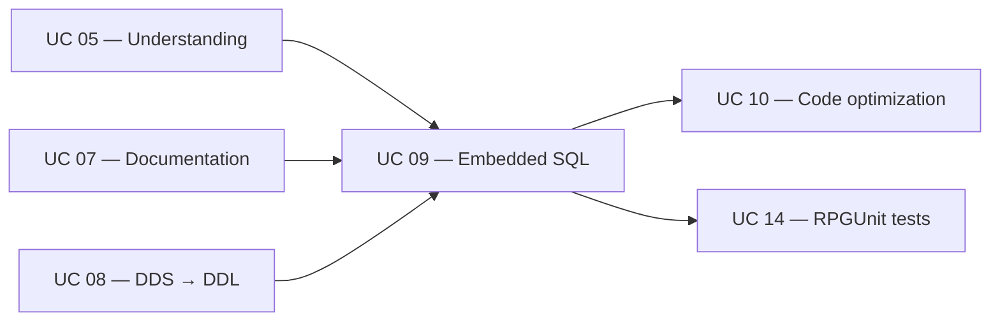

# UC 09 — Native database access → Embedded SQL

> **Category:** Database modernization
>
> **Position in the learning path:** 9 — follows UC 08 (target DDL tables known)
>
> **Recommended Bob mode:** IBM i Developer (RPG code analysis) → then IBM i Database (embedded SQL generation and compilation). Both modes are part of the IBM i Premium Package. Without the Premium Package: Ask for analysis/generation, Agent for compilation and saving.

---

## ⭐ IBM i Premium Package used

- **Workflow: SQL Index Strategy Advisor** (partial) → [Official documentation](https://bob.ibm.com/docs/ide/premium-packages/bob-for-i/workflows)
  Analyzes Db2 for i SQL performance data (Index Advisor recommendations, MTIs, execution statistics; capture of new data, Plan Cache snapshots or database monitor) and proposes indexes subject to selective approval. Use it alongside Prompt 5 (scope conversion plan) or after Prompt 4 to validate the index strategy on the generated cursors (once a real SQL workload is available).
  **Launch:** IBM i Database mode → **Start Workflow** button at the top of the chat → **Library List** workspace (the only workspace supported by this workflow) → *SQL Index Strategy Advisor*. Details: UC00 §1.2.
- **Slash Command: `/review_SQL`** → [Official documentation](https://bob.ibm.com/docs/ide/premium-packages/bob-for-i/slash-commands)
  Full review of an SQL query or of a source member containing SQL: syntax, readability, security, SQE performance, refactoring opportunities. Use it alongside Prompt 2 and Prompt 3 to validate the generated queries before compilation.
- **Auto-activated skills:**
  - `rpg-rla-to-sql` — converting RLA access to embedded SQL to improve performance
  - `rpg-embedded-sql` — embedded SQL: cursor operations, host variables, compilation differences
  - `rpg-sql-cursor` — SQL cursor declaration, scrollable cursors, multi-row processing
  - `db2-sql-primer` — Db2 for i SQL fundamentals: CRUD, joins, aggregates
  - `db2-sql-optimization` — query rewriting, join order, predicate pushdown, index usage
  - `db2-index-strategy` — Binary Radix and EVI index types, syntax, selection and maintenance
  - `db2-sql-stored-procedure-performance` — high-performance SQL PL best practices in stored procedures, functions and triggers (if the conversion relies on an SQL procedure)

> **IBM i Developer** mode is used for the analysis of the RPG source (Prompts 0 and 1). **IBM i Database** mode is used for SQL generation (Prompts 2, 3 and 4); Prompt 2-bis (compilation) switches back to IBM i Developer. This mode switch is the distinctive feature of UC 09 (UC 10 reuses it for its SQL part): it uses **both IBM i Premium modes** in the same session.

---

## Objective

Replace the **native IBM i file accesses** (`CHAIN`, `READ`, `READE`, `READP`, `SETLL`, `SETGT`, `WRITE`, `UPDATE`, `DELETE`…) with **embedded SQL statements** (`EXEC SQL SELECT`, `INSERT`, `UPDATE`, `DELETE`, cursors) in the RPG programs.

**This UC modernizes data access, not the structure.** UC 08 converted the DDS definitions into DDL tables — UC 09 converts the way programs access those tables. The two are complementary: a program converted to embedded SQL that still targets a DDS PF works technically, but a program that accesses a poorly typed table through SQL produces incorrect results. **UC 08 first, UC 09 second.**

**This UC does not change the functional logic of the program** — it only changes the data access mechanism. The business rules stay identical, and the results must be identical before and after conversion. This is the main success criterion.

**Expected deliverable:** for each converted program — the modified RPG source with the native accesses replaced by embedded SQL, the cursor declarations, the removal of the F-specs of the converted files, and a traceability file documenting each replacement made.

---

## Prerequisites

- **Phase:** Phase 2 — Database modernization
- **Required previous UCs:** UC 08 — DDS → DDL (mandatory), UC 05 — Code Understanding (recommended), UC 07 — Full Documentation (recommended)
- **Required deliverables:**
  - `{appId}-ddl-{appId}-complet-{YYYYMMDD-HHmm}.md` — complete UC 08 DDL migration script (**mandatory** — target SQL table names for the generated queries)
  - `{appId}-comprehension-{component}-report-{YYYYMMDD-HHmm}.md` — UC 05 program understanding reports (list of accessed files and their PF/LF nature)
  - `{appId}-doc-matrice-{YYYYMMDD-HHmm}.md` — UC 07 cross-reference matrix (programs sharing the same files)
- **Recommended Bob level:** Intermediate to Advanced
- **Estimated Bob Coins:** ⚠️ *To be calibrated after the UC 09 lab on FLGHT400.*

> ⚠️ **Blocking prerequisite:** if `*-ddl-{appId}-complet-*.md` is missing, Prompt 0 detects it and blocks the session — complete UC 08 on the scope before continuing.

> ⚠️ **An RPG developer must be available** to validate functional non-regression. A successful compilation by Bob does not guarantee identical behavior — functional tests remain irreducible.

---

## Concrete example — FLGHT400 Lab

The FLGHT403 application has its DDL tables available in [`../labs_FLGHT400_results/FLGHT403_erd_report.md`](../labs_FLGHT400_results/FLGHT403_erd_report.md). This post-UC 08 migration ERD report shows the target SQL tables (`ORDERS`, `FLIGHTS`, `AGENTS`, `CUSTOMERS`…) with their SQL types — this is the exact input for the UC 09 embedded SQL queries.

The FLGHT403 RPG programs (`QRPGLESRC` in the library) that access `ORDERS` through `CHAIN ORDER_NUMBER` become, after UC 09, `EXEC SQL SELECT ... INTO ... FROM FLGHT403.ORDERS WHERE ORDER_NUMBER = :var`.

> 💡 No UC 09 lab is available yet on FLGHT400 — the deliverables (`*-sql-embarque-*.md`) will be produced during the UC 09 lab.

---

## Start with a program you know

> **Strong recommendation before tackling the application's critical programs.**

Start with a **simple program with few native accesses** — ideally a program whose logic is known by a developer on the team, who can validate that the behavior after conversion is identical.

Why? Because the first conversion is used to **calibrate two things**:
- The quality of Bob's opcode → SQL translation (does `CHAIN` on a composite key really become a `SELECT ... WHERE field1 = :var1 AND field2 = :var2`?)
- The team's ability to test non-regression (which datasets, which edge cases to validate?)

**Recommended progression:**

> 💡 For each program, **start with Prompt 0** — it gives the category (SIMPLE / STANDARD / COMPLEX) and the exact sequence. Do not go straight to Prompt 1.

| Step | Program to choose | Expected category | Goal |
|---|---|---|---|
| 1 | Program with simple CHAIN and WRITE (< 10 native accesses) | SIMPLE | Calibrate CHAIN → SELECT, WRITE → INSERT; check that Prompt 0 classifies correctly |
| 2 | Program with a READ/READE loop | STANDARD | Validate the conversion to an SQL cursor |
| 3 | Program with SETLL/READE on an LF | STANDARD to COMPLEX | Validate that the DDL index correctly replaces the LF |
| 4 | Critical program with mixed accesses (read, write, update in the same transaction) | COMPLEX | Validate SQL transaction handling and error behavior |

---

## Impact of the program size on the conversion strategy

The complexity of UC 09 does not depend on the total number of lines of the program, but on the **number and diversity of access opcodes** and on the **navigation logic** (nested loops, conditional reads, multi-file accesses).

Key complexity factors:
- **SETLL/READ/READE loops** — positioned sequential navigation: the SQL equivalent is a cursor with `ORDER BY` and a starting `WHERE` clause
- **Correlated multi-file accesses** — a `CHAIN` whose key comes from the result of a `READ` on another file: becomes a `JOIN` or subqueries
- **Explicit locks** (`LOCK`) — no direct equivalent in embedded SQL: requires a design decision (`SELECT ... FOR UPDATE`)
- **Status indicators** (`%FOUND`, `%EOF`, `%EQUAL`) — to be replaced with `SQLCODE` checks
- **Subfiles (SUBFILE) loaded by read loops** — converting the load loop is often the most delicate part

| Category | Criteria | Sequence |
|---|---|---|
| **SIMPLE** | < 10 accesses, no complexity factor | Prompt 0 → Prompt 1 → Prompt 2 → Prompt 2-bis → Prompt 4 |
| **STANDARD** | 10 to 30 accesses, or simple loops without nesting | Prompt 0 → Prompt 1 → Prompt 2 per group → Prompt 2-bis → Prompt 4 |
| **COMPLEX** | > 30 accesses, or nested loops, or correlated accesses, or locks | Evaluate UC 11 (restructuring) before UC 09. If conversion is decided: Prompt 0 → Prompt 1 → Prompt 3 (cursors) + Prompt 2 → Prompt 2-bis → Prompt 4 |

> ⚠️ On a COMPLEX program, Prompt 0 explicitly asks the question: **should the program be restructured before converting?** (UC 11 before UC 09 on this specific program). If Prompt 0 concludes "restructuring recommended", do not start the conversion — open a UC 11 task first.

---

## Starting a Bob session

### 1. New Bob conversation and mode switch

UC 09 runs in **two phases that use different modes**:

| Phase | Mode | Reason |
|---|---|---|
| **RPG analysis** — reading the source, opcode inventory (Prompts 0 and 1) | `IBM i Developer` | Access to the RPG code, `read_member`, understanding of the navigation logic |
| **SQL generation** — replacing opcodes, cursors, optimization (Prompts 2, 3 and 4) | `IBM i Database` | Gives access to the Db2 skills (including `db2-index-strategy`, reserved to this mode) and to `rpg-rla-to-sql` (available in both modes) — index recommendations, SQL syntax validation, optimized joins. `rpg-embedded-sql` and `rpg-sql-cursor` belong to IBM i Developer (UC00 §4) |
| **Compilation** — compilation test after each Prompt 2 or 3 (Prompt 2-bis) | `IBM i Developer` | Access to the compilation actions (`execute_compile_action`, `execute_cl_command`); IBM i Database has no access to them |

**When to switch:** after Prompt 1 (complete inventory validated), start a **new conversation** in `IBM i Database` mode with the inventory as context.

> 💡 **IBM i Database** mode produces more precise SQL queries because it queries the Db2 for i catalog (`QSYS2.SYSTABLES`, `SYSCOLUMNS`) to validate the column names and the actual types — not just what Bob infers from the RPG code.

### 2. Open the source files in the editor

Before Prompt 0, open the RPG program to convert in the Bob editor via the **IBM i — Object Browser** panel: right-click the RPG member → **Open in Editor**.

Files to open:
- The RPG source program (`[LIB_NAME]/QRPGSRC([PROGRAM_NAME])` or `QRPGLESRC`)
- The complete DDL file of the library (`*-ddl-complet-*.md`) for the target table names

### 3. Context files to load

| File | Produced by | Priority |
|---|---|---|
| `{appId}-ddl-{appId}-complet-{date}.md` | UC 08 | **Mandatory** — target SQL table names for the generated queries |
| `{appId}-comprehension-{component}-report-{date}.md` | UC 05 | **Mandatory** — list of accessed files and their nature (PF/LF) |
| `{appId}-doc-spec-tech-{date}.md` | UC 07 | **Recommended** — program interfaces (parameters, files) |
| `{appId}-doc-matrice-{date}.md` | UC 07 | **Recommended** — programs sharing the same files (DDL name consistency) |
| `{appId}-sql-{component}-analyse-acces-{date}.md` | UC 09 (previous session) | **If resuming** — access inventory already produced |

> 💡 **Session resumption:** if the conversion is interrupted, open the `*-sql-{component}-analyse-acces-*.md` file already produced — Bob retrieves the inventory without re-reading the source from scratch.

> ⚠️ **Context compression risk:** on STANDARD or COMPLEX programs, save the deliverable in progress (Agent mode) after each major prompt. On each resumption: "The file [FILE_NAME] contains the decisions made — continue from group [No.]."

---

## Prompts

### Prompt 0 — Qualification and strategy choice

**Objective:** produce an assessment report before any conversion. Identifies the category (SIMPLE / STANDARD / COMPLEX), the missing DDL prerequisites, and recommends the exact sequence.

**When to use:** first, for each program before any other action.

**Workspace:** IBM i QSYS (reading the RPG source via the native IBM i tools) — IBM i Developer mode.
**Key skills used:** `rpg-rla-to-sql`, `rpg-embedded-sql`.

**Required input:** RPG program open in the editor, `*-ddl-complet-*.md` file loaded in context.

```
The program [PROGRAM_NAME] is located in [LIB_NAME]/QRPGSRC (or QRPGLESRC).

Analyze this program and produce in English, in markdown, an assessment report
for the conversion to embedded SQL:

## UC 09 Qualification — [PROGRAM_NAME]

### 1. Native file operation count
Count the total number of occurrences of each file access opcode:
| Opcode              | No. of occurrences |
|---------------------|--------------------|
| CHAIN               | ?                  |
| READ                | ?                  |
| READE               | ?                  |
| READP / READPE      | ?                  |
| SETLL               | ?                  |
| SETGT               | ?                  |
| WRITE               | ?                  |
| UPDATE              | ?                  |
| DELETE              | ?                  |
| EXCEPT (to file)    | ?                  |
| **TOTAL**           | **?**              |

### 2. Complexity factor detection
Answer YES / NO / TO CONFIRM for each factor:
- [ ] Navigation loops (SETLL + DOW + READ/READE)
- [ ] Nested loops (a READ loop inside a READ loop)
- [ ] Correlated multi-file accesses (key from a READ used for a CHAIN)
- [ ] Explicit locks (LOCK opcode or F-spec with locking)
- [ ] Subfiles (SUBFILE) loaded by read loops
- [ ] Access to logical files (LF) — check that the LF has a DDL index in UC 08

### 3. DDL prerequisite check (UC 08)
For each file declared in an F-spec, check that it exists in
{appId}-ddl-{appId}-complet-{YYYYMMDD-HHmm}.md (UC 08):
| Native DDS file | Target DDL table | DDL available? |
|-----------------|------------------|----------------|
| [FILE_NAME]     | [SQL_TABLE_NAME] | YES / NO / ?   |

If a DDL is missing: flag the blocker — UC 08 must be completed
on this scope before continuing.

### 4. Recommended category and strategy
Based on the count and the complexity factors, conclude:

**Category:**
- [ ] SIMPLE — < 10 accesses, no complexity factor
- [ ] STANDARD — 10 to 30 accesses, or simple loops without nesting
- [ ] COMPLEX — > 30 accesses, or nested loops, or correlated accesses, or locks

**Recommendation:**
- SIMPLE   → Direct sequence: Prompt 1 → Prompt 2 → Prompt 2-bis → Prompt 4
- STANDARD → Conversion by functional groups — identify the groups below,
              apply Prompt 1 → Prompt 2 group by group → Prompt 2-bis → Prompt 4
- COMPLEX  → Evaluate UC 11 (restructuring) before conversion.
              If the decision is to convert without restructuring:
              Prompt 1 → Prompt 3 (cursors) + Prompt 2 (simple accesses) → Prompt 2-bis → Prompt 4

**If STANDARD or COMPLEX category — functional groups identified:**
| Group | Subroutine(s) | File(s) concerned | No. of accesses | Prompts to use |

Clearly flag what you cannot determine without running the program.
```

**Deliverable produced:** `{appId}-sql-{component}-analyse-acces-{YYYYMMDD-HHmm}.md`

> 💡 Save this report as soon as Prompt 0 is finished (Agent mode). Prompt 1 will complete it.

> ⚠️ **Pitfall avoided:** without Prompt 0, the conversion starts without a plan — nested loops and correlated accesses are discovered along the way, and the session has to be interrupted and restarted. Prompt 0 = 2 minutes vs 2 hours lost.

---

### Prompt 1 — Inventory of a program's native accesses

**Objective:** produce the complete worksheet, opcode by opcode, before any SQL generation.

**Workspace:** IBM i QSYS (RPG reading via the native IBM i tools) — IBM i Developer mode.
**Key skills used:** `rpg-rla-to-sql`, `rpg-embedded-sql`.

```
The program [PROGRAM_NAME] is located in [LIB_NAME]/QRPGSRC (or QRPGLESRC).

Analyze this program and produce in English, in markdown, the complete inventory
of all its native IBM i file accesses:

1. List of the files declared in F-specs (or DCL-F in free format):
   | File name | Type (PF/LF) | Mode (INPUT/OUTPUT/UPDATE/DELETE) | Access (KEYED/SEQ) | Keyed file? |

2. Inventory of all native access opcodes, by occurrence in the source:
   | No. | Line | Opcode | Target file | Key / Condition | Subroutine / Procedure | Anticipated SQL equivalent |
   Opcodes to detect: CHAIN, READ, READE, READP, READPE, SETLL, SETGT,
   WRITE, UPDATE, DELETE, EXCEPT (to file), OPEN, CLOSE

3. Navigation loops identified:
   For each DOW/DOU/FOR loop with READ/READE inside:
   - Loop type (sequential / by key / EOF)
   - File traversed
   - Exit condition
   - Anticipated SQL strategy: simple cursor / cursor with WHERE filter / single fetch

4. Correlated multiple accesses:
   The cases where the value read on one file is used as a key to access another file
   (candidates for an SQL join)

5. Status indicators used after the access opcodes:
   %FOUND, %EOF, %EQUAL, *IN and the result indicators — they will have to be
   replaced by SQLCODE / SQLSTATE tests

Do not generate the SQL in this prompt.
Clearly flag the accesses whose conversion will be complex or will require a decision.
```

> ⚠️ **Pitfall avoided:** without a prior inventory, Bob generates embedded SQL in a single pass and may miss opcodes in secondary subroutines — the missed native access stays in the converted source and causes a compilation error.

---

### Prompt 2 — Converting simple accesses (CHAIN, WRITE, UPDATE, DELETE)

**Objective:** convert the direct (non-loop) accesses to `EXEC SQL`.

**Workspace:** Local (generation in the chat) + IBM i QSYS (validation of the table names via the native IBM i tools) — IBM i Database mode.
**Key skills used:** `rpg-rla-to-sql`, `db2-sql-primer`.

```
Based on the inventory of the native accesses of [PROGRAM_NAME] that we just made,
convert the following accesses to embedded SQL for Db2 for i, in free-format RPG:

[List here the access numbers from the Prompt 1 table to convert in this pass]

For each converted access, produce:

1. The original native RPG code (commented, kept for reference):
   // NATIVE: [OPCODE] [FILE] [KEY]

2. The SQL declarations to add (host variables, if new):
   DCL-S [VAR_NAME] [TYPE] ;

3. The embedded SQL replacement:
   EXEC SQL [SQL_STATEMENT] INTO / FROM [HOST_VARIABLES] ;
   IF SQLCODE <> 0 ;  // or SQLCODE = 100 for NOT FOUND
     [HANDLING EQUIVALENT TO THE ORIGINAL INDICATOR]
   ENDIF ;

Conversion rules to follow:
- CHAIN [KEY] [FILE] → EXEC SQL SELECT [FIELDS] INTO [VARS] FROM [TABLE] WHERE [KEY]
  After: IF SQLCODE = 0 → equivalent to %FOUND *ON ; IF SQLCODE = 100 → %FOUND *OFF
- WRITE [FILE] → EXEC SQL INSERT INTO [TABLE] ([FIELDS]) VALUES ([VARS])
  After: IF SQLCODE <> 0 → handle the error (duplicate key: SQLCODE = -803)
- UPDATE [FILE] → EXEC SQL UPDATE [TABLE] SET [FIELDS = VARS] WHERE [KEY]
  After: IF SQLCODE <> 0 → handle the error
- DELETE [FILE] → EXEC SQL DELETE FROM [TABLE] WHERE [KEY]
  After: IF SQLCODE <> 0 → handle the error

Use the DDL table names from the file
{appId}-ddl-{appId}-complet-{YYYYMMDD-HHmm}.md (UC 08).

Do not remove the F-specs in this prompt — they will be removed
only once all accesses to the file have been converted and validated.
Do not invent fields or columns not visible in the original source.
Flag the cases where the conversion is not direct.
```

**Deliverable produced:** `{appId}-sql-{component}-embarque-{YYYYMMDD-HHmm}.md`

> 💡 Use `/review_SQL` on the generated queries to validate syntax, performance and security before Prompt 2-bis.

> ⚠️ **Pitfall avoided:** without the `IF SQLCODE` test, an `UPDATE` that found no record (SQLCODE = 100) passes silently — in native RPG, the error indicator would have been set and the application logic would have detected it.

---

### Prompt 2-bis — Compilation test by Bob

> **This prompt runs in IBM i Developer mode** — Bob launches the compilation via the native IBM i tools (`execute_compile_action` or `execute_cl_command`). Do not stay in IBM i Database — this mode has no access to the compilation actions.
> **When to use:** after each Prompt 2 (group of simple accesses) or Prompt 3 (cursor), before moving on to the next group.

**Workspace:** IBM i QSYS (compilation on the test IBM i) — IBM i Developer mode.
**Key skills used:** `rpg-embedded-sql`.

```
The RPG source of [PROGRAM_NAME] in [LIB_NAME]/QRPGSRC has been modified
with the embedded SQL conversions we just made.

Launch the compilation on the test IBM i with CRTSQLRPGI (SQL precompiler —
CRTBNDRPG does not process EXEC SQL statements):
CRTSQLRPGI OBJ([TEST_LIB_NAME]/[PROGRAM_NAME])
           SRCFILE([LIB_NAME]/QRPGSRC)
           SRCMBR([PROGRAM_NAME])
           OBJTYPE(*PGM)
           OPTION(*EVENTF)
           OUTPUT(*PRINT)
           DBGVIEW(*SOURCE)

Analyze the compilation result and produce in English:

1. Status: COMPILATION SUCCESSFUL / COMPILATION ERRORS
2. If errors: list of the errors with line number, IBM i error code and description
   | Line | Error code | Description | Probable cause |
3. If SQL warnings (SQLCODE, SQLSTATE not tested): list them separately
4. Recommendation to fix the errors before continuing

If the compilation succeeds without errors:
- Confirm that group [GROUP_NAME] is compiled and ready for functional testing
- Remind that a successful compilation does not guarantee functional non-regression —
  functional testing on the test IBM i remains mandatory (human verification)
```

> 💡 In case of a compilation error: do not move on to the next group. Fix it in the chat, then rerun this prompt. The "fix → recompile → validate" loop can be done entirely in Bob until the compilation is clean.

> ⚠️ **This prompt does not replace functional testing.** Mandatory tests that cannot be delegated to Bob:
> - Run the program on the test IBM i with a real dataset
> - Compare the results (records read, created, updated) with the results of the original native program
> - Check the edge cases: record not found, end of file, key violation

---

### Prompt 3 — Converting navigation loops (SETLL/READ/READE → SQL cursor)

**Objective:** convert the sequential navigation loops into `DECLARE / OPEN / FETCH / CLOSE` SQL cursors.

**Workspace:** Local (generation in the chat) — IBM i Database mode.
**Key skills used:** `rpg-rla-to-sql`, `db2-sql-optimization`.

```
Based on the inventory of [PROGRAM_NAME], convert the following navigation loop
to an SQL cursor for Db2 for i, in free-format RPG:

Loop identified:
[Copy here the native code block: SETLL + DOW/DOU + READ/READE + content + ENDDO]

Expected conversion strategy:

1. SQL cursor declaration (to be placed in the program's declaration section):
   EXEC SQL DECLARE [CURSOR_NAME] CURSOR FOR
     SELECT [REQUIRED_FIELDS]
     FROM [DDL_TABLE]
     WHERE [CONDITION_EQUIVALENT_TO_THE_SETLL_OR_READE]
     ORDER BY [LF_OR_PF_KEY]
   ;

2. Loop replacement:
   EXEC SQL OPEN [CURSOR_NAME] ;
   IF SQLCODE <> 0 ;
     [OPEN ERROR HANDLING]
   ENDIF ;

   EXEC SQL FETCH [CURSOR_NAME] INTO [HOST_VARIABLES] ;
   DOW SQLCODE = 0 ;
     [LOOP BODY — logic unchanged]
     EXEC SQL FETCH [CURSOR_NAME] INTO [HOST_VARIABLES] ;
   ENDDO ;

   EXEC SQL CLOSE [CURSOR_NAME] ;

3. Removal of the original SETLL and READ/READE (commented out for reference)

Rules:
- SETLL [KEY] [FILE] + READ [FILE] (sequential read from the key) → cursor with ORDER BY + WHERE >= [KEY]
- SETLL [KEY] [FILE] + READE [FILE] (read limited to the key) → cursor with ORDER BY + WHERE = [KEY]
- SETGT [KEY] [FILE] + READ [FILE] → cursor with WHERE > [KEY]
- Loop until %EOF → DOW SQLCODE = 0 (SQLCODE = 100 = end of cursor)
- Loop until key change (READE) → WHERE = [KEY] (strict equality) in the cursor, never >=
- If the loop modifies records while reading:
  use SELECT ... FOR UPDATE and UPDATE ... WHERE CURRENT OF [CURSOR]

Name the cursor explicitly: [FILE_NAME]_[CONTEXT_SUFFIX]_CUR
(e.g.: ORDERS_PENDING_CUR)

Do not invent columns or conditions not present in the original source.
Flag if the loop contains operations incompatible with a simple cursor.
```

> ⚠️ **Pitfall avoided:** a `SETLL/READE` loop only reads the records whose key **equals** the positioned value. The cursor must have `WHERE key = :var` and not `WHERE key >= :var` — a nuance that completely changes the scope of the data read.

> ⚠️ **Pitfall avoided:** forgetting `CLOSE [CURSOR_NAME]` at the end of the loop. On a batch program processing thousands of records, an unclosed cursor can saturate IBM i resources.

---

### Prompt 4 — Final cleanup: removing the F-specs and native OPEN/CLOSE

**Objective:** remove the F-specs of the fully converted files and adapt the externally described DSs.

**Workspace:** Local (generation in the chat, workspace save) — IBM i Database mode.
**Key skills used:** `rpg-rla-to-sql`.

```
All native accesses to the file [FILE_NAME] in [PROGRAM_NAME] have been
converted to embedded SQL and validated.

Perform the final cleanup for this file:

1. Remove the F-spec (or DCL-F) of the file [FILE_NAME]
   - First check that no remaining native access references this file
     (otherwise, the removal will cause a compilation error)
   - Keep the F-spec as a comment for one more session
     before permanent removal

2. Remove the explicit native OPEN and CLOSE for this file (if any)

3. Check the data structure declarations linked to this file:
   - Externally described DSs (E DS EXTNAME([FILE_NAME])): to be replaced by SQL DSs
     or by individual host variables depending on the complexity
   - Are the fields of these DSs still referenced after the conversion?
     If yes: keep them as independent variables
     If no: remove them

4. Produce a summary of the changes:
   | Element removed  | Original line | Reason |
   | Element modified | Original line | Change made |

Do not remove any element other than those directly linked to [FILE_NAME].
Flag any element whose removal requires a manual check.
```

> ⚠️ **Pitfall avoided:** removing the F-spec before converting **all** the accesses to the file is the most frequent error — the compiler flags the error but the program is left in an inconsistent state that is hard to untangle.

---

### Prompt 5 — Conversion plan for a complete application scope

**Objective:** produce the steering document for the embedded SQL conversion across all the programs of an application.

**Workspace:** Local (generation from the UC 05 and UC 07 deliverables)
**Key skills used:** `rpg-rla-to-sql`.

```
Based on the program understanding reports ({appId}-*-comprehension-*.md)
and the technical specifications ({appId}-*-doc-spec-tech-*.md) for
the application [APPLICATION_NAME] in [LIB_NAME], generate an embedded SQL
conversion plan in English, in markdown.

## Embedded SQL conversion plan — [APPLICATION_NAME]

### 1. Scope of the programs to convert
Table:
| Program | Estimated no. of native accesses | Files accessed | Category (S/St/C) | Recommended conversion order |

Category: S  = SIMPLE   (< 10 accesses, no complex loop)
          St = STANDARD (10–30 accesses, simple loops)
          C  = COMPLEX  (> 30 accesses, nested loops, correlated accesses)

### 2. Dependencies between programs
The programs that access the same shared files (matrix *-doc-matrice-*.md)
must be converted consistently:
- A file shared between several programs must have the same target DDL table
- Programs that share data structures must be converted together

### 3. Target DDL files
Check that each DDS file accessed natively has its DDL equivalent in
{appId}-ddl-{appId}-complet-{YYYYMMDD-HHmm}.md (UC 08).
Flag the cases where the DDL is missing — these programs cannot be
converted until UC 08 is completed on their scope.

### 4. Identified risks
The 3 to 5 riskiest conversion points of this scope:
complex loops, correlated accesses, explicit locks, subfiles loaded
by native read loops.

### 5. Effort estimate
| Program | Prompts needed | Estimated duration (with Bob) | Priority |

Do not invent programs or files not visible in the available sources.
```

**Deliverable produced:** `{appId}-sql-{appId}-plan-conversion-{YYYYMMDD-HHmm}.md`

> 💡 This plan is the steering document of UC 09. It allows tracking progress program by program and prioritizing by risk and dependencies.

---

## Deliverables of this UC

| File produced | Naming pattern | Consumed by |
|---|---|---|
| Assessment report | `{appId}-sql-{component}-analyse-acces-{date}.md` | This same file (session resumption) |
| Converted RPG source (diff or full) | `{appId}-sql-{component}-embarque-{date}.md` | Code review, UC 10 (optimization) |
| Scope conversion plan | `{appId}-sql-{appId}-plan-conversion-{date}.md` | Steering of the UC 09 workstream |

---

## Dependencies



---

## Useful QSYS2 queries

```sql
-- Check that a DDL table exists before starting the conversion
SELECT TABLE_NAME, TABLE_TYPE, TABLE_TEXT
FROM QSYS2.SYSTABLES
WHERE TABLE_SCHEMA = '[LIB_NAME]' AND TABLE_NAME = '[TABLE_NAME]';

-- List the columns of a target DDL table (validate the names before SQL generation)
SELECT COLUMN_NAME, DATA_TYPE, LENGTH, NUMERIC_SCALE, IS_NULLABLE
FROM QSYS2.SYSCOLUMNS
WHERE TABLE_SCHEMA = '[LIB_NAME]' AND TABLE_NAME = '[TABLE_NAME]'
ORDER BY ORDINAL_POSITION;

-- Check the SQL indexes available on a table (to validate the ORDER BYs)
SELECT INDEX_SCHEMA, INDEX_NAME, IS_UNIQUE, COLUMN_COUNT
FROM QSYS2.SYSINDEXES
WHERE TABLE_SCHEMA = '[LIB_NAME]' AND TABLE_NAME = '[TABLE_NAME]';

-- Key columns of an SQL index
SELECT COLUMN_NAME, COLUMN_POSITION, ORDERING
FROM QSYS2.SYSKEYS
WHERE INDEX_SCHEMA = '[LIB_NAME]' AND INDEX_NAME = '[INDEX_NAME]'
ORDER BY COLUMN_POSITION;
```

> ⚠️ These views only list SQL indexes; the native DDS keys (PF/LF) do not appear there (`DSPFD`/`DSPDBR`).

> 💡 These queries make it possible to validate the column and index names before using them in the generated embedded SQL queries — avoids compilation errors due to inexact names.

---

## Pitfalls to avoid

| Pitfall | What happens | How to avoid it |
|---|---|---|
| Skipping Prompt 0 on a COMPLEX program | The conversion starts without a plan — nested loops discovered along the way | Always run Prompt 0 first — 2 minutes avoid 2 hours lost |
| Starting UC 09 without UC 08 being complete | The SQL queries target DDS PFs and not DDL tables — inconsistent conversion | Check that `QSYS2.SYSTABLES` returns all the expected DDL tables |
| Forgetting to test SQLCODE after each SQL statement | An `UPDATE` that finds no record passes silently | Systematically include `IF SQLCODE <> 0` after each `EXEC SQL` |
| Removing the F-spec before converting all accesses | Compilation error on the opcodes not yet converted | Remove the F-specs only with Prompt 4, after complete verification |
| Converting a SETLL/READE loop to `WHERE key >= :var` | All records from the key onward are returned, not only those with the same key | For READE: use `WHERE key = :var` (strict equality) |
| Forgetting to close the SQL cursor | Open cursor consuming resources, which can block other processes | Always include `EXEC SQL CLOSE [CURSOR_NAME]` after the loop's `ENDDO` |
| Converting without validating functional non-regression | Program compiled but results differ | Test with a real dataset — compare the outputs before/after |
| Using the DDS table names in the SQL instead of the DDL names | Works technically but bypasses the modernization goal | Systematically reference the names from the UC 08 `*-ddl-complet-*.md` file |
| Ignoring externally described DSs (EXTNAME) during cleanup | DSs still reference the old DDS PF — unexpected behavior | Handle the externally described DSs explicitly in Prompt 4 |

---

## UC 09 validation checklist

Before moving on to UC 10, validate each point:

- [ ] The conversion plan (Prompt 5) is produced and saved in `{appId}-sql-{appId}-plan-conversion-*.md` — all the programs of the scope listed with category and order
- [ ] **For each converted program: Prompt 0 has been run** — `{appId}-sql-{component}-analyse-acces-*.md` report produced with category and strategy
- [ ] Each converted program has a complete native access inventory (Prompt 1) — no opcode forgotten
- [ ] All the simple `CHAIN`, `WRITE`, `UPDATE`, `DELETE` accesses have been converted with the corresponding `SQLCODE` tests
- [ ] All the `SETLL/READ/READE` loops have been converted to SQL cursors — explicitly named, opened, traversed and closed
- [ ] The F-specs of the fully converted files have been removed (Prompt 4)
- [ ] The externally described DSs (`EXTNAME`) have been handled — converted to SQL DSs or host variables
- [ ] Each converted program has been **compiled without errors** on the test IBM i
- [ ] Each converted program has been **functionally tested** with a real dataset — results identical before and after conversion
- [ ] The converted sources are saved with the pattern `{appId}-sql-{component}-embarque-{date}.md`
- [ ] If a COMPLEX program was directed to UC 11 (restructuring), the corresponding UC 11 task is open

---

## Points to complete before going to production

### SQL transaction handling (COMMIT / ROLLBACK)

Some programs perform several `WRITE` / `UPDATE` / `DELETE` operations that must succeed or fail together. **Journaling alone does not group several operations into an atomic transaction**: that is the role of **commitment control**. It requires the files concerned to be journaled (a documented prerequisite for `STRCMTCTL`) and commitment control to be actually active for the job or activation group, with an effective commit level (the `COMMIT` parameter of the SQL compile command, `STRCMTCTL`, opening the files under commitment control) — to be checked on the original program before conversion. A native RPG program whose files are not opened under commitment control does not benefit from this grouping, even if the files are journaled. In embedded SQL, you must therefore determine the effective configuration, then handle transactions explicitly:

```rpg
EXEC SQL SET TRANSACTION ISOLATION LEVEL CS ;
// ... SQL accesses ...
EXEC SQL COMMIT ;
// in case of error:
EXEC SQL ROLLBACK ;
```

**To do before production:** on the programs where Prompt 0 detects the `WRITE + UPDATE` combination on different files in the same subroutine, or the presence of a `ROLBK` / `COMMIT` opcode in the native source — treat this program as a candidate for transactional handling.

---

## Additional reference

> **Lab 104 — Convert RLA to SQL and Optimize**
> File `lab104-premium-rla-to-sql.md` of the GitHub repository "IBM-i-Application-Modernization-with-Bob" (external reference, not reproduced here).

This lab illustrates UC 09 on the SAMCO application: replacing a `CHAIN` + procedure call with a `LEFT JOIN` in `EXEC SQL`, index strategy with the `db2-index-strategy` skill, creation of a summary SQL view. It shows concretely how **IBM i Database** mode auto-loads the Db2 skills and how the **SQL Index Strategy Advisor** workflow validates the index strategy after conversion. For this POC, replace the SAMCO library names with the equivalents of the target application — the prompt logic is identical.

---

*UC 09 — Living document to be updated throughout the POC.*
