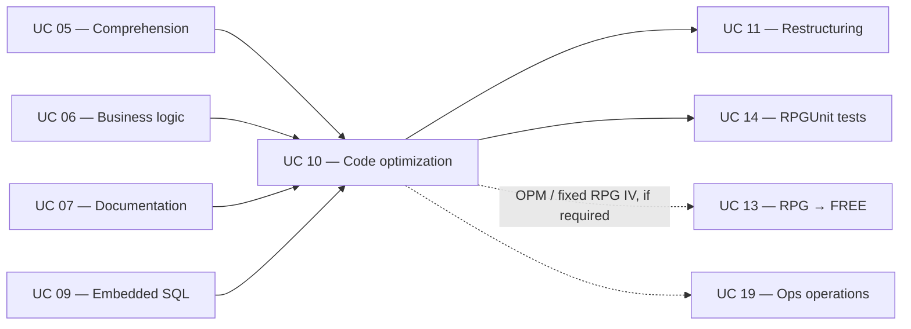

# UC 10 — Code Improvement and Optimization

> **Category:** Code modernization
>
> **Position in the journey:** 10 — first UC of Phase 3, follows UC 09 (embedded SQL access available). Can run in parallel with UC 11 on different programs.
>
> **Recommended Bob mode:** IBM i Developer (RPG review, qualification, diffs, compilation) → IBM i Database (SQL review, SQL Index Strategy Advisor). Both IBM i Premium Package modes. Without Premium Package: Ask for analysis/generation, Agent for compilation and save.

> ⚠️ **UC 10 and UC 11 must never be run in the same Bob session, nor through the same Plan-mode request.** Do UC 10 first, compile and validate functionally, then open a **new conversation** for UC 11. If both are requested together, Bob mixes renaming passes (UC 10) and module extraction (UC 11) in a single diff — errors become untraceable.

---

## ⭐ IBM i Premium Package used

- **Slash Command: `/review_rpg`** → [Official documentation](https://bob.ibm.com/docs/ide/premium-packages/bob-for-i/slash-commands)
  Code review of an RPG source member (fixed, free or mixed format): syntax, coding standards, error handling, security, performance (RLA vs embedded SQL), modernization opportunities. Structured output: detected format, summary, critical / major / minor issues, modernization roadmap. **This is the entry point of UC 10**: it replaces the manual starting analysis and feeds Prompt 0.
  **Mode:** IBM i Developer.
- **Slash Command: `/review_SQL`** → [Official documentation](https://bob.ibm.com/docs/ide/premium-packages/bob-for-i/slash-commands)
  Review of a SQL query or a source member containing SQL: syntax, readability, security (SQL injection, least privilege), SQE performance, refactoring. Structured output: summary, confirmed findings, conditional recommendations, revised SQL, explanation of changes.
  **Mode:** IBM i Database.
- **Workflow: SQL Index Strategy Advisor** (partial) → [Official documentation](https://bob.ibm.com/docs/ide/premium-packages/bob-for-i/workflows)
  Analyzes Db2 for i query performance (Index Advisor recommendations, MTIs, execution statistics) and recommends — or applies — an indexing strategy. Use it for the **SQL performance** part of UC 10, after `/review_SQL`.
  **Launch:** IBM i Database mode → **Start Workflow** button at the top of the chat → **Library List** workspace (the only workspace supported by this workflow) → *SQL Index Strategy Advisor*. Details: UC00 §1.2.
- **Understand Dashboard** → [Official documentation](https://bob.ibm.com/docs/ide/premium-packages/bob-for-i/understand)
  *If Understand is installed* (setup and usage: UC00 §2). Used to **prioritize** (dead objects: do not optimize an unused program) and to **secure shared renames** (impact analysis: affected programs and files).
- **Auto-activated skills:**
  - `rpg-code-review` — quality review: technical debt, performance, modernization opportunities
  - `rpg-indicators` — indicator types and replacement patterns with boolean variables
  - `rpg-refactor-legacy` — removing `GOTO`, converting routines to subprocedures
  - `rpg-procedures-functions` — subprocedures, prototypes, parameter passing
  - `rpg-free-format-fundamentals` — modern free-format RPGLE syntax and best practices
  - `rpg-legacy-specs` — historical RPG specifications (RPG II/III): name and column limits
  - `rpg-rla-to-sql` — converting RLA access to embedded SQL for performance improvement
  - `db2-sql-optimization` — query rewriting, join order, predicate pushdown, indexes
  - `db2-sql-performance-analysis` — Plan Cache, Visual Explain, Index Advisor
  - `db2-index-strategy` — Binary Radix and EVI indexes, syntax, selection and maintenance
  - `db2-sql-stored-procedure-performance` — high-performance SQL PL best practices in stored procedures, functions and triggers (if the scope contains SQL routines)
  - `understand-impact-analysis` — direct and indirect dependents, risk level (if Understand is installed)

> **What Premium does not cover, and this UC keeps:** the *controlled* application of fixes — renaming variables and indicators, replacing obsolete opcodes, extracting procedures — step by step, with compilation after each pass. `/review_rpg` **diagnoses** and proposes a roadmap; Prompts 1 to 4 **apply** that roadmap with non-regression safeguards.

---

## Objective

Improve the **readability, maintainability and performance** of IBM i RPG programs and SQL queries **without changing their functional logic**. Start from a tool-assisted assessment (`/review_rpg`, `/review_SQL`), turn it into an optimization plan, then apply the fixes in compiled and validated passes.

**This UC is the lowest-risk of Phase 3 — Code modernization.** It does not change what the program does, only how it does it. Functional results must be identical before and after: this is the primary success criterion, and the one that distinguishes UC 10 from UC 11 (restructuring).

**This UC differs from UC 09 (embedded SQL) and UC 11 (restructuring):**
- UC 09 changes the data access mechanism — native opcodes become SQL.
- UC 10 changes the internal form of the code — names, readability, obsolete opcodes, query performance. The access mechanism stays as is; the form changes.
- UC 11 changes the program structure — decomposition, module extraction, with higher risk.

> **UC 10 / UC 11 boundary for extractions:** UC 10 only allows **local** optimization — extracting a subroutine into an **internal, non-exported** procedure in the **same source**, without changing the program interface (`*ENTRY PLIST` / `DCL-PI`), the callers, or the split into `*MODULE` / `*SRVPGM`. Any extraction that changes an existing interface, creates a module or a service program, factors code across several programs or challenges the coupling through global variables is **architecture**: it belongs to UC 11 (new session). Bob must not start an architectural extraction during an optimization pass.

**Recommended order on a given program: UC 10 first, UC 11 afterwards.** Optimizing before restructuring avoids carrying cryptic names and redundancies into the new architecture.

> **Conditional dependency UC 10 / UC 11 / UC 13:** the default order (UC 10 then UC 11) applies to code already in `**FREE` / ILE. For an **OPM RPG III** or **fixed-format RPG IV** source, UC 13 (conversion to `**FREE`) can be a technical prerequisite for some advanced UC 10 optimizations (`EVAL` conversions, `DCL-PR`/`DCL-PROC` extraction): limit UC 10 to the safe passes (diagnosis, qualification, dead code, safe renames), run UC 13, then resume the advanced UC 10 optimizations. Each UC stays in its own Bob session.

**Expected deliverable:** for each program: a review report (`review-rpg` / `review-sql`), an assessment report, a diff file documenting each change, and for a full scope an optimization plan.

---

## Prerequisites

- **Phase:** Phase 3 — Code modernization
- **Required previous UCs:** UC 05 — Code comprehension (mandatory), UC 06 — Business logic (mandatory), UC 07 — Complete documentation (recommended), UC 09 — Embedded SQL (recommended: SQL optimization targets the already converted access)
- **Required deliverables:**
  - `{appId}-comprehension-{component}-report-{YYYYMMDD-HHmm}.md` — UC 05: map of subroutines, variables and calls (**mandatory**)
  - `{appId}-logique-{component}-regles-{YYYYMMDD-HHmm}.md` — UC 06: program business rules, safeguard against regressions (**mandatory**)
  - `{appId}-doc-spec-tech-{YYYYMMDD-HHmm}.md` — UC 07: interfaces and parameters (recommended, essential if an extraction touches interfaces)
  - `{appId}-doc-matrice-{YYYYMMDD-HHmm}.md` — UC 07: if a rename is shared across programs (recommended)
  - `{appId}-sql-{component}-embarque-{YYYYMMDD-HHmm}.md` — UC 09: already converted source, to avoid touching converted access (if UC 09 applied)
- **Recommended Bob level:** Intermediate to Advanced
- **Estimated Bob Coins:** ⚠️ *To be calibrated after the UC 10 lab on FLGHT400.*

> ⚠️ **An RPG developer must be available** to validate functional non-regression. A successful compilation by Bob does not guarantee identical behavior — functional tests remain irreducible.
>
> ⚠️ **A senior DBA or Db2 developer must be available** before any index creation: Bob proposes, a human decides on the impact on writes and disk space.
>
> 💡 If the UC 05 program understanding files are not available, start with a quick UC 05 session on the target program — 30 minutes of comprehension avoids renaming a variable that has two meanings depending on the subroutine.

---

## Concrete example — FLGHT400 Lab

| Deliverable | Lab file | What it illustrates |
|---|---|---|
| SQL review + bottleneck analysis | [`../labs_FLGHT400_results/FLGHT403_sql-review-bottleneck-analysis.md`](../labs_FLGHT400_results/FLGHT403_sql-review-bottleneck-analysis.md) | Review of a multi-table query `FLIGHTS × ORDERS × AGENTS × CUSTOMERS`: 4 findings (including a blocking `ORDER BY` outside `GROUP BY`, SQLSTATE 42803, and an unused `CUSTOMERS` join), revised SQL, then volume analysis: `ORDERS` (701,512 rows) identified as the main bottleneck, no SQL index on the 4 tables, composite index recommended |
| Associated conversation | [`../labs_FLGHT400_results/FLGHT403_sql-review-bottleneck-analysis_conversation.md`](../labs_FLGHT400_results/FLGHT403_sql-review-bottleneck-analysis_conversation.md) | Session flow: column validation via the catalog, then findings |
| Program audit (age, usage) | [`../labs_FLGHT400_results/FLGHT403_cpu_jobs_programs_audit.md`](../labs_FLGHT400_results/FLGHT403_cpu_jobs_programs_audit.md) | 34/34 programs not recompiled for more than 5 years, including 25 OPM RPG programs from 1997 (`FRS409`, `FRS403`…), all still in use — a typical basis for building the optimization plan (Prompt 5) |
| Candidate program | [`../labs_FLGHT400_results/FLGHT403_FRS409_explanation.md`](../labs_FLGHT400_results/FLGHT403_FRS409_explanation.md) | Explanation of `FRS409`, a small interactive WORKSTN program — good first SIMPLE candidate |

> 💡 The FLGHT403 lab does not yet contain a `/review_rpg` output or a complete UC 10 lab. The `*-optim-*` deliverables will be produced during the UC 10 lab.
>
> ⚠️ **OPM case:** the FLGHT403 programs are mostly OPM RPG (fixed format). See the "OPM RPG III program" box below — it determines Prompts 3 and 4.

---

## Start with a program you know

> **Strongly recommended before tackling the application's critical programs.**

Start with a **program whose logic a team developer knows well** — ideally with cryptic variable names known to the team, and expected behavior that is documented or quickly testable.

Why? The first optimization is used to **calibrate two things**:
- The quality of the `/review_rpg` diagnosis (are the "critical" issues really critical for the team?) and of the proposed renames (does `WK01` renamed `wkCustomerName` really reflect what the variable contains?)
- The team's ability to validate non-regression

> 💡 For each program, **run `/review_rpg` then Prompt 0** — it gives the category (SIMPLE / STANDARD / COMPLEX) and the exact sequence. Do not go straight to Prompt 1.

| Step | Program to choose | Expected category | Goal |
|---|---|---|---|
| 1 | Short program (< 200 lines), obvious renames, no critical performance concern | SIMPLE | Calibrate `/review_rpg` and renames; check that Prompt 0 classifies correctly |
| 2 | Program with several extractable subroutines and duplicated code | STANDARD | Validate procedure extraction |
| 3 | Program with obsolete opcodes (`MOVE`, `MOVEL`, `SETON`, indicators) and identified performance concern | STANDARD to COMPLEX | Validate opcode conversion and indicator decision rules |
| 4 | Critical production program, opaque naming across the whole source | COMPLEX | Validate pass-based handling and non-regression safeguards |

---

## Impact of program size on optimization strategy

UC 10 complexity does not depend on line count, but on the **number of optimization points**, their **nature** (risk-free rename vs extraction affecting callers) and the **level of documentation available**.

The real complexity factors:
- **Cryptic variables shared across subroutines** — risk-free if local, risky if passed between subroutines with different usages
- **Obsolete opcodes with side effects on indicators** (`SETON *IN50`) — sometimes tested in another branch of the program
- **Subroutines sharing global variables** — not extractable without adapting parameters
- **Code duplicated across several programs** — extraction touches several programs, beyond the scope of a single program
- **Performance optimizations** — a `READ` loop over a large file is more a matter for UC 09 (SQL cursor) or index strategy than simple refactoring

| Category | Criteria | Sequence |
|---|---|---|
| **SIMPLE** | Local renames, no extraction, no indicators driving logic | `/review_rpg` → Prompt 0 → Prompt 1 → Prompt 2 → Prompt 2-bis → Prompt 3 if applicable |
| **STANDARD** | Renames + 1 to 3 extractions, or limited obsolete opcodes | `/review_rpg` → Prompt 0 → Prompt 1 → Prompt 2 per pass → Prompt 2-bis → Prompt 3 → Prompt 3-bis → Prompt 4 → Prompt 2-bis |
| **COMPLEX** | Pervasive indicators, global variables across subroutines, `GOTO`/`CABxx` | Evaluate UC 11 before UC 10. If the decision is to optimize without restructuring: `/review_rpg` → Prompt 0 → Prompt 1 → Prompt 2 (safe renames only, pass by pass) → Prompt 2-bis after each pass → Prompt 3 (isolated opcodes) → Prompt 3-bis |

> ⚠️ On a COMPLEX program, Prompt 0 asks the question: **should we restructure before optimizing?** If the answer is "restructuring recommended", do not start UC 10 in depth — open a UC 11 task first, or limit UC 10 to safe renames.

### OPM RPG III program: what UC 10 can and cannot do

Prompt 0 detects the source style (OPM RPG III, ILE RPG IV fixed, mixed, free).

- **OPM RPG III** (`RPG` rather than `RPGLE`, no H-spec, typical of the 1997 programs in FLGHT403): the Prompt 3 conversions to `EVAL` and the Prompt 4 extraction to `DCL-PR`/`DCL-PROC` require ILE RPG. Do not apply them to an OPM source.
- **Operational sequencing rule:**
  - **On an OPM / RPG III source:** limit UC 10 to the quality diagnosis (`/review_rpg`), qualification, dead-code cleanup and safe renames. If the team wants to restructure into modular subprocedures (`DCL-PROC`) or convert to modern expressions, run the program through **UC 13** (*RPG Modernization* to `**FREE`) before completing the advanced UC 10 optimization.
  - **On a column-based ILE RPG IV source (fixed format):** same conditional dependency — if the team targets the advanced UC 10 optimizations (`EVAL` conversions, procedures), running UC 13 (tool-assisted conversion to `**FREE`) before those passes lets Bob make full use of free syntax without generating hybrid fixed/free code. The safe passes (renames, cleanup) remain possible without UC 13.
  - **On a source already in `**FREE`:** UC 10 applies directly and in full (UC 13 not applicable).
- Name limits are stricter in RPG III than in RPG IV (the RPG III name length limit is to be confirmed with the `rpg-legacy-specs` skill).

---

## Starting a Bob session

> **Read before every UC 10 session — new conversation or resume.**

### 1. New Bob conversation, workspace and mode

Each program starts in a **new Bob conversation** (`+` button). Do not reuse another program's conversation: previous renames and decisions pollute the suggestions.

**The three workspaces** (details: UC 02, section 3):

| Workspace | Content | Usage in UC 10 |
|---|---|---|
| **Local workspace** (workstation) | `.md` files, skills, rules, `bob-reports/` | Loading previous UC deliverables, local saving of reports |
| **IBM i Libraries / QSYS** ⭐ | RPG/CL/DDS sources, compilation, slash commands, workflows | **Default workspace for UC 10**: `/review_rpg`, `/review_SQL`, compilation, SQL Index Strategy Advisor |
| **`$HOME` IFS** | Markdown output deliverables, apps | Optional: copy of reports on the IBM i side |

**Procedure:** `+` button → **Library List** → choose the application library `{appId}`.

| Phase | Mode | Reason |
|---|---|---|
| RPG review, qualification, inventory, diffs, compilation (`/review_rpg`, Prompts 0 to 5) | `IBM i Developer` | Member reading (`read_member`), compilation (`execute_compile_action`), RPG skills |
| SQL review, SQL optimization (`/review_SQL`, SQL Index Strategy Advisor) | `IBM i Database` | SQL execution (`execute_sql_statement`), QSYS2 catalogs, Db2 skills |

**When to switch:** after the RPG phase of a program, start a new conversation in `IBM i Database` for the SQL part, loading the `review-rpg` report and the assessment report.

> 💡 **Agent** mode: only to save **local** files in the workspace. Never for IBM i operations (source reading, compilation, SQL).
>
> 💡 **Before the first session:** check that the Library List (Code for IBM i panel) includes the source library **and** the copybook libraries, to avoid global scans of several tens of minutes over `*LIBL`.

### 2. Open source files in the editor

In the **IBM i — Object Browser** panel: right-click the RPG member → **Open in Editor**. Files to open:
- The RPG source program (`[LIB_NAME]/QRPGSRC([PROGRAM_NAME])` or `QRPGLESRC`)
- The program understanding report (`*-comprehension-*-report-*.md`) and business rules (`*-logique-*-regles-*.md`)

### 3. Context files to load

| File | Produced by | Priority |
|---|---|---|
| `{appId}-comprehension-{component}-report-{date}.md` | UC 05 | **Mandatory** — basis of Prompt 1 |
| `{appId}-logique-{component}-regles-{date}.md` | UC 06 | **Mandatory** — safeguard against regressions |
| `{appId}-doc-spec-tech-{date}.md` | UC 07 | **Recommended** — interfaces and parameters |
| `{appId}-doc-matrice-{date}.md` | UC 07 | **Recommended** — renames shared across programs |
| `{appId}-sql-{component}-embarque-{date}.md` | UC 09 | **If UC 09 applied** |
| `{appId}-optim-{component}-review-rpg-{date}.md` | UC 10 (Premium step A) | **Mandatory for Prompt 0** |
| `{appId}-optim-{component}-qualification-{date}.md` | UC 10 (previous session) | **If resuming** — category and strategy already decided |

> ⚠️ **Where Bob writes.** In the IBM i Libraries workspace, Bob writes **on the IBM i**, not locally. Reports (`/review_rpg`, `/review_SQL`, sheets, diffs) are produced **in the chat**. To get a local file in `bob-reports/`, ask Bob explicitly (wording given in each prompt).
>
> ⚠️ **Context compression risk:** on STANDARD or COMPLEX programs, save the current deliverable after each major prompt. On each resume: "The file [FILE_NAME] contains the decisions made — continue from [STEP]."

---

## Premium sequence — to run before the prompts

### Step A — `/review_rpg`: diagnose the program

**Workspace:** IBM i QSYS — IBM i Developer mode.
**Key skills used:** `rpg-code-review`.

1. Open the RPG member in the editor (Object Browser → *Open in Editor*).
2. In the Bob chat input, type `/review_rpg` and designate the member `[LIB_NAME]/QRPGSRC([PROGRAM_NAME])`.
3. Read the result: **detected format**, summary, **critical / major / minor** issues, modernization roadmap.
4. Ask for a local save:

```
Save the full report of this /review_rpg in the bob-reports/ folder
under the name {appId}-optim-{component}-review-rpg-{YYYYMMDD-HHmm}.md
```

> 💡 **Invoking `/review_rpg`:** the command can be run either without an argument when the target member is active in the VS Code editor, or by specifying the full member path: `/review_rpg [LIB_NAME]/QRPGSRC([PROGRAM_NAME])`.
>
> ⚠️ The "modernization roadmap" may suggest conversion to free format or RLA → SQL. These topics belong to **UC 13** and **UC 09**: do not chain them in the same session as the optimization passes.

### Step B — `/review_SQL`: diagnose the SQL

**Workspace:** IBM i QSYS — IBM i Database mode.
**Key skills used:** `db2-sql-optimization`, `db2-sql-performance-analysis`.

1. For a standalone query: type `/review_SQL` then paste the query.
2. For a member containing embedded SQL (e.g. a source produced by UC 09): `/review_SQL` designating the member.
3. Read the five sections: summary, confirmed findings, conditional recommendations, revised SQL, explanation of changes.
4. Ask for a local save as `bob-reports/{appId}-optim-{component}-review-sql-{YYYYMMDD-HHmm}.md`.

> 💡 **Lab example:** [`FLGHT403_sql-review-bottleneck-analysis.md`](../labs_FLGHT400_results/FLGHT403_sql-review-bottleneck-analysis.md) — a "blocking" finding (`ORDER BY` outside `GROUP BY`) and a "dead code" finding (unused join) clearly separate mandatory fixes from conditional recommendations.

### Step C — SQL Index Strategy Advisor: optimize indexes

**Workspace:** IBM i QSYS — IBM i Database mode, **Library List** workspace (the only one supported). **Start Workflow** button (top of the chat) → *SQL Index Strategy Advisor*.
**Key skills used:** `db2-index-strategy`, `db2-sql-performance-analysis`.

- Run **after** `/review_SQL`, once the SQL is corrected: advising an index for a faulty query makes no sense.
- The workflow relies on Index Advisor recommendations, MTIs and execution statistics.
- **Only allow an index to be applied on the test IBM i**, after DBA validation.

> 💡 **Lab example:** on FLGHT403, the analysis found that no SQL index existed on `FLIGHTS`, `ORDERS`, `AGENTS`, `CUSTOMERS` (only DDS logical files), and recommended a composite index on `ORDERS (DEPARTURE_DATE, FLIGHT_NUMBER, AGENT_NO)` **provided** Visual Explain confirms a full scan.

### Step D — Understand Dashboard: prioritize and secure *(if installed)*

- **Dead objects**: exclude unused programs from the optimization plan.
- **Impact analysis** (`understand-impact-analysis` skill): before renaming a shared variable or parameter, list the affected programs and files.
- Use it to build Prompt 5 (scope optimization plan).

---

## Prompts

### Prompt 0 — Qualification and strategy selection

> **Mandatory entry point of UC 10 for each program, after `/review_rpg`.** It turns the diagnosis into a decision: category and exact prompt sequence.

**Objective:** produce an assessment report before any change. Identifies the category (SIMPLE / STANDARD / COMPLEX), the RPG style, complexity factors, and recommends the sequence.

**When to use:** first, for each program, once `/review_rpg` has run.

**Workspace:** IBM i QSYS (source read via `read_member`) — IBM i Developer mode.
**Key skills used:** `rpg-code-review`, `rpg-indicators`, `rpg-legacy-specs`.

**Required input:** RPG program open in the editor, `*-review-rpg-*.md` report and UC 05 / UC 06 files loaded in context.

```
The program [PROGRAM_NAME] is located in [LIB_NAME]/QRPGSRC (or QRPGLESRC).
The /review_rpg report for this program is available in [REVIEW_FILE_NAME].

Based on this report and on the source, produce in English, in markdown,
an assessment report for code optimization:

## UC 10 Qualification — [PROGRAM_NAME]

### 1. Quick inventory
| Indicator                                         | Value  |
|---------------------------------------------------|--------|
| Number of source lines                            | ?      |
| Number of subroutines (BEGSR/ENDSR)               | ?      |
| Number of procedures (DCL-PROC / P...B / P...E)   | ?      |
| Number of variables with cryptic names (< 4 chars or WKxx/Lxx/Nxx format) | ? |
| Number of indicators (*INxx used)                 | ?      |
| Obsolete opcodes present (MOVE, MOVEL, SETON, SETOF, GOTO, CABxx) | YES / NO |
| Duplicated code present (repeated blocks > 10 lines) | YES / NO |
| Subroutines extractable into procedures present   | YES / NO |
| RPG style                                         | OPM RPG III / RPG IV fixed / Mixed / Free |

### 2. Complexity factors
Answer YES / NO / TO CONFIRM for each factor:
- [ ] Global variables shared across several subroutines (wide-impact rename)
- [ ] Indicators (*INxx) used to drive application logic (SETON/SETOF/IF *INxx)
- [ ] GOTO or CABxx opcodes (unstructured branching logic)
- [ ] Program parameters (*ENTRY PLIST) — any extraction must preserve the interface
- [ ] Native file access still present (UC 09 not applied on this program)
- [ ] Program called by other programs (UC 07 matrix available?)
- [ ] Fixed or mixed format program — renames must respect column limits
- [ ] OPM RPG III program — Prompt 3 (EVAL) and Prompt 4 (procedures) not applicable before UC 13

### 3. /review_rpg recap
List the critical and major issues from the report that belong to UC 10
(renaming, opcodes, extraction, performance) and those that belong to another UC
(UC 09 SQL access, UC 11 restructuring, UC 13 free-format conversion).

### 4. Category and recommended strategy
**Category:**
- [ ] SIMPLE — local renames, no extraction, no indicators driving logic
- [ ] STANDARD — renames + extraction of 1 to 3 procedures, or limited obsolete opcodes
- [ ] COMPLEX — pervasive indicators, global variables across subroutines, or GOTO/CABxx

**Recommendation:**
- SIMPLE   → Prompt 1 → Prompt 2 → Prompt 2-bis → Prompt 3 if applicable
- STANDARD → Prompt 1 → Prompt 2 pass by pass → Prompt 2-bis after each pass
             → Prompt 3 → Prompt 3-bis → Prompt 4 → Prompt 2-bis
- COMPLEX  → Evaluate UC 11 (restructuring) before going deep with UC 10.
             If the decision is to limit to the essentials: Prompt 1 → Prompt 2 (safe
             renames only) → Prompt 2-bis. Defer extractions to UC 11.
- OPM RPG III / fixed-format RPG IV → limit to the review and safe renames; UC 13 first if Prompts 3 and 4 are targeted (conditional dependency), then resume UC 10.

**If category is STANDARD or COMPLEX — risk zones:**
| Zone | Nature of risk | Subroutine(s) concerned | Recommended precaution |

Clearly flag what you cannot determine without running the program.
```

**Key points:**
- `Complexity factors YES / NO / TO CONFIRM` — "TO CONFIRM" is deliberate: Bob can see that a variable is used in three subroutines without being able to guarantee it has the same meaning everywhere.
- `/review_rpg recap` — avoids handling in UC 10 what belongs to UC 09, 11 or 13.
- `RPG style / OPM RPG III` — determines Prompts 3 and 4 (see OPM box above).

**Deliverable produced:** `{appId}-optim-{component}-qualification-{YYYYMMDD-HHmm}.md`

```
Save this assessment report in the bob-reports/ folder
under the name {appId}-optim-{component}-qualification-{YYYYMMDD-HHmm}.md
```

> ⚠️ **Pitfall avoided:** without Prompt 0, the team starts renaming without knowing that an `*IN50` is tested in 8 places or that the program is OPM RPG III. Discovering it mid-pass forces everything to be reassessed.

---

### Prompt 1 — Optimization points inventory

`[Complement — not covered by the Premium workflow]` — `/review_rpg` ranks issues by severity but does not produce the numbered worksheet (variables, indicators, opcodes, subroutines, duplicates) needed for the following passes.

**Objective:** produce the exhaustive, numbered inventory, before any code generation.

**Workspace:** IBM i QSYS (RPG reading) — IBM i Developer mode.
**Key skills used:** `rpg-indicators`, `rpg-legacy-specs`, `rpg-code-review`.

```
The program [PROGRAM_NAME] is located in [LIB_NAME]/QRPGSRC (or QRPGLESRC).

Based on the UC 10 qualification we just did,
produce in English, in markdown, the complete inventory of optimization points:

## UC 10 Inventory — [PROGRAM_NAME]

### 1. Variables to rename
| No. | Current name | Type | Scope (local / global) | Usages (count) | Proposed name | Justification |
Criteria: name < 4 characters, WKxx / Lxx / Nxx / Axx format, opaque abbreviation,
name identical to another one in a different context.

### 2. Indicators (*INxx) to assess
| No. | Indicator | Where it is set (SETON/SETOF) | Where it is tested (IF/DOW) | Identified usage | Recommended action |
Action: rename to a boolean variable / keep if system / delete if dead

### 3. Obsolete opcodes to modernize
| No. | Line | Opcode | Recommended Free RPG equivalent | Regression risk |
Opcodes to detect: MOVE, MOVEL, SETON, SETOF, GOTO, CABxx, KLIST/KFLD,
SORTA, Z-ADD, Z-SUB, ADD, SUB, MULT, DIV, MVR, CASxx

### 4. Subroutines extractable into procedures
| No. | BEGSR name | Lines | Variables used | Dependent global variables | Extractable? |
Extractable: YES if no global variable, or if they can become
              parameters passed by value / reference
              NO if too coupled to the program's global state

### 5. Duplicated code detected
| No. | Lines occurrence 1 | Lines occurrence 2 | Nature of block | Extractable into a procedure? |
(repeated blocks of more than 5 lines)

Clearly flag the cases where the decision requires functional knowledge
not visible in the source.
Do not generate the optimized code in this prompt.
```

**Key points:**
- `Scope (local / global)` — main decision data: a global variable shared across 5 subroutines must be renamed everywhere in a single pass.
- `Indicators` — an `*IN50` set here and tested elsewhere may drive critical logic; identify all sites before recommending a rename.
- `Regression risk` (opcodes) — a `MOVE` into a shorter field (truncation) does not carry the same risk as a `Z-ADD`.
- `Do not generate the code` — inventory / generation separation: the team reviews the inventory and removes the cases not to be touched.

**Deliverable produced:** completes the file `{appId}-optim-{component}-qualification-{YYYYMMDD-HHmm}.md` (same file, "Inventory" section).

> ⚠️ **Pitfall avoided:** without an inventory, Bob renames as it reads and may propose two different names for the same variable.

---

### Prompt 2 — Renaming variables and indicators

`[Complement — not covered by the Premium workflow]`

**Objective:** apply, pass by pass, the validated renames from the inventory.

**Workspace:** IBM i QSYS (read) + diff generation in the chat — IBM i Developer mode. **No write at this stage.**
**Key skills used:** `rpg-indicators`, `rpg-free-format-fundamentals`.

```
Based on the UC 10 inventory of [PROGRAM_NAME] we just did,
apply the following renames:

[List here the Prompt 1 table section 1 variable numbers to rename in this pass]
[List here the Prompt 1 table section 2 indicator numbers to convert]

For each renamed variable, produce the following diff:
// BEFORE: [CURRENT_NAME] — [RENAME JUSTIFICATION]
// AFTER: [NEW_NAME]

Renaming rules:
- camelCase style: wkVariableName (prefix according to role: wk = work,
  li = line/iteration, fl = flag/indicator, nb = counter, dt = date)
- Name according to usage, not type (wkAmountExclTax and not wkDecimal12v2)
- Fixed or mixed format: respect the maximum name length allowed by the
  source language (10 characters in fixed RPG IV). If the style is Fixed or Mixed
  (checked in Prompt 0), the proposed names must respect it:
  `wkAmtET` and not `wkAmountExclTax`.
- For indicators: create a DCL-S [DESCRIPTIVE_NAME] IND INZ(*OFF) variable
  and replace each occurrence of *INxx with that variable
- Propagate each rename to all occurrences — no partial renames
- Do not rename *ENTRY PLIST parameter variables without explicit validation
- Do not rename fields of external data structures (EXTNAME) —
  they reference file columns whose names are constrained
- Flag any occurrence where the rename cannot be done safely

At the end, produce a summary:
| Name before | Name after | Occurrences modified | Residual risk |
```

**Key points:**
- `[List here the numbers ...]` — working on a numbered subset prevents Bob from renaming outside the pass scope.
- `Propagate to all occurrences` — a source with `WK01` here and `wkCustomerName` there may compile, but it is unreadable and inconsistent.
- `Do not rename EXTNAME` — the external DS field stays tied to the file's column name. If UC 09 has been applied, these DSs may already have been converted — check.
- Renaming a variable **shared across programs**: first consult `understand-impact-analysis` / the UC 07 matrix.

**Deliverable produced:** `{appId}-optim-{component}-diff-{YYYYMMDD-HHmm}.md`

```
Save this rename diff in the bob-reports/ folder
under the name {appId}-optim-{component}-diff-{YYYYMMDD-HHmm}.md
```

> ⚠️ **Pitfall avoided:** partially renaming a global variable (the one that reads, not the one that writes) leaves two names for a single variable — the source may compile while being inconsistent.

---

### Prompt 2-bis — Compilation test by Bob

> **This prompt runs in IBM i Developer mode** — Bob launches the compilation via the IBM i tools (`execute_compile_action` or `execute_cl_command`). IBM i Database mode has no access to compilation actions.
> **What Bob can do:** compile and report errors.
> **What Bob cannot do:** validate that the renames did not change semantics — human verification is irreducible.
> **When to use:** after each rename pass (Prompt 2), opcode pass (Prompt 3, via Prompt 3-bis) and after Prompt 4.

**Workspace:** IBM i QSYS (compilation on the test IBM i) — IBM i Developer mode.
**Key skills used:** `rpg-indicators`, `rpg-free-format-fundamentals`.

> ⚠️ **Write and compile on a copy.** To compile, the modified source must exist on the IBM i. After explicit team validation, ask Bob to write the modified source into a **test member** (copy of the original member, e.g. `_T` suffix as in the intermediate of [`FLGHT403_FRS409_modernization_report.md`](../labs_FLGHT400_results/FLGHT403_FRS409_modernization_report.md)), never into the original member. Replacing the original member is a human decision after functional tests.

```
The RPG source of [PROGRAM_NAME] modified with the renames of this pass
has been written to the test member [LIB_NAME]/QRPGSRC([TEST_MEMBER_NAME]).

Run the compilation on the test IBM i:
CRTBNDRPG PGM([TEST_LIB_NAME]/[PROGRAM_NAME])
          SRCFILE([LIB_NAME]/QRPGSRC)
          SRCMBR([TEST_MEMBER_NAME])
          OPTION(*EVENTF)
          OUTPUT(*PRINT)
          DBGVIEW(*SOURCE)

Analyze the compilation result and produce in English:

1. Status: COMPILATION SUCCESSFUL / COMPILATION ERRORS
2. If errors: list of errors with line number, IBM i error code and description
   | Line | Error code | Description | Probable cause |
   Probable causes to check: partial rename (missed occurrence),
   name conflict (new name already used), external DS modified by mistake
3. If compilation successful: confirm that the [N] changes of this pass compile
4. Remind that a successful compilation does not guarantee functional non-regression —
   functional testing on the test IBM i remains mandatory (human verification)
```

> 💡 In case of error: do not move to the next pass. Fix in the chat, rerun. The "fix → recompile → validate" loop is done entirely in Bob until the compilation is clean.
>
> 💡 Check that the IBM i user associated with the connection is authorized to use `CRTBNDRPG` and to write to the test library.

> ⚠️ **This prompt does not replace functional testing.** Mandatory and not delegable to Bob:
> - run the program on the test IBM i with a real dataset;
> - compare the results with those of the original program;
> - check the edge cases driven by renamed indicators (cf. `*-logique-*-regles-*.md`).

---

### Prompt 3 — Replacing obsolete opcodes

`[Complement — not covered by the Premium workflow]`
**Prerequisite:** RPG IV (ILE) source. On OPM RPG III, do not apply before UC 13.

**Objective:** replace the inventoried obsolete opcodes with their modern equivalent, without changing behavior.

**Workspace:** IBM i QSYS (read) + diff generation in the chat — IBM i Developer mode. No write at this stage.
**Key skills used:** `rpg-free-format-fundamentals`, `rpg-refactor-legacy`.

```
Based on the UC 10 inventory of [PROGRAM_NAME], section 3 (obsolete opcodes),
replace the following opcodes with their Free RPG equivalent:

[List here the Prompt 1 table section 3 opcode numbers to replace in this pass]

For each replacement, produce the diff:
// BEFORE: [OBSOLETE_OPCODE with its factors]
// AFTER:  [FREE RPG EQUIVALENT]

Conversion table to follow:
- MOVE  [SRC] [DEST]         → EVAL  dest = src     (caution: MOVE truncates on the right,
                                                      EVAL assigns the whole value — check lengths)
- MOVEL [SRC] [DEST]         → EVAL  dest = src     (MOVEL left-aligns — same remark)
- Z-ADD [VAL] [DEST]         → EVAL  dest = val
- Z-SUB [VAL] [DEST]         → EVAL  dest = -val
- ADD   [A] [B] [RESULT]     → EVAL  result = a + b
- SUB   [A] [B] [RESULT]     → EVAL  result = a - b
- MULT  [A] [B] [RESULT]     → EVAL  result = a * b
- DIV   [A] [B] [RESULT]     → EVAL  result = a / b  +  MVR rem → EVAL rem = %REM(a:b)
- SETON *INxx                → EVAL  [INDICATOR_NAME] = *ON   (after Prompt 2 rename)
- SETOF *INxx                → EVAL  [INDICATOR_NAME] = *OFF
- GOTO  [LABEL]              → Analyze the flow: IF/ELSEIF/ELSE or DO/LEAVE/ITER
                               Do not replace a GOTO without analyzing the branching logic
- CABxx [A] [B] [LABEL]      → IF [A] xx [B]; [continuation]; ENDIF — same precautions as GOTO
- KLIST/KFLD                 → Replace with a lookup structure using %KDS or host variables
- SORTA [ARRAY]              → Use %SORTA if Free RPG, or keep if one-off usage

Rules:
- Flag the cases where MOVE / MOVEL with different lengths may change behavior
- Do not replace a GOTO without analyzing the full control flow of the subroutine
- Keep the original code as a comment (// BEFORE) during validation
- Do not invent logic not visible in the original opcode
```

**Key points:**
- `Conversion table` — without it, Bob may choose different equivalents depending on context; the table enforces consistency.
- `MOVE / MOVEL — lengths` — the riskiest point: `MOVE` truncates silently, `EVAL` assigns the full value.
- `GOTO — do not replace without analysis` — a `GOTO` may serve as a loop exit or error handling; a mechanical `LEAVE` breaks what follows.
- `Keep // BEFORE` — the comments are removed after validation, in the same diff file.

**Deliverable produced:** completes `{appId}-optim-{component}-diff-{YYYYMMDD-HHmm}.md`

```
Complete the file {appId}-optim-{component}-diff-{YYYYMMDD-HHmm}.md in bob-reports/
with the opcode replacements of this pass.
```

> ⚠️ **Pitfall avoided:** mechanically replacing `MOVE` with `EVAL` without checking lengths is one of the hardest regressions to detect — the program compiles, results are almost right, a truncated variable produces wrong amounts in a small percentage of cases.

---

### Prompt 3-bis — Compilation test (after opcode replacement)

**Workspace:** IBM i QSYS — IBM i Developer mode. Same authority prerequisites and same "test member" rule as Prompt 2-bis.
**Key skills used:** `rpg-free-format-fundamentals`, `rpg-refactor-legacy`.

```
The RPG source of [PROGRAM_NAME] modified with the opcode replacements
of this pass has been written to the test member [LIB_NAME]/QRPGSRC([TEST_MEMBER_NAME]).

Run the compilation on the test IBM i:
CRTBNDRPG PGM([TEST_LIB_NAME]/[PROGRAM_NAME])
          SRCFILE([LIB_NAME]/QRPGSRC)
          SRCMBR([TEST_MEMBER_NAME])
          OPTION(*EVENTF)
          OUTPUT(*PRINT)
          DBGVIEW(*SOURCE)

Analyze the result and produce in English:

1. Status: COMPILATION SUCCESSFUL / COMPILATION ERRORS
2. If errors: | Line | Error code | Description | Probable cause |
   Probable causes to check: partially converted opcode (missing block end),
   malformed EVAL expression, undeclared indicator after SETON/SETOF replacement
3. If potential truncation warnings: list them separately
4. If compilation successful: confirm that the [N] opcode replacements compile
5. Remind that MOVE/MOVEL cases with different lengths must undergo
   specific functional validation — this test does not replace it
```

> ⚠️ **This prompt does not replace functional testing.** To be checked by a human: values triggering the replaced opcodes, `MOVE`/`MOVEL` conversions on different lengths, indicators turned into booleans tested in all contexts.

---

### Prompt 4 — Procedure extraction

`[Complement — not covered by the Premium workflow]`
**Prerequisite:** RPG IV (ILE) source. Skills `rpg-procedures-functions` and `rpg-refactor-legacy` activate automatically.

**Objective:** turn the extractable subroutines from the inventory into standalone **internal** procedures (same source, not exported — local optimization). An extraction that creates a `*MODULE` / `*SRVPGM`, exports a procedure, changes the program interface or factors code across several programs belongs to UC 11, not to this prompt.

**Workspace:** IBM i QSYS (read) + diff generation in the chat — IBM i Developer mode. No write at this stage.
**Key skills used:** `rpg-procedures-functions`, `rpg-refactor-legacy`.

```
Based on the UC 10 inventory of [PROGRAM_NAME], section 4 (extractable subroutines),
extract the following subroutines into procedures:

[List here the Prompt 1 table section 4 subroutine numbers to extract in this pass]

For each extraction, produce:

1. The declaration of the new procedure (prototype):
   DCL-PR [PROCEDURE_NAME] [RETURN_TYPE] ;
     [PARAM1] [TYPE] [OPTIONS] ;
   END-PR ;

2. The procedure definition (to place at the end of the source):
   DCL-PROC [PROCEDURE_NAME] ;
     DCL-PI [PROCEDURE_NAME] [RETURN_TYPE] ;
       [PARAM1] [TYPE] [OPTIONS] ;
     END-PI ;
     [BODY — code from the former BEGSR]
     RETURN [VALUE_IF_APPLICABLE] ;
   END-PROC ;

3. The replacement of the EXSR call:
   // BEFORE: EXSR [BEGSR_NAME]
   CALLP [PROCEDURE_NAME]([PARAMS]) ;

4. The removal of the original BEGSR/ENDSR block (as a comment during validation)

Rules:
- The dependent global variables identified in the inventory become parameters
  (VALUE for inputs, CONST if not modified, no qualifier if modified)
- Name the procedure according to its functional role, in camelCase: calculateAmountInclTax,
  validateOrderDate, loadCustomerByCode
- The procedure must be standalone: do not access global variables of the main
  program unless unavoidable and documented in the procedure comment
- Do not extract a subroutine marked "NO" in the inventory (too coupled to global state): flag it as a UC 11 candidate
- Stay within the same source: do not export the procedure (no `EXPORT`), do not create a module or a service program, do not change the program's `*ENTRY PLIST` / `DCL-PI`
- If the subroutine contains a conditional return (GOTO to the end of the subroutine),
  replace it with an early RETURN in the procedure
```

**Key points:**
- `DCL-PR / DCL-PI` — both declarations are mandatory: prototype (visible interface) and implementation.
- `Global variables → parameters` — central design rule: a procedure tied to global state can be neither tested in isolation (cf. UC 14) nor reused.
- `VALUE / CONST / no qualifier` — specifying the mode prevents Bob from systematically choosing the default (modifiable reference).

**Deliverable produced:** completes `{appId}-optim-{component}-diff-{YYYYMMDD-HHmm}.md`

```
Complete the file {appId}-optim-{component}-diff-{YYYYMMDD-HHmm}.md in bob-reports/
with the procedure extractions of this pass.
```

Then rerun **Prompt 2-bis** (compilation).

> ⚠️ **Pitfall avoided:** extracting a subroutine that uses `RETURN` or `*INLR = *ON` to end the main program. In a procedure, `RETURN` only ends the procedure — the flow continues after the `CALLP`. Check the end-of-program statements before any extraction.

---

### Prompt 5 — Optimization plan for a complete application scope

**Objective:** produce the UC 10 steering document across all the programs of an application.

**Workspace:** Local (generation from the UC 05, UC 06, UC 07 deliverables and the `/review_rpg` / `/review_SQL` reports) + IBM i QSYS for QSYS2 queries — IBM i Developer mode, or IBM i Database for the queries. *Understand Dashboard (if installed) for dead objects and dependencies.*
**Key skills used:** `rpg-code-review`, `db2-sql-performance-analysis`, `understand-impact-analysis` (if Understand is installed).

```
Based on the program understanding files ({appId}-comprehension-*-report-*.md),
the business rules ({appId}-logique-*-regles-*.md), the technical specifications
({appId}-doc-spec-tech-*.md) and the available review reports
({appId}-optim-*-review-rpg-*.md, {appId}-optim-*-review-sql-*.md)
for the application [APPLICATION_NAME] in [LIB_NAME],
generate an optimization plan in English, in markdown.

## UC 10 Optimization Plan — [APPLICATION_NAME]

### 1. Scope of programs to optimize
| Program | RPG style | Estimated lines | Cryptic variables | Obsolete opcodes | Critical/major issues (/review_rpg) | Category (S/St/C) | Priority |
Category: S = SIMPLE / St = STANDARD / C = COMPLEX (UC 10 criteria)
Priority: descending according to the combination of low risk + visible benefit + actual usage

### 2. Dependencies between programs
Programs that share variables, data structures or identical subroutines
(duplicated code across the scope): note the cases where optimizing one program
affects the others. List the shared variables and check that the proposed
renames are consistent across the whole scope.

### 3. Programs to defer
- to UC 11: restructuring recommended before optimization
- to UC 13: OPM RPG III / fixed-format RPG IV programs to convert before Prompts 3 and 4 (conditional dependency)
- to UC 09: native access still present that belongs to embedded SQL

### 4. SQL optimization
Queries to run through /review_SQL, candidate tables for the SQL Index Strategy Advisor workflow,
existing SQL indexes and their usage.

### 5. Identified risks
The 3 to 5 riskiest optimization points: indicators with cross-cutting logic,
cross-program global variables, complex GOTO / CABxx, MOVE with truncation.

### 6. Effort estimate
| Program | Prompts needed | Estimated duration (with Bob) | Estimated readability gain |
Duration: "To be calibrated after the UC 10 lab" as long as no lab has been run.

Do not invent programs or variables not visible in the available sources.
```

**Deliverable produced:** `{appId}-optim-{appId}-plan-{YYYYMMDD-HHmm}.md`

```
Save this optimization plan in the bob-reports/ folder
under the name {appId}-optim-{appId}-plan-{YYYYMMDD-HHmm}.md
```

> 💡 This plan is the UC 10 steering document: program-by-program tracking, identification of deferrals to UC 09 / UC 11 / UC 13 before starting.
>
> 💡 **Lab example:** the audit [`FLGHT403_cpu_jobs_programs_audit.md`](../labs_FLGHT400_results/FLGHT403_cpu_jobs_programs_audit.md) gives the age and usage of the library's 34 programs — it is the basis of the "Scope" table (RPG style and Priority columns).

---

## Deliverables of this UC

> ⚠️ **Where does Bob write?** In the IBM i Libraries workspace, Bob writes on the IBM i. Review reports, sheets and diffs are produced in the chat; to keep them locally in `bob-reports/`, explicitly ask for the save (wording given in each prompt). The modified source is only written to a **test member** on the IBM i, after validation.

| Produced file | Naming pattern | Where it is created | Consumed by |
|---|---|---|---|
| `/review_rpg` report | `{appId}-optim-{component}-review-rpg-{date}.md` | Local — `bob-reports/` (on request after `/review_rpg`) | Prompt 0, Prompt 5 |
| `/review_SQL` report | `{appId}-optim-{component}-review-sql-{date}.md` | Local — `bob-reports/` (on request after `/review_SQL`) | Prompt 5, SQL Index Strategy Advisor |
| Index report (SQL Index Strategy Advisor) | `{appId}-optim-{component}-index-{date}.md` | Local — `bob-reports/` (on request) | Steering, DBA, UC 16 |
| Assessment report + inventory | `{appId}-optim-{component}-qualification-{date}.md` | Local — `bob-reports/` | Session resume; UC 11 (context) |
| Optimization diff | `{appId}-optim-{component}-diff-{date}.md` | Local — `bob-reports/` | UC 11 (optimized source as input), UC 14 (tests) |
| Scope optimization plan | `{appId}-optim-{appId}-plan-{date}.md` | Local — `bob-reports/` | Steering of the UC 10 project |
| Modified source (test member) | member `{PROGRAM}_T` (or equivalent) | IBM i — QSYS, test library | Functional test, then replacement decision |

---

## Dependencies



> UC 10 and UC 19 share SQL performance analysis and the inventory of obsolete programs via QSYS2.

---

## Useful QSYS2 queries

```sql
-- Age and usage of the programs of a library (plan prioritization, Prompt 5)
SELECT OBJNAME, OBJATTRIBUTE, OBJCREATED, LAST_USED_TIMESTAMP
FROM TABLE(QSYS2.OBJECT_STATISTICS('[LIB_NAME]', '*PGM'))
ORDER BY LAST_USED_TIMESTAMP DESC;

-- Active temporary indexes (MTI) on the tables of a library
SELECT *
FROM TABLE(QSYS2.MTI_INFO(TABLE_SCHEMA => '[LIB_NAME]'))
WHERE TABLE_NAME IN ('[TABLE_1]', '[TABLE_2]');

-- Recent index advice from the optimizer
SELECT TABLE_NAME, KEY_COLUMNS_ADVISED, TIMES_ADVISED, LAST_ADVISED
FROM QSYS2.SYSIXADV
WHERE TABLE_SCHEMA = '[LIB_NAME]'
ORDER BY TIMES_ADVISED DESC, LAST_ADVISED DESC;
```

> ⚠️ **Caveat on `OBJCREATED`:** an old creation date is an indicator, not proof of the exact recompilation history. Cross-check it with the other `QSYS2.OBJECT_STATISTICS` columns (`CHANGE_TIMESTAMP`, `SOURCE_TIMESTAMP`, `SOURCE_FILE` / `SOURCE_LIBRARY` / `SOURCE_MEMBER`, `SAVE_TIMESTAMP`, `RESTORE_TIMESTAMP`, `COMPILER_VERSION`) and with the delivery history.

> 💡 These three queries are the ones used in the FLGHT403 lab ([`FLGHT403_cpu_jobs_programs_audit.md`](../labs_FLGHT400_results/FLGHT403_cpu_jobs_programs_audit.md) and [`FLGHT403_sql-review-bottleneck-analysis.md`](../labs_FLGHT400_results/FLGHT403_sql-review-bottleneck-analysis.md)). Run them in IBM i Database mode (`execute_sql_statement`).

---

## Pitfalls to avoid

| Pitfall | What happens | How to avoid it |
|---|---|---|
| Skipping `/review_rpg` and Prompt 0 on a COMPLEX program | Indicators driving logic and global variables not identified — renames create inconsistencies | Always `/review_rpg` then Prompt 0 — a few minutes avoid hours lost |
| Chaining the `/review_rpg` "roadmap" suggestions in the same session | Mix of optimization (UC 10), free-format conversion (UC 13) and SQL (UC 09) in a single diff | One session = one UC. Defer the other topics in Prompt 0, section 3 |
| Applying Prompts 3 and 4 on an OPM RPG III source | `EVAL`, `DCL-PR`, `DCL-PROC` do not exist in RPG III — compilation errors | Prompt 0 detects the style; go through UC 13 first |
| Renaming a variable partially | Two names for the same variable — sometimes compiles, functional result may differ | Prompt 2 requires full propagation; Prompt 2-bis detects compiler inconsistencies |
| Replacing `MOVE` with `EVAL` without checking lengths | Silent truncation — incorrect amounts, program that compiles | Isolate `MOVE`s with different lengths in a dedicated pass and test them functionally |
| Extracting a subroutine with `GOTO` / program `RETURN` | The `RETURN` no longer ends the program | Prompt 1 (section 4) marks these subroutines "NOT extractable" |
| Optimizing before having the UC 05 / UC 06 reports | Renames based on assumptions (`WK01` renamed `wkAmountInclTax` when it is a counter) | Check that `*-comprehension-*` and `*-regles-*` exist before starting |
| Allowing writes during analysis | An incorrect rename is in the source before review | Prompts 0 to 4: output in the chat only; write only to a test member after validation |
| Writing to the original member | Loss of the reference for before/after comparison | Always work on a copy (test member) |
| Creating an index without DBA validation | Write overhead, disk space, unused index | SQL Index Strategy Advisor: apply on the test IBM i only, DBA validation |
| Running SQL Index Strategy Advisor before fixing the SQL | Index advised for an erroneous or useless query | `/review_SQL` first, then fix, then the workflow |
| Using Agent mode for IBM i operations | No access to IBM i tools; risk of out-of-scope writes | Agent = saving local files only |
| Applying optimizations without functional testing | Regression on an edge case discovered in production | Real dataset including the edge cases from `*-regles-*.md` |

---

## UC 10 validation checklist

Before moving to UC 11 or declaring a program optimized, validate each point:

- [ ] **For each program:** `/review_rpg` run, report saved in `{appId}-optim-{component}-review-rpg-*.md`
- [ ] **For each program:** Prompt 0 was run — `{appId}-optim-{component}-qualification-*.md` exists with the category (SIMPLE / STANDARD / COMPLEX), the RPG style and the chosen strategy
- [ ] Programs requiring UC 11 before UC 10, or UC 13 (OPM RPG III / fixed-format RPG IV, if required for Prompts 3 and 4), have been deferred — no deep optimization attempted without this step
- [ ] Each renamed variable is propagated to all its occurrences — Prompt 2-bis returns no error related to a partial rename
- [ ] Each `*INxx` indicator driving application logic is converted into a boolean `IND` variable
- [ ] Each obsolete opcode is replaced — `MOVE`/`MOVEL` cases with different lengths have specific functional validation
- [ ] Extractable subroutines are turned into standalone procedures with explicit parameters (STANDARD / COMPLEX with explicit validation)
- [ ] The scope's SQL queries have gone through `/review_SQL`; the SQL Index Strategy Advisor workflow was run on the relevant tables (if relevant) and any created index was validated by a DBA
- [ ] Each optimized program was **compiled without error** on the test IBM i (Prompts 2-bis, 3-bis)
- [ ] Each optimized program was **functionally tested** with a real dataset — results identical before and after
- [ ] The optimization plan (Prompt 5) is saved in `{appId}-optim-{appId}-plan-*.md` — all programs listed with category and status
- [ ] The diffs are saved in `bob-reports/` with the pattern `{appId}-optim-{component}-diff-{date}.md`
- [ ] If the team versions sources in an external code manager: reintegration of validated sources is done manually (Bob writes on the IBM i)

---

## Points to complete before going to production

> These points do not block the POC — they concern advanced cases unlikely on the pilot programs. They become critical as soon as optimization extends to the whole estate.

### Propagating renames across interdependent programs

**Context:** when two programs share a data structure (common `DS EXTNAME`) or pass parameters to each other, a rename in one can create a divergence with the other. In the POC, the pilot programs are handled independently.

**To do before production:** use `understand-impact-analysis` (Understand Dashboard) and the UC 07 matrix to list the shared variables; define a unified naming convention before starting a batch; test the recompilation of the whole scope (not just program by program).

> ⚠️ **Field warning sign:** if several programs share the same variable names (matrix `*-doc-matrice-*.md`), freeze the naming convention for the batch before the first pass.

### `GOTO` and `CABxx` with unstructured logic

**Context:** some legacy programs use `GOTO` for error checks or early exits. The mechanical conversion `GOTO → IF/LEAVE/ITER` may require a rework of the control structure, which belongs to UC 11 (and the `rpg-refactor-legacy` skill).

**To do before production:** add to Prompt 0 a mapping of the `GOTO`s (simple exit, error handling, subroutine replacement) and decide program by program whether the conversion belongs to UC 10 (simple pattern) or UC 11.

> ⚠️ **Field warning sign:** more than 3 `GOTO`s in a program, or a `GOTO` to a label located in another subroutine → classify as COMPLEX and evaluate UC 11 before continuing UC 10.

---

## Additional reference

> **Lab 104 — Convert RLA to SQL and Optimize**
> File `lab104-premium-rla-to-sql.md` from the GitHub repository "IBM-i-Application-Modernization-with-Bob" (external reference, not reproduced here).

This lab, already cited in UC 09, illustrates the SQL optimization that follows the conversion: index strategy with the `db2-index-strategy` skill, validation through the **SQL Index Strategy Advisor** workflow. For this POC, replace the example's library names with those of the target application — the prompt logic is identical.

---

*UC 10 — Living document, to be updated throughout the POC.*
