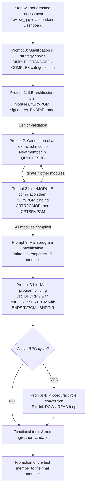
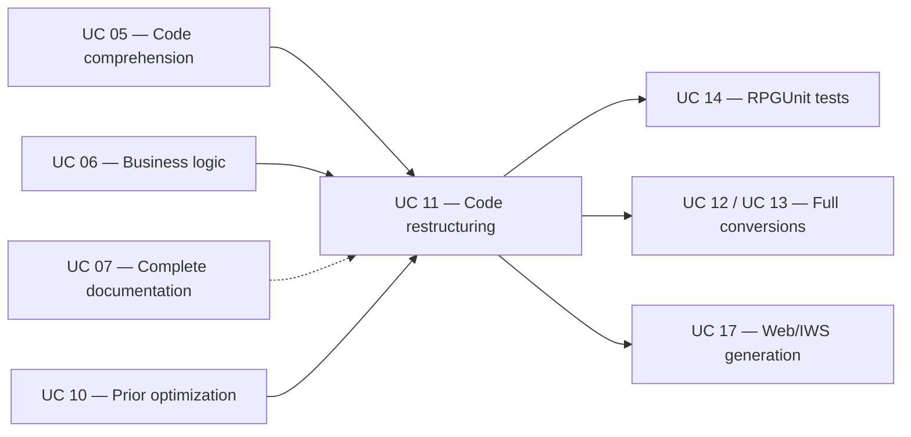

# UC 11 — Code Restructuring, Transformation, Conversion

> **Category:** Code modernization
>
> **Position in the journey:** 11 — second UC of Phase 3, follows UC 10 (*Code improvement and optimization*). Runs on code that has already been optimized and clarified.
>
> **Recommended Bob mode:** IBM i Developer (RPG review, qualification, architecture design, module generation, main program modification, compilation) → IBM i Database (checking objects and procedures in the `QSYS2` catalogs). Without Premium Package: Ask for design, Agent for compilation and saving.

> ⚠️ **UC 10 and UC 11 must never be run in the same Bob session, nor in the same request.**
> Do UC 10 first (variable renaming, removal of obsolete opcodes, clarification), compile and validate functionally, then open a **new dedicated conversation** for UC 11. If the two are mixed, Bob merges code-level refactoring and architectural overhaul into the same diffs, making any error diagnosis impossible.

> **Conditional dependency UC 10 / UC 11 / UC 13:** the default order (UC 10 then UC 11) applies to code already in `**FREE` / ILE. For an **OPM RPG III** or **fixed-format RPG IV** source, UC 13 (conversion to `**FREE`) can be a technical prerequisite for some advanced UC 10 optimizations (`EVAL` conversions, `DCL-PR`/`DCL-PROC` extraction): limit UC 10 to the safe passes (diagnosis, qualification, dead code, safe renames), run UC 13, then resume the advanced UC 10 optimizations. Each UC stays in its own Bob session.

---

## ⭐ IBM i Premium Package used

- **Workflow: RPG Modernization** (partial) → [Official documentation](https://bob.ibm.com/docs/ide/premium-packages/bob-for-i/workflows)
  Converts and modernizes existing RPG source code (OPM RPG III or fixed-format ILE RPG IV) to free-format RPG (`**FREE`) by applying modern standards (`CTL-OPT`, `GOTO` removal, built-in procedures). In UC 11, this workflow acts as support to modernize the syntax of the code blocks extracted during the modular split.
  **Launch:** IBM i Developer mode → **Start Workflow** button at the top of the chat → **Local** or **Library List** workspace (the workspaces supported by this workflow) → *RPG Modernization*. Details: UC00 §1.1.
- **Slash Command: `/review_rpg`** → [Official documentation](https://bob.ibm.com/docs/ide/premium-packages/bob-for-i/slash-commands)
  Full code review of an RPG source member (fixed, free or mixed format): syntax, ILE standards, error handling, coupling, technical debt and modernization roadmap. **This is the diagnostic entry point of UC 11** to identify structural complexity, subroutine coupling and extraction opportunities.
  **Mode:** IBM i Developer.
- **Understand Dashboard** → [Official documentation](https://bob.ibm.com/docs/ide/premium-packages/bob-for-i/understand)
  *If Understand is installed* (setup, tabs and tools: UC00 §2). Global analysis of the application estate:
  - **Mapping and impact analysis:** identify all calling programs before changing an interface or splitting a program.
  - **Dead object detection:** avoid restructuring orphaned or decommissioned components.
  - **ILE architecture visualization:** map the bound modules, service programs (`*SRVPGM`) and binding directories (`BNDDIR`).
  **Access:** *Open Understand Dashboard* command (`vscode-ibmi-bob.openUnderstandDashboard`) or the Dashboard icon in the Bob chat title bar.
- **Auto-activated skills:**
  - `rpg-fixed-to-free` — conversion from fixed format to free format (DCL-S, DCL-DS, DCL-PI, DCL-PR)
  - `rpg-refactor-legacy` — removing `GOTO`, eliminating conditional jumps and converting subroutines to subprocedures
  - `rpg-procedures-functions` — subprocedures, prototypes, parameter signatures, exports and service programs
  - `rpg-ile-understanding` — ILE concepts: modules (`*MODULE`), service programs (`*SRVPGM`), binding directories (`BNDDIR`), activation groups (`ACTGRP`)
  - `rpg-opm-to-ile` — conversion from the OPM model to ILE: move to modules and procedural call management
  - `rpg-cycle-explained` — legacy RPG cycle, control breaks (L1-L9), conversion to explicit structured loops
  - `rpg-indicators` — eliminating numbered indicators (`*INxx`) in favor of local boolean variables
  - `rpg-data-structures` — shared data structures vs explicit parameter passing
  - `rpg-file-operations` — file declarations (`DCL-F`), sharing rules and access isolation
  - `rpg-code-review` — assessment of cohesion, coupling and cyclomatic complexity
  - `understand-impact-analysis` — direct and indirect dependency matrix
  - `understand-program-explainer` — program composition, exports and files used
  - `db2-system-catalog` / `db2-services-catalog` — querying the `QSYS2` catalogs (`OBJECT_STATISTICS`, `SYSROUTINES`, `PROGRAM_INFO`)
  - *If the scope contains COBOL for i programs (the RPG Modernization workflow only handles RPG):* `cobol-code-refactoring` — simplifying logic, removing `GO TO` and dead code, reducing duplication, while preserving business logic; `cobol-module-service-program` — ILE COBOL modules and service programs (imports/exports, binder language, binding directories, activation groups)

> **What Premium provides and what this UC keeps:**
> `/review_rpg` and Understand Dashboard establish the coupling diagnosis and the impact mapping. The *RPG Modernization* workflow handles the syntactic conversion to free format. **This UC keeps the controlled architectural redesign method**: qualification of responsibilities, drafting of the ILE architecture plan, split into independent modules with a test member, modification of the main program while preserving the public interface, RPG cycle conversion, and step-by-step compilation.

---

## Objective

Transform monolithic RPG programs (procedural, OPM or dense ILE) into a **modern, maintainable modular architecture** (internal subprocedures, `*MODULE` modules, `*SRVPGM` service programs, `*PGM` programs), by isolating business responsibilities and eliminating shared global variables, **without changing the externally observable behavior or breaking the callers**.

**This is the most demanding UC of Phase 3 — Code modernization.**
Unlike UC 10, which improves surface readability (renames, opcodes) with a constant structure, UC 11 changes the physical and logical organization of the code:
- Splitting large monoliths into specialized components with a single responsibility.
- Turning spaghetti subroutines (`BEGSR`/`EXSR`/`GOTO`) into parameterized subprocedures or reusable modules.
- Encapsulating data (passing typed parameters instead of global variables mutated at a distance).
- Converting the implicit RPG cycle into an explicit procedural algorithm (`DOW`, `READ`, break detection).
- ILE modularization with service programs (`*SRVPGM`) and binding directories (`BNDDIR`).

**Primary success criterion:** The restructured program and its extracted modules compile without errors, respect the signatures expected by the existing callers, and produce strictly identical functional results to the original on a real dataset.

---

## Prerequisites

- **Phase:** Phase 3 — Code modernization
- **Required previous UCs:**
  - **UC 05 — Code comprehension** (**mandatory**): essential to know the subroutine tree, the variable list and the overall logic.
  - **UC 06 — Business logic** (**mandatory**): essential to identify the boundaries of the business rules to extract without distorting calculations or validations.
  - **UC 07 — Complete documentation** (**recommended**): technical specifications and cross-reference matrix (callers).
  - **UC 10 — Code improvement and optimization** (**strongly recommended**): restructuring code whose variables are already renamed and opcodes clarified considerably reduces the risk of error.
- **Required deliverables:**
  - `{appId}-comprehension-{component}-report-{YYYYMMDD-HHmm}.md` — UC 05: map of subroutines and flows (**mandatory**)
  - `{appId}-logique-{component}-regles-{YYYYMMDD-HHmm}.md` — UC 06: catalog of business rules and validations (**mandatory**)
  - `{appId}-doc-spec-tech-{YYYYMMDD-HHmm}.md` — UC 07: current interfaces and data structures (recommended)
  - `{appId}-doc-matrice-{YYYYMMDD-HHmm}.md` — UC 07: list of calling programs to preserve (recommended)
  - `{appId}-optim-{component}-diff-{YYYYMMDD-HHmm}.md` — UC 10: already cleaned-up source (if UC 10 was run)
- **Recommended Bob level:** Advanced
- **Estimated Bob Coins:** ⚠️ *To be calibrated after the UC 11 lab on FLGHT400.*

> ⚠️ **A senior RPG developer must be present** to validate the ILE architecture plan (Prompt 1) before any module generation. The design of the ILE architecture (choice between internal subprocedures, `*MODULE` or `*SRVPGM`) commits the future maintainability of the application.
>
> ⚠️ **Absolute test member rule:** Bob NEVER writes directly into the original source member. The extracted modules are created in new dedicated members, and the modified main program is written into a temporary test member (e.g. `[PGM_NAME]_T`).

---

## Concrete example — FLGHT400 Lab

| Deliverable | Lab file | What it illustrates |
|---|---|---|
| RPG modernization report | [`../labs_FLGHT400_results/FLGHT403_FRS409_modernization_report.md`](../labs_FLGHT400_results/FLGHT403_FRS409_modernization_report.md) | Modernization of `FRS409` (fixed-format OPM to free-format RPGLE) going through a temporary test member `FRS409_T` (compiled as a test `*PGM`, validated, then promoted to the final member). Transformation of the `CAS/ENDCS` control block into a modern `IF/ELSEIF` structure. |
| Application estate audit (candidates) | [`../labs_FLGHT400_results/FLGHT403_cpu_jobs_programs_audit.md`](../labs_FLGHT400_results/FLGHT403_cpu_jobs_programs_audit.md) | Inventory of 34 programs not recompiled for more than 5 years, including 25 OPM RPG programs from 1997. Identification of the monolithic batch programs that are priority candidates for ILE restructuring. |
| Functional explanation of the pilot | [`../labs_FLGHT400_results/FLGHT403_FRS409_explanation.md`](../labs_FLGHT400_results/FLGHT403_FRS409_explanation.md) | Detailed analysis of the inputs/outputs and subroutines of `FRS409`, serving as the functional reference before any split. |

> 💡 The complete ILE multi-module extraction lab (`*SRVPGM` + `BNDDIR`) will be run during the dedicated UC 11 session on FLGHT400.

---

## Impact of complexity on the restructuring strategy

As in UC 08, UC 09 and UC 10, the **SIMPLE / STANDARD / COMPLEX** vocabulary is unified, but calibrated on the structural criteria specific to UC 11:

```
                  ┌─────────────────────────────────────────┐
                  │ Program qualification (Prompt 0)        │
                  │ (/review_rpg + Understand Dashboard)    │
                  └────────────────────┬────────────────────┘
                                       │
            ┌──────────────────────────┼──────────────────────────┐
            ▼                          ▼                          ▼
   ┌─────────────────┐        ┌─────────────────┐        ┌─────────────────┐
   │     SIMPLE      │        │    STANDARD     │        │     COMPLEX     │
   │ 1-2 responsib.  │        │ 2-4 responsib.  │        │ >4 responsib.   │
   │ Few shared vars │        │ Medium coupling │        │ Active RPG cycle│
   │ No RPG cycle    │        │ Simple cycle    │        │ 5250 screens    │
   └────────┬────────┘        └────────┬────────┘        └────────┬────────┘
            │                          │                          │
            ▼                          ▼                          ▼
   Direct extraction          Complete validated         Restricted scope
   into subprocedures         architecture plan          for the POC:
   or 1 *MODULE module        Batch extraction           isolate the key block,
   (Prompt 1 → 2 → 3)         (Prompt 1 → 2 → 3bis → 3)  defer the rest
```

### SIMPLE programs — 1 to 2 separable responsibilities, low coupling
- Fewer than 500 lines, linear subroutines, no global variables mutated all over the place, no RPG cycle.
- **Strategy:** Direct extraction into internal subprocedures in the same source or creation of a single `*SRVPGM` service module.
- **Sequence:** Prompt 0 → Prompt 1 → Prompt 2 → Prompt 3-bis → Prompt 3 → Prompt 3-bis.

### STANDARD programs — 2 to 4 responsibilities, medium coupling or simple cycle
- 500 to 1,500 lines, several subroutines with shared variables, or a simple RPG cycle without nested breaks.
- **Strategy:** Architecture plan validated by a senior, split into 2 or 3 ILE modules, compile and test each module individually before modifying the main program.
- **Sequence:** Prompt 0 → Prompt 1 (human review) → Prompt 2 (module 1) → Prompt 3-bis → Prompt 2 (module 2) → Prompt 3-bis → Prompt 3 (main program) → Prompt 3-bis → Prompt 4 (if cycle).

### COMPLEX programs — > 4 responsibilities, active RPG cycle with multiple breaks, 5250 screens or transactions
- More than 1,500 lines, RPG cycle with L1-L9 indicators, business logic interleaved with 5250 screen `EXFMT` or `COMMIT`/`ROLLBACK` transactions.
- **Strategy:** Step-by-step split. For the POC, isolate the most independent business responsibility (e.g. pricing calculation or rule validation) and handle it in STANDARD mode. Defer the rest of the monolith.

---

## Starting a Bob session

### 1. Choosing the workspace

In Bob, three workspaces coexist:
- **IBM i Libraries / QSYS ⭐ (default primary workspace):** All source members (`QRPGLESRC`, `QRPGSRC`), modules (`*MODULE`), service programs (`*SRVPGM`), binding directories (`BNDDIR`) and compilations run directly in this workspace.
- **Local workspace:** Holds the markdown steering documentation, architecture plans and analysis reports in `bob-reports/`.
- **$HOME IFS:** Working directory on the IBM i IFS for temporary files or build scripts.

### 2. Open the sources in the editor (Open in Editor)

Before running the Bob commands:
1. In the **Code for IBM i** extension → QSYS object browser.
2. Open the source member to restructure: e.g. `FLGHT403/QRPGLESRC(FRS409)`.
3. Make sure the active mode in Bob is **IBM i Developer**.

### 3. Context files to load

For Bob to design a coherent architecture, provide it in context with:
- The program understanding report: `{appId}-comprehension-{component}-report-*.md`
- The business rules report: `{appId}-logique-{component}-regles-*.md`
- The technical specification and the caller matrix (if available): `{appId}-doc-spec-tech-*.md`, `{appId}-doc-matrice-*.md`
- The prior optimization report: `{appId}-optim-{component}-diff-*.md`

---

## Premium restructuring sequence



---

## Prompts

### Step A — Tool-assisted assessment: `/review_rpg` and Understand Dashboard

Before any free-form prompt, run the Premium slash command in the Bob chat:

```text
/review_rpg
```

**Workspace:** IBM i QSYS (on the source member open in the editor).
**Mode:** IBM i Developer.
**Key skills used:** `rpg-code-review`, `understand-impact-analysis` (if Understand is installed).

Bob analyzes the source structure, detects the format, identifies technical debt and proposes a modernization roadmap.
If Understand is available, open the dashboard (*Open Understand Dashboard* command, see UC00 §2) to view the list of calling programs and the dependencies of the component.

---

### Prompt 0 — Qualification and strategy selection

> **Mandatory entry point for each program to restructure.**
> This prompt analyzes the open source and the program understanding files to determine feasibility, the level of coupling and the restructuring category.

**Objective:** Produce the assessment report identifying the extractable responsibilities, the shared variables, the RPG cycle and the target category.

**When to use:** At the very start of the UC 11 session, after `/review_rpg`.

**Required input:**
- Source member open in the editor: `[LIB_NAME]/[SOURCE_FILE]([PROGRAM_NAME])`
- UC 05 and UC 06 context files and the `/review_rpg` diagnosis.

**Workspace:** IBM i QSYS + Local (read on the IBM i, report saved locally).
**Mode:** IBM i Developer.
**Key skills used:** `rpg-code-review`, `rpg-cycle-explained`, `rpg-indicators`, `understand-impact-analysis` (if Understand is installed).

**Prompt:**

```text
The program [PROGRAM_NAME] is located in [LIB_NAME]/QRPGLESRC (or QRPGSRC).
The /review_rpg diagnosis and the following program understanding files are available:
  - bob-reports/{appId}-comprehension-[PROGRAM_NAME]-report-{YYYYMMDD-HHmm}.md
  - bob-reports/{appId}-logique-[PROGRAM_NAME]-regles-{YYYYMMDD-HHmm}.md
  - bob-reports/{appId}-doc-matrice-{YYYYMMDD-HHmm}.md (if available)

Analyze this program and produce in English, in markdown, an assessment report
for its architectural restructuring:

## UC 11 Qualification — [PROGRAM_NAME]

### 1. Structural inventory
| Indicator | Value | Comment |
|---|---|---|
| Number of source lines | ? | Total size |
| Number of subroutines (BEGSR / ENDSR) | ? | Internal procedural blocks |
| Number of existing subprocedures (DCL-PROC) | ? | Procedures already isolated |
| Active RPG cycle (*INLR only, levels L1-L9, implicit cycle) | YES / NO | Detection of the legacy cycle |
| Number of distinct functional responsibilities | ? | Autonomous business blocks identified |
| Number of global variables (module-global scope) | ? | Variables declared outside a procedure |
| Calling programs identified (UC 07 matrix or Understand) | ? | Number of callers whose interface depends on it |
| Programs called directly (CALL / CALLP) | ? | External dependencies |
| Presence of 5250 screens (EXFMT / WRITE to DSPF) | YES / NO | Presentation/business coupling |
| Presence of transaction handling (COMMIT / ROLLBACK) | YES / NO | Risk of transaction split |

### 2. Map of functional responsibilities
For each identified responsibility:
| No. | Business responsibility | Associated subroutines | Exclusive variables | Shared variables | Extractability |
|---|---|---|---|---|---|
| 1 | E.g.: Pricing calculation | CALCTAR, APPLREDUC | wtRate, wtBase | wtTotalET, idCustomer | YES / NO / PARTIAL |

Extractability legend:
- YES: The responsibility can be extracted directly with clear interfaces.
- PARTIAL: Extractable only after prior decoupling of the shared variables.
- NO: Coupling to the global state or to the 5250 screens is too strong to isolate it in this batch.

### 3. Complexity and risk factors
Assess with YES / NO / TO CONFIRM:
- [ ] Active RPG cycle with control levels (L1-L9) or implicit sequential reads
- [ ] Shared global variables > 15 (strong coupling between subroutines)
- [ ] Public interface called by > 3 external programs (wide impact if the signature changes)
- [ ] Nested transaction logic (COMMIT/ROLLBACK in the middle of a calculation)
- [ ] 5250 display logic interleaved with business calculations (EXFMT inside the calculation subroutine)
- [ ] Data files opened in several subroutines that are candidates for extraction
- [ ] Presence of numbered indicators (*IN01-*IN99) conditioning shared processing

### 4. Category and recommended roadmap
Conclude on the UC 11 category:
- [ ] **SIMPLE**: 1 to 2 responsibilities, few shared variables, no RPG cycle.
      → Roadmap: Direct extraction into internal subprocedures or 1 service module (Prompts 1 → 2 → 3bis → 3).
- [ ] **STANDARD**: 2 to 4 responsibilities, manageable shared variables, simple cycle.
      → Roadmap: Complete architecture plan (Prompt 1), senior validation, batch extraction (Prompts 2 & 3bis), main program modification (Prompt 3), cycle conversion if needed (Prompt 4).
- [ ] **COMPLEX**: > 4 responsibilities, RPG cycle with breaks, presence of 5250 screens or transactions.
      → Roadmap: Targeted split for the POC (isolate only the most autonomous responsibility No. 1 as STANDARD, defer the rest).

If the category is COMPLEX, explicitly state the scope retained for the POC and what is deferred.
```

**Deliverable produced:**
- In the local workspace: `bob-reports/{appId}-restruct-[PROGRAM_NAME]-qualification-{YYYYMMDD-HHmm}.md`
- Explicit save instruction to Bob:
  ```text
  Save this qualification in the local file:
  bob-reports/{appId}-restruct-[PROGRAM_NAME]-qualification-{YYYYMMDD-HHmm}.md
  ```

---

### Prompt 1 — Restructuring architecture plan

> **Mandatory architecture design step.**
> This prompt formalizes the target ILE architecture, the split into modules, the prototypes, the data sharing mode and the extraction order. **No source code is generated at this step.**

**Objective:** Design and validate the ILE architecture plan before any physical change to the source.

**When to use:** After validation of the assessment report (Prompt 0).

**Required input:**
- Assessment report: `bob-reports/{appId}-restruct-[PROGRAM_NAME]-qualification-*.md`
- Business rules report: `bob-reports/{appId}-logique-[PROGRAM_NAME]-regles-*.md`

**Workspace:** IBM i QSYS + Local.
**Mode:** IBM i Developer.
**Key skills used:** `rpg-ile-understanding`, `rpg-procedures-functions`, `rpg-data-structures`, `rpg-file-operations`.

**Prompt:**

```text
Based on the assessment report of [PROGRAM_NAME] and the business rules documented in
bob-reports/{appId}-logique-[PROGRAM_NAME]-regles-{YYYYMMDD-HHmm}.md:

Draft in English, in markdown, the ILE architecture plan for the restructuring:

## UC 11 ILE Architecture Plan — [PROGRAM_NAME]

### 1. Architectural current state
- Current organization (OPM / ILE monolith, subroutines, main flow)
- Current global data and coupling points
- Current entry interface (*ENTRY PLIST or existing DCL-PI)
- Files accessed (native RLA mode or embedded SQL from UC 09)

### 2. Target architecture and modular split
Define all the target components:
| Component | IBM i type (*PGM / *MODULE / *SRVPGM / Internal procedure) | Exclusive business responsibility | Files accessed exclusively | Binding directory (BNDDIR) |
|---|---|---|---|---|
| [MODULE_NAME_1] | *MODULE (integrated into *SRVPGM) | E.g.: Customer validation | CUSTMAST | BND_SALES |
| [MODULE_NAME_2] | *MODULE (integrated into *SRVPGM) | E.g.: Discount calculation | — (in memory) | BND_SALES |
| [PROGRAM_NAME] | *PGM (slimmed-down main program) | Orchestration & navigation | ORDERS, ORDERDET | BND_SALES |

### 3. Interface and prototype specification (DCL-PR / DCL-PI)
For each extracted module or procedure:
- Procedure / module name (convention: [ORIGINAL_NAME]_[ROLE_SUFFIX], e.g. `ORD400_CALC`)
- Return type (if function) or void
- Ordered list of parameters with:
  - Parameter name (`p_` prefix)
  - RPGLE type and length (`CHAR(...)`, `PACKED(...)`, `IND`, `LIKEDS(...)`)
  - Passing direction: `CONST` (pure input / IN), `VALUE` (value), modifiable reference (OUT / INOUT)
  - Functional description

### 4. Data sharing strategy
- Which global variables become parameters passed as arguments?
- Are there data structures (`QUALIFIED` / `LIKEDS`) to create to group related parameters?
- Confirm that no hidden global variable remains between components.

### 5. Preservation of the main program's public interface
Must the external calling interface of the main program [PROGRAM_NAME] be modified?
- **NO (nominal POC case)**: Confirm that the `*ENTRY PLIST` / `DCL-PI` signature stays 100% identical so as not to break any of the identified calling programs.
- **YES**: If a change is unavoidable, list all the impacted callers and the associated migration plan.

### 6. File declaration and opening (isolation rule)
- Recall the isolation rule: A file declared with `DCL-F` in an extracted module MUST NOT be opened simultaneously by the main program without explicit sharing management (`SHARE(*YES)` or prior close), otherwise an `MCH3401` runtime error will occur.

### 7. Extraction order and progressive testing
Define the implementation sequence (from the most independent component to the most dependent):
1. Module 1: [MODULE_NAME_1] (no external call) → Generate → Compile to *MODULE → Test
2. Module 2: [MODULE_NAME_2] → Generate → Compile to *MODULE → Bind into the *SRVPGM (CRTSRVPGM) → Test
3. Main program: [PROGRAM_NAME]_T → Adapt the calls to CALLP → Bind to the *SRVPGM (CRTBNDRPG with BNDDIR, or CRTPGM with BNDSRVPGM) → Global test

### 8. Identified risks and technical countermeasures
List the 3 major points of vigilance (e.g.: activation group `ACTGRP`, call error handling, open transactions).

⚠️ Do not generate any complete source code in this prompt. The plan must be reviewed and validated by a senior developer before starting the generation step.
```

**Deliverable produced:**
- In the local workspace: `bob-reports/{appId}-restruct-[PROGRAM_NAME]-plan-archi-{YYYYMMDD-HHmm}.md`
- Explicit save instruction:
  ```text
  Save this architecture plan in the local file:
  bob-reports/{appId}-restruct-[PROGRAM_NAME]-plan-archi-{YYYYMMDD-HHmm}.md
  ```

---

### Prompt 2 — Generating an extracted module (batch by batch)

> **Run per batch for each module identified in Prompt 1.**
> Generates the fully free-format (`**FREE`) RPGLE source code of the extracted module, applying the variable isolation and typed interface rules.

**Objective:** Generate the code of a standalone module from the subroutines of the original program.

**When to use:** After human validation of the architecture plan (Prompt 1), for each module in the defined order.

**Required input:**
- Validated architecture plan: `bob-reports/{appId}-restruct-[PROGRAM_NAME]-plan-archi-*.md`
- Source subroutines identified in the original program.

**Workspace:** IBM i QSYS (member creation in `QRPGLESRC`).
**Mode:** IBM i Developer.
**Key skills used:** `rpg-procedures-functions`, `rpg-refactor-legacy`, `rpg-free-format-fundamentals`, `rpg-indicators`.

**Prompt:**

```text
Based on the ILE architecture plan (bob-reports/{appId}-restruct-[PROGRAM_NAME]-plan-archi-{YYYYMMDD-HHmm}.md),
generate the fully free-format RPGLE source code (**FREE) for the following module:

- Module name: [MODULE_NAME] (e.g.: ORD400_CALC)
- Responsibility: [RESPONSIBILITY_DESCRIPTION]
- Original subroutines extracted: [SUBROUTINE_LIST]
- Target IBM i type: *MODULE (intended for a *SRVPGM) or exported subprocedure

Expected structure of the free-format RPGLE source:

1. Control header (CTL-OPT):
   **FREE
   CTL-OPT NOMAIN OPTION(*NODEBUGIO:*SRCSTMT); // For a module without a main entry point

2. File declarations (DCL-F):
   Only if the module needs exclusive access to a data file.

3. Type and constant declarations (DCL-C, DCL-DS):
   Only the structures and constants required for this responsibility.

4. Procedure interface (DCL-PROC / DCL-PI):
   DCL-PROC [PROCEDURE_NAME] EXPORT;
     DCL-PI *N [RETURN_TYPE];
       p_[PARAM1] [TYPE] CONST;  // IN
       p_[PARAM2] [TYPE];        // OUT / INOUT
     END-PI;

     // Local variables of the procedure (DCL-S)
     ...

     // Body of the extracted and adapted business logic
     ...

     RETURN [VALUE];
   END-PROC;

Generation rules:
- Replace all the former global variables with interface parameters or local `DCL-S` variables.
- Eliminate every obsolete opcode (`MOVE`, `GOTO`, `CABxx`) and replace it with assignments or modern conditional structures (`IF/ELSE`, `SELECT/WHEN`).
- Eliminate the numbered indicators in favor of explicit conditions or boolean `IND` variables.
- Insert the following traceability header:
  // ============================================================
  // MODULE: [MODULE_NAME]
  // Extracted from: [LIB_NAME]/QRPGLESRC([PROGRAM_NAME])
  // Responsibility: [RESPONSIBILITY_DESCRIPTION]
  // Generation date: [YYYY-MM-DD]
  // Status: Test module — to be validated before promotion
  // ============================================================

Write this code into the IBM i source member:
[LIB_NAME]/QRPGLESRC([MODULE_NAME])
```

**Deliverable produced:**
- On the IBM i: `[LIB_NAME]/QRPGLESRC([MODULE_NAME])`
- In the local workspace: `bob-reports/{appId}-restruct-[MODULE_NAME]-spec-module-{YYYYMMDD-HHmm}.md` (saving of the module specification documentation).

---

### Prompt 3-bis — Compilation test by Bob (after each module or modification)

> **Run systematically after each module generation (Prompt 2) and after modification of the main program (Prompt 3).**
> Bob launches the appropriate ILE compilation command via IBM i Developer mode and analyzes the compilation log in case of error.

**Objective:** Validate the syntactic compliance and the physical creation of the object on the test IBM i, distinguishing three different ILE steps: **compilation** of a `*MODULE` (`CRTRPGMOD`), **binding** of modules into a `*SRVPGM` (`CRTSRVPGM`), **binding** of the main program (`CRTBNDRPG` or `CRTPGM`). Compiling a module on its own does not validate the whole: external symbols are only resolved at the service program and main program binding steps.

**When to use:** Immediately after writing a module or the modified main program.

**Required input:** Member name and target object type.

**Workspace:** IBM i QSYS.
**Mode:** IBM i Developer.
**Key skills used:** `rpg-ile-understanding`, `rpg-procedures-functions`.

**Prompt:**

```text
The member [MODULE_OR_PGM_NAME] has been written to [LIB_NAME]/QRPGLESRC.

Run the compilation on the test IBM i environment:

1. COMPILATION of an ILE module (*MODULE) — compilation only, no binding:
   CRTRPGMOD MODULE([TEST_LIB_NAME]/[MODULE_NAME])
             SRCFILE([LIB_NAME]/QRPGLESRC)
             SRCMBR([MODULE_NAME])
             OPTION(*EVENTF) OUTPUT(*PRINT)
             DBGVIEW(*SOURCE)

2. BINDING of the compiled modules into a service program (*SRVPGM) — creation or update:
   CRTSRVPGM SRVPGM([TEST_LIB_NAME]/[SRVPGM_NAME])
              MODULE([TEST_LIB_NAME]/[MODULE_NAME_1] [TEST_LIB_NAME]/[MODULE_NAME_2])
              EXPORT(*ALL)
              ACTGRP(*CALLER)

3. BINDING of the main program (*PGM) to the *SRVPGM — two routes, depending on the architecture plan:
   a) The main program is compiled and bound in one command; the *SRVPGM is resolved through the binding directory (BNDDIR):
   CRTBNDRPG PGM([TEST_LIB_NAME]/[TEST_PROGRAM_NAME])
             SRCFILE([LIB_NAME]/QRPGLESRC)
             SRCMBR([TEST_PROGRAM_NAME])
             BNDDIR([TEST_LIB_NAME]/[BNDDIR_NAME])
             OPTION(*EVENTF) OUTPUT(*PRINT)
             DBGVIEW(*SOURCE)
   b) The main program was first compiled to a *MODULE (CRTRPGMOD, as in point 1); binding is done with CRTPGM:
   CRTPGM PGM([TEST_LIB_NAME]/[TEST_PROGRAM_NAME])
          MODULE([TEST_LIB_NAME]/[MAIN_MODULE_NAME])
          BNDSRVPGM([TEST_LIB_NAME]/[SRVPGM_NAME])
          BNDDIR([TEST_LIB_NAME]/[BNDDIR_NAME])
          ACTGRP(*CALLER)

Run only the step matching the member or object concerned; do not present the success of one step as validation of the following ones.
Embedded SQL case: if the source contains `EXEC SQL` (SQLRPGLE member), CRTRPGMOD and CRTBNDRPG are not suitable (they do not process EXEC SQL); use CRTSQLRPGI with OBJTYPE(*MODULE) for a module (the main program binding then goes through CRTPGM, route b) or OBJTYPE(*PGM) for a standalone program:
   CRTSQLRPGI OBJ([TEST_LIB_NAME]/[OBJECT_NAME])
              SRCFILE([LIB_NAME]/QRPGLESRC)
              SRCMBR([MEMBER_NAME])
              OBJTYPE(*MODULE)
              OPTION(*EVENTF)
              OUTPUT(*PRINT)
              DBGVIEW(*SOURCE)
The listing goes through OUTPUT(*PRINT); do not copy OPTION(*LIST) for CRTSQLRPGI (not valid for this command).

Analyze the event log and produce the report in English:
- Status: SUCCESS or FAILURE
- In case of error: Table detailing (Line, IBM i error code e.g. RNFxxxx, Message, Probable cause and Proposed corrective action).
- UC 11-specific checks:
  * Prototype inconsistency (DCL-PR different from DCL-PI)
  * Global variable not declared in the extracted module (unresolved symbol)
  * File open conflict or incompatible activation group
```

---

### Prompt 3 — Main program modification

> **Runs once all the extracted modules have been generated and compiled successfully.**
> Adapts the main program by replacing the extracted subroutines with procedure calls (`CALLP`), integrating the prototypes (`DCL-PR`), and cleaning up orphaned global variables.

**Objective:** Slim down the main program by delegating the processing to the new modules, while scrupulously keeping its external interface.

**When to use:** As soon as all the Prompt 2 modules compile without error (Prompt 3-bis).

**Required input:**
- Original source: `[LIB_NAME]/QRPGLESRC([PROGRAM_NAME])`
- Architecture plan: `bob-reports/{appId}-restruct-[PROGRAM_NAME]-plan-archi-*.md`
- List of the prototypes of the extracted modules.

**Workspace:** IBM i QSYS (write to the test member `[PROGRAM_NAME]_T`).
**Mode:** IBM i Developer.
**Key skills used:** `rpg-procedures-functions`, `rpg-ile-understanding`, `rpg-refactor-legacy`, `rpg-data-structures`.

**Prompt:**

```text
Based on the validated ILE architecture plan and the modules already compiled successfully:
  - Module [MODULE_NAME_1] (procedure [PROC_NAME_1])
  - Module [MODULE_NAME_2] (procedure [PROC_NAME_2])

Generate the modified version of the main program [PROGRAM_NAME].
⚠️ SAFETY RULE: Write the result to the test member [LIB_NAME]/QRPGLESRC([PROGRAM_NAME]_T).
Never overwrite the original source member [PROGRAM_NAME].

Structural changes to make:

1. Control header (CTL-OPT):
   Add the reference to the binding directory or to the service program if needed:
   CTL-OPT DFTACTGRP(*NO) ACTGRP(*CALLER) BNDDIR('[BNDDIR_NAME]') OPTION(*NODEBUGIO:*SRCSTMT);

2. Prototype declaration (DCL-PR):
   Insert for each external module its exact prototype matching the generated DCL-PI:
   DCL-PR [PROCEDURE_NAME] [RETURN_TYPE];
     p_[PARAM1] [TYPE] CONST;
     p_[PARAM2] [TYPE];
   END-PR;

3. Replacement of the subroutine calls:
   For each extracted subroutine:
   - Replace the `EXSR [SUBROUTINE_NAME]` statement with the typed procedural call `CALLP [PROCEDURE_NAME]([ARGS])`
     or the assignment `variable = [FUNCTION_NAME]([ARGS])`.
   - Leave the former call as a comment to ease review:
     // FORMER: EXSR [SUBROUTINE_NAME]
     CALLP [PROCEDURE_NAME]([ARGS]);

4. Removal of the extracted BEGSR / ENDSR blocks:
   - Remove the body of the subroutines moved to the external modules.
   - Keep only the internal subroutines that were not extracted (e.g. general orchestration, screen handling).

5. Variable cleanup:
   - Remove the `DCL-S` declarations of the variables that have become strictly local to the extracted modules.
   - Keep the variables needed for orchestration and parameter passing.

6. External interface guarantee:
   - The program entry interface (*ENTRY PLIST or main DCL-PI) must remain STRICTLY UNCHANGED.

Also produce the change concordance table:
| Extracted subroutine | Target module | Procedure called | Parameters passed (IN / OUT) |
```

**Deliverable produced:**
- On the IBM i: `[LIB_NAME]/QRPGLESRC([PROGRAM_NAME]_T)`
- In the local workspace: `bob-reports/{appId}-restruct-[PROGRAM_NAME]-diff-{YYYYMMDD-HHmm}.md` (log of the changes made to the main program).

---

### Prompt 4 — [Conditional] Converting the RPG cycle into a procedural structure

> **Conditional prompt — use only if Prompt 0 confirmed: `Active RPG cycle = YES`.**
> Converts the implicit legacy cycle (`*GETIN`, `*DETC`, `*TOTC`, L1-L9 breaks, termination via `*INLR`) into an explicit, controlled procedural loop.

**Objective:** Replace the implicit RPG cycle with an explicit `DOW` loop with ordered reading and programmatic level-break detection.

**When to use:** Only on programs whose execution flow relies on the legacy RPG cycle.

**Required input:**
- "Active RPG cycle" section of the qualification (Prompt 0).
- Source of the test program `[PROGRAM_NAME]_T`.

**Workspace:** IBM i QSYS (on the member `[PROGRAM_NAME]_T`).
**Mode:** IBM i Developer.
**Key skills used:** `rpg-cycle-explained`, `rpg-refactor-legacy`, `rpg-opm-to-ile`.

**Prompt:**

```text
The program [PROGRAM_NAME]_T uses the implicit RPG cycle identified during Prompt 0:
[Paste here the cycle summary: primary file, level indicators L1-L9, total subroutines].

Convert this cycle into an explicit procedural algorithmic structure in free-format RPGLE (**FREE):

1. Cycle mapping table:
| Cycle mechanism | Legacy behavior | Structured procedural equivalent |
|---|---|---|
| Primary file (*GETIN) | Automatic read before each cycle | Explicit loop `DOW NOT %EOF(file)` or `DOW SQLCODE = 0` |
| Control breaks (L1-L9) | Automatic detection on key change | Break variables `save_KeyL1` + conditional test `IF key <> save_KeyL1` |
| Detail subroutines (*DETC) | Run for each record | Main body of the loop |
| Total subroutines (*TOTC) | Run before the detail of the next group | Conditional execution on key change + final processing outside the loop |
| End of file / Termination | Triggered by EOF on the primary file | Loop exit `ENDDO`, execution of the last totals, `*INLR = *ON`, `RETURN` |

2. Algorithmic structure to generate:

   // Primary read initialization
   READ PrimaryFile;
   save_KeyL1 = KeyL1;

   DOW NOT %EOF(PrimaryFile);
     // Level break detection (replaces L1)
     IF KeyL1 <> save_KeyL1;
       EXSR TotalL1; // or call to a dedicated procedure
       save_KeyL1 = KeyL1;
     ENDIF;

     // Detail processing
     EXSR ProcessDetail;

     // Read the next record
     READ PrimaryFile;
   ENDDO;

   // Processing of the last break's totals
   EXSR TotalL1;

   // Clean closure
   *INLR = *ON;
   RETURN;

3. Mandatory rules:
   - Scrupulously respect the chronology of the cycle: in legacy RPG, the break totals run with the data of the previous group before the new detail is processed.
   - Do not change the internal logic of the total calculations, only their trigger condition.
```

**Deliverable produced:**
- Updated on the IBM i: `[LIB_NAME]/QRPGLESRC([PROGRAM_NAME]_T)`
- Documented in: `bob-reports/{appId}-restruct-[PROGRAM_NAME]-diff-{YYYYMMDD-HHmm}.md`.

---

### Prompt 5 — [Scope complement] Global application restructuring plan

> **Framing prompt for a set of programs at the level of a complete application.**
> Lets the project manager or architect plan the restructuring trajectory, identify the components that can be shared in common `*SRVPGM`s and sequence the batches.

**Objective:** Establish the global restructuring roadmap for a complete application scope.

**When to use:** During the global framing phase or after validating a first pilot program.

**Required input:**
- Global program understanding reports (UC 05), call matrix (UC 07) and application estate audit.

**Workspace:** Local (saving of the global plan in `bob-reports/`).
**Mode:** IBM i Developer (or Agent for drafting).
**Key skills used:** `rpg-code-review`, `understand-app-overview` (if Understand is installed), `db2-system-catalog`.

**Prompt:**

```text
Based on the application audit of [APPLICATION_NAME] in [LIB_NAME], the caller matrices
and the extracted business rules:

Generate in English, in markdown, the global restructuring plan for the application:

## UC 11 Global Restructuring Plan — [APPLICATION_NAME]

### 1. Scope mapping and prioritization
| Program | Lines | Responsibilities | RPG cycle | No. of callers | Category (SIMPLE/STANDARD/COMPLEX) | Priority (P1 to P4) | ROI / Risk justification |
|---|---|---|---|---|---|---|---|

### 2. Programs excluded from the POC scope
List the programs that are too complex or carry a high transaction risk and are excluded from the POC, with the justification and the prerequisites for a future production treatment.

### 3. Target modularization schema (target ILE architecture)
- Which shared service programs (*SRVPGM) should be created for the whole application?
  (E.g.: `SRV_CUSTOMERS`, `SRV_PRICING`, `SRV_UTILS`)
- List of binding directories (`BNDDIR`) to set up.
- Opportunities to factor out code duplicated across programs.

### 4. Sequencing of workstreams and dependencies
Execution order graph to never break a calling program that is being modernized:
1. Batch 1: Foundation and independent shared service modules
2. Batch 2: Business batch programs of SIMPLE and STANDARD category
3. Batch 3: Main orchestrator programs

### 5. Workload estimate and trajectory
| Batch | Components concerned | Estimated duration with Bob | Key checkpoints |
```

**Deliverable produced:**
- In the local workspace: `bob-reports/{appId}-restruct-app-plan-perimetre-{YYYYMMDD-HHmm}.md`.

---

## Deliverables of this UC

| Produced file | Naming pattern | Where Bob writes it | Consumed by |
|---|---|---|---|
| Assessment report | `{appId}-restruct-[PGM]-qualification-{YYYYMMDD-HHmm}.md` | Local workspace (`bob-reports/`) | Prompt 1 (Architecture plan) |
| ILE architecture plan | `{appId}-restruct-[PGM]-plan-archi-{YYYYMMDD-HHmm}.md` | Local workspace (`bob-reports/`) | Senior developer, Prompts 2 and 3 |
| Extracted module source | `[LIB_NAME]/QRPGLESRC([MODULE_NAME])` | **IBM i QSYS** (source member) | ILE compiler, `CRTSRVPGM` |
| Module specification | `{appId}-restruct-[MODULE]-spec-module-{YYYYMMDD-HHmm}.md` | Local workspace (`bob-reports/`) | Technical documentation, UC 14 (RPGUnit) |
| Modified program source | `[LIB_NAME]/QRPGLESRC([PGM_NAME]_T)` | **IBM i QSYS** (test member) | ILE compiler, functional tests |
| Diff & traceability | `{appId}-restruct-[PGM]-diff-{YYYYMMDD-HHmm}.md` | Local workspace (`bob-reports/`) | Code review, promotion to production |
| Global scope plan | `{appId}-restruct-app-plan-perimetre-{YYYYMMDD-HHmm}.md` | Local workspace (`bob-reports/`) | Project steering, Phase 4 planning |

> 💡 **Reminder on the write workspace:**
> - Source members (`.RPGLE`) are created directly on the IBM i in the specified source file (`QRPGLESRC`).
> - Markdown files (`.md`) are written in the local workspace under `bob-reports/`.

---

## Dependencies



---

## Useful QSYS2 SQL queries for restructuring

These queries run in **IBM i Database** mode to audit the created objects and check the ILE bindings:

```sql
-- 1. Check the modules and service programs created in the test library
SELECT OBJNAME, OBJTYPE, OBJATTRIBUTE, OBJSIZE, CREATION_TIMESTAMP, TEXT_DESCRIPTION
FROM QSYS2.OBJECT_STATISTICS
WHERE OBJLIBRARY = '[TEST_LIB_NAME]'
  AND OBJTYPE IN ('*PGM', '*SRVPGM', '*MODULE')
ORDER BY CREATION_TIMESTAMP DESC;

-- 2. List the procedures exported by a service program (*SRVPGM)
SELECT ROUTINE_NAME, SPECIFIC_NAME, ROUTINE_TYPE, EXTERNAL_NAME, PARAMETER_COUNT
FROM QSYS2.SYSROUTINES
WHERE ROUTINE_SCHEMA = '[TEST_LIB_NAME]'
  AND EXTERNAL_NAME LIKE '[SRVPGM_NAME]%'
ORDER BY ROUTINE_NAME;

-- 3. Check the binding information and the binding directory (BNDDIR) of a program
SELECT PROGRAM_NAME, PROGRAM_LIBRARY, MODULE_COUNT, SERVICE_PROGRAM_COUNT, ACTIVATION_GROUP
FROM QSYS2.PROGRAM_INFO
WHERE PROGRAM_LIBRARY = '[TEST_LIB_NAME]'
  AND PROGRAM_NAME = '[PROGRAM_NAME]_T';
```

---

## Pitfalls to avoid

| Pitfall | What happens | How to avoid it |
|---|---|---|
| **Running UC 10 and UC 11 in the same session** | The diffs mix cosmetic renaming and architecture overhaul — unsolvable compilation errors | Handle UC 10 first, compile and validate, then open a new Bob session for UC 11 |
| **Directly overwriting the original member** | In case of failure or regression, the original working source code is corrupted | Absolute test member rule: Bob always writes to a temporary member `[PGM_NAME]_T` |
| **Generating code without validating Prompt 1** | Poorly sized modules, inconsistent interfaces between caller and callee | Mandatory human validation of the ILE architecture plan by a senior developer before Prompt 2 |
| **Changing the external interface without warning** | All the application's calling programs fail with `MCH3401` or a signature mismatch | Strictly keep the `*ENTRY PLIST` / `DCL-PI` signature of the main program |
| **Opening the same file with `DCL-F` in the module and the main program** | File open conflict at runtime on IBM i | Isolation rule: declare with `DCL-F` only the files accessed exclusively by the module |
| **Removing the RPG cycle without recreating the totals chronology** | The break totals run with shifted values, producing wrong cumulative figures | Follow the Prompt 4 model, which guarantees the totals run before the new group is processed |
| **Generating all the modules at once without testing** | Accumulated interface errors, making debugging complex | Batch approach: generate one module, compile (Prompt 3-bis), test, then move on to the next |
| **Treating the compilation of a `*MODULE` as validation of the whole** | A successful `CRTRPGMOD` leaves external symbols unresolved; the error only appears at binding time (`CRTSRVPGM`) or at main program binding (`CRTBNDRPG` / `CRTPGM`) | Run and validate separately the module compilation, the `*SRVPGM` binding, then the main program binding (Prompt 3-bis) |
| **Forgetting the binding directory (`BNDDIR`) at compile time** | Binding error `CPD5D84` (definition not found for the exported symbol) | Create the `BNDDIR` and include it in the main program's `CTL-OPT` or in the `CRTBNDRPG` command |

---

## UC 11 validation checklist

Before closing the restructuring of a program and moving on to unit tests (UC 14):

- [ ] **Tool-assisted assessment run:** `/review_rpg` launched and analyzed; Understand Dashboard consulted to identify the callers.
- [ ] **Qualification done (Prompt 0):** Report `{appId}-restruct-[PGM]-qualification-*.md` saved with the category (SIMPLE / STANDARD / COMPLEX).
- [ ] **ILE architecture plan validated (Prompt 1):** Plan `{appId}-restruct-[PGM]-plan-archi-*.md` formally approved by a senior RPG developer.
- [ ] **Test member rule respected:** The original member is intact; all the changes are in `[PGM_NAME]_T` and the new module members.
- [ ] **Extracted modules generated and documented (Prompt 2):** Each module has its free-format RPGLE source and its sheet `{appId}-restruct-[MODULE]-spec-module-*.md`.
- [ ] **Module compilation successful (Prompt 3-bis, step 1):** Each `*MODULE` compiles (`CRTRPGMOD`) without any blocking warning. This check does not validate the whole.
- [ ] **`*SRVPGM` binding successful (Prompt 3-bis, step 2):** Each service program is created by `CRTSRVPGM` from the compiled modules, with no unresolved symbol.
- [ ] **Main program adapted (Prompt 3):** Extracted subroutines replaced by `CALLP`, `DCL-PR` prototypes inserted, external interface strictly unchanged.
- [ ] **RPG cycle converted if applicable (Prompt 4):** No orphaned implicit cycle statement; explicit procedural loops tested.
- [ ] **Main program binding successful (Prompt 3-bis, step 3):** The program `[PGM_NAME]_T` is created (`CRTBNDRPG` with its `BNDDIR`, or `CRTPGM` with `BNDSRVPGM` / `BNDDIR`) and its external symbols are resolved.
- [ ] **Functional non-regression validated on the IBM i:** Run with a real dataset and verification that the results are strictly identical before/after.
- [ ] **Diff log saved:** File `{appId}-restruct-[PGM]-diff-*.md` documenting each change for traceability.

---

## Points to complete before going to production

> These aspects concern advanced architectures that are not critical for the basic POC pilots, but essential during the generalized production rollout.

### 1. Interactive programs with 5250 screens (`EXFMT`)
- **Context:** In legacy 5250 programs, business logic and screen handling (`EXFMT`, display indicator management) are often intertwined in the same subroutines.
- **Target approach:** First separate the pure business logic into `*SRVPGM` modules (UC 11) by passing the screen data structures to it as parameters, before considering the modernization of the user interface (UC 17).

### 2. Managing transactional consistency (`COMMIT` / `ROLLBACK`)
- **Context:** If a transaction spans several writes distributed between the main program and extracted modules, a poorly controlled split can leave orphaned transactions.
- **Target approach:** Imperatively centralize transaction control (`COMMIT` / `ROLLBACK`) in the main orchestrator program. The service modules must report success/failure through their return code without issuing an autonomous `COMMIT`.

### 3. ILE activation group strategy (`ACTGRP`)
- **Context:** A poor activation group setup between calling programs and service programs can cause memory leaks or unexpected cursor closures.
- **Target approach:** Standardize the `*SRVPGM`s on `ACTGRP(*CALLER)` and define a clear policy for the root programs (`ACTGRP('APP_NAME')` or `ACTGRP(*NEW)`).

---

*UC 11 sheet — Reference document of the Bob × IBM i POC (Premium Package)*
