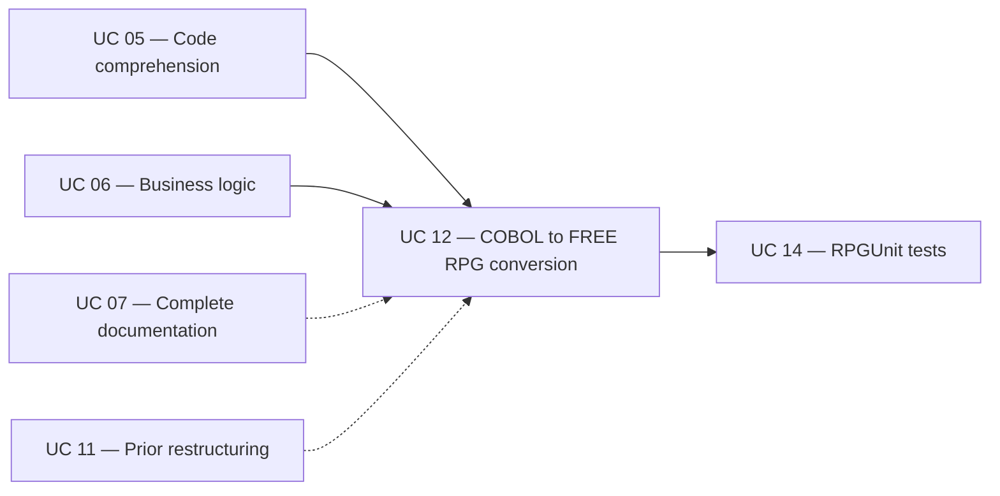

# UC 12 — COBOL → FREE RPG ILE conversion

> **Category:** Code modernization — Language conversion (Track A)
>
> **Position in the journey:** 12 — first UC of Phase 4 (Track A), follows UC 11 (*Restructuring, transformation, conversion*).
>
> **Recommended Bob mode:** IBM i Developer (structure analysis, code review, transposition, generation of the RPGLE members, `CRTBNDRPG` / `CRTSQLRPGI` compilation) → IBM i Database (checking the tables and DDS files in the `QSYS2` catalogs). Without Premium Package: Ask for design, Agent for compilation and writing.

---

## ⭐ IBM i Premium Package used

- **Important note on Premium Workflows:** There is **no automated 1-click "COBOL to RPG" workflow** in the IBM i Premium Package. The *RPG Modernization* workflow is dedicated exclusively to converting RPG source code (OPM RPG III or fixed-format ILE RPG IV) to fully free-form format (`**FREE`).
- **Workflow: RPG Modernization** (reference workflow for the target standards) → [Official documentation](https://bob.ibm.com/docs/ide/premium-packages/bob-for-i/workflows)
  Defines the modern target RPGLE code standards (`CTL-OPT`, built-in subprocedures, no `GOTO`, total free-form structure).
  **Launch:** **Start Workflow** button at the top of the chat → choose the workspace → **Start**. **Supported workspaces:** Local, Library List ([UC 00 §1](UC00-premium-package-ibmi-en.md)).
- **Slash Command: `/review_rpg`** → [Official documentation](https://bob.ibm.com/docs/ide/premium-packages/bob-for-i/slash-commands)
  Full code review of an RPG source member: format detection, ILE compliance, error handling, security and modernization roadmap. Used to audit the RPG code generated at each pass. **It rejects non-RPG sources (including COBOL)**: for the original COBOL, see the `cobol-code-review` skill (Step A).
  **Mode:** IBM i Developer.
- **Understand Dashboard** (optional, not ticked for this UC in [UC 00 §6](UC00-premium-package-ibmi-en.md); setup and tools: [UC 00 §2](UC00-premium-package-ibmi-en.md)) → [Official documentation](https://bob.ibm.com/docs/ide/premium-packages/bob-for-i/understand)
  *If Understand is installed.* Global analysis of the application estate:
  - **Mapping and impact analysis:** identify all calling programs (RPG, CL, COBOL) before transposing a `LINKAGE SECTION` interface.
  - **Dead object detection:** spot obsolete or orphaned COBOL members before starting a conversion.
  - **Architecture visualization:** map the hybrid COBOL / RPG interactions and the binding directories.
  **Access:** Command `vscode-ibmi-bob.openUnderstandDashboard`.
- **Auto-activated skills used (22 skills):**
  - **COBOL for i core (12 skills):** `cobol-primer-basics`, `cobol-data-division`, `cobol-procedure-division`, `cobol-embedded-sql`, `cobol-ile-understanding`, `cobol-ile-intrinsic-functions`, `cobol-opm-understanding`, `cobol-file-io`, `cobol-source-debugging`, `cobol-code-refactoring`, `cobol-code-review`, `cobol-module-service-program`.
  - **Modern ILE RPG core (7 skills):** `rpg-opm-to-ile`, `rpg-free-format-fundamentals`, `rpg-procedures-functions`, `rpg-data-structures`, `rpg-file-operations`, `rpg-indicators`, `rpg-refactor-legacy`.
  - **Mapping & Data (3 skills):** `understand-impact-analysis`, `understand-program-explainer`, `db2-system-catalog`.

> **Why this UC 12 provides unique methodological value:**
> Since no native automated workflow converts COBOL to RPG on IBM i, **it is the combination of Bob's COBOL + RPG skills, orchestrated by the structured prompt sequence of this UC (Prompts 0 to 5)**, that performs the conversion. This UC provides the rigorous framework that is essential: analysis of the 4 divisions, `COMPASBIN` compilation options, fine transposition of `REDEFINES` via `OVERLAY`, level 88s, conditional `READ(E)`, end-of-program handling `STOP RUN` vs `GOBACK`, Golden Master validation and hybrid architecture.

---

## Objective

Convert an existing COBOL program (OPM COBOL/400 or ILE COBOL) to **modern fully free-form RPGLE (`**FREE`)**, faithfully preserving the business logic, the data structures, the file accesses and the external call interface (`LINKAGE SECTION` → `DCL-PI`), while producing clean, maintainable and compilable ILE RPG code.

**What this UC enables:**
- Exhaustively transposing the `DATA DIVISION` (`WORKING-STORAGE`, `FILE SECTION`, `LINKAGE SECTION`) into modern RPG declarations (`DCL-S`, `DCL-DS`, `DCL-F`, `DCL-PI`).
- Handling the critical memory subtleties: precise calculation of `OVERLAY` offsets for `REDEFINES`, transposition of level 88 named conditions into `DCL-C` constants or compound predicates, and respect of numeric types (`ZONED` by default vs `PACKED` / `INT`).
- Transposing the `PROCEDURE DIVISION` into subroutines (`BEGSR`) or subprocedures (`DCL-PROC`), with explicit handling of control structures (`EVALUATE` → `SELECT`, `PERFORM UNTIL` → `DOW`/`DOU`).
- Immediately compiling and validating the target RPG member on the test IBM i via a dedicated temporary member.

**Main success criterion:** The generated RPG member (`QRPGLESRC`) compiles without errors on the IBM i (`CRTBNDRPG` or `CRTSQLRPGI`), strictly respects the original parameter signature, and produces execution results strictly identical to the reference COBOL program on a real dataset.

---

## Prerequisites

- **Phase:** Phase 4 — Advanced modernization (Track A: Languages)
- **Required previous UCs:**
  - **UC 05 — Code comprehension** (**mandatory**): essential to understand the architecture of the COBOL paragraphs, the files handled and the execution flow.
  - **UC 06 — Business logic** (**mandatory**): essential to map the business rules, validations and calculation formulas. For COBOL, use the manual prompts and the `cobol-*` skills: the *Business Rules Extraction* workflow is limited to RPG.
  - **UC 07 — Complete documentation** (**recommended**): technical specifications and call matrix to secure the `LINKAGE SECTION` interface.
  - **UC 11 — Code restructuring** (**recommended**): mastery of ILE concepts (modules, procedures, binding directories).
- **Required deliverables:**
  - `{appId}-comprehension-{component}-report-{YYYYMMDD-HHmm}.md` — UC 05 (**mandatory**)
  - `{appId}-logique-{component}-regles-{YYYYMMDD-HHmm}.md` — UC 06 (**mandatory**)
  - `{appId}-doc-spec-tech-{YYYYMMDD-HHmm}.md` — UC 07 (recommended)
  - `{appId}-doc-matrice-{YYYYMMDD-HHmm}.md` — UC 07 (recommended)
- **Recommended Bob level:** Intermediate to Advanced
- **Estimated Bob Coins:** ⚠️ *To be calibrated after the UC 12 lab on FLGHT400.*

> ⚠️ **Absolute test member rule:** Bob NEVER writes directly into the production source member. The converted code is written to a temporary test member (e.g. `[PGM_NAME]_T` or in a test library `[TEST_LIB_NAME]`).
>
> ⚠️ **Presence of a COBOL + RPG expert:** Human validation is required to settle the constructs with no direct mechanical equivalent (`PERFORM THRU`, `ALTER GO TO`, `OCCURS DEPENDING ON`, `COMP` with no known compilation option).

---

## Concrete example — FLGHT400 Lab

| Deliverable | Lab file | What it illustrates |
|---|---|---|
| RPG modernization report | [`../labs_FLGHT400_results/FLGHT403_FRS409_modernization_report.md`](../labs_FLGHT400_results/FLGHT403_FRS409_modernization_report.md) | Modernization approach to Free RPGLE going through the temporary member `FRS409_T`, compilation and validation of the functional behavior. |
| Functional explanation of the component | [`../labs_FLGHT400_results/FLGHT403_FRS409_explanation.md`](../labs_FLGHT400_results/FLGHT403_FRS409_explanation.md) | Detailed analysis of the input/output flows and subroutines serving as a functional baseline. |
| Extracted business rules | [`../labs_FLGHT400_results/FRS401-business-rules-FR.md`](../labs_FLGHT400_results/FRS401-business-rules-FR.md) | Extraction of the decision logic prior to any conversion. |
| Application estate audit | [`../labs_FLGHT400_results/FLGHT403_cpu_jobs_programs_audit.md`](../labs_FLGHT400_results/FLGHT403_cpu_jobs_programs_audit.md) | Identification of unmaintained programs eligible for language modernization. |

---

## Starting a Bob session

### The three workspaces

To run UC 12, clearly set up the three workspaces:

1. **Local workspace (workstation):**
   - Storage of the tracking deliverables, conversion analyses and diffs under `bob-reports/`.
   - Keeping the project rules and skills.
2. **IBM i Libraries / QSYS (⭐ Primary workspace):**
   - Reading the COBOL source member in `[LIB_NAME]/QCBLSRC([PGM_NAME])`.
   - Writing the target RPG member in `[TEST_LIB_NAME]/QRPGLESRC([PGM_NAME]_T)` via `write_member`.
   - Running the `CRTBNDRPG` or `CRTSQLRPGI` compilation commands.
3. **IFS Working Directory:**
   - Optional storage of the compilation listings (exported `.splf`) or error analysis logs.

> To launch the *RPG Modernization* workflow, the supported workspaces are **Local** and **Library List** (see [UC 00 §1](UC00-premium-package-ibmi-en.md)).

---

## Impact of complexity on the conversion strategy

As in all the modernization UCs, complexity is categorized as **SIMPLE / STANDARD / COMPLEX**:

```
                  ┌─────────────────────────────────────────┐
                  │ Program qualification (Prompt 0)        │
                  │   - Analysis of the 4 COBOL divisions   │
                  │   - Detection of special constructs     │
                  └────────────────────┬────────────────────┘
                                       │
         ┌─────────────────────────────┼─────────────────────────────┐
         ▼                             ▼                             ▼
  ┌──────────────┐              ┌──────────────┐              ┌──────────────┐
  │   SIMPLE     │              │   STANDARD   │              │   COMPLEX    │
  │ • Lin. proc. │              │ • REDEFINES  │              │ • PERF. THRU │
  │ • No THRU    │              │ • Level 88s  │              │ • ALTER GOTO │
  │ • No REDEF.  │              │ • Ext. CALL  │              │ • OCCURS DEP │
  └──────┬───────┘              └──────┬───────┘              └──────┬───────┘
         │                             │                             │
         ▼                             ▼                             ▼
  Conversion in                  Incremental                   Restricted POC
  a single pass                  conversion with               scope +
  (Prompts 1 to 4)               validation gates              Hybrid
                                 at each step                  architecture
```

### 1. SIMPLE programs
- Linear `PROCEDURE DIVISION`, paragraphs executed sequentially or via simple `PERFORM`s.
- No `PERFORM THRU`, no `ALTER GO TO`, no crossing `GO TO`s.
- Simple `WORKING-STORAGE`: scalar types, no multi-level `REDEFINES` or dynamic tables.
- **Strategy:** Direct full processing (Step 0-bis → Prompt 1 → Prompt 2 → Prompt 3 → Prompt 3-bis → Prompt 4 → Prompt 4-bis).

### 2. STANDARD programs
- Presence of simple `REDEFINES` clauses, level 88s (discrete values or `THRU` ranges).
- Paragraphs called from several `PERFORM`s (candidates for extraction into subprocedures).
- External `CALL ... USING` calls with `LINKAGE SECTION`.
- **Strategy:** Batch conversion with stop points and explicit validation of the data offsets before generating the procedure.

### 3. COMPLEX programs
- Presence of `PERFORM THRU` over extended blocks, `ALTER GO TO`, `OCCURS DEPENDING ON`.
- Dense `FILE SECTION` with variable-length records (`RECORD CONTAINS VARYING`).
- Tangled logic with multiple non-hierarchical conditional jumps.
- **Strategy:** Delimitation of a convertible subset for the POC; isolation of the residual blocks in a standalone COBOL program callable from RPG (**Hybrid COBOL + RPG architecture**).

---

## Step A — Prior tool-assisted assessment

Before launching the transposition prompts, run the tool-assisted assessment in **IBM i Developer** mode:

1. **Preliminary review of the COBOL source with the `cobol-code-review` skill:**
   `/review_rpg` rejects non-RPG sources (including COBOL): to audit the original COBOL, ask Bob for a COBOL review (defects, technical debt, modernization opportunities). Reserve `/review_rpg` for RPG members (existing transition member, then the generated `_T` member).
2. **Understand Dashboard (if available, see [UC 00 §2](UC00-premium-package-ibmi-en.md)):**
   Open the dashboard (`vscode-ibmi-bob.openUnderstandDashboard`):
   - Identify all the programs calling the COBOL program to freeze the `LINKAGE SECTION` signature.
   - Check the list of files accessed (`SELECT / ASSIGN`) and verify their presence in the `QSYS2.SYSTABLES` catalog.

---

## Prompts

### Prompt 0 — Qualification and strategy choice

> **Mandatory entry point of UC 12 for each COBOL program.**
> Analyzes the 4 divisions, checks the compilation options (`COMPASBIN`), detects the critical constructs and recommends the exact scope.

**Objective:** Classify the COBOL program, identify the complexity factors and secure the conversion path.

**When to use:** At the opening of the session, before any code transposition work.

**Required input:**
- COBOL source member in `[LIB_NAME]/QCBLSRC([PGM_NAME])`.
- Program understanding reports (UC 05) and technical specification (UC 07) if available.

**Workspace:** Local (`bob-reports/`) for the analysis deliverable.
**Mode:** IBM i Developer.
**Key skills used:** `cobol-primer-basics`, `cobol-opm-understanding`, `cobol-file-io`, `cobol-code-review`, `understand-program-explainer`.

**Prompt:**

```text
The COBOL program [PGM_NAME] is located in [LIB_NAME]/QCBLSRC.
[If available: The program understanding file {appId}-comprehension-[PGM_NAME]-report-{YYYYMMDD-HHmm}.md is available.]
[If available: The technical specification {appId}-doc-spec-tech-{YYYYMMDD-HHmm}.md is available.]

Analyze this COBOL program and produce in English, in markdown, a COBOL → RPG ILE Free conversion assessment report:

## UC 12 Conversion analysis — [PGM_NAME]

### 0. Prerequisites check
Before any analysis, check the availability of the mandatory items:
| Expected item | Present in the context? | Action if absent |
|---|---|---|
| Program understanding report (UC 05) | YES / NO | ⛔ STOP — run UC 05 on this program before continuing |
| Technical specification / Matrix (UC 07) | YES / NO | ⚠️ RECOMMENDED — needed to freeze the LINKAGE interface and the files |

### 1. Quick inventory of the COBOL divisions
| Division / Section | Content detected | Impact on the RPG conversion |
|---|---|---|
| IDENTIFICATION DIVISION | Program name, author, date | Transposition into RPG header comments |
| ENVIRONMENT DIVISION | File SELECT / ASSIGN | Transposition into DCL-F declarations |
| DATA DIVISION / FILE SECTION | FD and 01 descriptions | Transposition into DCL-DS (LIKEREC or manual) |
| DATA DIVISION / WORKING-STORAGE | Number of 01 levels / REDEFINES / Level 88s | Transposition into DCL-S, DCL-DS and DCL-C constants |
| DATA DIVISION / LINKAGE SECTION | Present (YES/NO) — USING parameters | Transposition into DCL-PI (external signature) |
| PROCEDURE DIVISION | Number of paragraphs / PERFORM THRU | Transposition into subroutines (BEGSR) or procedures |

### 2. Compilation options to determine
Search in this order:
1. PROCESS directive in the COBOL source or COPY member
2. Existing compilation command or script
3. Historical compilation listing
4. IBM i default values

| Option | Value found | Source of the information | Associated conversion rule |
|---|---|---|---|
| COMPASBIN / NOCOMPASBIN | ? | ? | If NOCOMPASBIN (IBM i default): COMP = PACKED. If COMPASBIN: COMP = INT/UNS. |
| TRUNC | ? | ? | Arithmetic truncation rules |
| Precompiled SQL (EXEC SQL) | YES / NO | Source | If YES: CRTSQLRPGI compilation mandatory (not CRTBNDRPG) |

⚠️ If COMPASBIN / NOCOMPASBIN is unknown: any COMP field without a numeric suffix will be marked "TO CONFIRM".

### 3. Complexity factors detected
Answer YES / NO / TO CONFIRM for each factor:
- [ ] PERFORM THRU (sequence of consecutive paragraphs)
- [ ] ALTER GO TO (dynamic modification of a GO TO target — obsolete)
- [ ] Multi-level REDEFINES (transposition into DCL-DS with OVERLAY)
- [ ] COBOL level 88s with multiple values or THRU ranges
- [ ] OCCURS DEPENDING ON (arrays with dynamic dimension at runtime)
- [ ] External CALL with USING BY REFERENCE / BY CONTENT
- [ ] Embedded EXEC SQL (requires SQL precompilation)
- [ ] Paragraphs called by several distinct PERFORMs (DCL-PROC candidate)
- [ ] COBOL COPY members (COPY MEMBER_NAME)
- [ ] PERFORM ... WITH TEST AFTER (DOU equivalent, not DOW)
- [ ] ROUNDED or ON SIZE ERROR clauses on calculations
- [ ] STOP RUN / GOBACK / EXIT PROGRAM (end-of-program handling)

### 4. Category and recommended scope
- **Category retained:** SIMPLE / STANDARD / COMPLEX
- **Conversion scope for the POC:**
  - Directly convertible paragraphs: [list]
  - Paragraphs requiring a design decision: [list + question to settle]
  - Paragraphs excluded / deferred to the hybrid architecture: [list + justification]

Save this analysis in bob-reports/{appId}-conv-cobol-[PGM_NAME]-analyse-{YYYYMMDD-HHmm}.md.
```

**Deliverable produced:**
- `bob-reports/{appId}-conv-cobol-[PGM_NAME]-analyse-{YYYYMMDD-HHmm}.md`.

---

### Step 0-bis — Minimal behavioral reference (Golden Master)

> **To be run before any code modification or generation.**
> Captures the behavioral reference state of the original COBOL program on the test IBM i to guarantee non-regression.

**Capture checklist:**
1. **Nominal case:** Run the original COBOL program with a known set of parameters; record the modified parameters and the records created/updated in the database.
2. **Boundary cases:** Test at least one complex conditional branch (level 88, `REDEFINES`, end-of-file indicator `AT END`).
3. **Execution status:** Collect the return code or the messages issued in the job log.
4. **Recording:** Add these results to the analysis file under the section `## Behavioral reference (Baseline)`.

**Useful skills:** `cobol-source-debugging` (ILE source debugger, analysis of the job log and dumps of the original COBOL program).

> ⚠️ If the COBOL program cannot be run in the test environment, explicitly write: `BEHAVIORAL NON-REGRESSION NOT DEMONSTRABLE IN THE POC` and have it validated by the project manager.

---

### Prompt 1 — Inventory of the structures to transpose

> Builds the detailed correspondence matrix between the COBOL structures and the RPG ILE Free declarations.
> **No RPG code is generated in this prompt** — it serves as the technical conversion contract.

**Objective:** Detail the transposition plan for the data, files, paragraphs and special cases.

**When to use:** After validation of Prompt 0 and Step 0-bis.

**Required input:** Analysis produced in Prompt 0.

**Workspace:** Local (`bob-reports/`).
**Mode:** IBM i Developer.
**Key skills used:** `cobol-data-division`, `cobol-file-io`, `rpg-data-structures`, `rpg-file-operations`, `db2-system-catalog`.

**Prompt:**

```text
Based on the conversion analysis of [PGM_NAME], produce in English, in markdown,
the complete inventory of the structures to transpose to RPG ILE Free:

## UC 12 Transposition inventory — [PGM_NAME]

### 1. WORKING-STORAGE structures (Types and variables)
For each 01 level and its subfields:
| # | COBOL level | COBOL name | PIC / USAGE | Target RPG Free declaration | Rule / Decision applied |
|---|---|---|---|---|---|

Type mapping rules to apply:
- PIC X(n) or A(n)                → DCL-S VarName CHAR(n)
- PIC 9(n) or S9(n) DISPLAY       → DCL-S VarName ZONED(n:d)  (by default)
  *Note: PACKED(n:d) allowed only if the field is 100% internal to WORKING-STORAGE,
  not included in a REDEFINES, not passed as a parameter and not written to a flat-format file.*
- PIC S9(n) COMP-3                → DCL-S VarName PACKED(n:d)
- PIC S9(1-4) COMP-4 / BINARY     → DCL-S VarName INT(5)
- PIC S9(5-9) COMP-4 / BINARY     → DCL-S VarName INT(10)
- PIC S9(10-18) COMP-4 / BINARY   → DCL-S VarName INT(20)
- PIC 9(1-4) COMP-4 / BINARY      → DCL-S VarName UNS(5)
- Figurative constants:
  * SPACES / SPACE                → *BLANKS
  * ZEROS / ZEROES                → *ZEROS
  * LOW-VALUES                    → *LOVAL
  * HIGH-VALUES                   → *HIVAL
  * ALL 'x'                       → %REPEAT('x' : length) or DCL-C constant

### 2. REDEFINES and overlay structures (OVERLAY)
For each REDEFINES clause detected:
| # | Original area (01) | REDEFINES area | Offset (bytes) | Length | RPG Free DCL-DS declaration |
|---|---|---|---|---|---|

Mandatory RPG rule:
  DCL-DS wsSharedArea ;
    baseField   CHAR(totalBytes) ;
    view1       CHAR(len1)    OVERLAY(baseField : 1) ;
    view2       PACKED(p:s)   OVERLAY(baseField : offset2) ;
  END-DS ;
⚠️ Systematically check that %SIZE(wsSharedArea) matches the COBOL size exactly.

### 3. Level 88s (Named conditions)
For each level 88:
| # | Parent variable | Level 88 name | Value(s) / THRU range | Form (SINGLE/MULTI/RANGE) | Proposed RPG equivalent |
|---|---|---|---|---|---|
- SINGLE → DCL-C C_[NAME_88] [VALUE] + IF var = C_[NAME_88]
- MULTI  → Direct compound predicate: IF var = 'A' OR var = 'B'
- RANGE  → Direct compound predicate: IF var >= min AND var <= max

### 4. FILE SECTION and file descriptions (FD)
For each FD:
| # | COBOL FD name | Access mode | Associated physical/logical file | DCL-F declaration | Associated DCL-DS structure |
|---|---|---|---|---|---|
Expected syntax:
- Externally described file:
  DCL-F FileName DISK(*EXT) KEYED USAGE(*INPUT/*OUTPUT/*UPDATE) ;
  DCL-DS dsFormatName LIKEREC(FormatName : *INPUT) END-DS ;
- Program-described file: DCL-F + manual DCL-DS with subfields.

### 5. PROCEDURE DIVISION (Paragraphs and flow)
For each paragraph:
| # | COBOL paragraph name | Called by (PERFORM) | PERFORM THRU present | RPG equivalent (BEGSR / DCL-PROC) |
|---|---|---|---|---|

### 6. Constructs with no direct equivalent (Decision points)
For each complex construct (PERFORM THRU, ALTER GO TO, OCCURS DEPENDING ON, STRING/UNSTRING):
| # | COBOL construct | Source line | Risk identified | Recommended option |

Do not generate any executable RPG code in this prompt.
Complete the file bob-reports/{appId}-conv-cobol-[PGM_NAME]-analyse-{YYYYMMDD-HHmm}.md with this inventory.
```

---

### Prompt 2 — Transposition of the data structures (DATA DIVISION → DCL)

> Generates all the RPG ILE Free (`**FREE`) data declarations from the validated inventory.

**Objective:** Produce the RPG declarations block (`CTL-OPT`, `DCL-F`, `DCL-S`, `DCL-DS`, `DCL-C`, `DCL-PR`, `DCL-PI`).

**When to use:** After human validation of the Prompt 1 inventory.

**Required input:** Structures inventory (Prompt 1).

**Workspace:** Local for the diff / IBM i for the temporary member.
**Mode:** IBM i Developer.
**Key skills used:** `cobol-data-division`, `rpg-free-format-fundamentals`, `rpg-data-structures`, `rpg-procedures-functions`, `rpg-file-operations`.

**Prompt:**

```text
Based on the validated inventory of [PGM_NAME], generate the complete block of RPG ILE Free
declarations, strictly following the fully free-form standard.

The generated code must start on the first line with:
**FREE

For each structure, produce the commented diff:
// COBOL : [Original excerpt]
// RPG ILE Free : [DCL equivalent]

Generation rules:
1. Program header:
   // ============================================================
   // PROGRAM : [PGM_NAME]
   // Converted from COBOL [LIB_NAME]/QCBLSRC([PGM_NAME])
   // Conversion date : [DATE]
   // Status : Temporary converted member — Expert validation required
   // ============================================================
   CTL-OPT OPTION(*SRCSTMT : *NODEBUGIO) MAIN(MainProcedure) ; // or free cycle

2. File declarations (DCL-F) coming from the FDs.
3. Constant declarations (DCL-C) coming from level 88s (SINGLE) and recurring literals.
4. Simple variable declarations (DCL-S) coming from WORKING-STORAGE (ZONED by default, PACKED if optimized).
5. Complex structure declarations (DCL-DS) with OVERLAY for the REDEFINES.
6. Procedure interface declaration (DCL-PI) coming from the LINKAGE SECTION:
   DCL-PI *N ;
     pParam1 CHAR(10) ;
     pParam2 ZONED(7:2) ;
   END-PI ;
   (⚠️ The types and lengths must strictly match the LINKAGE SECTION).
7. Prototype declarations (DCL-PR) for each external program called by CALL.

Save this diff in bob-reports/{appId}-conv-cobol-[PGM_NAME]-diff-{YYYYMMDD-HHmm}.md.
```

---

### Prompt 3 — Transposition of the PROCEDURE DIVISION

> Transposes the COBOL paragraphs, verbs, calculations and input/output operations to the corresponding RPG Free statements.

**Objective:** Transform the algorithmic body of the program into RPG subroutines or subprocedures.

**When to use:** As soon as Prompt 2 is validated.

**Required input:** Declarations diff (Prompt 2) + Paragraph inventory (Prompt 1).

**Workspace:** Local (`bob-reports/`) for the full diff.
**Mode:** IBM i Developer.
**Key skills used:** `cobol-procedure-division`, `cobol-embedded-sql`, `cobol-ile-intrinsic-functions`, `rpg-free-format-fundamentals`, `rpg-file-operations`, `rpg-indicators`, `rpg-refactor-legacy`.

**COBOL → RPG ILE Free verb mapping table:**

| COBOL verb | RPG ILE Free syntax (`**FREE`) | Remarks and points of attention |
|---|---|---|
| `MOVE src TO dest` | `dest = src ;` | Valid if types and lengths are identical. If lengths differ: use `%SUBST` or explicit conversion. |
| `COMPUTE c = expr` | `c = expr ;` | Adapt the arithmetic operators. |
| `ADD a TO b` | `b += a ;` | Or `b = b + a ;` |
| `SUBTRACT a FROM b` | `b -= a ;` | Or `b = b - a ;` |
| `MULTIPLY a BY b GIVING c` | `c = a * b ;` | Handle precision and `ROUNDED` if present. |
| `DIVIDE a INTO b GIVING c REMAINDER r` | `c = %DIV(b:a) ; r = %REM(b:a) ;` | ⚠️ Valid for integer operands. If decimals: explicit calculation required. |
| `IF cond THEN ... ELSE ... END-IF` | `IF cond ; ... ELSE ; ... ENDIF ;` | Adapt the relational operators (`EQUAL` → `=`, `NOT =` → `<>`). |
| `EVALUATE expr WHEN v1 ...` | `SELECT ; WHEN expr = v1 ; ... ENDSL ;` | Evaluation of a scalar value. |
| `EVALUATE TRUE WHEN cond1 ...` | `SELECT ; WHEN cond1 ; ... ENDSL ;` | ⚠️ `EVALUATE TRUE` evaluates independent boolean conditions. |
| `PERFORM para` | `EXSR srPara ;` | Standard transposition to a subroutine. |
| `PERFORM para UNTIL cond` | `DOW NOT cond ; EXSR srPara ; ENDDO ;` | `TEST BEFORE` by default in COBOL. |
| `PERFORM para WITH TEST AFTER UNTIL cond` | `DOU cond ; EXSR srPara ; ENDDO ;` | `TEST AFTER` corresponds exactly to `DOU`. |
| `PERFORM n TIMES` | `FOR i = 1 TO n ; EXSR srPara ; ENDFOR ;` | Finite counter loop. |
| `READ File INTO dsRecord AT END ...` | `READ File dsRecord ; IF %EOF(File) ; ... ENDIF ;` | If the original COBOL has explicit error handling: use `READ(E)` + `IF %ERROR ; ... ELSEIF %EOF(File) ; ... ENDIF ;`. |
| `READ File NEXT RECORD` | `READ File ; IF %EOF(File) ; ... ENDIF ;` | Sequential read without key filter. |
| `WRITE Record FROM dsRecord` | `WRITE Record dsRecord ;` | Add `(E)` only if error handling is present in the COBOL source. |
| `REWRITE Record FROM dsRecord` | `UPDATE Record dsRecord ;` | In RPG, `REWRITE` becomes `UPDATE`. |
| `DELETE File RECORD` | `DELETE File ;` | Record deletion. |
| `START File KEY = key` | `SETLL key File ; IF NOT %EQUAL(File) ; ... ENDIF ;` | Positioning on an indexed file. |
| `START File KEY > key` | `SETGT key File ;` | Strictly-greater positioning. |
| `CALL 'PGM' USING BY REFERENCE p1` | `CALLP Pgm(p1) ;` | Requires the `DCL-PR EXTPGM('PGM')` prototype. |
| `CALL 'PGM' USING BY CONTENT p1` | `wkCopy = p1 ; CALLP Pgm(wkCopy) ;` | ⚠️ `BY CONTENT` requires passing a non-mutable local copy. |
| `GOBACK` / `EXIT PROGRAM` | `RETURN ;` | Normal return to the caller. |
| `STOP RUN` | `*INLR = *ON ; RETURN ;` | ⚠️ To be confirmed depending on the role of the program (closing of the activation group). |

**Prompt:**

```text
Based on the section 5 inventory and the Prompt 2 declarations for [PGM_NAME],
transpose the PROCEDURE DIVISION to RPG ILE Free:

For each COBOL paragraph, generate the RPG code as a subroutine (BEGSR) or procedure:
// Original COBOL paragraph : [PARAGRAPH-NAME]
BEGSR sr[CamelCaseName] ;
  [Body transposed according to the mapping table]
ENDSR ;

Mandatory rules:
1. Prefix the subroutine names with 'sr' followed by the name in camelCase (e.g. CALCUL-SOLDE → srCalculSolde).
2. Keep the original names in comments above each block.
3. READ(E) rule: Do not add the (E) extender mechanically. Add it ONLY if the COBOL source
   had explicit error handling to reproduce with %ERROR.
4. STOP RUN rule: Use *INLR = *ON ; RETURN ; only for the main program.
5. Clearly mark the ambiguous cases with // ⚠️ DECISION REQUIRED.

Complete the file bob-reports/{appId}-conv-cobol-[PGM_NAME]-diff-{YYYYMMDD-HHmm}.md with the PROCEDURE DIVISION.
```

---

### Prompt 3-bis — Compilation test by Bob on a temporary member

> **Writes the converted RPG source member to the IBM i and launches the real compilation.**

**Objective:** Validate the syntax and obtain the ILE compiler error report.

**When to use:** As soon as the declarations (Prompt 2) and the procedure (Prompt 3) are assembled.

**Required input:** Assembled RPG code.

**Workspace:** **IBM i QSYS** (writing the member and compiling) + Local (error report).
**Mode:** IBM i Developer.
**Key skills used:** `rpg-opm-to-ile`, `rpg-debugging-techniques`.

**Prompt:**

```text
The RPG ILE Free source of [PGM_NAME] is ready for the first compilation test.
Run the following two steps:

Step 1 — Write the RPG source to the IBM i:
Write the complete source in [TEST_LIB_NAME]/QRPGLESRC([PGM_NAME]_T) via write_member.
(Temporary member with the _T suffix so as never to overwrite the existing one).

Step 2 — Launch the compilation:
If there is no SQL in the COBOL:
CRTBNDRPG PGM([TEST_LIB_NAME]/[PGM_NAME]_T)
          SRCFILE([TEST_LIB_NAME]/QRPGLESRC)
          SRCMBR([PGM_NAME]_T)
          OPTION(*EVENTF) OUTPUT(*PRINT)
          DBGVIEW(*SOURCE)

If EXEC SQL is present:
CRTSQLRPGI OBJ([TEST_LIB_NAME]/[PGM_NAME]_T)
           SRCFILE([TEST_LIB_NAME]/QRPGLESRC)
           SRCMBR([PGM_NAME]_T)
           OBJTYPE(*PGM)
           OPTION(*EVENTF)
           OUTPUT(*PRINT)
           DBGVIEW(*SOURCE)

Analyze the compilation result and produce in English:
1. Status: COMPILATION SUCCESSFUL or ERRORS DETECTED.
2. Table of the errors, if any:
   | Line | Error code | Compiler description | Probable COBOL → RPG cause | Proposed fix |
3. If the compilation succeeded: confirm the creation of the *PGM object in [TEST_LIB_NAME].
```

---

### Prompt 4 — Special constructs, interface validation and cleanup

> Handles the complex points put on hold (`PERFORM THRU`, strict validation of the `DCL-PI`, cleanup of the temporary comments).

**Objective:** Finalize the RPG code, resolve the complex constructs and clean up the source.

**When to use:** After fixing the first compilation errors.

**Required input:** RPG code from Prompt 3 / 3-bis.

**Workspace:** Local (`bob-reports/`) and IBM i (`QRPGLESRC`).
**Mode:** IBM i Developer.
**Key skills used:** `cobol-procedure-division`, `cobol-code-refactoring`, `rpg-procedures-functions`, `rpg-refactor-legacy`, `rpg-indicators`.

**Prompt:**

```text
Based on the section 6 inventory and the Prompt 3-bis compilation result for [PGM_NAME]:

1. Verification of the public interface (DCL-PI):
   - Check that each DCL-PI parameter matches the exact type and length of the LINKAGE SECTION.
   - Make sure no memory shift is introduced for the calling programs.

2. Resolution of the PERFORM THRUs:
   For each PERFORM THRU identified:
   - Option retained: [Option A: grouping into a single ordered subroutine / Option B: sequence of distinct EXSR calls].
   - Generate the resolved block.

3. Finalization of the complex level 88s:
   - Check that all the named conditions are correctly replaced by DCL-C constants or compound predicates.

4. Cleanup:
   - Remove the obsolete intermediate comment blocks.
   - Keep the // ⚠️ DECISION REQUIRED markers for the points subject to human arbitration.

Update the member [TEST_LIB_NAME]/QRPGLESRC([PGM_NAME]_T) with the finalized source.
```

---

### Prompt 4-bis — Final compilation test and qualification report

> Launches the final compilation of the completed member and records the eligibility status for functional tests.

**Objective:** Validate the full compiler conformity of the finalized member.

**When to use:** After running Prompt 4.

**Required input:** Finalized source member in `[TEST_LIB_NAME]/QRPGLESRC([PGM_NAME]_T)`.

**Workspace:** **IBM i QSYS** (compilation) + Local (final report).
**Mode:** IBM i Developer.
**Key skills used:** `rpg-debugging-techniques`, `rpg-opm-to-ile`.

**Prompt:**

```text
Launch the final compilation of the member [TEST_LIB_NAME]/QRPGLESRC([PGM_NAME]_T):

If there is no SQL in the COBOL:
CRTBNDRPG PGM([TEST_LIB_NAME]/[PGM_NAME]_T)
          SRCFILE([TEST_LIB_NAME]/QRPGLESRC)
          SRCMBR([PGM_NAME]_T)
          OPTION(*EVENTF) OUTPUT(*PRINT)
          DBGVIEW(*SOURCE)

If EXEC SQL is present:
CRTSQLRPGI OBJ([TEST_LIB_NAME]/[PGM_NAME]_T)
           SRCFILE([TEST_LIB_NAME]/QRPGLESRC)
           SRCMBR([PGM_NAME]_T)
           OBJTYPE(*PGM)
           OPTION(*EVENTF)
           OUTPUT(*PRINT)
           DBGVIEW(*SOURCE)

Produce the final qualification report in English:
1. Final compilation status: OK / KO.
2. Metrics summary:
   - Number of original COBOL lines vs generated RPGLE Free lines.
   - Number of subroutines / procedures created.
   - Number of DCL-F files and DCL-DS structures.
3. Reminder of the 3 mandatory human validation steps before promotion to production:
   - [ ] Code review by a senior developer (validation of the OVERLAYs and level 88s).
   - [ ] Execution of the functional non-regression tests compared with the Golden Master baseline (Step 0-bis).
   - [ ] Execution of the RPGUnit unit tests (UC 14).
```

---

### Prompt 5 — Conversion plan for a complete COBOL application scope

> Allows the project manager or architect to plan the conversion path of an entire COBOL application portfolio.

**Objective:** Structure the global COBOL → ILE RPG conversion roadmap.

**When to use:** During the initial scoping or after the validation of a first pilot.

**Required input:** List of COBOL members (`QCBLSRC`), call matrix and catalog statistics.

**Workspace:** Local (`bob-reports/`).
**Mode:** IBM i Developer (or Agent).
**Key skills used:** `understand-app-overview`, `understand-impact-analysis`, `db2-system-catalog`, `cobol-module-service-program`.

**Prompt:**

```text
Based on the inventory of the COBOL members of the application [APPLICATION_NAME] in [COBOL_LIB_NAME]:

Generate in English, in markdown, the global COBOL → RPG ILE Free conversion plan:

## Global COBOL → RPG conversion plan — [APPLICATION_NAME]

### 1. COBOL estate mapping and categorization
| Member | Nb lines | Nb FD | REDEFINES | Level 88s | PERFORM THRU | Category (SIMPLE/STANDARD/COMPLEX) | Priority |
|---|---|---|---|---|---|---|---|

### 2. Batching strategy
- **Batch 1 — SIMPLE pilots:** Standalone programs with no complex LINKAGE or PERFORM THRU (process validation).
- **Batch 2 — STANDARD programs:** Batch jobs with dense data structures and multiple files.
- **Batch 3 — COMPLEX programs & Hybrid architecture:** Split into standalone COBOL subprograms and partial conversion.

### 3. Dependency and risk matrix
- Identify the COBOL programs called by existing RPG or calling other modules.
- List the 3 major technical risks (e.g. `OCCURS DEPENDING ON`, diverging compilation options).

### 4. Global workload estimate
| Batch | Number of programs | Estimated duration with Bob | Expert validation workload |

Save this plan in bob-reports/{appId}-conv-cobol-app-plan-perimetre-{YYYYMMDD-HHmm}.md.
```

---

## Bob add-ons to enable

| Extension | Role in this UC |
|---|---|
| **Code for IBM i** | Navigation in the COBOL (`QCBLSRC`) and RPG (`QRPGLESRC`) members, launching the compilation actions and displaying inline errors. |
| **IBM i Languages** | Syntax highlighting and structural validation of the COBOL and RPGLE Free (`**FREE`) code. |
| **Markdown All in One** | Preview and validation of the analysis reports and conversion diffs. |

---

## Tools to use

> IBM i tools, documentation search (RAG) and guardrails: see [UC 00 §5](UC00-premium-package-ibmi-en.md).

| Tool | Usage in this UC |
|---|---|
| **IBM i native tools — IBM i Developer mode** | Reading the COBOL source members via `read_member`, writing the RPG members via `write_member`, running the `CRTBNDRPG` / `CRTSQLRPGI` compilation commands via `execute_cl_command` or `execute_compile_action`. |
| **IBM i native tools — IBM i Database mode** | Querying the `QSYS2` catalog metadata (`SYSTABLES`, `SYSCOLUMNS`, `OBJECT_STATISTICS`) to validate the descriptions of the files accessed by the `FD`s. |
| **Confluence MCP** *(if available)* | Publishing the assessment reports and the global conversion plan to share with the project teams. |

---

## Useful QSYS2 SQL queries for the COBOL conversion

These queries run in **IBM i Database** mode to audit the sources and objects:

```sql
-- 1. List all the COBOL members of a source file with their last modification date
SELECT SYSTEM_TABLE_MEMBER AS MEMBER,
       SOURCE_TYPE AS SOURCE_TYPE,
       LAST_SOURCE_UPDATE_TIMESTAMP AS LAST_UPDATE,
       TEXT_DESCRIPTION AS DESCRIPTION
FROM QSYS2.SYSPARTITIONSTAT
WHERE SYSTEM_TABLE_SCHEMA = '[COBOL_LIB_NAME]'
  AND SYSTEM_TABLE_NAME = 'QCBLSRC'
ORDER BY SYSTEM_TABLE_MEMBER;

-- 2. Check the files referenced in the COBOL FDs to build the LIKEREC DCL-DS
SELECT TABLE_NAME, TABLE_SCHEMA, TABLE_TYPE, SYSTEM_TABLE_NAME, TEXT_DESCRIPTION
FROM QSYS2.SYSTABLES
WHERE TABLE_SCHEMA = '[LIB_NAME]'
  AND TABLE_NAME IN ('[FILE_1]', '[FILE_2]')
ORDER BY TABLE_NAME;

-- 3. Check the compiled program objects in the test library
SELECT OBJNAME, OBJTYPE, OBJATTRIBUTE, OBJSIZE, CREATION_TIMESTAMP, TEXT_DESCRIPTION
FROM QSYS2.OBJECT_STATISTICS
WHERE OBJLIBRARY = '[TEST_LIB_NAME]'
  AND OBJTYPE = '*PGM'
  AND OBJNAME LIKE '%_T'
ORDER BY CREATION_TIMESTAMP DESC;
```

---

## Pitfalls to avoid

| Pitfall | Consequence | How to avoid it |
|---|---|---|
| **Skipping the Prompt 0 qualification** | Late discovery of blocking constructs (`PERFORM THRU`, `OCCURS DEPENDING ON`), incomplete generated source. | Always run Prompt 0 to qualify the program and delimit the scope before coding. |
| **Converting `COMP` without checking `COMPASBIN`** | Silent binary/decimal inconsistency: with `NOCOMPASBIN` (default), `COMP` is packed (`PACKED`); with `COMPASBIN`, it is binary (`INT`). | Check the `PROCESS` directive or mark the field "TO CONFIRM" in the inventory. |
| **Offset error on `REDEFINES`** | Memory shift in the `OVERLAY` `DCL-DS`, silent corruption of the data read or written. | Explicitly calculate the offsets in Prompt 1 and check that `%SIZE(DS)` equals the original COBOL size. |
| **Forgetting the transposition of level 88s** | Loss of the business rules carried by the COBOL named conditions. | Systematically inventory each level 88 and transpose it into a `DCL-C` constant or compound predicate. |
| **Altering the `LINKAGE SECTION` signature** | Parameter passing incompatibility with the existing calling programs. | Freeze the `DCL-PI` with the exact types and lengths of the `LINKAGE SECTION`. |
| **Adding `(E)` mechanically on all I/Os** | Serious errors become silent if `%ERROR` is not explicitly tested. | Add the `(E)` extender only if the COBOL code explicitly handled an I/O error status. |
| **Overwriting the production source** | Loss of the original code or premature overwriting. | Always write to a temporary test member (`_T`) in `[TEST_LIB_NAME]`. |
| **Validating without a Golden Master test** | Program compiled without errors but with a diverging functional behavior on boundary cases. | Run the behavioral baseline (Step 0-bis) and compare the execution results. |

---

## UC 12 validation checklist

Before declaring a program converted and ready for unit tests (UC 14):

- [ ] **Prompt 0 executed:** Analysis saved in `bob-reports/{appId}-conv-cobol-[PGM]-analyse-{date}.md` with validated category and scope.
- [ ] **Golden Master baseline established (Step 0-bis):** Results of the original COBOL program recorded for the nominal and boundary cases.
- [ ] **Complete technical inventory (Prompt 1):** `WORKING-STORAGE`, `REDEFINES`, level 88s, `FD`s and `LINKAGE SECTION` documented.
- [ ] **`OVERLAY` offsets verified:** The redefined structures respect the exact physical size of the COBOL memory.
- [ ] **Level 88s transposed:** No named condition omitted or converted into an undocumented magic value.
- [ ] **`DCL-PI` signature compliant:** The parameter types and lengths faithfully match the `LINKAGE SECTION`.
- [ ] **`**FREE` source generated in a temporary member:** Present in `[TEST_LIB_NAME]/QRPGLESRC([PGM]_T)`.
- [ ] **Successful compilation without critical warning:** `CRTBNDRPG` or `CRTSQLRPGI` run successfully.
- [ ] **Code review by a senior expert:** Arbitration and validation of all the `⚠️ DECISION REQUIRED` markers.
- [ ] **Conclusive non-regression tests:** Execution of the RPG `_T` program with results identical to the COBOL baseline.
- [ ] **Deliverables saved:** Assessment reports, diffs and plans archived under `bob-reports/`.

---

## Points to complete before going to production

### 1. COBOL programs with `OCCURS DEPENDING ON`
- **Issue:** Arrays dimensioned dynamically at runtime. In RPG, dimensions are fixed at compile time unless explicit dynamic allocation (`%ALLOC`) is used.
- **In production:** Define the project's target standard (sizing at the maximum tolerated bound, dynamic allocation via pointers, or keeping it in a standalone COBOL subprogram).

### 2. Hybrid COBOL + RPG architecture for COMPLEX programs
- **Issue:** Some very old OPM programs contain `ALTER GO TO` jumps or tangles that cannot be converted mechanically within a short sprint.
- **In production:** Implement the hybrid architecture pattern: isolate the residual complex portion in a standalone COBOL subprogram with a clean interface, called via `CALLP` from the modernized RPG program.

---

## Deliverables of this UC

| Produced file | Naming pattern | Where Bob writes it | Consumed by |
|---|---|---|---|
| Assessment report | `{appId}-conv-cobol-[PGM]-analyse-{YYYYMMDD-HHmm}.md` | Local workspace (`bob-reports/`) | Prompt 1 (Inventory), Senior developer |
| Technical transposition inventory | Included in `{appId}-conv-cobol-[PGM]-analyse-{date}.md` | Local workspace (`bob-reports/`) | Prompts 2 and 3 (Generation) |
| Conversion diff and declarations | `{appId}-conv-cobol-[PGM]-diff-{YYYYMMDD-HHmm}.md` | Local workspace (`bob-reports/`) | Code review, Conversion audit |
| Temporary RPGLE source member | `[TEST_LIB_NAME]/QRPGLESRC([PGM]_T)` | **IBM i QSYS** (source member) | ILE compiler, Functional tests |
| Global portfolio conversion plan | `{appId}-conv-cobol-app-plan-perimetre-{YYYYMMDD-HHmm}.md` | Local workspace (`bob-reports/`) | Project steering, Wave planning |

> 💡 **Reminder on the write workspace:**
> - Source members (`.RPGLE`) are created directly on the IBM i in the specified source file (`QRPGLESRC`).
> - Markdown files (`.md`) are written in the local workspace under `bob-reports/`.

---

## Dependencies


