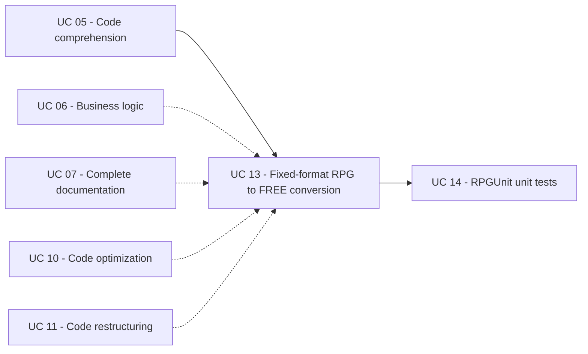

# UC 13 — Fixed-format RPG / RPG III → FREE RPG ILE conversion

> **Category:** Code modernization — Language conversion (Track A)
>
> **Position in the journey:** 13 — follows UC 12 (*COBOL → FREE RPG ILE conversion*), Phase 4 (Track A).
>
> **Recommended Bob mode:** IBM i Developer (analysis of the fixed-format specifications, `/review_rpg` review, syntactic transposition, generation of fully free RPGLE members, `CRTBNDRPG` / `CRTSQLRPGI` compilation) → IBM i Database (checking file accesses and `QSYS2` catalogs). Without Premium Package: Ask for analysis/generation, Agent for compilation and writing.

---

## ⭐ IBM i Premium Package used

- **Workflow: RPG Modernization** (the reference workflow for RPG modernization) → [Official documentation](https://bob.ibm.com/docs/ide/premium-packages/bob-for-i/workflows)
  Automates the conversion of an RPG source member (OPM RPG III or fixed-format ILE RPG IV) to fully free-format RPGLE (`**FREE`).
  - Automated pipeline: source type detection (OPM vs. fixed ILE) → OPM to ILE conversion if needed → transformation to free format (`CTL-OPT`, `DCL-*`, `EVAL`, modern control structures) → test compilation with a self-correction loop (*self-heal*) in case of errors → summary report.
  - Automatically handles: `TAG`, `CAS/ENDCS`, `MOVE`, `PLIST`, application indicators, `DOUEQ`/`CASEQ` branching to `IF`/`ELSEIF`, and subprocedure interfaces.
  - **Launch:** **Start Workflow** button at the top of the chat → choose the workspace → **Start**. **Supported workspaces:** Local, Library List ([UC 00 §1](UC00-premium-package-ibmi-en.md)).
- **Slash Command: `/review_rpg`** → [Official documentation](https://bob.ibm.com/docs/ide/premium-packages/bob-for-i/slash-commands)
  Full code review of an RPG source member (fixed, mixed or free):
  - Exact format detection (RPG III OPM, fixed RPG IV, mixed mode).
  - Identification of obsolete opcodes, resulting indicators, risky constructs (`MOVE`/`MOVEL`, `GOTO`, `CABxx`).
  - Prioritized modernization roadmap.
  - **Mode:** IBM i Developer.
- **Understand Dashboard** (optional, not ticked for this UC in [UC 00 §6](UC00-premium-package-ibmi-en.md); setup and tools: [UC 00 §2](UC00-premium-package-ibmi-en.md)) → [Official documentation](https://bob.ibm.com/docs/ide/premium-packages/bob-for-i/understand)
  *If Understand is installed.* Global analysis of the application estate:
  - **Mapping and impact analysis:** identify all calling programs before converting an `*ENTRY PLIST` into a `DCL-PI` prototype or changing call signatures.
  - **Dead object detection:** spot obsolete or orphaned RPG III / RPG IV members before planning a conversion.
  - **Architecture visualization:** visualize dependency graphs and inter-program links.
  - **Access:** Command `vscode-ibmi-bob.openUnderstandDashboard`.
- **Auto-activated skills used (16 skills):**
  - **Fixed → free RPG conversion core (7 skills):** `rpg-fixed-to-free`, `rpg-legacy-specs`, `rpgle-specs`, `rpg-opm-to-ile`, `rpg-pgmdb-conversion`, `rpg-ospec-conversion`, `rpg-refactor-legacy`.
  - **Semantics and complex constructs (4 skills):** `rpg-cycle-explained`, `rpg-indicators`, `rpg-file-operations`, `rpg-data-structures`.
  - **Modern RPGLE & mapping (4 skills):** `rpg-free-format-fundamentals`, `rpg-procedures-functions`, `understand-impact-analysis`, `understand-app-overview`.
  - **Compilation & diagnostics (1 skill):** `rpg-debugging-techniques`.

> **Why this UC 13 provides unique methodological value:**
> The Premium *RPG Modernization* workflow is the recommended direct accelerator for automatically converting RPG programs. This UC 13 provides the qualification, safeguarding and governance framework that is essential for sensitive sources:
> 1. Structured preliminary diagnosis (Sub-case A fixed RPG IV vs. Sub-case B RPG III OPM, mixed-mode detection).
> 2. Securing the silent runtime traps: truncation risk on `MOVE` (right-aligned) and `MOVEL` (left-aligned) with different field lengths.
> 3. Strict rule separating application indicators (convertible into named `IND` variables) from `INDARA` screen indicators (DSPF/PRTF) that must never be modified locally.
> 4. Explicit handling of the legacy RPG cycle (`L1-L9` control levels, `*INLR`) or prior structural conversion.
> 5. Establishing a behavioral reference (*Golden Master*) and the absolute temporary test member rule (`[PGM]_T`).

---

## Objective

Convert legacy RPG source code written in **fixed column format** (H, F, D, C, I, O specifications) or in **RPG III (OPM)** to modern **fully free-form RPGLE (`**FREE`)**, faithfully preserving the business logic, the execution semantics, the data accesses and the call signatures.

**What this UC enables:**
- Precisely qualifying the source code style: Sub-case A (fixed RPG IV) vs. Sub-case B (OPM RPG III), and detecting partially modernized sources (mixed mode).
- Transposing all declarative specifications into modern syntax:
  - `H-spec` → `CTL-OPT`
  - `F-spec` → `DCL-F` (with handling of the `USAGE`, `KEYED`, `WORKSTN`, `INFDS` keywords)
  - `D-spec` → `DCL-S`, `DCL-DS`, `DCL-PR`, `DCL-PI`
  - `*ENTRY PLIST` → `DCL-PI *N; ... END-PI;` interface block
- Transposing the calculation specifications (`C-specs`) into fully free-form statements:
  - File access opcodes (`CHAIN`, `READ`, `SETLL`, `WRITE`, etc.) with transposition of the resulting indicators to the native BIFs (`%FOUND`, `%EOF`, `%EQUAL`, `%ERROR`).
  - Arithmetic and assignment opcodes (`Z-ADD`, `ADD`, `SUB`, `MULT`, `DIV`) to `EVAL` expressions.
  - Memory move opcodes (`MOVE`, `MOVEL`) with truncation and alignment analysis.
- Converting application indicators (`*IN01`–`*IN99`) into explicit, documented `IND` boolean variables, while preserving the `INDARA` indicators linked to display files (DSPF) and print files (PRTF).
- Validating the syntax and compilability of the converted code on a temporary test member via `CRTBNDRPG` or `CRTSQLRPGI`.

**Main success criterion:** The generated RPGLE member compiles without errors on the IBM i (`CRTBNDRPG`, or `CRTSQLRPGI` if the program contains embedded SQL), complies with the modernized standards (`**FREE`, `CTL-OPT`), preserves the call interface, and delivers externally observable behavior strictly identical to the original program on the test datasets.

---

## Prerequisites

- **Phase:** Phase 4 — Advanced modernization (Track A: Languages)
- **Required previous UCs:**
  - **UC 05 — Code comprehension** (**mandatory**): identification of the RPG style (fixed IV / III), mapping of subroutines, files and call flows.
  - **UC 06 — Business logic** (**recommended**): inventory of calculation rules and decision conditions (the *Business Rules Extraction* workflow, limited to RPG, applies here).
  - **UC 07 — Complete documentation** (**recommended**): technical specifications of the interfaces and call matrices.
  - **UC 10 — Code optimization** (**recommended if applicable**): if the original program has been optimized (variable renaming, elimination of dead opcodes), the optimization diff is the starting point of the conversion.
- **Required deliverables:**
  - `{appId}-comprehension-{component}-report-{YYYYMMDD-HHmm}.md` — UC 05 (**mandatory**)
  - `{appId}-logique-{component}-regles-{YYYYMMDD-HHmm}.md` — UC 06 (recommended)
  - `{appId}-doc-spec-tech-{YYYYMMDD-HHmm}.md` — UC 07 (recommended)
  - `{appId}-optim-{component}-diff-{YYYYMMDD-HHmm}.md` — UC 10 (if prior optimization)
- **Recommended Bob level:** Intermediate to Advanced
- **Estimated Bob Coins:** ⚠️ *To be calibrated after the UC 13 lab on FLGHT400.*

> ⚠️ **Absolute test member rule:** Bob NEVER writes directly into the production source member. The converted code is written to a temporary test member (e.g. `[PGM_NAME]_T` in `QRPGLESRC` or in a test library `[TEST_LIB_NAME]`).
>
> ⚠️ **Critical prerequisite for dense RPG III programs:** RPG III programs with dense program-described I-specs/O-specs or a multi-level cycle (`L1-L9`) must undergo a pre-conversion via `CVTRPGSRC` or a structural treatment via UC 11 (Prompt 4) before being finalized in Free RPG.
>
> **Conditional dependency UC 10 / UC 11 / UC 13:** the default order (UC 10 then UC 11) applies to code already in `**FREE` / ILE. For an **OPM RPG III** or **fixed-format RPG IV** source, UC 13 (conversion to `**FREE`) can be a technical prerequisite for some advanced UC 10 optimizations (`EVAL` conversions, `DCL-PR`/`DCL-PROC` extraction): limit UC 10 to the safe passes (diagnosis, qualification, dead code, safe renames), run UC 13, then resume the advanced UC 10 optimizations. Each UC stays in its own Bob session.

---

## Concrete example — FLGHT400 Lab

| Deliverable | Lab file | What it illustrates |
|---|---|---|
| RPG modernization report | [`../labs_FLGHT400_results/FLGHT403_FRS409_modernization_report.md`](../labs_FLGHT400_results/FLGHT403_FRS409_modernization_report.md) | Full modernization of a fixed-format OPM RPG III program (`FRS409.RPG`) to Free RPGLE (`FRS409.RPGLE`) going through the temporary member `FRS409_T`, `WORKSTN` conversion, `DCL-PI *N`, and `IF/ELSEIF` structure. |
| RPG modernization session | [`../labs_FLGHT400_results/FLGHT403_FRS409_modernization_session.md`](../labs_FLGHT400_results/FLGHT403_FRS409_modernization_session.md) | Trace of the conversion session with application of the Premium standards and compilation validation. |
| Functional explanation | [`../labs_FLGHT400_results/FLGHT403_FRS409_explanation.md`](../labs_FLGHT400_results/FLGHT403_FRS409_explanation.md) | Structural and functional analysis of the `FRS409` program serving as a non-regression baseline. |

---

## Starting a Bob session

### The three workspaces

To run UC 13, clearly set up the three workspaces:
- **Local workspace** (workstation) — assessment reports, inventories, conversion plans and reports in Markdown format (`.md`).
- **IBM i Libraries / QSYS** ⭐ — **primary execution workspace**: RPG source members (`QRPGSRC`, `QRPGLESRC`), display files (`QDDSSRC`), tables and logical files, compilation commands (`CRTBNDRPG`, `CRTSQLRPGI`) and Premium workflows.
- **IFS Working Directory** — compilation logs, scripts or analysis reports.

> The *RPG Modernization* workflow is launched from the **Local** or **Library List** workspaces (see [UC 00 §1](UC00-premium-package-ibmi-en.md)).

### Session setup

1. **New Bob conversation:** Click `+` in the Bob Chat panel. Do not mix the conversions of several distinct programs in the same session.
2. **Mode to select:** `IBM i Developer` (IBM i Premium Package).
3. **Scope to select:** `Library List` → select the application library containing the sources and their copybooks.
4. **Opening the member in the editor (*Open in Editor*):** In the Code for IBM i explorer, open the RPG member to modernize (`[LIB_NAME]/QRPGSRC([PGM_NAME])` or `QRPGLESRC`).
5. **Context files to load:**
   - UC 05 program understanding report (`*-comprehension-*.md`).
   - UC 10 optimization diff (`*-optim-*.md`) if an optimization pass was performed beforehand.

---

## Conversion approach: Premium approach and structured prompts

```
┌─────────────────────────────────────────────────────────────────────────────┐
│                      RECOMMENDED PREMIUM APPROACH                           │
│                                                                             │
│  1. Initial review: Slash Command /review_rpg                               │
│  2. Automated modernization: RPG Modernization Workflow                     │
│     (OPM/ILE detection -> **FREE conversion -> Self-Heal compilation)       │
└──────────────────────────────────────┬──────────────────────────────────────┘
                                       │ If standard/complex program
                                       │ or step-by-step control required
                                       ▼
┌─────────────────────────────────────────────────────────────────────────────┐
│                       GUIDED CONVERSION APPROACH                            │
│                                                                             │
│  Step A       : Tool-assisted diagnosis and audit (/review_rpg + Understand)│
│  Prompt 0     : Qualification and strategy choice (Sub-case A/B, S/St/C)    │
│  Step 0-bis   : Minimal behavioral reference (Golden Master)                │
│  Prompt 1     : Exhaustive inventory of the structures to convert           │
│  Prompt 2     : Declarative specifications conversion (H, F, D, PI)         │
│  Prompt 3     : C-specs and calculation opcodes conversion                  │
│  Prompt 3-bis : Intermediate compilation test on [PGM]_T (SIMPLE)           │
│  Prompt 4     : Cleanup, application indicators, P-specs, interfaces        │
│  Prompt 4-bis : Final compilation test on [PGM]_T and assessment            │
│  Prompt 5     : Full application portfolio conversion plan                  │
└─────────────────────────────────────────────────────────────────────────────┘
```

---

## Prompts

### Step A — Tool-assisted diagnosis and qualification

Before starting the detailed conversion, use the Premium accelerators to get an immediate assessment of the source member:

1. **Run the `/review_rpg` Slash Command in the Bob chat:**
   ```text
   /review_rpg
   ```
   *Bob analyzes the member open in the editor, qualifies the format (OPM, fixed ILE, mixed), identifies obsolete opcodes, indicators and modernization opportunities.*

2. **Check the impact analysis in the Understand Dashboard (*if installed*):**
   Check whether the program is called by other components and whether its call interface (`*ENTRY PLIST`) requires special care.

---

### Prompt 0 — Qualification and strategy choice

**Objective:** Detect the RPG style (Sub-case A fixed RPG IV vs. Sub-case B RPG III), assess the complexity factors, classify the program (SIMPLE, STANDARD, COMPLEX, Mixed) and establish the exact roadmap.

**When to use:** Mandatory entry point before any code manipulation.

**Required input:** RPG source member open in the editor, UC 05 program understanding report.

**Key skills used:** `rpg-legacy-specs`, `rpgle-specs`, `rpg-cycle-explained`, `rpg-indicators`

**Prompt:**

```
The program [PGM_NAME] is located in [LIB_NAME]/[SOURCE_FILE] (e.g. QRPGSRC or QRPGLESRC).
[If available: The program understanding file {appId}-comprehension-{component}-report-{date}.md is loaded in context.]

Analyze this RPG program and produce in English, in markdown, a detailed assessment report for the conversion to FREE RPG ILE:

## Qualification UC 13 — [PGM_NAME]

### 1. Quick inventory
| Indicator | Value |
|---|---|
| Detected RPG style | RPG III (OPM) / Fixed RPG IV / Mixed |
| Number of lines of code | ? |
| Number of H-specs (CTL-OPT) | ? |
| Number of F-specs (DCL-F) | ? |
| Number of D-specs (DCL-S / DCL-DS / DCL-PR / DCL-PI) | ? |
| Number of remaining fixed-format C-specs | ? |
| Number of indicators (*IN01 to *IN99) used | ? |
| Indicators belonging to an INDARA area (DSPF/PRTF) | YES / NO / NONE |
| Active RPG cycle (*INLR, levels L1-L9, total subroutines) | YES / NO |
| Presence of RPG IV P-specs (PB / PE — fixed-format subprocedures) | YES / NO |
| Presence of MOVE / MOVEL with different field lengths | YES / NO / TO CONFIRM |
| Presence of GOTO / CABxx / TAG | YES / NO |
| UC 10 optimization already applied to this program | YES / NO |

### 2. Complexity factors and risks detected
Answer YES / NO / TO CONFIRM for each factor:
- [ ] Application indicators (*INxx) driving logical conditions (IF, DOW, DOU)
- [ ] Screen or print indicators (INDARA) to keep separate from local variables
- [ ] Control level indicators (*INL1 to *INL9) — RPG break cycle
- [ ] MOVE / MOVEL with source and destination of different lengths or types (truncation risk)
- [ ] Active RPG cycle — implicit dependency on the cycle or *INLR as the only stop
- [ ] RPG IV P-specs (PB/PE) to convert into DCL-PROC / END-PROC blocks
- [ ] Unstructured branching (GOTO, CABxx, misplaced ITER/LEAVE)
- [ ] *ENTRY PLIST input interface to transpose into a strict DCL-PI
- [ ] Mixed-mode code (mix of partial free format and fixed format)

### 3. Sub-case and category selected
**Sub-case:**
- [ ] **Sub-case A — Fixed RPG IV → FREE:** declarations and calculations in fixed ILE format, no RPG cycle.
- [ ] **Sub-case B — RPG III (OPM) → FREE:** legacy OPM code, without D-specs or P-specs, possible presence of the cycle or obsolete constructs.
- [ ] **Mixed:** partially converted program with free and fixed blocks side by side.

**Complexity category:**
- [ ] **SIMPLE:** < 200 fixed lines, no complex application indicators, no cycle, no risky MOVE.
- [ ] **STANDARD:** application indicators present, MOVE/MOVEL with variable lengths, or RPG IV P-specs without cycle.
- [ ] **COMPLEX:** active RPG cycle with L1-L9 breaks, extensive GOTO/CABxx, or dense RPG III with program-described I-specs/O-specs.

### 4. Recommended conversion sequence
- **If SIMPLE:** Prompt 1 → Prompt 2 (H/F/D/PI specs) → Prompt 3 (C-specs) → Prompt 3-bis (compilation test) → Prompt 4 (cleanup) → Prompt 4-bis.
- **If STANDARD:** Prompt 1 → Prompt 2 → Prompt 3 → Prompt 4 (application indicators + P-specs) → Prompt 4-bis (final compilation). *(No intermediate compilation Prompt 3-bis because the SETON/SETOF remain transient until Prompt 4).*
- **If COMPLEX:** Assess whether the cycle must be converted (via UC 11 Prompt 4). Sequence: Prompt 1 → Prompt 2 → Prompt 3 → Prompt 4 → Prompt 4-bis.
- **If Mixed:** First isolate the blocks already in free form before launching Prompt 2 on the fixed sections only.

### 5. Identified areas of vigilance
| Area / Routine | Nature of the risk | Lines concerned | Prevention measure |
```

**Deliverable produced:** `{appId}-conv-rpg-{component}-qualification-conv-{YYYYMMDD-HHmm}.md`

---

### Step 0-bis — Minimal behavioral reference (*Golden Master*)

**Objective:** Record the actual behavior of the program before any change so as to have an absolute comparison basis for non-regression.

**Actions to perform on the test IBM i:**
1. Run the original program with at least one nominal dataset and one boundary dataset.
2. Capture:
   - The output parameters (if the program is callable via `*ENTRY PLIST`).
   - The records created, modified or deleted in the tables/physical files.
   - The return codes, end messages or file statuses (`INFDS`).
3. Record these observations in the assessment report under the `## Behavioral reference` section.

---

### Prompt 1 — Exhaustive inventory of the structures to convert

**Objective:** Establish the complete mapping of the declarative specifications, calculations, composite keys, memory moves and indicators to transpose.

**When to use:** Immediately after the qualification (Prompt 0).

**Required input:** Original RPG source, assessment report.

**Key skills used:** `rpgle-specs`, `rpg-legacy-specs`, `rpg-file-operations`, `rpg-data-structures`, `rpg-indicators`

**Prompt:**

```
Based on the UC 13 qualification of [PGM_NAME], produce in English, in markdown, the exhaustive inventory of the structures to convert to RPG ILE Free:

## Inventory UC 13 — [PGM_NAME]

### 1. Declarative specifications (H / F / D)
| No. | Original fixed spec | Free RPG equivalent | Required keywords | Risk / Remark |
Equivalence rules:
- H-spec → CTL-OPT DFTACTGRP(*NO) ACTGRP(...) OPTION(...) ;
- F-spec DISK → DCL-F FileName DISK(*EXT) KEYED USAGE(*INPUT/*OUTPUT/*UPDATE/*DELETE) ;
- F-spec WORKSTN → DCL-F ScreenName WORKSTN [INFDS(...)] ;
- F-spec PRINTER → DCL-F ReportName PRINTER [OFLIND(...)] ;
- D-spec DCL-S → DCL-S VarName Type(Length:Decimals) [INZ(...)] ;
- D-spec DCL-DS → DCL-DS DsName [QUALIFIED / EXTNAME(...)] ; ... END-DS ;
- D-spec PR/PI → DCL-PR / DCL-PI ... END-PR / END-PI ;

### 2. Calculation specifications (C-specs) grouped by subroutine
For each routine or calculation block:
| Routine / Lines | Fixed opcode | Factor 1 | Factor 2 | Result | Resulting indicators (HI/LO/EQ/ERR) | Free RPG equivalent |

### 3. Resulting indicators of the opcodes (columns 54-59)
| Opcode | Column (HI/LO/EQ/ERR) | Indicator | Exact role | Mandatory Free RPG equivalent |
Transposition rules:
- CHAIN (not found) → IF NOT %FOUND(File) ;
- READ / READE (end of file) → IF %EOF(File) ;
- SETLL (equal found) → IF %EQUAL(File) ;
- Opcode(E) (I/O error) → IF %ERROR ;
- Comparison (COMP, CABxx, etc.) → IF Var1 = Var2 ;

### 4. Composite keys (KLIST / KFLD)
| KLIST name | Ordered KFLD fields | Used by | Free equivalent (%KDS or key list) |

### 5. Analysis of the MOVE and MOVEL opcodes (Truncation risk)
For each data move:
| No. | Opcode | Source (Type:Len) | Dest (Type:Len) | Length difference | Required behavior | Secure Free equivalent |
Rules:
- MOVE (right-justified): if lengths equal → dest = src ; if src longer → %SUBST(src : ...) ; if src shorter with remainder kept → %REPLACE(src : dest : ...) ;
- MOVEL (left-justified): if lengths equal → dest = src ; if src longer → %SUBST(src : 1 : %LEN(dest)) ; if src shorter with remainder kept → %REPLACE(src : dest : 1) ;

### 6. Application indicators vs. INDARA indicators
| Indicator | Nature (Application / INDARA screen / System) | Role in the program | Recommended action (IND variable name / Keep *INxx) |

### 7. External interface (*ENTRY PLIST)
| Parameter | Name | Deduced type & length | Declaration in DCL-PI *N |

Do not generate the full converted code in this prompt.
```

**Deliverable produced:** `{appId}-conv-rpg-{component}-inventaire-{YYYYMMDD-HHmm}.md`

---

### Prompt 2 — Declarative specifications conversion (H / F / D / PI)

**Objective:** Generate the header block, the file declarations, the data structures, variables and the entry interface in `**FREE` syntax.

**When to use:** After validation of the inventory.

**Required input:** Prompt 1 inventory (sections 1, 6 and 7).

**Key skills used:** `rpg-fixed-to-free`, `rpg-opm-to-ile`, `rpg-data-structures`, `rpg-free-format-fundamentals`

**Prompt:**

```
Based on the UC 13 inventory of [PGM_NAME], convert the declarative specifications into fully free-form RPGLE.

Generation rules:
1. The very first line of the member must be the directive in column 1:
   **FREE
2. Generate the CTL-OPT block with the modern ILE compilation options:
   CTL-OPT DFTACTGRP(*NO) ACTGRP(*CALLER) OPTION(*NODEBUGIO:*SRCSTMT);
3. Generate the DCL-F file declarations, preserving the USAGE, KEYED, WORKSTN and INFDS attributes.
4. Generate the DCL-C constants, DCL-DS data structures and DCL-S variables.
5. If an *ENTRY PLIST is present in the original source, generate here the main entry interface DCL-PI:
   DCL-PI *N;
     param1 TYPE;
     param2 TYPE;
   END-PI;

For each group of specifications, provide the structured diff:
// BEFORE (fixed format):
[original specification]
// AFTER (Free RPG):
[Free RPG declaration]

Finish with the complete block of assembled declarations ready to be inserted at the top of the member.
```

**Deliverable produced:** `{appId}-conv-rpg-{component}-diff-specs-{YYYYMMDD-HHmm}.md`

---

### Prompt 3 — C-specs and calculation opcodes conversion

**Objective:** Transpose the calculation logic, the RLA file accesses, the control structures and the arithmetic operations into free syntax.

**When to use:** After validation of the declarations (Prompt 2).

**Required input:** Prompt 1 inventory (sections 2, 3, 4 and 5).

**Key skills used:** `rpg-fixed-to-free`, `rpg-file-operations`, `rpg-indicators`, `rpg-refactor-legacy`

**Prompt:**

```
Based on the UC 13 inventory of [PGM_NAME], convert the calculation specifications (C-specs) into Free RPGLE syntax.

Strict equivalence table to apply:
- BEGSR / ENDSR:
    BEGSR SrName;
      ...
    ENDSR;
- EXSR: EXSR SrName;
- CHAIN / CHAIN(E):
    CHAIN(E) FileKey FileName;
    IF %ERROR;
      // I/O error handling
    ELSEIF NOT %FOUND(FileName);
      // Record not found handling
    ENDIF;
- READ / READE:
    READ(E) FileName;
    IF %ERROR;
      // I/O error handling
    ELSEIF %EOF(FileName);
      // End of file handling
    ENDIF;
- SETLL / SETGT:
    SETLL FileKey FileName;
    IF %EQUAL(FileName);
      // Equal found
    ENDIF;
- WRITE / UPDATE / DELETE:
    WRITE(E) FormatName;
- Arithmetic opcodes:
    Z-ADD → dest = src;
    ADD   → dest = dest + src;  (or dest = A + B;)
    SUB   → dest = dest - src;
    MULT  → dest = A * B;
    DIV   → dest = A / B;
- MOVE / MOVEL opcodes:
    Strictly apply the alignment and truncation rule identified in inventory section 5.
    If identical lengths: dest = src;
    If substring handling: use %SUBST or %REPLACE.
- Conditional structures:
    IF ... ; ELSE ; ... ENDIF ;
    SELECT ; WHEN ... ; ... OTHER ; ... ENDSL ;
    DOU ... ; ... ENDDO ;
    DOW ... ; ... ENDDO ;
- Obsolete opcodes:
    Replace the CAS/ENDCS loops with IF / ELSEIF / ELSE / ENDIF.
    Remove the unused TAGs and labels.

Safety rules:
- Keep the // BEFORE traceability comments during the validation phase.
- Systematically test %ERROR before %FOUND or %EOF after the opcodes with the (E) extender.
- Do not invent business logic absent from the original source.

Generate the conversion subroutine by subroutine with the before/after diff.
```

**Deliverable produced:** `{appId}-conv-rpg-{component}-diff-calc-{YYYYMMDD-HHmm}.md`

---

### Prompt 3-bis — Intermediate compilation test by Bob (*SIMPLE programs only*)

**Objective:** Write the converted source into a temporary test member on the IBM i and run a first control compilation.

**When to use:** Only for programs classified **SIMPLE** (without complex application indicators or residual `SETON`/`SETOF`). For STANDARD and COMPLEX programs, go straight to Prompt 4.

**Required input:** Code from Prompts 2 and 3 assembled.

**Key skills used:** `rpg-debugging-techniques`

**Prompt:**

```
We are going to test the compilation of the converted Free RPG code for [PGM_NAME] on the IBM i.

Step 1 — Writing to the temporary test member:
Write the converted code into the temporary test member [TEST_LIB_NAME]/QRPGLESRC([PGM_NAME]_T) via write_member.
(Never overwrite the production source member).

Step 2 — Compilation:
Run the compilation command that matches the source type:

If the converted source contains no embedded SQL (RPGLE):
CRTBNDRPG PGM([TEST_LIB_NAME]/[PGM_NAME]_T)
          SRCFILE([TEST_LIB_NAME]/QRPGLESRC)
          SRCMBR([PGM_NAME]_T)
          OPTION(*EVENTF) OUTPUT(*PRINT)
          DBGVIEW(*SOURCE)

If the source contains EXEC SQL (SQLRPGLE) — CRTBNDRPG does not process EXEC SQL:
CRTSQLRPGI OBJ([TEST_LIB_NAME]/[PGM_NAME]_T)
           SRCFILE([TEST_LIB_NAME]/QRPGLESRC)
           SRCMBR([PGM_NAME]_T)
           OBJTYPE(*PGM)
           OPTION(*EVENTF)
           OUTPUT(*PRINT)
           DBGVIEW(*SOURCE)

Analyze the compilation log and produce:
1. Status: ✅ COMPILATION SUCCESSFUL or ❌ COMPILATION FAILED.
2. List of any errors or warnings (Line, Code, Message, Probable cause).
3. Corrective actions if necessary.
```

---

### Prompt 4 — Cleanup, application indicators, P-specs and interfaces

**Objective:** Finalize the source modernization by converting the application indicators into named `IND` variables, transforming the P-specs into `DCL-PROC`, and cleaning up the temporary comments.

**When to use:** After the conversion of the C-specs (Prompt 3).

**Required input:** Code from Prompts 2 and 3, inventory section 6.

**Key skills used:** `rpg-indicators`, `rpg-procedures-functions`, `rpg-refactor-legacy`, `rpg-cycle-explained`

**Prompt:**

```
Based on the converted code of [PGM_NAME], carry out the finalization and cleanup operations:

1. Conversion of the application indicators (*IN01 to *IN99):
   - For each application indicator validated in inventory section 6:
     a. Declare the boolean variable in the header: DCL-S flIndicatorName IND INZ(*OFF);
     b. Replace the SETON / SETOF with: flIndicatorName = *ON; / flIndicatorName = *OFF;
     c. Replace the conditional tests IF *INxx with: IF flIndicatorName;
   - ⚠️ ABSOLUTE INDARA RULE: If an indicator is linked to a display file (DSPF) or print file (PRTF) under INDARA, you MUST keep the *INxx syntax (or the associated screen indicator DS) and MUST NOT convert it into a local variable.

2. Conversion of the RPG IV P-specs (Sub-case A with procedures):
   - Transpose each PB/PE subprocedure block:
     // BEFORE:
     P ProcName      B
     D ProcName      PI
     D   pParam1               10A   CONST
     P ProcName      E
     // AFTER:
     DCL-PROC ProcName;
       DCL-PI ProcName;
         pParam1 CHAR(10) CONST;
       END-PI;
       // Procedure body
     END-PROC;

3. Verification of the DCL-PI entry interface:
   - Check that the DCL-PI *N faithfully reflects the original signature (*ENTRY PLIST).

4. Code cleanup:
   - Remove the validated // BEFORE comments.
   - Check the uniform indentation (2 or 4 spaces per block level).
   - Make sure the member strictly starts with **FREE on the first line.

Produce the complete and final Free RPGLE source.
```

**Deliverable produced:** `{appId}-conv-rpg-{component}-rpg-converti-{YYYYMMDD-HHmm}.md`

---

### Prompt 4-bis — Final compilation test and assessment report

**Objective:** Compile the complete final source on the test IBM i and validate the technical conformity before the human functional tests.

**When to use:** After Prompt 4.

**Required input:** Complete final source from Prompt 4.

**Key skills used:** `rpg-debugging-techniques`

**Prompt:**

```
Run the final compilation validation for [PGM_NAME]:

Step 1 — Writing the final source to the IBM i:
Write the final Free RPGLE source into the temporary member [TEST_LIB_NAME]/QRPGLESRC([PGM_NAME]_T) via write_member.

Step 2 — Final compilation:
Run the command that matches the source type:

If no embedded SQL (RPGLE):
CRTBNDRPG PGM([TEST_LIB_NAME]/[PGM_NAME]_T)
          SRCFILE([TEST_LIB_NAME]/QRPGLESRC)
          SRCMBR([PGM_NAME]_T)
          OPTION(*EVENTF) OUTPUT(*PRINT)
          DBGVIEW(*SOURCE)

If EXEC SQL is present (SQLRPGLE) — CRTBNDRPG does not process EXEC SQL:
CRTSQLRPGI OBJ([TEST_LIB_NAME]/[PGM_NAME]_T)
           SRCFILE([TEST_LIB_NAME]/QRPGLESRC)
           SRCMBR([PGM_NAME]_T)
           OBJTYPE(*PGM)
           OPTION(*EVENTF)
           OUTPUT(*PRINT)
           DBGVIEW(*SOURCE)

Produce the final assessment report:
1. Compilation status: ✅ SUCCESSFUL / ❌ FAILED
2. Summary of the transformations carried out (H/F/D specs, C-specs, indicators, procedures).
3. Reminder of the 3 essential functional checks to be run by the team:
   - Execution with the Golden Master datasets (Step 0-bis).
   - Check of the at-risk MOVE/MOVEL assignment areas.
   - Validation of the integrity of the 5250 screens (function keys, subfiles) and the print reports.
```

**Deliverable produced:** `{appId}-conv-rpg-{component}-rapport-final-{YYYYMMDD-HHmm}.md`

---

### Prompt 5 — Full application portfolio conversion plan

**Objective:** Establish a macroscopic, prioritized roadmap to modernize a set of legacy RPG programs within an application or a library.

**When to use:** As part of a project scoping or a global modernization batch.

**Required input:** UC 05 program understanding reports and UC 13 assessment reports of the portfolio.

**Key skills used:** `understand-app-overview`, `understand-impact-analysis`

**Prompt:**

```
Based on the analyses and assessment reports carried out on the application [APP_NAME] in [LIB_NAME], produce in English, in markdown, the global plan for converting the RPG portfolio to Free RPG:

## RPG Free conversion plan — [APP_NAME]

### 1. Summary of the program estate
| Program | Source type (RPG III / fixed RPG IV) | Lines | Category (SIMPLE / STANDARD / COMPLEX) | RPG cycle | At-risk MOVE | Priority |
*Recommended prioritization: start with the isolated SIMPLE/STANDARD programs to calibrate the tooling before tackling the batch programs with cycle or heavy dependencies.*

### 2. Programs requiring a prior step
- Programs eligible for a prior UC 10 optimization (variable renaming, cleanup of obsolete opcodes).
- Dense RPG III programs with a complex cycle requiring a prior structural split via UC 11.

### 3. Risk matrix and major points of vigilance
- List of the 3 to 5 structuring risks identified across the estate (MOVE truncation, INDARA indicators, inter-program call dependencies).

### 4. Workload estimate and deployment trajectory
| Batch / Phase | Programs included | Estimated effort with Bob | Estimated traditional effort | Expected gain |
```

**Deliverable produced:** `{appId}-conv-rpg-global-plan-conv-rpg-{YYYYMMDD-HHmm}.md`

---

## Deliverables of this UC

| Produced file | Naming pattern | Consumed by |
|---|---|---|
| Assessment report | `{appId}-conv-rpg-{component}-qualification-conv-{date}.md` | Prompts 1 to 4, Global plan |
| Structures inventory | `{appId}-conv-rpg-{component}-inventaire-{date}.md` | Prompts 2 and 3 |
| Declarative specifications diff | `{appId}-conv-rpg-{component}-diff-specs-{date}.md` | Prompt 4, Final assembly |
| Calculations and C-specs diff | `{appId}-conv-rpg-{component}-diff-calc-{date}.md` | Prompt 4, Final assembly |
| Complete converted Free RPG source | `{appId}-conv-rpg-{component}-rpg-converti-{date}.md` | UC 14 (RPGUnit tests), Acceptance |
| Final assessment report | `{appId}-conv-rpg-{component}-rapport-final-{date}.md` | Conversion closure, Team |
| Global conversion plan | `{appId}-conv-rpg-global-plan-conv-rpg-{date}.md` | Project steering, Decision makers |

> 📍 **Location of the generated files:**
> - **Local workspace:** The Markdown inventory, qualification and plan files are saved in the local workspace (`bob-reports/`).
> - **IBM i Libraries (QSYS):** The converted RPGLE code is written on the IBM i into a temporary test member (`[TEST_LIB_NAME]/QRPGLESRC([PGM_NAME]_T)`).

---

## Dependencies



---

## Pitfalls to avoid

| Pitfall | Consequence | How to avoid it |
|---|---|---|
| Replacing `MOVE` with `dest = src` without checking the lengths | Silent truncation or data shift: `MOVE` right-justifies whereas `EVAL` assigns the whole value or truncates on the left. | Always check the lengths and types in inventory section 5. Use `%SUBST` or `%REPLACE` to reproduce the right alignment if the sizes differ. |
| Converting indicators linked to an `INDARA` (DSPF/PRTF) into `IND` variables | Break of the link with the display file: function keys and screen field masking stop working. | Systematically identify whether the indicator belongs to the screen's indicator area. Keep `*INxx` for the files under `INDARA`. |
| Forgetting the `**FREE` directive in column 1 | Immediate compilation error: the compiler treats the member as fixed RPG or partial free-form. | Make sure `**FREE` is the very first line of the member in column 1 with no preceding space. |
| Removing the resulting indicator columns without generating the equivalent BIFs | Ignored logical paths: a `CHAIN` without a `%FOUND` test or a `READ` without `%EOF` causes processing anomalies. | Systematically transpose the indicator columns to `IF NOT %FOUND(...)`, `IF %EOF(...)` or `IF %EQUAL(...)`. |
| Directly overwriting the production member | Loss of the original source and impossibility of comparing the behavior during the non-regression tests. | Systematically write to a temporary `[PGM]_T` member until the functional acceptance is fully validated. |
| Trying to convert a multi-level RPG cycle (`L1-L9`) without restructuring | Malfunctioning compiled code because the implicit read and break mechanism of the cycle has no direct equivalent in Free RPG. | Isolate the programs with an active cycle and apply the UC 11 structural approach (Prompt 4) to transform the cycle into an explicit `DOW/READ/ENDDO` loop. |

---

## UC 13 validation checklist

Before declaring an RPG program converted or moving on to UC 14 (RPGUnit tests), check each point:

- [ ] **Prompt 0 executed:** The assessment report is generated and the sub-case (A or B) as well as the complexity category are clearly established.
- [ ] **Golden Master recorded:** The execution results of the original program are saved as the non-regression reference.
- [ ] **Complete inventory:** All the H/F/D/C specifications, indicators, `MOVE/MOVEL` moves and `*ENTRY PLIST` interfaces are documented.
- [ ] **`**FREE` directive:** The code starts with `**FREE` in column 1 and the `CTL-OPT` block is correctly configured (`DFTACTGRP(*NO)`).
- [ ] **Secured moves:** No `MOVE`/`MOVEL` with a length difference has been converted into a simple direct assignment without a truncation check.
- [ ] **Screen indicators preserved:** No indicator belonging to a screen or print `INDARA` area has been turned into a local variable.
- [ ] **Successful compilation on the temporary member:** The `[PGM]_T` member compiles without error or critical warning on the IBM i (`CRTBNDRPG` or `CRTSQLRPGI`).
- [ ] **Non-regression tests validated:** Running the converted program on a real dataset produces results strictly identical to the reference.
- [ ] **Deliverables saved:** The Markdown reports and the converted code are archived according to the project naming conventions.
