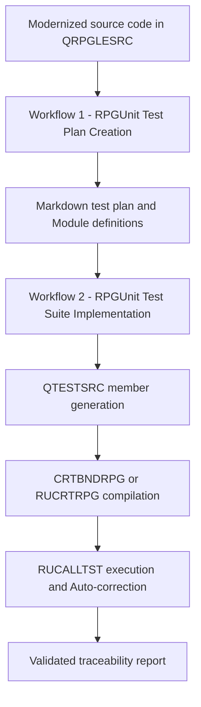
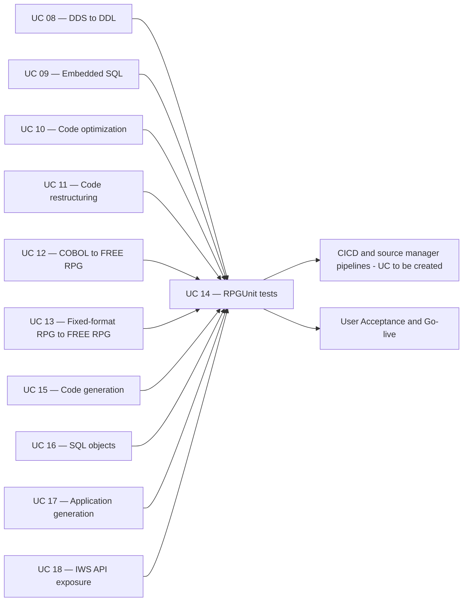

# UC 14 — Unit Test Development with RPGUnit

> **Category:** Testing & Quality Assurance — Non-regression
>
> **Position in the journey:** 14 — reusable validation mechanism after each workstream (UC 08 to UC 13, but also UC 15 to UC 17), not a single step in numeric order; main anchor in Phase 5 (Validation & Non-regression).
>
> **Recommended Bob mode:** IBM i Developer (program analysis, execution of the Premium RPGUnit workflows, generation of test suites in `**FREE`, `CRTBNDRPG` / `RUCRTRPG` compilation, `RUCALLTST` execution) → IBM i Database (checking the `QSYS2` catalogs, spool management via `SYSTOOLS.SPOOLED_FILE_DATA`, preparation of SQL test data). Without Premium Package: Ask for analysis/generation, Agent for compilation, execution and writing.

---

## ⭐ IBM i Premium Package used

- **Workflow: RPGUnit Test Plan Creation** (`ibmi_create_rpgunit_test_plan`) → [Official documentation](https://bob.ibm.com/docs/ide/premium-packages/bob-for-i/workflows)
  Analyzes the RPGLE / SQLRPGLE source members of a library, locates the entry points and exported procedures, and generates a structured set of test plan documents (module definitions, test suites, scenarios and shared test utilities).
  - **Launch:** **Start Workflow** button at the top of the chat → choose the workspace → **Start**. **Supported workspaces:** Local, Library List ([UC 00 §1.3](UC00-premium-package-ibmi-en.md)). **Mode:** IBM i Developer.
- **Workflow: RPGUnit Test Suite Implementation** (`ibmi_implement_rpgunit_test_plan`) → [Official documentation](https://bob.ibm.com/docs/ide/premium-packages/bob-for-i/workflows)
  Implements the planned unit test suites: generates the RPGUnit source code in `**FREE`, integrates the assertions and the lifecycle hooks (`setUp`, `tearDown`), compiles on the target IBM i and runs the tests with a correction loop for the detected errors.
  - **Launch:** **Start Workflow** button → **RPGUnit Test Suite Implementation**, after the *Test Plan Creation* workflow (prerequisite). **Supported workspaces:** Local, Library List ([UC 00 §1.4](UC00-premium-package-ibmi-en.md)). **Mode:** IBM i Developer.
- **Understand Dashboard** (optional, not ticked for this UC in [UC 00 §6](UC00-premium-package-ibmi-en.md); setup and tools: [UC 00 §2](UC00-premium-package-ibmi-en.md)) → [Official documentation](https://bob.ibm.com/docs/ide/premium-packages/bob-for-i/understand)
  *If Understand is installed.* Global structural analysis of the application scope:
  - **Mapping and impact analysis:** identify the call dependencies between programs to sequence the tests bottom-up (test the service modules before the calling programs).
  - **Access:** Command `vscode-ibmi-bob.openUnderstandDashboard`.
- **Auto-activated skills used (7 skills):**
  - **Unit tests (1 skill):** `rpgunit-testing` (structure of an RPGUnit suite, test case naming, `setup`/`teardown`, assertion API, test configuration).
  - **Diagnostics & debugging (2 skills):** `rpg-debugging-techniques`, `understand-impact-analysis`.
  - **Modern RPGLE & structures (4 skills):** `rpg-procedures-functions`, `rpg-file-operations`, `rpg-indicators`, `rpg-data-structures`.

> **Why this UC 14 provides unique methodological value:**
> The two Premium workflows *RPGUnit Test Plan Creation* and *RPGUnit Test Suite Implementation* are the direct accelerators for automating the design and implementation of tests. This UC 14 provides the methodological framework, governance and safeguards that are essential to make execution on the IBM i platform reliable:
> 1. Program qualification and splitting grid: SIMPLE (< 5 direct outputs), STANDARD (5–15 cases, DB state), COMPLEX (> 15 cases, `*SRVPGM` service modules), SQL (procedures & triggers) and BATCH (`SBMJOB`).
> 2. Conditional transactional isolation strategy: `SAVEPOINT` / `ROLLBACK TO SAVEPOINT` (supported when commitment control is active for the activation group; journaled tables and same activation group) vs. targeted `DELETE` by unique correlation key (timestamped prefix) if the tested program performs an internal `COMMIT`, if commitment control is not active or if the test library is not journaled. This cleanup is a risk-reduction measure, not a guarantee of isolation of all the side effects of the tested program: it remains partial when several tables are affected or in batch processing (see "Pitfalls to avoid").
> 3. Explicit handling of non-deterministic outputs: assert the shape (length, YYYYMMDD date format, non-empty) rather than a fluctuating fixed value.
> 4. Complete traceability manifest in each execution report (identification of the compiled object, creation date, RPGUnit version, execution job, exact spool) for audit compliance and future integration into a CI/CD pipeline (UC to be created).
> 5. Robust protocol for reading the test results in the spool via `QSYS2.JOB_NAME`, `QSYS2.OUTPUT_QUEUE_ENTRIES` and `SYSTOOLS.SPOOLED_FILE_DATA`.
> 6. Test source isolation policy: the test members are created exclusively in `QTESTSRC` within a dedicated test library (e.g. `[TEST_LIB_NAME]`), without polluting the production source files managed by the source manager (e.g. Git).

---

## Objective

Generate, compile, run and analyze **automated unit tests under RPGUnit** for the IBM i programs modernized during the project: optimized programs (UC 10), restructured programs (UC 11), converted programs (UC 12 COBOL, UC 13 fixed-format RPG), or generated programs (UC 15, UC 16, UC 17). This UC is replayed after each workstream: it is not conditioned on the completion of all the others.

This non-regression safety net formally demonstrates that the modernization has altered neither the business logic, nor the decision calculations, nor the error handling.

**What this UC enables:**
- Classifying the testability of programs and selecting the appropriate strategy according to the nature of the components.
- Using the Premium *RPGUnit Test Plan Creation* and *RPGUnit Test Suite Implementation* workflows to orchestrate the production of the tests.
- Generating RPGUnit test suites in fully free ILE RPGLE (`**FREE`) compliant with the standards of the target installation (`CRTBNDRPG` or `RUCRTRPG` / iRPGUnit).
- Defining exhaustive test procedures (`testCaseName`) covering nominal cases, boundary cases and error rejections.
- Managing data isolation via the lifecycle hooks (`setUp`, `tearDown`, `setUpSuite`, `tearDownSuite`).
- Automating the batch execution of the tests via a dedicated CL program (`[APP]TST`) and extracting the detailed execution reports from the IBM i spools.

**Main success criterion:** The test program compiles without errors in `QTESTSRC`, runs via `RUCALLTST`, validates all the assertions while limiting residual data (cleanup verified according to the test type: pure unit, database, or integration with side effects), and produces a timestamped traceability report attesting to the conformity of the modernized code.

---

## Prerequisites

- **Phase:** Phase 5 — Validation & Non-regression (cross-cutting mechanism, reusable after each workstream, including UC 15 to UC 17 of Phase 4)
- **Required previous UCs:**
  - **UC 01 — Connect Bob to the IBM i** (**mandatory**): active connection profile, access to the application and test libraries.
  - **UC 02 — Mastering Bob** (**mandatory**): use of the IBM i Developer mode.
  - **At least one completed modernization UC:** UC 10 (Optimization), UC 11 (Restructuring), UC 12 (COBOL→FREE), UC 13 (RPG→FREE), or UC 16 (SQL objects).
  - **UC 05 / UC 06** (**recommended**): program-understanding specifications and business rules serving as a reference for the assertions.
- **Required deliverables:**
  - `{appId}-restruct-{component}-diff-{YYYYMMDD-HHmm}.md` — UC 11 (if restructured program)
  - `{appId}-optim-{component}-diff-{YYYYMMDD-HHmm}.md` — UC 10 (if optimized program)
  - `{appId}-conv-rpg-{component}-diff-specs-{YYYYMMDD-HHmm}.md` and `{appId}-conv-rpg-{component}-diff-calc-{YYYYMMDD-HHmm}.md` — UC 13 (if converted RPG)
  - `{appId}-conv-cobol-{component}-diff-{YYYYMMDD-HHmm}.md` — UC 12 (if converted COBOL)
  - `{appId}-sql-{component}-{procedure|fonction|trigger}-{YYYYMMDD-HHmm}.md` — UC 16 (if SQL procedure/function/trigger)
  - `{appId}-comprehension-{component}-report-{YYYYMMDD-HHmm}.md` — UC 05 (recommended)
  - `{appId}-logique-{component}-regles-{YYYYMMDD-HHmm}.md` — UC 06 (recommended)
- **IBM i system prerequisites:**
  - The **RPGUnit / iRPGUnit** framework is installed on the IBM i system (`RPGUNIT` and `QDEVTOOLS` present in the Library List).
  - The test library (e.g. `[TEST_LIB_NAME]`, `FLGHT403` or `ACMETEST`) is created and accessible with compilation authority.
  - The `QTESTSRC` source file exists in the test library (distinct from `QRPGSRC` / `QRPGLESRC`).
- **Recommended Bob level:** Intermediate to Advanced
- **Estimated Bob Coins:** ⚠️ *To be calibrated after the UC 14 lab on FLGHT400.*

---

## Concrete example — FLGHT400 Lab

| Deliverable | Lab file | What it illustrates |
|---|---|---|
| RPGUnit test report | [`../labs_FLGHT400_results/FLGHT403_tests_RPGUnit.md`](../labs_FLGHT400_results/FLGHT403_tests_RPGUnit.md) | Summary of the setup of unit tests on the `FLGHT403` application: use of the `ibmi_create_rpgunit_test_plan` and `ibmi_implement_rpgunit_test_plan` workflows, detection of the candidate programs in `QRPGLESRC`, checking of the `RPGUNIT` and `QDEVTOOLS` libraries, and taking into account the absence of `*SRVPGM` (bound programs `CRTBNDRPG`). |
| RPGUnit conversational session | [`../labs_FLGHT400_results/FLGHT403_tests_RPGUnit_conversation.md`](../labs_FLGHT400_results/FLGHT403_tests_RPGUnit_conversation.md) | Step-by-step run of the two Premium test workflows, configuration of the templates, and generation of the traceability deliverables. |

---

## Starting a Bob session

### The three workspaces

To run UC 14, clearly set up the three workspaces:
- **Local workspace** (workstation) — assessment reports, scope test plans, traceability manifests and execution reports in Markdown format (`.md`).
- **IBM i Libraries / QSYS** ⭐ — **primary execution workspace**: source members of the tested program (`QRPGLESRC`), source members of the unit tests (`QTESTSRC`), test program objects (`*PGM` or `*SRVPGM`), compilation commands (`CRTBNDRPG`, `RUCRTRPG`), the `RUCALLTST` execution command, and test tables.
- **IFS Working Directory** — result spools, test plan configuration documents and exported execution reports.

> 💡 **Library List scope:** In Code for IBM i, check that the Library List contains the application library, the test library (`[TEST_LIB_NAME]`), as well as `RPGUNIT` and `QDEVTOOLS`.

---

## Premium Package accelerator — RPGUnit workflows (Recommended path)

The IBM i Premium Package includes two chained workflows dedicated to automating RPGUnit tests. **This tool-assisted workflow is the recommended method**:



### Step 1: Creating the test plan (`ibmi_create_rpgunit_test_plan`)
1. Launch the workflow via the **Start Workflow** button (Local or Library List workspace), then **RPGUnit Test Plan Creation** (identifier observed in the FLGHT400 lab: `ibmi_create_rpgunit_test_plan`). Select the target library and enter the output IFS folder.
2. Bob scans the active source library, inspects the RPGLE / SQLRPGLE members, and extracts the prototypes and exported procedures.
3. Select the programs or procedures to cover.
4. Bob generates the documentary structure of the test plan: module specification, associated test cases and shared test utilities.

### Step 2: Implementing and running the suite (`ibmi_implement_rpgunit_test_plan`)
1. Launch the **RPGUnit Test Suite Implementation** workflow (identifier observed in the FLGHT400 lab: `ibmi_implement_rpgunit_test_plan`) by selecting the plan documents generated in step 1, then confirm the library and the IFS folder and validate the environment.
2. Bob creates the skeleton of the test program in `QTESTSRC` with the appropriate copybooks, creates or updates the RPGUnit configuration file `testing.json`, and implements the assertions and the isolation routines.
3. Bob compiles the test program (`CRTBNDRPG` or `RUCRTRPG`), runs the `RUCALLTST` command on the IBM i, and analyzes the result.
4. In case of an assertion failure or a compilation error, Bob activates its correction loop (*self-healing*) to adjust the test code or flag the regression in the tested program.

---

## Structured approach and complementary prompts

When the Premium workflows must be completed by a tailor-made approach (complex programs with state dependencies, SQL stored procedures, triggers, global sequencing of an application or custom batch execution), use the prompt sequence below.

### Recommended progression by program category

| Step | Program type | Category | Recommended sequence |
|---|---|---|---|
| **1** | Simple optimized program (UC 10), direct calculations, < 5 outputs | **SIMPLE** | Prompt 0 → Prompt 1 → Prompt 1-bis (compilation) → Prompt 4 (execution) |
| **2** | Converted program (UC 12 COBOL / UC 13 RPG), multiple business rules | **STANDARD** | Prompt 0 → Prompt 1 per group of cases → Prompt 1-bis → Prompt 4 after each group |
| **3** | Program restructured into service modules (UC 11, `*SRVPGM`) | **COMPLEX** | Prompt 0 → Prompt 1 per exported procedure → Prompt 1-bis → Prompt 4 per procedure → Prompt 1 full flow → Prompt 4 |
| **4** | SQL stored procedure or trigger (UC 16) | **SQL** | Prompt 0 → Prompt 2 (SQL tests) → Prompt 1-bis → Prompt 4 |
| **5** | Full application portfolio / Batch automation | **SUITE** | Prompt 3 (global plan) → Prompt 5 (CL script `[APP]TST`) |

---

### Prompt 0 — Qualification and inventory of the test cases

**Objective:** Examine the modernized program, check the actual RPGUnit execution environment on the IBM i, classify the component and inventory all the necessary test cases.

**When to use:** Before any writing or implementation of a unit test.

**Required input:**
- Source of the modernized program in `[LIB_NAME]/QRPGLESRC([PGM_NAME])`.
- Modernization diff deliverable (`*-restruct-*-diff-*`, `*-conv-rpg-*-diff-*`, `*-conv-cobol-*-diff-*` or `*-optim-*-diff-*`).
- UC 05 understanding reports and UC 06 business rules (if available).

**Workspace:** Local (`bob-reports/`) for the qualification report, IBM i QSYS for consulting the catalogs.
**Mode:** IBM i Developer.
**Key skills used:** `rpgunit-testing`, `rpg-debugging-techniques`, `rpg-procedures-functions`, `rpg-data-structures`, `understand-impact-analysis`.

**Prompt:**

```text
The program [PROGRAM_NAME] in [LIB_NAME]/QRPGLESRC has been modernized as part of the project
(UC [UC_NO] — [MODERNIZATION_TYPE]).
[Load the *-diff-*.md deliverable and the UC 05 / UC 06 reports into the context]

Analyze this program and produce in English, in markdown, an assessment report
for the creation of RPGUnit unit tests:

## Qualification UC 14 — [PROGRAM_NAME]

### 1. Identification of the program and of the execution environment
| Indicator | Value |
|---|---|
| IBM i object type | *PGM / *SRVPGM |
| Program model | ILE (or residual OPM) |
| Activation group | Named / *CALLER / *NEW / DFTACTGRP(*NO) |
| *INLR handling | *INLR = *ON on exit / Persistence of memory state |
| Exported procedures (if *SRVPGM or ILE) | Exhaustive list of the procedures or NONE (*ENTRY only) |
| Interactive program (EXFMT) | YES (business logic isolable in procedures) / NO (pure batch or service) |
| Batch job submission (SBMJOB) | YES / NO |

Query QSYS2.OBJECT_STATISTICS and QSYS2.PROGRAM_INFO to confirm these characteristics.

### 2. Verification of the target RPGUnit environment
Identify the installed RPGUnit distribution and interface by querying the IBM i:
- [ ] RUCALLTST command available in the Library List
- [ ] Assertion copybook: exact name of the include (e.g. QRPGLESRC,CBRPGUNIT or RUTESTCASE)
- [ ] Required compilation command: CRTBNDRPG or RUCRTRPG; if the test source contains EXEC SQL, SQLRPGLE member type and mandatory SQL precompilation (CRTSQLRPGI, or RUCRTRPG with its precompiler options POPTION / COMPILEOPT) — to be confirmed on the target installation
- [ ] Object type generated for the test: *PGM or *SRVPGM
- [ ] Source file [TEST_LIB_NAME]/QTESTSRC accessible with creation authority
- [ ] Journaling active on the tables of [TEST_LIB_NAME] and commitment control active for the activation group (required for SAVEPOINT/ROLLBACK TO SAVEPOINT)
- [ ] Shared commitment control scope: Same job / Same activation group

### 3. Confirmed RPGUnit lifecycle interface
| Hook | Conventional name | Role | Available? |
|---|---|---|---|
| Before the whole suite | setUpSuite | Global initialization / Environment check | YES / NO / TO VERIFY |
| Before each test | setUp | Test data preparation / SAVEPOINT | YES / NO |
| After each test | tearDown | Cleanup / ROLLBACK TO SAVEPOINT or targeted DELETE | YES / NO |
| After the whole suite | tearDownSuite | Final safety cleanup | YES / NO / TO VERIFY |

### 4. Observable outputs and determinism
| Output | Nature (Returned parameter, updated table, spool, message) | Deterministic? | Assertion strategy |
|---|---|---|---|
| [Output name] | [Nature] | YES / NO | [Exact value if YES / Assert the shape, the format or the return code if NO] |

### 5. Inventory of the identifiable test cases
| Case no. | Test scenario | Input data | Expected output | Source business rule |
|---|---|---|---|---|
| 01 | Main nominal case | [Inputs] | [Expected output] | [UC 06 rule] |
| 02 | Boundary case / Limit | [Boundary inputs] | [Expected output] | [UC 06 rule] |
| 03 | Error case / Rejection | [Invalid inputs] | [Error code / Rejection] | [UC 06 rule] |

### 6. Categorization and recommended sequence
- [ ] SIMPLE (< 5 direct outputs, no persistent DB state)
- [ ] STANDARD (5 to 15 cases, DB data to inject)
- [ ] COMPLEX (> 15 cases, multi-procedure *SRVPGM)
- [ ] SQL (stored procedures or triggers)

Recommended sequence:
- SIMPLE   → Prompt 1 → Prompt 1-bis (compilation) → Prompt 4 (execution)
- STANDARD → Prompt 1 per group of cases → Prompt 1-bis → Prompt 4 per group
- COMPLEX  → Prompt 1 per exported procedure → Prompt 1-bis → Prompt 4 per procedure → Prompt 1 full flow → Prompt 4
```

**Deliverable produced:** `{appId}-test-{component}-analyse-{YYYYMMDD-HHmm}.md` (in `bob-reports/`).

---

### Prompt 1 — Generation of the RPGUnit test program (RPG programs)

**Objective:** Generate the complete source code of an RPGUnit test program in `**FREE` format for an RPG program or module.

**When to use:** After validation of the assessment report (Prompt 0).

**Required input:**
- Assessment report `{appId}-test-{component}-analyse-{YYYYMMDD-HHmm}.md`.
- Source code of the modernized program.

**Workspace:** Local (`bob-reports/`) for the documented version, then IBM i QSYS (`QTESTSRC`) during compilation.
**Mode:** IBM i Developer.
**Key skills used:** `rpgunit-testing`, `rpg-procedures-functions`, `rpg-file-operations`, `rpg-indicators`, `rpg-debugging-techniques`.

**Prompt:**

```text
Based on the assessment report [TEST_ANALYSIS_FILE_NAME]
for the program [PROGRAM_NAME] in [LIB_NAME]/QRPGLESRC,

The confirmed RPGUnit environment is:
- Assertion copybook: [COPYBOOK_NAME validated in Prompt 0]
- Target compilation type: [*PGM via CRTBNDRPG / *SRVPGM via RUCRTRPG / embedded SQL (EXEC SQL): SQLRPGLE member precompiled via CRTSQLRPGI (OBJTYPE *PGM or *MODULE) or RUCRTRPG with POPTION / COMPILEOPT — validated in Prompt 0]
- Isolation strategy: [SAVEPOINT/ROLLBACK TO SAVEPOINT if journaled and commitment control active / DELETE by unique timestamped correlation key otherwise]
- Test type: [pure unit without database / with database / integration with side effects — the cleanup below is only guaranteed within the journaled transactional scope]

Generate in fully free RPGLE (`**FREE`) the RPGUnit test program [PROGRAM_NAME]T covering the test cases [LIST_OF_CASES_OR_GROUP].

Mandatory structure of the test source member:

1. Control directives and Header
**FREE
CTL-OPT DFTACTGRP(*NO) ACTGRP('RPGUNIT') OPTION(*SRCSTMT : *NODEBUGIO);
/INCLUDE [RPGUNIT_LIB]/QRPGLESRC,[COPYBOOK_NAME]

2. Prototypes
- Prototype of the program or procedure to test (DCL-PR).
- Prototypes of the lifecycle hooks (setUpSuite, setUp, tearDown, tearDownSuite) and of the test procedures (DCL-PR test... EXPOBJ or exported).

3. Before-suite hook (setUpSuite — if supported)
- Check for the presence of the test library [TEST_LIB_NAME].
- Initialization of the unique correlation key prefix (e.g. timestamp in the format 'TEST_' + timestamp).

4. Before-each-test hook (setUp)
- Insertion of the test data needed for the current case.
- If journaling is active, commitment control is active and same activation group: EXEC SQL SAVEPOINT sp_rpgunit ON ROLLBACK RETAIN CURSORS;

5. Unit test procedures (one DCL-PROC subprocedure per test case)
For each case:
- Name: test[CaseName] (e.g. testCustomerDiscountCalculation, testUnknownItemCode).
- Initialization of the input parameters.
- Call of the tested program: CALLP or function call.
- Rigorous RPGUnit assertions (e.g. aEqual, aTrue, assert, aFailOnError depending on the confirmed API).
- For non-deterministic outputs (current date, numbering): assert non-emptiness and the structural format.

6. After-each-test hook (tearDown)
- Conditional cleanup (effective only if the tested program performs no internal COMMIT and stays within the same commitment control scope):
  a) If SAVEPOINT active: EXEC SQL ROLLBACK TO SAVEPOINT sp_rpgunit;
  b) Otherwise: EXEC SQL DELETE FROM [TEST_TABLE] WHERE TEST_KEY LIKE :gKeyPrefix;
- If the tested program writes to several tables or runs in batch (SBMJOB): clean each affected table and explicitly check for the absence of any lock or residual record (no automatic guarantee).

7. After-suite hook (tearDownSuite — if supported)
- Final safety purge of the data carrying the correlation key of the test session.

Generation rules:
- Code entirely written in **FREE, indented by 2 spaces.
- Explanatory comments in English above each test procedure.
- Do not group unrelated assertions in the same test case.
- Do not invent a BIF or RPGUnit function not attested in the copybook.
```

**Deliverable produced:** `{appId}-test-{component}-code-{YYYYMMDD-HHmm}.md` (in `bob-reports/`).

---

### Prompt 1-bis — Compilation test of the RPGUnit test program

**Objective:** Write the generated source member into the `QTESTSRC` test source file and run the compilation on the IBM i without launching the tests.

**When to use:** Immediately after the generation of the test code (Prompt 1 or Prompt 2).

**Required input:**
- Source code generated in Prompt 1.
- Target test library `[TEST_LIB_NAME]`.

**Workspace:** IBM i QSYS (`[TEST_LIB_NAME]/QTESTSRC([PGM_NAME]T)`).
**Mode:** IBM i Developer (or Agent).
**Key skills used:** `rpgunit-testing`, `rpg-procedures-functions`, `rpg-debugging-techniques`.

**Prompt:**

```text
The RPGUnit test program [PROGRAM_NAME]T has just been validated.
The confirmed compilation command is [CRTBNDRPG / RUCRTRPG / CRTSQLRPGI if the source contains EXEC SQL].

1. Create or replace the source member in [TEST_LIB_NAME]/QTESTSRC, member [PROGRAM_NAME]T, with the generated RPGLE code.
(Make sure to target QTESTSRC and never the production source file QRPGLESRC).

2. Run the appropriate compilation command:

[IF CRTBNDRPG — Standalone test program]
CRTBNDRPG PGM([TEST_LIB_NAME]/[PROGRAM_NAME]T)
          SRCFILE([TEST_LIB_NAME]/QTESTSRC)
          SRCMBR([PROGRAM_NAME]T)
          OPTION(*EVENTF)
          OUTPUT(*PRINT)
          DBGVIEW(*SOURCE)
          DFTACTGRP(*NO)
          ACTGRP(RPGUNIT)

[IF RUCRTRPG — iRPGUnit framework / *SRVPGM]
RUCRTRPG TSTPGM([TEST_LIB_NAME]/[PROGRAM_NAME]T)
         SRCFILE([TEST_LIB_NAME]/QTESTSRC)
         SRCMBR([PROGRAM_NAME]T)

[IF embedded SQL (EXEC SQL) — SQLRPGLE member type, SQL precompilation mandatory]
CRTBNDRPG does not precompile SQL: use CRTSQLRPGI instead of CRTBNDRPG
CRTSQLRPGI OBJ([TEST_LIB_NAME]/[PROGRAM_NAME]T)
           SRCFILE([TEST_LIB_NAME]/QTESTSRC)
           SRCMBR([PROGRAM_NAME]T)
           OBJTYPE(*PGM)
           OPTION(*EVENTF)
           OUTPUT(*PRINT)
           DBGVIEW(*SOURCE)
or, with the iRPGUnit framework, RUCRTRPG passing the precompiler options (POPTION) and compiler options (COMPILEOPT); options to be confirmed in Prompt 0 on the target installation.

3. Analyze the compilation result and produce in English:
- Overall status: COMPILATION SUCCESSFUL or COMPILATION ERRORS.
- If errors: table of the anomalies (Line, Message code, Description, Probable cause).
  Check as a priority:
  - The accessibility of the RPGUnit copybook in the Library List.
  - The conformity of the DCL-PR prototype parameters with the tested program.
  - The declaration of all the SQL host variables (DCL-S).
  - For a source with EXEC SQL: SQLRPGLE member type and SQL precompilation actually performed (no direct compilation via CRTBNDRPG).
- If successful: confirm the creation of the object ([TEST_LIB_NAME]/[PROGRAM_NAME]T of type *PGM or *SRVPGM).
```

**Deliverable produced:** Compilation report in the chat and update of the test status.

---

### Prompt 2 — Generation of the tests for SQL stored procedures and triggers (UC 16)

**Objective:** Generate an RPGUnit test program integrating embedded SQL to validate a Db2 for i SQL PL stored procedure or trigger.

**When to use:** To validate the SQL objects coming from UC 16.

**Required input:**
- UC 16 deliverables (`*-sql-*-procedure-*.md`, `*-sql-*-fonction-*.md` or `*-sql-*-trigger-*.md`).
- Db2 system catalog (`QSYS2.SYSROUTINES` or `QSYS2.SYSTRIGGERS`).

**Workspace:** Local (`bob-reports/`) for the trace, IBM i QSYS for the target.
**Mode:** IBM i Developer.
**Key skills used:** `rpgunit-testing`, `db2-stored-procedures`, `rpg-procedures-functions`, `rpg-debugging-techniques`.

**Prompt:**

```text
Based on the SQL specifications of the object [SQL_OBJECT_NAME] in [LIB_NAME]
(UC 16 deliverable files),
and according to the RPGUnit environment confirmed in Prompt 0:

Generate in fully free RPGLE with embedded SQL (`**FREE`) the RPGUnit test program [SQL_OBJECT_NAME]T.

The test program must cover:
1. Declarations
- Standard RPGUnit copybook.
- SQL host variables (DCL-S) matching exactly the IN, OUT and INOUT parameters of the procedure.
- SQL control variables: SQLCODE, SQLSTATE.

2. Before-each-test hook (setUp)
- Insertion of the required record sets into [TEST_LIB_NAME].
- Initialization of the SQL procedure parameters.
- Definition of a SAVEPOINT if journaled, or assignment of a unique correlation key.

3. Test scenarios
- Nominal case: Execution of the statement `EXEC SQL CALL [LIB_NAME].[SQL_OBJECT_NAME](:param1, :param2, ...);`
  - Assertion SQLCODE = 0 (success).
  - Assertions on the values returned in the OUT / INOUT parameters.
- Handled error case: Call with invalid data
  - Assertion on the expected return code (e.g. SQLCODE = -803 for key violation or a specific SQLSTATE).
- Trigger cases (if applicable):
  - Execution of the triggering DML operation (INSERT/UPDATE/DELETE).
  - Verification of the side effect (update of a computed column, insertion into an audit table, etc.).

4. After-each-test hook (tearDown)
- Conditional cleanup via ROLLBACK TO SAVEPOINT or DELETE targeted by key (partial in case of internal COMMIT, several tables or batch processing: clean each affected table and verify it).

Produce the complete source code (SQLRPGLE member type, SQL precompilation required) ready to be compiled via CRTSQLRPGI, or via RUCRTRPG with its precompiler options (POPTION / COMPILEOPT) according to the environment confirmed in Prompt 0.
```

**Deliverable produced:** `{appId}-test-{component}-sql-code-{YYYYMMDD-HHmm}.md`.

---

### Prompt 3 — Test plan for a full application scope

**Objective:** Establish an ordered matrix of all the unit tests to be performed on a complete application, taking the call dependencies into account.

**When to use:** When preparing the global non-regression phase of a project.

**Required input:**
- Understand Dashboard application mapping or UC 07 architecture report.
- Diff deliverables of all the modernized programs of the scope.

**Workspace:** Local (`bob-reports/`).
**Mode:** IBM i Developer.
**Key skills used:** `rpgunit-testing`, `understand-impact-analysis`, `rpg-debugging-techniques`.

**Prompt:**

```text
Based on all the modernization deliverables of the application [APPLICATION_NAME] in [LIB_NAME]
(UC 10, UC 11, UC 12, UC 13 diff files and UC 16 SQL objects available),

Generate in English, in markdown, the global integration and non-regression test plan:

## Unit Test Plan — Application [APPLICATION_NAME]

### 1. Matrix of the programs to test and sequencing
| Execution order | Program / Module | Type (*PGM, *SRVPGM, SQL) | Source UC | No. of test cases | Upstream dependencies | Priority |
(Sequencing rule: test the service modules and independent subprograms first, then move up to the orchestrator programs and the batch flows).

### 2. Test data strategy and isolation
For each functional group:
- Db2 tables impacted.
- Isolation mode selected (transactional SAVEPOINT / DELETE by timestamped correlation key).
- Data sensitivity (need for prior anonymization if extracted from production).

### 3. Programs excluded or subject to conditions
Identify the interactive programs (5250) that cannot be tested in headless mode whose logic has not been extracted, or the programs depending on external hardware, with the justification.

### 4. Automation schedule
Scheduling of the execution of the [APPLICATION_NAME]TST batch suite and global validation criteria.
```

**Deliverable produced:** `{appId}-test-{appId}-plan-{YYYYMMDD-HHmm}.md` (in `bob-reports/`).

---

### Prompt 4 — Test execution and results report

**Objective:** Run the RPGUnit test suite on the IBM i, capture the actual results from the job spool via the Db2 for i SQL services, and draw up the execution summary.

**When to use:** After successful compilation of the test program (Prompt 1-bis).

**Required input:**
- Compiled test program `[TEST_LIB_NAME]/[PGM_NAME]T`.
- Test assessment report.

**Workspace:** IBM i QSYS for the execution, then local workspace (`bob-reports/`) for the test report.
**Mode:** IBM i Developer.
**Key skills used:** `rpgunit-testing`, `rpg-debugging-techniques`, `rpg-procedures-functions`.

**Prompt:**

```text
The RPGUnit test program [PROGRAM_NAME]T is compiled in the library [TEST_LIB_NAME].

Step A — Preparing the traceability (memorizing the execution context):
Run the following queries to record the current job and the initial timestamp:
VALUES QSYS2.JOB_NAME;
VALUES CURRENT_TIMESTAMP;

Step B — Launching the RPGUnit execution:
Run the test command:
RUCALLTST TSTPGM([TEST_LIB_NAME]/[PROGRAM_NAME]T)
          OUTPUT(*SYSOUT)
          DETAIL(*ALL)

Step C — Precisely locating the report spool:
Query the job's output queue to identify the spool created after the initial timestamp:
SELECT SPOOLED_FILE_NAME, FILE_NUMBER, CREATE_TIMESTAMP
FROM QSYS2.OUTPUT_QUEUE_ENTRIES
WHERE JOB_NAME = '[QUALIFIED_JOB_NAME]'
  AND CREATE_TIMESTAMP >= [INITIAL_TIMESTAMP]
ORDER BY CREATE_TIMESTAMP DESC;

Step D — Extracting the content of the test report:
SELECT SPOOL_DATA
FROM TABLE(SYSTOOLS.SPOOLED_FILE_DATA(
  JOB_NAME            => '[QUALIFIED_JOB_NAME]',
  SPOOLED_FILE_NAME   => '[SPOOL_NAME_FOUND]',
  SPOOLED_FILE_NUMBER => [SPOOL_NUMBER]
)) AS T;

Step E — Analysis and writing of the deliverable:
Analyze the lines of the report and generate in English, in markdown, the execution report:

# RPGUnit Execution Report — [PROGRAM_NAME]

## 1. Overall summary
- Result: [TOTAL] tests | [PASSED] passed | [FAILED] failed | [ERROR] errors
- Overall status: [VALIDATED / NOT VALIDATED / PARTIALLY VALIDATED]

## 2. Test case details
| No. | Test procedure | Status | Result obtained vs. expected | Diagnosis / Business rule |
|---|---|---|---|---|
| 01 | testCaseName | PASSED / FAILED | ... | ... |

## 3. Failure analysis (if applicable)
For each FAILED or ERROR:
- Precise description of the discrepancy.
- Location (regression in the modernized code or defect in the test assertions).
- Corrective action recommendation (return to the source modernization UC).

## 4. Traceability manifest (Mandatory)
- Tested object: [LIB_NAME]/[PROGRAM_NAME] (*PGM / *SRVPGM)
- Source of the tested program: [LIB_NAME]/QRPGLESRC([PROGRAM_NAME])
- Test source: [TEST_LIB_NAME]/QTESTSRC([PROGRAM_NAME]T)
- Execution job: [QUALIFIED_JOB_NAME]
- Spool file: [SPOOL_NAME] (No. [SPOOL_NUMBER])
- Execution timestamp: [CURRENT_TIMESTAMP]
- RPGUnit version: [Identified version]
- Reference diff deliverable: [*-diff-*.md used]
```

**Deliverable produced:** `{appId}-test-{component}-rapport-{YYYYMMDD-HHmm}.md` (in `bob-reports/`).

---

### Prompt 5 — Test suite automation (Batch regression CL script)

**Objective:** Generate a batch CL program orchestrating the sequential execution of all the RPGUnit test programs of an application and recording the final status.

**When to use:** When all the individual test programs of an application scope are validated.

**Required input:**
- Scope test plan `{appId}-test-{appId}-plan-{YYYYMMDD-HHmm}.md`.
- List of the compiled test programs `[PGM_NAME]T`.

**Workspace:** IBM i QSYS (`[TEST_LIB_NAME]/QCLSRC([APP_NAME]TST)`).
**Mode:** IBM i Developer.
**Key skills used:** `cl-programming`, `cl-best-practices`, `rpg-debugging-techniques`.

**Prompt:**

```text
Based on the test plan [TEST_PLAN_FILE_NAME] for the application [APPLICATION_NAME] in [TEST_LIB_NAME],

Generate in modern IBM i CL (ILE CLLE) the test suite automation program [APPLICATION_NAME]TST.

The CL program must:
1. Header and Declarations
- Declaration of the control variables (DCL VAR(&NB_FAIL) TYPE(*DEC) LEN(5 0) VALUE(0)).
- Configuration of the execution Library List (ADDLIBLE for [LIB_NAME], [TEST_LIB_NAME], RPGUNIT, QDEVTOOLS with MONMSG CPF2103).

2. Sequential execution of the tests
For each test program of the suite ([PGM1]T, [PGM2]T, ...):
- Sending of an informational message: SNDPGMMSG MSG('Running the tests for [PGM1]...').
- RPGUnit call:
  RUCALLTST TSTPGM([TEST_LIB_NAME]/[PGM1]T) OUTPUT(*SYSOUT) DETAIL(*ALL)
  MONMSG MSGID(RUC0000 CPF0000) EXEC(DO)
    CHGVAR VAR(&NB_FAIL) VALUE(&NB_FAIL + 1)
    SNDPGMMSG MSGID(CPF9898) MSGF(QCPFMSG) MSGDTA('Failure detected on ' *CAT '[PGM1]T') MSGTYPE(*DIAG)
  ENDDO

3. Execution summary and notification
- If &NB_FAIL = 0: Send the normal completion message (*COMP) 'TEST SUITE SUCCESSFULLY VALIDATED'.
- If &NB_FAIL > 0: Send an escape message (*ESCAPE) reporting the number of failures detected.

Generate the complete CL source ready to be written to [TEST_LIB_NAME]/QCLSRC([APPLICATION_NAME]TST) and compiled via CRTBNDCL.
```

**Deliverable produced:** `{appId}-test-{appId}-suite-cl-{YYYYMMDD-HHmm}.md` (in `bob-reports/`).

---

## Deliverables of this UC

| Produced file | Naming pattern | Storage workspace | Consumed by |
|---|---|---|---|
| Assessment report | `{appId}-test-{component}-analyse-{YYYYMMDD-HHmm}.md` | `bob-reports/` (Local) | Prompts 1, 2, 4 |
| Documented RPGUnit source | `{appId}-test-{component}-code-{YYYYMMDD-HHmm}.md` | `bob-reports/` (Local) | Prompt 1-bis, Review |
| Compiled RPGUnit source member | `[PGM_NAME]T` | `[TEST_LIB_NAME]/QTESTSRC` (IBM i QSYS) | Prompt 4, Prompt 5, CI/CD |
| Scope test plan | `{appId}-test-{appId}-plan-{YYYYMMDD-HHmm}.md` | `bob-reports/` (Local) | Prompt 5, Project steering |
| Execution & traceability report | `{appId}-test-{component}-rapport-{YYYYMMDD-HHmm}.md` | `bob-reports/` (Local) | CI/CD pipeline (UC to be created), Validation |
| Batch suite CL program | `[APP_NAME]TST` | `[TEST_LIB_NAME]/QCLSRC` (IBM i QSYS) | Batch automation, CI/CD |

---

## Dependencies



---

## Pitfalls to avoid

| Pitfall | Consequence | How to avoid it |
|---|---|---|
| Assuming the name of the copybooks or assertion macros from memory | Immediate compilation errors (`RNF7030` undefined symbol): the classic, iRPGUnit and custom distributions use distinct copybooks (`CBRPGUNIT`, `RUTESTCASE`, etc.). | Run Prompt 0 without fail to inspect the members installed in the actual RPGUnit library before generating the code. |
| Generating hook names not supported by the installed distribution | The program compiles without errors, but the `setUpSuite`/`tearDownSuite` procedures never run, leaving silent residual data. | Check the hook table in Prompt 0. If the suite hook is not supported, move the initialization logic into the individual `setUp`. |
| Using `SAVEPOINT` / `ROLLBACK TO SAVEPOINT` without active commitment control, on non-journaled tables or with distinct activation groups | `SAVEPOINT` not allowed (commitment control inactive), `ROLLBACK` failure or `SQL7008` exception: the test tables are not reset and the following tests are polluted. | Check that journaling and commitment control are active in Prompt 0. If either is absent, switch without fail to strategy B (`DELETE` by unique timestamped correlation key). |
| Asserting an exact value on non-deterministic outputs | Intermittent failures and false positives: a field containing today's date or an incremented number changes with each execution. | Assert the structure and shape (non-empty field, conforming length, valid `YYYYMMDD` date format) rather than a constant value. |
| Declaring a program with an internal `COMMIT` as "not testable" | Unjustified blocking of test automation on IBM i batch programs. | Adopt strategy B: the internal `COMMIT` makes the `SAVEPOINT` inoperative beyond that point; the targeted `DELETE` with a session key limits residual data but does not rule it out (effects on several tables, batch): clean each affected table and verify the absence of residual data; treat these cases as integration tests with side effects. |
| Retrieving the result spool without strict filtering by qualified job and timestamp | Erroneous analysis of an obsolete test report or one coming from another user in a concurrent session. | Systematically capture `QSYS2.JOB_NAME` and `CURRENT_TIMESTAMP` before `RUCALLTST`, then filter `QSYS2.OUTPUT_QUEUE_ENTRIES` by these strict criteria. |
| Writing the test members in `QRPGLESRC` in a production library | Pollution of the production source repositories and interference with the source manager (e.g. Git). | Write exclusively in the `QTESTSRC` source file within the dedicated test library (`[TEST_LIB_NAME]`). |

---

## UC 14 validation checklist

Before declaring an RPGUnit unit test suite validated or promoting the modernized code to integration, check each point:

- [ ] **Environment audited (Prompt 0):** The `RPGUNIT` and `QDEVTOOLS` libraries are present in the `*LIBL`, the copybook and the compilation commands (`CRTBNDRPG` / `RUCRTRPG`) are confirmed.
- [ ] **Strict library separation:** The test source is written in `[TEST_LIB_NAME]/QTESTSRC([PGM]T)` and never in the production source libraries.
- [ ] **Isolation strategy applied:** The `setUp` and `tearDown` hooks aim to reset the test tables (via `SAVEPOINT` / `ROLLBACK TO SAVEPOINT` if commitment control is active, or `DELETE` by unique correlation key), to be checked according to the test type (pure unit, database, integration with side effects) and in case of internal `COMMIT`, several tables or batch.
- [ ] **Non-deterministic outputs secured:** The dynamically computed fields (dates, counters) are asserted on their shape and not on frozen values.
- [ ] **Successful compilation (Prompt 1-bis):** The test program compiles without errors or blocking warnings (`*PGM` or `*SRVPGM` created in `[TEST_LIB_NAME]`).
- [ ] **Execution validated (Prompt 4):** All the test cases pass (`0 FAILED`, `0 ERROR`) on the `RUCALLTST` call.
- [ ] **Complete traceability:** The execution report records the full manifest (tested object, compilation source, qualified job, spool number, timestamp).
- [ ] **Batch automation ready (Prompt 5):** The CL script `[APP]TST` is generated and tested to replay all the suites in batch without interactive intervention.
