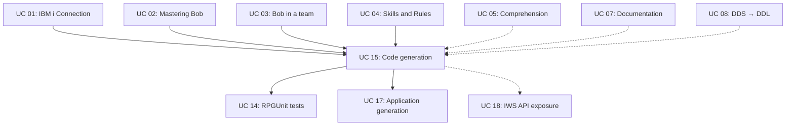

# UC 15 — Code generation

> **Category:** Development — Code generation (Track B)
>
> **Position in the journey:** 15 — Phase 4 (Track B), can run in parallel with UC 16 (SQL objects) on different objects, after the comprehension and documentation UCs (UC 05 to UC 07) on the same scope.
>
> **Recommended Bob mode:** IBM i Developer (qualification, `**FREE` generation, writing of the member, `CRTBNDRPG` / `CRTSQLRPGI` compilation, `/review_rpg` review) → IBM i Database (checking the tables and columns via `QSYS2` before generating the `DCL-F` / `DCL-DS`). Without Premium Package: Ask for qualification and generation, Agent for writing and compilation.

---

## ⭐ IBM i Premium Package used

There is **no one-click Premium workflow** for *ex nihilo* code generation (UC00 §6 lists neither a workflow nor a slash command for this UC: `/init` and `/review_rpg` below are usage complements specific to this sheet). The 71 IBM i skills are activated automatically according to the context; the Premium elements below speed up generation without replacing it. IBM i tools, documentation search (RAG) and safeguards: see UC00 §5.

- **Auto-activated skills used (9 skills):**
  - **Modern RPGLE (4 skills):** `rpg-free-format-fundamentals`, `rpg-procedures-functions`, `rpg-data-structures`, `rpg-file-operations`.
  - **ILE and system APIs (2 skills):** `rpg-ile-understanding` (modules, service programs, binding), `rpg-api`.
  - **CL and DDS (2 skills):** `cl-programming`, `dds-physical-files`.
  - **Embedded SQL (1 skill, if the program contains SQL):** `rpg-embedded-sql`.
- **Slash Command: `/init`** → [Official documentation](https://bob.ibm.com/docs/ide/premium-packages/bob-for-i/slash-commands)
  Generates the application's `AGENTS.md` (ILE architecture, observed naming conventions, standards); official locations: `{LIBRARY}/QBOBSRC/AGENTS.MD` (QSYS workspace) or `{IFS directory}/.bob/AGENTS.md` (IFS workspace) — see UC00 §0 and §3.1. This `AGENTS.md` is the **reference source of the conventions** that Bob applies to each generation (see UC 02 / UC 03).
- **Slash Command: `/review_rpg`** → [Official documentation](https://bob.ibm.com/docs/ide/premium-packages/bob-for-i/slash-commands)
  **Complementary** quality control **after generation** (obsolete opcodes, error handling, security, performance). Replaces neither human validation nor functional testing.
- **Understand (optional)** → [Official documentation](https://bob.ibm.com/docs/ide/premium-packages/bob-for-i/understand)
  *If Understand is installed* (setup, `understand_*` tools and `understand-*` skills: see UC00 §2). Useful for identifying callers/callees before freezing an interface (signature of a service module, Prompt 5). This UC is not marked ✅ Understand in UC00 §6.

> **Why this UC 15 provides unique methodological value:**
> Generating new code has no prior behavior to preserve, but the functional, transactional and data integrity risk remains intact. Bob does not know the company's standards: without framing, it applies its default conventions. This UC provides:
> 1. **The company's coding standards made executable:** naming conventions, header, `CTL-OPT`, data types, forbidden opcodes, injected into Bob via the *rules* of the IBM i Developer mode and the `AGENTS.md` (Prompt 1).
> 2. **An anti-hallucination qualification:** no file, table, column, copybook or command is assumed — everything is verified on the IBM i before the first generated line (Prompt 0).
> 3. **A two-pass generation** (skeleton then logic) validated by the team before any write to the IBM i (Prompts 2 and 3).
> 4. **The generation of ILE service modules** with shared prototypes and copybooks, to put an end to prototypes copied program by program (Prompt 5).
> 5. **A write safeguard:** check that the member does not exist before writing, compilation, then review (Prompt 4).

> ⚠️ **"ACME Developer" custom mode vs. IBM i Developer:** the POC position (UC 03, UC 04) is **not to create a mode competing with IBM i Developer** — a custom mode does not automatically inherit the Premium tools — but to **inject the ACME standards via rules** (`.bob/rules-ibm-i-developer/`) and via the `AGENTS.md`. Prompt 1 applies this approach; the "custom mode" variant is kept as an option in that same prompt.

---

## Objective

Generate **`**FREE` RPG ILE programs, procedures and ILE service modules** compliant with the company's development standards, from a functional description — with no source to migrate or modernize.

**What this UC enables:**
- Qualifying the need and the real environment (libraries, source files, existing objects, compilation commands) without any assumption.
- Turning the company's coding standards into instructions Bob can act on (rules + `AGENTS.md`).
- Generating SIMPLE and STANDARD programs, then ILE service modules with shared prototypes and copybooks.
- Writing the source member and compiling on the IBM i under the team's control, without overwriting an existing member.
- Steering an application scope with a prioritized generation plan.

**Main success criterion:** each generated program complies with the company's standards (validated by a developer), uses only objects verified on the IBM i, compiles without errors in the development library and has been run on a nominal case with representative data.

---

## Prerequisites

- **Phase:** Phase 4 — Track B (Generation)
- **Required previous UCs:**
  - **UC 01 — Connect Bob to the IBM i** (**mandatory**): active connection, rights to create members and compile in the development library.
  - **UC 02 — Mastering Bob** (**mandatory**): IBM i Developer mode, `/init`.
  - **UC 03 — Bob in a team** and **UC 04 — Skills and Rules strategy** (**mandatory**): location and structure of the rules (`.bob/rules-ibm-i-developer/`), shared `AGENTS.md`.
  - **UC 05 / UC 07** (**recommended**): comprehension and specifications of the application the program fits into.
  - **UC 08 — DDS → DDL** (**recommended**): up-to-date DDL to generate consistent `DCL-F` / `DCL-DS`.
- **Required deliverables:**
  - Company development standards, **at a minimum**: naming conventions, standard header, preferred data types, compilation options. If missing, Prompt 1 extracts them from existing programs.
  - `{appId}-doc-spec-fonc-{component}-{YYYYMMDD-HHmm}.md` and `{appId}-doc-spec-tech-{component}-{YYYYMMDD-HHmm}.md` — UC 07 (recommended).
  - `{appId}-ddl-{appId}-complet-{YYYYMMDD-HHmm}.md` — UC 08 (recommended if the program accesses tables).
- **IBM i system prerequisites:**
  - Development library identified (e.g. `[LIB_NAME]`) and existing source files (e.g. `QRPGLESRC`, `QSRVSRC`, `QCLSRC`) — **to be confirmed in Prompt 0**, never assumed.
- **Recommended Bob level:** Intermediate
- **Estimated Bob Coins:** ⚠️ *To be calibrated after the UC 15 lab on FLGHT400.*

---

## Concrete example — FLGHT400 Lab

> ⚠️ The FLGHT400 lab does not yet contain an *ex nihilo* generation result. The two deliverables below illustrate the two ingredients of this UC: the **conventions to inject** and the **propagation of new code into an existing application**. A full generation example remains to be produced during the UC 15 lab.

| Deliverable | Lab file | What it illustrates |
|---|---|---|
| `AGENTS.md` generated by `/init` | [`../labs_FLGHT400_results/FLGHT403_AGENTS.md`](../labs_FLGHT400_results/FLGHT403_AGENTS.md) | Conventions actually observed on `FLGHT403`: members modernized to `**FREE`, `CTL-OPT DFTACTGRP(*NO)` and `OPTION(*NODEBUGIO:*SRCSTMT)`, `QUALIFIED` program-information DS, indicators replaced by `IND` variables. It also highlights the **absence of a shared copybook** (function key constants and API prototypes redeclared in each program) — exactly what the rules and Prompt 5 of this UC correct for new code. |
| Cross-layer evolution report | [`../labs_FLGHT400_results/FLGHT403_Change_Total_Flight_Hours.md`](../labs_FLGHT400_results/FLGHT403_Change_Total_Flight_Hours.md) | Addition of the `FLHRS` field across PF, LF, DSPF and RPG program, with a strict compilation order and validation per layer. Reference for the "Advanced case" of this UC. |

---

## Starting a Bob session

### The three workspaces

- **Local workspace** (workstation) — assessment reports, documented source, generation plan (`bob-reports/`), **ACME rules** (`.bob/rules-ibm-i-developer/`).
- **IBM i Libraries / QSYS** ⭐ — **primary execution workspace**: generated source members (`QRPGLESRC`, `QSRVSRC`), compiled objects, tables queried to verify the interfaces. The project's `AGENTS.md` (`{LIBRARY}/QBOBSRC/AGENTS.MD`) is injected there automatically.
- **$HOME IFS** — copies of deliverables or API sources if the project is structured in the IFS.

> ⚠️ **Rules and QSYS workspace:** when the active workspace is *IBM i Libraries* alone, the local workspace and its `.bob/` are **not loaded** (see UC 03). For the standards to apply in all cases, declare them **also** in the application's `AGENTS.md` ("Coding standards" section) — this is what Prompt 1 does.

### Session rules

- **One new Bob conversation per program:** prevents the structures and conventions of one program from contaminating the next. Exception: chaining two programs of the same domain sharing the same data structures.
- **Load the context before Prompt 0:** `AGENTS.md` (generated by `/init`), UC 07 specifications, UC 08 DDL.
- **Session resumption:** reload the latest `{appId}-gen-{component}-code-*.md` and state "the current source is in [FILE] — resume at Prompt [N]".
- **Golden rule:** during Prompts 0 to 3, Bob produces **in the chat only**. Writing to the IBM i is allowed only at Prompt 4, after explicit validation by the team.

---

## Structured approach and prompts

### Recommended progression by category

Complexity is measured in **program type and number of interfaces** (files, parameters, external calls), not in lines of code. Start with a **simple utility program** (< 100 lines) whose compliance with the standards a developer can validate immediately: this first generation serves to calibrate the fidelity of the rules.

| Step | Program type | Category | Recommended sequence |
|---|---|---|---|
| **1** | Stateless utility or service, 1 to 3 parameters, no file | **SIMPLE** | Prompt 0 → (Prompt 1 if standards missing) → Prompt 2 → Prompt 3 → Prompt 4 |
| **2** | Batch with 1 to 3 files, CRUD logic, parameter validation | **STANDARD** | Prompt 0 → Prompt 2 (header, DCL) → Prompt 3 (logic) → Prompt 4 |
| **3** | Reusable logic called by several programs | **SERVICE** | Prompt 0 → Prompt 5 (module + prototypes + copybook) → Prompt 4 |
| **4** | Interactive 5250 / web program, several related files | **COMPLEX** | Prompt 0 → business logic in procedures (Prompts 2-3); screen/web interface → **UC 17** |
| **5** | Full application scope | **PLAN** | Prompt 6 (generation plan) |

---

### Prompt 0 — Qualification of the environment and of the program to generate

**Objective:** Translate the functional need into a technical category, check the real environment and interfaces on the IBM i, and list the available standards.

**When to use:** Before any generation, for each program. Its result determines the following sequence.

**Required input:**
- Project `AGENTS.md` (via `/init`) and development standards if available.
- UC 07 specifications and UC 08 DDL (if available).
- Description of the need in business terms.

**Workspace:** Local (`bob-reports/`) for the report, IBM i QSYS for the checks.
**Mode:** IBM i Developer (IBM i Database for the catalog queries).
**Key skills used:** `rpg-free-format-fundamentals`, `rpg-ile-understanding`, `rpg-file-operations`, `rpg-data-structures`.

**Prompt:**

```text
I need to generate a new program for [LIB_NAME].

Functional need (in business terms, not technical): [BUSINESS_DESCRIPTION]
[Load into the context: project AGENTS.md, UC 07 specifications, UC 08 DDL if available]

Do not invent any object. Every file, table, column, program, copybook, source file
or command cited must be verified on the IBM i (QSYS2, IBM i tools) before appearing in the report.
If an item cannot be verified, write "NOT VERIFIED" — do not deduce it.

Produce in English, in markdown, an assessment report:

## Qualification UC 15 — [TARGET_PROGRAM_NAME]

### 1. Verified environment
| Item | Verified value | Verification method |
|---|---|---|
| Development library | ? | |
| RPG source file (QRPGLESRC or other) | ? | |
| Module / binder source file (QSRVSRC) | ? / NONE | |
| Does an object with the target name already exist (source or object)? | YES / NO | |
| Compilation command to use (CRTBNDRPG / CRTSQLRPGI / CRTRPGMOD) | ? | |
| Existing shared copybooks (prototypes, constants) | list / NONE | |
| Existing binding directory / service programs | list / NONE | |

### 2. Available coding standards
| Area | Source of the standard (AGENTS.md / rules / document / NONE) | Value |
|---|---|---|
| Naming (variables, DS, procedures, parameters, programs) | | |
| Documentation header | | |
| CTL-OPT / activation group | | |
| Preferred data types | | |
| Error handling | | |
| File access (RLA / embedded SQL) | | |
| Forbidden opcodes | | |
If a line is "NONE": recommend Prompt 1 before any generation.

### 3. Analysis of the need
| Criterion | Detected value |
|---|---|
| Type (utility / service / batch / interactive) | ? |
| Input and output parameters (type, length) | ? |
| Files or tables accessed (verified names) | ? |
| External calls (CALLP to other programs or APIs) | YES / NO — which ones |
| User interface (screen, web) | YES / NO |

### 4. Verified interfaces
For each table or file: columns, types, lengths actually read from QSYS2.SYSCOLUMNS.
Then list the DCL-F and DCL-DS that the program will require.

### 5. Recommended category
- [ ] SIMPLE   — stateless utility / service, 1-3 parameters, no file
- [ ] STANDARD — batch with 1-3 files, CRUD logic, parameter validation
- [ ] SERVICE  — reusable ILE module (prototypes + shared copybook)
- [ ] COMPLEX  — interactive or several related files: logic here, interface → UC 17

### 6. Recommended sequence
State the prompt sequence suited to the selected category.
```

**Deliverable produced:** `{appId}-gen-{component}-analyse-{YYYYMMDD-HHmm}.md` (in `bob-reports/`).

> 💡 **Useful verification queries** (IBM i Database / `execute_sql_statement`):
> ```sql
> -- Actual columns of a table before generating the DCL-F / DCL-DS
> SELECT COLUMN_NAME, DATA_TYPE, LENGTH, NUMERIC_SCALE, IS_NULLABLE
> FROM QSYS2.SYSCOLUMNS
> WHERE TABLE_SCHEMA = '[LIB_NAME]' AND TABLE_NAME = '[TABLE_NAME]'
> ORDER BY ORDINAL_POSITION;
>
> -- Does a source member with the same name already exist?
> SELECT COUNT(*) AS MEMBER_COUNT
> FROM QSYS2.SYSPARTITIONSTAT
> WHERE SYSTEM_TABLE_SCHEMA = '[LIB_NAME]'
>   AND SYSTEM_TABLE_NAME   = '[SRCFILE_RPG]'
>   AND SYSTEM_TABLE_MEMBER = '[TARGET_PROGRAM_NAME]';
>
> -- Does a program object with the same name already exist?
> SELECT OBJNAME, OBJTYPE, OBJTEXT
> FROM TABLE(QSYS2.OBJECT_STATISTICS(OBJECT_SCHEMA => '[LIB_NAME]', OBJECT_TYPE_LIST => '*PGM *SRVPGM *MODULE'))
> WHERE OBJNAME = '[TARGET_PROGRAM_NAME]';
> ```

> ⚠️ **Pitfall avoided:** without qualification, Bob generates `DCL-F` with invented file names or `DCL-DS` that do not match the real tables — the source sometimes compiles, but accesses the wrong data.

---

### Prompt 1 — Building the coding standards foundation (rules + AGENTS.md)

**Objective:** Make the company's coding standards executable by Bob: IBM i Developer mode rules and "Coding standards" section of the `AGENTS.md`.

**When to use:** Once, before the first generation (or as an update when the standards evolve), as soon as Prompt 0 flags a "NONE" standard.

**Required input:**
- Either a company standards document.
- Or 2 to 3 representative existing RPG programs (via `[LIB_NAME]/[SRCFILE_RPG]`) from which Bob extracts the conventions actually practiced.

**Workspace:** Local workspace (`.bob/rules-ibm-i-developer/`) + IBM i QSYS (`QBOBSRC/AGENTS.MD`).
**Mode:** IBM i Developer.
**Key skills used:** `rpg-free-format-fundamentals`, `rpg-procedures-functions`, `rpg-data-structures`.

**Prompt:**

```text
[If the standards are documented:]
Based on the development standards provided in [STANDARDS_DOCUMENT],
[Otherwise:]
Based on the programs [LIST_OF_2_TO_3_PROGRAMS] in [LIB_NAME]/[SRCFILE_RPG],
analyze only what is actually practiced (header, naming, types, CTL-OPT, error handling, opcodes)
and flag any inconsistent practice from one program to another without deciding for me.

Produce, in English:

1. A rule file `.bob/rules-ibm-i-developer/01-normes-codage-[COMPANY].md`
   - Short, imperative instructions (max 80 lines), not documentation.
   - Sections: naming (table element / convention / example), exact documentation header,
     standard CTL-OPT, data types, error handling, file access,
     forbidden opcodes (MOVE, MOVEL, SETON, GOTO, etc. — to be confirmed by the standards).

2. A "Coding standards" section ready to be added to the project's AGENTS.md
   (same content, condensed version), because the local rules are not loaded
   when the active workspace is IBM i Libraries.

Mark each inferred rule "TO BE VALIDATED BY THE TECHNICAL LEAD".
Do not invent any rule absent from the sources.
Do not save anything at this stage: display the content in the chat. The files will only be created after my explicit validation.
```

**Deliverable produced:** `.bob/rules-ibm-i-developer/01-normes-codage-[COMPANY].md` (local) + section added to `{LIBRARY}/QBOBSRC/AGENTS.MD` (IBM i). These files are only created/modified **after explicit validation** of the content displayed in the chat (the prompt itself writes nothing). Documentary copy: `{appId}-gen-{appId}-rules-{YYYYMMDD-HHmm}.md`.

> 💡 **"Custom mode" variant [Complement — not covered by the Premium workflow]:** if the team nevertheless wants a dedicated mode (for example to restrict write rights to certain files), Bob can generate a `.bob/custom_modes.yaml` (keys `slug`, `name`, `roleDefinition`, `whenToUse`, `customInstructions`, `groups`) — the IBM i modes are customizable like any Bob mode (see [Modes](https://bob.ibm.com/docs/ide/premium-packages/bob-for-i/modes) and UC00 §0). The POC recommends not doing so by default (see the warning at the top of the sheet); if the mode is created, name it with a version ("ACME Developer v1.0") and validate it on at least 2 representative programs before distribution.

> ⚠️ **Pitfall avoided:** distributing standards that have never been tested. An incorrect rule makes the whole team generate bad code — validate it on 2 representative programs (Prompts 2 to 4) before sharing it via Git.

---

### Prompt 2 — Skeleton generation (header, CTL-OPT, DCL)

**Objective:** Generate the program skeleton — `CTL-OPT`, header, `DCL-F`, `DCL-DS`, `DCL-S`, `DCL-PI` — for validation before the logic.

**When to use:** After validation of the assessment report (Prompt 0).

**Required input:**
- Report `{appId}-gen-{component}-analyse-{YYYYMMDD-HHmm}.md`.
- Standards loaded (rules and/or `AGENTS.md`).

**Workspace:** In the chat (no writing).
**Mode:** IBM i Developer.
**Key skills used:** `rpg-free-format-fundamentals`, `rpg-data-structures`, `rpg-file-operations`, `rpg-procedures-functions`.

**Prompt:**

```text
Based on the assessment report [ANALYSIS_FILE_NAME] for [TARGET_PROGRAM_NAME],
generate in **FREE the program skeleton, applying the standards loaded in the context.

Expected content, in this order:
1. Exact documentation header defined by the standards.
2. CTL-OPT (compilation options and activation group as defined by the standards).
3. DCL-F: only the files listed and verified in the report (USAGE, KEYED depending on the access).
4. DCL-DS: structures linked to the verified columns (external when possible).
5. DCL-S / DCL-C: working variables and constants, named according to the standards.
6. DCL-PR / DCL-PI: prototype and interface, with the types and lengths from the report.

Rules:
- Do not reference any file, column or copybook absent from the report.
- Do not write the business logic yet.
- For any point on which the standards are silent, ask the question instead of choosing.
- Add in the header comment: "⚠️ Source manager reintegration — to be done manually after validation"
  if the company uses a source manager.
```

**Deliverable produced:** `{appId}-gen-{component}-code-{YYYYMMDD-HHmm}.md` (in `bob-reports/`, on request — saving of the skeleton).

> 💡 **Save the skeleton** before Prompt 3: "Save this skeleton in bob-reports/ under the name {appId}-gen-{component}-code-{YYYYMMDD-HHmm}.md".

---

### Prompt 3 — Business logic generation

**Objective:** Complete the validated skeleton with the main procedure and the subprocedures, with error handling and an explanation of the design choices.

**When to use:** After validation of the skeleton (Prompt 2).

**Required input:**
- Validated skeleton (`{appId}-gen-{component}-code-*.md`).
- Business rules (UC 06) or functional specification (UC 07), if available.

**Workspace:** In the chat (no writing).
**Mode:** IBM i Developer.
**Key skills used:** `rpg-procedures-functions`, `rpg-file-operations`, `rpg-free-format-fundamentals`, `rpg-api`.

**Prompt:**

```text
Based on the validated skeleton of [TARGET_PROGRAM_NAME] and the assessment report,
generate the business logic in **FREE.

Structure:
- Main procedure: high-level logic (loop, procedure calls).
- One subprocedure per responsibility (DCL-PROC / DCL-PI / END-PROC), named according to the standards.

Generation rules:
- File access: compliant with the standards (RLA or embedded SQL). If RLA:
  CHAIN for keyed access, READ for sequential access; UPDATE only after reading
  the current record (CHAIN/READ/READE on a file declared for update); DELETE after CHAIN.
- Error handling: (E) extender on each file operation likely to fail, then immediate
  test of %ERROR; without the extender, do not use %ERROR for this operation.
  Otherwise MONITOR / ON-ERROR block or the mechanism defined by the standards.
- Validation of the mandatory parameters at the entry of the main procedure.
- Under commitment control, explicitly state where COMMIT and ROLLBACK are located.
- Opcodes forbidden by the standards: do not use them.
- For any system API, use a prototype compliant with the rpg-api skill; do not invent any parameter.

After the code, explain in 5 to 10 lines the design choices and the assumptions made,
so that the developer can challenge them before compilation.
```

**Deliverable produced:** `{appId}-gen-{component}-code-{YYYYMMDD-HHmm}.md` (completed, in `bob-reports/`).

> ⚠️ **Pitfall avoided:** generating the logic without having loaded the DDL (UC 08) or verified the columns (Prompt 0). Bob invents column names — the source sometimes compiles with generic names, but the logic accesses the wrong data.

---

### Prompt 4 — Writing the source member, compilation and review

**Objective:** Write the validated member to the IBM i without overwriting an existing member, compile, then run a quality review.

**When to use:** Only after explicit validation of the skeleton and the logic by the team.

**Required input:**
- Validated source (Prompts 2 and 3).
- `*CHANGE` rights on the development library.
- Compilation command confirmed in Prompt 0.

**Workspace:** IBM i QSYS (`[LIB_NAME]/[SRCFILE_RPG]([TARGET_PROGRAM_NAME])`).
**Mode:** IBM i Developer (or Agent).
**Key skills used:** `rpg-free-format-fundamentals`, `rpg-procedures-functions`, `rpg-debugging-techniques`.

**Prompt:**

```text
The program [TARGET_PROGRAM_NAME] is validated by the team and ready to be written.

Step 1 — Check that the member does not exist:
Query QSYS2.SYSPARTITIONSTAT for [LIB_NAME]/[SRCFILE_RPG], member [TARGET_PROGRAM_NAME].
If the member exists: stop, report it, do not overwrite anything without my explicit confirmation.

Step 2 — Write the source:
Write only the **FREE code (without markdown tags or explanatory text)
to [LIB_NAME]/[SRCFILE_RPG]([TARGET_PROGRAM_NAME]). Do not write to any other source file.

Step 3 — Compile:
Use the command confirmed in Prompt 0 ([CRTBNDRPG / CRTSQLRPGI]: `CRTSQLRPGI` if the source contains `EXEC SQL`) on this member,
with the options defined by the standards. Report:
- Status: COMPILATION SUCCESSFUL / ERRORS.
- In case of errors: table (line, message code, description, proposed fix,
  mechanical or developer decision). Do not fix without showing me the diff.
- Warnings: list with severity.

Step 4 — Review:
If the compilation succeeds, run /review_rpg on the member and summarize the critical
and major findings.

Remind that compilation does not validate the behavior: a nominal case must be run
with representative data before declaring the program validated.
```

**Deliverable produced:** member `[LIB_NAME]/[SRCFILE_RPG]([TARGET_PROGRAM_NAME])` and compiled object `[LIB_NAME]/[TARGET_PROGRAM_NAME]` (IBM i QSYS); optional report `{appId}-gen-{component}-rapport-{YYYYMMDD-HHmm}.md` (in `bob-reports/`, on request).

> ⚠️ **This prompt does not replace the functional test.** To automate the non-regression of the generated programs, chain with **UC 14** (RPGUnit tests).

---

### Prompt 5 — Generation of an ILE service module (shared prototypes and copybook)

**Objective:** Generate a reusable ILE service module with its prototypes in a shared copybook, to eliminate the redeclaration of the prototypes in each caller.

**When to use:** For a SERVICE category, or when Prompt 0 finds the same logic or the same prototypes copied into several programs.

**Required input:**
- Assessment report (SERVICE category).
- List of the procedures to export with signatures (types, lengths, return value).
- Impact analysis result if callers exist (Understand Dashboard).

**Workspace:** In the chat for the generation, then IBM i QSYS for the writing (Prompt 4).
**Mode:** IBM i Developer.
**Key skills used:** `rpg-procedures-functions`, `rpg-ile-understanding`, `rpg-data-structures`, `rpg-api`.

**Prompt:**

```text
Based on the assessment report [ANALYSIS_FILE_NAME] (SERVICE category),
generate an ILE service module [MODULE_NAME] exporting the following procedures:
[LIST_OF_PROCEDURES — name, parameters, return type]

Produce, applying the loaded standards:

1. The prototype copybook [COPYBOOK_NAME] (in [LIB_NAME]/[SRCFILE_RPG]):
   - one DCL-PR per exported procedure (EXTPROC if needed), associated shared constants and DS;
   - protected against double inclusion if the standards require it.
2. The source of the module [MODULE_NAME]: NOMAIN, /INCLUDE of the copybook, one DCL-PROC EXPORT per procedure,
   error handling compliant with the standards. No undocumented global state.
3. If binding by service program is chosen: the binder source (QSRVSRC) with signature
   and the creation commands (CRTRPGMOD, CRTSRVPGM, binding directory).
4. An example caller of 10 lines using the copybook.

Rules:
- Export only the requested procedures.
- Specify the activation group and its impact on the static state of the service.
- Flag any signature change that would force the existing callers to be recompiled.
- Do not create any object: generation in the chat only.
```

**Deliverable produced:** `{appId}-gen-{component}-code-{YYYYMMDD-HHmm}.md` (in `bob-reports/`); after Prompt 4: module, copybook and binder members in `[LIB_NAME]` (IBM i QSYS).

> 💡 **Signature of a service program:** once published, the signature determines the compatibility of the callers. Freeze it with the team before the first release.

---

### Prompt 6 — Generation plan and governance of the standards

**Objective:** Produce the prioritized backlog of the programs to generate on a scope, and the standards maintenance plan.

**When to use:** To steer an application scope, after at least two programs generated and validated.

**Required input:**
- UC 05 / UC 07 reports of the scope.
- Assessment reports already produced.

**Workspace:** Local (`bob-reports/`).
**Mode:** IBM i Developer.
**Key skills used:** `rpg-ile-understanding`, `rpg-procedures-functions`.

**Prompt:**

```text
Based on the understanding reports and the specifications available for [APPLICATION_NAME]
and the UC 15 assessment reports already produced, generate in English, in markdown,
the generation plan.

## UC 15 Generation Plan — [APPLICATION_NAME]

### Angle 1 — Backlog of the programs to generate
| Program | Functional need | Category (SIMPLE / STANDARD / SERVICE / COMPLEX) | Dependencies | Priority | Status |

### Angle 2 — Governance of the standards
| Topic | Decision to make | Owner | Deadline |
| Rule validation | Test on 2 representative programs before sharing | | |
| Distribution | Sharing via the rules Git repository | | |
| Update | Who can modify the standards, how to version them | | |

Do not invent any program or structure absent from the available sources.
```

**Deliverable produced:** `{appId}-gen-{appId}-plan-{YYYYMMDD-HHmm}.md` (in `bob-reports/`).

---

## Advanced case — End-to-end field propagation (cross-layer feature) [Complement — not covered by the Premium workflow]

This case is not the creation of a new program: it is about **propagating a change** across several linked objects (PF, LF, DSPF, program). It is illustrated by [`FLGHT403_Change_Total_Flight_Hours.md`](../labs_FLGHT400_results/FLGHT403_Change_Total_Flight_Hours.md). Start with an explicit scope: list the impacted objects before any generation.

| Step | Object | Operation | Main risk |
|---|---|---|---|
| 1 | Physical file (PF) | Add the field | Do not touch the keys or the existing fields |
| 2 | Logical file (LF) | Add the field (`RENAME` if needed) | The key specification must remain intact |
| 3 | Display file (DSPF) | Add the screen field (position, label, validation) | Position overlap; no `COLHDG` in DSPF |
| 4 | RPG program | Propagate the field (F/I/C/O specs in fixed format, or DS/logic in free) | Column alignment on the O-specs of an OPM program |
| 5 | Compilation | PF → LF → DSPF → program, in this order | A failure blocks the following steps: stop and fix |

**Prompt:**

```text
I need to add the field [FIELD_NAME] (type [TYPE], length [LEN]) to the objects of [LIB_NAME]:
1. PF: [PF_NAME]   2. LF: [LF_NAME]   3. DSPF: [DSPF_NAME]   4. Program: [PGM_NAME]

For each object, show only the diff (added or modified lines), wait for my validation,
then save the member without compiling. Then compile in the order PF → LF → DSPF → program.
For the O-specs of a fixed-format program, copy the exact alignment of the line of a neighboring field
and change only the field name and the end position. After compilation,
list the other dependent objects that will need to be recompiled (DSPDBR / DSPPGMREF).
```

**Key skills used:** `dds-physical-files`, `rpg-file-operations`, `rpg-fixed-to-free` (if the program is still in fixed format).

> 💡 On a dense OPM program, split the change into three successive diffs (F/I-specs, C-specs, O-specs) to immediately locate an alignment error.

---

## Deliverables of this UC

> ⚠️ **Where does Bob write?** In the *IBM i Libraries* workspace, Bob writes the sources and objects **on the IBM i**, not locally. To keep a local trace (report, documented source, plan), explicitly ask Bob to save to `bob-reports/`.

| Produced file | Naming pattern | Storage workspace | Consumed by |
|---|---|---|---|
| Assessment report | `{appId}-gen-{component}-analyse-{YYYYMMDD-HHmm}.md` | `bob-reports/` (Local) | Prompts 2, 3, 5 |
| Coding standards (rule) | `.bob/rules-ibm-i-developer/01-normes-codage-[COMPANY].md` | `.bob/` (Local, Git-versioned) | All Bob sessions |
| Coding standards (AGENTS.md) | "Coding standards" section of `AGENTS.md` | `{LIBRARY}/QBOBSRC/AGENTS.MD` (IBM i QSYS) | All Bob sessions |
| Documented source | `{appId}-gen-{component}-code-{YYYYMMDD-HHmm}.md` | `bob-reports/` (Local) | Prompt 4, review, session resumption |
| Generated source member | `[TARGET_PROGRAM_NAME]` | `[LIB_NAME]/[SRCFILE_RPG]` (IBM i QSYS) | UC 14 (tests), UC 17 |
| Module, copybook and binder | `[MODULE_NAME]`, `[COPYBOOK_NAME]`, binder | `[LIB_NAME]/QRPGLESRC` and `QSRVSRC` (IBM i QSYS) | Calling programs, UC 17 |
| Generation plan | `{appId}-gen-{appId}-plan-{YYYYMMDD-HHmm}.md` | `bob-reports/` (Local) | Scope steering |
| Compilation and review report *(optional)* | `{appId}-gen-{component}-rapport-{YYYYMMDD-HHmm}.md` | `bob-reports/` (Local) | Review, traceability |

---

## Pitfalls to avoid

| Pitfall | What happens | How to avoid it |
|---|---|---|
| Generating without loaded standards | Bob applies its default conventions (English names, minimal header, generic `CTL-OPT`) | Load rules and `AGENTS.md`; if missing, run Prompt 1 first |
| Rules not loaded in the QSYS workspace | The local standards do not apply when only the IBM i Libraries workspace is active | Duplicate the standards in the application's `AGENTS.md` (Prompt 1) |
| Creating a mode competing with IBM i Developer | Loss of the Premium workflows, slash commands and skills | Inject the standards via rules; if a mode is created, validate and version it |
| Hallucination of files and fields | `DCL-F` / `DCL-DS` with invented names; the source compiles, the logic is wrong | Prompt 0: every object verified via `QSYS2`; "NOT VERIFIED" otherwise |
| Overwriting an existing member | Loss of an existing source | `QSYS2.SYSPARTITIONSTAT` check at Prompt 4, step 1 |
| Writing before validation | Unvalidated intermediate source in the development library | Prompts 0 to 3 in the chat only; writing at Prompt 4 only |
| Confusing UC 15 and UC 17 | A complete interactive program generated in one block, interface included | UC 15 for the RPG logic, UC 17 for the screen / web |
| Treating "compiles" as "valid" | A program that compiles but reads the wrong data or locks a record | Test a nominal case; automate with UC 14 |
| Obsolete opcodes reintroduced | `MOVE`, `SETON`, `GOTO` if the reference code contains them | Explicitly forbid them in the rule and in each logic prompt |
| Modifying several layers in a single diff | An alignment error is masked by the others | One diff per object, compilation in order (Advanced case) |

---

## UC 15 validation checklist

- [ ] Prompt 0 was run for each program; the category and the verified interfaces are documented.
- [ ] The coding standards are in place: rule in `.bob/rules-ibm-i-developer/` **and** section in the IBM i `AGENTS.md`.
- [ ] The standards were validated on **at least 2 representative programs** before being shared with the team.
- [ ] The conventions (naming, header, `CTL-OPT`, types) are respected in each generated source, validated by a developer.
- [ ] No file or column name is invented: everything was verified via `QSYS2`.
- [ ] Each member was written **after** the non-existence check (Prompt 4, step 1) and compiled without errors.
- [ ] `/review_rpg` was run on each compiled member; the critical findings are addressed.
- [ ] A **nominal case** was run on the test IBM i with representative data.
- [ ] For a service module: shared prototype copybook created, signature frozen, existing callers identified.
- [ ] The generation plan (Prompt 6) is saved and lists all the programs of the scope.
- [ ] No custom mode competing with IBM i Developer was created without an explicit team decision.

---

## Dependencies



> UC 15 provides the RPG generation standards and patterns for UC 17 (applications) and UC 18 (IWS API wrappers).

---

*UC 15 sheet — Living document to be updated throughout the POC.*
