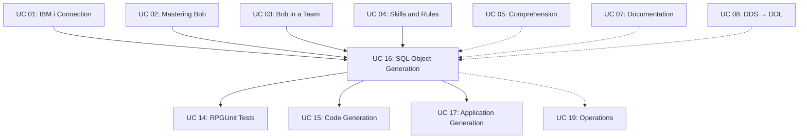

# UC 16 — SQL object generation

> **Category:** Development — Db2 for i object generation (Track B)
>
> **Position in the journey:** 16 — Phase 4 (Track B), can run in parallel with UC 15 (Code generation) on different objects; complements UC 08 (DDS → DDL conversion).
>
> **Recommended Bob mode:** **IBM i Database** (dedicated Db2 for i mode: qualification via `QSYS2`, DDL generation, creation on the test IBM i via `execute_sql_statement`, `/review_SQL`). Switch to **IBM i Developer** only to (a) read an RPG source whose logic migrates to a procedure, or (b) submit a long script with `RUNSQLSTM` (CL command). Without Premium Package: Ask for qualification and generation, Agent for creation and saving.

---

## ⭐ IBM i Premium Package used

There is **no one-click Premium workflow** for *ex nihilo* SQL object generation. One Premium workflow covers the index aspect **partially**; the 71 IBM i skills are activated automatically depending on context.

- **Workflow: SQL Index Strategy Advisor (partial — indexes only)** → [Official documentation](https://bob.ibm.com/docs/ide/premium-packages/bob-for-i/workflows)
  Analyzes query performance (Index Advisor recommendations, MTI usage, execution statistics) and advises on an indexing strategy. **It relies on an existing workload**: on a newly created table, it has nothing to analyze. Run it *after* go-live to validate or adjust the indexes created in Prompt 1I.
  **Launch:** IBM i Database mode → **Start Workflow** button at the top of the chat → **Library List** workspace (the only workspace supported by this workflow) → *SQL Index Strategy Advisor*. Details: UC00 §1.2.
- **Slash Command: `/review_SQL`** → [Official documentation](https://bob.ibm.com/docs/ide/premium-packages/bob-for-i/slash-commands)
  Full review of a SQL query or a member containing SQL (syntax, readability, security, SQE performance, refactoring). **Complementary quality control after generation** (Prompt 5), notably on view queries and on procedure, function, and trigger bodies. Replaces neither DBA validation nor functional testing.
- **Slash Command: `/erd`** *(complement, UC 08)* → [Official documentation](https://bob.ibm.com/docs/ide/premium-packages/bob-for-i/slash-commands)
  After the tables are created, generates the relationship diagram (PK, FK, UQ) from `QSYS2.SYSTABLES`, `SYSCOLUMNS`, `SYSCST`, `SYSREFCST`: confirms that the created constraints do appear in the catalog.
- **Auto-activated skills used:**
  - **Core (5 skills):** `db2-ddl-generation`, `db2-stored-procedures`, `db2-functions-udfs`, `db2-index-strategy`, `db2-sql-primer`.
  - **Depending on the subject (7 skills):** `db2-security-best-practices` (GRANT, least privilege), `db2-journaling-commitment` (triggers and procedures that modify data), `db2-sql-debugging` (`SQLCODE` / `SQLSTATE` errors at creation), `db2-system-catalog` (`QSYS2` checks), `db2-sqlpl-performance` and `db2-sql-stored-procedure-performance` (high-performance SQL PL best practices for procedures, functions, and triggers), `db2-temporal-tables` (table with row versioning).
  - **Routine tests:** the `rpgunit-testing` skill (IBM i Developer) and the UC 14 test plan take over to automate the tests of the procedures and triggers created (Prompt 5).
  → [Db2 for i & SQL Skills](https://bob.ibm.com/docs/ide/premium-packages/bob-for-i/skills#db2-for-i--sql)
- **Understand Dashboard** → [Official documentation](https://bob.ibm.com/docs/ide/premium-packages/bob-for-i/understand)
  *If Understand is installed* (setup and usage: UC00 §2). It maps triggers, constraints, and file dependencies: use it to spot the triggers and programs already tied to a table before adding a trigger to it, and the callers before freezing the signature of a procedure or function.
  - **Access:** *Open Understand Dashboard* command (`vscode-ibmi-bob.openUnderstandDashboard`) or the Dashboard icon in the Bob chat title bar.

> **Why this UC 16 provides unique methodological value:**
> Creating a new SQL object has no prior behavior to preserve, but a poorly framed `CREATE` can replace an existing object, break dependents, or leave overly broad rights. Bob does not know your catalog: without framing, it assumes tables, columns, and conventions. This UC provides:
> 1. **Anti-hallucination qualification:** IBM i version, schema, names already taken, target tables and columns, constraints — everything is verified by a real query (`QSYS2`, `SYSIBMADM`), "NOT VERIFIED" otherwise (Prompt 0).
> 2. **Generation in the chat only**, per object type, validated by the team before any execution (Prompts 1 to 4).
> 3. **A write safeguard:** non-existence verified before each `CREATE`, execution after explicit validation, catalog check, nominal test on test data (Prompt 5).
> 4. **Explicit creation order and rights:** scope plan, then an ordered deployment script with least-privilege `GRANT`s (Prompts 6 and 7).

> ⚠️ **Distinction from UC 08 (routing rule):** UC 08 **converts** an existing DDS (PF/LF) into DDL; UC 16 **creates** a new SQL object from a functional requirement. If a DDS file already exists for the object → **UC 08**. If the object does not exist and meets a new requirement → **UC 16**.

---

## Scope

**Six object types covered:**

| Type | Statement | Usage |
|---|---|---|
| Table | `CREATE TABLE` | New data model (PK, FK, CHECK, DEFAULT) |
| View | `CREATE OR REPLACE VIEW` | Simplified or secured read access to one or more tables |
| Index | `CREATE [UNIQUE] INDEX` | Access performance or uniqueness |
| Stored procedure | `CREATE OR REPLACE PROCEDURE` | Business logic encapsulated in the database |
| Trigger | `CREATE [OR REPLACE] TRIGGER` | Automation on a DML event |
| Function | `CREATE OR REPLACE FUNCTION` | Scalar or table function usable in a `SELECT` |

---

## Objective

Generate **new Db2 for i objects** — tables, views, indexes, stored procedures, triggers, functions — from a functional requirement, using only objects and interfaces **verified on the IBM i**, and creating on the test IBM i only after explicit team validation.

**What this UC enables:**
- Qualifying the requirement and the actual environment (version, schema, name collisions, dependencies) with no assumptions.
- Choosing the right object type (a complex trigger is often the symptom of logic that belongs in the calling program).
- Generating DDL that complies with the company's SQL standards, reviewed before execution.
- Creating, checking in the catalog, and testing the object on the test IBM i, without overwriting an existing object.
- Steering a scope through an ordered plan and a deployment script with least-privilege rights.

**Main success criterion:** every generated object complies with the company's standards (validated by a DBA or a developer), references only verified objects, is created without error on the test IBM i, appears correctly in the catalog, and has been exercised on a nominal case with test data.

---

## Prerequisites

- **Phase:** Phase 4 — Track B (Generation)
- **Required previous UCs:**
  - **UC 01 — Connect Bob to the IBM i** (**mandatory**): active connection, SQL access (`execute_sql_statement`) operational.
  - **UC 02 — Mastering Bob** (**mandatory**): IBM i Database / IBM i Developer modes, `/init`.
  - **UC 03 — Bob in a team** and **UC 04 — Skills and Rules strategy** (**mandatory**): location of the rules, shared `AGENTS.md` (to hold the SQL standards).
  - **UC 08 — DDS → DDL** (**recommended**, **mandatory if an FK or a view references a converted table**): up-to-date DDL, actual column names and types.
  - **UC 05 / UC 07** (**recommended**): comprehension and specifications of the application the object fits into.
- **Required deliverables:**
  - Company SQL standards, **at minimum**: target schema, naming conventions (tables, columns, constraints, routines), preferred types, comment / `LABEL` rules. If missing, Prompt 0 flags them "NONE" and proposes extracting them from existing objects (to be validated).
  - `{appId}-ddl-{appId}-complet-{YYYYMMDD-HHmm}.md` — UC 08 (if the object references converted tables).
  - `{appId}-doc-spec-tech-{composant}-{YYYYMMDD-HHmm}.md` — UC 07 (recommended).
- **IBM i system prerequisites:**
  - Test schema / library identified (e.g. `[TEST_LIB_NAME]`) — **to be confirmed in Prompt 0**, never assumed.
  - DDL rights of the user associated with the native IBM i connection on this schema. **They cannot be reliably verified through the catalog** (rights may come from a group profile or a special authority): they are confirmed by the first creation attempt (Prompt 5). For a trigger, the `CREATE TRIGGER` documentation notably requires the `ALTER` and `SELECT` privileges on the table concerned and the `*USE` system authority on the `ADDPFTRG` and `CRTPGM` commands.
- **Recommended Bob level:** Intermediate
- **Estimated Bob Coins:** ⚠️ *To be calibrated after the UC 16 lab on FLGHT400.*

---

## Concrete example — FLGHT400 Lab

> ⚠️ The FLGHT400 lab does not yet contain an *ex nihilo* SQL object generation result (no procedure, function, or trigger created). The deliverables below illustrate the **actual starting state** on which UC 16 builds and the **only `CREATE INDEX`** proposed in the lab. A complete generation example remains to be produced during the UC 16 lab.

| Deliverable | Lab file | What it illustrates |
|---|---|---|
| `/erd` report for `FLGHT403` | [`../labs_FLGHT400_results/FLGHT403_erd_report.md`](../labs_FLGHT400_results/FLGHT403_erd_report.md) | Actual catalog state: application tables derived from DDS PFs, **no formal SQL constraint** (`QSYS2.SYSCST` and `SYSREFCST` empty), columns and types read from the catalog (e.g. `ORDERS`: `ORDER_NUMBER`, `AGENT_NO`, `CUSTOMER_NO`, `FLIGHT_NUMBER`, `DEPARTURE_DATE`…). Shows why Prompt 0 verifies every FK target: a table without constraints offers no parent key. |
| SQL review and bottleneck analysis | [`../labs_FLGHT400_results/FLGHT403_sql-review-bottleneck-analysis.md`](../labs_FLGHT400_results/FLGHT403_sql-review-bottleneck-analysis.md) | No SQL index on `FLIGHTS`, `ORDERS`, `AGENTS`, `CUSTOMERS` (only DDS logical files). Proposes `CREATE INDEX FLGHT403/ORDIDX01 ON FLGHT403/ORDERS (DEPARTURE_DATE, FLIGHT_NUMBER, AGENT_NO) FOR SYSTEM NAME ORDIDX01`, **conditional on confirmation by Visual Explain** and not executed in the lab. Illustrates Prompt 1I and the place of the *SQL Index Strategy Advisor* workflow. Also illustrates the value of imposing readable system names: the lab query handles generated names (`FLIGH00001`, `DEPAR00002`, `CUSTO00001`). |

**Proposed lab scenario (to be produced, not performed):** on a **copy** of `FLGHT403` (never on the original), create an order audit table (columns aligned with `ORDERS`), an `AFTER UPDATE` audit trigger, an order-insertion procedure with `SQLSTATE` as an `OUT` parameter, and a utility scalar function; chain Prompts 0 → 5, then plan (6) and deployment (7).

---

## Starting a Bob session

### The three workspaces

- **Local workspace** (workstation) — assessment reports, documented DDL scripts, generation plan (`bob-reports/`), SQL standards (rule `.bob/rules-ibm-i-database/` or `AGENTS.md` section, see UC 03 / UC 04).
- **IBM i Libraries / QSYS** ⭐ — **primary execution workspace**: SQL objects created in the test schema, tables queried via `QSYS2`. The project's `AGENTS.md` (`{LIBRARY}/QBOBSRC/AGENTS.MD` in a QSYS workspace, `{IFS directory}/.bob/AGENTS.md` in an IFS workspace; see UC00 §0) is injected there automatically.
- **$HOME IFS** — executable `.sql` files (`RUNSQLSTM SRCSTMF`) and versioned scripts if the project is structured in the IFS.

> ⚠️ **Standards and QSYS workspace:** when the active workspace is *IBM i Libraries* alone, the local workspace and its `.bob/` are **not loaded** (see UC 03). For the SQL standards to apply in all cases, declare them **also** in the application's `AGENTS.md`.

### Session rules

- **One new Bob conversation per object type** (`+` button of the Chat panel): the context of a trigger and that of a procedure conflict. Exception: chaining a table and the procedure that accesses it in the same session — the table is already in the context.
- **Load the context before Prompt 0:** `AGENTS.md`, UC 08 DDL, UC 07 specifications.
- **Session resumption:** reload the latest `{appId}-sql-{composant}-*.md` and state "the current object is described in [FILE] — resume at Prompt [N]". If Bob seems to forget a Prompt 0 decision, save the current deliverable and open a new conversation.
- **Golden rule:** during Prompts 0 to 4, Bob **only reads the catalog and produces in the chat** (no `CREATE`, `ALTER`, `DROP`, `GRANT`). Creating on the IBM i is allowed only at Prompt 5, and rights only at Prompt 7, **after explicit team validation**.

---

## Structured approach and prompts

### Recommended progression by category

Start with an **object the team knows**: a simple table (fewer than 10 columns, obvious PK, no FK) that a DBA can validate at a glance. Tables are the foundation of the other objects: validating types and conventions on a simple table calibrates all subsequent generations.

| Step | Object | Category | Recommended sequence |
|---|---|---|---|
| **1** | Simple table (< 15 columns, no FK) | **SIMPLE** | Prompt 0 → Prompt 1 → Prompt 5 |
| **2** | Table with FK / CHECK / DEFAULT, view, index | **STANDARD** | Prompt 0 → Prompt 1 / 1V / 1I → Prompt 5 |
| **3** | CRUD procedure (1 to 3 IN parameters, no cursor) | **SIMPLE** | Prompt 0 → Prompt 2 → Prompt 5 |
| **4** | Audit trigger (1 event, 1 timing) | **SIMPLE** | Prompt 0 → Prompt 3 → Prompt 5 |
| **5** | Utility scalar function | **STANDARD** | Prompt 0 → Prompt 4 → Prompt 5 |
| **6** | Procedure with cursors, trigger with business logic, table function | **COMPLEX** | Prompt 0 (database layer / application layer trade-off) → Prompts 2-4 → Prompt 5 |
| **7** | Complete application scope | **PLAN** | Prompt 6 → Prompt 7 |

### Complexity impact by object type

| Type | SIMPLE | STANDARD | COMPLEX |
|---|---|---|---|
| **Table** | < 15 columns, no FK, direct types | FK to an existing table, `CHECK` / `DEFAULT`, `GENERATED` column | Partitioning, computed columns, row versioning (`db2-temporal-tables`), several nested FKs |
| **Procedure** | 1 to 3 IN parameters, linear logic | IN/OUT, 1 cursor, `DECLARE HANDLER` | Nested cursors, temporary tables, procedure calls, several tables |
| **Trigger** | 1 event, 1 timing, simple audit | — | Conditional business logic, procedure call, several events |
| **Function** | Scalar with no table access | Scalar with access to 1 table | Table function, subqueries, use in a `WHERE` on large volumes |

> ⚠️ A COMPLEX trigger with business logic is often the symptom of logic that belongs in the calling program (UC 15): harder to test and debug. Prompt 0 forces this trade-off.

---

### Prompt 0 — Qualification of the environment and of the SQL object to generate

**Objective:** Translate the functional requirement into an object type and category, verify the environment and dependencies on the IBM i, and inventory the available standards — without creating anything.

**When to use:** Before any generation, for each object. Its result determines the following sequence.

**Required input:**
- Project `AGENTS.md` and SQL standards if available.
- UC 08 DDL and UC 07 specifications (if available).
- Description of the requirement in business terms.

**Workspace:** Local (`bob-reports/`) for the report, IBM i QSYS for the checks (read-only).
**Mode:** IBM i Database.
**Key skills used:** `db2-system-catalog`, `db2-ddl-generation`, `db2-sql-primer`.

**Prompt:**

```text
I need to create a new SQL object in schema [LIB_NAME] on IBM i.

Functional requirement (in business terms, not SQL syntax): [BUSINESS_DESCRIPTION]
[Load into the context: project AGENTS.md, UC 08 DDL, UC 07 specifications if available]

Do not invent any object. Every schema, table, column, constraint, routine, trigger, right
or version mentioned must be verified by a real query on the IBM i (QSYS2, SYSIBMADM)
before it appears in the report. If an element cannot be verified, write "NOT VERIFIED"
— do not deduce it. This step is read-only: no CREATE, ALTER, DROP, or GRANT.

Produce in English, in markdown, an assessment report:

## UC 16 Qualification — [TARGET_OBJECT_NAME]

### 1. Verified environment
| Element | Verified value | Query used |
|---|---|---|
| IBM i version (OS_NAME, OS_VERSION, OS_RELEASE) | ? | |
| Target schema exists | YES / NO | |
| Does an object with this name already exist (table, view, index, routine, trigger)? | YES / NO | |
| Triggers already defined on the table concerned | list / NONE | |

### 2. Available SQL standards
| Area | Source (AGENTS.md / rules / document / NONE) | Value |
|---|---|---|
| Naming (tables, columns, constraints, routines, parameters) | | |
| Target schema and system name (FOR SYSTEM NAME / FOR COLUMN) | | |
| Preferred data types | | |
| Error handling (SQLSTATE, handlers) | | |
| Comments / LABEL ON | | |
If a row is "NONE": propose deriving the conventions from existing objects in the schema,
marking them "TO BE VALIDATED BY THE TECHNICAL LEAD".

### 3. Recommended object type (open question, justify your choice)
- [ ] Table   - [ ] View   - [ ] Index   - [ ] Stored procedure   - [ ] Trigger   - [ ] Function

### 4. Category
- [ ] SIMPLE   - [ ] STANDARD   - [ ] COMPLEX

### 5. Verified dependencies
| Dependency | Object | Exists? | Verified detail (columns, types, PK/UNIQUE parent key for an FK) |
|---|---|---|---|

### 6. Points of attention
- [ ] Trigger with complex business logic → does the logic belong in the calling program?
- [ ] Recursive trigger possible (the body writes to the triggering table)?
- [ ] Mass update planned on the table (trigger impact)?
- [ ] Function in a WHERE predicate → performance impact to check in the access plan
- [ ] Procedure with nested cursors → SQLSTATE handling plan
- [ ] SQL feature dependent on the IBM i version returned (§1) → NOT VERIFIED if not confirmed
- [ ] Trigger constraints: no DELETE trigger on a table with an ON DELETE CASCADE FK,
      no UPDATE trigger with an ON DELETE SET NULL / SET DEFAULT FK (to be checked on the table)

### 7. Rights
DDL rights of the current user: NOT VERIFIED (confirmed by the creation attempt, Prompt 5).
Target application profile: [PROFILE] — does it exist? (NOT VERIFIED if it cannot be checked)

### 8. Recommended sequence
Indicate the prompts to chain according to the type and category.
```

**Deliverable produced:** `{appId}-sql-{composant}-analyse-{YYYYMMDD-HHmm}.md` (in `bob-reports/`).

> 💡 **Useful verification queries** (IBM i Database / `execute_sql_statement`):
> ```sql
> -- IBM i version (SYSIBMADM.ENV_SYS_INFO view)
> SELECT OS_NAME, OS_VERSION, OS_RELEASE FROM SYSIBMADM.ENV_SYS_INFO;
>
> -- Is the name (SQL or system) already taken by a table, view, or logical file?
> SELECT TABLE_SCHEMA, TABLE_NAME, SYSTEM_TABLE_NAME, TABLE_TYPE
> FROM QSYS2.SYSTABLES
> WHERE TABLE_SCHEMA = '[LIB_NAME]'
>   AND (TABLE_NAME = '[OBJECT_NAME]' OR SYSTEM_TABLE_NAME = '[SYSTEM_NAME]');
>
> -- Existing indexes on the table
> SELECT INDEX_SCHEMA, INDEX_NAME, TABLE_SCHEMA, TABLE_NAME
> FROM QSYS2.SYSINDEXES
> WHERE TABLE_SCHEMA = '[LIB_NAME]' AND TABLE_NAME = '[TABLE_NAME]';
>
> -- Actual columns of a table (FK target, routine parameters)
> SELECT COLUMN_NAME, DATA_TYPE, LENGTH, NUMERIC_SCALE, IS_NULLABLE
> FROM QSYS2.SYSCOLUMNS
> WHERE TABLE_SCHEMA = '[LIB_NAME]' AND TABLE_NAME = '[TABLE_NAME]'
> ORDER BY ORDINAL_POSITION;
>
> -- Table constraints (an FK requires a PK or UNIQUE parent key)
> SELECT CONSTRAINT_NAME, CONSTRAINT_TYPE, TABLE_SCHEMA, TABLE_NAME
> FROM QSYS2.SYSCST
> WHERE TABLE_SCHEMA = '[LIB_NAME]' AND TABLE_NAME = '[TABLE_NAME]';
>
> -- Existing procedures and functions (avoid name conflicts)
> SELECT ROUTINE_SCHEMA, ROUTINE_NAME, ROUTINE_TYPE, SPECIFIC_NAME
> FROM QSYS2.SYSROUTINES
> WHERE ROUTINE_SCHEMA = '[LIB_NAME]'
> ORDER BY ROUTINE_NAME;
>
> -- Existing triggers on a table (ACTION_STATEMENT deliberately omitted: long text)
> SELECT TRIGGER_NAME, EVENT_MANIPULATION, ACTION_TIMING, ACTION_ORIENTATION, ENABLED, OPERATIVE
> FROM QSYS2.SYSTRIGGERS
> WHERE EVENT_OBJECT_SCHEMA = '[LIB_NAME]' AND EVENT_OBJECT_TABLE = '[TABLE_NAME]';
> ```

> ⚠️ **Pitfall avoided:** without qualification, Bob generates an FK to a nonexistent table, a procedure on invented columns, or an object whose name overwrites an existing object. Prompt 0 moves this discovery to the very beginning.

---

### Prompt 1 — Table generation (`CREATE TABLE`)

**Objective:** Generate, in the chat, the DDL of a new table that complies with the standards and the verified dependencies.

**When to use:** After validation of the assessment report (Prompt 0), for a table.

**Required input:**
- Report `{appId}-sql-{composant}-analyse-{YYYYMMDD-HHmm}.md`.
- SQL standards loaded (rules and/or `AGENTS.md`).

**Workspace:** In the chat (no writing).
**Mode:** IBM i Database.
**Key skills used:** `db2-ddl-generation`, `db2-sql-primer` (and `db2-temporal-tables` if the table is versioned).

**Prompt:**

```text
Based on the assessment report [ANALYSIS_FILE_NAME] for [TABLE_NAME],
generate in the chat, in English and in markdown, the Db2 for i DDL script, applying
the standards loaded in the context.

Expected content, in this order:
1. Comment header: object, functional requirement (1 line), date, status
   "To be validated and tested on the test IBM i before any use".
2. CREATE TABLE [LIB_NAME].[TABLE_NAME] (columns + named constraints).
3. LABEL ON COLUMN for each column (business label) — the catalog's COLUMN_TEXT
   is populated by LABEL ON, not by "--" comments.

Rules:
- CREATE TABLE (never CREATE OR REPLACE on a table): if the object exists, the script
  must fail (SQL0601) and ask for a decision. ALTER TABLE to evolve an existing table.
- Native Db2 for i SQL types only; default types per the standards.
  Absent a standard: CHAR(n) if n <= 30, VARCHAR(n) otherwise; DECIMAL(n,d) for amounts;
  DATE / TIME / TIMESTAMP for dates (not CHAR(8) unless existing data requires it).
- Constraints named {TABLE}_PK, {TABLE}_FK_{COLUMN}, {TABLE}_CHK_{COLUMN}.
- Explicit ON DELETE on every FK (RESTRICT by default; CASCADE only on written decision).
  Each FK references only columns whose parent key (PK or UNIQUE) was verified in the report.
- If SQL names exceed 10 characters and RPG programs or DDS files will access the table:
  propose readable system names (FOR SYSTEM NAME for the table, FOR COLUMN
  for the columns) instead of letting the system generate truncated names.
- Do not invent any constraint, column, or default value absent from the requirement or the standards.
  For a point on which the standards are silent, ask the question.
- Do not generate any GRANT statement at this stage.
Do not save anything and do not execute anything.
```

**Deliverable produced:** `{appId}-sql-{composant}-table-{YYYYMMDD-HHmm}.md` (in `bob-reports/`, on request after validation).

> 💡 **Save the script** before Prompt 5: "Save this script in bob-reports/ under the name {appId}-sql-{composant}-table-{YYYYMMDD-HHmm}.md".

> ⚠️ **Pitfall avoided:** handing out a `CREATE TABLE` with ill-considered types (`CHAR(200)` for free text) or unreadable generated names (cf. `FLIGH00001` in the lab).

---

### Prompt 1V — View generation (`CREATE OR REPLACE VIEW`)

**Objective:** Generate, in the chat, the DDL of a read view on verified tables.

**When to use:** After Prompt 0, for a view.

**Required input:** Assessment report; source table columns read in Prompt 0.

**Workspace:** In the chat (no writing).
**Mode:** IBM i Database.
**Key skills used:** `db2-ddl-generation`, `db2-sql-primer`, `db2-sql-optimization`.

**Prompt:**

```text
Based on the assessment report [ANALYSIS_FILE_NAME] for [VIEW_NAME],
generate in the chat the view DDL:

CREATE OR REPLACE VIEW [LIB_NAME].[VIEW_NAME] AS SELECT ... FROM [LIB_NAME].[TABLE_NAME1] ...

Rules:
- Only the necessary columns, explicitly named: no SELECT *
  (the column contract would drift silently if the source table evolves).
- Prefix columns with the table alias; document the WHERE filter if it is not obvious.
- WITH READ ONLY if the view is intended for read-only use.
- All referenced tables and columns must appear in the assessment report.
- Remind that CREATE OR REPLACE VIEW replaces the existing definition and can break dependent
  objects or programs if the column contract changes: only propose it after the
  non-existence check of Prompt 5, or on a view created in this session.
Do not save anything and do not execute anything.
```

**Deliverable produced:** `{appId}-sql-{composant}-vue-{YYYYMMDD-HHmm}.md` (in `bob-reports/`, on request).

> ⚠️ **Pitfall avoided:** a view on a missing table fails with `SQL0204`; a `SELECT *` view drifts silently.

---

### Prompt 1I — Index generation (`CREATE INDEX`) [Complement — not covered by the Premium workflow]

**Objective:** Generate, in the chat, the DDL of an index justified by a documented need (uniqueness or identified access).

**When to use:** For a uniqueness need, or an access known from the design stage. **To optimize queries already in production**, favor the Premium *SQL Index Strategy Advisor* workflow (see ⭐ above): it relies on real execution data, which a new table does not have yet.

**Required input:** Assessment report; existing indexes read in Prompt 0 (`QSYS2.SYSINDEXES`); query or program that will benefit from the index.

**Workspace:** In the chat (no writing).
**Mode:** IBM i Database.
**Key skills used:** `db2-index-strategy`, `db2-ddl-generation`.

**Prompt:**

```text
Based on the assessment report [ANALYSIS_FILE_NAME] for [INDEX_NAME],
generate in the chat the index DDL:

CREATE [UNIQUE] INDEX [LIB_NAME].[INDEX_NAME] ON [LIB_NAME].[TABLE_NAME] ([COL1] [ASC|DESC], ...)
[FOR SYSTEM NAME [SYSTEM_NAME] if the SQL name exceeds 10 characters]

Rules:
- Document in a comment the query or program that benefits from the index. Without an identified
  beneficiary, do not propose the index.
- UNIQUE only if uniqueness is a functional rule. Before a UNIQUE index on a populated table,
  provide the duplicate-detection query
  (SELECT col, COUNT(*) ... GROUP BY col HAVING COUNT(*) > 1): otherwise creation fails (SQL0603).
- Before proposing an index on FK columns, check in QSYS2.SYSINDEXES and QSYS2.SYSCST
  whether the access is already covered; write "NOT VERIFIED" if you cannot confirm it.
- Do not presume the gain: recommend confirming it with Visual Explain, or with the
  SQL Index Strategy Advisor workflow once the real workload is available.
Do not save anything and do not execute anything.
```

**Deliverable produced:** `{appId}-sql-{composant}-index-{YYYYMMDD-HHmm}.md` (in `bob-reports/`, on request).

> 💡 **Lab example:** the `ORDIDX01` index proposed on `ORDERS` in [`FLGHT403_sql-review-bottleneck-analysis.md`](../labs_FLGHT400_results/FLGHT403_sql-review-bottleneck-analysis.md) is explicitly conditional on a scan confirmed by Visual Explain — the same discipline applies here.

---

### Prompt 2 — Stored procedure generation (`CREATE OR REPLACE PROCEDURE`)

**Objective:** Generate, in the chat, a SQL PL procedure with explicit error handling.

**When to use:** After Prompt 0, for a procedure.

**Required input:** Assessment report; actual columns and types of the tables accessed; business rules (UC 06) if available.

**Workspace:** In the chat (no writing).
**Mode:** IBM i Database.
**Key skills used:** `db2-stored-procedures`, `db2-sqlpl-performance`, `db2-sql-stored-procedure-performance`, `db2-journaling-commitment`, `db2-sql-debugging`.

**Prompt:**

```text
Based on the assessment report [ANALYSIS_FILE_NAME] for [PROCEDURE_NAME],
generate in the chat the Db2 for i stored procedure DDL:

CREATE OR REPLACE PROCEDURE [LIB_NAME].[PROCEDURE_NAME] (IN ..., OUT p_sqlstate CHAR(5))
LANGUAGE SQL
SPECIFIC [SPECIFIC_NAME]
BEGIN
  -- 1. variables  2. cursors  3. handlers  4. body
END

Rules:
- Mandatory SQL PL order: variables -> cursors -> handlers (an inversion causes a creation error).
- DECLARE CONTINUE HANDLER FOR NOT FOUND for the end of a cursor (normal condition).
- DECLARE EXIT HANDLER FOR SQLEXCEPTION with GET DIAGNOSTICS (RETURNED_SQLSTATE, MESSAGE_TEXT),
  then return the SQLSTATE in the OUT parameter. No generic CONTINUE HANDLER on SQLEXCEPTION
  for a procedure that modifies data.
- Prefer SQLSTATE (5 characters) over SQLCODE for new developments.
- Explicit and distinct SPECIFIC for each signature in case of overloading.
- Data modification: state explicitly where COMMIT and ROLLBACK are located and what happens
  if the table is not journaled (do not presume; mark "NOT VERIFIED" if you have not checked
  journaling).
- Every referenced table and column must appear in the assessment report.
After the code, explain in 5 to 10 lines the design choices and assumptions,
so that the team can challenge them before execution.
Do not save anything and do not execute anything.
```

**Deliverable produced:** `{appId}-sql-{composant}-procedure-{YYYYMMDD-HHmm}.md` (in `bob-reports/`, on request).

> ⚠️ **Pitfall avoided:** a procedure without a handler can leave a cursor open after an error (the next call fails with "cursor already open") and masks the real cause.

---

### Prompt 3 — Trigger generation (`CREATE TRIGGER`)

**Objective:** Generate, in the chat, a trigger limited to its role (audit, validation) and flag its risks.

**When to use:** After Prompt 0, **only if Prompt 0 validated that the logic belongs in the database** (and not in the calling program).

**Required input:** Assessment report; existing triggers on the table (Prompt 0); verified target log table for an audit.

**Workspace:** In the chat (no writing).
**Mode:** IBM i Database.
**Key skills used:** `db2-stored-procedures`, `db2-sql-stored-procedure-performance`, `db2-journaling-commitment`, `db2-security-best-practices`.

**Prompt:**

```text
Based on the assessment report [ANALYSIS_FILE_NAME] for [TRIGGER_NAME],
generate in the chat the Db2 for i trigger DDL:

CREATE OR REPLACE TRIGGER [LIB_NAME].[TRIGGER_NAME]
  [BEFORE | AFTER] [INSERT | UPDATE [OF columns] | DELETE]
  ON [LIB_NAME].[TABLE_NAME]
  REFERENCING [NEW AS new_row] [OLD AS old_row]
  FOR EACH ROW
  [MODE per the standards; otherwise DB2ROW, marked "TO BE VALIDATED BY THE DBA"]
  [WHEN (condition)]
BEGIN ATOMIC
  ...
END

Rules:
- BEFORE to validate or adjust NEW (SET on the transition variable); the body of a BEFORE trigger
  cannot contain data updates: to write to a log table, use AFTER.
- Include only the applicable clauses: OLD does not exist on INSERT, NEW does not exist on DELETE.
- Flag any recursion risk (the body modifies the triggering table) and propose a
  stop condition. An excessive trigger cascade is rejected by Db2 for i
  (SQL0724, SQLSTATE 54038, documented maximum depth of 200).
- Flag the impact of a mass update: the trigger fires on every row.
  Propose a WHEN clause or a controlled deactivation, to be decided with the business.
- Check, based on the report, the constraints from the CREATE TRIGGER documentation: no
  DELETE trigger on a table with an ON DELETE CASCADE FK, no UPDATE trigger on a table with an FK
  ON DELETE SET NULL / SET DEFAULT.
- No complex business logic in the trigger in the COMPLEX category: write a TODO
  and point to the calling program.
Do not save anything and do not execute anything.
```

**Deliverable produced:** `{appId}-sql-{composant}-trigger-{YYYYMMDD-HHmm}.md` (in `bob-reports/`, on request).

> ⚠️ **Pitfall avoided:** an `AFTER UPDATE` trigger that updates its own table re-fires until Db2 for i rejects it (SQL0724).

> 💡 **Edge cases to validate with the business before production:** a mass `UPDATE` (e.g. price recalculation on 500,000 rows) fires the trigger 500,000 times. Should a batch import fire it? If not: `WHEN` clause or temporary deactivation, decided explicitly.

---

### Prompt 4 — Function generation (`CREATE OR REPLACE FUNCTION`)

**Objective:** Generate, in the chat, a scalar or table SQL function, with justified determinism.

**When to use:** After Prompt 0, for a function.

**Required input:** Assessment report; actual columns of the tables accessed.

**Workspace:** In the chat (no writing).
**Mode:** IBM i Database.
**Key skills used:** `db2-functions-udfs`, `db2-sqlpl-performance`, `db2-sql-stored-procedure-performance`, `db2-sql-optimization`.

**Prompt:**

```text
Based on the assessment report [ANALYSIS_FILE_NAME] for [FUNCTION_NAME],
generate in the chat the Db2 for i function DDL:

[Scalar]  CREATE OR REPLACE FUNCTION [LIB_NAME].[FUNCTION_NAME] (params)
          RETURNS [TYPE] LANGUAGE SQL [DETERMINISTIC | NOT DETERMINISTIC] SPECIFIC [SPECIFIC_NAME]
          BEGIN ... RETURN ...; END
[Table]   ... RETURNS TABLE (col TYPE, ...) LANGUAGE SQL ... BEGIN RETURN SELECT ... END

Rules:
- DETERMINISTIC only if the same parameters always give the same result regardless of the
  state of the database. Justify the choice: determinism is distinct from the SQL data access
  class (READS SQL DATA, MODIFIES SQL DATA...).
- If the function will be used in a WHERE, flag the performance risk and recommend
  checking the access plan (Visual Explain) rather than presuming the impact.
- Every referenced table and column must appear in the assessment report.
After the code, explain in 5 lines the choices and assumptions.
Do not save anything and do not execute anything.
```

**Deliverable produced:** `{appId}-sql-{composant}-fonction-{YYYYMMDD-HHmm}.md` (in `bob-reports/`, on request).

---

### Prompt 5 — Creation on the test IBM i, catalog check, review, and nominal test

**Objective:** Create the validated object without overwriting an existing one, check the result in the catalog, run the `/review_SQL` review, then exercise the object on test data.

**When to use:** Only after explicit team validation of the script, after each of Prompts 1 to 4.

**Required input:**
- Validated script (Prompts 1 to 4) and assessment report.
- Test schema confirmed in Prompt 0; DDL rights (confirmed by the attempt).

**Workspace:** IBM i QSYS (object created in `[TEST_LIB_NAME]`).
**Mode:** IBM i Database (statement by statement via `execute_sql_statement`). A long script can be submitted with `RUNSQLSTM SRCSTMF('[IFS_PATH]') COMMIT(*NONE) NAMING(*SQL)` in IBM i Developer mode; `COMMIT(*NONE)` is reserved for the POC schema, to be validated with the DBA for any other schema.
**Key skills used:** `db2-ddl-generation`, `db2-system-catalog`, `db2-sql-debugging`, `db2-security-best-practices`.

**Prompt:**

```text
The script [CREATE TABLE | VIEW | INDEX | PROCEDURE | TRIGGER | FUNCTION] [OBJECT_NAME] has been validated
by the team. Test schema: [TEST_LIB_NAME].

Step 1 — Verify non-existence:
Query the appropriate catalog (QSYS2.SYSTABLES / SYSINDEXES / SYSROUTINES / SYSTRIGGERS).
If an object with this name exists: stop, report it, and do not create or replace anything without my
explicit confirmation. CREATE OR REPLACE is allowed only on an object created in this session.

Step 2 — Verify dependencies:
Re-check that every referenced table, column, routine, or parent key still exists.

Step 3 — Create:
Run the script on [TEST_LIB_NAME], one statement at a time. Do not modify any existing data:
structure creation only. Report:
- Status: CREATION SUCCESSFUL / SQL ERRORS.
- On error: table (SQL code, description, object concerned, probable cause, proposed fix).
  Do not fix without showing me the diff.

Step 4 — Check in the catalog:
- Table or view: QSYS2.SYSCOLUMNS (columns, types, COLUMN_TEXT); constraints: QSYS2.SYSCST.
- Index: QSYS2.SYSINDEXES.
- Procedure or function: QSYS2.SYSROUTINES (SPECIFIC name, parameters).
- Trigger: QSYS2.SYSTRIGGERS (event, timing, ENABLED = 'Y', OPERATIVE = 'Y').
Compare with the script and flag any discrepancy.

Step 5 — Review:
Run /review_SQL on the body of the procedure, function, or trigger, or on the view query,
and summarize the critical and major findings.

Step 6 — Nominal test (only after my separate confirmation):
Propose a nominal case on test data tagged with a unique correlation key
(procedure: CALL with expected OUT SQLSTATE '00000'; trigger: visible side effect;
function: SELECT with known values). Indicate how to clean up this data after the test.
Do not touch any existing data.

Do not create any GRANT at this step. Remind that error-free creation does not validate the behavior.
```

**Deliverable produced:** SQL object created in `[TEST_LIB_NAME]` (IBM i QSYS); optional report `{appId}-sql-{composant}-rapport-{YYYYMMDD-HHmm}.md` (in `bob-reports/`, on request).

> 💡 Common creation codes: `SQL0601` (object already exists), `SQL0204` (object not found), `SQL0104` (syntax), `SQL0551` (insufficient rights), `SQL0603` (duplicates when creating a unique index), `SQL0724` (excessive trigger cascade). To automate them and prevent regressions, chain with **UC 14** (procedure and trigger tests).

> ⚠️ **This prompt does not replace DBA validation.** `/review_SQL` is a complementary check; it does not verify that the object meets the requirement.

---

### Prompt 6 — SQL scope generation plan

**Objective:** Produce the ordered inventory of a scope's SQL objects, with dependencies and tracking.

**When to use:** To steer an application scope, after at least two objects have been generated and validated.

**Required input:** Assessment reports already produced; UC 05 / UC 07 reports for the scope.

**Workspace:** Local (`bob-reports/`).
**Mode:** IBM i Database.
**Key skills used:** `db2-ddl-generation`, `db2-system-catalog`.

**Prompt:**

```text
Based on the requirements identified for [APPLICATION_NAME] and the UC 16 assessment reports
already produced, generate in English, in markdown, the SQL generation plan.

## SQL generation plan — [APPLICATION_NAME]

### Object inventory
| Object | Type | Category | Dependencies (verified) | Priority | Status (To generate / Generated / Created / Tested / Validated) |

### Mandatory creation order
1. Tables without FK  2. Tables with FK (existing targets)  3. Views  4. Indexes
5. Functions and procedures (referenced objects must exist)
6. Triggers (target table and called routines must exist)
For each dependency, indicate whether it is verified or NOT VERIFIED.

### Complements after go-live
- /erd on the schema to confirm the created constraints.
- SQL Index Strategy Advisor workflow once the real workload is available.

Do not invent any object absent from the reports or the catalog.
```

**Deliverable produced:** `{appId}-sql-{appId}-plan-{YYYYMMDD-HHmm}.md` (in `bob-reports/`).

> 💡 The plan is a living document: each object moves from "To generate" to "Validated". It is the input to the UC 14 test plan for SQL objects.

---

### Prompt 7 — Rights (`GRANT`) and ordered deployment script

**Objective:** Produce least-privilege `GRANT`s and assemble an ordered deployment script, without executing anything.

**When to use:** Once the plan's objects have been created and validated on the test IBM i.

**Required input:** Generation plan (Prompt 6); target application profile confirmed with the security team.

**Workspace:** Local (`bob-reports/`); `GRANT` execution on IBM i QSYS only after validation.
**Mode:** IBM i Database.
**Key skills used:** `db2-security-best-practices`, `db2-ddl-generation`.

**Prompt:**

```text
Based on the plan [PLAN_FILE_NAME], generate in the chat, without executing anything:

1. Least-privilege GRANTs per object, for the profile [APPLICATION_PROFILE] only:
   - Table: only the privileges required by the need (SELECT, INSERT, UPDATE, DELETE).
   - View: SELECT by default; DML privileges only if the view is updatable and the need requires it.
   - Procedure or function: GRANT EXECUTE ON SPECIFIC PROCEDURE | FUNCTION [schema].[specific].
   - Index: no GRANT. Trigger: no GRANT.
   No GRANT to PUBLIC. Each GRANT is justified by the need.
2. The ordered deployment script (plan order, Prompt 6) grouping the validated DDL and the GRANTs.
3. The query to check explicitly granted privileges (QSYS2.SYSTABAUTH for tables
   and views, QSYS2.SYSROUTINEAUTH for routines). Remind that these views list the granted
   privileges but do not allow concluding that a profile is authorized (group profile,
   special authority such as *ALLOBJ).
4. The "Versioning" section: location of the scripts (IFS, physical source file, Git, the company's
   source management tool), to be decided with the team — do not choose for me.
```

**Applying and verifying rights (after explicit human validation):**

1. The security team validates the script (review of each `GRANT`, no unjustified `PUBLIC`); without this validation, nothing is executed.
2. On explicit request, run the deployment script on the test IBM i (by Bob in the *IBM i Libraries* workspace, or by the team) and record the result of each `GRANT` (success or `SQLSTATE` / `SQLCODE`).
3. Run the check query from item 3 (`QSYS2.SYSTABAUTH`, `QSYS2.SYSROUTINEAUTH`; `QSYS2.OBJECT_PRIVILEGES` for an overview of object authorities, `*PUBLIC` included) and compare the result with the expected `GRANT`s.
4. Confirm effective access with a test using the application profile: catalog views are not enough to conclude that it is authorized.
5. Record the result in the deployment deliverable.

**Deliverable produced:** `{appId}-sql-{appId}-deploiement-{YYYYMMDD-HHmm}.md` (in `bob-reports/`).

> 💡 **Sources:** if the company manages its sources in a source manager, re-integration of the created scripts is manual after validation; in that case add to the header of each script "⚠️ Source manager re-integration — to be performed manually after validation". The choice of a SQL migration manager is **outside the Premium scope** and is not evaluated in this POC.

> ⚠️ **Pitfall avoided:** an object created by an administrator is not accessible to application profiles; forgotten `GRANT`s are discovered in production (`SQL0551`). Conversely, overly broad rights (`PUBLIC`, `ALL`) bypass least privilege.

---

## Deliverables of this UC

> ⚠️ **Where does Bob write?** In the *IBM i Libraries* workspace, Bob creates objects **on the IBM i** (test schema), not locally. To keep a local trace (report, documented script, plan), explicitly ask Bob to save to `bob-reports/`.

| Produced file / object | Naming pattern | Storage space | Consumed by |
|---|---|---|---|
| Assessment report | `{appId}-sql-{composant}-analyse-{YYYYMMDD-HHmm}.md` | `bob-reports/` (Local) | Prompts 1 to 4, 6 |
| SQL standards (rule / AGENTS.md) | `.bob/rules-ibm-i-database/…` + `AGENTS.md` section | Local + `{LIBRARY}/QBOBSRC/AGENTS.MD` (QSYS) or `{IFS directory}/.bob/AGENTS.md` (IFS) | All Bob sessions |
| Table / view / index script | `{appId}-sql-{composant}-{table\|vue\|index}-{YYYYMMDD-HHmm}.md` | `bob-reports/` (Local) | Prompt 5, 7 |
| Procedure / function / trigger script | `{appId}-sql-{composant}-{procedure\|fonction\|trigger}-{YYYYMMDD-HHmm}.md` | `bob-reports/` (Local) | Prompt 5, 7, **UC 14** (tests) |
| Created SQL object | `[OBJECT_NAME]` | `[TEST_LIB_NAME]` (IBM i QSYS) | UC 14, UC 15 (calling programs), UC 17 |
| SQL generation plan | `{appId}-sql-{appId}-plan-{YYYYMMDD-HHmm}.md` | `bob-reports/` (Local) | Scope steering, UC 14 |
| Deployment and rights script | `{appId}-sql-{appId}-deploiement-{YYYYMMDD-HHmm}.md` | `bob-reports/` (Local); executable `.sql` in IFS (optional) | Production release |
| Creation and review report *(optional)* | `{appId}-sql-{composant}-rapport-{YYYYMMDD-HHmm}.md` | `bob-reports/` (Local) | Review, traceability |

---

## Pitfalls to avoid

| Pitfall | What happens | How to avoid it |
|---|---|---|
| Confusing UC 16 and UC 08 | A created object duplicates a table already converted from a DDS | If a DDS exists for the object → UC 08; UC 16 for objects with no DDS source |
| Generating without qualification | Invented names, columns, or FKs; collision with an existing object | Prompt 0: everything verified via `QSYS2` / `SYSIBMADM`, "NOT VERIFIED" otherwise |
| FK to a table without a parent key | Creation refused or invalid constraint (the lab tables have no formal constraint) | Verify the target's PK / UNIQUE in `QSYS2.SYSCST` at Prompt 0; if absent, create it first (explicit decision) |
| `CREATE OR REPLACE` on an existing object | Silent replacement; dependents broken if the contract changes | Non-existence verified at Prompt 5, step 1; `OR REPLACE` only on an object created in the session |
| Version-dependent SQL feature | Syntax error or different behavior | Read the version at Prompt 0 (`SYSIBMADM.ENV_SYS_INFO`) and check the feature in that version's documentation |
| Writing before validation | Unvalidated intermediate object in the test schema | Prompts 0 to 4 read-only / chat; creation at Prompt 5 only |
| Recursive or mass trigger | Cascade rejected (`SQL0724`) or blocking during a mass `UPDATE` | Flag recursion at Prompt 3; `WHEN` or deactivation decided with the business |
| Trigger on a table with a cascading FK | Creation refused (DELETE with `ON DELETE CASCADE`, UPDATE with `SET NULL` / `SET DEFAULT`) | Check the table's constraints at Prompt 0 |
| Procedure without a handler | Cursor left open, errors masked, locks | `CONTINUE HANDLER FOR NOT FOUND` + `EXIT HANDLER FOR SQLEXCEPTION` with `GET DIAGNOSTICS` |
| Unreadable system names | Generated truncated names (`FLIGH00001`) that RPG and DDS must handle | Explicit `FOR SYSTEM NAME` / `FOR COLUMN` (Prompt 1) |
| Presuming an index's effect | Useless index, maintenance cost | Visual Explain, then SQL Index Strategy Advisor workflow on real workload |
| Forgetting `GRANT`s or granting them to `PUBLIC` | `SQL0551` in production, or overly broad rights | Prompt 7: least privilege, check of explicit privileges |
| Treating "it creates" as "it is valid" | An object created without error but with wrong behavior | Nominal test (Prompt 5, step 6); automate with UC 14 |

---

## UC 16 validation checklist

- [ ] Prompt 0 was run for each object; type, category, and verified dependencies are documented.
- [ ] The SQL standards are in place (rule and/or `AGENTS.md` section) or "NONE" was handled explicitly.
- [ ] No schema, table, column, or constraint is invented: everything was verified via `QSYS2` / `SYSIBMADM`.
- [ ] Each FK points to a verified parent key (PK or UNIQUE).
- [ ] Each script was validated by a DBA or a developer before execution.
- [ ] Each object was created **after** the non-existence check (Prompt 5, step 1), without SQL error.
- [ ] Each created object was checked in the appropriate catalog and matches the script.
- [ ] For each table: `LABEL ON COLUMN` executed, `COLUMN_TEXT` verified in `QSYS2.SYSCOLUMNS`.
- [ ] `/review_SQL` run on each routine, trigger, and view; critical findings addressed.
- [ ] For each procedure, function, and trigger: a nominal case run on test data; test data cleaned up.
- [ ] For each trigger: recursion and mass update analyzed with the business.
- [ ] The generation plan (Prompt 6) is saved and lists all objects of the scope.
- [ ] The `GRANT`s were reviewed by the security team, then applied after human validation with least privilege (Prompt 7); no unjustified `PUBLIC`.
- [ ] The granted privileges were verified (`QSYS2.SYSTABAUTH`, `QSYS2.SYSROUTINEAUTH`, `QSYS2.OBJECT_PRIVILEGES`) and access confirmed by a test with the application profile.
- [ ] The location and versioning of the DDL scripts are decided with the team.
- [ ] The objects are handed over to UC 14 (tests) and, if needed, to UC 15 (calling programs).

---

## Dependencies



> UC 16 and UC 19 share Db2 for i skills and querying of the QSYS2 catalog.

---

*UC 16 sheet — Living document to be updated throughout the POC.*
