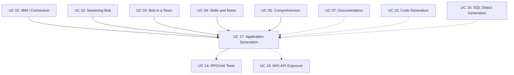

# UC 17 — Application generation

> **Category:** Development — Application interface generation (Track B)
>
> **Position in the journey:** 17 — Phase 4 (Track B), last UC of the track; after UC 15 (Code generation) and UC 16 (SQL object generation), both recommended; depends on UC 05 (and ideally UC 07) for sub-cases B/C.
>
> **Recommended Bob mode:** **IBM i Developer** (single mode for the whole session: reading DDS/RPG sources, generation, writing members and `CRTDSPF` / `CRTBNDRPG` compilation after validation). Switch to **IBM i Database** only to check the interfaces of the SQL objects called by the Web component (`QSYS2.SYSROUTINES`, see UC 16). Without Premium Package: Ask for analysis and generation, Agent for writing and compilation.

---

## ⭐ IBM i Premium Package used

There is **no one-click Premium workflow** for application generation (5250 screens or Web components): UC00 §6 lists, for this UC, neither a workflow, nor a slash command, nor any Understand usage; the slash commands and Understand below are **usage complements** specific to this sheet. The 71 IBM i skills are activated automatically depending on context; two families cover the foundation of this UC. The **5250 → Web conversion** and the **generation of Web components** are covered by no Premium skill: this is the POC's own value.

- **Auto-activated skills used:**
  - **DDS display files:** `dds-display-files` (record formats, indicators, subfiles, screen design) — foundation of sub-cases A, B, and C. → [DDS skills](https://bob.ibm.com/docs/ide/premium-packages/bob-for-i/skills#dds)
  - **IWS web services:** `iws-service-ops` (list, install, start, configure web services), `iws-server-config` (IWS server properties) — relevant for the layer that exposes an RPG back-end to the Web (Prompt 2c). → [IWS skills](https://bob.ibm.com/docs/ide/premium-packages/bob-for-i/skills#ibm-i-iws)
  - **In addition:** `rpg-free-format-fundamentals`, `rpg-procedures-functions`, `rpg-file-operations`, `rpg-indicators` (screen handling program, sub-case A); `dds-physical-files` (files underlying the screen).
- **Slash Command: `/init`** → [Official documentation](https://bob.ibm.com/docs/ide/premium-packages/bob-for-i/slash-commands)
  Generates the application's `AGENTS.md`: run it before the first generations so that the standards (naming, indicators, RPG structure) apply in every session. Official locations: `{LIBRARY}/QBOBSRC/AGENTS.MD` (QSYS workspace) or `{IFS directory}/.bob/AGENTS.md` (IFS workspace) — see UC00 §0 and §3.1.
- **Slash Command: `/review_rpg`** → [Official documentation](https://bob.ibm.com/docs/ide/premium-packages/bob-for-i/slash-commands)
  Review of the generated RPG screen handling program (sub-case A, Prompt 2a-bis). **Complementary** check, which does not replace testing on a 5250 terminal.
- **Slash Command: `/review_SQL`** *(to be decided, depending on the component)* → [Official documentation](https://bob.ibm.com/docs/ide/premium-packages/bob-for-i/slash-commands)
  Only if the Web component calls SQL procedures or views created in UC 16: the review then covers those objects (see UC 16), not the Web code.
- **Understand (optional)** → [Official documentation](https://bob.ibm.com/docs/ide/premium-packages/bob-for-i/understand)
  *If Understand is installed* (setup, `understand_*` tools and `understand-*` skills: see UC00 §2). It maps the callers and callees of an interactive program: useful for spotting the programs called from a screen before designing the exposure contract (sub-cases B/C). This UC is not marked ✅ Understand in UC00 §6.
- **`generate_dds` tool** (sub-case A): DDS generation for a DSPF with layout validation — see UC00 §5.1. Other IBM i tools, documentation search (RAG), and safeguards: see UC00 §5.

> **Why this UC 17 provides unique methodological value:**
> Generating an interface is not just producing fields: a 5250 screen carries implicit logic (indicators, function keys, subfile loading) that has no direct equivalent on the Web. This UC provides:
> 1. **A mandatory qualification per screen:** sub-case (A/B/C), category (SIMPLE/STANDARD/COMPLEX), points of attention, back-end eligibility for sub-case C (Prompt 0).
> 2. **Generation in the chat only**, validated by the team before any writing or compilation (Prompts 1a to 4).
> 3. **Multi-pass handling of subfiles**, because the loading logic is in the RPG program and not in the DDS (Prompts 2A-SFL and 2b).
> 4. **A write and compile safeguard:** member non-existence verified, `REPLACE(*NO)`, human decision when an object exists (Prompts 1a-bis and 2a-bis).
> 5. **An explicit framing of the exposure layer and of the prototype level** (mock or real API) before generating a Web component (Prompts 2c and 3b).

> ⚠️ **Distinctions from the other Track B UCs (routing rule):**
> - **UC 15** generates the **RPG logic** (batch programs, procedures, CRUD); **UC 17** generates the **interface** (DDS display file or Web component) and the RPG program that drives the screen. For a complete interactive application: UC 15 for the processing logic, UC 17 for the screen.
> - **UC 16** creates the **SQL objects** (tables, procedures, triggers); the Web components of UC 17 can query procedures or views created in UC 16.
> - **Modification of an existing display file** (adding a field, for example): this is not *ex nihilo* generation — see UC 15 (modification of existing code); UC 17 covers the creation of a new interface or its conversion.

---

## Scope

**Three sub-cases, to be handled as three levels of ambition for modernizing the interface** (Prompt 0 determines the sub-case for each screen or group of screens):

| Sub-case | Description | Constraint |
|---|---|---|
| **A — New 5250 application** | *Ex nihilo* generation of a DDS display file (`*DSPF`) and of the RPG screen handling program | Mockup or functional description required |
| **B — 5250 → Web conversion** | Analysis of an existing display file and generation of equivalent Web components (React / Vue / Angular depending on the company's choice) | UC 05 mandatory; UX thinking required — no copy-paste of the 5250 screen |
| **C — Web UI on an existing back-end** | Variant of B: the back-end RPG program **must not be modified** | Program eligibility verified at Prompt 0; written confirmation from the team |

> ⚠️ **UC 17 is the longest UC of Track B and the one that demands the most framing.** Do not start without having defined the exact scope: which sub-case, how many screens, which pilot screen. Sending a whole application to Prompt 0 produces a generic result with no value.

---

## Objective

Generate IBM i **application interfaces** — new 5250 screens, Web components, or conversions of existing 5250 screens to the Web — from **verified** sources and specifications, writing and compiling on the test IBM i only after explicit team validation.

**What this UC enables:**
- Qualifying each screen (sub-case, category, points of attention) before any generation.
- Generating a DDS display file and the RPG screen handling program that comply with the standards, with controlled compilation (sub-case A).
- Inventorying the existing 5250 screens and converting each screen, including subfiles, into a Web component (sub-cases B/C).
- Translating DDS validations, function keys, and indicators into Web equivalents.
- Framing the exposure layer (IWS, Node/Toolkit adapter, CGI, existing API) and the security level of the prototype.
- Steering a complete application scope with a screen conversion plan.

**Main success criterion:** for each screen in the scope, the sub-case and category are documented; the generated source (DDS, RPG, or Web component) has been reviewed by a developer (RPG or Front-End as applicable); the DDS and the RPG compile without errors on the test IBM i (sub-case A) and have been tested on a 5250 terminal or with the DDS Previewer; the Web component has been reviewed by a Front-End developer; the "RPG not modified" constraint is confirmed in writing (sub-case C).

---

## Prerequisites

- **Phase:** Phase 4 — Track B (Generation)
- **Required previous UCs:**
  - **UC 01 — Connect Bob to the IBM i** (**mandatory**): active connection, access to the sources (`QDDSSRC…`, `QRPGSRC…`).
  - **UC 02 — Mastering Bob**, **UC 03 — Bob in a team**, and **UC 04 — Skills and Rules strategy** (**mandatory**): IBM i Developer / IBM i Database modes, `/init`, location of the rules and shared `AGENTS.md` (to hold the screen and naming standards).
  - **UC 05 — Code comprehension** (**mandatory for sub-cases B/C**): map of the interactive program (screens, indicators, navigation logic).
  - **UC 07 — Complete documentation** (**recommended**): functional specification of the screens to convert or create.
  - **UC 15 — Code generation** and **UC 16 — SQL object generation** (**recommended** if the screen relies on generated RPG procedures or SQL objects).
- **Required deliverables:**
  - `{appId}-comprehension-{composant}-report-{YYYYMMDD-HHmm}.md` — UC 05 (**mandatory for B/C**).
  - `{appId}-doc-spec-fonc-{composant}-{YYYYMMDD-HHmm}.md` — UC 07 (recommended).
  - Screen and naming standards (field prefixes, indicator range, RPG structure) in `AGENTS.md` or the rules. If missing, Prompt 0 flags them "NONE".
  - **Sub-case A:** mockups or functional description (fields, validations, navigation). Without a mockup, Prompt 1a produces a generic screen.
  - **Sub-case B/C:** mockups or wireframes from the Front-End team (recommended) — without a mockup, Bob generates a default layout with no UX value.
  - **Sub-case B/C:** the chosen **Web framework** (React / Vue / Angular) decided and documented **before** starting; otherwise Bob generates React by default.
  - **Sub-case C:** explicit written confirmation from the team that the back-end RPG program will not be modified, recorded in the analysis file.
- **IBM i system prerequisites:**
  - Test library and source files identified (e.g. `[LIB_NAME]`, `[SRCFILE_DDS]`, `[SRCFILE_RPG]`) — **to be confirmed in Prompt 0**, never assumed.
  - `*CHANGE` rights on the target library to write a member and compile (sub-case A).
- **Recommended Bob level:** Intermediate to Advanced
- **Estimated Bob Coins:** ⚠️ *To be calibrated after the UC 17 lab on FLGHT400.* As a precaution: handle **1 pilot screen (or 1 group of related screens) per session**.

---

## Concrete example — FLGHT400 Lab

> ⚠️ The FLGHT400 lab contains **no sub-case A result** (new 5250 application generated *ex nihilo*). It contains two **conversion (sub-case B)** Web prototypes with **mocked data**: no real IBM i API was wired in (IWS exposure is cited as a next step, not performed). A complete generation example remains to be produced during the UC 17 lab.

| Deliverable | Lab file | What it illustrates |
|---|---|---|
| "Create Order" screen in React | [`../labs_FLGHT400_results/FLGHT403_App_React.md`](../labs_FLGHT400_results/FLGHT403_App_React.md) (+ [`_conversation`](../labs_FLGHT400_results/FLGHT403_App_React_conversation.md), [`.png`](../labs_FLGHT400_results/FLGHT403_App_React.png)) | React 18.2 + Vite 4.4.5 + `@carbon/react` (Carbon 11, g100 theme) + Sass component, running on IBM i (PASE, Node v22). 10 Carbon controls (Select, RadioButtonGroup, NumberInput) with **static lists**, live price calculation (8.75% tax) and an "F10 – Make Reservation" button with notification — illustrates the DDS field → Web control mapping and PF → button (Prompt 3b). Environment pitfalls resolved: `node` wrapper with `LIBPATH=/QOpenSys/pkgs/lib`, esbuild patch script (no os400 ppc64 binary) to rerun after each `npm install`, non-interactive `npm create vite` that hangs, SCSS order (`@use theme` before `components`). Access through an SSH tunnel. **Prototype level: mock** (see the security table of Prompt 3b). |
| 5250 prototype emulated on the Web | [`../labs_FLGHT400_results/FLGHT403_App_5250_web.md`](../labs_FLGHT400_results/FLGHT403_App_5250_web.md) (+ [`_conversation`](../labs_FLGHT400_results/FLGHT403_App_5250_web_conversation.md), [`web1.png`](../labs_FLGHT400_results/FLGHT403_App_5250_web1.png), [`web2.png`](../labs_FLGHT400_results/FLGHT403_App_5250_web2.png)) | Framework-free HTML/CSS/JS prototype emulating 4 screens (FRS000DF LOGON, FRS001DF Create Order, FRS002DF Modify Order, FRS003DF Display Order), built from the `FLGHT403/QDDSSRCD` sources, deployed on the `QICCQXML` Apache server. Constraints respected: **no FLGHT403 object modified (read-only)**, no new server. Illustrates reading the existing DDS (Prompt 1b) and the "do not modify the existing" principle. Follow-ups suggested by the lab: screens FRS004–024 (subfiles) and connection to an IWS REST API — **not performed**. |
| Application context | [`../labs_FLGHT400_results/FLGHT403_architecture.md`](../labs_FLGHT400_results/FLGHT403_architecture.md), [`FLGHT403_functional_areas.md`](../labs_FLGHT400_results/FLGHT403_functional_areas.md) | Map of the application the screens come from (input to Prompt 0). |
| *(Related, outside generation)* Modification of an existing DSPF | [`../labs_FLGHT400_results/FLGHT403_Change_Total_Flight_Hours.md`](../labs_FLGHT400_results/FLGHT403_Change_Total_Flight_Hours.md) | Addition of the field `SFLHRS` (line 16, column 35, `4D 0B`) to `FRS021DF` then `CRTDSPF … AUT(*EXCLUDE)` (result `CPC7301`). This is a **modification** of an existing screen, not a generation: cited for the file field → screen field chain. The `D` data type is used there and the display file compiles: do not claim that a field type is "invalid" without having compiled it. |

**Proposed lab scenario (to be produced, not performed):** on a **copy** of `FLGHT403` (never on the original), (A) generate a small inquiry screen with its DDS and RPG program, compiled (Prompts 0 → 1a → 1a-bis → 2a → 2a-bis); (B) convert a screen with a subfile (e.g. FRS004–024) in two passes (Prompts 0 → 1b → 2b → 3b); document the exposure contract (Prompt 2c) then build the plan for the remaining screens (Prompt 4).

---

## Starting a Bob session

### The three workspaces

- **Local workspace** (workstation) — assessment reports, documented DDS/RPG sources, generated Web components, conversion plan (`bob-reports/`), standards (rule `.bob/rules-ibm-i-developer/` or `AGENTS.md` section, see UC 03 / UC 04). The **Web code** of the Front-End project lives in its own repository, decided with the team.
- **IBM i Libraries / QSYS** ⭐ — **execution workspace for sub-case A**: DDS/RPG source members written in `[SRCFILE_DDS]` / `[SRCFILE_RPG]`, compiled `*DSPF` and `*PGM` objects. The project's `AGENTS.md` (`{LIBRARY}/QBOBSRC/AGENTS.MD`) is injected there automatically. **Web code is never compiled on the IBM i.**
- **IFS (`$HOME`)** — possible hosting of a Web prototype (as in the lab, under the PASE home directory); to be decided with the team.

> ⚠️ **Standards and QSYS workspace:** when the active workspace is *IBM i Libraries* alone, the local workspace and its `.bob/` are **not loaded** (see UC 03). For the screen standards to apply in all cases, declare them **also** in the application's `AGENTS.md`.

### Session rules

- **One new Bob conversation per screen or group of functionally related screens** (`+` button of the Chat panel). Exception: chain several screens in the same session if the navigation between them is documented and the data structures are shared. Do not reuse another screen's conversation: indicators and field names pollute the generation.
- **Open the sources in the editor** before Prompt 0 (Code for IBM i Object Browser → right-click the member → *Open in Editor*): display file `[LIB_NAME]/[SRCFILE_DDS]([DSPF_NAME])`, RPG screen handling program `[LIB_NAME]/[SRCFILE_RPG]([PROGRAM_NAME])`, any copybooks. For sub-case A: the mockup or functional description.
- **Load the context:** `AGENTS.md`, `{appId}-comprehension-…` (UC 05), `{appId}-doc-spec-fonc-…` (UC 07), mockups.
- **Intermediate save rule:** UC 17 is long. Beyond 4 to 5 consecutive prompts, Bob may compress the first turns and lose the Prompt 0 points of attention (subfiles identified, navigation indicators, "RPG not modified" constraint). **Save to `bob-reports/` after each major prompt** (Prompts 0, 1b, 2b), not only at the end of the session.
- **Session resumption:** reload the latest `{appId}-app-{composant}-analyse-ecrans-*.md` and state "the screen analysis is in [FILE] — the selected sub-case is [A/B/C], the category [SIMPLE/STANDARD/COMPLEX] — resume at Prompt [N]".
- **Golden rule:** during Prompts 0 to 4, Bob **reads the sources and produces in the chat**; no `write_member`, no compilation, **except for Prompts 1a-bis and 2a-bis only** (sub-case A), where writing and compiling are allowed only **after explicit validation** by the team. Never write while analyzing an existing display file (risk of modifying the existing). **No `CRTDSPF` for sub-cases B/C.**

---

## Structured approach and prompts

### Recommended progression: start with a known screen

Start with a **simple screen whose behavior the team knows** — inquiry or entry, with no subfile or multi-level navigation, whose 5250 rendering can be checked immediately. The first generation serves to calibrate Bob's quality against the company's style (labels, field naming, validations) and the team's ability to validate the result.

**Sub-case A — new 5250 application:**

| Step | Screen | Category | Goal |
|---|---|---|---|
| 1 | Inquiry, < 15 fields, no subfile or navigation | SIMPLE | Calibrate DDS generation: field types, validations, layout |
| 2 | Entry with validation (`VALUES`, `RANGE`), 1 or 2 function keys | SIMPLE to STANDARD | Validate control indicators and DDS-side validation |
| 3 | 2 to 5 linked screens with function-key navigation | STANDARD | Validate the consistency of navigation and shared indicators |
| 4 | Screen with a subfile | COMPLEX | Apply the three-pass strategy (Prompt 2A-SFL) |

**Sub-case B/C — 5250 → Web conversion:**

| Step | Screen | Category | Goal |
|---|---|---|---|
| 1 | Simple screen, no subfile, documented RPG program (UC 05 completed) | SIMPLE | Calibrate the component structure and client-side validations |
| 2 | Screen with DDS validations (`CHECK`, `VALUES`, `RANGE`) and function keys | SIMPLE to STANDARD | Validate the translation of DDS validations and PFs |
| 3 | Screen with 1 simple subfile | STANDARD | Apply the two-pass strategy on a simple case |
| 4 | Multi-screen, dynamic navigation, nested subfiles, RPG indicators driving the display | COMPLEX | Identify Bob's limits and the screens requiring a UX workshop |

### Complexity impact on the strategy

Complexity is not measured in lines of DDS but in **structural factors**: presence of a subfile (loading logic in the RPG, with no direct HTML equivalent), implicit navigation in the RPG program (function keys, level indicators), embedded DDS validations (to be recreated client-side with different semantics), nested program calls from a screen, and — in sub-case C — the constraint of not modifying the RPG.

**Sub-case A**

| Category | Criteria | Sequence |
|---|---|---|
| **SIMPLE** | 1 screen, < 15 fields, no subfile, simple validations | Prompt 0 → 1a → 1a-bis → 2a → 2a-bis |
| **STANDARD** | 2 to 5 linked screens, PF navigation, no subfile | Prompt 0 → 1a per screen → 1a-bis → 2a with navigation → 2a-bis |
| **COMPLEX** | Subfile, multi-level navigation, RPG coupled to the display | Prompt 0 (delimit) → 1a per screen without subfile → **2A-SFL** → 2a → 2a-bis |

**Sub-case B/C**

| Category | Criteria | Sequence |
|---|---|---|
| **SIMPLE** | 1 to 2 screens without subfile, direct validations, documented RPG | Prompt 0 → 1b → (2c) → 3b |
| **STANDARD** | 3 to 6 screens, 1 subfile, PF navigation | Prompt 0 → 1b → 2b (two passes) → (2c) → 3b per screen |
| **COMPLEX** | Nested subfiles, dynamic navigation, state driven by RPG indicators, nested calls | Prompt 0 (scope + UX workshop required before generation) → screen-by-screen strategy |

> 💡 On a COMPLEX B/C, Prompt 0 may conclude that a **UX workshop** with the Front-End team is needed before any generation. In that case, do not move on to Prompt 1b: wait for mockups or wireframes.

---

### Prompt 0 — Qualification: which sub-case, which category?

**Objective:** Determine the sub-case (A/B/C) and the category for a screen or group of screens, inventory the standards and points of attention, and recommend the sequence of prompts — without writing anything.

**When to use:** **Mandatory** entry point, before any generation, for each screen or group of screens. Never skip it on a screen that looks simple: a screen with few fields can have complex navigation driven by RPG indicators.

**Required input:**
- Project `AGENTS.md` and screen standards if available.
- **B/C:** display file `[DSPF_NAME]` and RPG program open in the editor; `{appId}-comprehension-…` (UC 05); `{appId}-doc-spec-fonc-…` (UC 07) if available.
- **A:** functional description of the screen (UX goal, fields, validations, function keys) or mockup.

**Workspace:** Local (`bob-reports/`) for the report, IBM i QSYS for the reads (read-only).
**Mode:** IBM i Developer.
**Key skills used:** `dds-display-files`, `rpg-indicators` (and `iws-service-ops` for reading the existing exposure layer).

**Prompt:**

```text
[B/C: the DDS display file [DSPF_NAME] is in [LIB_NAME]/[SRCFILE_DDS]; the RPG screen program
is [PROGRAM_NAME]. The comprehension file [UC05_FILE] is available.]
[A: description of the need, in terms of UX goal: [DESCRIPTION]]
[Load into the context: AGENTS.md, UC 07 specification if available]

Do not invent any object. Every source member, record, field, indicator, or program mentioned must
come from a real reading of the sources; otherwise write "NOT VERIFIED". This step is
read-only: no write_member, no compilation.

Produce in English, in markdown, an assessment report:

## UC 17 Qualification — [SCREEN_NAME or DSPF_NAME]

### 1. Selected sub-case
A (new 5250), B (5250 → Web conversion) or C (Web UI on an existing back-end without RPG
modification). Justification in 1 to 2 sentences.

### 2. Category
SIMPLE / STANDARD / COMPLEX, justified according to the criteria of the report (subfile, number
of screens, validations, navigation).

### 3. Available standards
| Area | Source (AGENTS.md / rules / NONE) | Value |
|---|---|---|
| Naming of records and fields | | |
| Indicator range | | |
| RPG structure (CTL-OPT, DCL-F, INDDS) | | |
| Selected Web framework (B/C) | | |
If "NONE": propose deriving the conventions from existing objects, marked "TO BE VALIDATED".

### 4. Points of attention detected
- Subfile present? (YES/NO; if YES: page-at-a-time or load-all, based on the RPG)
- DDS validations (CHECK, VALUES, RANGE)?
- Implicit navigation logic in the RPG (function keys, option indicators)?
- Nested program calls from the screen?
- Fields shown/hidden according to dynamic indicators?
- [Sub-case C] Is the program [PROGRAM_NAME] callable outside 5250 (no WORKSTN file,
  no EXFMT, no unexposed interactive state)?

### 5. Sub-case C eligibility (sub-case C only)
Exact conclusion: "ELIGIBLE FOR SUB-CASE C" or "NOT ELIGIBLE FOR SUB-CASE C — reason: …".
If NOT ELIGIBLE: do not move on to Prompt 1b; alternative strategy to be decided with the team.

### 6. Prototype level (B/C)
Mocked data or real IBM i API? (see the security table before Prompt 3b)

### 7. Recommended prompt sequence
Ordered list according to the sub-case and category.

### 8. Scope
Recommendation if the scope is too broad: reduce to 1 pilot screen.
```

**Deliverable produced:** `{appId}-app-{composant}-analyse-ecrans-{YYYYMMDD-HHmm}.md` (in `bob-reports/`).

> 💡 Bob detects a subfile by searching for the keywords `SFL`, `SFLCTL`, and `SFLPAG` in the DDS R-specs.

> ⚠️ **Pitfall avoided:** a skipped Prompt 0 on a COMPLEX screen leads to a Web component that displays the fields but handles neither pagination nor navigation. Prompt 0 takes a few minutes and avoids hours of generation in the wrong direction.

---

## — SUB-CASE A: new 5250 application —

### Prompt 1a — DDS display file generation

**Objective:** Generate in the chat the DDS source of a screen, compliant with the standards.

**When to use:** After Prompt 0 (SIMPLE or STANDARD category confirmed). For a subfile: see Prompt 2A-SFL first.

**Required input:**
- Assessment report `{appId}-app-{composant}-analyse-ecrans-{YYYYMMDD-HHmm}.md`.
- Description of the screens (fields, types, lengths, validations, function keys) or mockup.
- Standards loaded (naming, indicator range).

**Workspace:** In the chat (no writing).
**Mode:** IBM i Developer.
**Key skills used:** `dds-display-files`, `dds-physical-files` (if the screen references file fields).

**Prompt:**

```text
Based on the assessment report [ANALYSIS_FILE_NAME], generate in the chat, in English
and in markdown, the DDS display file for the screen [SCREEN_NAME], applying the loaded standards.
[Mockup available: [FILE_NAME].]

Expected content:

### 1. DDS header
Comments: screen name, date, author, calling program, status "To be validated".
Add a source manager traceability placeholder in the header if the team requests it.

### 2. File specifications
DSPSIZ, INDARA, and any required global parameters.

### 3. Records and fields
For each RECORD: name (per the standards), fields (name, type, length, position, label),
validations (CHECK, VALUES, RANGE), attributes (DSPATR, COLOR) driven by indicators.
Field types: use types consistent with the SQL types or the file fields
(for example alphanumeric, zoned, date, time, timestamp). For any position 35 value
you are not sure of, write "TO BE VERIFIED AT COMPILATION" rather than asserting it.
Numeric display formatting is set with EDTCDE or EDTWRD.

### 4. Function keys
- CAxx: return to the program without retransmitting the inputs (e.g. CA03 = Exit).
- CFxx: return to the program retransmitting the inputs (e.g. CF06 = Add, CF12 = Cancel).
- VLDCMDKEY validates the use of a command key; it does not define the keys.
Document the indicator range used and the indicator ↔ key correspondence.

Do not invent any field, file, or indicator absent from the need or the standards. For a point on which
the standards are silent, ask the question. Do not save anything and do not compile anything.
```

**Deliverable produced:** `{appId}-app-{composant}-dspf-genere-{YYYYMMDD-HHmm}.md` (in `bob-reports/`, DDS section).

> 💡 `DSPATR(HI)` highlights a field, `DSPATR(PR)` protects it, `DSPATR(ND)` hides it: these attributes are driven by RPG indicator numbers (01-99) — set the indicator range at the start of the session.

### Prompt 1a-bis — Writing the member and `CRTDSPF` compilation

**Objective:** Write the validated DDS without overwriting an existing member, then compile the display file.

**When to use:** Only after explicit validation of the DDS by the team.

**Required input:**
- Validated DDS source (Prompt 1a).
- `[LIB_NAME]`, `[SRCFILE_DDS]`, `[DSPF_NAME]` confirmed in Prompt 0.

**Workspace:** IBM i QSYS (member `[LIB_NAME]/[SRCFILE_DDS]([DSPF_NAME])` and `*DSPF` object).
**Mode:** IBM i Developer (Agent mode if Premium is not available).
**Key skills used:** `dds-display-files`.

**Prompt:**

```text
The DDS [DSPF_NAME] is validated by the team.

Step 0 — Verify that the member does not exist:
SELECT COUNT(*) AS MEMBER_COUNT
FROM QSYS2.SYSPARTITIONSTAT
WHERE SYSTEM_TABLE_SCHEMA = '[LIB_NAME]'
  AND SYSTEM_TABLE_NAME   = '[SRCFILE_DDS]'
  AND SYSTEM_TABLE_MEMBER = '[DSPF_NAME]';
If MEMBER_COUNT > 0: stop and report it; do not overwrite anything without my explicit confirmation.

Step 1 — Write the validated DDS source (without Markdown fences) into
[LIB_NAME]/[SRCFILE_DDS]([DSPF_NAME]).

Step 2 — Compile:
CRTDSPF FILE([LIB_NAME]/[DSPF_NAME]) SRCFILE([LIB_NAME]/[SRCFILE_DDS]) SRCMBR([DSPF_NAME]) REPLACE(*NO)

If the message is CPF5813 (object already exists): display it and stop. DO NOT RERUN with
REPLACE(*YES) automatically; ask for an explicit decision (keep or replace).

If compilation fails: list the messages with the source line number, propose the DDS fix
for each error, and show me the diff before correcting the member.

Remind that a successful compilation validates neither the visual rendering nor the navigation: testing is
mandatory on a 5250 terminal or with the Code for IBM i DDS Previewer.
```

**Deliverable produced:** DDS member and `*DSPF` in `[LIB_NAME]` (IBM i QSYS).

> ⚠️ Bob can fix DDS syntax errors (misspelled keyword, misplaced field), but cannot validate the visual rendering: overlaps and truncated labels can only be detected on a 5250 terminal or the DDS Previewer.

### Prompt 2a — RPG screen handling program

**Objective:** Generate in the chat the free-format ILE RPG program that drives the screen (display, key reading, input validation).

**When to use:** After compilation of the display file (Prompt 1a-bis).

**Required input:**
- Compiled display file `[DSPF_NAME]` in `[LIB_NAME]`.
- RPG standards loaded; processing procedures generated in UC 15 if available.

**Workspace:** In the chat (no writing).
**Mode:** IBM i Developer.
**Key skills used:** `rpg-free-format-fundamentals`, `rpg-indicators`, `rpg-file-operations`, `rpg-procedures-functions`, `dds-display-files`.

**Prompt:**

```text
The display file [DSPF_NAME] is compiled and available in [LIB_NAME]. Generate in the chat, in
English and in markdown, the free-format ILE RPG screen handling program for [SCREEN_NAME],
applying the loaded standards:

### 1. Header and CTL-OPT (per the standards)

### 2. Declarations
DCL-F for the display file, DCL-S / DCL-DS for the screen fields.
The DDS uses INDARA: do not read indicators with *INxx. Use INDDS and a structure:
  DCL-F [DSPF_NAME] WORKSTN INDDS(dsIndicators);
  DCL-DS dsIndicators;
    exit     IND POS(3);
    add      IND POS(6);
    cancel   IND POS(12);
  END-DS;
The position numbers correspond to the indicators actually defined in the DDS.

### 3. Display loop
EXFMT, then test the dsIndicators.xxx indicators after each EXFMT.

### 4. Program-side validation
Check of mandatory fields; calls to existing service procedures.

### 5. Business calls
CALLP to the processing programs or procedures. Do not write business logic in the
screen program (CRUD, calculations, business rules): it belongs to UC 15.

Do not invent any procedure, file, or indicator. Do not save anything and do not compile anything.
```

**Deliverable produced:** `{appId}-app-{composant}-dspf-genere-{YYYYMMDD-HHmm}.md` (RPG Program section, in `bob-reports/`).

> 💡 If the request is mostly about processing logic ("generate the order processing logic"), use UC 15; UC 17 stays focused on the interface.

### Prompt 2a-bis — Writing the RPG member and `CRTBNDRPG` compilation

**Objective:** Write the validated RPG without overwriting an existing member, compile it, and report the result.

**When to use:** After validation of the RPG (Prompt 2a) **and** after compilation of the display file (Prompt 1a-bis).

**Required input:**
- Validated RPG source, existing `*DSPF` display file in `[LIB_NAME]`.
- `*CHANGE` rights on the target library.

**Workspace:** IBM i QSYS (member `[LIB_NAME]/[SRCFILE_RPG]([PROGRAM_NAME])` and `*PGM` object).
**Mode:** IBM i Developer.
**Key skills used:** `rpg-free-format-fundamentals`, `rpg-file-operations`.

**Prompt:**

```text
The RPG program [PROGRAM_NAME] is validated. The display file [DSPF_NAME] is compiled in [LIB_NAME].

Step 1 — Verify that the member does not exist:
SELECT COUNT(*) AS MEMBER_COUNT
FROM QSYS2.SYSPARTITIONSTAT
WHERE SYSTEM_TABLE_SCHEMA = '[LIB_NAME]'
  AND SYSTEM_TABLE_NAME   = '[SRCFILE_RPG]'
  AND SYSTEM_TABLE_MEMBER = '[PROGRAM_NAME]';
If MEMBER_COUNT > 0: stop and report it; do not overwrite anything without my confirmation.

Step 2 — Write the RPG source (without Markdown fences) into [LIB_NAME]/[SRCFILE_RPG]([PROGRAM_NAME]).

Step 3 — Compile with CRTBNDRPG on [LIB_NAME] (REPLACE(*NO) for the first attempt) and report:
- Success with no error or warning: confirm.
- Errors: table (code, line, description), proposed fix, stating whether it is "mechanical" or
  "developer decision". Show the diff before correcting.
- Warnings: list with severity level.

Step 4 — Run /review_rpg on the program and summarize the critical and major findings.

Remind that a successful compilation does not validate the screen's behavior: testing is mandatory on a
5250 terminal or the DDS Previewer.
```

**Deliverable produced:** RPG member and `*PGM` in `[LIB_NAME]` (IBM i QSYS); optional report `{appId}-app-{composant}-rapport-{YYYYMMDD-HHmm}.md` (in `bob-reports/`, on request).

> ⚠️ **Mandatory order: `CRTDSPF` (Prompt 1a-bis) before `CRTBNDRPG` (Prompt 2a-bis).** The RPG contains a `DCL-F` that references the display file: if the `*DSPF` does not exist yet, compilation fails with `RNF7031`.

### Prompt 2A-SFL — 5250 subfile (sub-case A COMPLEX, three passes)

**Objective:** Generate a subfile (SFL / SFLCTL) and the associated loading strategy, in three independently validated passes.

**When to use:** Sub-case A COMPLEX. **Never generate a subfile in a single pass**: the SFL DDS, the SFLCTL, and the RPG loading logic are separate entities.

**Required input:**
- Assessment report (Prompt 0); main display file `[DSPF_NAME]` existing or in progress.
- Need: columns, volume, pagination, option field.

**Workspace:** Passes 1 and 2: in the chat. Pass 3: IBM i QSYS (compilation).
**Mode:** Passes 1 and 2: IBM i Developer, without writing; pass 3: IBM i Developer with writing/compilation allowed after validation.
**Key skills used:** `dds-display-files`, `rpg-file-operations`, `rpg-indicators`.

**Pass 1 — Subfile qualification (chat):**

```text
I need to create a 5250 subfile for [SCREEN_NAME]. Produce in English, in markdown:

## SUBFILE Qualification — [SFL_NAME]

### 1. Structure
- Displayed columns (name, type, length, position).
- SFLPAG: number of visible rows per page.
- SFLSIZ: selected strategy:
  • page-at-a-time: SFLSIZ = SFLPAG — the subfile holds only one page; the program
    reloads on each navigation;
  • load-all (expanding): SFLSIZ > SFLPAG — several pages loaded; paging can be done
    among the records present.
- RRN field (SFLRCDNBR in the SFLCTL): positions the displayed page; with CURSOR, also positions
  the cursor. It does not determine the loading strategy.

### 2. SFLCTL
- Indicators SFLDSP, SFLDSPCTL, SFLCLR, SFLEND: choose a consistent, documented pattern
  (the numbers may differ depending on needs).
- Function keys (CAxx / CFxx).

### 3. Loading (RPG program)
- Page-at-a-time: loading loop, one WRITE per visible row, paging keys.
- Load-all: full loading before display.
- Reading the selected row: READC (next changed record, option field); do not confuse it
  with SFLRCDNBR (displayed page).

### 4. Risks and decisions
Maximum number of records, paging or full loading, option field present or not.
```

**Pass 2 — Subfile DDS generation (chat):**

```text
The qualification [SFL_NAME] is available. Generate in English, in markdown, the complete
A-specs / R-specs:
- SFL: record with the SFL keyword, one field per column, option field if needed.
- SFLCTL([SFL_NAME]): SFLPAG, SFLSIZ (equal for page-at-a-time, SFLSIZ > SFLPAG for load-all),
  SFLRCDNBR if repositioning is required, control indicators with justification of the numbers.
- Associated function keys (CAxx / CFxx rule from Prompt 1a).
Do not save anything and do not compile anything.
```

**Pass 3 — Compilation (after validation):**

```text
The DDS of the subfile [SFL_NAME] / [SFLCTL_NAME] has been added to [LIB_NAME]/[SRCFILE_DDS]([DSPF_NAME]).
Compile the complete display file:
CRTDSPF FILE([LIB_NAME]/[DSPF_NAME]) SRCFILE([LIB_NAME]/[SRCFILE_DDS]) SRCMBR([DSPF_NAME]) REPLACE(*NO)
Apply the Prompt 1a-bis rule (CPF5813, human decision before REPLACE(*YES)). In case of an error
on the subfile (keyword order, SFLSIZ, field type): identify the line and the keyword,
propose the precise fix and show the diff before correcting.
```

**Deliverable produced:** `{appId}-app-{composant}-dspf-genere-{YYYYMMDD-HHmm}.md` (SFL / SFLCTL sections, in `bob-reports/`); compiled display file in `[LIB_NAME]` (IBM i QSYS).

> ⚠️ **After pass 3: Prompt 2a.** The subfile loading logic (WRITE in a loop, SFLDSP, READC) must be included in the RPG program.

---

## — SUB-CASES B/C: 5250 → Web conversion —

### Prompt 1b — Analysis of existing 5250 screens [Complement — not covered by the Premium workflow]

**Objective:** Inventory all the screens of a display file before any Web generation.

**When to use:** After Prompt 0 (category confirmed, sub-case C eligible if applicable). The source display file must be open in the editor.

**Required input:**
- Display file `[DSPF_NAME]`; UC 05 comprehension file.

**Workspace:** In the chat (read-only), then local save.
**Mode:** IBM i Developer.
**Key skills used:** `dds-display-files`, `rpg-indicators`.

**Prompt:**

```text
The display file [DSPF_NAME] is in [LIB_NAME]/[SRCFILE_DDS]. The comprehension file
[UC05_FILE] is available. Read the display file and produce in English, in markdown:

## 5250 Screen Analysis — [DSPF_NAME]

### Record table
| RECORD name | No. of fields | Type (screen / SFL / SFLCTL / message) | DDS validations | Subfile (Y/N) | Keys used |
(one row per RECORD, including error message records and hidden records)

### Points of attention per screen
For each complex RECORD: condition indicators, conditional DSPATR, fields shown or
hidden according to RPG indicators.

### Recommended generation sequence
Screens without subfile first, subfiles last.

Read-only: no write_member. Do not invent any record or field; "NOT VERIFIED" otherwise.
```

**Deliverable produced:** `{appId}-app-{composant}-analyse-ecrans-{YYYYMMDD-HHmm}.md` (in `bob-reports/`, to be added to the Prompt 0 report).

> 💡 A field displayed only if an indicator is active (for example `30 DSPATR(ND)`) becomes a boolean property of the Web component: Bob must document these conditions for the Front-End developer.

### Prompt 2b — Analysis and conversion of a subfile (two passes) [Complement — not covered by the Premium workflow]

**Objective:** Convert an existing subfile into a Web list component, after analyzing its loading logic in the RPG.

**When to use:** Mandatory as soon as a subfile is present. **Never convert a subfile in a single pass**: the loading logic is partly in the RPG program, not in the DDS.

**Required input:**
- Display file and RPG program driving the subfile, open in the editor.
- Selected Web framework; assessment report.

**Workspace:** In the chat (no writing); local save after each pass.
**Mode:** IBM i Developer.
**Key skills used:** `dds-display-files`, `rpg-file-operations`, `rpg-indicators`.

**Pass 1 — Subfile analysis:**

```text
The display file [DSPF_NAME] contains the subfile [SFL_NAME] and its SFLCTL [SFLCTL_NAME].
The RPG program [PROGRAM_NAME] that drives it is open in the editor.
Produce in English, in markdown:

## SUBFILE Analysis — [SFL_NAME]
1. DDS structure: columns, SFLPAG, SFLSIZ.
2. Loading logic: page by page or complete; when SFLDSP, SFLDSPCTL, SFLCLR, and SFLEND
   are activated; navigation keys.
3. Row selection: effect of the values entered in the option field.
4. Sections of the RPG program that load, clear, or navigate the subfile.
Read-only. [Sub-case C: the program [PROGRAM_NAME] must NOT be modified.]
```

**Pass 2 — Generation of the equivalent component:**

```text
The analysis of the subfile [SFL_NAME] is in [FILE_NAME]. Selected framework: [React / Vue / Angular].
Generate in English, in markdown, the equivalent Web component:
1. Structure: props, state, data interface (equivalent of the SFL columns).
2. Pagination: server-side paged loading (page parameters on the back-end call), end-of-list
   indicator (equivalent of SFLEND). Do not paginate client-side over all the records
   if the original subfile was loaded page by page.
3. Row selection: action buttons or context menu (equivalent of the option field).
4. Integration with the back-end: call interface of the RPG program (IN/OUT parameters).
[Sub-case C: reminder — the RPG program [PROGRAM_NAME] must NOT be modified; the call API
preserves the existing interface.]
Write nothing; generate in the chat.
```

**Deliverable produced:** `{appId}-app-{composant}-web-genere-{YYYYMMDD-HHmm}.md` (list component, in `bob-reports/`).

### Prompt 2c — Back-end exposure contract [Complement — not covered by the Premium workflow]

**Objective:** Document how the Web component will call the IBM i back-end, before generating the component. A browser cannot call a `*PGM` directly.

**When to use:** Before Prompt 3b, as soon as the component must call IBM i other than through mocked data.

**Required input:**
- Assessment report; interface of the program or SQL objects called (IN/OUT parameters); team decision on the exposure layer.

**Workspace:** In the chat (no writing; no service created or started).
**Mode:** IBM i Developer (IBM i Database to check the UC 16 SQL routines via `QSYS2.SYSROUTINES`).
**Key skills used:** `iws-service-ops`, `iws-server-config` (reading the existing setup only).

**Prompt:**

```text
The Web component [COMPONENT_NAME] must call [PROGRAM_NAME or SQL_PROCEDURE_NAME]. Produce in
English, in markdown, the exposure contract:

## Exposure Contract — [COMPONENT_NAME]
| Element | Value | Source |
|---|---|---|
| Selected exposure layer | IWS / Node adapter (Toolkit) / CGI / existing API | team decision |
| URL and HTTP method | | |
| IN/OUT parameters and serialization | | reading of the program or of QSYS2.SYSROUTINES |
| Authentication and authorization | | |
| Session / state management | | |
| Prototype level | mock / real API | |

If the exposure layer is not decided, write "TO BE DECIDED WITH THE TEAM" and do not choose for
them. Do not create, install, or start any IWS service. [Sub-case C: the program
[PROGRAM_NAME] must NOT be modified; the contract preserves its interface.]
```

**Deliverable produced:** "Exposure contract" section added to `{appId}-app-{composant}-analyse-ecrans-{YYYYMMDD-HHmm}.md` (in `bob-reports/`).

> ⚠️ **Not performed in the FLGHT400 lab**: IWS exposure is cited there as a next step. This prompt frames the decision; setting up the service is a separate operation, validated by the team.

> ⚠️ **Before running Prompt 3b: define the prototype level**
>
> | Prototype type | Security requirements |
> |---|---|
> | **Mocked data, no real IBM i API** | Detailed security can be deferred (no secrets or production data). Record this choice in the analysis file. |
> | **Real IBM i API** | Authentication, server-side authorization, validation of received data, secrets management (no hard-coded credentials), dedicated application IBM i profile: **mandatory before any test with real data**. Client-side JavaScript validations are not security controls. |
>
> If the prototype moves from mock to real API during the session, apply the requirements of the second row before continuing. A Web prototype that compiles or runs with mocked data does not, on its own, demonstrate a functional integration with the IBM i back-end.

### Prompt 3b — Web component per 5250 screen [Complement — not covered by the Premium workflow]

**Objective:** Generate in the chat the Web component of a screen, with validations, function keys, and back-end call.

**When to use:** After Prompt 1b (and 2b for a subfile, 2c for a real API). **One prompt per screen**, except for screens sharing the same base component.

**Required input:**
- Assessment report; list component from Prompt 2b if subfile; exposure contract (Prompt 2c); Web framework; mockups.

**Workspace:** In the chat (no writing); local save after validation.
**Mode:** IBM i Developer.
**Key skills used:** `dds-display-files`, `rpg-indicators` (translation of indicators into properties), `iws-service-ops` (call contract).

**Prompt:**

```text
The screen analysis is in [FILE_NAME]. Selected framework: [React / Vue / Angular].
[Subfile: the component [SFL_NAME] was generated in Prompt 2b.]
[Sub-case C: the RPG program [PROGRAM_NAME] must NOT be modified; preserve the existing
call interface.]
Generate in English, in markdown, the Web component for the screen [RECORD_NAME]:

1. Structure: props, state, events of the selected framework.
2. Form: one control per DDS field (equivalent HTML type, DDS label, constraints).
3. Client-side validations:
   - CHECK(ER) → required
   - VALUES('A' 'B' 'C') → select or radio buttons with the allowed values
   - RANGE(1 999) → min/max on a numeric field
4. Function keys: PF → buttons or shortcuts mapping (e.g. F3 → "Exit" button/Escape).
5. Conditional indicators: each field shown or hidden according to an indicator → reactive
   property documented with its business condition.
6. Back-end call: according to the exposure contract [CONTRACT_FILE_NAME]; if the
   prototype is mocked, state it explicitly in the code.

Bob generates the structure and logic of the component; the styling and graphic charter are the
Front-End team's responsibility. Do not invent any URL, parameter, or field. Do not save
anything at this stage.
```

**Deliverable produced:** `{appId}-app-{composant}-web-genere-{YYYYMMDD-HHmm}.md` (in `bob-reports/`); the final code joins the Front-End repository after review.

> 💡 DDS validations run on the IBM i side; their Web equivalent runs in the browser, on submission or on input: the semantics differ (for example, `VALUES` blocks entry in DDS).

### Prompt 4 — Screen conversion plan (complete application scope) [Complement — not covered by the Premium workflow]

**Objective:** Produce the prioritized inventory of a scope's screens, with dependencies and UX needs.

**When to use:** After the analysis and the pilot components, to steer the remaining screens.

**Required input:**
- Assessment report; list of components already generated.

**Workspace:** In the chat, then local save.
**Mode:** IBM i Developer.
**Key skills used:** `dds-display-files`.

**Prompt:**

```text
The screen analysis is in [FILE_NAME]. Pilot components already generated: [LIST].
Produce in English, in markdown:

## Screen Conversion Plan — [APP_NAME]
| Screen (RECORD) | Sub-case | Category | Subfile (Y/N) | Prior UX thinking (Y/N) | Estimated effort | Priority |
(one row per screen)

### Synchronization points
Interdependent screens, to be handled in the same session.

### Screens requiring a prior UX workshop
COMPLEX screens whose conversion must not start without mockups or wireframes.

Save the plan in bob-reports/ under the name {appId}-app-{appId}-plan-ecrans-{YYYYMMDD-HHmm}.md.
```

**Deliverable produced:** `{appId}-app-{appId}-plan-ecrans-{YYYYMMDD-HHmm}.md` (in `bob-reports/`).

> 💡 This plan is the input to **UC 14** to define which generated screens to test first.

---

## Deliverables of this UC

> ⚠️ **Where does Bob write?** For sub-case A, Bob writes the source members and creates the objects **on the IBM i** (`[LIB_NAME]`), not locally; for sub-cases B/C, everything stays local (no IBM i compilation). To keep a local trace of the sources and analyses, explicitly ask Bob to save to `bob-reports/`.

| Produced file / object | Naming pattern | Storage space | Consumed by |
|---|---|---|---|
| Assessment report and screen analysis | `{appId}-app-{composant}-analyse-ecrans-{YYYYMMDD-HHmm}.md` | `bob-reports/` (Local) | All following prompts, session resumption, UC 18 (exposure contract) |
| Screen standards (rule / AGENTS.md) | `.bob/rules-ibm-i-developer/…` + `AGENTS.md` section | Local + `{LIBRARY}/QBOBSRC/AGENTS.MD` | All Bob sessions |
| Generated DDS and RPG (sub-case A) | `{appId}-app-{composant}-dspf-genere-{YYYYMMDD-HHmm}.md` | `bob-reports/` (Local) | Prompts 1a-bis, 2a-bis, UC 14 |
| Source members and compiled objects (sub-case A) | `[DSPF_NAME]`, `[PROGRAM_NAME]` | `[LIB_NAME]` (IBM i QSYS) | UC 14 (tests), production release |
| Generated Web components (sub-cases B/C) | `{appId}-app-{composant}-web-genere-{YYYYMMDD-HHmm}.md` | `bob-reports/` (Local); final code in the Front-End repository | Front-End review, UC 14 |
| Screen conversion plan | `{appId}-app-{appId}-plan-ecrans-{YYYYMMDD-HHmm}.md` | `bob-reports/` (Local) | Scope steering, UC 14 |
| Compilation and review report *(optional)* | `{appId}-app-{composant}-rapport-{YYYYMMDD-HHmm}.md` | `bob-reports/` (Local) | Review, traceability |

> ⚠️ **Source manager:** if the company manages its sources in a source manager, re-integration of the created members/scripts is manual after validation. The DDS/RPG members created (sub-case A) are new objects to be **re-integrated manually in the source manager** after validation; for sub-case B/C, manually mark the original display file as "replaced" if the team decides so. Web sources are versioned via Git, independently of the source manager.

---

## Pitfalls to avoid

| Pitfall | What happens | How to avoid it |
|---|---|---|
| Skipping Prompt 0 on a COMPLEX screen with a subfile | Incomplete Web component: loading logic and navigation indicators not documented | Always run Prompt 0 for each screen |
| Sending the whole application to Prompt 0 | Context saturation, generic inventory, Bob Coins consumed with no value | 1 screen (or related group) per session; Prompt 4 for the global plan |
| Converting a subfile in a single pass | The component displays the columns but handles neither pagination nor row selection | Prompt 2b in two passes: DDS + RPG analysis, then generation |
| Generating a DDS subfile in one pass | SFL, SFLCTL, and loading logic not validated separately | Prompt 2A-SFL in three passes |
| Sub-case C: Bob proposes to modify the back-end RPG | Constraint violation; regression risk | Repeat "the RPG program must NOT be modified" in every prompt 2b/2c/3b; check the proposed modifications |
| Sub-case C without an eligibility test | The program depends on `EXFMT` / `WORKSTN` and cannot be called outside 5250 | ELIGIBLE / NOT ELIGIBLE conclusion at Prompt 0 before anything else |
| Compiling the RPG before the DSPF | `RNF7031`: the referenced `*DSPF` cannot be found | `CRTDSPF` (1a-bis) before `CRTBNDRPG` (2a-bis) |
| Overwriting an existing member or object | Loss of the existing | Non-existence verified (`SYSPARTITIONSTAT`), `REPLACE(*NO)`, human decision on `CPF5813` |
| Reading indicators with `*INxx` while the DDS uses `INDARA` | Indicators read wrongly | `INDDS` + indicator structure (`IND POS(n)`) |
| Claiming a DDS field type is "invalid" without compiling | False rejections or false certainties (the lab uses `4D 0B` in `FRS021DF`) | Validate at compilation (`CRTDSPF`), mark "TO BE VERIFIED" otherwise |
| Validating rendering only on Bob's text output | Overlapping fields, truncated labels | 5250 terminal or DDS Previewer after Prompt 1a-bis |
| Starting B/C without a decided Web framework | Code generated in React by default, to be rewritten | Decide and document the framework, repeat it in every prompt |
| Confusing a mocked prototype with a real API | Security requirements omitted at the switch | Security table before Prompt 3b; reminder at each level change |
| Chaining 5 screens at once | Overloaded context, degraded quality | 1 pilot screen → validation → the rest; intermediate save |
| Writing business logic in the screen program | Program hard to test and maintain | Business logic in UC 15; the screen program calls procedures |

---

## UC 17 validation checklist

- [ ] **For each screen: Prompt 0 was run**; sub-case and category are documented in `{appId}-app-{composant}-analyse-ecrans-*.md`.
- [ ] No member, record, field, or indicator is invented: everything comes from a real reading ("NOT VERIFIED" otherwise).
- [ ] **[Sub-case A]** The DDS and the RPG were written **after** verification of member non-existence (`QSYS2.SYSPARTITIONSTAT`).
- [ ] **[Sub-case A]** The display file compiles without error (`CRTDSPF`, `REPLACE(*NO)`) and was tested on a 5250 terminal or the DDS Previewer.
- [ ] **[Sub-case A]** The RPG program compiles without error (`CRTBNDRPG`), `/review_rpg` was run, and the screen was functionally tested on the test IBM i (order: `CRTDSPF` before `CRTBNDRPG`).
- [ ] **[Sub-case A]** Indicators are read through `INDDS`; the indicator ↔ key correspondence is documented.
- [ ] **[Sub-case A]** Each subfile was handled in three passes (Prompt 2A-SFL).
- [ ] **[Sub-case C]** Eligibility (ELIGIBLE / NOT ELIGIBLE) is documented; the written "RPG not modified" confirmation is recorded; the component's call parameters match the existing RPG interface.
- [ ] **[Sub-case B/C]** Each subfile was handled in two passes (Prompt 2b).
- [ ] **[Sub-case B/C]** The Web framework is documented and repeated in every generation prompt.
- [ ] **[Sub-case B/C]** DDS validations were translated into client-side validations; reviewed by a Front-End developer.
- [ ] **[Sub-case B/C]** The exposure layer is defined (Prompt 2c) and the prototype level (mock / real API) is recorded; the real API security requirements are applied where relevant.
- [ ] The screen conversion plan (Prompt 4) is produced and validated with the team; it is handed over to UC 14.
- [ ] The generated sources are saved with the naming convention (`analyse-ecrans`, `dspf-genere`, `web-genere`, `plan-ecrans`).
- [ ] The DDS/RPG members created (sub-case A) are manually re-integrated into the source manager after validation.
- [ ] The "to be completed before production" points (below) have been reviewed.

---

## Points to complete before going to production

> These points do not block the POC: they concern advanced cases to handle before industrializing interface generation.

- **COMPLEX screens with dynamic navigation:** some screens show or hide fields according to RPG indicators driven by business logic; the full mapping is not in the DDS but in the RPG program. Before production, map the conditional indicators (`DSPATR`, `COLOR`) and translate them into reactive properties with their business conditions.
- **Accessibility (RGAA / WCAG):** the generated components are not compliant by default (labels, contrast, keyboard navigation not verified). Plan an accessibility review by the Front-End team after each generation: at minimum `aria-label` on fields without a visible label, color contrast, tab order, and visible focus.
- **Internationalization:** DDS labels are often hard-coded in the source's language; the generated components take them over as-is. Externalize the labels into translation files and decide with the team whether multilingual support is required before any mass generation.
- **Bob Coins:** the real cost per screen will be measured at the UC 17 lab; until then, limit the scope to one pilot screen per session.

---

## Dependencies



> UC 05 is mandatory for sub-cases B/C (solid line); UC 07, UC 15, and UC 16 are recommended (dotted lines). UC 17 feeds UC 18 (exposure contract).

---

*UC 17 sheet — Living document to be updated throughout the POC.*
