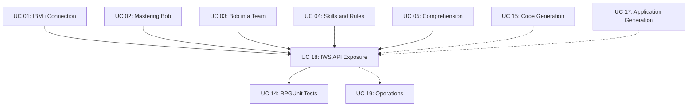

# UC 18 — Exposing RPG Programs and Procedures as REST APIs (IWS)

> **Category:** Development — API integration and exposure (Track B)
>
> **Position in the journey:** 18 — Phase 4 (Track B), after UC 17 (Application generation), which frames the exposure layer (Prompt 2c) without setting it up; UC 15 (Code generation) recommended to produce the RPG wrapper; depends on UC 05 to understand the program to expose.
>
> **Recommended Bob mode:** **IBM i Developer** (single mode for the whole session: the five IWS skills are available only in this mode). Switch to **IBM i Database** only to check an SQL object or the catalog (`QSYS2`). Without Premium Package: Ask for analysis, Agent for writing and compilation — the IWS skills then do not exist and deployment remains manual (Web Administration for i).

---

## ⭐ IBM i Premium Package used

There is **no Premium workflow** and no slash command dedicated to API exposure: UC00 §6 does not list this UC. The 71 IBM i skills are activated automatically depending on context; one family is at the heart of this UC, the **5 IWS skills** (Integrated Web Services for i). The official documentation states that they cover "the complete service lifecycle" (create, deploy, start, stop, install, uninstall) in natural language. **Their use has been demonstrated on FLGHT400**: Bob, in IBM i Developer mode with the `iws-admin` skill, compiles the `FRSWS01` to `FRSWS06` services, deploys and verifies them on the `WSERVICE` IWS server, then connects a React application to these REST APIs (see "Concrete example").

- **Auto-activated skills used:**
  - **IWS web services (IBM i Developer mode only):** → [IWS skills](https://bob.ibm.com/docs/ide/premium-packages/bob-for-i/skills#ibm-i-iws)
    - `iws-admin` — IWS administration: server operations, service operations, configuration, REST deployment, backup.
    - `iws-server-ops` — list, create, delete, start, stop IWS servers (QShell scripts).
    - `iws-server-config` — read and modify the properties of an IWS server.
    - `iws-service-ops` — list, install, uninstall, start, stop, configure a web service; REST deployment of ILE/SQLRPGLE; error resolution.
    - `iws-backup` — back up and restore IWS servers and services in IFS save files.
  - **RPG comprehension and generation:** `rpg-procedures-functions`, `rpg-free-format-fundamentals`, `rpg-code-review` (the wrapper to expose), `rpg-embedded-sql` (if the service is an `SQLRPGLE`). → [RPG skills](https://bob.ibm.com/docs/ide/premium-packages/bob-for-i/skills#rpg)
  - **Db2 catalog (read):** `db2-system-catalog`, `db2-services-catalog` (inventory of `QSYS2` objects, jobs, and services). → [Db2 for i & SQL skills](https://bob.ibm.com/docs/ide/premium-packages/bob-for-i/skills#db2-for-i--sql)
- **Slash Command: `/init`** → [Official documentation](https://bob.ibm.com/docs/ide/premium-packages/bob-for-i/slash-commands)
  Generates the application's `AGENTS.md`. Run it before the first generations so that the standards (naming, activation group, `PGMINFO`) apply in every session. Official locations: `{LIBRARY}/QBOBSRC/AGENTS.MD` (QSYS workspace) or `{IFS directory}/.bob/AGENTS.md` (IFS workspace) — see UC00 §0 and §3.1.
- **Slash Command: `/review_rpg`** → [Official documentation](https://bob.ibm.com/docs/ide/premium-packages/bob-for-i/slash-commands)
  Review of the generated RPG wrapper (Prompt 4-bis). **Complementary** check, which does not replace the service call test.
- **Execution tools** → [Official documentation](https://bob.ibm.com/docs/ide/premium-packages/bob-for-i/tools): `execute_sql_statement`, `execute_cl_command`, `execute_pase_command` (IWS QShell/PASE scripts), `write_stream_file`/`read_stream_file` (IFS), `write_member` (sources). See UC00 §5.1.
- **Documentation search (RAG):** `search_ibm_i_docs_with_rag` — to be requested explicitly for IWS prerequisites and error messages ("Search the IBM i docs for…"). → [RAG](https://bob.ibm.com/docs/ide/premium-packages/bob-for-i/retrieval-augmented-generation)
- **Safeguards:** `enforceQualifiedCLCommands` (default `true`), `deniedSQLStatementTypes` (default: `CALL`, `UPDATE`, `DROP`, `GRANT`… require explicit approval; `INSERT`, `DELETE`, `CREATE`, `ALTER` are not in the default list — **check the value on the instance**), `maxRowsToFetch` (100). → [Settings](https://bob.ibm.com/docs/ide/premium-packages/bob-for-i/settings)
- **Understand (optional)** → [Official documentation](https://bob.ibm.com/docs/ide/premium-packages/bob-for-i/understand)
  *If Understand is installed*: callers and callees of the program to expose (UC00 §2). This UC is not marked ✅ Understand in UC00 §6.

> **Why this UC 18 provides unique methodological value:**
> Exposing an RPG program as an API is not "clicking Deploy": it means deciding **what** to expose, **how** (contract), **with which authorities**, and changing nothing on the server without approval. This UC provides:
> 1. **A mandatory qualification** (Prompt 0): system prerequisites, actual presence of an IWS server, selected sub-case — never assuming that a service exists.
> 2. **A verified eligibility** of the program (Prompt 2): object type, ILE language, parameter types, PCML — before any writing.
> 3. **An API contract written before the code** (Prompt 3), taken from the UC 17 exposure contract.
> 4. **A write safeguard:** wrapper written in a test member, compilation, deployment on a test server only after explicit approval (Prompts 4-bis and 5).
> 5. **A read / modify separation:** inventory and diagnosis (sub-case A) without writing; server operations (sub-case C) always validated by a human.

> ⚠️ **Distinctions from the other UCs (routing rule):**
> - **UC 17** decides *which* Web component calls *which* back-end (Prompt 2c: "exposure contract") and sets up no service; **UC 18** sets up the service.
> - **UC 15** generates the **RPG logic**; **UC 18** writes only the **exposure wrapper** needed (no business logic).
> - **UC 16** creates SQL objects; this sheet found no source documenting the direct exposure of SQL procedures by the IWS skills — out of scope until validated.
> - **UC 19** (Operations) monitors the partition; this UC operates only the IWS server itself.

---

## Scope

**Three sub-cases, to be handled in this order** (Prompt 0 determines the one for the session):

| Sub-case | Description | Writing on the IBM i |
|---|---|---|
| **A — Diagnosis and inventory** | List existing IWS servers and services, check prerequisites, read the configuration | **None** (read-only) |
| **B — Expose a program or procedure** | Qualify a `*SRVPGM`/`*PGM`, produce the contract, generate the wrapper, compile it, deploy the service on a **test** server | Test member + compiled objects + deployed service, **after explicit approval** |
| **C — Operate the server** | Start, stop, configure, back up, restore a server or a service | Server state change, **after explicit approval** |

> ⚠️ **Out of scope:** SOAP (the sources read document only REST for the skills), exposure of Java services (not possible in IWS — go through the Integrated Application Server), IWS 3.0 / Jakarta EE until it is confirmed that the skills handle it, and server creation in production.

---

## Objective

Make existing RPG logic available to third-party applications (Web, mobile, Node.js, Java) as **IWS REST services**, by first qualifying what exists, writing the API contract, then deploying on the test IBM i only after team validation.

**What this UC enables:**
- Checking the IWS prerequisites and inventorying existing servers and services, without changing anything.
- Determining whether a program can be exposed without modification, or requires an ILE wrapper.
- Producing an API contract (URL, method, parameters, HTTP codes, authentication) before any code.
- Generating, compiling, and deploying a REST service on a test IWS server.
- Testing the call, diagnosing deployment errors, and operating the server (stop, start, backup).
- Steering the exposure of a complete application scope with an exposure plan.

**Main success criterion:** for each program in the scope, the sub-case, the eligibility, and the API contract are documented; the wrapper has been reviewed by an RPG developer and compiles without errors in a test member; the service is deployed **on a test server** after written approval, called successfully (expected HTTP code), and the service's security level (mock / live API integration) is recorded.

---

## Prerequisites

- **Phase:** Phase 4 — Track B (Generation)
- **Required previous UCs:**
  - **UC 01 — Connect Bob to the IBM i** (**mandatory**): active SSH connection, IBM i Developer mode.
  - **UC 02 — Mastering Bob**, **UC 03 — Bob in a team**, and **UC 04 — Skills and Rules strategy** (**mandatory**): modes, `/init`, shared `AGENTS.md` (to hold the exposure standards).
  - **UC 05 — Code comprehension** (**mandatory for sub-case B**): parameters, callers, and side effects of the program to expose.
  - **UC 17 — Application generation** (**recommended**): the exposure contract (Prompt 2c) provides the consumer's needs.
  - **UC 15 — Code generation** (**recommended**): standards for generating the RPG wrapper.
- **Required deliverables:**
  - `{appId}-comprehension-{composant}-report-{YYYYMMDD-HHmm}.md` — UC 05 (**mandatory for B**).
  - `{appId}-app-{composant}-analyse-ecrans-{YYYYMMDD-HHmm}.md` — UC 17, "Exposure contract" section (recommended).
  - Written team decision on the **target IWS server** (name, port, runtime profile) and on the fact that it is a **test** server.
- **IBM i system prerequisites (to be confirmed at Prompt 0, never assumed):**
  - IBM i 7.4 or later (IWS 2.6 and 3.0 are supported on 7.4, 7.5, and 7.6 — [IWS Support Statement](https://www.ibm.com/support/pages/node/687889)).
  - IBM HTTP Server for i (5770-DG1) and the latest **HTTP PTF group**. For IWS 3.0: SF99962 level 6+ (7.6), SF99952 level 25+ (7.5), SF99662 level 47+ (7.4) — [IWS 3.0](https://www.ibm.com/support/pages/node/7248102).
  - **JDK:** IWS 2.6: JDK 8 or later; IWS 3.0: JDK 17. JDK 11 is not supported on 7.6; JDK 21 is on 7.6 — [IWS Support Statement](https://www.ibm.com/support/pages/node/687889).
  - Service runtime profile (default `QWSERVICE`) **enabled** and with a password other than `*NONE`.
  - To **create** an IWS server: special authorities `*ALLOBJ` and `*IOSYSCFG` (IWS tutorial, part 2). **The exact authorities required by the IWS skills to deploy or operate a service are not documented** — to be tested at Prompt 0 with the session's profile.
- **Recommended Bob level:** Intermediate to Advanced (handle **one program or procedure per session**)

> ⚠️ **An IBM i administrator and an RPG developer must be available**: the former validates the creation or start of the server, the latter reviews the wrapper. Security compliance (profile, HTTPS, authentication) is the team's responsibility, not Bob's.

---

## Concrete example — FLGHT400 Lab

**Validated demonstration: modernizing the interface through APIs, in three steps** (IBM i Developer mode; every PASE command goes through an explicit approval):

1. **A React application built from a 5250 screen.** From a capture of the 5250 "Create Order" screen of the FLGHT400 flight reservation, Bob generates a React 18 + Vite application with `@carbon/react` (dark theme) on the IBM i (PASE). It checks Node.js, creates the project, installs the dependencies, applies the adjustment required on IBM i, builds and starts the development server, then gives the URL. The lists of values (airlines, cities, customers, flights) are fed by Db2 queries.
2. **REST APIs through IWS.** Bob analyzes the reservation data and logic, then proposes a four-step plan: compile the ILE services, deploy and verify on the active IWS server `WSERVICE` (`iws-admin` skill, reading the `AGENTS.MD` of `FLGHT400/QBOBSRC`), configure the development proxy and CORS, connect the application. After the plan is validated, it compiles the `FRSWS01` to `FRSWS06` services, verifies the endpoints (`getAirlines`, `getCities`, `getCustomers`, `getFlights`, `getOrderPricing`, `createOrder`), and connects the React components. The screen then displays real data from IWS; the F10 key (reservation) calls `createOrder` (`FRSWS05`) and displays the generated order ID.
3. **An IBM i MCP server.** Bob describes the reservation queries (`list_flight_orders`, `get_flight_order_by_id`, `search_flights`, `get_flight_pricing`) in a YAML tools file, the IBM i MCP server is started as a service (port 3010, `/mcp` endpoint), and Bob configures its connection in `.bob/mcp.json`. Any AI agent connected to this server can then look up orders, check pricing, and search itineraries on Db2.

> 💡 MCP tools expose application data and actions: they fall under the same least-privilege and approval rules as REST services. The IBM i MCP server is not a Premium Package feature: it is added to the demonstration.

The following lab deliverables complement this demonstration (recap of what exists, eligibility cases):

| Deliverable | Lab file | What it illustrates |
|---|---|---|
| `/init` report of FLGHT403 | [`../labs_FLGHT400_results/FLGHT403_init_report.md`](../labs_FLGHT400_results/FLGHT403_init_report.md) | No `*SRVPGM`/`*BNDDIR` in FLGHT403; `EVFTEMPF01` = RDi/Bob temporary file; `FRS022` is `**FREE` RPG with embedded SQL to be compiled with `CRTSQLRPGI` (rule to carry over to any `SQLRPGLE` service); hard-coded dependency on `FLGHT400` (`FRSMSGF`): the library must be in the service's library list. |
| CPU and jobs audit | [`../labs_FLGHT400_results/FLGHT403_cpu_jobs_programs_audit.md`](../labs_FLGHT400_results/FLGHT403_cpu_jobs_programs_audit.md) (+ [`_conversation`](../labs_FLGHT400_results/FLGHT403_cpu_jobs_programs_audit_conversation.md)) | Jobs `QWEBADMIN/ADMIN*` and `QLWISVR/ADMIN*` at the top of cumulative CPU, interpreted in the lab as IWS/JVM servers. **Interpretation to be confirmed** by Prompt 1: the lab did not verify it server by server. Also illustrates the `QSYS2.ACTIVE_JOB_INFO` query. |
| Explanation of `FRS409` | [`../labs_FLGHT400_results/FLGHT403_FRS409_explanation.md`](../labs_FLGHT400_results/FLGHT403_FRS409_explanation.md) | **Counter-example** case: interactive OPM RPG program (`WORKSTN`) with `*ENTRY PLIST` (`ORDER#` 9, `ENDYN` 1). It illustrates why a screen program is not exposable (Prompt 2) — its logic would have to be extracted. |
| Modernization of `FRS409` | [`../labs_FLGHT400_results/FLGHT403_FRS409_modernization_report.md`](../labs_FLGHT400_results/FLGHT403_FRS409_modernization_report.md) | Move from `*ENTRY PLIST` to `DCL-PI`: basis of the ILE wrapper to expose (Prompt 4). |
| Web prototypes (mocked data) | [`../labs_FLGHT400_results/FLGHT403_App_React.md`](../labs_FLGHT400_results/FLGHT403_App_React.md), [`FLGHT403_App_5250_web.md`](../labs_FLGHT400_results/FLGHT403_App_5250_web.md) | The lab's first consumers, on mocked data: the validated demonstration above connects them to real IWS REST APIs. |

**Lab scenario to replay the UC step by step:** on a **copy** of the library (never on the original) — (A) Prompts 0 → 1: check the IWS server and the `*SRVPGM` objects present (`FRSWS01` to `FRSWS06`); (B) choose a low-risk **non-interactive** program (for example a date or random-draw utility, `RTRAND`, `RTDOFW`, `JTOGCV`, `GTOJCV` according to `FLGHT403_functional_areas.md` — **interface and eligibility to be verified** at Prompt 2) and run Prompts 2 → 6 on a test server.

---

## Starting a Bob session

### The three workspaces

- **Local workspace** (workstation) — assessment reports, API contract, exposure plan (`bob-reports/`), standards (rule `.bob/rules-ibm-i-developer/` or `AGENTS.md` section, see UC 03 / UC 04).
- **IBM i Libraries / QSYS** ⭐ — **default workspace for this UC**: wrapper source members in `[SRCFILE_RPG]`, compilation, IWS calls through the execution tools. The project's `AGENTS.md` (`{LIBRARY}/QBOBSRC/AGENTS.MD`) is injected there automatically.
- **IFS (`$HOME`)** — QShell/PASE scripts used by IWS (directory `/QIBM/ProdData/OS/WebServices/bin`), backup save files (`iws-backup`), any test logs.

> ⚠️ **Standards and QSYS workspace:** when the active workspace is *IBM i Libraries* alone, the local workspace, its `.bob/`, and its skills are **not loaded** (see UC 03 / UC 04). Also declare the exposure standards in the application's `AGENTS.md`.

### Session rules

- **One new Bob conversation per exposed program or procedure** (`+` button). Do not reuse another service's conversation: parameter names and contract choices pollute the generation.
- **Open the sources in the editor** before Prompt 0 (Code for IBM i Object Browser → *Open in Editor*): target program or service program, any copybooks.
- **Load the context:** `AGENTS.md`, `{appId}-comprehension-…` (UC 05), the UC 17 exposure contract if available.
- **Intermediate save rule:** save to `bob-reports/` after each major prompt (Prompts 0, 2, 3), not only at the end of the session.
- **Session resumption:** reload the latest `{appId}-iws-{composant}-qualification-*.md` and state "the qualification is in [FILE] — sub-case [A/B/C], target server [NAME] — resume at Prompt [N]".
- **Golden rule:** during Prompts 0 to 3, Bob **reads and produces in the chat**; no writing, no compilation, no IWS call that changes state. Writing (Prompt 4-bis), deployment (Prompt 5), and any sub-case C action are allowed only **after explicit team validation**, **on a test server only**.

---

## Structured approach and prompts

### Recommended progression: start with a simple, non-interactive program

Start with a **batch program, with no screen, with few parameters of simple types** (character, numeric). Do not start with a program that reads a display file, opens files with locking, or depends on navigation indicators.

| Complexity | Criteria | Sequence |
|---|---|---|
| **SIMPLE** | `*PGM` or ILE procedure, primitive parameters, no screen, no particular library dependency | Prompts 0 → 1 *(if the target server is not qualified)* → 2 → 3 → 4 → 4-bis → 5 → 6 |
| **STANDARD** | Structures as parameters, arrays, or library list dependency | Same + attention to types (Prompt 2) |
| **COMPLEX** | OPM RPG, `WORKSTN`, in-memory state between calls, adopted authority | **Do not expose as is**: first handle through UC 11 / UC 13, or extract the logic (UC 15) |

> ⚠️ **Prompt 3 → Prompt 5 shortcut:** possible only if an **existing** `*SRVPGM` can already be exposed without modification and is validated (existence, exports, PCML — Prompts 0 and 2). A **newly** generated wrapper first requires a successful compilation at Prompt 4-bis before Prompt 5. Include Prompt 1 (inventory) whenever the target IWS server is not qualified: deployment depends on the choice of an existing server.

### Prompt 0 — Qualification: prerequisites, IWS server, sub-case

**Objective:** Establish the real state of the system before any action: version, prerequisites, IWS servers present, sub-case to handle.

**When to use:** First prompt of **every** session, without exception.

**Required input:** name of the test library, targeted program or service program, name of the target IWS server (if already known).

**Workspace:** In the chat (read-only; no writing).
**Mode:** IBM i Developer.
**Key skills used:** `iws-admin`, `db2-system-catalog`, `db2-services-catalog`.

**Prompt:**

```text
Qualify the IWS exposure for library [LIB_NAME], program [PROGRAM_NAME]. Read-only:
write nothing, create, start, or stop no server or service. Produce in English, in
markdown:

## UC 18 Qualification — [PROGRAM_NAME]
### 1. System
IBM i version, presence of product 5770-DG1 and the HTTP PTF group, installed JDKs (versions and
options). Each line states its source (QSYS2 service, command, file read) or "NOT VERIFIED".
### 2. Existing IWS servers
List of IWS servers (name, port, status, version, runtime profile) and associated jobs. If none is
found, write "NO IWS SERVER FOUND" — do not assume one.
### 3. Library objects
Presence of *SRVPGM, *BNDDIR, and the target program (object type, attribute, creation date), based
on QSYS2.OBJECT_STATISTICS. Do not claim that a service program exists without having seen it.
### 4. Session profile authorities
Special authorities of the connected profile (QSYS2.USER_INFO) and what they allow for IWS. The
authorities required by the IWS skills are not documented: write "TO TEST".
### 5. Selected sub-case
A (diagnosis), B (expose a program), or C (operate the server), with the justification.
### 6. Points of attention
Gaps versus the prerequisites (unsupported JDK, missing PTF group, QWSERVICE profile disabled…).

Change nothing. If information cannot be obtained with the session's authorities, say so.
```

**Deliverable produced:** `{appId}-iws-{composant}-qualification-{YYYYMMDD-HHmm}.md` (local save explicitly requested in `bob-reports/`).

> ⚠️ If "NO IWS SERVER FOUND": do not create a server in this session. Creating a server (authorities `*ALLOBJ` and `*IOSYSCFG`) is a separate administration operation, to be validated by the administrator.

### Prompt 1 — Inventory of existing IWS servers and services

**Objective:** List precisely what exists (servers, deployed services, status, URL) to decide whether to reuse a test server.

**When to use:** After Prompt 0, sub-case A or B (before choosing the target server).

**Required input:** assessment report (Prompt 0).

**Workspace:** In the chat (read-only).
**Mode:** IBM i Developer.
**Key skills used:** `iws-server-ops`, `iws-service-ops`, `iws-server-config`.

**Prompt:**

```text
The qualification is in [FILE_NAME]. For each IWS server found, produce in English:

| Server | Port | Status | IWS version | Runtime profile | Context root | Deployed services (name, status, URL) |

Then, for the server [TEST_SERVER_NAME] only, list its configuration properties. Read-only: do not
start, stop, install, or modify anything. If a service is listed as active, state it without
calling it. Do not invent any server name, port, or URL: write "NOT VERIFIED" if the read fails,
with the exact error message.
```

**Deliverable produced:** "IWS inventory" section added to `{appId}-iws-{composant}-qualification-{YYYYMMDD-HHmm}.md`.

> 💡 In the FLGHT403 lab, the jobs `QWEBADMIN/ADMIN*` and `QLWISVR/ADMIN*` dominate cumulative CPU: this prompt confirms whether they really are IWS servers and which ones.

### Prompt 2 — Eligibility of the program or procedure to expose

**Objective:** Determine, with evidence, whether the program can be exposed without modification, after a wrapper, or not at all.

**When to use:** Before writing the contract. Mandatory for sub-case B.

**Required input:** program source (open in the editor), UC 05 report.

**Workspace:** In the chat (read-only).
**Mode:** IBM i Developer.
**Key skills used:** `rpg-code-review`, `rpg-procedures-functions`, `iws-service-ops`.

**Prompt:**

```text
Analyze the eligibility of [PROGRAM_NAME] (or of procedure [PROCEDURE_NAME] of service program
[SRVPGM_NAME]) for REST exposure through IWS. Read the source and the report [UC05_FILE_NAME].
Produce in English:

| Criterion | Finding | Source (code line or object) |
|---|---|---|
| Object type (*PGM / *SRVPGM) and language (OPM RPG / ILE RPG / SQLRPGLE / COBOL) | | |
| Screen (WORKSTN) or interactive I/O | | |
| Parameters: name, type, length, input/output | | |
| Unsuitable types (date, time, timestamp, pointer, 8-byte unsigned integer, 1-byte integer) | | |
| Structures or arrays as parameters | | |
| Library list dependencies (e.g. hard-coded objects) | | |
| Side effects (file writes, COMMIT, calls to other programs) | | |
| Adopted authority (USRPRF *OWNER) | | |

Conclude with: EXPOSABLE AS IS / EXPOSABLE AFTER ILE WRAPPER / NOT EXPOSABLE AS IS, with the
reason. Do not invent any parameter. If the program is OPM RPG, state that the IWS deployment
described by the documentation relies on a PCML document produced at ILE compilation (PGMINFO) and
recommend an ILE wrapper or a prior conversion (UC 13). Change nothing.
```

**Deliverable produced:** "Eligibility" section added to the assessment report.

> ⚠️ According to the IWS FAQ (a 2021 document), several types are not supported by PCML (date, time, timestamp, pointer, 1-byte integers, and 8-byte unsigned integers). These limits have not been rechecked on 7.6: mark "TO BE VERIFIED" rather than claiming a rejection.

### Prompt 3 — API contract (URL, methods, parameters, errors, security)

**Objective:** Write the API contract before any code, as a complement to the UC 17 "exposure contract".

**When to use:** After Prompt 2 (conclusion exposable or exposable after wrapper).

**Required input:** qualification and eligibility assessment report; consumer needs (UC 17, Web team); prototype level (mock / live API integration).

**Workspace:** In the chat (no writing).
**Mode:** IBM i Developer.
**Key skills used:** `iws-service-ops`, `iws-server-config`.

**Prompt:**

```text
The qualification is in [FILE_NAME]. Write the API contract in English, in markdown:

## API Contract — [SERVICE_NAME]
| Item | Value | Source / decision |
|---|---|---|
| Target IWS server and context root | | team decision |
| Resource and "URI path template" | | |
| HTTP method per procedure (GET/POST/PUT/DELETE/PATCH) | | |
| Parameters: injection source (path, query, header, body), input/output | | |
| Body and format (JSON/XML), "wrapped" or "unwrapped" mode | | |
| HTTP code and return header parameters | | |
| HTTP codes per case (success, duplicate, not found, internal error) | | |
| Runtime profile and library list | | |
| Authentication and HTTPS | | TO BE DECIDED WITH THE TEAM if not decided |
| Prototype level | mock / live API integration | |

A simple read procedure with no side effect is a candidate for GET; a write for POST or PUT.
Do not invent any URL or HTTP code. If a decision is missing, write "TO BE DECIDED WITH THE TEAM" and
do not choose in its place. Create, install, and start nothing.
```

**Deliverable produced:** `{appId}-iws-{composant}-contrat-api-{YYYYMMDD-HHmm}.md` (local save explicitly requested in `bob-reports/`).

> ⚠️ **Before Prompt 5: define the security level**
>
> | Service type | Security requirements |
> |---|---|
> | **Test with no production data, internal use** | Dedicated least-privilege runtime profile, restricted network access; record the choice in the contract. |
> | **Live API integration on production data** | HTTPS, authentication, server-side authorization, input validation, secrets management (no hard-coded credentials), dedicated application IBM i profile: **mandatory before any call with real data**. |

### Prompt 4 — Preparing the ILE wrapper (in the chat)

**Objective:** Generate, in the chat, the ILE RPG source that exposes the program with the necessary PCML options.

**When to use:** "EXPOSABLE AFTER ILE WRAPPER" conclusion of Prompt 2. If the object is already an **existing** ILE `*SRVPGM` that can be exposed without modification and is validated (existence, exports, PCML — Prompts 0 and 2), go directly to Prompt 5. A **newly** generated wrapper first goes through Prompt 4-bis (successful compilation) before Prompt 5.

**Required input:** API contract (Prompt 3), `AGENTS.md` standards.

**Workspace:** In the chat (no writing).
**Mode:** IBM i Developer.
**Key skills used:** `rpg-procedures-functions`, `rpg-free-format-fundamentals`, `rpg-embedded-sql`.

**Prompt:**

```text
The API contract is in [CONTRACT_FILE_NAME]. Generate in English, in markdown, the free-format ILE
RPG source of the wrapper that exposes [PROGRAM_NAME]:

1. Control header compliant with the AGENTS.md standards, with the option to generate the PCML
   document in the module (PGMINFO).
2. One exported procedure per contract operation, with the parameters exactly as defined
   (simple types recommended).
3. Call to the existing program, without modifying it, and return of the HTTP codes defined in the
   contract through the return parameters (this return depends on the IWS response parameter
   configuration, to be verified at deployment — Prompt 5).
4. No new business logic: the wrapper adapts the parameters and returns the result.
5. If the source contains embedded SQL: state that compilation goes through CRTSQLRPGI.

The program [PROGRAM_NAME] must NOT be modified. Do not invent any parameter. Save nothing at this
stage.
```

**Deliverable produced:** `{appId}-iws-{composant}-wrapper-genere-{YYYYMMDD-HHmm}.md` (local save explicitly requested in `bob-reports/`).

### Prompt 4-bis — Writing the test member and compilation

**Objective:** Write the wrapper in a test member, compile the RPG module, then create the `*SRVPGM` (two separate steps), without touching existing objects.

**When to use:** After review and validation of Prompt 4 by an RPG developer. **After explicit team validation.**

**Required input:** validated source; test library; `*CHANGE` authority on the library.

**Workspace:** IBM i QSYS (writing a member and creating objects in `[LIB_NAME]`).
**Mode:** IBM i Developer.
**Key skills used:** `rpg-free-format-fundamentals`, `rpg-code-review`.

**Prompt:**

```text
The wrapper source is validated by the team (see [WRAPPER_FILE_NAME]). Before writing:
1. Check via QSYS2.SYSPARTITIONSTAT that the member [MEMBER_NAME_T] does not exist in
   [LIB_NAME]/[SRCFILE_RPG], and that the objects [MODULE_NAME] / [SRVPGM_NAME] do not exist.
2. If one exists, stop and ask me what to do: do not overwrite it.
Then write the source into the member [MEMBER_NAME_T] (test copy, never into an existing member),
proceed next in two separate steps. Display each qualified command before running it and report the
exact result (including error messages):
A. Compile the RPG module [MODULE_NAME] (CRTRPGMOD, or CRTSQLRPGI with OBJTYPE(*MODULE) if embedded
   SQL), REPLACE(*NO), PGMINFO option kept (for example PGMINFO(*PCML *MODULE) with CRTRPGMOD; for
   CRTSQLRPGI, state how it is passed to the RPG compiler, without inventing it).
B. Create the service program [SRVPGM_NAME] from this module (CRTSRVPGM), REPLACE(*NO), with the
   exports described by a binder language source (EXPORT(*SRCFILE), SRCFILE, SRCMBR) or EXPORT(*ALL).
   Then check the exported procedures (DSPSRVPGM DETAIL(*PROCEXP)) and compare them with those of
   the contract; check that the PCML is present.
On error, fix in the chat and redo the step concerned; do not move on to anything else.
Then run /review_rpg on the member.
```

**Deliverable produced:** member and compiled objects in `[LIB_NAME]` (IBM i QSYS); `{appId}-iws-{composant}-rapport-{YYYYMMDD-HHmm}.md` (optional, local save explicitly requested).

> ⚠️ **A successful compilation does not prove that the exposure works.** Prompt 6 (call test) is mandatory. `REPLACE(*NO)` only prevents overwriting an existing object: it does not show that the binding, the exports, and the deployment are correct. Replacing an existing object is a human decision.

### Prompt 5 — Deploying the service on the test server

**Objective:** Deploy the service on the test IWS server, in accordance with the contract, after explicit approval.

**When to use:** After a clean compilation (4-bis) of a newly generated wrapper, or after validation of an existing `*SRVPGM` that can be exposed without modification (Prompts 0 and 2); in both cases, with written agreement from the administrator and the developer.

**Required input:** API contract; compiled object or validated existing `*SRVPGM`; test server (Prompt 1); "test server" confirmation.

**Workspace:** IBM i QSYS / IFS (change of IWS server state).
**Mode:** IBM i Developer.
**Key skills used:** `iws-service-ops`, `iws-server-ops`, `iws-admin`.

**Prompt:**

```text
The API contract is in [CONTRACT_FILE_NAME] and the object [SRVPGM_NAME] is compiled in [LIB_NAME].
Deploy the service on the TEST IWS server [TEST_SERVER_NAME] (never on another server).

Before any action: display the exact plan (command, script, or skill action, parameters) and
wait for my explicit agreement. After agreement:
1. Check that the service does not already exist on this server; otherwise stop and ask me.
2. Deploy the service with the contract configuration (resource, methods, parameters, runtime
   profile, library list) and start it.
3. Explicitly verify the IWS response parameter configuration: mapping of the return parameters to
   the HTTP code and headers, in line with the contract (Prompt 3). Do not infer it from the RPG
   code alone; write "NOT VERIFIED" if the read fails.
4. Report the resulting state and the service URL. On error, give the exact message (for example
   IWS00230E) and the resolution lead, without retrying automatically.
Do not modify any other service or the server configuration. Do not create a server.
```

**Deliverable produced:** service deployed on the test server; report added to `{appId}-iws-{composant}-rapport-{YYYYMMDD-HHmm}.md`.

> ⚠️ The sources consulted document deployment through **Web Administration for i** ("Deploy New Service") and server administration QShell scripts; **no equivalent REST service deployment script was found in the documentation read**. The exact mechanism used by `iws-service-ops` therefore has to be observed and recorded during the lab (skill action, command actually executed).

### Prompt 6 — Call test and diagnosis

**Objective:** Verify that the service responds as the contract announces, and diagnose discrepancies.

**When to use:** Immediately after Prompt 5.

**Required input:** service URL; API contract; test data set.

**Workspace:** In the chat (read, test calls); no server modification, but POST/PUT/DELETE calls can modify business data.
**Mode:** IBM i Developer.
**Key skills used:** `iws-service-ops`, `db2-services-catalog`.

**Prompt:**

```text
The service is deployed at [URL]. Test it according to the contract [CONTRACT_FILE_NAME], only
with the following test set: [TEST_DATA]. Before any call, confirm that the environment is a test
environment and that the data is disposable or restorable. Start with GET calls; for any
POST/PUT/DELETE (for example createOrder), display the request and wait for my explicit agreement
before running it. For each case in the contract (success, duplicate, not found, error):
| Case | Request (method, URL, input) | Expected HTTP code | Actual HTTP code | Actual body |
Use the test tool available in the session (for example a PASE command if the client tool is
installed — check that it is present; install none without my agreement). In case of a discrepancy,
read the server job log (QSYS2.JOBLOG_INFO) and the service status, then propose a probable cause
without changing anything. Distinguish facts from hypotheses.
```

**Deliverable produced:** test table added to `{appId}-iws-{composant}-rapport-{YYYYMMDD-HHmm}.md`.

> 💡 Consumer-side validations (JavaScript) are not security controls; the IWS service must validate its inputs.

> ⚠️ **Read-only IWS server access ≠ calls without side effects.** The nominal, duplicate, and error tests can modify business data (`createOrder`…). Safeguards: test environment only, disposable or restorable data, GET calls first, explicit validation before any POST/PUT/DELETE.

### Prompt 7 — Server operations: start, stop, configure, back up *(sub-case C)*

**Objective:** Perform a specific operation on an IWS server or service, with a prior backup.

**When to use:** For a planned operation (stop/restart, property change, backup before migration). **After explicit validation.**

**Required input:** server name; desired operation; maintenance window.

**Workspace:** IBM i QSYS / IFS (IFS save file for the backup).
**Mode:** IBM i Developer.
**Key skills used:** `iws-backup`, `iws-server-ops`, `iws-server-config`.

**Prompt:**

```text
Requested operation on the IWS server [SERVER_NAME]: [BACK UP / STOP / START / MODIFY
PROPERTY X].
1. Display the exact plan (actions, commands, impact: affected services, connected users) and
   wait for my explicit agreement.
2. Before any modification or stop, back up the server and its services into an IFS save file
   [IFS_PATH]; do not proceed without a valid backup. State whether restoring this backup has
   already been tested on a test server; if not, flag it as a risk.
3. Run only the requested operation, then report the before/after state.
Do not touch any other server. Delete nothing. On error, stop and report the exact
message.
```

**Deliverable produced:** report in `{appId}-iws-{composant}-rapport-{YYYYMMDD-HHmm}.md`; save file in the IFS.

> ⚠️ This step changes a server's state: never in production within the POC. Restoration (`iws-backup`) has not been proven in the lab: **backing up is not the same as having a validated restoration**. Acceptance criterion: restoration of the backup has been tested on a test server before relying on it.

### Prompt 8 — Exposure plan (complete application scope) [Complement — not covered by the Premium workflow]

**Objective:** Produce the prioritized inventory of programs to expose, with dependencies and risks.

**When to use:** After a first validated pilot service, to steer the next steps.

**Required input:** assessment reports, UC 05 report of the application, list of consumers.

**Workspace:** In the chat, then local save.
**Mode:** IBM i Developer.
**Key skills used:** `rpg-code-review`, `iws-service-ops`.

**Prompt:**

```text
The qualifications are in [FILE_LIST]. Produce in English, in markdown:

## Exposure Plan — [APP_NAME]
| Program | Eligibility (Prompt 2) | Consumer | Wrapper needed (Y/N) | Side effect (Y/N) | Risk | Priority |
(one row per program)
### Dependencies
Called programs or programs sharing files, to be exposed together.
### Programs to defer
Interactive, OPM, or adopted-authority programs: to be handled first through UC 11 / UC 13 / UC 15.
Save the plan in bob-reports/ under the name {appId}-iws-{appId}-plan-exposition-{YYYYMMDD-HHmm}.md.
```

**Deliverable produced:** `{appId}-iws-{appId}-plan-exposition-{YYYYMMDD-HHmm}.md` (in `bob-reports/`).

> 💡 This plan is the input to **UC 14** to define which services to test first.

---

## Deliverables of this UC

> ⚠️ **Where does Bob write?** For sub-case B, Bob writes the source member, creates the objects, and deploys the service **on the IBM i** (`[LIB_NAME]`, IWS server), not locally; for sub-case A and for analyses, everything is produced in the chat. To keep a local trace, explicitly ask Bob to save to `bob-reports/`.

| Produced file / object | Naming pattern | Storage space | Consumed by |
|---|---|---|---|
| Qualification, IWS inventory, and eligibility | `{appId}-iws-{composant}-qualification-{YYYYMMDD-HHmm}.md` | `bob-reports/` (Local) | All following prompts, session resumption |
| API contract | `{appId}-iws-{composant}-contrat-api-{YYYYMMDD-HHmm}.md` | `bob-reports/` (Local) | Prompts 4 to 6, UC 17 (Web component), UC 14 |
| Generated ILE wrapper | `{appId}-iws-{composant}-wrapper-genere-{YYYYMMDD-HHmm}.md` | `bob-reports/` (Local) | Prompt 4-bis, RPG review |
| Source member and compiled objects | `[MEMBER_NAME_T]`, `[SRVPGM_NAME]` | `[LIB_NAME]` (IBM i QSYS) | Prompt 5, UC 14 |
| Deployed service | `[SERVICE_NAME]` on `[TEST_SERVER_NAME]` | IWS server (IBM i) | Prompt 6, consumers |
| Deployment, testing, and operations report | `{appId}-iws-{composant}-rapport-{YYYYMMDD-HHmm}.md` | `bob-reports/` (Local) | Review, traceability, UC 14 |
| Server backup *(sub-case C)* | save file `[IFS_PATH]` | IFS (`$HOME` or designated folder) | Restoration |
| Exposure plan | `{appId}-iws-{appId}-plan-exposition-{YYYYMMDD-HHmm}.md` | `bob-reports/` (Local) | Scope steering, UC 14 |

> ⚠️ **Source manager:** if the company manages its sources in a source manager, re-integration of the created members/scripts is manual after validation. The members and objects created are new objects to be **re-integrated manually in the source manager** after validation.

---

## Pitfalls to avoid

| Pitfall | What happens | How to avoid it |
|---|---|---|
| Assuming the REST services exist in the environment's library | Blocked demonstration: `FRSWS01` to `FRSWS06` have to be compiled (absent from the FLGHT403 copy) | Prompt 0: verify with `QSYS2.OBJECT_STATISTICS` on the LPAR, compile if needed |
| Exposing an interactive program (`WORKSTN`) | The service cannot handle `EXFMT` | Eligibility (Prompt 2); extract the logic (UC 15) |
| Assuming that an OPM RPG is exposable | No PCML document produced at compilation | ILE wrapper or prior conversion (UC 13) |
| Unsupported parameter types (date, time, pointer…) | Deployment refused or unexpected behavior | Simple types in the wrapper; mark "TO BE VERIFIED" |
| Compiling embedded SQL with `CRTBNDRPG` | Compilation error | `CRTSQLRPGI` (like `FRS022` in the lab) |
| Dependency library absent from the service's library list | Runtime failure (the lab has a hard-coded dependency on `FLGHT400`) | Declare the service's library list in the contract |
| Runtime profile disabled or without a password | Inoperative service | Check the profile (`QWSERVICE` or other) at Prompt 0 |
| Deploying on a production server | Impact on users | Test server only, confirmed in writing |
| Overwriting an existing service or object | Loss of the existing | Non-existence check, `REPLACE(*NO)`, human decision |
| Treating a 7.1/7.2 tutorial PTF/JDK set as valid | Wrong prerequisites | Use the up-to-date IWS Support Statement, levels above |
| Confusing a mocked test with live API integration | Security requirements omitted | Security table before Prompt 5 |
| Retrying a deployment in a loop after an error | Inconsistent server state | Stop on error, exact message, human decision |
| Testing the API with write calls on real data (`createOrder`…) | Business data modified: read-only IWS server access does not mean calls without side effects | Test environment, disposable data, GET first, validation before POST/PUT/DELETE (Prompt 6) |

---

## UC 18 validation checklist

- [ ] **Prompt 0 was run**; version, prerequisites, IWS servers, and profile authorities are documented (or "NOT VERIFIED").
- [ ] No existence of a server, service, `*SRVPGM`, parameter, or URL is claimed without a real read.
- [ ] The program's eligibility (Prompt 2) is documented with its source.
- [ ] The API contract (Prompt 3) is written, with the "TO BE DECIDED WITH THE TEAM" decisions resolved.
- [ ] The security level (test / live API integration) is recorded; the requirements of the second row are applied where relevant.
- [ ] **[Sub-case B]** The wrapper was reviewed by an RPG developer, written in a test member after a non-existence check, compiled as a module without errors (`REPLACE(*NO)`, `PGMINFO` kept, `CRTSQLRPGI` if embedded SQL), then the `*SRVPGM` was created separately and its exports verified; `/review_rpg` was run. For an existing `*SRVPGM` reused as is (without Prompts 4 and 4-bis), existence, exports, and PCML were validated at Prompts 0 and 2.
- [ ] **[Sub-case B]** The original program was not modified.
- [ ] **[Sub-case B]** Deployment took place on a **test server**, after explicit agreement; the mechanism actually used is recorded.
- [ ] **[Sub-case B]** The IWS response parameter / HTTP code / header mapping was verified at deployment against the contract (Prompt 3).
- [ ] **[Sub-case B]** Each case of the contract was tested (expected and actual HTTP code), in a test environment with disposable data, starting with read calls (GET); each POST/PUT/DELETE was validated before execution.
- [ ] **[Sub-case C]** A valid backup precedes any server modification; its restoration has been tested on a test server (a backup that has not been restored is not validated).
- [ ] The deliverables are saved with the naming convention (`qualification`, `contrat-api`, `wrapper-genere`, `rapport`, `plan-exposition`).
- [ ] The members and objects created are manually re-integrated into the source manager after validation.
- [ ] The "to be completed before production" points (below) have been reviewed.

---

## Points to complete before going to production

> These points do not block the POC: they concern advanced cases to handle before industrializing API exposure.

- **IWS skills authorities:** the IBM i authorities (`*IOSYSCFG`, HTTP Admin role) required by the skills are documented by no page read. Establish them in the lab and record them in a rule.
- **Deployment mechanism:** the demonstration uses the QShell script `installWebService.sh` (`/QIBM/ProdData/OS/WebServices/V1/server/bin/`); record its behavior on error.
- **IWS 3.0 (Jakarta EE):** support by the skills is not documented. 3.0 servers require JDK 17 and a minimum HTTP PTF group; OpenAPI UI is enabled there by default. To be tested before choosing the server version.
- **SOAP:** not covered by the skills according to the sources read (only REST is cited).
- **Security:** HTTPS, basic authentication or TAI, dedicated least-privilege profile, secret rotation, call logging. WS-Security is not supported by IWS.
- **Governance:** contract versioning, management of signature changes, production release through the company's process.
- **Restoration:** test restoring an `iws-backup` backup on a test server.
- **IBM i MCP server:** authentication, exposed tools, and runtime profile to be defined before any use beyond the lab.

---

## Dependencies



> UC 05 is mandatory for sub-case B (solid line); UC 15 and UC 17 are recommended (dotted lines). UC 19 reuses the IWS job inventory.
>
> **See also:** UC 19 is not a prerequisite of UC 18, and its audits (operations, jobs, CPU) do not replace the functional and security tests of the deployed APIs (Prompt 6 and the Prompt 3 security table).

---

*UC 18 sheet — Living document to be updated throughout the POC.*
