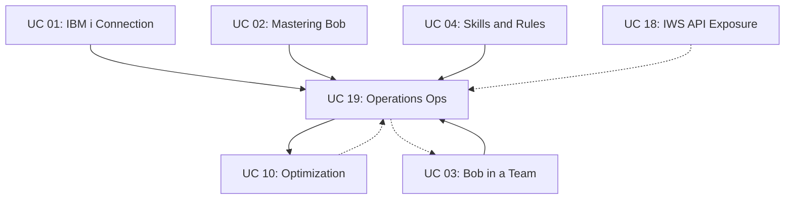

# UC 19 — IBM i operations and administration with Bob (Ops)

> **Category:** System operations and administration
>
> **Position in the journey:** 19 — Phase 5 (Operations); **independent of application code**: only UC 01 to UC 04 are required. Complements UC 10 (SQL performance, non-recompiled objects) and UC 18 (IWS jobs and servers); does not replace production monitoring.
>
> **Recommended Bob mode:** **IBM i Developer** (IBM i Libraries workspace: execution tools `execute_sql_statement`, `execute_cl_command`, `execute_pase_command`, `write_stream_file`). Switch to **IBM i Database** only for SQL performance analysis (plan cache, indexes). Without Premium Package: Agent with a manually configured SQL/SSH connection — the Db2 skills, RAG, and Premium safeguards do not exist.

---

## ⭐ IBM i Premium Package used

There is **no Premium workflow dedicated to operations**: UC00 §6 does not list this UC. The only workflow that writes to the system, **SQL Index Strategy Advisor**, belongs to SQL performance (UC 10 / UC 16) and is not the core of UC 19. What the Premium brings to operations is the **execution tools** (SQL, CL, PASE), the **Db2 catalog and security skills**, **documentation search (RAG)**, and the **safeguards**; querying the system relies on the **IBM i SQL services** (`QSYS2`, `SYSTOOLS`).

- **Execution tools** → [Official documentation](https://bob.ibm.com/docs/ide/premium-packages/bob-for-i/tools):
  - `execute_sql_statement` (IBM i Developer and IBM i Database modes) — queries on the `QSYS2` / `SYSTOOLS` services. Some statement types require explicit approval.
  - `execute_cl_command` and `execute_pase_command` (IBM i Developer) — CL commands qualified by default; PASE commands.
  - `write_stream_file` / `read_stream_file` (IBM i Developer) — writing Markdown and HTML reports to the IFS.
- **Auto-activated skills used** → [Db2 for i & SQL skills](https://bob.ibm.com/docs/ide/premium-packages/bob-for-i/skills#db2-for-i--sql):
  - `db2-security-best-practices` (IBM i Developer, IBM i Database) — security audit.
  - **Complementary custom skill (outside the Premium):** `ibm-i-security-ppi` — IBM i security skill, available on request, used in the security audit demonstration (Prompt 4) alongside the Premium skills.
  - `db2-system-catalog`, `db2-services-catalog` (IBM i Developer, IBM i Database) — catalog and system services.
  - `db2-sql-performance-analysis`, `db2-sql-stored-procedure-performance`, `db2-sql-optimization` (IBM i Developer, IBM i Database); `db2-sql-find-performance-data`, `db2-index-strategy` (IBM i Database) — performance and indexes.
- **Documentation search (RAG):** `search_ibm_i_docs_with_rag` — queries the indexed IBM i documentation and Redbooks instead of relying on the model alone. To be requested explicitly ("Search the IBM i docs for…"). → [RAG](https://bob.ibm.com/docs/ide/premium-packages/bob-for-i/retrieval-augmented-generation)
- **Safeguards** → [Settings](https://bob.ibm.com/docs/ide/premium-packages/bob-for-i/settings):
  - `deniedSQLStatementTypes` — default value `ALLOCATE, CALL, COMMIT, CONNECT, DISCONNECT, DROP, EXECUTE, GRANT, LOCK, MERGE, PREPARE, RENAME, REVOKE, ROLLBACK, SAVEPOINT, TRUNCATE, UPDATE` (explicit approval required). `INSERT`, `DELETE`, `CREATE`, and `ALTER` are not in it: **check the value on the instance**.
  - `maxRowsToFetch` — default 100 rows; `enforceQualifiedCLCommands` — default `true`.
- **Security and traceability** → [Security guidelines](https://bob.ibm.com/docs/ide/premium-packages/bob-for-i/security-guidelines): Bob acts with **the authorities of the connected IBM i profile** ("any operation the user profile is permitted to perform … Bob will also be able to perform"); it sets the `CLIENT_APPLNAME` register, which makes it possible to spot its queries. Least privilege is mandatory.
- **Slash Command: `/init`** → [Official documentation](https://bob.ibm.com/docs/ide/premium-packages/bob-for-i/slash-commands) — the partition's `AGENTS.md` (operating rules, report output folder). See UC00 §3.1.
- **Troubleshooting** → [Troubleshooting](https://bob.ibm.com/docs/ide/premium-packages/bob-for-i/troubleshooting): "IBM Bob Premium Package for i" output channel (every tool call, with duration; warning if a tool exceeds 30 seconds).
- **Outside the Premium (Bob features):** creating a *skill* from a result and calling it with `/skill-name`; see UC 04 for the location and sharing of skills.

> **Why this UC 19 provides unique methodological value:**
> Operations is the domain where an AI connected to the system is the most useful and the riskiest: everything the profile can do, Bob can do. This UC provides:
> 1. **A strict separation of read-only and change operations:** audits (sub-case A) are read-only, a property enforced by the environment (strictly limited-authority profile) and not only by the prompt; writing reports (B) and any system modification (C) are made explicit and approved.
> 2. **A mandatory qualification of authorities and safeguards** (Prompt 0) before the first query.
> 3. **Sourced findings, never deduced:** every value comes from an SQL service, otherwise "NOT VERIFIED"; recommendations are separated from facts and **never applied**.
> 4. **A move from the one-off question to the reusable asset:** the result becomes a skill, then a chain, with a reusable, standardized execution procedure (a skill remains an instruction interpreted by the model: it does not remove its reasoning and does not guarantee deterministic execution, unless execution is delegated to deterministic scripts).
> 5. **A framework for automation outside Bob** (Ansible, `JOBSCDE`) treated as a **system change** to be approved.

> ⚠️ **Distinctions from the other UCs (routing rule):**
> - **UC 10 / UC 16** handle the **SQL** performance and indexes of an application; **UC 19** observes the **partition** (jobs, PTFs, security, health). Both share the plan cache — see UC 10 for the analysis.
> - **UC 18** operates the **IWS servers**; **UC 19** uses it only to spot their jobs. **See also:** UC 19 is not a prerequisite of UC 18, and its audits do not replace functional and security tests of the deployed APIs.
> - **UC 03** (Bob in a team) carries the common rules; UC 19 refers to it for the profile, rules, and shared skills.

---

## Scope

**Three sub-cases, to be handled in this order** (Prompt 0 determines the one for the session):

| Sub-case | Description | Writing |
|---|---|---|
| **A — Diagnosis (read)** | Active jobs, job log, non-recompiled objects, PTF/CVE status, security audit, partition health | **None** on the system; report in the chat |
| **B — Industrialization** | Markdown/HTML reports in the IFS; creation of skills callable with `/name`; "full audit" chaining skill | Files in the IFS and Bob skills, **after agreement** |
| **C — Automation outside Bob** | Ansible playbook running the chain without VS Code; `JOBSCDE` scheduling entry | **System modification** (objects, scheduling), explicit approval |

> ⚠️ **Not covered (no source found):** subsystems, spool files, jobs in error, **backup verification** with Bob. Pending messages in `QSYSOPR` and disk usage (ASP) were **mentioned orally** during the webinar of November 5, 2026 but **not demonstrated**: Prompt 5-bis treats them as trial prompts, with no expected result.

---

## Objective

Enable an IBM i administrator to obtain, in natural language, a **documented state of their partition** (jobs, PTFs and CVEs, security, health) from the IBM i SQL services, to turn those requests into **reusable assets** (skills), and to frame their **automation** — without ever letting Bob modify the system without approval.

**What this UC enables:**
- Qualifying the profile's authorities, the safeguards, and the output folder before any audit.
- Identifying the most CPU-consuming active jobs, reading a job log, and listing old objects (FLGHT400 lab).
- Producing a PTF/CVE report, a security audit with a **proposed** remediation plan, and a partition health report, in Markdown then HTML.
- Turning a result into a skill callable with `/name`, then assembling a "full audit" skill.
- Framing execution outside Bob (Ansible, `JOBSCDE`) and report hygiene (retention).

**Main success criterion:** the session's authorities and safeguards are documented; every finding in the reports is tied to a query on an IBM i service (otherwise "NOT VERIFIED"); recommendations are separated from facts and **none was applied**; every write (IFS, skills, scheduling) was explicitly approved and is traced.

---

## Prerequisites

- **Phase:** Phase 5 — Operations
- **Required previous UCs:**
  - **UC 01 — Connect Bob to the IBM i** (**mandatory**): active SSH connection (`STRTCPSVR *SSHD`, 5733-SC1, `QSSHD` user enabled), IBM i 7.4 or later.
  - **UC 02 — Mastering Bob**, **UC 03 — Bob in a team**, and **UC 04 — Skills and Rules strategy** (**mandatory**): modes, `/init`, location and sharing of skills.
  - **UC 10 — Code optimization** (**recommended**): `QSYS2` queries already used for jobs and objects.
- **Required deliverables:** none. Written team decision on: the **IFS output folder** for reports, the session's **dedicated IBM i profile**, and the retention policy.
- **IBM i system prerequisites (to be confirmed at Prompt 0, never assumed):**
  - Session profile with **least privilege**; for a full audit, read authority on the services concerned (`USER_INFO`, `SECURITY_INFO`, etc.) — **the authorities required service by service have to be established in the lab**.
  - For `SYSTOOLS.CVE_INFO`: IBM i 7.5 (SF99950 level 12) or 7.6 (SF99960 level 3 / TR2); the service queries the IBM Security Bulletins API, so **outbound network access** is needed — [IBM i 7.6 TR2 Enhancements](https://www.ibm.com/support/pages/node/7271857).
  - Sub-case C: Ansible server and SSH access (in the demonstration, installed on the partition itself); authority to create scheduling objects.
- **Recommended Bob level:** Intermediate (sub-cases A and B); Advanced (sub-case C)

> ⚠️ **An IBM i administrator must validate** Bob's recommendations (security remediation plan, PTF application). In the webinar: "the PPI is an assistant, it never makes decisions for you".

---

## Concrete example — FLGHT400 Lab

**Validated demonstration: auditing the partition's security in the Mythos era.** Attackers now use AI to detect vulnerabilities, chain them, and attack systems: defense must have the same level of assistance. On an IBM i partition (IBM i 7.5, 66 profiles), Bob, in IBM i Developer mode with the custom skill `ibm-i-security-ppi` (available on request) alongside the Premium skills, receives the request "perform a quick security audit of my IBM i and generate an HTML report". After connecting to the partition, it builds a list of **10 control domains**, all read-only, followed by an **HTML summary report** (11 rows in total):

| # | Check | Security benefit |
|---|---|---|
| 1 | System identity (server, profile, release, partition) | Scope and version to audit |
| 2 | Security system values | Partition policy: passwords, lockout, object restore |
| 3 | Profiles with special authorities | High-power accounts, an attacker's first target |
| 4 | Profile hygiene (dormant, never signed on, non-expiring passwords) | Forgotten, exploitable accounts |
| 5 | Audit journal (`QAUDJRN`) | Ability to detect and reconstruct an intrusion |
| 6 | Network exposure (listening ports, NetServer shares) | Attack surface visible from outside |
| 7 | Exit programs | Access control on host servers (FTP, Telnet, DDM, ODBC) |
| 8 | Adopted-authority programs | Privilege-escalation paths |
| 9 | `QCRTAUT` and public authority on user libraries | Data readable or changeable by everyone |
| 10 | Multi-factor authentication (TOTP) adoption on privileged profiles | Protection against password theft |
| 11 | *Summary report* — HTML report generation (`ibmi-security-report.html`), which is not a control domain | Prioritized findings, shareable with security and management |

The HTML report changes nothing on the system (only its output file is written, after write authorization). It highlights, for example: 44 user libraries open as `*PUBLIC *CHANGE` (`QCRTAUT = *CHANGE`); unrestricted authority adoption (`QUSEADPAUT = *NONE`) allowing any developer to compile a privilege-escalation program; no exit programs on the host servers (FTP 21, Telnet 23, DDM 446-449, ODBC 8471-8479 open with no control). Positives are also noted: `QMAXSIGN = 3` and `QMAXSGNACN = 3` (brute-force lockout), `QRMTSIGN = *FRCSIGNON`. Five first actions are **proposed**, in this order: create `QAUDJRN` and enable `QAUDCTL`; set `QPWDEXPITV = 90` and `QPWDRQDDIF = 8`; set `QALWOBJRST = *NONE`; disable a full `*SECOFR` profile that never signed on and still has a password; plan an IPL window to move `QPWDLVL` to 3. The report finally notes that the profile conducting the assessment holds `*ALLOBJ` ("Authority Notice"): this finding matches this UC's least-privilege profile rule.

> 💡 This demonstration was run on a demonstration partition, not on the FLGHT400 lab: the list of findings depends on each partition.

> ⚠️ **The FLGHT400 lab covers active jobs by CPU and non-recompiled programs** (table below). The PTF/CVE, partition health, skills, Ansible, and `JOBSCDE` scenarios come from a pre-recorded IBM demonstration (webinar of November 5, 2026), **on a personal instance** (IBM i 7.6, Ansible server) — to be replayed and validated on the TechZone LPAR before presenting.

| Deliverable | Lab file | What it illustrates |
|---|---|---|
| CPU and non-recompiled programs audit | [`../labs_FLGHT400_results/FLGHT403_cpu_jobs_programs_audit.md`](../labs_FLGHT400_results/FLGHT403_cpu_jobs_programs_audit.md) (+ [`_conversation`](../labs_FLGHT400_results/FLGHT403_cpu_jobs_programs_audit_conversation.md)) | Top 20 active jobs by `CPU_TIME` (`QSYS2.ACTIVE_JOB_INFO`) with the distinction between cumulative CPU / `ELAPSED_CPU_PERCENTAGE` (0 for all: idle system); 34 programs out of 34 not recompiled for more than 5 years (`QSYS2.OBJECT_STATISTICS`), including 25 OPM RPG from 1997. Illustrates Prompts 1 and 2. |
| `/init` report | [`../labs_FLGHT400_results/FLGHT403_init_report.md`](../labs_FLGHT400_results/FLGHT403_init_report.md) | Application context of the partition (hard-coded dependency on `FLGHT400`) — useful for interpreting the jobs and objects of Prompts 1 and 2. |

**Original lab prompts (Exercise 5, `bmarolleau/flight400-demo` README, about 10 minutes, IBM i Developer mode)** — reproduced in English in the repository: (1) *"Which active jobs have accumulated the most CPU time? For the top jobs, distinguish cumulative CPU time from their current elapsed CPU percentage."*; (2, optional) inspect the top-ranked job, its job log, and **one** fresh elapsed CPU measurement, distinguishing facts from inferences, with at most two recommendations; (3) *"Which programs in the FLGHT4nn library have not been recompiled in the last 5 years?"*. The README contains **no "read-only" instruction** for this exercise: Prompts 1 and 2 below add it explicitly.

**Lab scenario to replay the UC step by step:** on the TechZone LPAR — A: Prompts 0 → 1 → 2 → 3 → 4 → 5; B: Prompts 6 → 7; C (optional, outside a shared LPAR): Prompts 8 → 9.

---

## Starting a Bob session

### The three workspaces

- **Local workspace** (workstation) — saved reports (`bob-reports/`), `AGENTS.md`/rules (see UC 03 / UC 04).
- **IBM i Libraries / QSYS** ⭐ — **default workspace for this UC**: execution of `QSYS2` / `SYSTOOLS` queries, CL and PASE commands; partition `AGENTS.md` injected.
- **IFS (`$HOME` or designated folder)** — **output Markdown and HTML reports** (one subfolder per day recommended), Ansible playbook, any backups.

> ⚠️ **Skills and QSYS workspace:** when the active workspace is *IBM i Libraries* alone, only `~/.bob/skills/` (workstation-global) is loaded; the repository's skills are not (see UC 04). A skill created for audits therefore has to be placed where the session will see it, and **shared via Git** for the team (UC 03).

### Session rules

- **One new Bob conversation per audit** (`+` button). Do not reuse the conversation of a previous audit: old findings pollute the new ones.
- **Dedicated profile:** do not use an `*ALLOBJ` profile for an audit; a least-privilege profile limits both mistakes and the scope of Bob's possible actions.
- **Always ask for facts before recommendations:** *"Distinguish facts (with the query) from inferences"*.
- **Date in every report and every file name** (format `YYYYMMDD-HHmm`): audits can be compared over time.
- **Golden rule:** during Prompts 0 to 5, Bob **only reads** on the system. Writing to the IFS (Prompts 3 to 6), creating skills (Prompts 6 and 7), and any system modification (Prompts 8 and 9) require **explicit, separate agreement**.
- **Write authorization (a distinct step, after reading):** the agreement in principle on the output folder gathered at Prompt 0 is not an authorization to write; before the first write to the IFS, check the exact path and authorities (the profile's authorities on the folder, `QSYS2.IFS_OBJECT_PRIVILEGES`), then give explicit agreement for that write only (`write_stream_file` tool). The real write test happens only at that point.
- **Read-only = a property of the environment:** the prompt instruction is not enough; read-only relies on a strictly limited-authority profile and on technical safeguards (`deniedSQLStatementTypes` does not block every statement that changes data: see Pitfalls).

---

## Structured approach and prompts

### Recommended progression: start with the simplest read

Start with Prompts 1 and 2 (FLGHT400 lab, read-only, values the administrator can verify) before the PTF/CVE and security audits. A result the administrator can cross-check (a job they know) validates the method before heavier findings.

| Sub-case | Risk level | Sequence |
|---|---|---|
| **A** (diagnosis) | Low (read) | Prompts 0 → 1 → 2 → 3 → 4 → 5 |
| **B** (industrialization) | Medium (IFS writing, skills) | Prompts 6 → 7 |
| **C** (automation) | **High (system modification)** | Prompts 8 → 9, never on a shared LPAR without the administrator's agreement |

### Prompt 0 — Qualification: authorities, safeguards, scope, output folder

**Objective:** Establish the state of the session before the first query: profile, authorities, Bob safeguards, version, output folder, sub-case.

**When to use:** First prompt of **every** session.

**Required input:** envisaged IFS output folder; targeted sub-case; retention policy.

**Workspace:** In the chat (read-only; no writing).
**Mode:** IBM i Developer.
**Key skills used:** `db2-security-best-practices`, `db2-system-catalog`, `db2-services-catalog`.

**Prompt:**

```text
Qualify the operations session. Read-only: write no file, modify no object or system
value, start or stop no job. Produce in English, in markdown:

## UC 19 Qualification
### 1. System and profile
IBM i version, model, connected profile, special authorities (QSYS2.USER_INFO) and user
class. Each line states its source or "NOT VERIFIED".
### 2. Bob safeguards
Effective values of deniedSQLStatementTypes, maxRowsToFetch, and enforceQualifiedCLCommands, if you
can read them; otherwise "NOT VERIFIED". State whether INSERT, DELETE, CREATE, and ALTER require approval.
### 3. Available services
For each of the services QSYS2.ACTIVE_JOB_INFO, QSYS2.JOBLOG_INFO, QSYS2.OBJECT_STATISTICS,
QSYS2.PTF_INFO, SYSTOOLS.GROUP_PTF_CURRENCY, SYSTOOLS.CVE_INFO, QSYS2.SECURITY_INFO,
QSYS2.SYSTEM_VALUE_INFO, QSYS2.USER_INFO, QSYS2.SYSTEM_STATUS_INFO, QSYS2.MEMORY_POOL_INFO,
QSYS2.SYSDISKSTAT: presence on this version and the profile's read authority (minimal read test,
one row). A missing or denied service is noted as is, with no workaround.
### 4. Output folder
Does the IFS folder [OUTPUT_FOLDER] exist, and what do the profile's declared authorities say about
it (read-only metadata)? No write test: the real test is performed only after
explicit agreement.
### 5. Selected sub-case
A, B, or C, with the justification and the prompts of the sequence.

Fix nothing. If a check fails, give the exact message.
```

**Deliverable produced:** `{appId}-ops-partition-qualification-{YYYYMMDD-HHmm}.md` (local save explicitly requested in `bob-reports/`).

> ⚠️ If the profile has `*ALLOBJ` or extended administration authorities: flag it to the administrator and consider a dedicated profile before continuing.

### Prompt 1 — Active jobs by CPU and main job log *(lab Exercise 5)*

**Objective:** Identify the most consuming jobs and determine whether the top one is really CPU-bound.

**When to use:** First read audit; reproduces prompts 1 and 2 of the FLGHT400 lab.

**Required input:** assessment report (Prompt 0).

**Workspace:** In the chat (read-only).
**Mode:** IBM i Developer.
**Key skills used:** `db2-services-catalog`, `db2-sql-find-performance-data`.

**Prompt:**

```text
The qualification is in [FILE_NAME]. Read-only: write nothing, modify no job.

1. Which active jobs have accumulated the most CPU time? For the top 10, distinguish cumulative CPU
   (CPU_TIME) from the current elapsed CPU percentage (ELAPSED_CPU_PERCENTAGE), via
   QSYS2.ACTIVE_JOB_INFO. Display the query used.
2. For the top-ranked job: consult its log (QSYS2.JOBLOG_INFO) and take ONE fresh measurement of
   elapsed CPU. If the log is empty and it is a PASE process, read its IFS information
   (executable, current directory, open files) without modifying them. Stop after this
   investigation.

Distinguish facts (with the query or the value read) from inferences. Provide at most two
recommendations, without applying them. Do not invent any job or value.
```

**Deliverable produced:** `{appId}-ops-jobs-cpu-report-{YYYYMMDD-HHmm}.md` (local save explicitly requested in `bob-reports/`).

> 💡 **FLGHT403 lab:** all `ELAPSED_CPU_PERCENTAGE` values were 0 (idle system); the cumulative CPU order is dominated by server jobs (`QWEBADMIN/ADMIN*`, `QLWISVR/ADMIN*`, `QBRMS`). High cumulative CPU does not imply current consumption — hence the requested distinction.

### Prompt 2 — Programs Not Recompiled Since the Specified Date *(lab Exercise 5)*

**Objective:** List the programs of a library that have not been recompiled since a given threshold.

**When to use:** After Prompt 1, to prepare a modernization window or a debt audit.

**Required input:** target library; threshold (default 5 years).

**Workspace:** In the chat (read-only).
**Mode:** IBM i Developer.
**Key skills used:** `db2-system-catalog`, `db2-services-catalog`.

**Prompt:**

```text
Which programs in library [LIB_NAME] have not been recompiled since [THRESHOLD, e.g. 5 years]?
Use QSYS2.OBJECT_STATISTICS on the *PGM objects. State which column you chose for the date
(OBJCREATED or LAST_USED_TIMESTAMP) and why. For each program: name, attribute, creation
date, last use. Conclude with the number of programs concerned out of the total. State that an old creation date does not
prove the absence of recompilation. Read-only.
Do not invent any program; draw no conclusion about a program's usefulness without its
last use.
```

**Deliverable produced:** `{appId}-ops-objets-anciens-report-{YYYYMMDD-HHmm}.md` (local save explicitly requested in `bob-reports/`).

> 💡 **FLGHT403 lab:** 34 programs out of 34, including 25 OPM RPG from 1997. `FLGHT400` plays the role of a frozen library: the absence of recompilation is not an anomaly in itself, but a debt indicator to be cross-checked with the last use. An old creation date (`OBJCREATED`) is not proof of no recompilation: cross-check with the compilation history and the last use (`LAST_USED_TIMESTAMP`).

### Prompt 3 — PTF and CVE status

**Objective:** Produce a status of fixes (PTF groups, defective or pending PTFs) and published vulnerabilities, with recommendations.

**When to use:** Before a maintenance window, or at regular intervals.

**Required input:** assessment report; validated output folder.

**Workspace:** In the chat (read); report in the IFS **after agreement** (sub-case B).
**Mode:** IBM i Developer.
**Key skills used:** `db2-services-catalog`, `db2-system-catalog`.

**Prompt:**

```text
The qualification is in [FILE_NAME]. Produce, in English, the PTF and CVE status of the partition.
Read-only on the system. Use the services available from the qualification, for example:
 - installed PTF groups and their level, compared with the current level (SYSTOOLS.GROUP_PTF_CURRENCY or
   QSYS2.GROUP_PTF_INFO depending on availability);
 - PTFs and their status (QSYS2.PTF_INFO): defective, pending application, applied
   temporarily or permanently;
 - recently published CVEs (SYSTOOLS.CVE_INFO, if available on this version).
For each section: the query used, the figures, then the recommendations, separated from the facts.
If a service is unavailable or if outbound network access is missing, write "NOT VERIFIED" and the cause;
complete nothing from memory. Apply, load, and remove no PTF.

Write the report in the chat first. Create no file at this stage.
```

**Deliverable produced:** `{appId}-ops-ptf-cve-report-{YYYYMMDD-HHmm}.md` (local save explicitly requested in `bob-reports/`).

> 💡 **HTML report:** once the content is validated, ask Bob to write it in Markdown then in HTML in `[OUTPUT_FOLDER]/{date}/`. In the demonstration, the HTML colors defective PTFs and "in action" PTFs. Writing is subject to the write authorization step (see Session rules; `write_stream_file` tool).

> ⚠️ `SYSTOOLS.CVE_INFO` queries an external service: the result depends on the partition's network access. The CVE list is not proof of exposure — a fix may not apply to the configuration.

### Prompt 4 — Security audit and proposed remediation plan

**Objective:** Produce a complete security audit of the partition — 10 control domains and 1 HTML summary report — and a **proposed remediation plan**, without applying it. In the Mythos era, where attackers use AI to detect and chain vulnerabilities, this regular audit reduces the attack surface before it is exploited.

**When to use:** After Prompt 3; periodically.

**Required input:** assessment report; list of libraries or profiles to examine in detail (optional).

**Workspace:** In the chat (read); report in the IFS after agreement.
**Mode:** IBM i Developer.
**Key skills used:** `db2-security-best-practices`, `db2-services-catalog`; custom skill `ibm-i-security-ppi` (available on request) for the complete audit.

**Prompt:**

```text
The qualification is in [FILE_NAME]. Perform a security audit of the partition, read-only,
in 10 control domains, then a summary report:
1. System identity (server, profile, release, partition).
2. Security system values (for example QSECURITY, QPWDLVL, QPWDEXPITV, QMAXSIGN, QALWOBJRST,
   QCRTAUT, QUSEADPAUT, QAUDCTL, QAUDLVL) via QSYS2.SYSTEM_VALUE_INFO and QSYS2.SECURITY_INFO.
3. Profiles with special authorities (*ALLOBJ, *SECADM…), via QSYS2.USER_INFO.
4. Profile hygiene: dormant, never signed on, non-expiring passwords. No list of passwords or
   credentials.
5. Status of the QAUDJRN audit journal.
6. Network exposure: listening ports, NetServer shares.
7. Exit programs registered on the host servers.
8. Adopted-authority programs.
9. QCRTAUT and public authority on user libraries.
10. Multi-factor authentication (TOTP) adoption on privileged profiles.
11. HTML summary report (not a check): prioritized findings, positives, and remediation plan.
For each finding: the query, the figure, the proposed risk level, and the source. End with a PROPOSED
remediation plan (ordered steps, impact, prerequisites; changes requiring an IPL are flagged). Modify
no system value, no profile, no authority. Distinguish facts and recommendations; write "NOT VERIFIED"
if information is inaccessible with the session's authorities. Write the summary in the chat first;
write the HTML report only after my agreement.
```

**Deliverable produced:** `{appId}-ops-securite-report-{YYYYMMDD-HHmm}.md` and its HTML report (local save explicitly requested in `bob-reports/`).

> ⚠️ In the validated demonstration, the audit notably flags 44 user libraries as `*PUBLIC *CHANGE`, unrestricted authority adoption, and no exit programs on the host servers, and proposes five first actions (audit journal, password policy, object restore, unused `*SECOFR` profile, password level). **Remediation is proposed, never applied** by Bob in this UC.

> 💡 The report contains sensitive information (profile names, authorities). Store the output folder with restricted authorities and exclude it from shared repositories.

### Prompt 5 — Partition health status

**Objective:** Summarize the partition's state (version, model, CPU, memory, disks, active jobs) with one indicator per domain.

**When to use:** When response times degrade, or at regular intervals.

**Required input:** assessment report.

**Workspace:** In the chat (read); report in the IFS after agreement.
**Mode:** IBM i Developer.
**Key skills used:** `db2-services-catalog`, `db2-sql-find-performance-data`.

**Prompt:**

```text
The qualification is in [FILE_NAME]. Produce, in English, a health status of the partition:
version and model, CPU (utilization, cores), memory (QSYS2.MEMORY_POOL_INFO, QSYS2.SYSTEM_STATUS_INFO),
disks (QSYS2.SYSDISKSTAT: usage per ASP and per unit), number of active jobs. For each domain:
the query, the values, an indicator (green / yellow / red) WITH the threshold used and its justification
— if no threshold is defined by the team, propose one and mark it "PROPOSED THRESHOLD". Read-only.
Draw no conclusion about a bottleneck without a measurement. Invent no value; write
"NOT VERIFIED" if a service is unavailable. Create no file at this stage.
```

**Deliverable produced:** `{appId}-ops-sante-report-{YYYYMMDD-HHmm}.md` (local save explicitly requested in `bob-reports/`).

> ⚠️ A green/yellow/red indicator depends on the threshold: it does not replace the administrator's judgment. Validated thresholds join the partition's `AGENTS.md`.

### Prompt 5-bis — Trials: pending messages (`QSYSOPR`) and disk usage *(not demonstrated)*

**Objective:** Test what Bob can do on two requests **mentioned in the webinar but not shown**.

**When to use:** Only in an exploratory lab; **do not present as a demonstrated capability**.

**Required input:** assessment report.

**Workspace:** In the chat (read-only).
**Mode:** IBM i Developer.
**Key skills used:** `db2-services-catalog`.

**Prompt:**

```text
Read-only. 1) Are there messages awaiting a reply in the QSYSOPR queue? For each: the job
concerned, the text, and the severity level (QSYS2.MESSAGE_QUEUE_INFO). 2) What is the disk usage
of each ASP (QSYS2.SYSDISKSTAT)? Send no reply to any message, release no job.
Distinguish facts and hypotheses; "NOT VERIFIED" if the service is unavailable. Propose at most two
analysis leads, without running them.
```

**Deliverable produced:** result in the chat (optional local save, `{appId}-ops-essais-report-{YYYYMMDD-HHmm}.md`).

> ⚠️ **Never an automatic reply to a `QSYSOPR` message** by Bob: replying to a message changes the behavior of a running job (an operations decision).

### Prompt 6 — Create a skill from a result *(sub-case B)*

**Objective:** Turn a validated audit into a skill callable with `/name`, to obtain a reusable, standardized execution procedure (with no guarantee of deterministic execution: the skill remains an instruction interpreted by the model).

**When to use:** After an audit (Prompts 3 to 5) has been validated by the administrator and cross-checked.

**Required input:** validated report; queries used; presentation rules; output folder.

**Workspace:** Local / Bob skills (creating skill files); the skill itself will write to the IFS at each run.
**Mode:** IBM i Developer.
**Key skills used:** `db2-services-catalog`, `db2-security-best-practices`.

**Prompt:**

```text
From the validated audit [REPORT_FILE_NAME] and the queries you used in it, create a skill
named [SKILL_NAME] that, when invoked, runs those same queries READ-ONLY, produces the
report (Markdown then HTML) in [OUTPUT_FOLDER]/{date}/ and separates facts and recommendations.
Constraints: the skill modifies no object or system value; it writes only to the
output folder; it displays "NOT VERIFIED" rather than inventing; the skill text stays short
(under 150 lines) and points to this sheet for the rules. Before writing the skill, display its
content and location, and wait for my agreement. State how to call it (/[SKILL_NAME]).
```

**Deliverable produced:** skill `[SKILL_NAME]` (SKILL.md) at the validated location; report in `{appId}-ops-skills-rapport-{YYYYMMDD-HHmm}.md` (optional).

> 💡 In the demonstration, three skills were created (CVE, security, health); their exact names are **to be confirmed** — the automatic transcript does not render them with certainty. Call: `/` followed by the skill name.

> ⚠️ A skill can contain SQL queries that run with the connected profile's authorities: it is reviewed by the administrator before sharing (UC 04).

### Prompt 7 — "Full audit" chaining skill *(sub-case B)*

**Objective:** Assemble the audit skills into a chain that produces a single summary.

**When to use:** After at least two audit skills work individually.

**Required input:** skill names; summary format.

**Workspace:** Local / Bob skills (creation); IFS at run time.
**Mode:** IBM i Developer.
**Key skills used:** audit skills created at Prompt 6; `db2-security-best-practices`.

**Prompt:**

```text
Create a skill named [FULL_AUDIT_SKILL_NAME] that successively runs the skills [SKILL_LIST], then
produces a single summary (HTML page + Markdown) in [OUTPUT_FOLDER]/{date}/: a summary table
(domain, indicator, main finding, link to the detailed report). Read-only on the system;
writing only to the output folder. If a skill fails, the summary says so and continues
with the others without hiding the error. Display the skill content and wait for my agreement before
writing it.
```

**Deliverable produced:** skill `[FULL_AUDIT_SKILL_NAME]`; summary in the IFS at each run.

### Prompt 8 — Ansible playbook for execution outside Bob *(sub-case C, optional)*

**Objective:** Run the audit chain from the IBM i, without VS Code or Bob.

**When to use:** On a dedicated partition, with an Ansible server already in place; **never on a shared LPAR without agreement**.

**Required input:** validated Ansible server and SSH access; audit skills or queries; output folder.

**Workspace:** File generation in the chat; execution = **system modification**, after agreement.
**Mode:** IBM i Developer.
**Key skills used:** `db2-services-catalog`.

**Prompt:**

```text
Create an Ansible playbook [PLAYBOOK_NAME] that runs the full audit's read queries
([QUERY_LIST]) over SSH on the partition and writes the HTML/Markdown reports to
[OUTPUT_FOLDER]/{date}/. Read-only on the system; writing only to the output folder.
No clear-text password in the playbook: use the company's secrets mechanism (to be
specified: [MECHANISM]). Do not run the playbook: display its content, the profile it will use, and
its impact, and wait for my agreement. State how to test it on a single domain first.
```

**Deliverable produced:** `{appId}-ops-audit-complet-playbook-{YYYYMMDD-HHmm}.yml` (in the validated IFS folder, with a local copy on request).

> ⚠️ In the demonstration, the Ansible server was installed on the partition; this is not the case for the lab's TechZone LPAR. The alternatives cited (CL, RPG, Java) were not shown.

### Prompt 9 — Weekly `JOBSCDE` scheduling *(sub-case C, optional)*

**Objective:** Frame, then create on approval, a scheduling entry that launches the audit at regular intervals.

**When to use:** After a manually tested playbook; **system modification**.

**Required input:** command to run; day and time (demonstration example: Monday 06:00); runtime profile; job queue; **result of the existing-scheduling check** (`QSYS2.SCHEDULED_JOB_INFO`).

**Workspace:** IBM i QSYS (creating a scheduling entry) — **after explicit approval**.
**Mode:** IBM i Developer.
**Key skills used:** `db2-services-catalog`.

**Prompt:**

```text
I want to schedule the full audit every [DAY] at [TIME] with the profile [PROFILE]. Before any action:
1. Check the existing scheduling (read): QSYS2.SCHEDULED_JOB_INFO view (or WRKJOBSCDE); if an
   entry named [ENTRY_NAME] or launching the same command already exists, stop and ask me.
2. Display the exact qualified command you will run (ADDJOBSCDE: entry, command launched,
   profile, job queue), the impact (who launches what, when), and how to cancel.
Wait for my explicit agreement. After agreement: create only this entry, then display it for
verification. Modify no other entry, no other scheduled job.
```

**Deliverable produced:** scheduling entry on the IBM i; report in `{appId}-ops-planification-rapport-{YYYYMMDD-HHmm}.md` (optional).

> ⚠️ This step **creates a scheduling object**: it goes beyond the "Bob reads" framework. It assumes a profile with the right authorities, administrator validation, and follow-up of the runs. **Retention** of daily reports (deletion beyond N days) is not handled by Bob: plan a scheduled cleanup (in the demonstration, mentioned as possible).

---

## Deliverables of this UC

> ⚠️ **Where does Bob write?** Audits (sub-case A) are produced **in the chat**. Reports are written **to the IBM i IFS** (`write_stream_file`), not locally; skills are written to Bob's skills; scheduling and the playbook modify the system (sub-case C). To keep a local trace, explicitly ask Bob to save to `bob-reports/`.

| Produced file / object | Naming pattern | Storage space | Consumed by |
|---|---|---|---|
| Session qualification | `{appId}-ops-partition-qualification-{YYYYMMDD-HHmm}.md` | `bob-reports/` (Local) | All following prompts, session resumption |
| Active jobs by CPU | `{appId}-ops-jobs-cpu-report-{YYYYMMDD-HHmm}.md` | `bob-reports/` (Local) | UC 10, UC 18 |
| Old objects | `{appId}-ops-objets-anciens-report-{YYYYMMDD-HHmm}.md` | `bob-reports/` (Local) | UC 10, UC 11, UC 13 |
| PTF/CVE status | `{appId}-ops-ptf-cve-report-{YYYYMMDD-HHmm}.md` (+ HTML) | Chat / IFS `[OUTPUT_FOLDER]/{date}/` | Maintenance windows |
| Security audit and proposed plan | `{appId}-ops-securite-report-{YYYYMMDD-HHmm}.md` (+ HTML) | Chat / IFS (restricted access) | Security review |
| Partition health status | `{appId}-ops-sante-report-{YYYYMMDD-HHmm}.md` (+ HTML) | Chat / IFS | Performance monitoring |
| Audit and chaining skills | `[SKILL_NAME]`, `[FULL_AUDIT_SKILL_NAME]` | Bob skills (to be shared via Git, UC 04) | Following audits |
| Ansible playbook *(optional)* | `{appId}-ops-audit-complet-playbook-{YYYYMMDD-HHmm}.yml` | IFS | Execution outside Bob |
| Scheduling entry *(optional)* | `[ENTRY_NAME]` | IBM i QSYS | Scheduled runs |

---

## Pitfalls to avoid

| Pitfall | What happens | How to avoid it |
|---|---|---|
| Using an `*ALLOBJ` profile for an audit | Everything the profile can do, Bob can do | Dedicated least-privilege profile (Prompt 0) |
| Relying on `deniedSQLStatementTypes` for read-only | `INSERT`, `DELETE`, `CREATE`, `ALTER` are not in the default list, and the list only covers `execute_sql_statement` | Strictly limited-authority profile (the real barrier), verification of the value on the instance and addition of the write statements, **and** "read-only" instruction in every prompt |
| Treating the instruction in the prompt as a technical rule | The prompt is not an access control | Profile authorities, safeguards, query review |
| Applying a recommendation without the administrator | Uncontrolled configuration change | Recommendations separated from facts; human decision |
| Replying to a `QSYSOPR` message or restarting a job through Bob | Change in the behavior of a running process | Read-only at Prompt 5-bis; no action |
| Confusing cumulative CPU and current CPU | Wrong diagnosis (lab: all at 0%) | Distinguish `CPU_TIME` and `ELAPSED_CPU_PERCENTAGE` |
| Presenting a green/yellow/red indicator without a threshold | False sense of security | Explicit thresholds, marked "PROPOSED THRESHOLD" until validated |
| Presenting the CVE list as proof of exposure | Unjustified alert or false assurance | Cross-check with the configuration; human security decision |
| Asking the model the same question every week | Wording and reasoning vary from one audit to the next, results hard to compare | Skill (Prompt 6) to standardize the procedure, to be reviewed before sharing; it does not guarantee deterministic execution (deterministic scripts if strict reproducibility is required) |
| Skill that contains a modifying query | Unwanted write at each call | Review by the administrator; read-only skills |
| Presenting what was not demonstrated (subsystems, spool files, backups) | Broken promise | "Not covered" section of the Scope |
| Storing security reports without protection | Leak of sensitive information | IFS folder with restricted authorities, outside shared repositories |
| Scheduling an audit without retention | Accumulation of reports in the IFS | Scheduled cleanup (beyond N days) |
| Replaying the webinar demonstration as is | Different environment (personal instance, Ansible) | Test each request on the LPAR before the presentation |

---

## UC 19 validation checklist

- [ ] **Prompt 0 was run**; profile, authorities, safeguards, and available services are documented (or "NOT VERIFIED").
- [ ] The session uses a **least-privilege** profile (not `*ALLOBJ`); read-only is enforced by the profile's authorities, not only by the prompt.
- [ ] Every finding in the reports is tied to a query; otherwise "NOT VERIFIED".
- [ ] Recommendations are separated from facts and **none was applied** by Bob.
- [ ] **[Sub-case A]** Prompts 1 and 2 were cross-checked by the administrator on known values.
- [ ] **[Sub-case A]** `SYSTOOLS.CVE_INFO`: availability (version, PTF) and network access verified; otherwise documented.
- [ ] **[Sub-case A]** Health thresholds are validated or marked "PROPOSED THRESHOLD".
- [ ] **[Sub-case B]** Every write to the IFS and every skill created was approved before writing; the content was reviewed.
- [ ] **[Sub-case B]** Skills are read-only and shared via Git after review.
- [ ] **[Sub-case C]** The administrator's approval is traced before the playbook or scheduling; cancellation is documented.
- [ ] Sensitive reports are stored with restricted access; a retention is defined.
- [ ] The deliverables are saved with the naming convention (`ops-…`).
- [ ] Capabilities not demonstrated (subsystems, spool files, backups, `QSYSOPR`, ASP) are not presented as established.
- [ ] The "to be completed before production" points (below) have been reviewed.

---

## Points to complete before going to production

> These points do not block the POC: they concern advanced cases to handle before industrializing assisted operations.

- **Reproducibility:** the PTF/CVE, health, skills, Ansible, and `JOBSCDE` scenarios were seen only in a pre-recorded demonstration on a personal instance. Replay them on the TechZone LPAR and record the gaps. The validated security audit is to be replayed with a least-privilege profile.
- **Authorities per service:** establish which authorities are needed for each queried service, then define the corresponding audit profile.
- **Safeguards:** harden `deniedSQLStatementTypes` for audit sessions (add the write statements); document the value chosen. This hardening does not replace the strictly limited-authority profile, which remains the main barrier (the list only covers `execute_sql_statement`).
- **Traceability:** use `CLIENT_APPLNAME` to distinguish Bob's queries from the others.
- **Out-of-scope items to investigate:** subsystems, spool files, jobs in error, backup verification — no source documents them with Bob; to be evaluated in the lab before promising them.
- **IBM roadmap:** integrating Bob with monitoring and deployment (DevOps) is announced as a product direction; it is not part of the capabilities measured here.
- **Report retention and security:** retention period, access authorities, possible encryption.
- **Custom security skill:** `ibm-i-security-ppi` is available on request; place it in the shared skills (UC 04) and have the administrator review it before use.

---

## Dependencies



> UC 01 to UC 04 are mandatory (solid lines). UC 10 and UC 18 are recommended (dotted lines); UC 19 feeds UC 10 (old objects, jobs) and enriches UC 03's team rules (profile, shared skills).

---

*UC 19 sheet — Living document to be updated throughout the POC.*
