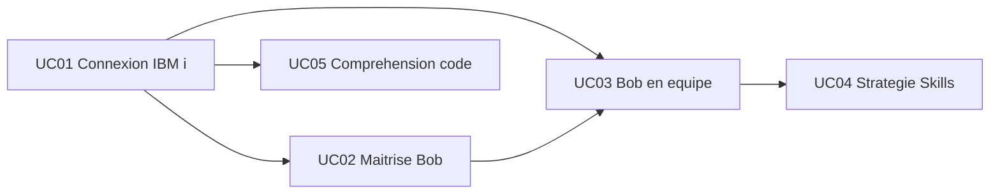

# UC 01 — Connecter Bob à l'IBM i et MCP tiers optionnels

> **Catégorie :** Utilisation de Bob
>
> **Phase :** Phase 0 — Onboarding (prérequis physique absolu à tous les autres UC)
>
> **Durée estimée :** 30 à 60 minutes (connexion IBM i) + variable selon disponibilité des tokens IT (MCP tiers)
>
> **Modes Bob utilisés :** IBM i Developer, IBM i Database

---

## ⭐ Premium Package IBM i utilisé

La connexion à l'IBM i est **native au Premium Package IBM i** : elle se configure une seule fois, puis les modes IBM i Developer et IBM i Database l'utilisent :

| Capacité | Mécanisme | Rôle dans cet UC |
|---|---|---|
| **Mode IBM i Developer** | Outils natifs intégrés (liste : UC00 §5.1) | Accès complet aux membres sources, bibliothèques, compilation — aucun `mcp.json` requis |
| **Mode IBM i Database** | Outils natifs intégrés (liste : UC00 §5.1) | Exécution SQL Db2, vues `QSYS2` — aucun `mcp.json` requis |

> Aucun workflow, slash command ni skill Premium n'est requis pour cet UC (voir UC00 §6). Workspaces (Local, Library List, IFS Working Directory), outils IBM i, recherche documentaire (RAG) et garde-fous : voir UC00 §0 et §5.

> La connexion est configurée **une seule fois** dans les paramètres de l'extension Code for IBM i. Une fois active, tous les modes IBM i (Developer, Database) utilisent automatiquement cette connexion.

> Les MCP tiers (JIRA, Confluence) restent optionnels et configurés séparément dans `~/.bob/settings/mcp.json`.

**Documentation officielle :** [Bob for IBM i — Workspaces](https://bob.ibm.com/docs/ide/premium-packages/bob-for-i/workspaces)

---

## Objectif

Établir la connexion entre Bob et l'IBM i de test, et optionnellement configurer les MCP tiers (JIRA, Confluence) pour les équipes qui en disposent. Sans cette connexion, Bob ne peut accéder ni aux membres sources, ni à Db2 for i, ni aux bibliothèques QSYS — tous les UC IBM i (UC02 à UC19) sont inutilisables.

## Prérequis

- **Phase :** Phase 0 — Onboarding
- **UC précédents requis :** Aucun — c'est le point de départ absolu
- **Livrables requis :** Aucun
- **Niveau Bob recommandé :** Débutant
- **Bob Coins estimés :** ● ○ ○ (configuration, pas de génération de code)
- **Matériel requis :**
  - IBM i de test accessible en SSH (TechZone ou LPAR client)
  - Profil utilisateur IBM i avec droits `*USE` / `*CHANGE` sur les bibliothèques sources
  - Clé SSH privée (recommandée) ou mot de passe IBM i
  - Extension Code for IBM i installée dans VS Code / Bob IDE

## Exemple concret — Lab FLGHT400

Une fois la connexion établie sur l'instance FLGHT403, la commande `/init` (voir UC02) a produit automatiquement :

- [`../labs_FLGHT400_results/FLGHT403_init_report.md`](../labs_FLGHT400_results/FLGHT403_init_report.md) — rapport complet : 122 membres sources lus via les outils natifs IBM i Developer, architecture ILE documentée, dépendances cross-bibliothèques détectées (`FLGHT400/FRSMSGF`)
- [`../labs_FLGHT400_results/FLGHT403_AGENTS.md`](../labs_FLGHT400_results/FLGHT403_AGENTS.md) — AGENTS.md généré dans `FLGHT403/QBOBSRC/AGENTS.MD` — tout cela sans aucun `mcp.json`

**Ce que cette connexion débloque :** les outils natifs `read_member`, `execute_sql_statement`, `execute_cl_command` sont actifs dès lors que la connexion Code for IBM i est configurée et que le Premium Package est activé.

---

## 1. Architecture de la connexion IBM i

```
Bob (modes IBM i Developer / IBM i Database)
        │
        │  Outils natifs Premium
        │  (read_member, execute_sql, execute_cl…)
        ▼
Code for IBM i Extension
        │
        │  SSH (port 22) + clé privée
        ▼
IBM i LPAR (QSYS, Db2 for i, IFS)
```

**Aucun fichier `mcp.json` n'est nécessaire pour la connexion IBM i.** L'extension Code for IBM i joue le rôle de pont — une fois la connexion native configurée, les modes IBM i Developer et IBM i Database l'utilisent automatiquement.

---

## Prompts

### Prompt 0 — Vérifier les prérequis de connexion

**Objectif :** s'assurer que l'environnement poste est prêt avant la configuration.

**Quand l'utiliser :** avant toute configuration, Jour 1 du POC.

**Espace :** Local (terminal du poste développeur)

**Prompt :**

```
Avant de configurer la connexion IBM i dans Bob, aide-moi à vérifier les prérequis
suivants sur mon poste :

1. L'extension "Code for IBM i" est installée dans VS Code
   → Identifiant : `HalcyonTechLtd.code-for-ibmi`
   → Vérifier dans Extensions (Ctrl+Shift+X)

2. Le profil IBM i {IBMI_USER} est opérationnel
   → Droits requis : *USE et *CHANGE sur les bibliothèques sources ({appId})
   → NE PAS utiliser un profil *ALLOBJ pour Bob — créer un profil dédié POC

3. La connexion SSH vers {IBMI_HOST} (port 22) est accessible depuis ce poste
   → Test : `ssh {IBMI_USER}@{IBMI_HOST} "WRKUSRJOB"`

4. La clé SSH privée est disponible (recommandée plutôt qu'un mot de passe)
   → Emplacement habituel : `~/.ssh/id_rsa` ou `~/.ssh/id_ed25519`

Retourne un tableau de validation (✅ OK / ⚠️ À vérifier / ❌ Bloquant) pour chaque point,
avec les actions correctives si nécessaire.
Sauvegarde le résultat dans bob-reports/{appId}-connexion-prereqs-{YYYYMMDD-HHmm}.md
```

**Espace :** Local
**Livrable produit :** `bob-reports/{appId}-connexion-prereqs-{YYYYMMDD-HHmm}.md`

---

### Prompt 1 — Configurer la connexion dans Code for IBM i

**Objectif :** créer et valider la connexion IBM i dans l'extension Code for IBM i.

**Quand l'utiliser :** après validation des prérequis.

**Espace :** Local (interface VS Code)

**Étapes de configuration (à réaliser dans l'interface VS Code) :**

> ⚠️ **IBM i (IBMeurs — TechZone)** : la connexion TechZone nécessite d'être en **VPN IBM** pour accéder au LPAR. Vérifier que le VPN est actif avant de configurer.

**Méthode 1 — depuis la page d'accueil du Premium Package IBM i :**
1. Ouvrir l'icône **IBM i** dans la barre latérale gauche de VS Code
2. Cliquer sur **"Connect to an IBM i"** (bouton bleu en haut de la page d'accueil)
3. La fenêtre **IBM i Login** s'ouvre avec les champs suivants :
   - **Connection Name** : nom libre (ex. `Flight 4nn Demo`, `ACME-DEV`)
   - **Host or IP Address** : `{IBMI_HOST}` (IP ou hostname du LPAR)
   - **Port (SSH)** : `22` (valeur par défaut — ne pas modifier sauf exception)
   - **Username** : `{IBMI_USER}` (ex. `ITZUSER` pour TechZone)
   - **Password** : laisser vide si clé privée utilisée
   - **Private Key** : cliquer **"Select File"** → sélectionner le fichier de clé privée (formats OpenSSH, RFC4716 ou PPK)
   - **Key Passphrase** : saisir la passphrase si la clé est protégée
4. Cliquer **Save** puis **Connect** (▶ à droite de la connexion dans l'arborescence)

**Méthode 2 — depuis l'arborescence SERVERS :**
1. Dans la section **SERVERS** (bas du panneau IBM i), cliquer sur **"+"** à droite de "SERVERS"
2. Renseigner les mêmes champs que ci-dessus
3. La connexion apparaît dans la liste avec l'icône ✗ (déconnecté) → cliquer ▶ pour connecter

**Résultat attendu :** la connexion passe de ✗ à ✓ dans l'arborescence SERVERS et le nom du serveur affiche `{IBMI_USER}@{IBMI_HOST}`.

**Prompt de validation après connexion :**

```
Ma connexion IBM i est configurée dans Code for IBM i.
Je suis en mode IBM i Developer, espace Librairies IBM i.

Effectue ces 3 tests de validation :

Test 1 — Lecture membre source :
Liste les 5 premiers membres de {appId}/QRPGSRC avec leur type.

Test 2 — Exécution SQL :
Exécute : SELECT TABLE_NAME, TABLE_TYPE FROM QSYS2.SYSTABLES WHERE TABLE_SCHEMA = '{appId}' FETCH FIRST 5 ROWS ONLY

Test 3 — Commande CL :
Exécute : DSPOBJD OBJ({appId}/*ALL) OBJTYPE(*PGM)
(liste des programmes compilés dans la bibliothèque)

Si les 3 tests réussissent, retourne une confirmation avec les résultats.
Sauvegarde le rapport de validation dans bob-reports/{appId}-connexion-validation-{YYYYMMDD-HHmm}.md
```

**Espace :** IBM i QSYS
**Livrable produit :** `bob-reports/{appId}-connexion-validation-{YYYYMMDD-HHmm}.md`

---

### Prompt 2 — Configurer les MCP tiers optionnels (JIRA, Confluence)

**Objectif :** ajouter JIRA et/ou Confluence comme outils complémentaires accessibles à Bob.

**Quand l'utiliser :** uniquement si des tokens API sont disponibles — optionnel pour le POC IBM i.

**Espace :** Local

> ⚠️ **Action à mener dès le kick-off** : les tokens API JIRA/Confluence ont souvent les délais de provisioning les plus longs. Lancer la demande auprès de l'équipe IT dès Phase 0 même si la configuration est différée.

> ⚠️ **Règle unique de gestion des secrets et MCP tiers :**
> 1. **Variables d'environnement / secrets référencés (`${env:VARIABLE_NAME}`)** : dans un `mcp.json` partagé/versionné (ex. `.bob/mcp.json`), référencer les jetons via la syntaxe `${env:JIRA_API_TOKEN}` / `${env:CONFLUENCE_API_TOKEN}`. Aucun jeton n'est stocké en clair dans le fichier. La doc Bob recommande les variables d'environnement mais ne documente pas la syntaxe `${env:…}` : **à valider tant que le test de fonctionnement n'a pas réussi** (voir ci-dessous).
>
> **Test de fonctionnement (sur l'installation cible)** : définir la variable sur le poste, redémarrer Bob, vérifier que le MCP s'initialise sans erreur d'authentification, puis lire un ticket JIRA / une page Confluence de test. Tant que ce test n'a pas réussi, le point reste « à valider ».
>
> 2. **Jetons stockés en clair** : si `~/.bob/settings/mcp.json` contient des jetons réels, ce fichier est strictement personnel et ne doit **jamais être versionné ni commité dans Git**.
> 3. **Secrets dans un prompt (à proscrire)** : ne jamais transmettre de jetons réels ou mots de passe en clair dans un prompt. Définir les variables d'environnement sur le poste ou utiliser `/manage-secrets set <KEY> <VALUE>`.
>
> Les MCP tiers ne remplacent en rien la connexion IBM i native (qui ne requiert aucun `mcp.json`).

**Prompt :**

```
Je souhaite ajouter les serveurs MCP JIRA et/ou Confluence dans Bob.
Ces MCP me permettront de lire des tickets JIRA depuis le chat
et de publier de la documentation sur Confluence.

Paramètres de configuration (sans jeton en clair) :
- JIRA : URL={JIRA_URL}, email={JIRA_EMAIL}, token référencé via ${env:JIRA_API_TOKEN}
- Confluence : URL={CONFLUENCE_URL}, email={CONFLUENCE_EMAIL}, token référencé via ${env:CONFLUENCE_API_TOKEN}

Crée ou mets à jour le fichier de configuration MCP (`~/.bob/settings/mcp.json` pour un usage
personnel non versionné, ou `.bob/mcp.json` pour un partage d'équipe) avec ces serveurs.

⚠️ Règle de gestion des secrets :
- Référencer les jetons via la syntaxe `${env:NOM_VARIABLE}` (ou configurer via `/manage-secrets set`)
- Un fichier contenant des jetons en clair ne doit JAMAIS être commité dans Git
- Ne JAMAIS transmettre de jeton réel en clair dans le texte d'un prompt

⚠️ Vérifier les noms de packages npm sur bob.ibm.com avant utilisation
— ils peuvent évoluer entre versions.

Après configuration, indique la commande pour enregistrer les secrets (/manage-secrets set ...)
et propose un prompt de validation pour chaque MCP activé.
```

**Espace :** Local
**Livrable produit :** `~/.bob/settings/mcp.json` (non versionné)

---

## Symptômes d'une connexion mal configurée

| Symptôme | Cause probable | Remède |
|---|---|---|
| Bob répond "Je n'ai pas accès aux membres sources" en mode IBM i Developer | Connexion Code for IBM i inactive ou pas de bibliothèque active | Vérifier l'état de connexion dans Code for IBM i, activer une bibliothèque |
| L'espace "Librairies IBM i" n'apparaît pas dans Bob | Extension Code for IBM i non installée ou non connectée | Installer `HalcyonTechLtd.code-for-ibmi`, se connecter |
| `/init` ne trouve aucun membre | Mauvaise bibliothèque active dans la Library List | Ajouter `{appId}` dans la Library List de Code for IBM i |
| Bob peut lire mais pas écrire | Droits `*USE` uniquement — `*CHANGE` manquant | Demander les droits `*CHANGE` sur les bibliothèques sources |
| Erreur SSH `Permission denied` | Clé privée non reconnue | Vérifier le chemin de la clé dans Code for IBM i Settings, ajouter la clé publique dans `~/.ssh/authorized_keys` IBM i |
| MCP JIRA "connection refused" | Token expiré ou URL incorrecte | Régénérer le token dans JIRA → API tokens |

---

## Livrables de cet UC

| Fichier produit | Pattern de nommage | Consommé par |
|---|---|---|
| Rapport de prérequis | `bob-reports/{appId}-connexion-prereqs-{YYYYMMDD-HHmm}.md` | Équipe technique |
| Rapport de validation connexion | `bob-reports/{appId}-connexion-validation-{YYYYMMDD-HHmm}.md` | UC02 à UC19 |

> `~/.bob/settings/mcp.json` est un fichier de configuration personnelle — non versionné, non inclus dans les livrables.

## Dépendances



---

## Check-list de validation UC 01

Avant de passer à UC02, valider chaque point :

- [ ] L'extension Code for IBM i est installée et affiche l'IBM i de test en statut **Connected**
- [ ] La bibliothèque `{appId}` est active dans la Library List
- [ ] Test 1 réussi : listage de membres QRPGSRC retourne des résultats en mode IBM i Developer
- [ ] Test 2 réussi : requête SQL sur `QSYS2.SYSTABLES` retourne des résultats en mode IBM i Database
- [ ] Test 3 réussi : commande CL `DSPOBJD` s'exécute sans erreur
- [ ] Le profil IBM i utilisé n'est PAS `*ALLOBJ` — droits limités aux bibliothèques du POC
- [ ] Rapport de validation sauvegardé dans `bob-reports/`
- [ ] *(Optionnel)* JIRA MCP : lecture d'un ticket de test réussie si token disponible
- [ ] *(Optionnel)* Confluence MCP : lecture d'une page de test réussie si token disponible
- [ ] L'équipe IT a été contactée pour les tokens JIRA/Confluence si non disponibles

---

*Fiche UC01 — révisée le 2026-10-30 — connexion IBM i native Premium Package + MCP tiers optionnels*
