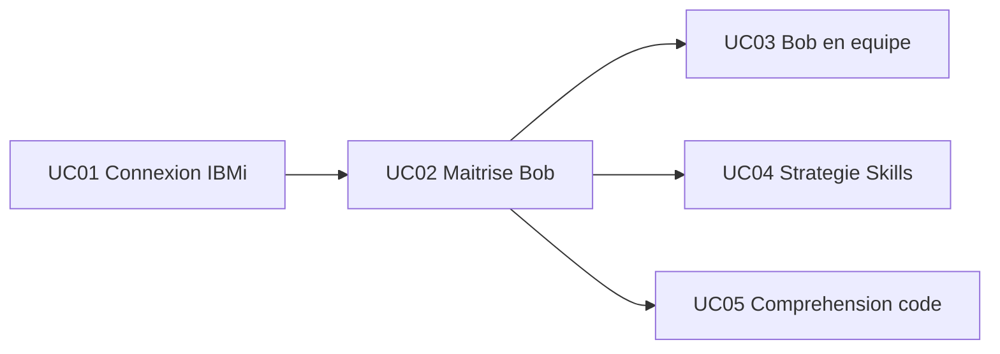

# UC 02 — Maîtrise de Bob

> **Catégorie :** Utilisation de Bob
> **Phase :** Phase 0 — Onboarding (prérequis absolu à tous les autres UC)
> **Durée estimée :** 1 à 2 journées selon le niveau initial de l'équipe
> **Modes Bob utilisés :** ASK, IBM i Developer, IBM i Database, Agent

---

## ⭐ Premium Package IBM i utilisé

> Les capacités Premium entrent en jeu dès la prise en main de Bob pour IBM i. Cet UC est le moment d'apprendre à les activer.

| Capacité Premium | Rôle dans cet UC |
|---|---|
| **`/init`** slash command | Génère automatiquement l'`AGENTS.md` de la bibliothèque IBM i — premier geste concret Premium |
| **`/erd`** slash command | Génère le diagramme ERD de la base de données — exercice de découverte des slash commands |
| **`/review_SQL`** slash command | Révise une requête SQL — exercice slash command en mode IBM i Database |
| **Understand Dashboard** | Scanner d'application — découverte de la cartographie applicative sans prompts (voir UC00 §2) |
| **Workflow RPG Modernization** | Premier workflow guidé (bouton *Start Workflow*) — exercice de modernisation FRS409 |
| **Workflow SQL Index Strategy Advisor** | Second workflow (bouton *Start Workflow*, Library List uniquement) — exercice d'optimisation SQL |
| **71 skills IBM i** | Activées automatiquement dès que le mode IBM i Developer est sélectionné |

**Documentation officielle :** [Slash Commands](https://bob.ibm.com/docs/ide/premium-packages/bob-for-i/slash-commands) · [Understand Dashboard](https://bob.ibm.com/docs/ide/premium-packages/bob-for-i/understand) · [Workflows](https://bob.ibm.com/docs/ide/premium-packages/bob-for-i/workflows) · [Skills IBM i](https://bob.ibm.com/docs/ide/premium-packages/bob-for-i/skills)

---

## Objectif

Rendre chaque membre de l'équipe autonome sur Bob **avant d'aborder tout autre UC** : comprendre les modes, le scope, les workflows, les slash commands et les skills Premium. Pratiquer sur l'application IBM i réelle du lab Flight400.

Sans cette maîtrise initiale, tous les UC suivants seront sous-exploités.

---

## Prérequis

- **Phase :** Phase 0 — Onboarding
- **UC précédents requis :** Aucun
- **Livrables requis :** Aucun
- **Niveau Bob requis :** Débutant (c'est le point de départ)
- **Bob Coins estimés :** ● ○ ○ (exercices découverte, consommation faible)
- **Matériel requis :** IBM i de test accessible (TechZone ou IBM i client) + lab FLGHT400 déployé

---

## Exemple concret — Lab FLGHT400

Le lab Flight400 est le support pratique officiel de cet UC. Les résultats ci-dessous ont été produits lors d'une session réelle sur l'instance FLGHT403 :

- [`FLGHT403_init_report.md`](../labs_FLGHT400_results/FLGHT403_init_report.md) — résultat de `/init` sur FLGHT403 : 122 membres sources documentés, architecture ILE, dépendances cross-library
- [`FLGHT403_AGENTS.md`](../labs_FLGHT400_results/FLGHT403_AGENTS.md) — le fichier AGENTS.md généré automatiquement par `/init`
- [`FLGHT403_erd.md`](../labs_FLGHT400_results/FLGHT403_erd.md) — ERD Mermaid produit par `/erd FLGHT400`
- [`FRS409-Modernisation-report.md`](../labs_FLGHT400_results/FRS409-Modernisation-report.md) — rapport de modernisation RPG produit par le workflow RPG Modernization
- [`FLGHT403_sql-review-bottleneck-analysis.md`](../labs_FLGHT400_results/FLGHT403_sql-review-bottleneck-analysis.md) — analyse SQL produite par `/review_SQL` + workflow SQL Index Strategy Advisor

---

## 1. Accès au lab Flight400

### Références officielles

- **Lab :** [IBM i Application Modernization with Bob — Flight400](https://github.com/bmarolleau/flight400-demo)
- **Guide de redéploiement :** [`labs_FLGHT400/FICHE-REDEPLOIEMENT.md`](../labs_FLGHT400/FICHE-REDEPLOIEMENT.md)

### Accès à un IBM i pour le lab

| Situation | Action |
|---|---|
| L'admin IBM i accorde des droits sur l'IBM i de test | Utiliser directement. Vérifier : profil utilisateur, bibliothèques, droits `*USE`/`*CHANGE`, port SSH ouvert. |
| IBM i de test non accessible | Provisionner un IBM i sur TechZone (voir ci-dessous). |

### Provisionner un IBM i sur TechZone

1. Aller sur [techzone.ibm.com](https://techzone.ibm.com) → rechercher **"IBM i"** → sélectionner **IBM i 7.6 - Sandbox**
2. **Reserve** : objectif *Practice / Self-Education*, durée minimum 8 h, région la plus proche
3. Dans quelques minutes : hostname, port, profil utilisateur, mot de passe par e-mail

> ⚠️ Durée maximale : 4 à 6 semaines avec un OPPY valide. Demander une extension avant la fin — ne pas attendre.

---

## 2. Configuration initiale de Bob

| Étape | Action | Ce qu'on apprend |
|---|---|---|
| C1 | Ouvrir un dossier local (`File → Open Folder`) | Bob travaille toujours dans un workspace local — obligatoire avant tout. |
| C2 | Installer le **Package Premium IBM i** depuis le Marketplace Bob | Le Premium Package active les modes IBM i Developer et IBM i Database, les 71 skills, les workflows et les slash commands. |
| C3 | Installer l'extension **Code for IBM i** et configurer la connexion SSH | La connexion IBM i est la fondation — tester immédiatement. Si la connexion est down, rien ne fonctionne. |
| C4 | Installer l'extension **IBM i Languages** | Coloration syntaxique RPG, CL, DDS, COBOL dans l'éditeur. |
| C5 | Configurer la **Library List** dans Code for IBM i | Ajouter `FLGHT400` (ou la bibliothèque du projet). Bob cherche les membres sources dans cette liste. |
| C6 | Vérifier les **Bob Coins** dans les settings du profil TechZone | Chaque appel LLM consomme des Coins. Surveiller le compteur dès le début. |

---

## 3. Les trois espaces de travail Bob × IBM i — Premier choix à faire

> **Ce choix conditionne tout** : les outils disponibles, les fichiers accessibles, les livrables produits, et même la capacité de Bob à lire les membres source. C'est la première décision à prendre à chaque nouvelle conversation.

À l'ouverture d'une nouvelle conversation Bob avec une connexion IBM i active, trois espaces sont disponibles :

---

### Espace 1 — Workspace local (poste de travail)

**Ce que c'est :** le dossier ouvert dans Bob sur le poste local (`File → Open Folder`). Bob y voit les fichiers markdown, les skills, les rules, les livrables produits lors des sessions précédentes.

**Ce que Bob peut faire :**
- Lire et écrire des fichiers locaux (`.md`, `.json`, configs)
- Accéder aux skills et rules `.bob/`
- Charger des livrables UC existants comme contexte (fichiers `*-comprehension-*.md`, etc.)

**Ce que Bob ne peut PAS faire :**
- Lire les membres sources RPG/CL/DDS directement depuis QSYS
- Exécuter des commandes IBM i ou CL
- Compiler des programmes

**Quand l'utiliser :** pour travailler sur les fiches UC, les plans, la documentation locale, la création de skills/rules. Pas pour le code IBM i.

---

### Espace 2 — Librairies IBM i (QSYS) ⭐ Espace principal du POC

**Ce que c'est :** l'accès direct aux bibliothèques IBM i via l'extension Code for IBM i. Bob navigue dans QSYS comme dans un explorateur de fichiers : objets compilés, membres sources RPG/CL/DDS, fichiers physiques et logiques.

**Comment l'activer :** bouton `+` (scope) dans le panneau Bob → **Library List** → sélectionner `FLGHT400` (ou la bibliothèque du projet).

**Ce que Bob peut faire :**
- Lire les membres sources RPG, CL, DDS directement (`read_member`)
- Exécuter des requêtes SQL sur Db2 for i (`execute_sql_statement`)
- Compiler des programmes (`execute_compile_action`)
- Exécuter des commandes CL (`execute_cl_command`)
- Utiliser les slash commands `/init`, `/erd`, `/review_rpg`, `/review_SQL`
- Lancer les workflows Premium (RPG Modernization, SQL Index Strategy Advisor, RPGUnit, Business Rules Extraction)
- Scanner l'application avec Understand Dashboard

**Quand l'utiliser :** pour **la quasi-totalité des exercices et labs** — c'est l'espace de travail par défaut du POC. Dans le lab FLGHT400, on ouvre systématiquement la bibliothèque `FLGHT400` dans cet espace.

> ⚠️ **Sans cet espace activé, les outils IBM i de Bob sont inopérants.** `/init` s'arrête, les workflows ne trouvent pas les sources, les compilations échouent.

**Exemple lab FLGHT400 :** tous les exercices 1 à 7 de la [`FICHE-REDEPLOIEMENT.md`](../labs_FLGHT400/FICHE-REDEPLOIEMENT.md) s'exécutent dans cet espace, bibliothèque `FLGHT400` (ou `FLGHT403` pour la démo instance 403).

---

### Espace 3 — $HOME IFS (répertoire personnel sur IBM i)

**Ce que c'est :** le répertoire IFS (`/home/ITZUSER/` ou `/home/{USER}/`) sur l'IBM i. Bob y lit et écrit des fichiers via le système de fichiers intégré (IFS).

**Comment l'activer :** bouton `+` (scope) dans le panneau Bob → **IFS** → sélectionner `/home/{USER}/` ou le dossier du projet.

**Ce que Bob peut faire :**
- Écrire les livrables markdown dans l'IFS (rapports, plans, AGENTS.md)
- Lire des fichiers de configuration ou de données stockés en IFS
- Déployer des scripts shell (`.sh`) et des apps Node/Vite pour les exercices React
- Lire le fichier AGENTS.md créé par `/init` (en QSYS ou IFS)

**Quand l'utiliser :** pour les livrables de sortie des workflows (rapports Business Rules, plans RPGUnit), pour les apps React/Web (exercice 7-8 du lab), pour les scripts de déploiement.

> 💡 `/init` écrit l'AGENTS.md dans `{BIBLIO}/QBOBSRC/AGENTS.MD` (en QSYS) ou dans `{répertoire IFS}/.bob/AGENTS.md` (en IFS). Une copie `/home/{USER}/AGENTS.md` a été observée dans le lab FLGHT400 (non documentée par IBM). Les emplacements officiels sont injectés automatiquement dans les conversations suivantes.

---

### Tableau récapitulatif — Quel espace pour quelle tâche ?

| Tâche | Espace recommandé |
|---|---|
| Lire un membre source RPG (`FRS409`) | **Librairies IBM i** (QSYS) |
| Exécuter `/init`, `/erd`, `/review_rpg` | **Librairies IBM i** (QSYS) |
| Lancer un workflow Premium | **Librairies IBM i** (QSYS) |
| Scanner avec Understand | **Librairies IBM i** (QSYS) |
| Écrire un rapport de modernisation | **$HOME IFS** |
| Déployer une app React/Node | **$HOME IFS** |
| Lire/modifier une fiche UC locale | **Workspace local** |
| Créer ou modifier un skill/rule | **Workspace local** |
| Combiner sources IBM i + livrables locaux | **Librairies IBM i** + fichier local chargé via `Add File to Chat` |

---

### Premier geste de chaque nouvelle conversation IBM i

1. Vérifier que la connexion IBM i est active (icône de statut dans Code for IBM i)
2. Clic droit sur la bibliothèque cible → **Set as Current Library** (ex. `FLGHT400`)
3. Bouton `+` → **Library List** → confirmer que `FLGHT400` est présente
4. Sélectionner le mode Bob adapté (IBM i Developer pour le code, IBM i Database pour le SQL)
5. Démarrer le prompt

> 💡 Si Bob répond "je ne vois pas ce programme" ou "je ne peux pas accéder à cette bibliothèque" — vérifier en priorité que l'espace Librairies IBM i est bien activé (étape 3).

---

## 4. Découverte des modes Bob

### Les modes à connaître

| Mode | Quand l'utiliser |
|---|---|
| **ASK** | Questions générales, documentation, explications sans accès IBM i |
| **IBM i Developer** | Tout travail sur le code RPG, CL, DDS, COBOL — mode principal du POC |
| **IBM i Database** | SQL, Db2 for i, analyse de performance, génération DDL |
| **Agent** | Actions multi-étapes autonomes : écriture de fichiers, compilations, séquences complexes |
| **Plan** | Planification, conception, architecture — avant de coder |

> ⚠️ Ne jamais rester en mode ASK pour générer du code IBM i — basculer en IBM i Developer.

### Exercice de découverte des modes

Depuis le lab FLGHT400, ouvrir `FLGHT400/QRPGSRC(FRS409)` dans l'éditeur, puis tester :

```
[Mode ASK] "Qu'est-ce que le RPG OPM ?"
[Mode IBM i Developer] "What does this program do?"
[Mode IBM i Database] "Quelle est la structure de la table FLIGHTS ?"
[Mode Agent] "Génère un fichier markdown avec la liste des programmes de la bibliothèque FLGHT400."
```

Comparer les résultats — le mode change radicalement la qualité des réponses sur IBM i.

---

## 5. Scope et contexte

### Contexte implicite vs scope explicite

| Mécanisme | Comment ça fonctionne | Quand l'utiliser |
|---|---|---|
| **Contexte implicite** | Le fichier actif dans l'éditeur est transmis automatiquement à Bob | Questions ponctuelles sur le programme ouvert |
| **Scope explicite** | Bouton `+` → Library List, QSYS, dossier IFS | Travail multi-sources, dépendances, architecture |

**Erreurs fréquentes :**
- Scope trop large (toute la QSYS) → ralentissement, résultats dilués
- Oublier le scope pour une tâche multi-sources → Bob répond uniquement sur le fichier ouvert
- Changer de fichier actif sans s'en rendre compte → contexte implicite change silencieusement

**Bonne pratique :** En début de session, ouvrir le fichier cible ET définir le scope Library List.

### Syntaxe `@mention`

Dans les prompts, `@NOM` ancre explicitement un objet dans le contexte :

```
"Génère la documentation de @FRS409 et liste ses dépendances dans @FLGHT400."
"Compare les champs de @FLIGHTS avec ceux utilisés dans @FRS021."
```

> ⚠️ N'utiliser `@NOM` que pour des objets présents dans le scope défini — sinon Bob ne les trouve pas.

### Gestion de la fenêtre de contexte

**L'indicateur Context** est la barre de progression affichée en haut du panneau Bob (ou via l'icône cercle en bas à droite de la zone de chat). Il indique le pourcentage de la fenêtre de contexte utilisé — ce n'est pas un comptage de messages humains, mais un volume total de tokens incluant le system prompt, les définitions d'outils, les rules, les skills et **tous les échanges Bob-outil** (tool calls) qui se produisent sans intervention humaine visible.

**Seuils pratiques :**

| Indicateur Context | Situation | Action recommandée |
|---|---|---|
| < 40 % | Zone verte — tout va bien | Continuer normalement |
| 40–60 % | Zone jaune — surveiller | Éviter de lancer des tâches longues ou multi-étapes |
| > 60 % | Zone orange — agir maintenant | Voir options ci-dessous |
| > 80 % | Zone rouge — dégradation probable | Bob commence à perdre des décisions prises en début de session |

**Quand l'indicateur dépasse 60 % — deux options :**

**Option A — Nouvelle session directe** (si la tâche est terminable rapidement) :
1. Sauvegarder le livrable en cours (basculer en Agent, demander la sauvegarde)
2. Ouvrir une nouvelle conversation (bouton `+`)
3. Re-définir le scope et mentionner le fichier produit à la conversation précédente

**Option B — Document de transfert de contexte** (si la tâche doit continuer) :

```
"Prépare un document de transfert de contexte sur [SUJET EN COURS] :
 - Ce qui a été analysé / produit jusqu'ici
 - Les décisions importantes prises
 - Les questions ouvertes identifiées
 - Les prochaines étapes prévues
 - Les skills IBM i à activer dans la nouvelle session
 Sauvegarde ce document dans bob-reports/ sous le nom
 {appId}-context-transfer-{sujet}-{YYYYMMDD-HHmm}.md"
```

Puis ouvrir une nouvelle conversation, charger ce document en contexte et indiquer : *"Reprends à partir de [ÉTAPE] — le résumé de la session précédente est dans [NOM_FICHIER]."*

**Symptômes et remèdes rapides :**

| Symptôme | Cause | Remède |
|---|---|---|
| Réponse vague sur du code précis | Scope trop large | Réduire au fichier ou à la bibliothèque concernée |
| Documentation tronquée | Programme trop long | Découper programme par programme |
| Bob "oublie" les décisions précédentes | Contexte > 60 % | Option A ou B ci-dessus |
| Bob propose des solutions déjà écartées | Décisions refoulées hors de la fenêtre | Option B — transfert de contexte |

---

## 6. ⭐ Slash commands Premium — Exercices pratiques

### Exercice `/init` — Générer l'AGENTS.md automatiquement

1. Vue **User Library List** → clic droit sur `FLGHT400` → **Set as Current Library**
2. Mode **IBM i Developer**, portée *Library List*
3. Dans le chat : `/init`
4. Bob analyse la bibliothèque et crée `FLGHT400/QBOBSRC/AGENTS.MD` (ou `{répertoire IFS}/.bob/AGENTS.md` en workspace IFS ; une copie `/home/USER/AGENTS.md` a été observée dans le lab FLGHT400, non documentée par IBM).

> ⚠️ Sans bibliothèque courante définie, `/init` s'arrête sans créer le fichier.

**Ce qu'on apprend :** l'AGENTS.md est injecté automatiquement dans chaque conversation Bob suivante — c'est la mémoire persistante du projet.

**Résultat exemple :** [`FLGHT403_init_report.md`](../labs_FLGHT400_results/FLGHT403_init_report.md)

---

### Exercice `/erd` — Générer le diagramme ERD

1. Mode **IBM i Database**
2. Dans le chat : `/erd FLGHT400`
3. Bob génère le diagramme Mermaid ERD de toutes les tables

**Ce qu'on apprend :** une commande, zéro SQL manuel, un ERD complet avec PK/FK/cardinalités.

**Résultat exemple :** [`FLGHT403_erd.md`](../labs_FLGHT400_results/FLGHT403_erd.md)

---

### Exercice `/review_SQL` — Revue d'une requête SQL

1. Mode **IBM i Database**
2. Dans le chat : `/review_sql` puis coller la requête de l'exercice 4 du lab (requête `ORDERS × FLIGHTS × AGENTS`)
3. Bob détecte le problème intentionnel (`ORDER BY` sur colonne hors `GROUP BY`) et propose le SQL corrigé

**Résultat exemple :** [`FLGHT403_sql-review-bottleneck-analysis.md`](../labs_FLGHT400_results/FLGHT403_sql-review-bottleneck-analysis.md)

---

## 7. ⭐ Understand Dashboard — Cartographie applicative

> Understand est le composant de cartographie applicative du Premium Package. Voir UC00 §2 pour le détail complet de l'installation, des 6 outils et des 3 skills Understand.

### Activation

1. Prérequis : Understand installé sur l'IBM i (voir UC00 §2 pour la configuration de la bibliothèque dédiée via `vscode-ibmi-bob.understand.installLibrary`)
2. Commande *Open Understand Dashboard* ou icône du Dashboard dans la barre de titre du chat Bob
3. **New Application** → nom `FLGHT400`, bibliothèque `FLGHT400`, bibliothèque de métadonnées `UNDERSTAND` → **Scan**
4. Scan ~30–60 s pour ~100 membres

### Questions à poser après le scan

```
"What are the high-level functional areas of FLGHT400?"
"Which programs will be affected if I modify the FLIGHTS table?"
"Which objects in FLGHT400 haven't been used in the last 5 years?"
```

**Ce qu'on apprend :** la cartographie applicative sans lecture manuelle de chaque source — analyse d'impact en secondes.

**Résultat exemple :** [`FLGHT403_functional_areas.md`](../labs_FLGHT400_results/FLGHT403_functional_areas.md)

---

## 8. ⭐ Workflows Premium — Exercices pratiques

### Exercice Workflow RPG Modernization

1. Ouvrir `FLGHT400/QRPGSRC(FRS409)` dans l'éditeur
2. Mode IBM i Developer (workspaces supportés : Local, Library List — voir UC00 §1)
3. Bouton **Start Workflow** en haut du chat → **RPG Modernization** (ou demander dans le chat : `"Can you modernize this program?"` → Bob propose le workflow)
4. Saisir les paramètres : bibliothèque source `FLGHT400`, fichier `QRPGSRC`, membre `FRS409`, sortie `FLGHT400/QRPGLESRC/FRS409.RPGLE`

**Ce qu'on apprend :** deux approches existent — workflow (structuré, guidé) vs agent (flexible, itératif). Le workflow est recommandé pour les patterns connus.

**Résultat exemple :** [`FRS409-Modernisation-report.md`](../labs_FLGHT400_results/FRS409-Modernisation-report.md)

---

### Exercice Workflow SQL Index Strategy Advisor

1. Mode **IBM i Database**, workspace **Library List** uniquement (seul workspace supporté — voir UC00 §1)
2. Bouton **Start Workflow** en haut du chat → **SQL Index Strategy Advisor**
3. Paramètres : Data Source = `Capture New Performance Data`, Output Library = `FLGHT400`, Top N = 20
4. Bob analyse le Plan Cache et propose les index prioritaires
5. Valider : *"Apply the highest-priority index only for FLGHT400"*

**Résultat exemple :** [`FLGHT403_sql-review-bottleneck-analysis.md`](../labs_FLGHT400_results/FLGHT403_sql-review-bottleneck-analysis.md)

---

## 9. Workflows vs Agent vs Slash commands

| Niveau | Quand l'utiliser | Exemples |
|---|---|---|
| **Slash commands** | Actions rapides, résultat immédiat | `/init`, `/erd`, `/review_rpg`, `/review_SQL` |
| **Workflows** | Tâches guidées structurées, patterns connus | RPG Modernization, SQL Index Advisor, RPGUnit |
| **Agent** | Séquences multi-étapes autonomes, tâches complexes | Ajout d'un champ bout-en-bout, génération app React |

> 💡 Commencer par les slash commands et workflows pour les tâches connues — réserver l'Agent pour les tâches nécessitant de l'adaptabilité.

---

## 10. Skills

Un Skill est un fichier Markdown (`.md`) stocké dans `.bob/skills/` qui injecte du contexte persistant dans chaque session. Les 71 skills IBM i du Premium Package s'activent automatiquement.

**Créer un Skill ACME :** en mode Agent, demander à Bob de créer un skill avec les normes de développement RPG de ACME. Ce skill sera réutilisé dans tous les UC suivants.

> 💡 Voir UC04 (Stratégie Skills) pour l'industrialisation des skills sur le projet.

---

## 11. Gestion des Bob Coins et économie de contexte

**Où surveiller les Bob Coins :** Settings du profil TechZone → Bob Coins counter.

**Consommation par mode / action :**

| Mode / Action | Consommation |
|---|---|
| ASK, questions simples | ● ○ ○ |
| IBM i Developer, prompts standards | ● ○ ○ |
| Workflows (RPG Modernization, etc.) | ● ● ○ |
| Agent, séquences longues | ● ● ○ à ● ● ● |
| Génération d'applications (React, Web) | ● ● ● |

**Stratégies d'économie — à appliquer dès le premier jour :**

| Stratégie | Impact | Comment |
|---|---|---|
| Utiliser le mode **Ask** ou **IBM i Developer** (pas Agent) pour les tâches de lecture/compréhension | Moyen | Agent consomme plus de coins car il peut lancer des tool calls en boucle |
| Garder les sessions courtes et ciblées | Élevé | Une session = un programme ou un objectif précis. Ne pas "continuer" indéfiniment. |
| Surveiller l'indicateur Context (voir § Gestion de la fenêtre de contexte) | Élevé | Dépasser 60 % = risque de réponses dégradées ET de gaspillage sur les nouvelles questions |
| Fermer les fichiers non utilisés dans l'éditeur | Faible | Le fichier actif dans l'éditeur est transmis en contexte implicite |
| Préférer les slash commands aux prompts libres pour les tâches connues | Moyen | `/init`, `/review_rpg`, `/review_SQL` sont optimisés — moins de tokens que le prompt équivalent en libre |
| Demander à Bob de sauvegarder **avant** de lancer la prochaine tâche | Élevé | Évite de re-générer un livrable perdu si la session se termine mal |
| Utiliser `@mention` précis plutôt que "tous les fichiers de la lib" | Moyen | Scope ciblé = moins de tokens dans la fenêtre de contexte |

> 💡 Sur un POC de 5 jours, la gestion du contexte est aussi importante que la qualité des prompts — un développeur qui ouvre de nouvelles sessions régulièrement avancera plus vite qu'un développeur qui accumule 3h de conversation dans une seule session.

---

## 12. Approbation des actions en mode Agent

En mode Agent, Bob demande une **confirmation avant chaque action irréversible** (écriture de fichier, compilation, commande CL). Lire systématiquement :

| Point de contrôle | Question à se poser |
|---|---|
| Chemin de destination | Bonne bibliothèque / bon membre ? |
| Type d'action | Écriture ? Remplacement ? Suppression ? |
| Commande CL | Correcte et sans effet de bord ? |
| Périmètre | Bob touche-t-il plus d'objets que demandé ? |

> ⚠️ Ne jamais tout approuver sans lire — risque d'écraser un source ou de compiler sur le mauvais LPAR.

---

## 13. Personnalisation de l'environnement : mode natif IBM i Developer et rules

> ⚠️ **Important — modes personnalisés vs IBM i Developer :**
> Ne pas créer un custom mode concurrent à IBM i Developer. Un custom mode est indépendant — il ne hérite pas des outils Premium (workflows, slash commands, 71 skills). La bonne approche : utiliser **IBM i Developer** comme mode de base et injecter les normes ACME via les **rules** (`.bob/rules/` et `.bob/rules-ibm-i-developer/`), qui s'appliquent à tous les modes ou à ce mode spécifique, complétées par l'`AGENTS.md` généré par `/init`.

Pour intégrer le contexte et les normes de l'entreprise :
- Utiliser le mode natif **IBM i Developer** pour tout travail sur le code RPG, CL, DDS, COBOL
- Injecter les normes de développement RPG et conventions de nommage via les rules (détaillé dans UC03 et UC04)
- Documenter le contexte métier et l'architecture dans l'`AGENTS.md` (via `/init`)

La création d'un custom mode reste une exception explicitement validée (besoins spécifiques hors IBM i), et non une étape d'onboarding standard.

---

## Livrables de cet UC

> ⚠️ **Important — où écrit Bob ?**
> `/init` écrit l'AGENTS.md **sur l'IBM i** (`{BIBLIO}/QBOBSRC/AGENTS.MD` en QSYS et `{répertoire IFS}/.bob/AGENTS.md` en IFS ; copie `/home/{USER}/AGENTS.md` observée dans le lab FLGHT400, non documentée par IBM), pas en local.
> Pour conserver un rapport local dans `bob-reports/`, demander explicitement à Bob après `/init` :
> ```
> "Sauvegarde le rapport complet de cet /init dans le dossier bob-reports/
>  sous le nom {app}-init-report-{YYYYMMDD-HHmm}.md"
> ```

| Fichier produit | Où il est créé | Comment l'obtenir | Consommé par |
|---|---|---|---|
| `{BIBLIO}/QBOBSRC/AGENTS.MD` | IBM i — QSYS | Object Browser → `QBOBSRC` → membre `AGENTS` | Injecté automatiquement dans les conversations Bob |
| `{répertoire IFS}/.bob/AGENTS.md` | IBM i — IFS (workspace IFS) | Fichier créé lors d'un `/init` en workspace IFS | Injecté automatiquement dans les conversations Bob |
| `/home/{USER}/AGENTS.md` *(observé dans le lab)* | IBM i — IFS | Télécharger via Code for IBM i SFTP si besoin local (copie observée dans le lab FLGHT400, non documentée par IBM) | Injecté automatiquement si présent |
| `bob-reports/{app}-init-report-{date}.md` *(optionnel)* | Local — `bob-reports/` | Demander à Bob de sauvegarder après `/init` | Documentation du projet, référence équipe |
| `bob-reports/{app}-erd-all-{date}.md` *(optionnel)* | Local — `bob-reports/` | Demander à Bob de sauvegarder le diagramme après `/erd` | UC07, UC09, UC16 |

---

## Dépendances



---

## Check-list de validation UC 02

Avant de passer à UC03, chaque membre doit pouvoir répondre **oui** à chaque point :

- [ ] Je sais distinguer les trois espaces de travail (workspace local, librairies IBM i QSYS, $HOME IFS) et choisir le bon selon la tâche
- [ ] Je sais activer l'espace Librairies IBM i (bouton `+` → Library List → `FLGHT400`) avant tout exercice
- [ ] Je sais basculer entre les modes ASK, IBM i Developer, IBM i Database et Agent
- [ ] J'ai installé et activé le Premium Package IBM i
- [ ] J'ai exécuté `/init` sur la bibliothèque du lab — l'AGENTS.md est créé
- [ ] J'ai exécuté `/erd` — le diagramme ERD est produit
- [ ] J'ai exécuté au moins un workflow (RPG Modernization ou SQL Index Strategy Advisor)
- [ ] J'ai scanné l'application avec Understand et posé une question d'architecture
- [ ] Je sais ajouter un scope (Library List) avant un prompt
- [ ] Je sais lire le panneau "File Changed" pour valider un diff
- [ ] Je comprends la différence entre contexte implicite et scope explicite
- [ ] Je sais utiliser la syntaxe `@mention` dans un prompt
- [ ] Je sais reconnaître les symptômes d'un contexte saturé
- [ ] Je sais lire le plan d'approbation en mode Agent avant d'approuver
- [ ] Je comprends la gestion des Bob Coins et où les surveiller
- [ ] J'utilise le mode natif IBM i Developer enrichi par les rules d'entreprise et l'AGENTS.md (sans créer de custom mode concurrent)

---

*Fiche UC02 — révisée le 2026-10-30 — intégration Premium Package IBM i*
