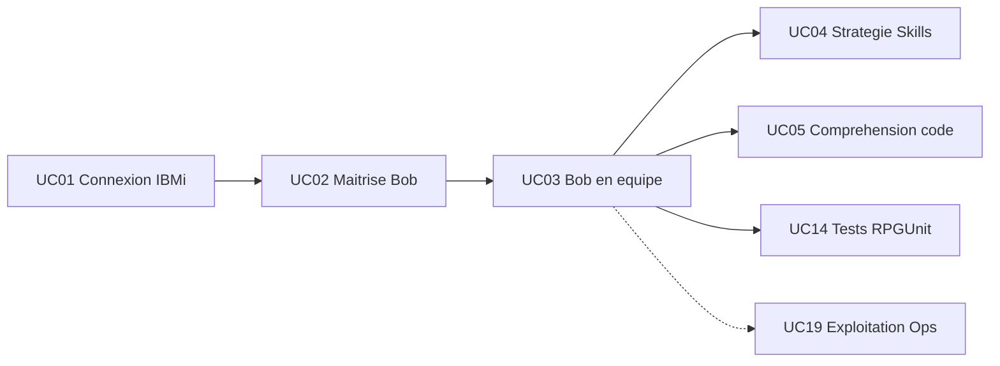

# UC 03 — Bob en équipe : workspace d'entreprise

> **Catégorie :** Utilisation de Bob
> **Phase :** Phase 0 — Onboarding (après UC02 — maîtrise de Bob en place)
> **Durée de mise en place initiale :** 2 à 4 heures — workspace entreprise, rules, /init
> **Durée d'onboarding d'un nouveau développeur :** 30 à 45 minutes
> **Modes Bob utilisés :** IBM i Developer, IBM i Database, Agent

---

## ⭐ Premium Package IBM i utilisé

| Capacité Premium | Rôle dans cet UC |
|---|---|
| **`/init`** slash command | Génère automatiquement l'`AGENTS.md` du projet IBM i — contextualisation collective persistante |
| **Mode IBM i Developer** | Mode de base à utiliser sur IBM i — les normes ACME y sont injectées via les rules |
| **71 skills IBM i** | Activées automatiquement avec le mode IBM i Developer — partagées sans configuration |

**Documentation officielle :** [Slash Commands](https://bob.ibm.com/docs/ide/premium-packages/bob-for-i/slash-commands) · [Skills IBM i](https://bob.ibm.com/docs/ide/premium-packages/bob-for-i/skills)

> ⚠️ **Important — modes personnalisés vs IBM i Developer :**
> Ne pas créer un custom mode concurrent à IBM i Developer. Un custom mode est indépendant — il ne hérite pas des outils Premium (workflows, slash commands, 71 skills). La bonne approche : utiliser **IBM i Developer** comme mode de base et injecter les normes ACME via les **rules** (`.bob/rules/`), qui s'appliquent à tous les modes sans exception.

---

## Objectif

Industrialiser l'utilisation de Bob au sein d'une équipe IBM i, en garantissant que **tous les développeurs travaillent avec les mêmes normes, les mêmes outils et le même contexte projet**, quelle que soit leur machine.

Cet UC répond à trois problèmes concrets :
1. **L'incohérence** — sans cadrage, chaque développeur configure Bob différemment.
2. **L'oubli de contexte** — Bob est stateless : sans `AGENTS.md`, il redécouvre le projet à chaque session.
3. **Le temps perdu** — onboarder un nouveau développeur sans workspace partagé prend des heures.

---

## Prérequis

- **Phase :** Phase 0 — Onboarding
- **UC précédents requis :** UC02 — Maîtrise de Bob
- **Livrables requis :** Aucun
- **Niveau Bob recommandé :** Intermédiaire
- **Bob Coins estimés :** ● ● ○ (workspace entreprise, rules, /init)

---

## Exemple concret — Lab FLGHT400

Le lab FLGHT400 illustre ce UC avec un workspace IBM i complet :

- [`FLGHT403_AGENTS.md`](../labs_FLGHT400_results/FLGHT403_AGENTS.md) — l'`AGENTS.md` généré par `/init` sur `FLGHT403` : 122 membres documentés, architecture ILE, dépendances cross-library, conventions de code, gotchas critiques. C'est le résultat attendu après ce UC.
- [`FLGHT403_init_report.md`](../labs_FLGHT400_results/FLGHT403_init_report.md) — rapport `/init` complet : inventaire des sources, analyse ILE, règles de compilation. Modèle de rapport à sauvegarder en local après chaque `/init`.

---

## Les 4 niveaux de configuration Bob

```
Niveau 1 — Poste développeur (~/.bob/)
  Portée : un seul poste, un seul développeur
  Versionné : NON — jamais
  Contenu : préférences personnelles, tokens MCP tiers réels

Niveau 2 — Workspace entreprise (repo Git partagé)
  Portée : toute l'entreprise, tous les projets
  Versionné : OUI — git clone par chaque développeur
  Contenu : normes ACME converties en rules Bob, MCP sans tokens

Niveau 3 — Workspace projet (repo applicatif)
  Portée : un seul projet applicatif
  Versionné : OUI — dans le repo du projet
  Contenu : contexte projet, rules spécifiques, .bobignore

Niveau 4 — Projet IBM i initialisé avec /init  ⭐ Premium
  Portée : un seul projet IBM i, toutes les sessions Bob
  Versionné : OUI — via une copie Git de l'AGENTS.md (source : QBOBSRC en QSYS ou .bob/ en IFS)
  Contenu : contexte généré par /init + enrichi manuellement
```

**Priorité des configurations :**
- Rules : workspace > global — [doc](https://bob.ibm.com/docs/ide/configuration/rules#rule-priority)
- Skills : projet > global — [doc](https://bob.ibm.com/docs/ide/features/skills#skill-locations)
- MCP : projet > global — [doc](https://bob.ibm.com/docs/ide/configuration/mcp/mcp-in-bob#configuration-levels)

> **Note espace IBM i :** Quand l'espace actif est **Librairies IBM i (QSYS)**, le workspace local et son `.bob/` ne sont **pas chargés**. Les rules et skills actives sont celles du `~/.bob/` global et du workspace local ouvert en parallèle (si un dossier local est ouvert). L'AGENTS.md IBM i (`{BIBLIO}/QBOBSRC/AGENTS.MD` en QSYS ou `{répertoire IFS}/.bob/AGENTS.md` en IFS) est injecté automatiquement.

---

## Prompts

---

### Prompt 0 — Créer le workspace entreprise

**Objectif :** Initialiser le repo Git commun contenant les normes ACME converties en rules Bob.

**Quand l'utiliser :** Une seule fois, lors de la mise en place initiale pour l'équipe.

**Input requis :** Normes ACME existantes (ex. `NORMES/ACME-Normes Programmation.md`)

**Espace :** Workspace local (poste de travail)
**Mode :** Agent
**Skills clés mobilisées :** Aucune (configuration locale)

**Prompt :**

```
En mode Agent, workspace local :
1. Crée la structure de dossiers suivante :
   acme-bob-commons/.bob/rules/
   acme-bob-commons/.bob/rules-ibm-i-developer/
   acme-bob-commons/.bob/skills/
   acme-bob-commons/.bob/commands/

2. Ouvre @NORMES/ACME-Normes Programmation.md et convertis ces normes de l'entreprise
   en directives Bob actionnables — instructions courtes et impératives, pas une documentation
   à lire. Sauvegarde le résultat dans acme-bob-commons/.bob/rules/normes-rpg.md.

3. Crée acme-bob-commons/.bob/rules-ibm-i-developer/normes-specifiques.md avec les
   directives qui s'appliquent uniquement quand on travaille en mode IBM i Developer
   (ex. conventions de compilation, structure ILE, utilisation des procédures vs sous-routines).

4. Sauvegarde le rapport de cette initialisation dans
   bob-reports/acme-workspace-init-{YYYYMMDD-HHmm}.md dans le workspace local.
```

**Livrable produit :** `bob-reports/acme-workspace-init-{YYYYMMDD-HHmm}.md`

> 💡 Les rules dans `.bob/rules/` s'appliquent **à tous les modes** (IBM i Developer, IBM i Database, Agent, Ask). Les rules dans `.bob/rules-ibm-i-developer/` s'appliquent uniquement quand ce mode est actif. C'est le mécanisme correct pour personnaliser IBM i Developer sans le remplacer.

**Documentation :** [Rules — mode-specific](https://bob.ibm.com/docs/ide/configuration/rules#mode-specific-rules) · [Team standardization](https://bob.ibm.com/docs/ide/configuration/rules#team-standardization)

---

### Prompt 1 — ⭐ Initialiser un projet IBM i avec `/init`

> **Règle Premium-first :** `/init` est le premier geste sur tout nouveau projet IBM i. Il remplace tout prompt manuel de description du projet.

**Objectif :** Générer automatiquement le fichier `AGENTS.md` décrivant l'architecture, les sources et les conventions de la bibliothèque IBM i.

**Quand l'utiliser :** Dès l'arrivée sur un projet IBM i, avant toute session de développement.

**Input requis :**
- Connexion IBM i active (Code for IBM i)
- Bibliothèque courante définie (ex. `FLGHT403` via clic droit → *Set as Current Library*)
- Espace Librairies IBM i activé (bouton `+` → Library List)

**Espace :** Librairies IBM i (QSYS) — espace principal
**Mode :** IBM i Developer (ou IBM i Database)
**Skills clés mobilisées :** Aucune (slash command `/init`)

**Prompt :**

```
/init
```

Bob scanne la bibliothèque courante et crée automatiquement :

| Livrable | Emplacement IBM i | Chargé automatiquement par Bob |
|---|---|---|
| `AGENTS.md` principal (QSYS) | `{BIBLIO}/QBOBSRC/AGENTS.MD` — QSYS | ✅ Oui — injecté dans chaque session |
| `AGENTS.md` principal (IFS) | `{répertoire IFS}/.bob/AGENTS.md` — IFS | ✅ Oui — injecté en workspace IFS |
| Copie IFS *(lab FLGHT400)* | `/home/{USER}/AGENTS.md` | Observé dans le lab FLGHT400, non documenté par IBM |

> ⚠️ **Où Bob écrit :** `/init` écrit **sur l'IBM i** (`{BIBLIO}/QBOBSRC/AGENTS.MD` en QSYS ou `{répertoire IFS}/.bob/AGENTS.md` en IFS ; une copie `/home/{USER}/AGENTS.md` a été observée dans le lab FLGHT400, non documentée par IBM), **pas en local**. Pour conserver un rapport local, ajouter explicitement dans la conversation après `/init` :

```
Sauvegarde le rapport complet de cet /init dans un fichier local
nommé {app}-init-report-{YYYYMMDD-HHmm}.md dans le dossier bob-reports/ du workspace local.
```

**Livrable produit :** `bob-reports/{app}-init-report-{YYYYMMDD-HHmm}.md` (rapport local, sur demande explicite)

**Documentation :** [Start a project with /init](https://bob.ibm.com/docs/ide/getting-started/tutorials/start-a-project) · [AGENTS.md](https://bob.ibm.com/docs/ide/getting-started/tutorials/start-a-project#mode-specific-agentsmd-files)

---

### Prompt 2 — Enrichir l'AGENTS.md généré par `/init`

**Objectif :** Ajouter les règles métier et dépendances que `/init` ne peut pas inférer automatiquement, et sauvegarder un exemplaire local.

**Quand l'utiliser :** Immédiatement après `/init` — section toujours à compléter.

**Input requis :** `AGENTS.md` généré par `/init` (injecté automatiquement)

**Espace :** Librairies IBM i (QSYS) — dans la même session que le Prompt 1, ou session suivante
**Mode :** IBM i Developer
**Skills clés mobilisées :** Aucune (enrichissement markdown de l'AGENTS.md)

**Prompt :**

```
L'AGENTS.md de {appId} vient d'être généré par /init. Il décrit bien la structure
technique. Aide-moi à l'enrichir avec ces informations que /init ne peut pas déduire :

Règles métier clés :
- [ex. "Les commandes en attente (STATUS='A') ne doivent jamais être modifiées par un batch"]

Dépendances applicatives non visibles dans les sources :
- [ex. "TRC0018 appelle TRC0018R via CALLB — ne jamais modifier la signature sans adapter l'appelant"]

Workflow de développement ACME :
- [ex. "Développement dans ACME_DEV, tests RPGUnit, promotion via le gestionnaire de sources uniquement"]

Références documentaires :
- [ex. "Spécifications : OKF/acme/GEE/TRI/{appId}/spec-fonc.md"]

1. Génère les sections Markdown à ajouter dans l'AGENTS.md.
2. Sauvegarde le contenu enrichi complet dans un fichier local nommé
   {app}-agents-enriched-{YYYYMMDD-HHmm}.md dans le dossier bob-reports/ du workspace local.
```

**Livrable produit :** `bob-reports/{app}-agents-enriched-{YYYYMMDD-HHmm}.md`

> 💡 Après l'enrichissement, versionner l'AGENTS.md IBM i. Le fichier source vit sur l'IBM i (`QBOBSRC/AGENTS.MD` ou `.bob/AGENTS.md` en IFS), pas dans le dépôt Git : `git add` ne s'applique qu'à une **copie locale**. Synchroniser d'abord QSYS/IFS → dépôt :
> 1. Copier l'AGENTS.md IBM i vers `AGENTS.md` à la racine du repo projet local (ex. en demandant à Bob de le lire sur l'IBM i et de l'écrire en local, ou par copie manuelle via Code for IBM i).
> 2. Committer : `git add AGENTS.md && git commit -m "feat: contexte Bob /init + enrichissement manuel"`
>
> L'IBM i reste la source de vérité (c'est lui que Bob injecte) : modifier l'AGENTS.md côté IBM i puis re-synchroniser vers Git, après chaque `/init` ou enrichissement — ne jamais éditer la copie locale seule.

---

### Prompt 3 — Configurer les MCP partagés (sans tokens)

**Objectif :** Créer le fichier `mcp.json` de l'entreprise avec les références MCP JIRA (et Confluence si utilisé), sans aucun token en clair.

**Quand l'utiliser :** Lors de la mise en place du workspace entreprise.

**Input requis :** URL du serveur MCP JIRA de l'entreprise (la connexion IBM i est native et ne passe pas par `mcp.json`)

**Espace :** Workspace local (poste de travail)
**Mode :** Agent
**Skills clés mobilisées :** Aucune (configuration MCP)

**Prompt :**

```
En mode Agent, workspace local, crée le fichier acme-bob-commons/.bob/mcp.json
avec la configuration MCP partagée suivante (variables d'environnement uniquement,
jamais de tokens en clair) :
- MCP JIRA : URL via ${env:JIRA_URL}, token via ${env:JIRA_TOKEN} (références uniquement — je ne te
  fournis aucune valeur de token dans cette conversation)

Crée également le fichier acme-bob-commons/.gitignore avec les entrées
nécessaires pour ne jamais committer de credentials.

Sauvegarde le rapport de configuration dans
acme-mcp-setup-{YYYYMMDD-HHmm}.md dans le dossier bob-reports/ du workspace local.
```

**Livrable produit :** `bob-reports/acme-mcp-setup-{YYYYMMDD-HHmm}.md`

> ⚠️ **Règle unique pour les secrets MCP** (identique à UC01 Prompt 2) :
> - **(a) Variable d'environnement référencée (`${env:VARIABLE_NAME}`)** — le `mcp.json` ne contient que la référence (`${env:JIRA_TOKEN}`), jamais la valeur, qui est définie sur chaque poste : fichier versionnable. La doc Bob recommande les variables d'environnement mais ne documente pas la syntaxe `${env:…}` : **à valider tant que le test de fonctionnement n'a pas réussi** (définir la variable sur le poste, redémarrer Bob, vérifier l'initialisation sans erreur et lire un ticket JIRA de test).
> - **(b) Jeton réellement stocké** dans un `mcp.json` (ex. `~/.bob/settings/mcp.json`) — fichier personnel, **jamais versionné**.
> - **(c) Secret transmis dans un prompt** — à proscrire : il se retrouverait dans la conversation et dans les rapports `bob-reports/`.

**Documentation :** [MCP — configuration levels](https://bob.ibm.com/docs/ide/configuration/mcp/mcp-in-bob#configuration-levels) · [MCP security](https://bob.ibm.com/docs/ide/configuration/mcp/understanding-mcp#common-questions)

---

### Prompt 4 — Onboarding d'un nouveau développeur

**Objectif :** Guider un nouveau développeur pour qu'il soit opérationnel en 30–45 minutes.

**Quand l'utiliser :** À chaque arrivée d'un nouveau développeur sur le projet IBM i.

**Input requis :** Repo `acme-bob-commons` accessible + repo projet applicatif

**Espace :** Workspace local (poste de travail) puis Librairies IBM i (QSYS)
**Mode :** Agent (étape 1) puis IBM i Developer (étape 2)
**Skills clés mobilisées :** Aucune (onboarding développeur)

**Prompt :**

```
Je suis nouveau sur ce projet IBM i (bibliothèque {appId}).
Guide-moi étape par étape pour :

Étape 1 (workspace local) :
- Cloner acme-bob-commons et activer les rules ACME dans Bob
- Définir mes variables d'environnement MCP (JIRA_URL, JIRA_TOKEN) sur mon poste — ou, à défaut, mon jeton dans ~/.bob/settings/mcp.json (jamais versionné) ; ne jamais me le faire saisir dans ce chat
- Vérifier que le mode IBM i Developer est bien installé (Premium Package)

Étape 2 (espace Librairies IBM i — QSYS) :
- Activer l'espace Librairies IBM i : bouton + → Library List → {appId}
- Lire l'AGENTS.md existant et me résumer le projet en 5 points essentiels
- Faire une première question de validation :
  "Quels sont les programmes principaux de {appId} et leurs dépendances ?"

À la fin, sauvegarde une checklist de vérification dans
{app}-onboarding-checklist-{YYYYMMDD-HHmm}.md dans le dossier bob-reports/ du workspace local.
```

**Livrable produit :** `bob-reports/{app}-onboarding-checklist-{YYYYMMDD-HHmm}.md`

---

## Arborescences cibles

### Sur le poste de travail — workspace local

> Actif quand un dossier local est ouvert dans Bob (`File → Open Folder`).

```
acme-bob-commons/                      ← repo Git entreprise — cloné sur chaque poste
├── .bob/
│   ├── rules/
│   │   ├── normes-rpg.md              ← normes ACME → tous les modes
│   │   ├── normes-nomenclature.md
│   │   └── conventions-gestionnaire-sources.md
│   ├── rules-ibm-i-developer/
│   │   └── normes-specifiques.md      ← normes spécifiques au mode IBM i Developer
│   ├── skills/                        ← skills partagés (UC05, UC07, UC14…)
│   └── mcp.json                       ← MCP sans tokens (variables d'environnement)
├── .bobignore.template
├── .gitignore
└── README.md

acme/TRC0018/                          ← repo projet applicatif
├── .bob/
│   └── rules/
│       └── contexte-projet.md         ← spécificités TRC0018 (bibliothèques, contraintes)
├── bob-reports/                       ← livrables produits par Bob (git-ignoré ou versionné)
│   ├── {app}-init-report-{date}.md
│   ├── {app}-agents-enriched-{date}.md
│   └── {app}-onboarding-checklist-{date}.md
├── AGENTS.md                          ← copie locale versionnée de l'AGENTS.md IBM i (synchronisée depuis QSYS/IFS)
├── acme-trc0018.code-workspace        ← workspace multi-root QSYS + acme-bob-commons (→ UC04 Prompt 6)
└── .bobignore
```

### Sur l'IBM i — espace Librairies IBM i (QSYS)

> Espace principal pour tout le travail sur le code IBM i. Les arborescences locales ci-dessus **ne sont pas actives** dans cet espace sauf si un workspace local est ouvert en parallèle.
> **Piste recommandée (à valider sur votre installation) : le workspace multi-root** (fichier `.code-workspace`) qui combine l'espace QSYS et `acme-bob-commons` dans la même fenêtre Bob, dans le but de charger les skills et rules ACME locaux en plus du contenu QSYS. Le `.code-workspace` référence la racine QSYS par une URI `iseries://QSYS/…` : son comportement exact dans Bob n'est pas documenté par IBM (la doc indique seulement que Bob peut travailler sur plusieurs workspaces) et doit être confirmé. Voir [UC04 — section "Workspace multi-root"](./UC04-strategie-skills-fr.md#workspace-multi-root--qsys--dossier-local) et UC04 Prompt 6.
> **Test de validation :** ouvrir le `.code-workspace` (connexion IBM i active), vérifier dans Bob Settings que les rules et skills d'`acme-bob-commons` sont listés, puis poser une question dont la réponse dépend d'une rule ACME. Si ce n'est pas le cas, ouvrir `acme-bob-commons` comme workspace local en parallèle.

```
{BIBLIO}.LIB                           ← ex. FLGHT403.LIB ou TRC0018.LIB
├── QBOBSRC.SRCPF
│   └── AGENTS.MD                      ← créé par /init (emplacement officiel QSYS) — injecté automatiquement
├── QRPGLESRC.SRCPF                    ← sources ILE RPGLE
├── QRPGSRC.SRCPF                      ← sources OPM RPG
├── QDDSSRCF.SRCPF                     ← DDS physiques et logiques
├── QDDSSRCD.SRCPF                     ← DDS écrans
└── QCLPSRC.SRCPF                      ← sources CL

{répertoire IFS}/                      ← IFS — répertoire de travail ou $HOME
├── .bob/
│   └── AGENTS.md                      ← créé par /init en workspace IFS (emplacement officiel IFS)
├── AGENTS.md                          ← copie IFS observée dans le lab FLGHT400 (non documentée par IBM)
└── bob-reports/                       ← livrables produits par Bob dans l'IFS
    ├── {app}-init-report-{date}.md    ← rapport /init (sur demande explicite)
    └── {app}-agents-enriched-{date}.md ← AGENTS.md enrichi (sur demande explicite)
```

### Sur le poste — niveau personnel (`~/.bob/`)

> Jamais versionné. Credentials et préférences personnelles uniquement.

```
~/.bob/
├── rules/
│   └── preferences-perso.md           ← langue, verbosité, style de réponse
└── settings/
    └── mcp.json                        ← tokens RÉELS JIRA, Confluence
```

---

## Règles de sécurité — tokens et credentials

> ⚠️ **Règle absolue** ([doc sécurité MCP](https://bob.ibm.com/docs/ide/configuration/mcp/understanding-mcp#common-questions)) :
> Ne jamais committer de tokens, mots de passe ou API keys dans un fichier versionné.

| Ce qui va où | Versionné ? | Raison |
|---|---|---|
| `~/.bob/settings/mcp.json` (tokens réels JIRA, Confluence) | ❌ Non | Credentials personnels |
| `acme-bob-commons/.bob/mcp.json` (URLs et références `${env:VARIABLE_NAME}` — sans valeur de token) | ✅ Oui | Config partageable |
| `acme-bob-commons/.bob/rules/*.md` (normes ACME) | ✅ Oui | Standards équipe |
| `{BIBLIO}/QBOBSRC/AGENTS.MD` sur IBM i | ✅ Via une copie locale dans le dépôt Git (synchronisation QSYS → Git, voir Prompt 2) | Contexte projet |

---

## Pièges à éviter

| Piège | Conséquence | Solution |
|---|---|---|
| Créer un custom mode concurrent à IBM i Developer | Perte des 71 skills et workflows Premium | Utiliser IBM i Developer + rules ACME injectées |
| Mettre des tokens dans le `mcp.json` versionné, ou les saisir dans un prompt | Exposition credentials dans Git ou dans la conversation | Références `${env:VARIABLE_NAME}` dans le fichier versionné ; valeurs définies sur chaque poste (variable d'environnement, ou jeton dans `~/.bob/settings/mcp.json` non versionné) |
| Ne pas lancer `/init` à l'arrivée sur un projet | Bob redécouvre le projet à chaque session | `/init` — étape non négociable de l'onboarding |
| Rules trop longues | Bob tronque au-delà de la fenêtre de contexte | Max 100 lignes par fichier — 1 fichier = 1 sujet |
| Confondre espace actif (IBM i vs local) | Bob ne trouve pas les sources ou ne charge pas les rules | Vérifier l'espace avant chaque session |
| Travailler en espace QSYS sans workspace multi-root | Rules et skills ACME non chargés — comportements manquants | Créer le `.code-workspace` multi-root, puis vérifier le chargement des rules/skills — voir UC04 Prompt 6 |
| Ne pas relancer `/init` après un changement majeur | Contexte obsolète | Relancer après ajout de module, changement d'architecture |

---

## Livrables de cet UC

| Fichier produit | Pattern de nommage | Espace de création | Consommé par |
|---|---|---|---|
| Rapport initialisation workspace | `bob-reports/acme-workspace-init-{YYYYMMDD-HHmm}.md` | Local | Référence équipe |
| Rapport /init | `bob-reports/{app}-init-report-{YYYYMMDD-HHmm}.md` | Local (demandé explicitement) | UC03, UC05 |
| AGENTS.md enrichi | `bob-reports/{app}-agents-enriched-{YYYYMMDD-HHmm}.md` | Local (demandé explicitement) | Tous les UC (dont UC18, UC19) |
| Configuration MCP | `bob-reports/acme-mcp-setup-{YYYYMMDD-HHmm}.md` | Local | Référence équipe |
| Checklist onboarding | `bob-reports/{app}-onboarding-checklist-{YYYYMMDD-HHmm}.md` | Local | Chaque nouveau dev |

---

## Dépendances



---

## Check-list de validation UC 03

Avant de passer à UC04, valider chaque point :

- [ ] Le repo `acme-bob-commons` est créé et accessible à toute l'équipe
- [ ] Les normes de l'entreprise ACME sont converties en rules Bob dans `.bob/rules/`
- [ ] Les rules mode-specific IBM i Developer existent dans `.bob/rules-ibm-i-developer/`
- [ ] Aucun custom mode concurrent à IBM i Developer n'a été créé
- [ ] Le `mcp.json` partagé ne contient que des références `${env:VARIABLE_NAME}` — aucune valeur de token en clair, ni dans un fichier versionné, ni dans un prompt
- [ ] `/init` a été exécuté sur au moins un projet IBM i — `AGENTS.MD` présent dans QBOBSRC ou `.bob/AGENTS.md` en IFS
- [ ] L'`AGENTS.md` a été enrichi manuellement avec les règles métier et dépendances
- [ ] Une copie locale de l'`AGENTS.md` IBM i est synchronisée (QSYS/IFS → dépôt Git) puis versionnée dans le repo projet
- [ ] La différence entre espace local et espace IBM i est comprise par toute l'équipe
- [ ] Le workspace multi-root `{app}.code-workspace` est créé et versionné dans le repo projet (→ UC04 Prompt 6), et le chargement effectif des rules/skills ACME a été vérifié
- [ ] L'onboarding a été testé avec au moins un nouveau développeur

---

*Fiche UC03 — révisée le 2026-10-30 — intégration Premium Package IBM i — ref workspace multi-root → UC04*
