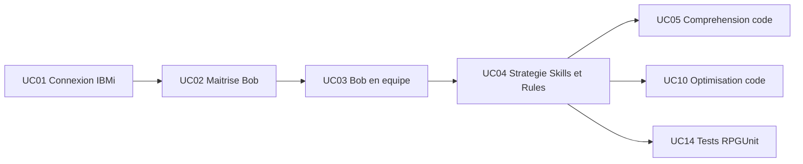

# UC 04 — Stratégie Skills et Rules : industrialisation des use cases Bob

> **Catégorie :** Utilisation de Bob
> **Phase :** Phase 0 — Onboarding (après UC03 — workspace entreprise en place)
> **Durée de mise en place initiale :** 1 à 2 heures par skill/rule — rédaction du SKILL.md ou rule.md, test sur composant pilote, versioning
> **Durée d'utilisation :** faible — le skill peut s'activer automatiquement selon le contexte et la rule s'applique à chaque prompt, sans effort développeur récurrent
> **Modes Bob utilisés :** Agent (création des skills et rules), IBM i Developer (utilisation des skills)

---

## ⭐ Premium Package IBM i utilisé

| Capacité Premium | Rôle dans cet UC |
|---|---|
| **71 skills IBM i** | Socle à ne **pas** redupliquer — les skills ACME complètent ce socle, elles ne le remplacent jamais |
| **Mode IBM i Developer** | Mode de base dans lequel les skills ACME s'activent — porteur des 71 skills Premium |

**Documentation officielle :** [Skills IBM i — liste complète](https://bob.ibm.com/docs/ide/premium-packages/bob-for-i/skills) · [Bob Skills — documentation générale](https://bob.ibm.com/docs/ide/features/skills) · [Bob Rules](https://bob.ibm.com/docs/ide/configuration/rules)

> ⚠️ **Règle critique — ne pas recréer ce qui existe déjà :**
> Avant de créer un skill ACME, vérifier si une des 71 skills Premium couvre déjà le besoin. Les 71 skills couvrent RPG (22), CL (4), DDS (5), COBOL (12), Db2 (19), IWS (5), Understand (3) et Tests unitaires (1). Un skill ACME apporte ce que le Premium ne connaît pas : les normes de l'entreprise, les conventions de nommage, les contraintes du gestionnaire de sources, les règles métier et la séquence d'exécution des UC.

---

## Objectif

Transformer les fiches UCxx.md en **skills Bob réutilisables** et définir des **rules d'infrastructure** qui automatisent les comportements transversaux — pour que Bob applique les normes ACME sans que le développeur ait à les rappeler à chaque session.

Cet UC résout trois problèmes concrets :
1. **La friction d'utilisation** — sans skill, exécuter UC10 demande d'ouvrir la fiche, de lire la séquence, de copier chaque prompt un par un. Avec un skill, le développeur dit *"Optimise FRS409"* et Bob orchestre tout.
2. **L'incohérence entre développeurs** — chaque développeur exécute les prompts légèrement différemment. Le skill aide à faire respecter une même séquence, les mêmes règles et les mêmes livrables pour tous.
3. **La double maintenance** — sans stratégie, les règles métier se dupliquent entre la fiche UCxx et le skill. Ce UC définit une architecture "source unique de vérité" qui élimine ce problème.

---

## Prérequis

- **Phase :** Phase 0 — Onboarding
- **UC précédents requis :** UC02 — Maîtrise de Bob, UC03 — Bob en équipe
- **Livrables requis :** `bob-reports/acme-workspace-init-{date}.md` (workspace entreprise en place — UC03)
- **Niveau Bob recommandé :** Intermédiaire
- **Bob Coins estimés :** ● ● ○ (création de skills, test, versioning)

---

## Exemple concret — Lab FLGHT400

Le skill `poc-ibmi-premium-uc-writer` est un exemple concret de ce que produit cet UC, appliqué à ce POC lui-même.

- [`.bob/skills/poc-ibmi-premium-uc-writer/SKILL.md`](../.bob/skills/poc-ibmi-premium-uc-writer/SKILL.md) — skill créé pour industrialiser la rédaction des fiches UC du POC. Son SKILL.md illustre tous les composants d'un skill bien conçu : frontmatter avec déclencheur précis, pointeur vers la source de vérité, règles absolues, section démarrage.

Pour les skills orientés code IBM i, le lab FLGHT400 illustre l'arrivée en bout de chaîne :
- [`FLGHT403_FRS409_modernization_report.md`](../labs_FLGHT400_results/FLGHT403_FRS409_modernization_report.md) — rapport produit par une session d'optimisation sur `FRS409`. C'est ce type de livrable structuré, reproductible et conforme aux normes ACME que le skill UC10 (optimisation) doit produire automatiquement, sans que le développeur pilote la séquence à la main.

---

## Principe fondamental : source unique de vérité

Les fichiers `UCxx-*.md` restent la **source de vérité**. Ils contiennent les règles métier, les prompts, les check-lists, les conventions et les pièges. Le skill ne duplique **jamais** ce contenu — il **pointe** vers l'UCxx.md et ajoute le workflow d'orchestration par-dessus.

```
UC10-optimisation-code.md          ← source de vérité (ne jamais modifier pour le skill)
         ↑
         pointé par @UC10-optimisation-code.md
         ↓
.bob/skills/uc10-optimisation-rpg/SKILL.md   ← pilote : workflow + règles absolues + pointeur
```

**Conséquence directe :** si un UCxx.md évolue (nouveau prompt, nouveau piège détecté), le skill en tient compte lors d'une activation ultérieure, à condition que son SKILL.md charge bien le fichier référencé (voir test ci-dessous). Les règles ne sont pas dupliquées, donc pas de double maintenance.

**Test de la source unique :** après création du skill, vérifier explicitement :
1. que `@UCxx-slug.md` se résout vers le fichier source (chemin correct depuis le dossier du skill) ;
2. que Bob charge réellement le contenu, par exemple en lui demandant de citer un prompt précis de l'UCxx ;
3. qu'après modification d'un passage de l'UCxx dans un environnement de test, la réponse suivante du skill reflète cette modification, sans modifier le SKILL.md.

---

## Comment fonctionne un skill Bob

Quand Bob reçoit une demande, il analyse la `description` de chaque skill disponible pour décider lequel activer. Si la description correspond à la demande, Bob charge le `SKILL.md` en contexte et suit ses instructions.

**Points clés :**
- Un skill se charge **une seule fois par conversation** — pas de doublons
- Bob peut activer le skill **automatiquement** à partir de la description — pas besoin d'invocation explicite, mais l'activation dépend du contexte et peut demander une approbation. Un skill oriente Bob : il ne garantit pas une exécution déterministe
- Les fichiers supports dans le dossier du skill sont accessibles à Bob une fois le skill activé
- Par défaut Bob demande confirmation avant d'activer un skill — désactivable dans *Paramètres → Auto-Approve → Skills*

### Auto-activation et multilinguisme (FR / EN)

Une question fréquente des équipes de développement : **les skills dont la description est en anglais s'activent-ils si le prompt est en français ?**

**Oui, dans la plupart des cas, pour trois raisons :**
1. **Rapprochement sémantique cross-lingue du LLM :** Le modèle sous-jacent à Bob effectue une analyse sémantique conceptuelle (embedding / attention) et associe directement une intention formulée en français (ex. *« transpose la DATA DIVISION et gère les REDEFINES »*) à la description anglaise de la skill (`cobol-data-division`).
2. **Invariance du vocabulaire technique IBM i :** Les termes clés ne sont jamais traduits (`QRPGLESRC`, `QCBLSRC`, `DATA DIVISION`, `WORKING-STORAGE`, `**FREE`, `CTL-OPT`, `DCL-DS`, `OVERLAY`, `CRTBNDRPG`, `QSYS2.SYSTABLES`). Leur présence dans le prompt ou dans le membre source ouvert dans l'éditeur favorise l'activation.
3. **Bonnes pratiques pour les skills d'entreprise ACME :**
   - Rédiger la `description` du frontmatter YAML en incluant des déclencheurs bilingues ou explicites (ex. *« Utiliser pour optimiser du RPGLE / Use when refactoring RPG »*).
   - Utiliser un vocabulaire technique précis dans les prompts plutôt que des formulations floues.
   - En cas de besoin d'explicitation ponctuelle, le développeur peut invoquer directement `@nom-du-skill` dans le chat.

> 📚 Doc : [How skills work](https://bob.ibm.com/docs/ide/features/skills#how-skills-work) · [Approving skills](https://bob.ibm.com/docs/ide/features/skills#approving-skills)

---

## Localisation des skills — 2 niveaux

| Niveau | Emplacement | Portée | Versionné |
|---|---|---|---|
| **Global** | `~/.bob/skills/` | Tous les projets du poste | Non — personnel |
| **Projet** | `.bob/skills/` dans le repo | Ce projet uniquement | Oui — dans Git |

**Règle de priorité :** si un skill avec le même nom existe aux deux niveaux, le skill projet prend le dessus sur le skill global.

Dans le contexte ACME, les skills sont placés dans le **repo entreprise** `acme-bob-commons/.bob/skills/` (voir UC03) pour être partagés avec toute l'équipe via Git.

> ⚠️ **Impact espace QSYS IBM i :**
> Quand l'espace actif est **Librairies IBM i (QSYS)**, le workspace local et son `.bob/skills/` ne sont **pas chargés**. Seul `~/.bob/skills/` (global poste) est actif.
> Conséquence : les skills ACME versionnés dans `acme-bob-commons/.bob/skills/` ne sont **pas disponibles automatiquement** en espace QSYS.
>
> **Même remarque pour les rules** : `.bob/rules/` n'est chargé que si un workspace local est ouvert. En espace QSYS pur, seules les rules de `~/.bob/rules/` sont actives.
>
> **Solution recommandée : workspace multi-root QSYS + dossier local** → voir section ci-dessous et Prompt 6.

> 📚 Doc : [Skill locations](https://bob.ibm.com/docs/ide/features/skills#skill-locations) · [Workspaces IBM i](https://bob.ibm.com/docs/ide/premium-packages/bob-for-i/workspaces)

---

## Workspace multi-root : QSYS + dossier local

### Pourquoi le workspace multi-root ?

La doc officielle Bob IBM i précise :
> *"In some cases, Bob can work outside a workspace or even **across multiple workspaces** if needed and with the appropriate permissions granted."*

Le **workspace multi-root VS Code** (fichier `.code-workspace`) est la solution standard pour combiner l'espace Librairies IBM i (QSYS) et un dossier local dans la même fenêtre Bob. Une fois configuré, **les skills et rules du dossier local doivent être chargés même quand l'espace QSYS est l'espace de travail principal** (comportement à valider sur une installation réelle, voir test ci-dessous).

**Documentation officielle :**
- [Workspaces IBM i — Bob Premium](https://bob.ibm.com/docs/ide/premium-packages/bob-for-i/workspaces)
- [Multi-root Workspaces — VS Code](https://code.visualstudio.com/docs/editing/workspaces/multi-root-workspaces)

### Comment le créer (une seule fois par projet)

**Étape 1 — Ouvrir l'espace QSYS**
1. Dans Bob : bouton `+` en bas → *Library List*
2. Sélectionner la bibliothèque courante (ex. `TRC0018`)

**Étape 2 — Ajouter le dossier local `acme-bob-commons`**
```
File → Add Folder to Workspace...
```
→ Sélectionner le dossier `acme-bob-commons/` cloné localement

L'Explorer affiche maintenant deux racines :
```
📁 TRC0018 (Library List — QSYS)
📁 acme-bob-commons (local)
```

**Étape 3 — Sauvegarder le workspace**
```
File → Save Workspace As...
```
→ Nommer le fichier `acme-{app}.code-workspace` et le sauvegarder dans le dossier du projet local (ex. `acme/TRC0018/`)

Le fichier généré ressemble à :
```json
{
  "folders": [
    {
      "name": "TRC0018 — QSYS",
      "uri": "iseries://QSYS/TRC0018"
    },
    {
      "name": "acme-bob-commons",
      "path": "../acme-bob-commons"
    }
  ]
}
```

> 💡 Les chemins relatifs dans `.code-workspace` sont relatifs à l'emplacement du fichier lui-même.

### Comment recharger ce workspace

| Méthode | Comment faire |
|---|---|
| **Double-clic** | Double-cliquer sur `acme-trc0018.code-workspace` depuis le Finder / Explorer |
| **Depuis Bob** | `File → Open Workspace from File...` → sélectionner le `.code-workspace` |
| **Récents** | `File → Open Recent` → les workspaces apparaissent avec le suffixe `(Workspace)` |

> ⚠️ **Prérequis au rechargement :** la connexion IBM i (Code for IBM i) doit être active avant d'ouvrir le workspace, sinon la racine QSYS apparaîtra vide.

### Ce que ça change pour skills et rules

| Situation | Skills `acme-bob-commons/.bob/skills/` | Rules `acme-bob-commons/.bob/rules/` |
|---|---|---|
| Espace QSYS seul | ❌ Non chargé | ❌ Non chargé |
| Workspace local seul | ✅ Chargé (si dossier = `acme-bob-commons`) | ✅ Chargé |
| **Multi-root : QSYS + `acme-bob-commons`** | ✅ **Chargé** (à valider) | ✅ **Chargé** (à valider) |

**Test de validation du multi-root :** après ouverture du `.code-workspace`, vérifier que les skills et rules attendus de `acme-bob-commons` apparaissent dans l'onglet Skills de Bob Settings, et demander à Bob de citer une rule ou une skill précise pour confirmer leur prise en compte. Si ce n'est pas le cas, ne pas considérer le workspace comme valide et consigner le constat.

### Ce que Bob voit dans l'Explorer multi-root

- Les membres QSYS sont navigables et `@`-mentionnables directement
- Les fichiers locaux (`.bob/rules/`, `.bob/skills/`, `UC/*.md`) sont accessibles et `@`-mentionnables
- Bob peut écrire sur l'IBM i (QSYS ou IFS) **et** en local dans la même session
- L'AGENTS.md IBM i (`QBOBSRC/AGENTS`) est injecté automatiquement

### Versionner le `.code-workspace`

```bash
cd acme/TRC0018/
git add acme-trc0018.code-workspace
git commit -m "feat(workspace): ajout workspace multi-root QSYS + acme-bob-commons"
git push
```

Chaque développeur peut ouvrir exactement le même workspace après `git pull`.

> ⚠️ Le chemin `acme-bob-commons` dans le `.code-workspace` doit être **relatif** pour que le fichier soit portable entre postes. Adapter si les repos sont dans des dossiers différents d'un poste à l'autre.

---

## Les Rules : comportements automatiques transversaux

### Qu'est-ce qu'une rule Bob ?

Une **rule** est un fichier Markdown dans `.bob/rules/` qui injecte des instructions dans **chaque prompt** envoyé à Bob — sans que le développeur ait à les rappeler. Contrairement au skill (activé ponctuellement), la rule est toujours active tant que le workspace est ouvert.

| Mécanisme | Quand actif | Déclencheur | Cas d'usage |
|---|---|---|---|
| **Skill** | Sur demande — Bob l'active si la description correspond | Description dans frontmatter | Workflow d'un UC (séquence, prérequis, livrables) |
| **Rule** | En permanence — injecté dans chaque prompt | Présence du fichier dans `.bob/rules/` | Normes transversales, comportements par défaut, conventions |

### Deux types de rules

```
.bob/rules/                        ← actives dans TOUS les modes
    normes-rpg.md                  → normes de code ACME (nommage, opcodes, structure)
    conventions-gestionnaire-sources.md → contraintes du gestionnaire de sources (workflow, marqueurs diff)
    livraison-bob-reports.md       → comportement de sauvegarde des livrables

.bob/rules-ibm-i-developer/        ← actives UNIQUEMENT en mode IBM i Developer
    normes-specifiques.md          → conventions ILE, compilation, procédures
    mirror-qsys-ifs.md             ← ⭐ example : rule de mirror QSYS → IFS
```

> 📚 Doc : [Rules — mode-specific](https://bob.ibm.com/docs/ide/configuration/rules#mode-specific-rules) · [Team standardization](https://bob.ibm.com/docs/ide/configuration/rules#team-standardization)

### Exemple concret — Rule "Mirror QSYS → IFS"

Cette rule illustre un comportement d'infrastructure : chaque fois que Bob crée ou modifie un livrable Markdown dans l'espace QSYS, il le copie automatiquement dans l'IFS avec la convention de nommage ACME.

**Contenu du fichier** `.bob/rules-ibm-i-developer/mirror-qsys-ifs.md` :

```markdown
# Rule : Mirror IBM i QSYS → IFS

Quand tu crées ou modifies un membre source Markdown dans QSYS
(ex. QBOBSRC, QRPGLESRC), copier automatiquement le contenu dans
/home/{USER}/bob-reports/ avec la convention ACME :
{appId}-{fonction}-{composant}-{type}-{YYYYMMDD-HHmm}.md

Demander à l'utilisateur son {USER} IBM i si non connu.
Utiliser le mode IBM i Developer (connexion native IBM i) pour écrire dans l'IFS.
```

> **Limites à connaître :**
> - Une rule **guide** le comportement de Bob mais ne déclenche pas une action système automatique — Bob doit être en mode Agent et approuver l'écriture IFS
> - Ce n'est **pas** un trigger IBM i automatique (pas de `CRTJOBSCD`) — c'est une instruction que Bob suit **dans la conversation**
> - La rule n'est active que si un workspace local est ouvert (voir avertissement espace QSYS ci-dessus)

### Règles de rédaction d'une rule

- **Courtes** — max 80-100 lignes par fichier. Au-delà, Bob tronque le contexte injecté.
- **1 fichier = 1 comportement** — ne pas mélanger les sujets dans un même fichier.
- **Impératives** — rédiger comme des instructions directes, pas comme de la documentation.
- **Sans conditions complexes** — une rule ne remplace pas un skill. Si la logique est conditionnelle, utiliser un skill.

---

## Prompts

---

### Prompt 0 — Inventorier les skills Premium avant de créer

**Objectif :** Identifier quelles des 71 skills Premium couvrent déjà le besoin avant de créer un skill ACME. Évite la duplication et la concurrence avec le Premium.

**Quand l'utiliser :** En amont de la création de tout nouveau skill ACME, pour chaque UC ciblé.

**Input requis :** Liste des UC à industrialiser, accès au Premium Package IBM i

**Espace :** Workspace local (poste de travail)
**Mode :** Agent (ou ASK)
**Skills clés mobilisées :** Aucune (analyse des skills Bob)

**Prompt :**

```
Je prépare la création des skills ACME pour industrialiser les UC IBM i.
Voici les UC concernés : [liste des UC — ex. UC05 Compréhension, UC06 Logique métier, UC10 Optimisation]

Pour chaque UC :
1. Identifie quelles skills Premium IBM i (parmi les 71) sont déjà actives pour ce domaine.
   Liste-les par catégorie (RPG, CL, DDS, COBOL, Db2/SQL, IWS, Understand).
2. Identifie ce que les skills Premium ne couvrent PAS : normes ACME, conventions de nommage,
   contraintes du gestionnaire de sources, séquence de prompts spécifique, livrables attendus.
3. Pour chaque UC, propose un titre de skill ACME et sa description-déclencheur (3-5 lignes
   qui décrivent quand et pourquoi Bob doit activer ce skill).

Sauvegarde le résultat dans
bob-reports/acme-skills-inventory-{YYYYMMDD-HHmm}.md dans le workspace local.
```

**Livrable produit :** `bob-reports/acme-skills-inventory-{YYYYMMDD-HHmm}.md`

---

### Prompt 1 — Créer un skill ACME pour un UC

**Objectif :** Générer le `SKILL.md` d'un skill ACME qui pointe vers un UCxx.md existant.

**Quand l'utiliser :** Pour chaque UC que l'on veut industrialiser, après le Prompt 0.

**Input requis :**
- Le fichier `UCxx-[slug].md` cible (ex. `UC/UC10-optimisation-code.md`)
- L'inventaire produit au Prompt 0

**Espace :** Workspace local (poste de travail)
**Mode :** Agent
**Skills clés mobilisées :** Aucune (génération de skill Bob)

**Prompt :**

```
En mode Agent, workspace local.
Je veux créer un skill Bob pour industrialiser @UC/[UCxx-slug].md.

D'après l'inventaire @bob-reports/acme-skills-inventory-{date}.md,
les skills Premium [liste] couvrent déjà les bases de ce domaine.
Mon skill ACME doit uniquement ajouter : [normes spécifiques, séquence, livrables ACME].

Crée le fichier acme-bob-commons/.bob/skills/[slug-skill]/SKILL.md avec :
1. Un frontmatter `name` + `description` (déclencheur précis — quand, pour quoi, sur quoi)
2. Une section "Source de vérité" qui pointe vers @UCxx-slug.md via la syntaxe @
3. Une section "Règles absolues" (5 règles max — les non-négociables ACME)
4. Une section "Démarrage" qui demande à l'utilisateur le contexte minimum :
   programme cible, bibliothèque, livrables prérequis disponibles
5. Une section "Prérequis Premium" qui liste les skills Premium complémentaires actives

Ne pas dupliquer le contenu de UCxx.md dans le SKILL.md — pointer uniquement.
Garder le SKILL.md sous 150 lignes.

Sauvegarde le rapport de création dans
bob-reports/acme-skill-[slug]-creation-{YYYYMMDD-HHmm}.md dans le workspace local.
```

**Livrable produit :** `bob-reports/acme-skill-[slug]-creation-{YYYYMMDD-HHmm}.md`

> 💡 Le SKILL.md généré est dans `acme-bob-commons/.bob/skills/[slug]/SKILL.md`. Pour le tester immédiatement en local, copier le dossier dans `.bob/skills/[slug]/` du projet courant et redémarrer Bob.

**Documentation :** [Creating a skill — Basic setup](https://bob.ibm.com/docs/ide/features/skills#basic-setup) · [SKILL.md format](https://bob.ibm.com/docs/ide/features/skills#skillmd-format) · [Writing effective skills](https://bob.ibm.com/docs/ide/features/skills#writing-effective-skills)

---

### Prompt 2 — Tester un skill sur un composant pilote

**Objectif :** Vérifier que Bob active bien le skill et suit la séquence attendue sur un programme réel.

**Quand l'utiliser :** Immédiatement après la création du skill, avant de le distribuer à l'équipe.

**Input requis :**
- Skill créé et déposé dans `.bob/skills/[slug]/` (local ou acme-bob-commons cloné)
- Programme IBM i pilote disponible (ex. `FRS409` dans `FLGHT403`)
- Connexion IBM i active

**Espace :** IBM i QSYS + Local (espace mixte — workspace local ouvert + connexion IBM i)
**Mode :** IBM i Developer
**Skills clés mobilisées :** `rpg-code-review`, `rpg-rla-to-sql` (ou skills du domaine du composant testé)

**Prompt :**

```
[Formuler naturellement ce que le skill doit déclencher — ex. :]
Optimise le programme FRS409 de la bibliothèque FLGHT403.
```

Bob doit activer automatiquement le skill `[slug-skill]` — vérifier dans le chat que Bob mentionne le skill activé.

Si Bob n'active pas le skill automatiquement, diagnostiquer via :

```
Quels skills sont actuellement chargés dans ce workspace ?
```

Puis ajuster la description du SKILL.md pour améliorer la détection.

**Livrable produit :** livrable spécifique au skill activé (ex. `bob-reports/flght403-optimisation-frs409-report-{date}.md`)

> 📚 Doc : [Skills settings tab](https://bob.ibm.com/docs/ide/features/skills#skills-settings-tab) · [Tips and best practices](https://bob.ibm.com/docs/ide/features/skills#tips-and-best-practices)

---

### Prompt 3 — Créer les fichiers supports optionnels

**Objectif :** Enrichir le skill avec des fichiers supports que Bob consulte automatiquement une fois le skill activé — checklist, template de livrable, guide de sévérité.

**Quand l'utiliser :** Optionnel — quand le SKILL.md seul ne suffit pas à guider Bob sur les détails.

**Input requis :** SKILL.md existant, retours du Prompt 2 (points manquants identifiés)

**Espace :** Workspace local (poste de travail)
**Mode :** Agent
**Skills clés mobilisées :** Aucune (rédaction de documentation technique)

**Prompt :**

```
En mode Agent, workspace local.
Le skill @acme-bob-commons/.bob/skills/[slug]/SKILL.md est en place.
Suite aux tests, Bob manque d'information sur : [ex. convention de nommage des variables,
grille de sévérité des problèmes détectés].

Crée les fichiers supports suivants dans acme-bob-commons/.bob/skills/[slug]/ :
1. checklist-validation.md — check-list que Bob doit cocher avant de livrer le résultat
2. conventions-nommage.md — référence rapide des conventions ACME pour ce domaine

Ces fichiers doivent être courts (< 50 lignes) et référençables dans le SKILL.md
via la syntaxe @checklist-validation.md.

Sauvegarde le rapport dans
bob-reports/acme-skill-[slug]-supports-{YYYYMMDD-HHmm}.md dans le workspace local.
```

**Livrable produit :** `bob-reports/acme-skill-[slug]-supports-{YYYYMMDD-HHmm}.md`

> 📚 Doc : [Adding supporting files](https://bob.ibm.com/docs/ide/features/skills#adding-supporting-files)

---

### Prompt 4 — Versionner et distribuer

**Objectif :** Committer le skill dans `acme-bob-commons` pour distribution à toute l'équipe.

**Quand l'utiliser :** Après validation du skill sur un composant pilote.

**Input requis :** Skill testé et validé dans `.bob/skills/[slug]/`

**Espace :** Workspace local (poste de travail)
**Mode :** Agent
**Skills clés mobilisées :** Aucune (commandes git)

**Prompt :**

```
En mode Agent, workspace local.
Le skill [slug-skill] est validé. Guide-moi pour le versionner dans acme-bob-commons :

1. Vérifier que le dossier acme-bob-commons/.bob/skills/[slug]/ contient bien :
   - SKILL.md
   - (fichiers supports si créés au Prompt 3)
2. Mettre à jour le README.md du repo acme-bob-commons avec l'entrée du nouveau skill :
   | [slug-skill] | [UC ciblé] | [déclencheur en une ligne] | ✅ Validé |
3. Générer les commandes git à exécuter :
   cd acme-bob-commons
   git add .bob/skills/[slug]/
   git add README.md
   git commit -m "feat(skills): ajout skill [slug-skill] — UC[N] [titre]"
   git push

Sauvegarde la note de release dans
bob-reports/acme-skill-[slug]-release-{YYYYMMDD-HHmm}.md dans le workspace local.
```

**Livrable produit :** `bob-reports/acme-skill-[slug]-release-{YYYYMMDD-HHmm}.md`

> 💡 Chaque développeur reçoit le skill via `git pull` dans son clone local de `acme-bob-commons` — aucune action manuelle de leur part.

---

## Structure d'un skill — référence

### Arborescence type

```
acme-bob-commons/.bob/skills/
├── uc10-optimisation-rpg/
│   ├── SKILL.md                    ← obligatoire — workflow + frontmatter
│   ├── checklist-validation.md     ← optionnel — check-list de validation
│   └── conventions-nommage.md      ← optionnel — référence rapide ACME
├── uc05-comprehension-rpg/
│   └── SKILL.md
└── uc14-rpgunit/
    └── SKILL.md
```

### Format du SKILL.md — exemple concret

```markdown
---
name: UC10 — Optimisation RPG IBM i
description: >
  Optimise un programme RPG IBM i sans modifier sa logique fonctionnelle.
  Applique la méthodologie UC10 ACME : renommage des variables cryptiques,
  remplacement des opcodes obsolètes (MOVE, SETON, GOTO…), extraction de
  sous-routines en procédures Free RPG, selon les normes ACME.
  À activer quand l'utilisateur demande d'optimiser, moderniser, refactorer
  ou améliorer la lisibilité d'un programme RPG.
---

## Source de vérité

Ce skill applique la méthodologie définie dans @UC10-optimisation-code.md.
Lire ce fichier en entier avant de démarrer — il contient les prompts P0 à P5,
les règles de mode, les conventions de nommage et la check-list de validation.

## Prérequis Premium

Skills Premium complémentaires actives en mode IBM i Developer :
- `rpg-code-review` — revue qualité et modernisation
- `rpg-rla-to-sql` — conversion accès RLA vers SQL
- `rpg-fixed-to-free` — conversion format fixe → libre
Ces skills enrichissent les réponses de Bob — ne pas les redéfinir dans ce SKILL.md.

## Règles absolues

1. Toujours commencer par le Prompt 0 de UC10 — jamais directement les renommages.
2. Rester en mode Ask pendant les Prompts 0 à 4 (analyse, diffs).
   Basculer en Agent uniquement pour la compilation et la sauvegarde.
3. Vérifier les prérequis avant de démarrer :
   - *-comprehension-*.md (UC05) disponible → OBLIGATOIRE
   - *-regles-*.md (UC06) disponible → OBLIGATOIRE
   - Connexion IBM i native active
4. Nommer les livrables : {appId}-{fonction}-{composant}-{type}-{YYYYMMDD-HHmm}.md
5. Mention gestionnaire de sources dans chaque diff : ⚠️ Réintégration gestionnaire de sources — à effectuer manuellement

## Démarrage

Demander à l'utilisateur :
- Quel programme RPG optimiser ? (nom + bibliothèque)
- Les fichiers *-comprehension-*.md et *-regles-*.md sont-ils dans le workspace ?

Si les prérequis sont absents, recommander une session UC05 (30 min) avant de continuer.
```

---

## Roadmap de création des skills ACME

| Priorité | UC | Slug du skill | Socle Premium activé | Statut |
|---|---|---|---|---|
| 0 | Ce POC lui-même | `poc-ibmi-premium-uc-writer` | — | ✅ Créé — exemple de référence |
| 1 | UC10 — Optimisation code | `uc10-optimisation-rpg` | `rpg-code-review`, `rpg-rla-to-sql` | ✅ Créé (pilote) |
| 2 | UC05 — Compréhension programme | `uc05-comprehension-rpg` | `understand-app-overview`, `understand-program-explainer` | À créer |
| 3 | UC06 — Logique métier | `uc06-logique-metier` | `rpg-code-review`, `cobol-procedure-division` | À créer |
| 4 | UC08 — DDS vers DDL | `uc08-dds-vers-ddl` | `db2-dds-to-ddl`, `dds-physical-files` | À créer |
| 5 | UC07 — Documentation | `uc07-documentation` | `db2-system-catalog`, `understand-impact-analysis` | À créer |
| 6 | UC11 — Restructuration | `uc11-restructuration-rpg` | `rpg-fixed-to-free`, `rpg-refactor-legacy` | À créer |
| 7 | UC09 — SQL embarqué | `uc09-sql-embarque` | `rpg-rla-to-sql`, `rpg-embedded-sql` | À créer |
| 8 | UC14 — Tests RPGUnit | `uc14-rpgunit` | `rpgunit-testing`, `rpg-debugging-techniques` | À créer |

---

### Prompt 5 — Créer une rule d'infrastructure

**Objectif :** Créer une rule qui automatise un comportement transversal (nommage des livrables, mirror QSYS→IFS, marqueurs de gestionnaire de sources…) appliqué à tous les prompts.

**Quand l'utiliser :** Quand un comportement doit être actif en permanence, pas seulement lors d'un UC précis.

**Input requis :** Normes ou comportement à automatiser, espace cible (tous modes ou IBM i Developer uniquement)

**Espace :** Workspace local (poste de travail)
**Mode :** Agent
**Skills clés mobilisées :** Aucune (génération de rule Bob)

**Prompt :**

```
En mode Agent, workspace local.
Je veux créer une rule Bob qui automatise le comportement suivant :
[décrire le comportement — ex. "Toujours copier les livrables Markdown
créés en espace QSYS vers /home/{USER}/bob-reports/ avec la convention
{appId}-{fonction}-{composant}-{type}-{YYYYMMDD-HHmm}.md"]

Ce comportement doit être actif :
- [ ] Dans tous les modes (.bob/rules/)
- [ ] Uniquement en mode IBM i Developer (.bob/rules-ibm-i-developer/)

Crée le fichier de rule dans acme-bob-commons/.bob/rules[suffixe]/ :
1. Titre court et descriptif (H1)
2. Instructions impératives (pas de documentation — juste des directives)
3. Max 80 lignes — si plus long, créer plusieurs fichiers thématiques

Sauvegarde le rapport de création dans
bob-reports/acme-rule-[slug]-creation-{YYYYMMDD-HHmm}.md dans le workspace local.
```

**Livrable produit :** `bob-reports/acme-rule-[slug]-creation-{YYYYMMDD-HHmm}.md`

> 💡 Après création, tester immédiatement : envoyer un prompt quelconque à Bob et vérifier qu'il respecte le comportement défini dans la rule.

**Documentation :** [Rules](https://bob.ibm.com/docs/ide/configuration/rules) · [Mode-specific rules](https://bob.ibm.com/docs/ide/configuration/rules#mode-specific-rules)

---

### Prompt 6 — Créer le workspace multi-root QSYS + dossier local

**Objectif :** Générer et versionner le fichier `.code-workspace` qui combine l'espace QSYS IBM i et le dossier `acme-bob-commons` local, afin que skills et rules ACME soient disponibles quelle que soit l'espace de travail actif.

**Quand l'utiliser :** Une seule fois par projet IBM i, après avoir cloné `acme-bob-commons` et configuré la connexion IBM i.

**Input requis :**
- Connexion IBM i active (Code for IBM i)
- `acme-bob-commons` cloné localement
- Bibliothèque courante définie (ex. `TRC0018`)

**Espace :** Workspace local (poste de travail) → bascule vers le workspace multi-root
**Mode :** Agent
**Skills clés mobilisées :** Aucune (configuration multi-root workspace)

**Prompt :**

```
En mode Agent, workspace local.
Je veux créer un workspace multi-root Bob qui combine :
- L'espace Librairies IBM i (QSYS) — bibliothèque {appId}
- Le dossier local acme-bob-commons (chemin : {chemin-local}/acme-bob-commons)

1. Crée le fichier {appId}-workspace.code-workspace dans le dossier
   du projet local (ex. acme/{appId}/) avec :
   - Une entrée pour l'espace QSYS IBM i (uri iseries://QSYS/{appId})
   - Une entrée pour acme-bob-commons (chemin relatif depuis l'emplacement du fichier)
   - Les noms d'affichage : "{appId} — QSYS" et "acme-bob-commons"

2. Vérifie que le chemin relatif vers acme-bob-commons est correct
   (relatif au dossier où est sauvegardé le .code-workspace).

3. Génère les commandes git pour versionner ce fichier :
   git add {appId}-workspace.code-workspace
   git commit -m "feat(workspace): workspace multi-root QSYS + acme-bob-commons"

4. Sauvegarde les instructions de rechargement dans
   bob-reports/acme-workspace-multiroot-{YYYYMMDD-HHmm}.md dans le workspace local :
   - Comment ouvrir ce workspace (3 méthodes)
   - Prérequis (connexion IBM i active)
   - Ce que le workspace charge (skills, rules, AGENTS.md)
```

**Livrable produit :** `bob-reports/acme-workspace-multiroot-{YYYYMMDD-HHmm}.md`

> 💡 Une fois le workspace multi-root sauvegardé, l'utilisation au quotidien est simple : double-clic sur le fichier `.code-workspace` dans le Finder (ou `File → Open Recent` dans Bob). Bob charge les deux espaces simultanément.

**Documentation :** [Workspaces IBM i — Bob Premium](https://bob.ibm.com/docs/ide/premium-packages/bob-for-i/workspaces) · [Multi-root Workspaces — VS Code](https://code.visualstudio.com/docs/editing/workspaces/multi-root-workspaces)

---

## Pièges à éviter

| Piège | Conséquence | Solution |
|---|---|---|
| Description trop vague (`"skill UC10"`) | Bob n'active jamais le skill | Écrire une description qui décrit le **déclencheur** — quand, pour quoi, sur quoi |
| Dupliquer les règles UCxx dans le SKILL.md | Double maintenance — les deux fichiers divergent | Pointer vers `@UCxx.md` — ne jamais copier-coller les règles |
| Recréer une skill Premium déjà existante | Conflit, incohérence, maintenance inutile | Vérifier les 71 skills Premium avant de créer — compléter, ne pas remplacer |
| SKILL.md trop long (> 150 lignes) | Bob tronque les instructions en fin de fichier | Garder SKILL.md court — déplacer le détail dans des fichiers supports |
| Oublier la section "Démarrage" | Bob commence sans collecter les prérequis | Toujours inclure une section qui demande le contexte minimum |
| Skill dans `~/.bob/skills/` uniquement | Skill non partagé — chaque développeur doit le recréer | Skills d'équipe dans `acme-bob-commons` |
| Rule trop longue (> 100 lignes) | Bob tronque le contexte injecté à chaque prompt | Max 80-100 lignes — 1 fichier = 1 comportement |
| Rule avec logique conditionnelle complexe | Rule ignorée ou mal interprétée | Logique conditionnelle → skill, pas rule |
| Skills/rules inactifs en espace QSYS | `.bob/` local non chargé — skills et rules ACME absents | Utiliser le workspace multi-root (Prompt 6) |
| Chemin absolu dans `.code-workspace` | Workspace non portable entre postes | Toujours utiliser des chemins relatifs dans `.code-workspace` |
| `.code-workspace` non versionné | Chaque développeur recrée son workspace | Versionner dans le repo projet — `git add *.code-workspace` |
| Ouvrir le workspace multi-root sans connexion IBM i active | Racine QSYS vide — membres non accessibles | Démarrer Code for IBM i et se connecter avant d'ouvrir le `.code-workspace` |
| Créer un custom mode pour personnaliser IBM i Developer | Perte des 71 skills et workflows Premium | Skills + rules mode-specific — jamais de custom mode concurrent |

---

## Livrables de cet UC

| Fichier produit | Pattern de nommage | Espace de création | Consommé par |
|---|---|---|---|
| Inventaire skills | `bob-reports/acme-skills-inventory-{YYYYMMDD-HHmm}.md` | Local | Référence équipe |
| Rapport création skill | `bob-reports/acme-skill-{slug}-creation-{YYYYMMDD-HHmm}.md` | Local | Référence skill |
| Rapport fichiers supports | `bob-reports/acme-skill-{slug}-supports-{YYYYMMDD-HHmm}.md` | Local | Maintenance skill |
| Note de release skill | `bob-reports/acme-skill-{slug}-release-{YYYYMMDD-HHmm}.md` | Local | Équipe / changelog |
| Rapport création rule | `bob-reports/acme-rule-{slug}-creation-{YYYYMMDD-HHmm}.md` | Local | Référence rule |
| Guide workspace multi-root | `bob-reports/acme-workspace-multiroot-{YYYYMMDD-HHmm}.md` | Local | Onboarding dev |
| Fichier workspace | `{appId}-workspace.code-workspace` | Local (versionné) | Chaque session QSYS |

---

## Dépendances



---

## Check-list de validation UC 04

Avant de passer à UC05, valider chaque point :

**Skills :**
- [ ] L'inventaire des 71 skills Premium a été consulté avant création de chaque skill ACME
- [ ] Au moins un skill ACME est créé et versionné dans `acme-bob-commons/.bob/skills/`
- [ ] Le SKILL.md pointe vers le UCxx.md via `@` — aucune règle dupliquée
- [ ] Le test de la source unique a été réalisé (résolution et chargement de `@UCxx.md`, prise en compte d'une modification)
- [ ] Le skill a été testé sur un programme pilote — Bob l'a activé automatiquement
- [ ] Le SKILL.md fait moins de 150 lignes
- [ ] La section "Démarrage" est présente et demande le contexte minimum
- [ ] La section "Prérequis Premium" liste les skills Premium complémentaires

**Rules :**
- [ ] Au moins une rule d'infrastructure est créée dans `acme-bob-commons/.bob/rules/` ou `.bob/rules-ibm-i-developer/`
- [ ] Chaque rule fait moins de 100 lignes — 1 fichier = 1 comportement
- [ ] Le comportement de la rule a été testé (un prompt envoyé, comportement vérifié)

**Workspace multi-root :**
- [ ] Le fichier `{appId}-workspace.code-workspace` est créé avec chemin relatif vers `acme-bob-commons`
- [ ] Le fichier `.code-workspace` est versionné dans le repo projet
- [ ] Le workspace a été rechargé via double-clic — les deux racines (QSYS + local) sont visibles
- [ ] Skills et rules ACME sont visibles dans l'onglet Skills de Bob Settings avec le workspace multi-root ouvert
- [ ] Le test de validation multi-root a été réalisé (skills et rules attendus effectivement pris en compte)

**Commun :**
- [ ] Aucun custom mode concurrent à IBM i Developer n'a été créé
- [ ] Le repo `acme-bob-commons` est mis à jour et les équipes ont accès via `git pull`

---

*Fiche UC04 — révisée le 2026-10-30 — intégration Premium Package IBM i — Skills, Rules et Workspace multi-root*
