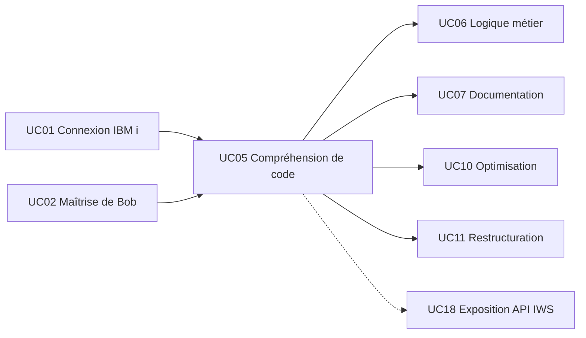

# UC 05 — Compréhension de code et d'applications

> **Phase :** Phase 1 — Comprendre avant de moderniser

---

## ⭐ Premium Package IBM i utilisé

- **Understand Dashboard** → [Understand](https://bob.ibm.com/docs/ide/premium-packages/bob-for-i/understand) — cartographie applicative, analyse d'impact, objets morts. Ouverture : commande *Open Understand Dashboard* (`vscode-ibmi-bob.openUnderstandDashboard`) ou icône du Dashboard dans la barre de titre du chat Bob. Installation, scan, onglets et limites : voir UC00 §2 (non redupliqué ici).
- **Slash Command `/init`** → [Slash Commands Bob for IBM i](https://bob.ibm.com/docs/ide/premium-packages/bob-for-i/slash-commands) — génère l'`AGENTS.md` contextuel avant tout prompt de compréhension (modes IBM i Developer et IBM i Database)
- **Workflow Business Rules Extraction** → [Business Rules Extraction](https://bob.ibm.com/docs/ide/premium-packages/bob-for-i/workflows) — porte d'entrée vers UC06 (logique métier). Lancement par le bouton **Start Workflow** en haut du chat. Périmètre : sources **RPG uniquement** (COBOL et CL : prompts manuels et skills `cobol-*` / `cl-*`, voir UC06). Workspaces supportés : Local, IFS Working Directory, Library List.
- **Skills auto-activées :** `understand-app-overview`, `understand-program-explainer`, `understand-impact-analysis` (actives uniquement si Understand est installé), `rpg-code-review`, `rpg-indicators`, `db2-system-catalog`. Pour un programme COBOL : `cobol-opm-understanding`, `cobol-ile-understanding`.

---

## Objectif

Comprendre rapidement du code legacy IBM i inconnu ou peu documenté : rôle fonctionnel d'un programme, ses entrées/sorties, ses dépendances, sa logique de traitement.

C'est le **point d'entrée obligatoire avant toute modernisation**. Sans compréhension du code existant, aucune décision d'architecture, de refactorisation ou de migration n'est fiable.

**Livrable attendu :** Une fiche de compréhension par programme analysé — rôle, flux de données, dépendances, points d'attention — prête à alimenter UC06 (logique métier), UC07 (documentation), UC10 (optimisation) et UC11 (restructuration).

---

## Prérequis

- **Phase :** Phase 1 — Comprendre avant de moderniser
- **UC précédents requis :** UC01 (connexion IBM i), UC02 (maîtrise de Bob)
- **Livrables requis :** `AGENTS.md` généré par `/init` (voir UC02 et UC00 §3.1) — optionnel mais fortement recommandé
- **Niveau Bob recommandé :** Intermédiaire
- **Bob Coins estimés :** ● ● ○

---

## Exemple concret — Lab FLGHT400

Trois fichiers produits par Bob sur l'application `FLGHT403` illustrent directement cet UC :

- [`../labs_FLGHT400_results/FLGHT403_FRS409_explanation.md`](../labs_FLGHT400_results/FLGHT403_FRS409_explanation.md) — Analyse complète du programme `FRS409` (OPM RPG/400) : rôle fonctionnel, interface DDS, paramètres d'entrée/sortie, flux d'exécution détaillé, subroutines. Produit avec le Prompt 1 (compréhension générale).

- [`../labs_FLGHT400_results/FLGHT403_architecture.md`](../labs_FLGHT400_results/FLGHT403_architecture.md) — Architecture applicative complète de FLGHT403 : 92 programmes (68 OPM, 22 ILE), 56 DSPF, 28 PF, 52 LF, diagramme Mermaid des flux, tableau des signaux de modernisation. Produit via Understand Dashboard + skills `understand-app-overview`.

- [`../labs_FLGHT400_results/FLGHT403_functional_areas.md`](../labs_FLGHT400_results/FLGHT403_functional_areas.md) — Domaines fonctionnels identifiés (réservations, planning vols, clients, reporting, utilitaires). Produit via Understand scan.

> Ces trois livrables montrent la progression naturelle de cet UC : compréhension d'un programme isolé (FRS409) → vue applicative (Understand) → carte des domaines fonctionnels.

---

## Stratégie Premium-first : par où commencer ?

Avant tout prompt libre, deux éléments Premium accélèrent et structurent la compréhension.

### Étape 1 — Exécuter `/init` pour contextualiser Bob

**Espace :** IBM i QSYS (workspace Library List)

**Quand :** en début de session, avant tout prompt de compréhension.

La commande `/init` analyse la bibliothèque courante et génère automatiquement un fichier `AGENTS.md` documentant l'architecture ILE, les conventions de nommage, les objets DDS/SQL et les standards du projet. Ce fichier est ensuite injecté en contexte dans chaque conversation Bob.

**Comment :**
1. S'assurer que la bibliothèque applicative est définie comme **bibliothèque courante** (clic droit → *Set as Current Library* dans la vue User Library List) — sans bibliothèque courante, `/init` s'arrête sans rien créer
2. Dans la zone de saisie du chat Bob, saisir `/init`
3. Bob scanne la bibliothèque et génère l'`AGENTS.md` à l'emplacement officiel :
   - `{BIBLIO}/QBOBSRC/AGENTS.MD` — workspace QSYS
   - `{répertoire IFS}/.bob/AGENTS.md` — workspace IFS

> 📝 Le lab FLGHT400 a aussi produit une copie `/home/ITZUSER/AGENTS.md`, observée dans le lab FLGHT400 et non documentée par IBM — ne pas s'y appuyer. Détail : UC00 §3.1.

**Résultat :** voir [`../labs_FLGHT400_results/FLGHT403_init_report.md`](../labs_FLGHT400_results/FLGHT403_init_report.md) pour un exemple sur FLGHT403 — 122 membres scannés, architecture duale OPM/ILE identifiée, dépendance critique `FLGHT400` détectée.

> 💡 Sans `/init`, Bob ignorera les conventions de nommage et les dépendances cross-bibliothèques. Il peut répondre correctement mais avec moins de précision contextuelle.

---

### Étape 2 — Ouvrir Understand Dashboard pour la vue applicative

**Espace :** IBM i QSYS (Understand doit être installé et une application scannée — voir UC00 §2)

**Quand :** pour cartographier une application entière, identifier les programmes les plus couplés, les objets morts, l'ordre de modernisation recommandé.

**Comment :**
1. Dans VS Code / Bob IDE, ouvrir la palette de commandes (`Cmd+Shift+P`)
2. Saisir `vscode-ibmi-bob.openUnderstandDashboard` (*Open Understand Dashboard*) — ou cliquer sur l'icône du Dashboard dans la barre de titre du chat Bob
3. Sélectionner l'application à analyser (créée et scannée dans l'onglet **Applications**)

> 💡 Le scan lit les **objets compilés**, pas le source, et ne capture ni les appels dynamiques ni le SQL dynamique : ces limites sont détaillées en UC00 §2.

**Ce que le Dashboard produit :**
- Graphe complet des dépendances entre programmes
- Tableau des hotspots (programmes les plus couplés)
- Indicateur de maturité de modernisation OPM → ILE
- Liste des objets morts (non utilisés)
- Analyse d'impact : quels objets sont affectés par la modification d'un élément

> ⚠️ Le Dashboard Understand nécessite une installation préalable sur l'IBM i (voir UC00 §2). Si Understand n'est pas disponible, utiliser le Prompt 2 (dépendances manuelles) comme alternative.

---

## Impact de la taille du programme sur la stratégie d'analyse

Avec les outils IBM i actifs (mode IBM i Developer), Bob accède aux sources via des appels outils ciblés — il ne charge pas l'intégralité du source en mémoire d'un coup. Cela lui permet de naviguer dans des programmes volumineux. **La taille brute n'est donc pas le seul facteur limitant.**

Les vrais facteurs qui dégradent la qualité de l'analyse :
- La **densité de logique** : 800 lignes de calculs financiers imbriqués sont plus difficiles que 2 000 lignes d'I/O répétitifs
- Les **copybooks non résolus** : si les `/COPY` ne sont pas dans le scope, Bob travaille sur un programme incomplet
- Les **appels dynamiques** : `CALL` avec variable de nom de programme — invisibles statiquement
- Les **indicateurs partagés** entre subroutines (`*IN50`, `*IN51`…)

| Taille | Stratégie | Prompt à utiliser |
|---|---|---|
| < 1 000 lignes | Analyse directe | Prompt 1 tel quel |
| 1 000 à 3 000 lignes | Analyse avec focalisation sur la structure | Prompt 1 étendu |
| 3 000 à 8 000 lignes | Analyse en deux passes | Passe 1 (cartographie) + Passe 2 (détail ciblé) |
| > 8 000 lignes | Analyse par module fonctionnel | Prompt modules → UC11 (restructuration) |

---

## Démarrer une session Bob

**Mode à sélectionner :** `IBM i Developer` (Premium Package IBM i)

Chaque session d'analyse d'un programme doit démarrer dans une **nouvelle conversation Bob** (bouton `+`). Ne pas analyser deux programmes différents dans la même conversation.

**Exception :** si on enchaîne l'analyse de plusieurs programmes **liés entre eux** (Prompt 2 — vue applicative), rester dans la même conversation exploite l'historique des dépendances.

**Avant le premier prompt :**
1. Ouvrir le programme RPG dans l'éditeur (clic droit sur le membre → **Open in Editor** dans le panneau IBM i — Object Browser)
2. Ouvrir aussi les copybooks référencés via `/COPY` si présents dans le scope
3. Ouvrir les display files DDS si le programme est interactif

> ⚠️ UC 05 est **lecture seule** sur l'IBM i — ne jamais autoriser d'écriture sur les sources ou objets IBM i. Si Bob propose une action `write_member`, refuser. La sauvegarde locale du rapport markdown reste autorisée.

---

## Prompts

### Prompt 0 — Initialiser le contexte avec `/init`

**Objectif :** générer l'`AGENTS.md` contextuel de la bibliothèque avant tout prompt de compréhension.

**Quand l'utiliser :** en tout début de session, avant le Prompt 1, si `/init` n'a pas encore été exécuté sur cette bibliothèque.

**Espace :** IBM i QSYS

**Input requis :** bibliothèque applicative définie comme bibliothèque courante

**Skills clés mobilisées :** — (slash command Premium, voir UC00 §3.1)

**Prompt :**

```
/init
```

**Livrable produit :** `AGENTS.md` sur l'IBM i — `{BIBLIO}/QBOBSRC/AGENTS.MD` (workspace QSYS) ou `{répertoire IFS}/.bob/AGENTS.md` (workspace IFS)

> 💡 Ce prompt est [Remplacé par la Slash Command Premium `/init` — voir ⭐ Premium Package ci-dessus].

---

### Prompt 1 — Compréhension générale d'un programme

**Objectif :** produire une fiche de compréhension complète d'un programme : rôle fonctionnel, langage, entrées/sorties, dépendances, points d'attention, questions ouvertes.

**Quand l'utiliser :** pour tout programme de moins de 3 000 lignes, ou comme première passe sur les programmes plus volumineux.

**Espace :** IBM i QSYS

**Input requis :** programme ouvert dans l'éditeur, copybooks dans le scope

**Skills clés mobilisées :** `rpg-code-review`, `rpg-indicators` (et `cobol-opm-understanding` / `cobol-ile-understanding` si le programme est COBOL)

**Prompt :**

```
Le programme [NOM_PROGRAMME] se trouve dans la bibliothèque [NOM_LIB]/QRPGSRC.

Analyse ce programme et réponds en français aux points suivants, en markdown :
1. Rôle fonctionnel en 3 phrases maximum (pour un non-technicien)
2. Langage et style (RPG III / RPG IV fixe / RPG Free / COBOL / CL)
3. Entrées : paramètres reçus, fichiers lus, écrans utilisés
4. Sorties : paramètres retournés, fichiers écrits/mis à jour, impressions
5. Dépendances : programmes appelés (CALL), sous-programmes (EXSR), copybooks (/COPY)
6. Points d'attention : code complexe, indicateurs, logique conditionnelle lourde
7. Questions ouvertes : ce que tu ne peux pas déterminer sans contexte supplémentaire
```

**Notes importantes :**
- Point 7 « Questions ouvertes » → **garde-fou anti-hallucination**. Force Bob à signaler ce qu'il ne sait pas plutôt que d'inventer.
- Point 5 « Dépendances » → le point le plus souvent oublié dans une analyse manuelle — critique pour la modernisation.
- `Langage et style` → essentiel sur IBM i où plusieurs générations de RPG coexistent.

**Livrable produit :** `{appId}-comprehension-{composant}-report-{YYYYMMDD-HHmm}.md`

---

### Prompt 1-bis — Programmes 1 000 à 3 000 lignes

**Objectif :** analyse avec focalisation sur la structure, en particulier les subroutines et flux de contrôle.

**Espace :** IBM i QSYS

**Skills clés mobilisées :** `rpg-code-review`, `rpg-indicators` (et `cobol-opm-understanding` / `cobol-ile-understanding` si le programme est COBOL)

**Prompt :**

```
Le programme [NOM_PROGRAMME] dans [NOM_LIB]/QRPGSRC fait environ [N] lignes.

Analyse ce programme et réponds en français en markdown :
1. Rôle fonctionnel global en 3 phrases (pour un non-technicien)
2. Langage et style (RPG III / RPG IV fixe / RPG Free / COBOL / CL)
3. Entrées et sorties : paramètres, fichiers, écrans
4. Liste des subroutines / procédures avec leur rôle supposé et leur déclencheur
5. Dépendances : CALL / CALLP externes, /COPY, fichiers partagés
6. Points d'attention : indicateurs partagés entre subroutines, logique conditionnelle complexe
7. Questions ouvertes : ce que tu ne peux pas déterminer sans contexte supplémentaire
```

**Livrable produit :** `{appId}-comprehension-{composant}-report-{YYYYMMDD-HHmm}.md`

---

### Prompt 1-ter — Programmes 3 000 à 8 000 lignes (analyse en deux passes)

**Objectif :** cartographier la structure avant d'approfondir les sections d'intérêt.

**Espace :** IBM i QSYS

**Skills clés mobilisées :** `rpg-code-review`, `rpg-indicators`

**Passe 1 — Cartographie structurelle :**

```
Le programme [NOM_PROGRAMME] dans [NOM_LIB]/QRPGSRC fait environ [N] lignes.

Passe 1 — cartographie uniquement, ne pas entrer dans le détail du code :
1. Liste toutes les subroutines (EXSR / SR) avec leur nom et rôle supposé
2. Liste tous les fichiers déclarés en spécifications F (ou DCL-F en free)
3. Liste tous les CALL / CALLP vers des programmes externes
4. Identifie les structures de données principales (DS) et leur rôle probable
5. Décris le flux principal d'exécution en 5 à 10 étapes

Ne pas détailler le code de chaque subroutine dans cette passe.
```

**Passe 2 — Analyse ciblée sur les sections d'intérêt :**

```
Sur la base de la cartographie que nous venons de faire pour [NOM_PROGRAMME],
analyse en détail les subroutines suivantes : [SR1], [SR2], [SR3].

Pour chaque subroutine :
- Rôle fonctionnel précis
- Données lues et modifiées
- Logique conditionnelle et indicateurs utilisés
- Appels externes éventuels
```

**Livrable produit :** `{appId}-comprehension-{composant}-report-{YYYYMMDD-HHmm}.md`

---

### Prompt 2 — Comprendre les dépendances entre programmes (vue application)

**Objectif :** produire un diagramme Mermaid des appels entre programmes et des fichiers partagés.

**Quand l'utiliser :** pour comprendre une fonction métier complète impliquant plusieurs programmes liés.

**Espace :** IBM i QSYS

**Input requis :** liste des programmes à analyser (3 à 5 max par conversation)

**Skills clés mobilisées :** `understand-app-overview` (si Understand est disponible)

**Prompt :**

```
Dans la bibliothèque [NOM_LIB], analyse les relations entre les programmes 
suivants : [PROG1], [PROG2], [PROG3].

Pour chaque programme, identifie :
- Les programmes qu'il appelle (CALL, CALLB, CALLP)
- Les fichiers physiques et logiques qu'il lit ou modifie
- Les paramètres échangés entre programmes

Produis ensuite un diagramme Mermaid flowchart montrant les appels entre programmes,
avec les fichiers partagés comme nœuds intermédiaires.
Ne pas inventer de relations non visibles dans le code source.
```

> ⚠️ Sans la dernière ligne, Bob peut déduire des relations plausibles d'après les noms de programmes sans que ce soit visible dans le code — c'est une hallucination structurelle.

> 💡 **Alternative avec Understand Dashboard :** si Understand est disponible, le Prompt 2 est complémentaire — Understand produit la vue complète de l'application, le Prompt 2 approfondit un sous-ensemble de programmes spécifiques.

**Livrable produit :** `{appId}-comprehension-all-report-{YYYYMMDD-HHmm}.md`

---

### Prompt 3 — Comprendre un programme sans en avoir le source (objet compilé uniquement)

**Objectif :** extraire les métadonnées d'un programme dont le source est perdu.

**Quand l'utiliser :** quand le source d'un programme est introuvable (objet compilé sans source dans QSYS).

**Espace :** IBM i QSYS

**Input requis :** nom du programme et bibliothèque, connexion IBM i native active (mode IBM i Database)

**Skills clés mobilisées :** `db2-system-catalog`

**Prompt :**

```
Le programme [NOM_PROGRAMME] dans [NOM_LIB] n'a pas de source disponible
(objet compilé uniquement).

Utilise les informations disponibles pour me donner :
1. Date de création et dernière utilisation : QSYS2.OBJECT_STATISTICS
2. Langage de création : QSYS2.PROGRAM_INFO (attribut PROGRAM_TYPE)
3. Références à d'autres objets : exécute DSPPGMREF OUTPUT(*OUTFILE) sur ce programme
   et interroge le fichier de sortie pour lister les fichiers et programmes référencés
4. Si programme ILE : modules liés via QSYS2.BOUND_MODULE_INFO

DSPPGMREF est préférable aux vues QSYS2 pour les programmes OPM (RPG III / RPG400)
car ces programmes ne remontent rien dans BOUND_MODULE_INFO.

Signale clairement ce que tu ne peux pas déterminer sans le source.
```

> ⚠️ `QSYS2.BOUND_MODULE_INFO` ne remonte **rien** pour les programmes OPM (RPG III, RPG400, COBOL OPM). Sur un IBM i de production avec des programmes des années 80-90, c'est la majorité du parc. `DSPPGMREF` est la seule commande fiable sur ces objets.

> ⚠️ Ne jamais demander à Bob de « décompiler » un programme IBM i — il pourrait générer un source fictif qui ressemble au vrai sans l'être.

**Livrable produit :** `{appId}-comprehension-{composant}-report-{YYYYMMDD-HHmm}.md`

---

### Prompt 3-bis — Inventaire des programmes obsolètes

**Objectif :** produire un tableau des programmes non recompilés depuis N ans pour prioriser la modernisation.

**Espace :** IBM i QSYS

**Complément au Prompt 3 — utilisable sur toute bibliothèque.**

**Skills clés mobilisées :** `db2-system-catalog`

**Prompt :**

```
Dans la bibliothèque [NOM_LIB], identifie les programmes qui n'ont pas été recompilés
depuis [N] ans (à partir de la date d'aujourd'hui).

Utilise QSYS2.OBJECT_STATISTICS avec les filtres suivants :
- OBJECT_LIBRARY = '[NOM_LIB]'
- OBJECT_TYPE = '*PGM'
- OBJCREATED < CURRENT_DATE - [N] YEARS

Pour chaque programme identifié, produis un tableau avec :
| Nom du programme | Date de création (OBJCREATED) | Langage (PROGRAM_TYPE) | Âge estimé (années) |

Trier par OBJCREATED ascendant (les plus anciens en premier).
Signaler le nombre total de programmes dans la bibliothèque et le pourcentage considéré obsolète.
Ne pas conclure sur la pertinence de moderniser sans information métier supplémentaire.
```

> ⚠️ `OBJCREATED` est la date de **recompilation**, pas la date d'écriture du source. Croiser avec `LAST_USED_TIMESTAMP` pour détecter les programmes qui n'ont jamais été utilisés récemment.

**Livrable produit :** `{appId}-comprehension-all-report-{YYYYMMDD-HHmm}.md`

---

### Prompt 4 — Résumé exécutif pour le management

**Objectif :** produire un résumé de 10 lignes destiné à un responsable non-développeur.

**Quand l'utiliser :** après le Prompt 1, pour préparer une réunion de bilan de Phase 1 avec le management.

**Espace :** IBM i QSYS + Local (génération dans le chat, sauvegarde en local)

**Skills clés mobilisées :** `rpg-code-review`

**Prompt :**

```
Sur la base de l'analyse du programme [NOM_PROGRAMME] que nous venons de faire,
rédige un résumé exécutif en français de 10 lignes maximum, destiné à un 
responsable informatique non-développeur.

Le résumé doit inclure :
- Ce que fait le programme en termes métier
- Son importance dans le système (critique / secondaire / autonome)
- Son état technique (moderne / legacy / à moderniser en priorité)
- Le risque si ce programme est modifié sans précaution

Ne pas utiliser de termes techniques RPG ou IBM i sans les expliquer.
```

**Livrable produit :** intégré dans `{appId}-comprehension-{composant}-report-{YYYYMMDD-HHmm}.md`

---

### Prompt 5 — Analyse Understand d'un programme spécifique

**Objectif :** utiliser la skill `understand-program-explainer` pour obtenir la composition ILE, les modules liés, les exports, les fichiers utilisés et les appelants.

**Quand l'utiliser :** sur les programmes ILE pour compléter l'analyse du Prompt 1 avec les données Understand.

**Espace :** IBM i QSYS (Understand requis)

**Skills clés mobilisées :** `understand-program-explainer`

**Prompt :**

```
En utilisant les données Understand disponibles pour la bibliothèque [NOM_LIB],
donne-moi pour le programme [NOM_PROGRAMME] :
1. Composition ILE : est-ce un programme OPM, un module ou un programme de service ?
2. Modules liés (si ILE) : liste des modules avec leur fichier source
3. Exports : procédures exportées par ce programme ou service program
4. Fichiers utilisés : PF, LF et tables SQL
5. Appelants : programmes qui appellent directement [NOM_PROGRAMME]
6. Niveau de risque de modification : faible / moyen / élevé — justification
```

> 💡 Ce prompt mobilise la skill `understand-program-explainer`, activée automatiquement dans les modes IBM i quand Understand est installé et qu'une application est scannée (voir UC00 §2).

**Livrable produit :** intégré dans `{appId}-comprehension-{composant}-report-{YYYYMMDD-HHmm}.md`

---

### Prompt 6 — Analyse d'impact avant modification

**Objectif :** identifier tous les objets affectés par la modification d'un programme ou d'un fichier.

**Quand l'utiliser :** avant toute modification d'un programme ou d'un fichier partagé, pour évaluer le risque.

**Espace :** IBM i QSYS (Understand requis pour l'analyse complète)

**Skills clés mobilisées :** `understand-impact-analysis`

**Prompt :**

```
Avant de modifier [NOM_OBJET] dans [NOM_LIB], analyse l'impact de cette modification.

1. Dépendants directs : programmes qui appellent ou lisent [NOM_OBJET]
2. Dépendants indirects : programmes qui dépendent des dépendants directs
3. Fichiers partagés : quels fichiers de données sont utilisés par [NOM_OBJET] 
   et par combien d'autres programmes ?
4. Niveau de risque global : faible / moyen / élevé
5. Ordre de reconstruction recommandé si recompilation nécessaire

Utiliser QSYS2 pour les programmes OPM si Understand n'est pas disponible.
```

> 💡 Ce prompt mobilise la skill `understand-impact-analysis` quand Understand est configuré.

**Livrable produit :** `{appId}-comprehension-{composant}-report-{YYYYMMDD-HHmm}.md`

---

### Note — Enchaîner les prompts en conversation continue

UC 05 se pratique en **conversation continue**, pas en prompts isolés. Une fois le Prompt 1 envoyé, approfondir sans tout re-soumettre :

```
[Après la réponse au Prompt 1]
"Tu as mentionné que le programme appelle CALCREMISE.
 Peux-tu analyser ce programme de la même façon ?"

"Le point 6 (points d'attention) mentionne des indicateurs *IN50 et *IN51.
 Explique leur rôle précis dans la logique de ce programme."

"Reformule le point 1 (rôle fonctionnel) en insistant sur l'impact
 pour le processus de commande client."
```

> 💡 Bob conserve le contexte du programme analysé pendant toute la conversation. Économise des Bob Coins.

> ⚠️ **Surveiller l'indicateur Context** : dès que le % dépasse 60 %, ouvrir une nouvelle session ou demander un document de transfert de contexte. Voir UC02 §5 — Scope et contexte pour la stratégie complète.

**Sauvegarder la fiche (rapport local) :** une fois l'analyse finalisée en mode IBM i Developer, basculer en mode **Agent** (autorisé pour la création de fichiers locaux) et demander :

```
Sauvegarde la fiche de compréhension de ce programme dans un fichier markdown
nommé selon la convention : {appId}-comprehension-{composant}-report-{YYYYMMDD-HHmm}.md
dans le dossier bob-reports/.
Exemple : flght403-comprehension-frs409-report-20261030-1400.md
```

> 💡 **Lien avec UC06 :** quand Bob liste les subroutines au Prompt 1 (point 4 ou 5), **noter cette liste immédiatement** — elle devient le guide de navigation pour l'extraction de règles métier en UC06.

---

## Pièges à éviter

| Piège | Ce qui se passe | Comment l'éviter |
|---|---|---|
| Analyser sans définir le scope Library List | Bob rate les copybooks et fichiers liés dans d'autres membres | Toujours définir le scope → Library List avant le premier prompt |
| Analyser toute une bibliothèque en un prompt | Saturation de la fenêtre de contexte, résultat tronqué | Analyser programme par programme, ou par groupe de 3 à 5 max |
| Ne pas fournir les copybooks inclus via `/COPY` | Bob analyse le programme incomplet | Ouvrir aussi les copybooks dans l'éditeur |
| Accepter un résultat sans le point « Questions ouvertes » | Bob comble les zones d'ombre par des hypothèses | Toujours inclure la demande de signalement des inconnues (point 7) |
| Demander à Bob de « décompiler » un programme sans source | Bob peut générer un source fictif plausible mais faux | Utiliser le Prompt 3 (analyse via QSYS2) |
| Utiliser le mode Agent ou Code pour l'analyse du code | Risque de modification accidentelle de sources IBM i | Effectuer l'analyse en mode **IBM i Developer** (lecture seule sur l'IBM i) — le mode Agent ne sert qu'à la sauvegarde locale du rapport |
| Confondre fichiers logiques et fichiers physiques | L'analyse des dépendances est faussée | Demander explicitement la distinction PF/LF |

---

## Livrables de cet UC

| Fichier produit | Pattern de nommage | Consommé par |
|---|---|---|
| Fiche de compréhension d'un programme | `{appId}-comprehension-{composant}-report-{YYYYMMDD-HHmm}.md` | UC06, UC07, UC10, UC11, UC18 |
| Diagramme de dépendances (vue applicative) | intégré dans le rapport ou fichier séparé | UC07, UC11 |
| Inventaire des programmes obsolètes | `{appId}-comprehension-all-report-{YYYYMMDD-HHmm}.md` | UC10, UC11 |

Tous les livrables locaux → dossier `bob-reports/` (versionné dans le repo projet).

**Exemples FLGHT400 :**
- `flght403-comprehension-frs409-report-20261030-1400.md`
- `flght403-comprehension-all-report-20261030-1500.md`

---

## Dépendances



---

## Check-list de validation UC 05

Avant de passer à UC06, valider chaque point :

- [ ] `/init` exécuté sur la bibliothèque applicative — `AGENTS.md` généré sur l'IBM i
- [ ] Au moins 3 programmes représentatifs analysés avec le Prompt 1 (1 critique, 1 métier central, 1 utilitaire)
- [ ] Un diagramme de dépendances (Prompt 2) produit pour au moins une application — ou Understand Dashboard utilisé
- [ ] Les copybooks des programmes analysés ont été identifiés et ouverts dans le scope
- [ ] Les programmes sans source traités avec le Prompt 3 (si applicable)
- [ ] Un résumé exécutif (Prompt 4) produit pour au moins un programme
- [ ] Fiches de compréhension sauvegardées avec la convention `{appId}-comprehension-{composant}-report-{YYYYMMDD-HHmm}.md` dans `bob-reports/`
- [ ] Les « Questions ouvertes » identifiées par Bob notées — elles alimenteront UC06

---

*Fiche UC 05 — Document évolutif à mettre à jour au fil du POC.*
