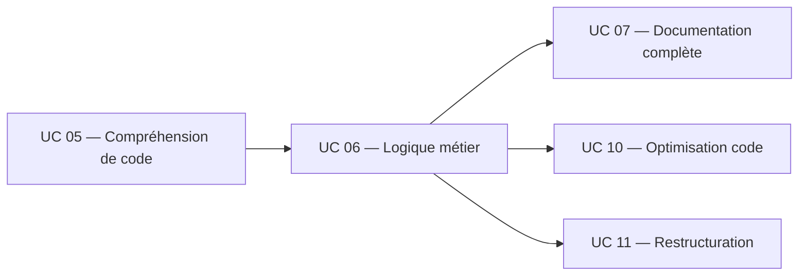

# UC 06 — Explication de code et extraction de la logique métier

> **Catégorie :** Documentation
>
> **Priorité dans le parcours :** 6 — s'appuie sur les fiches de compréhension produites en UC 05
>
> **Modes Bob recommandés :** **IBM i Developer** (mode principal pour l'extraction et le workflow), **IBM i Database** (si interrogation SQL de tables de paramétrage), **Agent** (pour la sauvegarde locale des rapports). Sans Premium Package : Ask.

---

## ⭐ Premium Package IBM i utilisé

- **Workflow : Business Rules Extraction** → [Documentation officielle](https://bob.ibm.com/docs/ide/premium-packages/bob-for-i/workflows)
  Analyse automatiquement le flux d'exécution et les spécifications de calcul des sources **RPG** pour isoler et documenter les règles métier, validations et règles de calcul décisionnelles. Lancement par le bouton **Start Workflow** en haut du chat. Périmètre officiel : RPG uniquement ; pour COBOL et CL, utiliser les prompts manuels ci-dessous et les skills `cobol-*` / `cl-*`. Workspaces supportés : Local, IFS Working Directory, Library List.
- **Understand** → [Documentation officielle](https://bob.ibm.com/docs/ide/premium-packages/bob-for-i/understand) — optionnel, pour localiser appelants, fichiers et dépendances d'un programme avant l'extraction (voir UC00 §2, non redupliqué ici).
- **Skills auto-activées :** `rpg-code-review`, `cobol-procedure-division`, `db2-system-catalog`, `rpg-embedded-sql`, `rpg-indicators`, `rpg-cycle-explained`, `understand-program-explainer` (si Understand est installé)

> Le workflow **Business Rules Extraction** est l'accélérateur principal de cet UC.  
> Les prompts manuels (notamment Prompt 5 — document de validation métier) apportent une valeur complémentaire irremplaçable pour la validation par expert métier — non couverte par le workflow.

---

## Objectif

Extraire la **logique métier enfouie dans le code** : règles de calcul, conditions, seuils, formules, validations, décisions — tout ce qui représente la connaissance fonctionnelle du client codée en dur dans le RPG, COBOL ou CL. Ces règles sont souvent non documentées ailleurs et constituent un risque majeur en cas de remplacement ou de modernisation.

**Cet UC va plus loin que UC 05** : UC 05 décrit *ce que fait* un programme. UC 06 extrait *pourquoi* et *comment* — les règles de gestion précises, utilisables par un analyste métier ou pour alimenter un cahier des charges.

**Livrable attendu :** un catalogue de règles métier par domaine fonctionnel (calculs, validations, flux de décision), formulé en langage naturel, vérifiable par un expert métier, et directement réutilisable pour les UC de modernisation.

---

## Prérequis

- **Phase :** Phase 1 — Comprendre
- **UC précédents requis :** UC 05 — Compréhension de code et d'applications
- **Livrables requis :** `{appId}-comprehension-{composant}-report-{YYYYMMDD-HHmm}.md` — carte des subroutines et des dépendances produite en UC 05
- **Niveau Bob recommandé :** Intermédiaire
- **Bob Coins estimés :** ⚠️ *À calibrer après le lab UC 06 sur FLGHT400.*

---

## Exemple concret — Lab FLGHT400

Le fichier [`../labs_FLGHT400_results/FRS401-business-rules-FR.md`](../labs_FLGHT400_results/FRS401-business-rules-FR.md) illustre ce que produit le workflow Business Rules Extraction sur le programme `FRS401` (fenêtre de sélection d'agent, `FLGHT400/QRPGLESRC`).

Le rapport couvre : règles métier de navigation et de pagination, validations de saisie, logique de décision sur les touches de fonction, règles de calcul (taille de page, repositionnement), règles d'intégrité (accès en lecture seule, protection du mot de passe agent) — le tout structuré avec des statuts **certain**, **inféré** et **hypothèse**.

La version anglaise est disponible dans [`../labs_FLGHT400_results/FRS401-business-rules.md`](../labs_FLGHT400_results/FRS401-business-rules.md).

---

## Démarrer par un programme dont vous connaissez les règles métier

Même principe que UC 05 : **commencer par un programme dont un expert métier de l'équipe connaît les règles**. L'objectif est de vérifier que Bob extrait correctement les règles réelles — pas des règles plausibles mais fausses.

Idéalement, avoir en salle lors de cette session :
- Un développeur qui connaît le code
- Un référent métier qui peut valider que les règles extraites correspondent à la réalité opérationnelle

Si une règle extraite par Bob est fausse ou incomplète, corriger le prompt immédiatement (plus de contexte, copybooks fournis, paramétrage explicité) avant de passer aux programmes moins connus.

---

## Impact de la taille du programme — Renvoi à UC 05

Les stratégies d'analyse par taille définies en UC 05 s'appliquent intégralement ici — consulter la section **"Impact de la taille du programme sur la stratégie d'analyse"** de la fiche UC 05 pour les seuils et les approches adaptées (< 1 000 lignes, 1 000–3 000, 3 000–8 000, > 8 000 lignes).

**Deux différences importantes par rapport à UC 05 :**

**1. L'extraction de règles est plus sensible à la taille que la compréhension générale.**  
UC 05 peut produire une vue d'ensemble acceptable même sur un programme volumineux avec une seule passe. UC 06 nécessite une lecture fine du code — une règle mal lue est une règle fausse dans le catalogue. Sur les programmes de plus de 1 000 lignes, **toujours appliquer la stratégie de découpage** même si UC 05 avait pu se faire en une passe directe.

**2. Extraire les règles subroutine par subroutine est plus fiable qu'une extraction globale.**  
Quelle que soit la taille du programme, demander à Bob d'extraire les règles **subroutine par subroutine** (en utilisant la cartographie produite en UC 05 comme guide) produit des résultats plus précis et plus traçables qu'une extraction en une seule fois. Exemple d'enchaînement :

```
"Sur la base de la cartographie de [NOM_PROGRAMME], extrait les règles métier
 de la subroutine [SR_CALCUL_PRIX] uniquement."

[Après validation]
"Maintenant extrait les règles de la subroutine [SR_REMISES]."
```

> 💡 Cette approche subroutine par subroutine exploite la cartographie produite en UC 05 — c'est la raison pour laquelle UC 05 doit être complété avant UC 06.

> ⚠️ Sur un programme > 3 000 lignes, ne jamais lancer le Prompt 1 sur l'intégralité du programme en une seule fois — Bob produira une liste de règles incomplète sans le signaler.

---

## Démarrer une session Bob

> **À lire avant chaque session UC 06 — nouvelle conversation ou reprise.**

### 1. Espace de travail à sélectionner

**Mode à sélectionner :** `IBM i Developer` (mode principal pour l'analyse de code ; basculer en `IBM i Database` pour interroger les tables de paramétrage, et en `Agent` pour la sauvegarde locale)

**Espace :** IBM i QSYS — sélectionner `Library List` et choisir la bibliothèque applicative dans la liste proposée.

> 💡 **Ce que l'espace Library List change :** Bob dirige ses outils IBM i (`read_member`, `search_qsys`, `execute_compile_action`) vers les bibliothèques configurées dans l'extension Code for IBM i. Les rules `.bob/rules/`, les skills Premium IBM i et les fichiers markdown locaux **restent accessibles** — le workspace VS Code reste ouvert en parallèle. Les workflows IBM i (bouton **Start Workflow** en haut du chat Bob) deviennent visibles dès qu'une connexion IBM i est active.

UC 06 peut se dérouler dans la **même conversation** que UC 05 si l'analyse de compréhension vient d'être faite (Bob a encore le programme en contexte). Dans ce cas, enchaîner directement avec les prompts UC 06 sans ouvrir une nouvelle session.

Si UC 05 a été fait dans une session **précédente** : démarrer une nouvelle conversation Bob (bouton `+`) et charger le fichier de compréhension en contexte avant de commencer.

> 💡 **Avant la première session UC 06 :** vérifier que la User Library List (panneau Code for IBM i → Library List dans VS Code) inclut la bibliothèque source applicative **et** les bibliothèques contenant les copybooks utilisés par le programme. Cela évite les scans globaux sur `*LIBL` entier.

### 2. Ouvrir les fichiers sources dans l'éditeur (Open in Editor)

Ouvrir le programme RPG source dans l'éditeur — Bob en a besoin pour affiner les règles extraites avec le code précis.

**Procédure :** dans le panneau **IBM i — Object Browser**, clic droit sur le membre → **Open in Editor**.

Fichiers à ouvrir pour chaque session UC 06 :
- Le programme RPG source (`[NOM_LIB]/QRPGSRC([NOM_PROGRAMME])`)
- Les copybooks référencés (si présents dans le scope)
- Le display file DDS si le programme est interactif (les validations de saisie y sont parfois codées)

### 3. Fichiers de contexte à charger

Ces fichiers produits par UC 05 doivent être chargés **avant de démarrer** si la session est nouvelle. Utiliser **Add File to Chat** (icône trombone) ou les ouvrir dans l'éditeur.

| Fichier | Produit par | Obligatoire / Recommandé |
|---------|-------------|--------------------------|
| `{appId}-comprehension-{composant}-report-{date}.md` | UC 05 | **Obligatoire** — carte des subroutines, guide de navigation pour l'extraction règle par règle |
| `{appId}-logique-{composant}-regles-{date}.md` | UC 06 (session précédente) | **Si reprise** — catalogue partiel déjà produit, pour compléter sans recommencer |

> 💡 Si le fichier `*-comprehension-*-report-*.md` n'est pas disponible, démarrer par une session rapide UC 05 sur le programme ciblé — 20 minutes de cartographie des subroutines évitent d'extraire des règles dans le désordre.

> ⚠️ **Risque de réduction de contexte — sauvegarde intermédiaire recommandée :** une session UC 06 avec plusieurs passes d'extraction peut atteindre la limite de contexte sur les programmes STANDARD ou COMPLEXE. Si Bob semble oublier une décision prise au Prompt 1 (statut des règles, formules identifiées, tables de paramétrage signalées), c'est un signal de compression de contexte. Sauvegarder le livrable en cours après chaque prompt majeur — pas seulement en fin de session. À chaque reprise de passe, commencer le prompt par : "Le fichier [NOM_FICHIER] contient les décisions prises — continuer à partir de [ÉTAPE]."

---

## Stratégie Premium-first : workflow Business Rules Extraction

> Disponible depuis le bouton **Start Workflow** en haut du chat Bob,
> en mode **IBM i Developer**, connexion IBM i active requise.
> Workspaces supportés : Local, IFS Working Directory, Library List.
> (Source : [Bob IBM i Documentation — Business Rules Extraction](https://bob.ibm.com/docs/ide/premium-packages/bob-for-i/workflows))

**Ce que fait ce workflow** (détail : UC00 §1.5) :
1. Analyse les sources **RPG uniquement** (RPG II, RPG III, RPG/400, RPGLE, SQLRPGLE) — COBOL et CL ne sont pas couverts : utiliser les prompts manuels ci-dessous et les skills `cobol-*` / `cl-*`
2. Extrait règles métier, logique de décision, validations et règles de calcul, et identifie les dépendances externes (fichiers, programmes, programmes de service, copy members, SQL)
3. Traite les sections du source (procédures, sous-routines, mainline) avec des sous-agents en parallèle
4. Produit un rapport Markdown en 8 sections, avec jusqu'à 3 diagrammes Mermaid, enregistré en local ou dans l'IFS

**Comment le lancer :** **Start Workflow** → choisir le workspace → **Start** sur *Business Rules Extraction* → saisir bibliothèque, fichier source, membre et chemin de sortie.

**Understand (optionnel) :** si l'application est scannée, la skill `understand-program-explainer` donne les appelants, fichiers utilisés et exports d'un programme sans relire tout le source (voir UC05 Prompt 5 et UC00 §2).

**Séquence recommandée :**
1. **Lancer d'abord le workflow** sur le programme cible pour une extraction initiale rapide
2. **Affiner avec les prompts manuels** UC 06 — en particulier le Prompt 5 (document de validation métier) pour la réunion avec l'expert métier

| Approche | Avantage | Cas d'usage recommandé |
|---|---|---|
| **Workflow Business Rules Extraction** | Guidé étape par étape, auto-structuré, robuste sur les programmes inconnus | Première extraction sur un programme inconnu, programmes STANDARD à COMPLEXE |
| **Prompts manuels UC 06** | Contrôle précis subroutine par subroutine, statut "certain/probable/à confirmer", document de validation métier | Validation par expert métier, règles ambiguës, programmes avec tables de paramétrage nombreuses |

> 💡 **Lien UC 06 → UC 07 :** le rapport du workflow et les prompts manuels alimentent la spécification fonctionnelle de UC 07 (Prompt 2) ; ils sont aussi consommés par UC 10 et UC 11.

---

## Prompts

### Prompt 1 — Extraction des règles métier d'un programme

**Objectif :** produire un catalogue structuré de toutes les règles métier d'un programme ou d'une subroutine.

**Quand l'utiliser :** en complément du workflow, ou pour les programmes simples (< 1 000 lignes) sur lesquels un contrôle fin est nécessaire.

**Input requis :** le programme RPG source ouvert dans l'éditeur + le fichier `*-comprehension-*-report-*.md` de UC 05 chargé en contexte.

**Espace :** IBM i QSYS + Local

**Skills clés mobilisées :** `rpg-code-review`, `rpg-indicators`, `rpg-embedded-sql`, `rpg-cycle-explained` (programmes à cycle), `cobol-procedure-division` (si le programme est COBOL)

**Prompt :**

```
Le programme [NOM_PROGRAMME] dans [NOM_LIB]/QRPGSRC a fait l'objet d'une fiche de compréhension.
[Si nouvelle session : charger le fichier {appId}-comprehension-{composant}-report-*.md dans le contexte avant ce prompt]

Extrait maintenant toutes les règles métier implicites contenues dans ce programme.
Une règle métier est une décision, un calcul, une validation ou une condition
qui reflète une politique ou une pratique de l'entreprise — pas une contrainte technique.

Pour chaque règle identifiée, fournis en markdown :
- Numéro et intitulé court de la règle
- Description en langage naturel (compréhensible par un non-développeur)
- Déclencheur : dans quelle situation cette règle s'applique-t-elle ?
- Formule ou logique précise : reproduis le calcul ou la condition en pseudo-code clair
- Données impliquées : champs, fichiers ou paramètres utilisés dans la règle
- Origine : numéro de ligne ou nom de subroutine dans le source
- Statut : certain (visible dans le code) / probable (déduit) / à confirmer (ambigu)

Si une règle dépend de valeurs stockées en table de paramétrage (non codées en dur),
signale-le et indique la table concernée.
```

**Livrable produit :** catalogue de règles — enrichit le fichier `{appId}-logique-{composant}-regles-{YYYYMMDD-HHmm}.md`

> ⚠️ **Piège évité :** sans le statut "certain / probable / à confirmer", Bob présente toutes les règles avec le même niveau de confiance. Les règles déduites d'un contexte partiel (copybook manquant, table de paramétrage non lue) passent pour certaines.

---

### Prompt 2 — Extraction des règles de calcul et formules

**Objectif :** produire un catalogue exhaustif des calculs et formules métier avec leurs formules exactes et reformulations lisibles.

**Quand l'utiliser :** après Prompt 1, pour approfondir les calculs financiers, les taux et coefficients.

**Input requis :** programme RPG ouvert dans l'éditeur.

**Espace :** IBM i QSYS + Local

**Skills clés mobilisées :** `rpg-embedded-sql`, `db2-system-catalog` (tables de paramétrage), `cobol-procedure-division` (si le programme est COBOL)

**Prompt :**

```
Dans le programme [NOM_PROGRAMME] de [NOM_LIB], identifie tous les calculs
et formules métier.

Pour chaque calcul :
- Nom du calcul (déduis un nom fonctionnel si le code n'en a pas)
- Formule mathématique exacte, avec les noms de champs tels qu'ils apparaissent dans le code
- Formule reformulée avec des noms lisibles (si les noms de champs sont cryptiques)
- Unités et types : est-ce un montant ? un pourcentage ? une quantité ? une durée ?
- Précision et arrondis : comment le résultat est-il arrondi ou tronqué ?
- Conditions d'application : dans quel cas ce calcul est-il exécuté ?

Signale tout calcul dont le résultat dépend d'une valeur lue en base de données
(taux, coefficient, seuil) plutôt que codée en dur.
```

**Livrable produit :** section "Calculs et formules" dans le fichier `{appId}-logique-{composant}-regles-{YYYYMMDD-HHmm}.md`

> 💡 **Variante — interroger la table de paramétrage directement :** si Bob identifie une table de taux ou de seuils, enchaîner immédiatement avec :
> ```
> "Interroge la table [NOM_TABLE] dans [NOM_LIB] et affiche les valeurs
>  actuelles des taux / seuils utilisés dans ce calcul."
> ```
> Le mode IBM i Database (ou l'outil SQL en IBM i Developer) exécute la requête SQL en temps réel — les valeurs réelles s'affichent dans le chat.

---

### Prompt 3 — Extraction des règles de validation et contrôles de saisie

**Objectif :** identifier toutes les validations métier (à distinguer des validations de format).

**Quand l'utiliser :** pour les programmes interactifs (display file DDS associé) ou les programmes de saisie.

**Input requis :** programme RPG + display file DDS ouvert dans l'éditeur.

**Espace :** IBM i QSYS + Local

**Skills clés mobilisées :** `dds-display-files`, `rpg-indicators` (et `cobol-procedure-division` si le programme est COBOL)

**Prompt :**

```
Dans le programme [NOM_PROGRAMME] de [NOM_LIB], identifie toutes les règles
de validation et de contrôle appliquées aux données entrantes.

Pour chaque validation :
- Ce qui est contrôlé (quel champ, quelle valeur, quelle combinaison)
- La condition de rejet : quand la validation échoue-t-elle ?
- Le message ou le comportement en cas d'échec (message d'erreur, blocage, valeur par défaut)
- La sévérité : bloquant (l'utilisateur ne peut pas continuer) ou avertissement ?
- L'origine dans le code (subroutine, ligne)

Distingue les validations de format (type, longueur, obligatoire)
des validations métier (règle de gestion, cohérence entre champs, existence en référentiel).
```

**Livrable produit :** section "Validations et contrôles" dans le fichier `{appId}-logique-{composant}-regles-{YYYYMMDD-HHmm}.md`

> ⚠️ **Piège évité :** les validations sur écran 5250 sont souvent dans le fichier DDS display (`CHECK`, `RANGE`, `VALUES`) **et** dans le programme RPG. Si on n'analyse que le programme RPG, on rate les validations côté DDS. Toujours inclure le display file dans le scope pour cet UC.

---

### Prompt 4 — Flux de décision (arbres de décision) [Complément — non couvert par le workflow Premium]

**Objectif :** identifier les points de décision métier principaux et les représenter sous forme d'arbres lisibles par un expert métier.

**Quand l'utiliser :** pour les programmes avec une logique conditionnelle complexe (plusieurs chemins métier distincts). Complète le workflow Business Rules Extraction qui identifie les décisions mais ne les structure pas en arbre.

**Input requis :** programme RPG ouvert dans l'éditeur + catalogue de règles en cours (Prompts 1–3).

**Espace :** IBM i QSYS + Local

**Skills clés mobilisées :** `rpg-code-review`, `rpg-indicators` (et `cobol-procedure-division` si le programme est COBOL)

**Prompt :**

```
Dans le programme [NOM_PROGRAMME] de [NOM_LIB], identifie les points de décision
métier principaux — les endroits où le programme choisit entre plusieurs chemins
en fonction d'une condition métier.

Pour les 3 à 5 décisions les plus importantes :
- La condition de décision en langage naturel
- Les branches possibles et leur effet métier
- Les données qui influencent la décision
- Représente la décision sous forme d'arbre en markdown (listes imbriquées)

Ne pas inclure les décisions purement techniques (gestion des erreurs SQL,
boucles de lecture de fichier, fin de programme).
```

**Livrable produit :** section "Flux de décision" dans le fichier `{appId}-logique-{composant}-regles-{YYYYMMDD-HHmm}.md`

> 💡 Les arbres de décision extraits ici sont directement utilisables dans les spécifications fonctionnelles produites en UC 07.

> 💡 **Limite explicite à 3–5 décisions** : sans cette limite, Bob liste toutes les conditions IF/ELSE du programme — des dizaines sur un programme legacy. On veut les décisions à valeur métier, pas l'exhaustivité.

---

### Prompt 5 — Synthèse : document de validation métier

**Objectif :** produire un document en langage naturel pur, destiné à être lu et validé par un expert métier — sans aucun terme technique IBM i ou RPG.

**Quand l'utiliser :** après extraction des règles (Prompts 1–4), avant la réunion de validation avec l'expert métier. C'est le livrable principal de cet UC.

**Input requis :** catalogue de règles partiellement consolidé dans le chat + fichier de compréhension UC 05 chargé.

**Espace :** Local

**Skills clés mobilisées :** — (rédaction à partir du catalogue déjà extrait ; aucune skill IBM i spécifique)

**Prompt :**

```
Sur la base des règles métier extraites pour [NOM_PROGRAMME], rédige un document
de synthèse en français destiné à être validé par un expert métier [NOM_CLIENT].

Le document doit être rédigé sans aucun terme technique RPG ou IBM i.
Structure :
1. Contexte : à quel processus métier ce programme participe-t-il ?
2. Règles de gestion : liste numérotée des règles extraites, en langage naturel pur
3. Calculs clés : les formules reformulées en termes métier
   (ex : "Le prix net = prix brut × (1 - taux de remise)")
4. Points à valider : règles marquées "probable" ou "à confirmer" qui nécessitent
   une confirmation par un expert métier
5. Règles dépendant du paramétrage : règles dont les valeurs sont en base de données
   (à faire vérifier avec les valeurs actuelles)

En fin de document, ajoute une section "Questions pour l'expert métier" avec
3 à 5 questions précises sur les points ambigus identifiés.
```

**Livrable produit :** `{appId}-logique-{composant}-validation-{YYYYMMDD-HHmm}.md`

> 💡 Ce document structure la réunion de validation avec l'équipe métier et nourrit directement UC 07 (documentation complète — spécifications fonctionnelles).

> 💡 **Sauvegarder le catalogue de règles :** une fois la synthèse validée par l'expert métier, basculer en mode Agent (autorisé pour la création de fichiers locaux) et demander à Bob de sauvegarder le document :
> ```
> "Sauvegarde ce catalogue de règles dans un fichier markdown
>  nommé {appId}-logique-{composant}-regles-{YYYYMMDD-HHmm}.md
>  Exemple : flght403-logique-frs401-regles-20261030-1400.md"
> ```

---

## Outils à utiliser

| Outil | Usage dans cet UC |
|-----|------------------|
| **Outils natifs IBM i — mode IBM i Developer** | Lecture des membres sources RPG, CL, DDS (display files pour les validations) |
| **Outils natifs IBM i — mode IBM i Database** | Interrogation des tables de paramétrage référencées dans les règles (taux, codes, seuils) |
| **Confluence MCP** *(si disponible)* | Publication du catalogue de règles et du document de validation sur l'espace POC |

> 💡 Les outils IBM i sont **natifs au Premium Package** — ils utilisent la connexion IBM i configurée dans UC 01 et ne nécessitent aucune configuration dans `mcp.json`. Ils sont disponibles dès que cette connexion est active, en mode IBM i Developer comme en mode IBM i Database. Liste des outils IBM i, garde-fous et réglages : voir UC00 §5.

---

## Pièges à éviter

| Piège | Ce qui se passe | Comment l'éviter |
|-------|----------------|-----------------|
| Analyser le programme RPG sans le display file DDS associé | Les validations de saisie côté écran sont manquantes — le catalogue de règles est incomplet | Inclure le display file dans le scope, ou l'ouvrir dans l'éditeur avant le prompt |
| Ne pas distinguer règles certaines et règles déduites | Toutes les règles semblent fiables — les règles fausses passent inaperçues | Toujours inclure le statut "certain / probable / à confirmer" (Prompt 1) |
| Oublier les tables de paramétrage | Les règles qui lisent des taux ou des seuils en base sont extraites avec des valeurs nulles ou inventées | Demander à Bob de signaler les dépendances aux tables, puis les interroger en mode IBM i Database |
| Présenter les règles extraites directement au management sans validation métier | Des règles fausses ou incomplètes sont validées comme spécifications — risque majeur sur les UC suivants | Toujours passer par le Prompt 5 (document de validation) et une session de revue avec un expert métier |
| Confondre UC 06 et UC 05 | On produit une compréhension générale au lieu d'un catalogue de règles précis | UC 06 = règles métier actionnables avec formules et conditions précises. UC 05 = vue d'ensemble. Les deux sont distincts et complémentaires. |
| Extraire les règles métier de programmes CL | Les programmes CL contiennent rarement des règles métier — ils orchestrent des appels | Se concentrer sur les programmes RPG et COBOL pour cet UC ; les programmes CL relèvent de l'architecture (UC 07) |
| Lancer le Prompt 1 sur un programme > 3 000 lignes en une seule passe | Bob produit une liste de règles incomplète sans le signaler | Découper par subroutine en utilisant la cartographie UC 05 |

---

## Livrables de cet UC

| Fichier produit | Pattern de nommage | Consommé par |
|---|---|---|
| Catalogue de règles métier | `{appId}-logique-{composant}-regles-{YYYYMMDD-HHmm}.md` | UC 07 — Prompt 2 (spécification fonctionnelle), UC 10 (optimisation), UC 11 (restructuration) |
| Document de validation métier | `{appId}-logique-{composant}-validation-{YYYYMMDD-HHmm}.md` | Réunion de validation expert métier → UC 07 (spécifications fonctionnelles) |

**Exemples FLGHT400 :**
- `flght403-logique-frs401-regles-20261023-1400.md`
- `flght403-logique-frs401-validation-20261023-1600.md`

---

## Dépendances



---

## Check-list de validation UC 06

Avant de passer à UC 07 (voir `uc-fr/UC07-documentation-complete-fr.md`), valider chaque point :

- [ ] Le workflow Business Rules Extraction a été lancé sur au moins un programme métier central
- [ ] Au moins un programme métier central a été analysé avec les Prompts 1 et 2
- [ ] Les calculs clés (prix, remises, taxes, quantités…) ont été extraits avec formules et unités
- [ ] Les validations métier (pas seulement les validations de format) ont été identifiées
- [ ] Les dépendances aux tables de paramétrage ont été identifiées et interrogées via le mode IBM i Database
- [ ] Le document de synthèse (Prompt 5) a été produit pour au moins un domaine métier
- [ ] Le document a été soumis à un expert métier pour validation
- [ ] Les règles "à confirmer" ont été revues et clarifiées (ou explicitement laissées ouvertes)
- [ ] Le catalogue de règles validé est sauvegardé avec la convention de nommage `{appId}-logique-{composant}-regles-{YYYYMMDD-HHmm}.md`

---

*Fiche UC 06 — Document évolutif à mettre à jour au fil du POC.*
