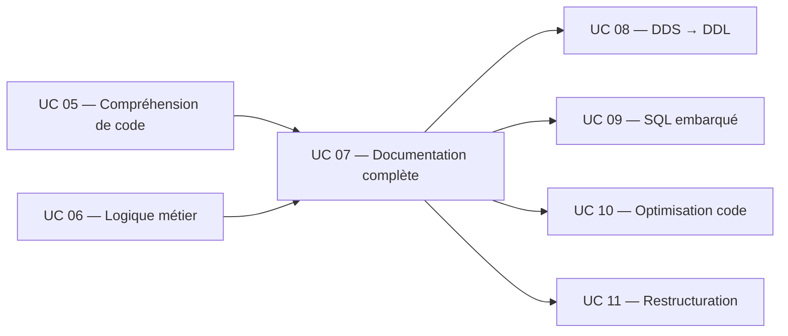

# UC 07 — Documentation complète

> **Catégorie :** Documentation
>
> **Priorité dans le parcours :** 7 — capitalise les livrables UC 05 et UC 06
>
> **Mode Bob recommandé :** IBM i Developer (Premium Package IBM i) — mode principal. `/erd` est disponible dans IBM i Developer et IBM i Database (voir UC00 §3.2). Sans Premium Package : Ask.

---

## ⭐ Premium Package IBM i utilisé

- **Slash Command : `/erd`** → [Documentation officielle](https://bob.ibm.com/docs/ide/premium-packages/bob-for-i/slash-commands)
  Génère un diagramme Entité-Relation (ERD) Mermaid directement depuis le catalogue Db2 for i (`QSYS2.SYSTABLES`, `QSYS2.SYSCOLUMNS`, `QSYS2.SYSCST`, `QSYS2.SYSREFCST`). Remplace le prompt de génération ERD manuel.
- **Slash Command : `/init`** → [Documentation officielle](https://bob.ibm.com/docs/ide/premium-packages/bob-for-i/slash-commands)
  Génère automatiquement un fichier `AGENTS.md` documentant l'architecture ILE, les conventions de nommage et les objets DDS/SQL — utilisable comme contexte socle pour tout le corpus documentaire. Emplacements officiels : `{bibliothèque courante}/QBOBSRC/AGENTS.MD` (QSYS) ou `{répertoire IFS}/.bob/AGENTS.md` (IFS).
- **Understand Dashboard** → [Documentation officielle](https://bob.ibm.com/docs/ide/premium-packages/bob-for-i/understand)
  Cartographie applicative, analyse d'impact, identification des objets morts — prime pour la vue architecture globale. Installation, scan et limites : voir UC00 §2 (non redupliqué ici).
- **Skills auto-activées :** `understand-app-overview`, `understand-impact-analysis` (actives uniquement si Understand est installé), `db2-system-catalog`, `db2-services-catalog`, `rpg-code-review`

> Les slash commands `/erd` et `/init`, ainsi que le tableau de bord Understand, priment sur les prompts d'architecture manuelle.
> Les prompts UC 07 (spécification fonctionnelle, spécification technique, matrice croisée, fiche de synthèse) apportent une valeur complémentaire irremplaçable non couverte par ces outils.

---

## Objectif

Produire une **documentation structurée, durable et actionnable** de l'application à partir de tout ce qui a été compris en UC 05 et extrait en UC 06 : modèles d'architecture, spécifications fonctionnelles et techniques, diagrammes des relations entre programmes et données, matrices de références croisées.

**Cet UC est le point de convergence de la Phase 1.** UC 05 a fourni la compréhension programme par programme. UC 06 a extrait les règles métier. UC 07 les assemble en un corpus documentaire cohérent, navigable, et directement utilisable comme input pour les phases de modernisation.

**Sans UC 07, les phases suivantes partent à l'aveugle.** Un développeur qui attaque UC 10 (optimisation) ou UC 11 (restructuration) sans documentation de référence n'a aucun filet pour valider qu'il n'a pas cassé la logique.

**Livrable attendu :** un dossier documentaire par application comprenant un modèle d'architecture (diagramme de composants + flux de données), une spécification fonctionnelle, une spécification technique, un diagramme ERD des relations données, et une matrice de références croisées programmes-fichiers-règles.

---

## Prérequis

- **Phase :** Phase 1 — Comprendre (capitalisation)
- **UC précédents requis :** UC 05 — Compréhension de code, UC 06 — Logique métier
- **Livrables requis :**
  - `{appId}-comprehension-{composant}-report-{YYYYMMDD-HHmm}.md` — fiches de compréhension UC 05
  - `{appId}-logique-{composant}-regles-{YYYYMMDD-HHmm}.md` — catalogues de règles **validés** par un expert métier (UC 06)
- **Niveau Bob recommandé :** Intermédiaire
- **Bob Coins estimés :** ⚠️ *À calibrer après le lab UC 07 sur FLGHT400.*

> ⚠️ **Prérequis bloquant :** ne pas démarrer UC 07 sans au moins un fichier `*-comprehension-*-report-*.md` validé **et** un fichier `*-logique-*-regles-*.md` validé par un expert métier pour l'application ciblée.

---

## Exemple concret — Lab FLGHT400

Les fichiers suivants illustrent ce que produit UC 07 sur l'application FLGHT400 :

| Livrable | Fichier lab | Produit par |
|---|---|---|
| ERD complet (commande `/erd`) | [`../labs_FLGHT400_results/FLGHT403_erd_report.md`](../labs_FLGHT400_results/FLGHT403_erd_report.md) | `/erd FLGHT403` — tables, colonnes, diagramme Mermaid |
| Diagramme ERD seul | [`../labs_FLGHT400_results/FLGHT403_erd.md`](../labs_FLGHT400_results/FLGHT403_erd.md) | `/erd FLGHT403` |
| Architecture applicative | [`../labs_FLGHT400_results/FLGHT403_architecture.md`](../labs_FLGHT400_results/FLGHT403_architecture.md) | Understand + skill `understand-app-overview` (voir UC00 §7, exercice 1d) — point de départ du Prompt 1 UC 07 |
| Init report (contexte `/init`) | [`../labs_FLGHT400_results/FLGHT403_init_report.md`](../labs_FLGHT400_results/FLGHT403_init_report.md) | Slash command `/init` |
| Domaines fonctionnels | [`../labs_FLGHT400_results/FLGHT403_functional_areas.md`](../labs_FLGHT400_results/FLGHT403_functional_areas.md) | Scan Understand (voir UC00 §7, exercice 1c) |

Le rapport ERD FLGHT400 met en évidence un cas typique IBM i : aucune contrainte FK formelle (fichiers DDS) — les relations entre `ORDERS`, `AGENTS`, `CUSTOMERS`, `FLIGHTS` sont déduites depuis les champs communs (`AGENT_NO`, `CUSTOMER_NO`, `FLIGHT_NUMBER`).

---

## Démarrer par une application dont vous connaissez déjà les livrables UC 05 et UC 06

UC 07 ne produit rien de bon sur une application non préalablement analysée. Règle ferme : **ne démarrer UC 07 que sur les applications pour lesquelles les fichiers de compréhension et les catalogues de règles sont complets et validés**.

UC 07 assemble des informations existantes — il ne découvre pas. Si les sources sont incomplètes ou non validées, la documentation produite propagera les erreurs aux UC suivants.

**Progression recommandée :**

| Étape | Point de départ | Document à produire |
|-------|----------------|---------------------|
| 0 | Connexion IBM i active | `/init` → `AGENTS.md` + `/erd [NOM_LIB]` → ERD |
| 1 | Fichiers `*-comprehension-*-report-*.md` | Architecture (Prompt 1) → `*-doc-architecture-*.md` |
| 2 | Fichiers `*-logique-*-regles-*.md` validés | Spéc fonctionnelle (Prompt 2) → `*-doc-spec-fonc-*.md` |
| 3 | Fichiers `*-comprehension-*-report-*.md` (F-specs + dépendances) | Spéc technique + modèle ER (Prompt 3) → `*-doc-spec-tech-*.md` |
| 4 | Fichiers de compréhension (liste complète programmes) | Matrice références croisées (Prompt 4) → `*-doc-matrice-*.md` |
| 5 | Tous les livrables Prompts 1–4 | Fiche de synthèse (Prompt 5) → `*-doc-synthese-*.md` |

---

## Démarrer une session Bob

> **À lire avant chaque session UC 07 — nouvelle conversation ou reprise.**

### 1. Espace de travail à sélectionner

UC 07 travaille sur l'ensemble d'une application. Démarrer dans une **nouvelle conversation Bob** (bouton `+`) dédiée à l'application à documenter.

**Mode à sélectionner :** `IBM i Developer` pour les Prompts 1 à 5.

**Espace :** IBM i QSYS (workspace Library List) + Local

> 💡 **Mode pour `/erd` :** la commande est disponible dans IBM i Developer **et** dans IBM i Database (UC00 §3.2) ; le basculement vers IBM i Database n'est donc pas obligatoire. Il reste pratique pour les requêtes `QSYS2` de la spécification technique (Prompt 3).

> 💡 **Exécuter `/init` en premier** sur la bibliothèque applicative avant tout prompt. Le fichier `AGENTS.md` généré sera injecté automatiquement en contexte pour toute la session — il évite de répéter le contexte applicatif dans chaque prompt.

### 2. Fichiers de contexte à charger

Ces fichiers sont les inputs directs de chaque prompt UC 07. Les charger dans le chat via **Add File to Chat** (icône trombone) avant de lancer le prompt correspondant.

| Fichier | Produit par | Utilisé dans |
|---------|-------------|-------------|
| `{appId}-comprehension-{composant}-report-{date}.md` | UC 05 | **Obligatoire** — Prompts 1, 3, 4 |
| `{appId}-logique-{composant}-regles-{date}.md` | UC 06 | **Obligatoire** — Prompts 2 et 4 |
| `{appId}-doc-architecture-{date}.md` | UC 07 Prompt 1 | Disponible pour les Prompts 2 à 5 |
| `{appId}-doc-spec-fonc-{date}.md` | UC 07 Prompt 2 | Input Prompt 5 |
| `{appId}-doc-spec-tech-{date}.md` | UC 07 Prompt 3 | Input **UC 08** (DDS→DDL) et **UC 09** (SQL embarqué) |
| `{appId}-doc-matrice-{date}.md` | UC 07 Prompt 4 | Input **UC 10** (Optimisation) et **UC 11** (Restructuration) |

> ⚠️ **Risque de réduction de contexte :** une session UC 07 multi-prompts peut atteindre la limite de contexte sur les applications volumineuses. Sauvegarder le livrable en cours après chaque prompt — pas seulement en fin de session.

> 💡 UC 07 peut se dérouler en plusieurs sessions (un prompt par session si l'application est volumineuse). Ouvrir les livrables partiels au début de chaque session de reprise.

---

## Stratégie Premium-first

### Étape 0 — `/init` pour contextualiser la session

```
/init
```

**Ce que ça produit :** un fichier `AGENTS.md` documentant l'architecture ILE, les conventions de nommage, les objets DDS/SQL et les standards du projet. Injecté automatiquement en contexte sans rechargement manuel.

**Espace :** IBM i QSYS

**Emplacement de l'`AGENTS.md` généré :** `{BIBLIO}/QBOBSRC/AGENTS.MD` (workspace QSYS) ou `{répertoire IFS}/.bob/AGENTS.md` (workspace IFS). Une bibliothèque courante (ou un répertoire de travail IFS) doit être définie, sinon `/init` s'arrête sans rien créer (voir UC00 §3.1).

> 💡 `/init` est à exécuter **une seule fois par application** en début de première session UC 07. Les sessions suivantes réutilisent l'`AGENTS.md` déjà présent.

### Étape 1 — `/erd` pour le diagramme Entité-Relation

```
/erd [NOM_LIB]
```

**Ce que ça produit :** un diagramme Mermaid `erDiagram` depuis le catalogue réel Db2 for i — tables, colonnes (type, null), contraintes FK, cardinalités. Remplace la génération ERD manuelle.

**Espace :** IBM i QSYS (workspace Library List) — IBM i Developer ou IBM i Database

> ⚠️ **Limite avec les fichiers DDS :** les PF DDS n'ont pas de contraintes FK dans le catalogue SQL — `/erd` montre les tables sans relations FK formelles. Compléter manuellement les relations déduites depuis les champs communs (voir Prompt 3).

> 💡 **Lab FLGHT400 :** voir [`../labs_FLGHT400_results/FLGHT403_erd_report.md`](../labs_FLGHT400_results/FLGHT403_erd_report.md) pour un exemple complet de sortie `/erd FLGHT403`.

### Understand Dashboard — vue architecture applicative

Ouvrir le tableau de bord avec la commande *Open Understand Dashboard* (`vscode-ibmi-bob.openUnderstandDashboard`) ou l'icône du Dashboard dans la barre de titre du chat Bob. Prérequis (installation, application scannée) : voir UC00 §2.

**Ce que ça apporte :** cartographie des appels de programmes, utilisation des fichiers DDS PF/LF, liaisons de programmes de service, objets morts — directement utilisable comme source pour le Prompt 1. L'onglet **Insights** propose le bouton **Explore the Application with Bob**.

> ⚠️ Le scan lit les objets compilés (pas le source) et ne capture ni les appels dynamiques ni le SQL dynamique : à signaler comme zones incomplètes dans le Prompt 1.

> 💡 Understand Dashboard prime sur les inférences du code pour la vue architecture globale. Utiliser ses données comme point de départ du Prompt 1 plutôt que de repartir de zéro.

---

## Prompts

### Prompt 1 — Architecture générale de l'application

**Objectif :** produire le modèle d'architecture de l'application — diagramme de composants, flux de traitement, points d'intégration.

**Quand l'utiliser :** en premier, après `/init` et le tableau de bord Understand (si disponible). Base de tous les prompts suivants.

**Input requis :** fichiers `*-comprehension-*-report-*.md` chargés en contexte + données Understand Dashboard (si disponible).

**Espace :** IBM i QSYS + Local

**Skills clés mobilisées :** `understand-app-overview`, `understand-impact-analysis` (si Understand est installé)

**Prompt :**

```
Sur la base des fichiers de compréhension ({appId}-comprehension-*-report-*.md)
pour l'application [NOM_APPLICATION] dans [NOM_LIB],
génère la documentation d'architecture en français, en markdown.

[Si nouvelle session : charger les fichiers *-comprehension-*-report-*.md dans le contexte avant ce prompt]

Produis les sections suivantes :

## 1. Vue d'ensemble de l'application
- Rôle métier de l'application en 3 phrases (pour un non-technicien)
- Périmètre fonctionnel : quels processus métier cette application couvre-t-elle ?
- Volumétrie : nombre de programmes, fichiers physiques, fichiers logiques, écrans

## 2. Diagramme de composants (Mermaid)
Génère un diagramme Mermaid de type `graph TD` représentant :
- Les programmes principaux comme nœuds (PGM)
- Les fichiers physiques partagés comme nœuds (PF)
- Les interfaces avec d'autres applications ou systèmes comme nœuds (EXT)
- Les appels CALL entre programmes comme flèches →
- Les accès en lecture aux PF comme flèches en pointillés -.->
- Les accès en écriture/mise à jour comme flèches =>
Limiter à 15 nœuds maximum — si l'application est plus grande,
représenter uniquement les composants centraux (les plus appelés ou les plus partagés).

## 3. Flux de traitement principal
Décris en 5 à 8 étapes le flux de traitement de bout en bout :
depuis l'entrée utilisateur (écran 5250 ou déclencheur batch)
jusqu'à la production de la sortie (mise à jour base, impression, appel externe).

## 4. Points d'intégration
Liste les interfaces avec l'extérieur :
- Autres applications IBM i appelées ou appelantes
- Fichiers d'interface (entrée / sortie) avec des systèmes tiers
- Déclencheurs batch (JOBSCD, CL de soumission)

Ne pas inventer de composants non visibles dans les fichiers de compréhension.
Signaler explicitement les zones où le périmètre est incomplet ou incertain.
```

**Livrable produit :** `{appId}-doc-architecture-{YYYYMMDD-HHmm}.md`

> ⚠️ **Piège évité :** sans la contrainte de 15 nœuds, Bob génère des diagrammes Mermaid qui dépassent la capacité du rendu. Toujours limiter, quitte à produire un second diagramme pour les composants secondaires.

> ⚠️ **Garde-fou anti-hallucination :** la mention "Ne pas inventer de composants non visibles" est critique — une relation inventée dans un diagramme d'architecture propage une fausse information dans toute la documentation suivante.

---

### Prompt 2 — Spécification fonctionnelle

**Objectif :** produire la spécification fonctionnelle de l'application, basée sur les cas d'utilisation et les règles métier validées.

**Quand l'utiliser :** après Prompt 1, en s'appuyant sur le catalogue de règles UC 06 **obligatoirement validé** par un expert métier.

**Input requis :** fichiers `*-comprehension-*-report-*.md` + `*-logique-*-regles-*.md` (validés) chargés en contexte.

**Espace :** Local

**Skills clés mobilisées :** — (rédaction à partir des livrables UC 05 et UC 06 ; aucune skill IBM i spécifique)

**Prompt :**

```
Sur la base des fichiers de compréhension ({appId}-comprehension-*-report-*.md)
et du catalogue de règles validé ({appId}-logique-*-regles-*.md) pour
[NOM_APPLICATION] / [NOM_DOMAINE_FONCTIONNEL], rédige une spécification
fonctionnelle en français, en markdown.

[Si nouvelle session : charger les fichiers *-comprehension-*-report-*.md ET *-logique-*-regles-*.md
 dans le contexte avant ce prompt — les deux sources sont nécessaires]

Structure attendue :

## Spécification fonctionnelle — [NOM_APPLICATION] / [NOM_DOMAINE]

### 1. Contexte et périmètre
- Processus métier couvert
- Acteurs : qui déclenche le traitement ? qui en consomme le résultat ?
- Volume et fréquence : traitement unitaire ou batch ? quotidien / hebdomadaire / à la demande ?

### 2. Cas d'utilisation
Pour chaque cas d'utilisation identifié :
- Nom et résumé en 2 phrases
- Préconditions : qu'est-ce qui doit être vrai pour que le traitement se déclenche ?
- Flux nominal : les étapes du traitement dans le cas normal
- Flux alternatifs : les cas particuliers identifiés dans le code (conditions, exceptions)
- Post-conditions : quel est l'état du système à la fin du traitement ?

### 3. Règles de gestion
Reporter ici les règles du catalogue de règles (*-logique-*-regles-*.md), organisées par cas d'utilisation.
Pour chaque règle :
- Identifiant et intitulé (reprendre la numérotation du catalogue)
- Description en langage naturel
- Cas d'utilisation auquel elle s'applique

### 4. Messages et comportements utilisateur
Liste des messages affichés à l'écran (codes message IBM i, textes MSGF),
avec leur déclencheur et leur sévérité (information / avertissement / erreur bloquante).

### 5. Interfaces et données échangées
- Données en entrée : champs, formats, sources
- Données en sortie : champs, formats, destinations
- Règles de correspondance entrée → sortie

Ne pas reproduire le code RPG dans ce document.
Signaler en note les points qui n'ont pas pu être déterminés depuis les sources disponibles.
```

**Livrable produit :** `{appId}-doc-spec-fonc-{composant}-{YYYYMMDD-HHmm}.md`
*(si la spec couvre l'application entière : `{appId}-doc-spec-fonc-all-{YYYYMMDD-HHmm}.md`)*

> 💡 **Double source obligatoire :** les cas d'utilisation viennent des fichiers de compréhension ; les règles de gestion viennent du catalogue de règles validé. Un seul des deux produit une spec incomplète.

> 💡 Les flux alternatifs correspondent souvent aux arbres de décision extraits au Prompt 4 de UC 06 — les charger en contexte les rend directement exploitables ici.

---

### Prompt 3 — Spécification technique et modèle de données physique

**Objectif :** produire la spécification technique de l'application — inventaire des objets, modèle de données physique (complété par `/erd`), interfaces de programmes, dépendances techniques.

**Quand l'utiliser :** après le Prompt 1, en s'appuyant sur les fichiers de compréhension et l'ERD produit par `/erd`.

**Input requis :** fichiers `*-comprehension-*-report-*.md` + ERD `/erd` chargés en contexte.

**Espace :** IBM i QSYS + Local

**Skills clés mobilisées :** `db2-system-catalog`, `dds-physical-files`, `dds-logical-files`

**Prompt :**

```
Sur la base des fichiers de compréhension ({appId}-comprehension-*-report-*.md)
pour [NOM_APPLICATION] dans [NOM_LIB], génère une spécification technique
en français, en markdown.

[Si nouvelle session : charger les fichiers *-comprehension-*-report-*.md dans le contexte avant ce prompt]
[Charger également le rapport ERD produit par /erd si disponible]

## Spécification technique — [NOM_APPLICATION]

### 1. Inventaire des objets
Produis un tableau :
| Nom objet | Type (PGM / PF / LF / DSPF / PRTF / CL) | Bibliothèque | Rôle | Programmes utilisant cet objet |

### 2. Modèle de données physique
Pour chaque fichier physique (PF) de l'application :
- Nom du fichier et bibliothèque
- Rôle fonctionnel (ce que représente chaque enregistrement)
- Champs principaux : nom, type, longueur, rôle supposé
- Clé primaire (champ UNIQUE ou premier champ de la clé)
- Fichiers logiques associés (LF) et critère de sélection/tri de chaque LF

Génère ensuite un diagramme Mermaid `erDiagram` représentant les relations
entre les fichiers physiques de l'application (clés étrangères déduites
des champs communs entre fichiers).
Si le rapport /erd est disponible en contexte, l'utiliser comme base et ajouter
les relations implicites non visibles dans le catalogue SQL.

### 3. Interfaces de programmes (signatures)
Pour chaque programme de l'application appelé depuis l'extérieur (CALL entrant) :
- Nom du programme
- Liste des paramètres avec type, longueur et sens (entrée / sortie / entrée-sortie)
- Valeurs de retour ou codes de statut

### 4. Dépendances techniques
- Copybooks partagés (/COPY) et leur contenu (structures, constantes, prototypes)
- Data areas (*DTAARA) utilisées
- Data queues (*DTAQ) utilisées
- User spaces (*USRSPC) utilisés

### 5. Contraintes techniques identifiées
- Indicateurs partagés entre programmes
- Variables globales ou structures de données partagées
- Appels dynamiques (CALL avec variable de nom — non résolvables statiquement)
- Programmes sans source disponible (objets compilés uniquement)

Signaler explicitement les informations non déterminables depuis les sources disponibles.
```

**Livrable produit :** `{appId}-doc-spec-tech-{composant}-{YYYYMMDD-HHmm}.md`

> ⚠️ **Ne pas confondre LF et PF dans le modèle ER :** les fichiers logiques (LF) sont des index/vues, pas des entités — les placer dans "Fichiers logiques associés", jamais dans le diagramme `erDiagram`.

> 💡 **Requêtes QSYS2 utiles (mode IBM i Database) :**
> ```sql
> -- Colonnes d'un fichier physique
> SELECT COLUMN_NAME, DATA_TYPE, LENGTH, NUMERIC_SCALE, IS_NULLABLE, COLUMN_TEXT
> FROM QSYS2.SYSCOLUMNS
> WHERE TABLE_SCHEMA = '[NOM_LIB]' AND TABLE_NAME = '[NOM_PF]'
> ORDER BY ORDINAL_POSITION;
>
> -- Fichiers logiques (LF) basés sur un PF
> -- (SYSTABLES.BASE_TABLE_NAME n'est renseigné que pour les alias : utiliser SYSFILES)
> SELECT F.TABLE_SCHEMA, F.TABLE_NAME, F.SYSTEM_TABLE_NAME
> FROM QSYS2.SYSFILES F,
>      JSON_TABLE(F.BASED_ON_FILES, 'lax $.BASED_ON_FILES'
>                 COLUMNS(LIBRARY CHAR(10), FILE CHAR(10))) B
> WHERE F.NATIVE_TYPE = 'LOGICAL'
>   AND B.LIBRARY = '[NOM_LIB]' AND B.FILE = '[NOM_PF]';
> ```

---

### Prompt 4 — Matrice de références croisées

**Objectif :** produire une matrice programmes × fichiers, programmes × règles métier, et programmes × programmes — cartographie des dépendances croisées.

**Quand l'utiliser :** après les Prompts 1 et 2, une fois l'architecture et les règles consolidées.

**Input requis :** fichiers `*-comprehension-*-report-*.md` + `*-logique-*-regles-*.md` chargés en contexte.

**Espace :** Local

**Skills clés mobilisées :** `understand-impact-analysis` (si Understand est installé)

**Prompt :**

```
Sur la base des fichiers de compréhension ({appId}-comprehension-*-report-*.md)
et du catalogue de règles ({appId}-logique-*-regles-*.md) pour l'application
[NOM_APPLICATION] dans [NOM_LIB], génère une matrice de références croisées
en markdown.

[Si nouvelle session : charger les fichiers *-comprehension-*-report-*.md ET *-logique-*-regles-*.md
 dans le contexte avant ce prompt]

## Matrice de références croisées — [NOM_APPLICATION]

### 1. Matrice Programmes × Fichiers
Produis un tableau markdown :
- Lignes : tous les programmes de l'application (un programme par ligne)
- Colonnes : tous les fichiers physiques de l'application (un PF par colonne)
- Cellule : L (lecture seule) / E (écriture seule) / LE (lecture+écriture) / - (pas d'accès)

### 2. Matrice Programmes × Règles métier
Produis un tableau :
- Lignes : tous les programmes de l'application
- Colonnes : les règles métier numérotées du catalogue de règles
- Cellule : ✓ (règle implémentée dans ce programme) / - (pas concerné)

### 3. Matrice Programmes × Programmes (appels)
Produis un tableau :
- Lignes : programmes appelants
- Colonnes : programmes appelés
- Cellule : CALL / CALLP / EXSR / - (pas d'appel direct)

### 4. Index des objets partagés
Liste les fichiers physiques utilisés par plus d'un programme,
avec pour chaque PF partagé :
- Nombre de programmes en lecture
- Nombre de programmes en écriture
- Programmes en écriture (risque de contention)
- Niveau de criticité : Élevé (écrit par 3+ programmes) / Moyen / Faible

Pour les tableaux avec plus de 8 colonnes, utiliser des abréviations pour les noms
de colonnes et fournir un index d'abréviations en dessous du tableau.
```

**Livrable produit :** `{appId}-doc-matrice-{YYYYMMDD-HHmm}.md`

> 💡 **Matrice volumineuse :** sur une application de 50+ programmes, construire la matrice domaine par domaine en plusieurs passes — ne jamais lancer la matrice globale en une seule passe.

> 💡 **Mise à jour incrémentale :** la matrice sera remise à jour au fil des UC suivants (UC 10, 11, 12…). Bob peut mettre à jour une ligne ou une colonne sur instruction — plus rapide que de régénérer de zéro.

> 💡 **Lien UC 11 (Restructuration) :** la colonne "Niveau de criticité" identifie les PF à encapsuler en priorité dans des procédures de service.

---

### Prompt 5 — Fiche de synthèse applicative (livrable final UC 07)

**Objectif :** produire une fiche applicative d'une page, destinée au management et aux nouveaux membres de l'équipe — résumé exécutif, indicateurs clés, points de vigilance, liens vers les livrables détaillés.

**Quand l'utiliser :** en dernier, une fois tous les livrables des Prompts 1 à 4 produits et validés.

**Input requis :** tous les livrables `*-doc-*.md` des Prompts 1–4 chargés en contexte.

**Espace :** Local

**Skills clés mobilisées :** — (synthèse à partir des livrables déjà produits ; aucune skill IBM i spécifique)

**Prompt :**

```
Sur la base de toute la documentation générée pour [NOM_APPLICATION]
(fichiers *-doc-architecture-*.md, *-doc-spec-fonc-*.md, *-doc-spec-tech-*.md, *-doc-matrice-*.md),
génère une fiche de synthèse applicative en français, en markdown.

[Si nouvelle session : charger tous les fichiers de documentation de l'application
 dans le contexte avant ce prompt]

Cette fiche est destinée à être :
- Publiée en page d'accueil de l'espace Confluence du POC
- Distribuée à tout nouveau membre de l'équipe arrivant sur ce périmètre
- Utilisée comme référence lors des réunions de pilotage

Structure :

## Fiche applicative — [NOM_APPLICATION]
**Date :** [date du jour]
**Statut :** Documentée dans le cadre du POC Bob × [NOM_CLIENT]
**Auteur :** Généré par Bob — à valider par l'équipe [NOM_CLIENT]

### Résumé exécutif (5 lignes max)
Ce que fait l'application, son importance dans le SI, son état technique,
et la recommandation de modernisation principale issue de l'analyse.

### Indicateurs clés
| Indicateur | Valeur |
|------------|--------|
| Nombre de programmes | ? |
| Nombre de fichiers physiques | ? |
| Nombre de règles métier documentées | ? |
| Langage principal | ? |
| Complexité globale | Faible / Moyenne / Élevée |
| Priorité de modernisation | Haute / Normale / Basse |

### Points de vigilance
Les 3 à 5 points qui nécessitent une attention particulière
lors des phases de modernisation (UC 08 à UC 17).

### Liens vers les livrables détaillés
- [ ] Architecture : {appId}-doc-architecture-{YYYYMMDD-HHmm}.md
- [ ] Spécification fonctionnelle : {appId}-doc-spec-fonc-{composant}-{YYYYMMDD-HHmm}.md
- [ ] Spécification technique : {appId}-doc-spec-tech-{composant}-{YYYYMMDD-HHmm}.md
- [ ] Matrice de références croisées : {appId}-doc-matrice-{YYYYMMDD-HHmm}.md
- [ ] Catalogue de règles métier : {appId}-logique-{composant}-regles-{YYYYMMDD-HHmm}.md
- [ ] Fiches de compréhension : {appId}-comprehension-{composant}-report-{YYYYMMDD-HHmm}.md
```

**Livrable produit :** `{appId}-doc-synthese-{YYYYMMDD-HHmm}.md`

> 💡 **Ce prompt est le livrable de présentation de la Phase 1.** La fiche applicative est ce qu'on montre lors du point de mi-parcours du POC avec le management.

> 💡 Toujours inclure le bandeau `Statut : à valider par l'équipe [NOM_CLIENT]` jusqu'à la revue formelle.

---

## Outils à utiliser

| Outil | Usage dans cet UC |
|-----|------------------|
| **Outils natifs IBM i — mode IBM i Developer** | Lecture des sources pour compléter ou vérifier les informations issues des fichiers de compréhension |
| **Outils natifs IBM i — mode IBM i Database** | Commande `/erd`, interrogation `QSYS2.SYSCOLUMNS`, `QSYS2.SYSTABLES`, `QSYS2.SYSINDEXES` pour enrichir les specs techniques |
| **Confluence MCP** *(si disponible)* | Publication directe de chaque livrable sur l'espace POC au fil de leur production |

> 💡 Les outils IBM i sont **natifs au Premium Package** — ils utilisent la connexion IBM i configurée dans UC 01 et ne nécessitent aucune configuration dans `mcp.json`. Liste des outils IBM i, RAG et garde-fous : voir UC00 §5.

---

## Pièges à éviter

| Piège | Ce qui se passe | Comment l'éviter |
|-------|----------------|-----------------|
| Démarrer UC 07 sans les fichiers `*-comprehension-*` et `*-logique-*-regles-*` | La documentation est générée sans base factuelle — elle reflète ce que Bob suppose | Vérifier que tous les fichiers de compréhension et de règles sont présents et validés avant de démarrer |
| Utiliser un catalogue de règles non validé dans la spec fonctionnelle | Des règles erronées sont formalisées comme spécifications — elles alimenteront les UC de modernisation avec de mauvaises entrées | Ne sourcer la spec fonctionnelle que depuis le catalogue marqué "validé" dans son en-tête |
| Produire un diagramme Mermaid de 30+ nœuds | Le diagramme génère une erreur de rendu ou est illisible | Limiter à 15 nœuds — produire plusieurs diagrammes par couche si nécessaire |
| Confondre LF et PF dans le modèle ER | La matrice et le diagramme ER représentent des index comme des entités | Séparer explicitement PF et LF — les LF vont dans "Fichiers logiques associés", jamais dans le diagramme `erDiagram` |
| Lancer `/erd` sans connexion IBM i ni bibliothèque cible | Bob demande le schéma à analyser ou la commande échoue | Vérifier la connexion Code for IBM i, puis `/erd [NOM_LIB]` (disponible dans IBM i Developer et IBM i Database) |
| Générer tous les livrables en une seule session sans revue intermédiaire | Les erreurs du Prompt 1 se propagent dans tous les prompts suivants | Valider chaque livrable avec un développeur avant de passer au prompt suivant |
| Publier la documentation sans mention "à valider" | Le management la considère comme définitive avant la revue formelle | Toujours inclure le bandeau `Statut : à valider par l'équipe [NOM_CLIENT]` |

---

## Livrables de cet UC

| Fichier produit | Pattern de nommage | Consommé par |
|---|---|---|
| Architecture | `{appId}-doc-architecture-{YYYYMMDD-HHmm}.md` | UC 07 Prompts suivants, UC 11 |
| Spécification fonctionnelle | `{appId}-doc-spec-fonc-{composant}-{YYYYMMDD-HHmm}.md` | Recette, UC 10, UC 11 |
| Spécification technique | `{appId}-doc-spec-tech-{composant}-{YYYYMMDD-HHmm}.md` | **UC 08** (DDS→DDL), **UC 09** (SQL embarqué) |
| Matrice de références croisées | `{appId}-doc-matrice-{YYYYMMDD-HHmm}.md` | **UC 10** (Optimisation), **UC 11** (Restructuration) |
| Fiche de synthèse | `{appId}-doc-synthese-{YYYYMMDD-HHmm}.md` | Management, Confluence |

**Exemples FLGHT400 :**
- `flght403-doc-architecture-20261030-0900.md`
- `flght403-doc-spec-fonc-frs401-20261030-1045.md`
- `flght403-doc-spec-tech-all-20261030-1200.md`
- `flght403-doc-matrice-20261030-1300.md`
- `flght403-doc-synthese-20261030-1400.md`

---

## Dépendances



---

## Check-list de validation UC 07

Avant de passer aux UC de la Phase 2 (UC 08, UC 09), valider chaque point :

- [ ] `/init` a été exécuté sur la bibliothèque applicative — `AGENTS.md` présent
- [ ] `/erd [NOM_LIB]` a été exécuté — diagramme ERD produit et sauvegardé
- [ ] Le diagramme d'architecture (Prompt 1) a été revu et validé par un développeur qui connaît l'application — tous les composants importants sont présents, aucun nœud fictif
- [ ] La spécification fonctionnelle (Prompt 2) a été relue par l'expert métier ayant validé les fichiers `*-logique-*-regles-*` — les règles sont correctement référencées
- [ ] La spécification technique (Prompt 3) liste tous les PF et LF de l'application — vérifier contre `QSYS2.SYSTABLES` via le mode IBM i Database
- [ ] Le modèle ER (Prompt 3) représente correctement les relations entre PF — les clés étrangères implicites ont été confirmées par un développeur
- [ ] La matrice de références croisées (Prompt 4) couvre tous les programmes des fichiers de compréhension — aucun programme orphelin
- [ ] L'index des objets partagés (Prompt 4) identifie les PF à risque — notés comme points de vigilance pour UC 08/10/11
- [ ] La fiche de synthèse (Prompt 5) a été produite et relue par le chef de projet POC
- [ ] Tous les livrables sont sauvegardés avec la convention `{appId}-doc-{type}-{YYYYMMDD-HHmm}.md`

---

*Fiche UC 07 — Document évolutif à mettre à jour au fil du POC.*
