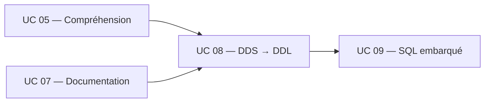

# UC 08 — Conversion DDS → DDL

> **Catégorie :** Modernisation base de données
>
> **Priorité dans le parcours :** 8 — premier UC de la Phase 2, prérequis de UC 09
>
> **Mode Bob recommandé :** IBM i Developer (Premium Package IBM i) pour le Prompt 0 (qualification), puis **bascule en IBM i Database dès le Prompt 0-bis** et pour tous les prompts suivants (1 à 6, dont `/erd`) — voir le tableau de bascule dans « Démarrer une session Bob ».

---

## ⭐ Premium Package IBM i utilisé

- **Slash Command : `/erd`** → [Documentation officielle](https://bob.ibm.com/docs/ide/premium-packages/bob-for-i/slash-commands)
  Utilisée **après la migration** pour valider que la structure DDL créée correspond aux relations attendues. Interroge `QSYS2.SYSTABLES`, `QSYS2.SYSCOLUMNS`, `QSYS2.SYSCST` et `QSYS2.SYSREFCST` et génère le diagramme ERD Mermaid des tables SQL créées (détail : UC00 §3.2).
- **Skills auto-activées :**
  - `db2-dds-to-ddl` — migration DDS → DDL SQL : tables, vues, stratégies de conversion
  - `db2-ddl-generation` — syntaxe DDL : colonnes, contraintes PK, FK, CHECK, UNIQUE, index, vues
  - `dds-physical-files` — fichiers physiques PF : spécifications de champs, clés, formats d'enregistrement
  - `dds-logical-files` — fichiers logiques LF : jointures, SELECT/OMIT, champs dérivés
  - `dds-primer-basics` — fondamentaux DDS pour lire et interpréter les sources DDS
  - `db2-dds-understanding` — lecture des fichiers DDS historiques : PF, LF et chemins d'accès clés
  - `db2-system-catalog` — catalogues QSYS2 pour la validation post-création
  - `db2-journaling-commitment` — journal et contrôle d'engagement (statut de journalisation du Prompt 0-bis)
  - `db2-security-best-practices` — modèles d'autorité et privilèges SQL (autorités à recréer, Prompt 0-bis)

> Les skills DDS et DDL s'activent automatiquement dès que Bob lit un fichier source DDS ou génère un `CREATE TABLE`. La commande `/erd` s'exécute **en mode IBM i Database** après la création des tables — elle valide le résultat, elle ne remplace pas les prompts de conversion.

> Selon UC00 §4, `db2-ddl-generation`, `db2-dds-understanding` et `db2-journaling-commitment` sont **réservées au mode IBM i Database** : elles ne s'activent pas en mode IBM i Developer. Pour les prompts qui les listent, basculer en IBM i Database. Aucun workflow n'est mobilisé par cet UC ; outils IBM i, RAG et garde-fous : voir UC00 §5.

---

## Objectif

Convertir les **fichiers physiques (PF) et fichiers logiques (LF) DDS** d'IBM i en **instructions DDL SQL** (`CREATE TABLE`, `CREATE INDEX`, `CREATE VIEW`) conformes à Db2 for i.

**UC 08 est le point d'entrée de la Phase 2 — Modernisation de la couche base de données.** Il précède UC 09 (SQL embarqué) car les requêtes SQL d'UC 09 doivent cibler des tables DDL correctement typées. Convertir les accès avant d'avoir converti les structures revient à écrire des requêtes contre des cibles mal définies.

**Ce UC diffère d'UC 07 (Documentation) sur un point fondamental :** UC 07 documente ce qui existe pour comprendre et conserver. UC 08 produit du code exécutable destiné à **remplacer** les définitions DDS — il porte un risque d'exécution réel. Chaque DDL généré doit être relu et testé avant tout usage en production.

**Livrable attendu :** des scripts DDL SQL (`CREATE TABLE` + `CREATE INDEX` + optionnellement `CREATE VIEW`) pour chaque PF/LF converti, avec commentaires de traçabilité, validés par `/erd` après création, prêts à être soumis sur l'IBM i de test.

---

## Prérequis

- **Phase :** Phase 2 — Modernisation base de données
- **UC précédents requis :** UC 05 — Compréhension de code, UC 07 — Documentation complète (recommandé)
- **Livrables requis :**
  - `{appId}-comprehension-{composant}-report-{YYYYMMDD-HHmm}.md` — rapports de compréhension UC 05 (liste des PF/LF utilisés par chaque programme)
  - `{appId}-doc-spec-tech-{YYYYMMDD-HHmm}.md` — inventaire des objets UC 07 (recommandé — identifie les PF partagés et leur criticité)
  - `{appId}-doc-matrice-{YYYYMMDD-HHmm}.md` — matrice de références croisées UC 07 (recommandé)
- **Niveau Bob recommandé :** Intermédiaire
- **Bob Coins estimés :** ⚠️ *À calibrer après le lab UC 08 sur FLGHT400.*

> ⚠️ **Prérequis bloquant :** ne pas démarrer UC 08 sur un PF critique sans avoir la matrice de références croisées (`*-doc-matrice-*.md`) d'UC 07 — elle identifie les PF partagés par de nombreux programmes et donc les fichiers à traiter avec le Prompt 0-bis.

> ⚠️ **Un DBA ou développeur senior doit être disponible** pour trancher les décisions de types ambigus (champs pseudo-date, COMP-3, REFLD). Bob identifie les ambiguïtés, mais ne peut pas décider seul.

---

## Exemple concret — Lab FLGHT400

L'application FLGHT403 illustre un cas IBM i typique : **toutes les tables sont des fichiers physiques DDS sans contrainte FK formelle**. Aucune ligne dans `QSYS2.SYSCST` ou `QSYS2.SYSREFCST` — les relations entre `ORDERS`, `AGENTS`, `CUSTOMERS` et `FLIGHTS` sont implicites (champs `AGENT_NO`, `CUSTOMER_NO`, `FLIGHT_NUMBER`).

| Livrable | Fichier lab | Produit par |
|---|---|---|
| ERD post-migration | [`../labs_FLGHT400_results/FLGHT403_erd_report.md`](../labs_FLGHT400_results/FLGHT403_erd_report.md) | `/erd FLGHT403` — tables DDL, colonnes, diagramme Mermaid |
| Diagramme ERD seul | [`../labs_FLGHT400_results/FLGHT403_erd.md`](../labs_FLGHT400_results/FLGHT403_erd.md) | `/erd FLGHT403` |

Ce rapport ERD illustre exactement ce que produit la validation `/erd` après UC 08 : tables découvertes, colonnes et types SQL, diagramme Mermaid des relations déduites. Sur FLGHT403, les 7 tables applicatives (`AGENTS`, `CUSTOMERS`, `AIRLINE`, `FLIGHTS`, `ORDERS`, `FRCITY`, `TOCITY`) correspondent à autant de PF DDS à convertir.

---

## Démarrer par un fichier DDS connu

> **Recommandation forte avant d'aborder les fichiers critiques de l'application.**

Commencer par un **fichier physique que l'équipe connaît bien** — un PF simple, peu de champs, dont la structure est connue d'au moins un développeur capable de valider la sortie de Bob.

Pourquoi ? Parce que la première conversion sert à **calibrer le niveau de précision** :
- Bob produit-il les bons types SQL pour les champs DDS (`6S2` → `DECIMAL(6,2)`, `10A` → `VARCHAR(10)` ou `CHAR(10)`) ?
- La clé primaire est-elle correctement déduite ?
- Les fichiers logiques sont-ils convertis en `CREATE INDEX` ou `CREATE VIEW` selon leur nature ?
- Bob signale-t-il les champs dont le type est ambigu ou les contraintes non exprimables en DDL ?

**Progression recommandée :**

> 💡 Pour chaque fichier, **commencer par le Prompt 0** — il donne la catégorie (SIMPLE / STANDARD / COMPLEXE) et la séquence exacte à suivre. Ne pas aller directement au Prompt 1.

| Étape | Fichier à choisir | Catégorie attendue | Objectif |
|---|---|---|---|
| 1 | PF simple, < 20 champs, clé évidente | SIMPLE | Calibrer la correspondance de types ; vérifier que le Prompt 0 classe correctement |
| 2 | PF métier central avec plusieurs LF associés | STANDARD | Valider la conversion des LF en `CREATE INDEX` et `CREATE VIEW` |
| 3 | PF avec champs spéciaux (dates, zones décimales, COMP) | STANDARD à COMPLEXE | Identifier les cas nécessitant une décision manuelle sur le type SQL cible |
| 4 | PF partagé par de nombreux programmes (matrice UC 07) | COMPLEXE + risque | Valider contre la matrice de références croisées avant toute modification |

---

## Impact de la taille du fichier DDS sur la stratégie de conversion

La taille ne se mesure pas en lignes, mais en **nombre de champs** et en **nombre de LF associés**.

Les vrais facteurs de complexité sont :
- **Champs COMP-3 (packed decimal) ou COMP (binary)** — plusieurs équivalents SQL possibles
- **Champs de date au format numérique** (`8S0` stocké comme `YYYYMMDD`) — à convertir en `DATE` ou laisser en `DECIMAL` selon l'usage
- **LF avec SELECT/OMIT** — `CREATE INDEX` avec filtre ou `CREATE VIEW` selon la nature de l'accès
- **LF multi-format (jointures)** — ne se convertissent pas en index ; deviennent des vues
- **REFLD** (champs référencés depuis un autre fichier) — à résoudre avant toute génération DDL

| Catégorie | Critères | Séquence |
|---|---|---|
| **SIMPLE** | < 20 champs, 1 à 3 LF sans SELECT/OMIT, pas de REFLD | Prompt 0 → Prompt 1 → Prompt 2 → Prompt 3-bis → Prompt 3 (LF) → Prompt 3-bis |
| **STANDARD** | 20 à 50 champs, ou LF simples, ou quelques types ambigus | Prompt 0 → décisions types → Prompt 1 → Prompt 2 → Prompt 3-bis → Prompt 3 → Prompt 3-bis |
| **COMPLEXE** | > 50 champs, ou LF avec SELECT/OMIT, ou REFLD non résolus | Prompt 0 → Prompt 1 complet → décisions → Prompt 2 → Prompt 3-bis → Prompt 3 LF par LF → Prompt 3-bis |

> ⚠️ Un REFLD non résolu produit un `CREATE TABLE` avec des types incorrects — les données pourront être insérées sans erreur mais avec troncature silencieuse.

---

## Démarrer une session Bob

### 1. Nouvelle conversation Bob

Démarrer chaque session dans une **nouvelle conversation Bob** (bouton `+`). Ne pas réutiliser une conversation d'un UC précédent — le contexte accumulé pollue les réponses.

**Mode à sélectionner au démarrage :** `IBM i Developer` (Prompt 0 uniquement)

> ⚠️ Dès le Prompt 0-bis, switcher en **IBM i Database** : ce mode active les outils `execute_sql_statement` et les skills qui lui sont réservées (`db2-ddl-generation`, `db2-dds-understanding`, `db2-journaling-commitment`, cf. UC00 §4).

**Bascule de mode, prompt par prompt :**

| Prompt | Mode | Raison |
|---|---|---|
| Prompt 0 — Qualification | `IBM i Developer` | Lecture du membre DDS ; skills `dds-*` et `db2-dds-to-ddl` |
| Prompt 0-bis — Rapport d'impact | `IBM i Database` | Requêtes SQL (`execute_sql_statement`) ; `db2-journaling-commitment` réservée à ce mode |
| Prompt 1 — Analyse DDS | `IBM i Database` | `db2-dds-understanding` réservée à ce mode |
| Prompts 2, 3 et 4 — Génération DDL | `IBM i Database` | `db2-ddl-generation` réservée à ce mode |
| Prompt 3-bis — Test de création | `IBM i Database` | Exécution du DDL via `execute_sql_statement` |
| Prompt 5 — Validation QSYS2 | `IBM i Database` | Requêtes catalogue ; `db2-dds-understanding` réservée à ce mode |
| Prompt 6 — `/erd` | `IBM i Database` | Slash command exécutée en IBM i Database |

### 2. Ouvrir les fichiers sources dans l'éditeur

Avant le Prompt 0, ouvrir dans l'éditeur Bob les fichiers DDS à analyser via le panneau **IBM i — Object Browser** : clic droit sur le membre DDS → **Open in Editor**.

Fichiers à ouvrir pour chaque session UC 08 :
- Le fichier DDS source cible (`[NOM_LIB]/QDDSSRC([NOM_PF_OU_LF])` ou `QDDSSRCD`)
- Les fichiers DDS référencés (`REFLD`) si présents

### 3. Fichiers de contexte à charger

| Fichier | Produit par | Priorité |
|---|---|---|
| `{appId}-comprehension-{composant}-report-{date}.md` | UC 05 | **Recommandé** — liste des PF/LF utilisés par programme |
| `{appId}-doc-spec-tech-{date}.md` | UC 07 | **Recommandé** — inventaire complet des objets et PF partagés |
| `{appId}-doc-matrice-{date}.md` | UC 07 | **Recommandé** — criticité des PF partagés |

> 💡 Si ces fichiers ne sont pas disponibles, UC 08 fonctionne quand même — mais le Prompt 0 ne peut pas identifier les PF partagés à fort risque ni les REFLD entre fichiers hors scope.

> ⚠️ **Risque de compression de contexte :** une session avec plusieurs fichiers STANDARD ou COMPLEXE peut atteindre la limite de contexte. Si Bob semble oublier une décision prise au Prompt 0, sauvegarder le livrable en cours (mode Agent) après chaque prompt majeur. À chaque reprise : "Le fichier [NOM_FICHIER] contient les décisions prises — continuer à partir de [ÉTAPE]."

---

## Prompts

### Prompt 0 — Qualification et choix de stratégie

**Objectif :** produire un rapport de qualification avant toute génération DDL. Identifie la catégorie (SIMPLE / STANDARD / COMPLEXE), les REFLD bloquants, les champs ambigus, et recommande la séquence exacte.

**Quand l'utiliser :** en premier, pour chaque fichier DDS avant toute autre action.

**Espace :** IBM i QSYS (lecture du membre DDS via les outils natifs IBM i)

**Input requis :** membre DDS ouvert dans l'éditeur ou accessible via les outils natifs IBM i.

**Skills clés mobilisées :** `dds-primer-basics`, `dds-physical-files`, `dds-logical-files`, `db2-dds-to-ddl`.

```
Le fichier DDS [NOM_PF_OU_LF] se trouve dans [NOM_LIB]/QDDSSRC (ou QDDSSRCD).

Analyse ce fichier DDS et produis en français, en markdown,
un rapport de qualification pour la conversion DDL :

## Qualification UC 08 — [NOM_PF_OU_LF]

### 1. Inventaire rapide
| Indicateur                                      | Valeur        |
|-------------------------------------------------|---------------|
| Type d'objet                                    | PF / LF       |
| Nombre de champs                                | ?             |
| Nombre de fichiers logiques (LF) associés       | ? (si PF)     |
| Présence de REFLD                               | OUI / NON     |
| Présence de champs COMP-3 ou COMP               | OUI / NON     |
| Présence de champs date numériques (ex. 8S0)    | OUI / NON     |
| LF avec SELECT/OMIT                             | OUI / NON / ? |
| LF multi-format (jointure de PF)                | OUI / NON / ? |

### 2. Facteurs de complexité détectés
Réponds par OUI / NON / À CONFIRMER pour chaque facteur :
- [ ] REFLD non résolvables depuis ce seul fichier (fichier référencé hors scope)
- [ ] Champs dont le type SQL est ambigu (date numérique, COMP-3, binaire, champ très long)
- [ ] LF avec SELECT/OMIT nécessitant une CREATE VIEW plutôt qu'un CREATE INDEX
- [ ] LF multi-format (jointure) → CREATE VIEW avec JOIN complexe
- [ ] Contraintes DDS sans équivalent DDL (ALWNULL implicite, COLHDG, COMP)
- [ ] PF référencé par plusieurs programmes (criticité élevée — matrice UC 07)

### 3. REFLD à résoudre avant conversion
Si des REFLD sont présents, lister chaque champ référencé :
| Nom champ | Fichier référencé     | Champ source       | Type SQL à utiliser |
|-----------|-----------------------|--------------------|---------------------|
| [CHAMP]   | [NOM_FICHIER_REF]     | [NOM_CHAMP_SOURCE] | ? (à résoudre)      |

Si le fichier référencé n'est pas dans le scope actuel :
→ Signaler le blocage — résoudre via QSYS2.SYSCOLUMNS avant de continuer.

### 4. Champs ambigus — décisions requises
Pour chaque champ dont le type SQL est ambigu :
| Nom champ | Type DDS | Usage probable    | Type SQL recommandé   | Décision requise |
|-----------|----------|-------------------|-----------------------|------------------|
| [CHAMP]   | 8S0      | Date de création? | DATE ou DECIMAL(8,0)  | À confirmer      |

### 5. Catégorie et stratégie recommandée
Sur la base de l'inventaire, conclure :

**Catégorie :**
- [ ] SIMPLE — ≤ 20 champs, 1 à 3 LF sans SELECT/OMIT, pas de REFLD, pas de type ambigu
- [ ] STANDARD — 20 à 50 champs, ou LF simples, ou quelques types ambigus
- [ ] COMPLEXE — > 50 champs, ou LF avec SELECT/OMIT / jointure, ou REFLD non résolus

**Recommandation :**
- SIMPLE   → Séquence directe : Prompt 1 → Prompt 2 → Prompt 3-bis → Prompt 3 (LF) → Prompt 3-bis
- STANDARD → Résoudre les ambiguïtés d'abord, puis : Prompt 1 → Prompt 2 avec décisions → Prompt 3-bis → Prompt 3 → Prompt 3-bis
- COMPLEXE → Analyse en deux passes : Prompt 1 complet → décisions de types → Prompt 2 avec décisions → Prompt 3-bis → Prompt 3 LF par LF → Prompt 3-bis

Signale clairement les REFLD bloquants et les décisions de types qui doivent être prises
par un DBA ou développeur senior avant de continuer.
```

**Livrable produit :** `{appId}-ddl-{composant}-analyse-dds-{YYYYMMDD-HHmm}.md`

> 💡 Sauvegarder ce rapport dès la fin du Prompt 0 (mode Agent). Le Prompt 1 le complètera.

> ⚠️ **Piège évité :** sans le Prompt 0, les REFLD bloquants et les LF complexes se découvrent en milieu d'analyse — la session doit être interrompue. Le Prompt 0 déplace cette découverte au tout début (2 minutes vs 1 heure perdue).

---

### Prompt 0-bis — Rapport d'impact pré-migration

> **Ce prompt est recommandé sur tout PF classé STANDARD ou COMPLEXE** par le Prompt 0, et sur tout PF référencé par de nombreux programmes (matrice UC 07). Facultatif sur les PF SIMPLE.

> ⚠️ **Mode IBM i Database requis** — ce prompt exécute des requêtes SQL. Switcher en IBM i Database avant de le lancer.

**Objectif :** produire un rapport d'impact complet — journalisation, autorités, verrous, programmes référenceurs — à valider **avant** de générer le DDL.

**Espace :** IBM i QSYS + Local (exécution SQL sur IBM i, rapport sauvegardé localement)
**Skills clés mobilisées :** `db2-system-catalog`, `db2-journaling-commitment`, `db2-security-best-practices`.

```
Le fichier physique [NOM_PF] dans la bibliothèque [NOM_LIB] est décrit en DDS.
Nous allons procéder à sa conversion en table SQL DDL.

Avant de générer le DDL, produis un rapport d'impact pré-migration complet en markdown.
Ce rapport doit couvrir :

### 1. DDL équivalent via GENERATE_SQL
Appelle QSYS2.GENERATE_SQL pour [NOM_LIB].[NOM_PF] et montre le CREATE TABLE généré.

### 2. Références statiques des programmes (DSPPGMREF)
Interroge QTEMP/PGMREF (via DSPPGMREF sur toutes les bibliothèques de la Library List)
pour lister les programmes qui référencent [NOM_PF]. Pour chaque programme :
| Bibliothèque | Programme | Type d'accès (lecture / écriture / mise à jour) |

### 3. Objets dépendants (vues, index, LF)
Interroge SYSTOOLS.RELATED_OBJECTS pour [NOM_LIB].[NOM_PF].
Liste tous les objets dépendants (LF, vues SQL, index).

### 4. Statut de journalisation
Interroge QSYS2.JOURNALED_OBJECTS pour [NOM_LIB].[NOM_PF].
Si journalisé : journal, récepteur courant, type de journalisation.
⚠️ La table SQL de remplacement doit répliquer exactement ce paramétrage.

### 5. Verrous actifs
Interroge QSYS2.OBJECT_LOCK_INFO pour [NOM_LIB].[NOM_PF].
Si des verrous sont actifs : ne pas modifier l'objet sans coordination avec l'équipe.

### 6. Autorités
Interroge QSYS2.OBJECT_PRIVILEGES pour [NOM_LIB].[NOM_PF].
Liste les autorités PUBLIC et spécifiques par utilisateur/groupe.
⚠️ Ces autorités doivent être recréées sur la table SQL après migration (GRANT).

### 7. Note RRN
Si des programmes accèdent au fichier par numéro de record relatif (RRN),
la table SQL de remplacement doit avoir REUSEDLT(*NO) (valeur par défaut — à confirmer).

Sauvegarde ce rapport dans le workspace sous le nom :
{appId}-ddl-{composant}-impact-{YYYYMMDD-HHmm}.md
```

**Livrable produit :** `{appId}-ddl-{composant}-impact-{YYYYMMDD-HHmm}.md`

> 💡 Ce rapport est la liste de contrôle pour la phase de validation post-création (Prompt 5 et `/erd`). Sauvegarder avant de continuer.

---

### Prompt 1 — Analyse préalable d'un fichier DDS

**Objectif :** produire la feuille de travail champ par champ avec les types SQL proposés, avant toute génération DDL.

**Espace :** IBM i QSYS (lecture DDS via les outils natifs IBM i)
**Skills clés mobilisées :** `dds-physical-files`, `dds-logical-files`, `db2-dds-to-ddl`, `db2-dds-understanding`.

```
Le fichier DDS [NOM_PF_OU_LF] se trouve dans [NOM_LIB]/QDDSSRC (ou QDDSSRCD).

Analyse ce fichier DDS et réponds en français en markdown :

1. Type d'objet DDS : fichier physique (PF) ou fichier logique (LF)
2. Rôle fonctionnel supposé : ce que représente chaque enregistrement (1 à 3 phrases)
3. Liste de tous les champs :
   | Nom champ | Type DDS | Long. | Déc. | Texte / Libellé DDS | Type SQL proposé | Remarque |
4. Clé primaire : champs composant la clé, dans l'ordre
5. Si fichier logique :
   - Fichier(s) physique(s) de base
   - Clé du LF et critères de tri
   - Clauses SELECT/OMIT si présentes
   - Nature de conversion recommandée : CREATE INDEX ou CREATE VIEW ? Pourquoi ?
6. Champs dont la conversion SQL est ambiguë ou nécessite une décision :
   (ex. champ date numérique, COMP-3, REFLD non résolu, champ très long)
7. Contraintes DDS sans équivalent DDL direct :
   (ex. COMP, ALWNULL implicite, COLHDG, ALIAS)

Ne pas générer le DDL dans ce prompt.
Signale clairement ce que tu ne peux pas déterminer depuis le seul source DDS.
```

> ⚠️ **Piège évité :** sans la distinction explicite PF/LF, Bob peut proposer un `CREATE TABLE` pour un fichier logique — une erreur qui crée une table redondante sans remplacer l'index d'origine.

---

### Prompt 2 — Génération du CREATE TABLE (fichier physique)

**Objectif :** générer le script DDL `CREATE TABLE` sur la base de l'analyse du Prompt 1, en intégrant les décisions prises sur les types ambigus.

**Espace :** Local (génération dans le chat, sauvegarde workspace)
**Skills clés mobilisées :** `db2-dds-to-ddl`, `db2-ddl-generation`, `dds-physical-files`.

```
Sur la base de l'analyse du fichier physique [NOM_PF] que nous venons de faire,
génère le script DDL SQL CREATE TABLE pour Db2 for i, en français dans les commentaires,
en prenant en compte les décisions suivantes :
[Lister ici les décisions de types prises lors de l'analyse Prompt 1]

Structure attendue du script :

-- ============================================================
-- TABLE : [NOM_LIB].[NOM_TABLE]
-- Fichier DDS d'origine : [NOM_LIB]/QDDSSRC([NOM_PF])
-- Converti le : [DATE]
-- Statut : À valider et tester sur IBM i de test avant tout usage production
-- ============================================================

CREATE OR REPLACE TABLE [NOM_LIB].[NOM_TABLE] (
  -- [NOM_CHAMP]  [TYPE_SQL]  [NULL/NOT NULL]  -- [LIBELLÉ DDS ORIGINAL]
  ...
  CONSTRAINT [NOM_TABLE]_PK PRIMARY KEY ([CHAMPS_CLE])
)
;

Règles de conversion à respecter :
- Utiliser les types SQL Db2 for i natifs : CHAR, VARCHAR, DECIMAL, INTEGER, SMALLINT, DATE, TIME, TIMESTAMP
- Champs alphanumériques courts (≤ 30) : CHAR(n)
- Champs alphanumériques longs (> 30) ou texte libre : VARCHAR(n)
- Zones décimales zoned (DDS type S) : NUMERIC(long, déc) ; zones décimales packed (DDS type P) : DECIMAL(long, déc)
- Ne pas inventer de contraintes non visibles dans le DDS source
- Conserver les libellés DDS originaux en commentaire de chaque champ
- Si un champ a un ALIAS DDS, l'indiquer en commentaire
- Signaler en commentaire TODO les champs dont la conversion n'est pas certaine
```

**Livrable produit :** `{appId}-ddl-{composant}-table-{YYYYMMDD-HHmm}.md`

> 💡 `CREATE OR REPLACE TABLE` permet de relancer le script en environnement de test sans `DROP TABLE` préalable — moins d'erreurs lors des itérations.

> ⚠️ **Relançable ne veut pas dire sans risque :** `CREATE OR REPLACE TABLE` remplace une table existante. À n'exécuter que dans la bibliothèque de test ([NOM_LIB_TEST]), jamais sur une table de production. Le sort des lignes existantes est régi par la clause `ON REPLACE` (`PRESERVE ALL ROWS`, `PRESERVE ROWS`, `DELETE ROWS` — voir la doc IBM `CREATE TABLE`) : la préciser explicitement si des données de test doivent être conservées, et sauvegarder la table avant tout remplacement. Avant de remplacer, vérifier les dépendances de la table (vues, index SQL, fichiers logiques, programmes — cf. Prompt 0-bis, `SYSTOOLS.RELATED_OBJECTS`) : elles peuvent bloquer ou être impactées par le remplacement.

> ⚠️ **Piège évité :** sans la règle `VARCHAR(n)` pour les champs longs, Bob peut générer des `CHAR(200)` pour du texte libre — gaspillage d'espace et dégradation des performances d'indexation.

---

### Prompt 3 — Génération des CREATE INDEX et CREATE VIEW (fichiers logiques)

**Objectif :** convertir chaque LF en `CREATE INDEX` (tri) ou `CREATE VIEW` (SELECT/OMIT ou jointure).

**Espace :** Local (génération dans le chat, sauvegarde workspace)
**Skills clés mobilisées :** `db2-dds-to-ddl`, `db2-ddl-generation`, `dds-logical-files`.

```
Sur la base de l'analyse des fichiers logiques de [NOM_PF] que nous venons de faire,
génère les scripts DDL pour chaque LF identifié, en respectant les règles suivantes :

Pour chaque LF à convertir en CREATE INDEX :
-- ============================================================
-- INDEX : [NOM_INDEX] sur [NOM_LIB].[NOM_TABLE]
-- Fichier logique DDS d'origine : [NOM_LIB]/QDDSSRC([NOM_LF])
-- Clé : [CHAMPS_CLE_LF]
-- Type : [UNIQUE / non unique]
-- ============================================================

CREATE [UNIQUE] INDEX [NOM_LIB].[NOM_INDEX]
  ON [NOM_LIB].[NOM_TABLE] ([CHAMPS_CLE_LF ASC/DESC])
;

Pour chaque LF à convertir en CREATE VIEW (SELECT/OMIT ou colonnes réduites) :
-- ============================================================
-- VUE : [NOM_VUE] sur [NOM_LIB].[NOM_TABLE]
-- Fichier logique DDS d'origine : [NOM_LIB]/QDDSSRC([NOM_LF])
-- SELECT/OMIT d'origine : [CONDITION_DDS]
-- ============================================================

CREATE OR REPLACE VIEW [NOM_LIB].[NOM_VUE] AS
  SELECT [COLONNES]
  FROM [NOM_LIB].[NOM_TABLE]
  WHERE [CONDITION_SQL_EQUIVALENTE]
;

Règles :
- LF avec tri uniquement (pas de SELECT/OMIT, pas de réduction de colonnes) → CREATE INDEX
- LF avec SELECT/OMIT → CREATE VIEW avec clause WHERE équivalente
- LF multi-format (jointure de PF) → CREATE VIEW avec JOIN — signaler si la jointure est complexe
- Ne pas inventer de colonnes ou de conditions non visibles dans le DDS source
- Signaler en commentaire les cas où la conversion n'est pas directe
```

**Livrable produit :** `{appId}-ddl-{composant}-index-{YYYYMMDD-HHmm}.md`

> ⚠️ **Piège évité :** un LF avec SELECT/OMIT converti en `CREATE INDEX` ne filtre rien — tous les enregistrements sont accessibles, le SELECT/OMIT est perdu silencieusement.

---

### Prompt 3-bis — Test de création DDL sur IBM i de test

> **Ce prompt s'exécute en mode IBM i Database** — Bob exécute le DDL via `execute_sql_statement` (outils natifs IBM i).
> **Quand l'utiliser :** après chaque Prompt 2 (CREATE TABLE) et après chaque Prompt 3 (CREATE INDEX / CREATE VIEW), avant de passer au fichier suivant.

**Espace :** IBM i QSYS (exécution DDL sur IBM i de test)
**Skills clés mobilisées :** `db2-ddl-generation`, `db2-sql-debugging`.

```
Avant d'exécuter le DDL, appelle check_sql_syntax sur le script CREATE TABLE/INDEX/VIEW
généré. Si check_sql_syntax retourne OK, procède à l'exécution.
Si des erreurs de syntaxe sont détectées, corrige-les et relance check_sql_syntax.
N'exécuter sur l'IBM i qu'après validation syntaxique réussie.
```

```
Le script DDL suivant a été généré pour [NOM_PF_OU_LF] dans [NOM_LIB] :

[Coller ici le CREATE TABLE / CREATE INDEX / CREATE VIEW généré au Prompt 2 ou 3]

Exécute ce script sur l'IBM i de test via les outils natifs IBM i (mode IBM i Database).
Bibliothèque cible OBLIGATOIRE : [NOM_LIB_TEST] — jamais [NOM_LIB].
Avant toute exécution :
- remplace dans la copie exécutée toute qualification [NOM_LIB] des objets créés
  (table, index, vue) par [NOM_LIB_TEST] ;
- affiche le script réellement exécuté et confirme qu'aucun objet n'est qualifié [NOM_LIB] ;
- si une référence à [NOM_LIB] subsiste, ne rien exécuter et le signaler.

Analyse le résultat et produis en français :

1. Statut : CRÉATION RÉUSSIE / ERREURS SQL
2. Si erreurs : liste des erreurs avec code SQL et description
   | Code SQL | Description | Objet concerné | Cause probable |
3. Si création réussie : confirmer le nom complet de l'objet créé
   ([NOM_LIB_TEST].[NOM_TABLE_OU_INDEX_OU_VUE])
4. Rappeler que la structure créée doit être validée via le Prompt 5 (QSYS2)
   avant de passer au fichier suivant

Ne pas modifier les données existantes — création de structure uniquement.
```

> 💡 Codes SQL courants : `-601` (objet déjà existant — vérifier que `CREATE OR REPLACE` est bien utilisé), `-204` (table de base introuvable pour un index), `-104` (erreur de syntaxe SQL).

> ⚠️ Ce prompt ne remplace pas la validation fonctionnelle du Prompt 5. Une table créée sans erreur SQL peut avoir des types incorrects ou des champs manquants.

---

### Prompt 4 — Script de migration complet (périmètre applicatif)

**Objectif :** assembler tous les scripts DDL dans l'ordre d'exécution correct pour un périmètre applicatif complet (plusieurs PF + leurs LF).

**Espace :** Local (génération et sauvegarde workspace)
**Skills clés mobilisées :** `db2-dds-to-ddl`, `db2-ddl-generation`.

```
Sur la base de l'analyse et des scripts DDL générés pour le périmètre applicatif
[NOM_APPLICATION] / [NOM_LIB], génère un script de migration SQL complet en français,
en markdown, regroupant tous les CREATE TABLE, CREATE INDEX et CREATE VIEW
dans le bon ordre d'exécution.

Structure du script de migration :

-- ============================================================
-- SCRIPT DE MIGRATION DDS → DDL
-- Application : [NOM_APPLICATION]
-- Bibliothèque : [NOM_LIB]
-- Périmètre : [liste des PF/LF couverts]
-- Date : [DATE]
-- Statut : ⚠️ À valider et tester sur IBM i de test avant tout usage
-- ============================================================

-- SECTION 1 : TABLES (fichiers physiques)
-- Ordre : tables indépendantes d'abord, tables avec dépendances ensuite
[CREATE TABLE ...]

-- SECTION 2 : INDEX (fichiers logiques avec tri)
[CREATE INDEX ...]

-- SECTION 3 : VUES (fichiers logiques avec SELECT/OMIT ou jointure)
[CREATE VIEW ...]

Règles d'ordre :
- Les index doivent suivre leurs tables
- Les vues de jointure doivent suivre toutes leurs tables sources

Inclure en fin de script un tableau récapitulatif :
| Objet DDS original | Type DDS | Objet SQL créé | Type SQL | Statut |
```

**Livrable produit :** `{appId}-ddl-{appId}-complet-{YYYYMMDD-HHmm}.md`

> 💡 Ce script est l'input direct de UC 09 (SQL embarqué) — les noms de tables et d'index générés ici sont les cibles des requêtes SQL produites en UC 09. S'assurer que ce fichier est présent et validé avant de démarrer UC 09.

---

### Prompt 5 — Validation croisée avec QSYS2

**Objectif :** valider que les structures créées sur IBM i correspondent bien aux DDS d'origine.

> **Ce prompt s'exécute après l'exécution du script DDL** — en mode IBM i Database.

**Espace :** IBM i QSYS + Local
**Skills clés mobilisées :** `db2-system-catalog`, `db2-dds-understanding`.

```
Les tables suivantes ont été créées dans la bibliothèque de test [NOM_LIB_TEST] à partir du
script DDL que nous avons généré : [NOM_TABLE1], [NOM_TABLE2], ...

Utilise les outils natifs IBM i (mode IBM i Database) pour valider la création,
toutes les requêtes ciblent [NOM_LIB_TEST] (et non [NOM_LIB]) :
1. Pour chaque table : vérifie que QSYS2.SYSCOLUMNS retourne bien tous les champs attendus
   avec les types SQL corrects
2. Compare le nombre de champs entre le DDS d'origine et la table créée :
   SELECT COUNT(*) FROM QSYS2.SYSCOLUMNS WHERE TABLE_SCHEMA = '[NOM_LIB_TEST]' AND TABLE_NAME = '[NOM_TABLE]'
3. Vérifie que les index SQL ont été créés :
   SELECT INDEX_SCHEMA, INDEX_NAME, IS_UNIQUE, COLUMN_COUNT
   FROM QSYS2.SYSINDEXES
   WHERE TABLE_SCHEMA = '[NOM_LIB_TEST]' AND TABLE_NAME = '[NOM_TABLE]'
   (colonnes de clé : QSYS2.SYSKEYS par INDEX_SCHEMA + INDEX_NAME)
4. Signale toute différence entre le DDS source et la structure SQL créée

Ne pas modifier les objets créés — se limiter à la validation.
```

> 💡 Ce prompt peut être exécuté en mode **IBM i Database** avec les outils natifs IBM i. Bob interroge `QSYS2` et compare les résultats au DDS d'origine analysé en Prompt 1.

> ⚠️ **Piège évité :** ne pas se contenter du succès du `CREATE TABLE` — une table peut être créée avec succès mais avec un champ en moins si un type non reconnu a été silencieusement ignoré.

---

### Prompt 6 — Validation post-migration avec `/erd` ⭐ Premium

> **Slash command Premium — exécuter en mode IBM i Database après le Prompt 5.**
> C'est la validation finale UC 08 : le diagramme ERD confirme visuellement que la structure DDL créée est cohérente.

**Objectif :** générer le diagramme ERD des tables SQL créées et vérifier que les relations correspondent aux attentes.

**Espace :** IBM i QSYS (interrogation des catalogues Db2 for i)
**Skills clés mobilisées :** `db2-system-catalog`.

```
/erd [NOM_LIB]
```

Bob interroge `QSYS2.SYSTABLES`, `QSYS2.SYSCOLUMNS`, `QSYS2.SYSCST` et `QSYS2.SYSREFCST` et génère le diagramme ERD Mermaid.

**Analyser le résultat :**
- Toutes les tables migrées apparaissent-elles dans le diagramme ?
- Les colonnes ont-elles les bons types SQL ?
- Les relations déduites (depuis les noms de colonnes) correspondent-elles aux LF d'origine ?
- Des contraintes FK formelles sont-elles maintenant définies ? (Sur IBM i legacy, la réponse est souvent non — c'est attendu, comme sur FLGHT403.)

**Livrable produit :** `{appId}-ddl-{appId}-erd-{YYYYMMDD-HHmm}.md`

> 💡 **Exemple FLGHT403 :** le rapport ERD [`../labs_FLGHT400_results/FLGHT403_erd_report.md`](../labs_FLGHT400_results/FLGHT403_erd_report.md) montre le résultat attendu : 7 tables applicatives, aucune FK formelle (`QSYS2.SYSCST` vide), relations déduites depuis les champs communs. C'est la norme pour un parc IBM i legacy converti depuis DDS.

---

## Livrables de cet UC

| Fichier produit | Pattern de nommage | Consommé par |
|---|---|---|
| Rapport de qualification DDS | `{appId}-ddl-{composant}-analyse-dds-{date}.md` | Ce fichier lui-même (reprise de session) |
| Rapport d'impact pré-migration | `{appId}-ddl-{composant}-impact-{date}.md` | Prompt 5 (liste de contrôle) |
| Script CREATE TABLE | `{appId}-ddl-{composant}-table-{date}.md` | Prompt 4 (assemblage) |
| Script CREATE INDEX/VIEW | `{appId}-ddl-{composant}-index-{date}.md` | Prompt 4 (assemblage) |
| Script de migration complet | `{appId}-ddl-{appId}-complet-{date}.md` | **UC 09 (SQL embarqué) — input obligatoire** |
| Rapport ERD post-migration | `{appId}-ddl-{appId}-erd-{date}.md` | UC 09 (validation du modèle de données) |

---

## Dépendances



---

## Référence rapide — Correspondance de types DDS → SQL

| Type DDS | Signification | Type SQL Db2 for i recommandé | Cas particuliers |
|---|---|---|---|
| `nA` | Alphanumérique (n caractères) | `CHAR(n)` si n ≤ 30 ; `VARCHAR(n)` si n > 30 | Texte libre : toujours `VARCHAR` |
| `nS d` | **Zoned decimal** (n chiffres, d décimales) — position 35 = `S` | `NUMERIC(n, d)` (le catalogue `SYSCOLUMNS.DATA_TYPE` = `NUMERIC` désigne le zoné) | `nS 0` : `INTEGER` ou `BIGINT` possible pour un compteur, **uniquement après validation par le DBA** |
| `nP d` | **Packed decimal** (n chiffres, d décimales) — position 35 = `P` | `DECIMAL(n, d)` (`DATA_TYPE` = `DECIMAL` désigne le packed) | S et P sont deux types distincts : ne pas les confondre lors de la conversion |
| `nB` | Binary (entier binaire) | `SMALLINT` (n ≤ 4) ou `INTEGER` (n ≤ 9) | Vérifier l'usage avant de choisir |
| `nL` | Date (format ISO/JUL/MDY…) | `DATE` | Vérifier le format DATFMT du fichier |
| `nT` | Time | `TIME` | — |
| `nZ` | Timestamp | `TIMESTAMP` | — |
| `nA` (8 chars) utilisé comme date | Pseudo-date YYYYMMDD | `CHAR(8)` avec commentaire | Ne pas forcer `DATE` sans valider |
| `REFLD(champ, fichier)` | Référence à un autre champ | Résoudre la référence → copier le type | Toujours résoudre avant génération |

> 💡 Ce tableau peut être collé dans un prompt Bob pour lui donner la grille de conversion — évite que Bob invente ses propres équivalences.

---

## Requêtes QSYS2 utiles

```sql
-- Structure d'un fichier après création
SELECT COLUMN_NAME, DATA_TYPE, LENGTH, NUMERIC_SCALE,
       IS_NULLABLE, COLUMN_TEXT, COLUMN_HEADING
FROM QSYS2.SYSCOLUMNS
WHERE TABLE_SCHEMA = '[NOM_LIB]' AND TABLE_NAME = '[NOM_PF]'
ORDER BY ORDINAL_POSITION;

-- Fichiers logiques (LF) basés sur un PF
-- (SYSTABLES.BASE_TABLE_NAME n'est renseigné que pour les alias : utiliser SYSFILES)
SELECT F.TABLE_SCHEMA, F.TABLE_NAME, F.SYSTEM_TABLE_NAME, F.NATIVE_TYPE
FROM QSYS2.SYSFILES F,
     JSON_TABLE(F.BASED_ON_FILES, 'lax $.BASED_ON_FILES'
                COLUMNS(LIBRARY CHAR(10), FILE CHAR(10))) B
WHERE F.NATIVE_TYPE = 'LOGICAL'
  AND B.LIBRARY = '[NOM_LIB]' AND B.FILE = '[NOM_PF]';

-- Colonnes de clé d'un index SQL (CREATE INDEX)
SELECT COLUMN_NAME, COLUMN_POSITION, ORDERING
FROM QSYS2.SYSKEYS
WHERE INDEX_SCHEMA = '[NOM_LIB]' AND INDEX_NAME = '[NOM_INDEX]'
ORDER BY COLUMN_POSITION;

-- Contraintes PRIMARY KEY / UNIQUE d'une table et leurs colonnes
SELECT CONSTRAINT_NAME, COLUMN_NAME, ORDINAL_POSITION
FROM QSYS2.SYSKEYCST
WHERE TABLE_SCHEMA = '[NOM_LIB]' AND TABLE_NAME = '[NOM_TABLE]'
ORDER BY CONSTRAINT_NAME, ORDINAL_POSITION;

-- Index SQL sur une table (après création DDL)
SELECT INDEX_SCHEMA, INDEX_NAME, IS_UNIQUE, COLUMN_COUNT
FROM QSYS2.SYSINDEXES
WHERE TABLE_SCHEMA = '[NOM_LIB]' AND TABLE_NAME = '[NOM_TABLE]';

-- Vérifier les triggers sur un PF (avant conversion production)
SELECT TRIGGER_NAME, EVENT_MANIPULATION, ACTION_TIMING
FROM QSYS2.SYSTRIGGERS
WHERE EVENT_OBJECT_SCHEMA = '[NOM_LIB]'
  AND EVENT_OBJECT_TABLE  = '[NOM_PF]';
```

> ⚠️ `SYSINDEXES` et `SYSKEYS` ne couvrent que les **index SQL** (`CREATE INDEX`). Les clés et chemins d'accès DDS natifs (clé d'un PF, clé d'un LF) n'y apparaissent pas : les lister avec `DSPFD`/`DSPDBR` (le nombre de champs clés est dans `QSYS2.SYSFILES.NUMBER_KEY_FIELDS`).

---

## Pièges à éviter

| Piège | Ce qui se passe | Comment l'éviter |
|---|---|---|
| Sauter le Prompt 0 sur un fichier COMPLEXE | REFLD bloquants et LF complexes découverts en milieu d'analyse | Toujours lancer le Prompt 0 en premier — 2 minutes évitent 1 heure perdue |
| Confondre PF et LF | Un LF est converti en `CREATE TABLE` — table redondante, index perdu | Le Prompt 0 identifie le type dès l'inventaire rapide |
| Ne pas résoudre les REFLD avant la génération | DDL avec types erronés — troncature silencieuse à l'insertion | Le Prompt 0 liste les REFLD bloquants dans la section 3 |
| Ignorer les champs pseudo-date (`8S0`) | Champ en `DECIMAL(8,0)` alors que l'usage est une date | Le Prompt 0 liste ces champs dans la section 4 |
| Convertir un LF SELECT/OMIT en `CREATE INDEX` | L'index ne filtre rien — tous les enregistrements accessibles | Pour tout LF avec SELECT/OMIT : `CREATE VIEW` avec clause `WHERE` |
| Générer le DDL sans en-tête de traçabilité | Impossible de retrouver le DDS d'origine 3 mois plus tard | Toujours inclure l'en-tête avec fichier DDS d'origine, date et statut |
| Exécuter le `CREATE TABLE` en production sans test | Erreur de type ou champ manquant découvert lors du chargement de données | Utiliser le Prompt 3-bis sur IBM i de test — obligatoire avant production |
| Ne pas lancer `/erd` après migration | Validation visuelle manquante — incohérences structurelles non détectées | Le Prompt 6 (`/erd`) est la validation finale — ne pas sauter |
| Démarrer UC 09 sans le script DDL complet validé | Les requêtes SQL d'UC 09 ciblent des tables mal définies | Vérifier que `*-ddl-{appId}-complet-*.md` est présent et validé avant UC 09 |

---

## Check-list de validation UC 08

Avant de passer à UC 09, valider chaque point :

- [ ] L'inventaire des PF/LF à convertir est complet — vérifié contre `QSYS2.SYSTABLES` et les fichiers `*-doc-spec-tech-*.md` d'UC 07
- [ ] **Pour chaque fichier DDS converti : le Prompt 0 a été exécuté** — rapport `{appId}-ddl-{composant}-analyse-dds-*.md` produit avec la catégorie et la stratégie retenue
- [ ] Tous les REFLD bloquants identifiés ont été résolus avant la génération DDL
- [ ] Les champs ambigus ont été soumis à décision par un développeur senior — choix documentés dans le fichier analyse
- [ ] Chaque PF a un script `CREATE TABLE` généré, relu et testé (Prompt 3-bis)
- [ ] Chaque LF a été converti en `CREATE INDEX` ou `CREATE VIEW` selon sa nature — choix justifié
- [ ] Le script de migration complet est produit et sauvegardé : `{appId}-ddl-{appId}-complet-*.md`
- [ ] Le script a été exécuté sur l'IBM i de test — sans erreur SQL
- [ ] La validation QSYS2 (Prompt 5) ne signale aucun écart entre DDS d'origine et tables créées
- [ ] La commande `/erd` a été exécutée après migration — rapport sauvegardé
- [ ] Le tableau récapitulatif DDS → SQL (Prompt 4) est complet

---

## Points à compléter avant passage en production

### Triggers natifs IBM i (`ADDPFTRG`)

Certains fichiers physiques ont des triggers définis via `ADDPFTRG` — programmes RPG déclenchés automatiquement lors d'un `INSERT`, `UPDATE` ou `DELETE`. Ces triggers sont attachés à l'objet PF DDS, **pas à la table SQL** créée par UC 08. Résultat : la table SQL se comporte différemment du PF sans aucune erreur visible.

**À faire avant conversion en production :** vérifier l'existence de triggers via `QSYS2.SYSTRIGGERS` (requête dans la section ci-dessus). Si des triggers existent : les recréer sur la table SQL avec `CREATE TRIGGER` DDL.

> ⚠️ **Signal d'alerte :** si après la création de la table SQL des comportements métier disparaissent silencieusement — vérifier en premier lieu les triggers `ADDPFTRG` du PF d'origine.

### Contraintes référentielles (FOREIGN KEY)

UC 08 se limite au schéma DDS → DDL. Les `FOREIGN KEY` ne sont pas générées — elles n'existent pas en DDS. Leur définition est une étape séparée, après validation du modèle de données.

---

## Référence complémentaire

> **Lab 103 — DDS to SQL Conversion Impact Analysis** (dépôt GitHub `bmarolleau/IBM-i-Application-Modernization-with-Bob`, fichier `lab103-premium-dds-to-sql-workflow.md`)

Ce lab illustre UC 08 sur l'application SAMCO : génération du rapport d'impact pré-migration, utilisation de `QSYS2.GENERATE_SQL`, enrichissement du DDL avec contraintes `DEFAULT` et `CHECK`, validation avec `check_sql_syntax`, et exécution après approbation explicite. Pour ce POC, remplacer les noms de bibliothèques et fichiers SAMCO par les équivalents de l'application cible — la logique de prompt est identique. Le Prompt 0-bis de cette fiche est directement inspiré du Step 1 du lab.

---

*UC 08 — Document évolutif à mettre à jour au fil du POC.*
