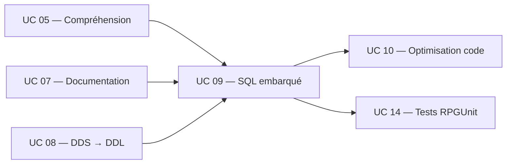

# UC 09 — Accès natif base de données → SQL embarqué

> **Catégorie :** Modernisation base de données
>
> **Priorité dans le parcours :** 9 — suit UC 08 (tables DDL cibles connues)
>
> **Mode Bob recommandé :** IBM i Developer (analyse du code RPG) → puis IBM i Database (génération SQL embarqué et compilation). Les deux modes du Premium Package IBM i. Sans Premium Package : Ask pour l'analyse/génération, Agent pour la compilation et la sauvegarde.

---

## ⭐ Premium Package IBM i utilisé

- **Workflow : SQL Index Strategy Advisor** (partiel) → [Documentation officielle](https://bob.ibm.com/docs/ide/premium-packages/bob-for-i/workflows)
  Analyse les données de performance SQL de Db2 for i (recommandations Index Advisor, MTI, statistiques d'exécution ; capture de nouvelles données, snapshots de Plan Cache ou moniteur de base de données) et propose des index soumis à approbation sélective. À utiliser en complément du Prompt 5 (plan de conversion périmètre) ou après le Prompt 4 pour valider la stratégie d'index sur les curseurs générés (une fois une charge SQL réelle disponible).
  **Lancement :** mode IBM i Database → bouton **Start Workflow** en haut du chat → workspace **Library List** (seul workspace supporté par ce workflow) → *SQL Index Strategy Advisor*. Détail : UC00 §1.2.
- **Slash Command : `/review_SQL`** → [Documentation officielle](https://bob.ibm.com/docs/ide/premium-packages/bob-for-i/slash-commands)
  Revue complète d'une requête SQL ou d'un membre source contenant du SQL : syntaxe, lisibilité, sécurité, performances SQE, possibilités de refactorisation. Utiliser en complément du Prompt 2 et du Prompt 3 pour valider les requêtes générées avant compilation.
- **Skills auto-activées :**
  - `rpg-rla-to-sql` — conversion de l'accès RLA vers le SQL embarqué pour améliorer les performances
  - `rpg-embedded-sql` — SQL embarqué : opérations de curseur, variables hôtes, différences de compilation
  - `rpg-sql-cursor` — déclaration de curseurs SQL, curseurs scrollables, traitement multiligne
  - `db2-sql-primer` — fondamentaux SQL Db2 for i : CRUD, jointures, agrégats
  - `db2-sql-optimization` — réécriture des requêtes, ordre des jointures, predicate pushdown, utilisation des index
  - `db2-index-strategy` — types d'index Binary Radix et EVI, syntaxe, sélection et maintenance
  - `db2-sql-stored-procedure-performance` — bonnes pratiques SQL PL haute performance dans les procédures stockées, fonctions et déclencheurs (si la conversion s'appuie sur une procédure SQL)

> Le mode **IBM i Developer** s'utilise pour l'analyse du source RPG (Prompts 0 et 1). Le mode **IBM i Database** s'utilise pour la génération SQL (Prompts 2, 3 et 4) ; le Prompt 2-bis (compilation) repasse en IBM i Developer. Cette bascule de mode est la particularité de UC 09 (UC 10 la reprend pour sa partie SQL) : elle mobilise les **deux modes IBM i Premium** sur une même session.

---

## Objectif

Remplacer les **accès natifs aux fichiers IBM i** (`CHAIN`, `READ`, `READE`, `READP`, `SETLL`, `SETGT`, `WRITE`, `UPDATE`, `DELETE`…) par des **instructions SQL embarqué** (`EXEC SQL SELECT`, `INSERT`, `UPDATE`, `DELETE`, curseurs) dans les programmes RPG.

**Ce UC modernise l'accès aux données, pas la structure.** UC 08 a converti les définitions DDS en tables DDL — UC 09 convertit la façon dont les programmes accèdent à ces tables. Les deux sont complémentaires : un programme converti en SQL embarqué qui cible encore un PF DDS fonctionne techniquement, mais un programme qui accède en SQL à une table mal typée produit des résultats incorrects. **UC 08 d'abord, UC 09 ensuite.**

**Ce UC ne change pas la logique fonctionnelle du programme** — il change uniquement le mécanisme d'accès aux données. Les règles métier restent identiques, les résultats doivent être identiques avant et après conversion. C'est le critère de succès principal.

**Livrable attendu :** pour chaque programme converti — le source RPG modifié avec les accès natifs remplacés par du SQL embarqué, les déclarations de curseurs, la suppression des F-specs des fichiers convertis, et un fichier de traçabilité documentant chaque remplacement effectué.

---

## Prérequis

- **Phase :** Phase 2 — Modernisation base de données
- **UC précédents requis :** UC 08 — DDS → DDL (obligatoire), UC 05 — Compréhension de code (recommandé), UC 07 — Documentation complète (recommandé)
- **Livrables requis :**
  - `{appId}-ddl-{appId}-complet-{YYYYMMDD-HHmm}.md` — script de migration DDL complet UC 08 (**obligatoire** — noms des tables SQL cibles pour les requêtes générées)
  - `{appId}-comprehension-{composant}-report-{YYYYMMDD-HHmm}.md` — rapports de compréhension UC 05 (liste des fichiers accédés et leur nature PF/LF)
  - `{appId}-doc-matrice-{YYYYMMDD-HHmm}.md` — matrice de références croisées UC 07 (programmes partageant les mêmes fichiers)
- **Niveau Bob recommandé :** Intermédiaire à Avancé
- **Bob Coins estimés :** ⚠️ *À calibrer après le lab UC 09 sur FLGHT400.*

> ⚠️ **Prérequis bloquant :** si `*-ddl-{appId}-complet-*.md` est absent, le Prompt 0 le détecte et bloque la session — compléter UC 08 sur le périmètre avant de continuer.

> ⚠️ **Un développeur RPG doit être disponible** pour valider la non-régression fonctionnelle. La compilation réussie par Bob ne garantit pas un comportement identique — les tests fonctionnels restent irréductibles.

---

## Exemple concret — Lab FLGHT400

L'application FLGHT403 a ses tables DDL disponibles dans [`../labs_FLGHT400_results/FLGHT403_erd_report.md`](../labs_FLGHT400_results/FLGHT403_erd_report.md). Ce rapport ERD post-migration UC 08 montre les tables SQL cibles (`ORDERS`, `FLIGHTS`, `AGENTS`, `CUSTOMERS`…) avec leurs types SQL — c'est l'input exact pour les requêtes SQL embarqué d'UC 09.

Les programmes RPG de FLGHT403 (`QRPGLESRC` dans la bibliothèque) qui accèdent à `ORDERS` via `CHAIN ORDER_NUMBER` deviennent, après UC 09, des `EXEC SQL SELECT ... INTO ... FROM FLGHT403.ORDERS WHERE ORDER_NUMBER = :var`.

> 💡 Pas encore de lab UC 09 disponible sur FLGHT400 — les livrables (`*-sql-embarque-*.md`) seront produits lors du lab UC 09.

---

## Démarrer par un programme que vous connaissez

> **Recommandation forte avant d'aborder les programmes critiques de l'application.**

Commencer par un **programme simple avec peu d'accès natifs** — idéalement un programme dont un développeur de l'équipe connaît la logique et peut valider que le comportement après conversion est identique.

Pourquoi ? La première conversion sert à **calibrer deux choses** :
- La qualité de la traduction opcode → SQL par Bob (est-ce que `CHAIN` sur clé composite devient bien un `SELECT ... WHERE champ1 = :var1 AND champ2 = :var2` ?)
- La capacité de l'équipe à tester la non-régression (quels jeux de données, quels cas limites valider ?)

**Progression recommandée :**

> 💡 Pour chaque programme, **commencer par le Prompt 0** — il donne la catégorie (SIMPLE / STANDARD / COMPLEXE) et la séquence exacte. Ne pas aller directement au Prompt 1.

| Étape | Programme à choisir | Catégorie attendue | Objectif |
|---|---|---|---|
| 1 | Programme avec CHAIN et WRITE simples (< 10 accès natifs) | SIMPLE | Calibrer CHAIN → SELECT, WRITE → INSERT ; vérifier que le Prompt 0 classe correctement |
| 2 | Programme avec boucle READ/READE | STANDARD | Valider la conversion en curseur SQL |
| 3 | Programme avec SETLL/READE sur LF | STANDARD à COMPLEXE | Valider que l'index DDL remplace correctement le LF |
| 4 | Programme critique avec accès mixtes (lecture, écriture, mise à jour dans la même transaction) | COMPLEXE | Valider la gestion des transactions SQL et le comportement en erreur |

---

## Impact de la taille du programme sur la stratégie de conversion

La complexité d'UC 09 ne dépend pas du nombre de lignes total du programme, mais du **nombre et de la diversité des opcodes d'accès** et de la **logique de navigation** (boucles imbriquées, lectures conditionnelles, accès multi-fichiers).

Les vrais facteurs de complexité :
- **Boucles SETLL/READ/READE** — navigation séquentielle positionnée : l'équivalent SQL est un curseur avec `ORDER BY` et clause `WHERE` de départ
- **Accès multi-fichiers corrélés** — un `CHAIN` dont la clé vient du résultat d'un `READ` sur un autre fichier : devient un `JOIN` ou des sous-requêtes
- **Verrous explicites** (`LOCK`) — pas d'équivalent direct en SQL embarqué : nécessite une décision de conception (`SELECT ... FOR UPDATE`)
- **Indicateurs de statut** (`%FOUND`, `%EOF`, `%EQUAL`) — à remplacer par des vérifications du `SQLCODE`
- **Sous-fichiers (SUBFILE) alimentés par des boucles de lecture** — la conversion de la boucle de chargement est souvent la partie la plus délicate

| Catégorie | Critères | Séquence |
|---|---|---|
| **SIMPLE** | < 10 accès, aucun facteur de complexité | Prompt 0 → Prompt 1 → Prompt 2 → Prompt 2-bis → Prompt 4 |
| **STANDARD** | 10 à 30 accès, ou boucles simples sans imbrication | Prompt 0 → Prompt 1 → Prompt 2 par groupe → Prompt 2-bis → Prompt 4 |
| **COMPLEXE** | > 30 accès, ou boucles imbriquées, ou accès corrélés, ou verrous | Évaluer UC 11 (restructuration) avant UC 09. Si conversion décidée : Prompt 0 → Prompt 1 → Prompt 3 (curseurs) + Prompt 2 → Prompt 2-bis → Prompt 4 |

> ⚠️ Sur un programme COMPLEXE, le Prompt 0 pose explicitement la question : **faut-il restructurer avant de convertir ?** (UC 11 avant UC 09 sur ce programme spécifique). Si le Prompt 0 conclut "restructuration recommandée", ne pas démarrer la conversion — ouvrir une tâche UC 11 d'abord.

---

## Démarrer une session Bob

### 1. Nouvelle conversation Bob et bascule de mode

UC 09 se déroule en **deux phases qui utilisent des modes différents** :

| Phase | Mode | Raison |
|---|---|---|
| **Analyse RPG** — lecture du source, inventaire des opcodes (Prompts 0 et 1) | `IBM i Developer` | Accès au code RPG, `read_member`, compréhension de la logique de navigation |
| **Génération SQL** — remplacement des opcodes, curseurs, optimisation (Prompts 2, 3 et 4) | `IBM i Database` | Donne accès aux skills Db2 (dont `db2-index-strategy`, réservée à ce mode) et à `rpg-rla-to-sql` (disponible dans les deux modes) — recommandations d'index, validation de syntaxe SQL, jointures optimisées. `rpg-embedded-sql` et `rpg-sql-cursor` relèvent d'IBM i Developer (UC00 §4) |
| **Compilation** — test de compilation après chaque Prompt 2 ou 3 (Prompt 2-bis) | `IBM i Developer` | Accès aux actions de compilation (`execute_compile_action`, `execute_cl_command`) ; IBM i Database n'y a pas accès |

**Quand basculer :** après le Prompt 1 (inventaire complet validé), démarrer une **nouvelle conversation** en mode `IBM i Database` avec le contexte de l'inventaire.

> 💡 Le mode **IBM i Database** produit des requêtes SQL plus précises car il interroge le catalogue Db2 for i (`QSYS2.SYSTABLES`, `SYSCOLUMNS`) pour valider les noms de colonnes et les types réels — pas seulement ce que Bob infère du code RPG.

### 2. Ouvrir les fichiers sources dans l'éditeur

Avant le Prompt 0, ouvrir dans l'éditeur Bob le programme RPG à convertir via le panneau **IBM i — Object Browser** : clic droit sur le membre RPG → **Open in Editor**.

Fichiers à ouvrir :
- Le programme RPG source (`[NOM_LIB]/QRPGSRC([NOM_PROGRAMME])` ou `QRPGLESRC`)
- Le fichier DDL complet de la bibliothèque (`*-ddl-complet-*.md`) pour les noms de tables cibles

### 3. Fichiers de contexte à charger

| Fichier | Produit par | Priorité |
|---|---|---|
| `{appId}-ddl-{appId}-complet-{date}.md` | UC 08 | **Obligatoire** — noms des tables SQL cibles pour les requêtes générées |
| `{appId}-comprehension-{composant}-report-{date}.md` | UC 05 | **Obligatoire** — liste des fichiers accédés et leur nature (PF/LF) |
| `{appId}-doc-spec-tech-{date}.md` | UC 07 | **Recommandé** — interfaces du programme (paramètres, fichiers) |
| `{appId}-doc-matrice-{date}.md` | UC 07 | **Recommandé** — programmes partageant les mêmes fichiers (cohérence des noms DDL) |
| `{appId}-sql-{composant}-analyse-acces-{date}.md` | UC 09 (session précédente) | **Si reprise** — inventaire des accès déjà produit |

> 💡 **Reprise de session :** si la conversion est interrompue, ouvrir le fichier `*-sql-{composant}-analyse-acces-*.md` déjà produit — Bob retrouve l'inventaire sans relire le source depuis zéro.

> ⚠️ **Risque de compression de contexte :** sur les programmes STANDARD ou COMPLEXE, sauvegarder le livrable en cours (mode Agent) après chaque prompt majeur. À chaque reprise : "Le fichier [NOM_FICHIER] contient les décisions prises — continuer à partir du groupe [N°]."

---

## Prompts

### Prompt 0 — Qualification et choix de stratégie

**Objectif :** produire un rapport de qualification avant toute conversion. Identifie la catégorie (SIMPLE / STANDARD / COMPLEXE), les prérequis DDL manquants, et recommande la séquence exacte.

**Quand l'utiliser :** en premier, pour chaque programme avant toute autre action.

**Espace :** IBM i QSYS (lecture du source RPG via les outils natifs IBM i) — mode IBM i Developer.
**Skills clés mobilisées :** `rpg-rla-to-sql`, `rpg-embedded-sql`.

**Input requis :** programme RPG ouvert dans l'éditeur, fichier `*-ddl-complet-*.md` chargé en contexte.

```
Le programme [NOM_PROGRAMME] se trouve dans [NOM_LIB]/QRPGSRC (ou QRPGLESRC).

Analyse ce programme et produis en français, en markdown, un rapport de qualification
pour la conversion en SQL embarqué :

## Qualification UC 09 — [NOM_PROGRAMME]

### 1. Comptage des accès natifs
Compte le nombre total d'occurrences de chaque opcode d'accès aux fichiers :
| Opcode              | Nb occurrences |
|---------------------|----------------|
| CHAIN               | ?              |
| READ                | ?              |
| READE               | ?              |
| READP / READPE      | ?              |
| SETLL               | ?              |
| SETGT               | ?              |
| WRITE               | ?              |
| UPDATE              | ?              |
| DELETE              | ?              |
| EXCEPT (vers fichier)| ?             |
| **TOTAL**           | **?**          |

### 2. Détection des facteurs de complexité
Réponds par OUI / NON / À CONFIRMER pour chaque facteur :
- [ ] Boucles de navigation (SETLL + DOW + READ/READE)
- [ ] Boucles imbriquées (une boucle READ dans une boucle READ)
- [ ] Accès multi-fichiers corrélés (clé d'un READ utilisée pour un CHAIN)
- [ ] Verrous explicites (opcode LOCK ou F-spec avec locking)
- [ ] Sous-fichiers (SUBFILE) alimentés par des boucles de lecture
- [ ] Accès à des fichiers logiques (LF) — vérifier que le LF a un index DDL dans UC 08

### 3. Vérification des prérequis DDL (UC 08)
Pour chaque fichier déclaré en F-spec, vérifier son existence dans
{appId}-ddl-{appId}-complet-{YYYYMMDD-HHmm}.md (UC 08) :
| Fichier DDS natif | Table DDL cible | DDL disponible ? |
|-------------------|-----------------|------------------|
| [NOM_FICHIER]     | [NOM_TABLE_SQL] | OUI / NON / ?    |

Si un DDL est manquant : signaler le blocage — UC 08 doit être complété
sur ce périmètre avant de continuer.

### 4. Catégorie et stratégie recommandée
Sur la base du comptage et des facteurs de complexité, conclure :

**Catégorie :**
- [ ] SIMPLE — < 10 accès, aucun facteur de complexité
- [ ] STANDARD — 10 à 30 accès, ou boucles simples sans imbrication
- [ ] COMPLEXE — > 30 accès, ou boucles imbriquées, ou accès corrélés, ou verrous

**Recommandation :**
- SIMPLE   → Séquence directe : Prompt 1 → Prompt 2 → Prompt 2-bis → Prompt 4
- STANDARD → Conversion par groupes fonctionnels — identifier les groupes ci-dessous,
              appliquer Prompt 1 → Prompt 2 groupe par groupe → Prompt 2-bis → Prompt 4
- COMPLEXE → Évaluer UC 11 (restructuration) avant conversion.
              Si décision de convertir sans restructurer :
              Prompt 1 → Prompt 3 (curseurs) + Prompt 2 (accès simples) → Prompt 2-bis → Prompt 4

**Si catégorie STANDARD ou COMPLEXE — groupes fonctionnels identifiés :**
| Groupe | Subroutine(s) | Fichier(s) concerné(s) | Nb accès | Prompts à utiliser |

Signale clairement ce que tu ne peux pas déterminer sans exécuter le programme.
```

**Livrable produit :** `{appId}-sql-{composant}-analyse-acces-{YYYYMMDD-HHmm}.md`

> 💡 Sauvegarder ce rapport dès la fin du Prompt 0 (mode Agent). Le Prompt 1 le complètera.

> ⚠️ **Piège évité :** sans le Prompt 0, la conversion démarre sans plan — les boucles imbriquées et les accès corrélés sont découverts en cours de route, la session doit être interrompue et recommencée. Prompt 0 = 2 minutes vs 2 heures perdues.

---

### Prompt 1 — Inventaire des accès natifs d'un programme

**Objectif :** produire la feuille de travail complète opcode par opcode, avant toute génération SQL.

**Espace :** IBM i QSYS (lecture RPG via les outils natifs IBM i) — mode IBM i Developer.
**Skills clés mobilisées :** `rpg-rla-to-sql`, `rpg-embedded-sql`.

```
Le programme [NOM_PROGRAMME] se trouve dans [NOM_LIB]/QRPGSRC (ou QRPGLESRC).

Analyse ce programme et produis en français, en markdown, l'inventaire complet
de tous ses accès natifs aux fichiers IBM i :

1. Liste des fichiers déclarés en F-specs (ou DCL-F en free) :
   | Nom fichier | Type (PF/LF) | Mode (INPUT/OUTPUT/UPDATE/DELETE) | Accès (KEYED/SEQ) | Fichier clé ? |

2. Inventaire de tous les opcodes d'accès natifs, par occurrence dans le source :
   | N° | Ligne | Opcode | Fichier cible | Clé / Condition | Subroutine / Procédure | Équivalent SQL pressenti |
   Opcodes à détecter : CHAIN, READ, READE, READP, READPE, SETLL, SETGT,
   WRITE, UPDATE, DELETE, EXCEPT (vers fichier), OPEN, CLOSE

3. Boucles de navigation identifiées :
   Pour chaque boucle DOW/DOU/FOR avec READ/READE à l'intérieur :
   - Type de boucle (séquentielle / par clé / EOF)
   - Fichier parcouru
   - Condition de sortie
   - Stratégie SQL pressentie : curseur simple / curseur avec filtre WHERE / fetch unique

4. Accès multiples corrélés :
   Les cas où la valeur lue sur un fichier sert de clé pour accéder à un autre fichier
   (candidats à une jointure SQL)

5. Indicateurs de statut utilisés après les opcodes d'accès :
   %FOUND, %EOF, %EQUAL, *IN et les indicateurs de résultat — ils devront être
   remplacés par des tests SQLCODE / SQLSTATE

Ne pas générer le SQL dans ce prompt.
Signale clairement les accès dont la conversion sera complexe ou nécessitera une décision.
```

> ⚠️ **Piège évité :** sans inventaire préalable, Bob génère du SQL embarqué en une seule passe et peut manquer des opcodes dans des subroutines secondaires — l'accès natif manqué reste dans le source converti et provoque une erreur à la compilation.

---

### Prompt 2 — Conversion des accès simples (CHAIN, WRITE, UPDATE, DELETE)

**Objectif :** convertir les accès directs (non-boucles) en `EXEC SQL`.

**Espace :** Local (génération dans le chat) + IBM i QSYS (validation des noms de tables via les outils natifs IBM i) — mode IBM i Database.
**Skills clés mobilisées :** `rpg-rla-to-sql`, `db2-sql-primer`.

```
Sur la base de l'inventaire des accès natifs de [NOM_PROGRAMME] que nous venons de faire,
convertis les accès suivants en SQL embarqué pour Db2 for i, en RPG Free :

[Lister ici les N° d'accès du tableau Prompt 1 à convertir dans cette passe]

Pour chaque accès converti, produis :

1. Le code RPG natif original (commenté, conservé pour référence) :
   // NATIF : [OPCODE] [FICHIER] [CLE]

2. Les déclarations SQL à ajouter (variables hôtes, si nouvelles) :
   DCL-S [NOM_VAR] [TYPE] ;

3. Le remplacement SQL embarqué :
   EXEC SQL [INSTRUCTION_SQL] INTO / FROM [VARIABLES_HOTES] ;
   IF SQLCODE <> 0 ;  // ou SQLCODE = 100 pour NOT FOUND
     [GESTION EQUIVALENTE A L'INDICATEUR D'ORIGINE]
   ENDIF ;

Règles de conversion à respecter :
- CHAIN [CLE] [FICHIER] → EXEC SQL SELECT [CHAMPS] INTO [VARS] FROM [TABLE] WHERE [CLE]
  Après : IF SQLCODE = 0 → équivalent %FOUND *ON ; IF SQLCODE = 100 → %FOUND *OFF
- WRITE [FICHIER] → EXEC SQL INSERT INTO [TABLE] ([CHAMPS]) VALUES ([VARS])
  Après : IF SQLCODE <> 0 → gérer l'erreur (duplication de clé : SQLCODE = -803)
- UPDATE [FICHIER] → EXEC SQL UPDATE [TABLE] SET [CHAMPS = VARS] WHERE [CLE]
  Après : IF SQLCODE <> 0 → gérer l'erreur
- DELETE [FICHIER] → EXEC SQL DELETE FROM [TABLE] WHERE [CLE]
  Après : IF SQLCODE <> 0 → gérer l'erreur

Utiliser les noms de tables DDL issus du fichier
{appId}-ddl-{appId}-complet-{YYYYMMDD-HHmm}.md (UC 08).

Ne pas supprimer les F-specs dans ce prompt — elles seront retirées
uniquement une fois tous les accès au fichier convertis et validés.
Ne pas inventer de champs ou de colonnes non visibles dans le source original.
Signaler les cas où la conversion n'est pas directe.
```

**Livrable produit :** `{appId}-sql-{composant}-embarque-{YYYYMMDD-HHmm}.md`

> 💡 Utiliser `/review_SQL` sur les requêtes générées pour valider syntaxe, performances et sécurité avant le Prompt 2-bis.

> ⚠️ **Piège évité :** sans le test `IF SQLCODE`, un `UPDATE` qui n'a trouvé aucun enregistrement (SQLCODE = 100) passe silencieusement — en RPG natif, l'indicateur d'erreur aurait été activé et la logique de l'application l'aurait détecté.

---

### Prompt 2-bis — Test de compilation par Bob

> **Ce prompt s'exécute en mode IBM i Developer** — Bob lance la compilation via les outils natifs IBM i (`execute_compile_action` ou `execute_cl_command`). Ne pas rester en IBM i Database — ce mode n'a pas accès aux actions de compilation.
> **Quand l'utiliser :** après chaque Prompt 2 (groupe d'accès simples) ou Prompt 3 (curseur), avant de passer au groupe suivant.

**Espace :** IBM i QSYS (compilation sur IBM i de test) — mode IBM i Developer.
**Skills clés mobilisées :** `rpg-embedded-sql`.

```
Le source RPG de [NOM_PROGRAMME] dans [NOM_LIB]/QRPGSRC a été modifié
avec les conversions SQL embarqué que nous venons de faire.

Lance la compilation sur l'IBM i de test avec CRTSQLRPGI (précompilateur SQL —
CRTBNDRPG ne traite pas les instructions EXEC SQL) :
CRTSQLRPGI OBJ([NOM_LIB_TEST]/[NOM_PROGRAMME])
           SRCFILE([NOM_LIB]/QRPGSRC)
           SRCMBR([NOM_PROGRAMME])
           OBJTYPE(*PGM)
           OPTION(*EVENTF)
           OUTPUT(*PRINT)
           DBGVIEW(*SOURCE)

Analyse le résultat de la compilation et produis en français :

1. Statut : COMPILATION RÉUSSIE / ERREURS DE COMPILATION
2. Si erreurs : liste des erreurs avec numéro de ligne, code erreur IBM i et description
   | Ligne | Code erreur | Description | Cause probable |
3. Si avertissements SQL (SQLCODE, SQLSTATE non testés) : les lister séparément
4. Recommandation pour corriger les erreurs avant de continuer

Si la compilation réussit sans erreur :
- Confirmer que le groupe [NOM_GROUPE] est compilé et prêt pour le test fonctionnel
- Rappeler que la compilation réussie ne garantit pas la non-régression fonctionnelle —
  le test fonctionnel sur l'IBM i de test reste obligatoire (vérification humaine)
```

> 💡 En cas d'erreur de compilation : ne pas passer au groupe suivant. Corriger dans le chat, puis relancer ce prompt. La boucle "corriger → recompiler → valider" peut se faire entièrement dans Bob jusqu'à la compilation propre.

> ⚠️ **Ce prompt ne remplace pas le test fonctionnel.** Tests obligatoires non délégables à Bob :
> - Exécuter le programme sur l'IBM i de test avec un jeu de données réel
> - Comparer les résultats (enregistrements lus, créés, mis à jour) avec les résultats du programme natif d'origine
> - Vérifier les cas limites : enregistrement non trouvé, fin de fichier, violation de clé

---

### Prompt 3 — Conversion des boucles de navigation (SETLL/READ/READE → curseur SQL)

**Objectif :** convertir les boucles de navigation séquentielle en curseurs SQL `DECLARE / OPEN / FETCH / CLOSE`.

**Espace :** Local (génération dans le chat) — mode IBM i Database.
**Skills clés mobilisées :** `rpg-rla-to-sql`, `db2-sql-optimization`.

```
Sur la base de l'inventaire de [NOM_PROGRAMME], convertis la boucle de navigation
suivante en curseur SQL pour Db2 for i, en RPG Free :

Boucle identifiée :
[Copier ici le bloc de code natif : SETLL + DOW/DOU + READ/READE + contenu + ENDDO]

Stratégie de conversion attendue :

1. Déclaration du curseur SQL (à placer dans la section de déclaration du programme) :
   EXEC SQL DECLARE [NOM_CURSEUR] CURSOR FOR
     SELECT [CHAMPS_NECESSAIRES]
     FROM [TABLE_DDL]
     WHERE [CONDITION_EQUIVALENTE_AU_SETLL_OU_READE]
     ORDER BY [CLE_DU_LF_OU_PF]
   ;

2. Remplacement de la boucle :
   EXEC SQL OPEN [NOM_CURSEUR] ;
   IF SQLCODE <> 0 ;
     [GESTION ERREUR OUVERTURE]
   ENDIF ;

   EXEC SQL FETCH [NOM_CURSEUR] INTO [VARIABLES_HOTES] ;
   DOW SQLCODE = 0 ;
     [CORPS DE LA BOUCLE — logique inchangée]
     EXEC SQL FETCH [NOM_CURSEUR] INTO [VARIABLES_HOTES] ;
   ENDDO ;

   EXEC SQL CLOSE [NOM_CURSEUR] ;

3. Suppression du SETLL et du READ/READE d'origine (commentés pour référence)

Règles :
- SETLL [CLE] [FICHIER] + READ [FICHIER] (lecture séquentielle à partir de la clé) → curseur avec ORDER BY + WHERE >= [CLE]
- SETLL [CLE] [FICHIER] + READE [FICHIER] (lecture limitée à la clé) → curseur avec ORDER BY + WHERE = [CLE]
- SETGT [CLE] [FICHIER] + READ [FICHIER] → curseur avec WHERE > [CLE]
- Boucle jusqu'à %EOF → DOW SQLCODE = 0 (SQLCODE = 100 = fin de curseur)
- Boucle jusqu'à changement de clé (READE) → WHERE = [CLE] (égalité stricte) dans le curseur, jamais >=
- Si la boucle modifie des enregistrements en cours de lecture :
  utiliser SELECT ... FOR UPDATE et UPDATE ... WHERE CURRENT OF [CURSEUR]

Nommer le curseur de façon explicite : [NOM_FICHIER]_[SUFFIXE_CONTEXTE]_CUR
(ex. : ORDERS_PENDING_CUR)

Ne pas inventer de colonnes ou de conditions non présentes dans le source original.
Signaler si la boucle contient des opérations incompatibles avec un curseur simple.
```

> ⚠️ **Piège évité :** une boucle `SETLL/READE` lit uniquement les enregistrements dont la clé **égale** la valeur positionnée. Le curseur doit avoir `WHERE clé = :var` et non `WHERE clé >= :var` — nuance qui change complètement le périmètre des données lues.

> ⚠️ **Piège évité :** oublier `CLOSE [NOM_CURSEUR]` en fin de boucle. Sur un programme batch traitant des milliers d'enregistrements, un curseur non fermé peut saturer les ressources IBM i.

---

### Prompt 4 — Nettoyage final : suppression des F-specs et OPEN/CLOSE natifs

**Objectif :** retirer les F-specs des fichiers intégralement convertis et adapter les DS externées.

**Espace :** Local (génération dans le chat, sauvegarde workspace) — mode IBM i Database.
**Skills clés mobilisées :** `rpg-rla-to-sql`.

```
Tous les accès natifs au fichier [NOM_FICHIER] dans [NOM_PROGRAMME] ont été
convertis en SQL embarqué et validés.

Effectue le nettoyage final pour ce fichier :

1. Supprimer la F-spec (ou DCL-F) du fichier [NOM_FICHIER]
   - Vérifier d'abord qu'aucun accès natif restant ne référence ce fichier
     (sinon, la suppression provoquera une erreur de compilation)
   - Conserver la F-spec en commentaire une session supplémentaire
     avant suppression définitive

2. Supprimer les OPEN et CLOSE natifs explicites pour ce fichier (s'ils existent)

3. Vérifier les déclarations de structures de données liées à ce fichier :
   - DS externées (E DS EXTNAME([NOM_FICHIER])) : à remplacer par des DS SQL
     ou par des variables hôtes individuelles selon la complexité
   - Les champs de ces DS sont-ils encore référencés après la conversion ?
     Si oui : les conserver sous forme de variables indépendantes
     Si non : les supprimer

4. Produire un récapitulatif des modifications :
   | Élément supprimé | Ligne d'origine | Raison |
   | Élément modifié  | Ligne d'origine | Changement effectué |

Ne pas supprimer d'autres éléments que ceux directement liés à [NOM_FICHIER].
Signaler tout élément dont la suppression nécessite une vérification manuelle.
```

> ⚠️ **Piège évité :** supprimer la F-spec avant d'avoir converti **tous** les accès au fichier est l'erreur la plus fréquente — le compilateur signale l'erreur mais le programme est dans un état incohérent difficile à démêler.

---

### Prompt 5 — Plan de conversion pour un périmètre applicatif complet

**Objectif :** produire le document de pilotage de la conversion SQL embarqué sur l'ensemble des programmes d'une application.

**Espace :** Local (génération à partir des livrables UC 05 et UC 07)
**Skills clés mobilisées :** `rpg-rla-to-sql`.

```
Sur la base des fichiers de compréhension ({appId}-*-comprehension-*.md)
et des spécifications techniques ({appId}-*-doc-spec-tech-*.md) pour
l'application [NOM_APPLICATION] dans [NOM_LIB], génère un plan de conversion
SQL embarqué en français, en markdown.

## Plan de conversion SQL embarqué — [NOM_APPLICATION]

### 1. Périmètre des programmes à convertir
Tableau :
| Programme | Nb accès natifs estimés | Fichiers accédés | Catégorie (S/St/C) | Ordre de conversion recommandé |

Catégorie : S  = SIMPLE   (< 10 accès, pas de boucle complexe)
            St = STANDARD (10–30 accès, boucles simples)
            C  = COMPLEXE (> 30 accès, boucles imbriquées, accès corrélés)

### 2. Dépendances entre programmes
Les programmes qui accèdent aux mêmes fichiers partagés (matrice *-doc-matrice-*.md)
doivent être convertis de manière cohérente :
- Un fichier partagé entre plusieurs programmes doit avoir la même table DDL cible
- Les programmes qui partagent des structures de données doivent être convertis ensemble

### 3. Fichiers DDL cibles
Vérifier que chaque fichier DDS accédé en natif a son équivalent DDL dans
{appId}-ddl-{appId}-complet-{YYYYMMDD-HHmm}.md (UC 08).
Signaler les cas où le DDL est manquant — ces programmes ne peuvent pas être
convertis avant que UC 08 soit complété sur leur périmètre.

### 4. Risques identifiés
Les 3 à 5 points de conversion les plus risqués de ce périmètre :
boucles complexes, accès corrélés, verrous explicites, sous-fichiers alimentés
par des boucles de lecture natives.

### 5. Estimation d'effort
| Programme | Prompts nécessaires | Durée estimée (avec Bob) | Priorité |

Ne pas inventer de programmes ou de fichiers non visibles dans les sources disponibles.
```

**Livrable produit :** `{appId}-sql-{appId}-plan-conversion-{YYYYMMDD-HHmm}.md`

> 💡 Ce plan est le document de pilotage de UC 09. Il permet de suivre l'avancement programme par programme et de prioriser selon le risque et les dépendances.

---

## Livrables de cet UC

| Fichier produit | Pattern de nommage | Consommé par |
|---|---|---|
| Rapport de qualification | `{appId}-sql-{composant}-analyse-acces-{date}.md` | Ce fichier lui-même (reprise de session) |
| Source RPG converti (diff ou complet) | `{appId}-sql-{composant}-embarque-{date}.md` | Revue de code, UC 10 (optimisation) |
| Plan de conversion périmètre | `{appId}-sql-{appId}-plan-conversion-{date}.md` | Pilotage du chantier UC 09 |

---

## Dépendances



---

## Requêtes QSYS2 utiles

```sql
-- Vérifier qu'une table DDL existe avant de démarrer la conversion
SELECT TABLE_NAME, TABLE_TYPE, TABLE_TEXT
FROM QSYS2.SYSTABLES
WHERE TABLE_SCHEMA = '[NOM_LIB]' AND TABLE_NAME = '[NOM_TABLE]';

-- Lister les colonnes d'une table DDL cible (valider les noms avant génération SQL)
SELECT COLUMN_NAME, DATA_TYPE, LENGTH, NUMERIC_SCALE, IS_NULLABLE
FROM QSYS2.SYSCOLUMNS
WHERE TABLE_SCHEMA = '[NOM_LIB]' AND TABLE_NAME = '[NOM_TABLE]'
ORDER BY ORDINAL_POSITION;

-- Vérifier les index SQL disponibles sur une table (pour valider les ORDER BY)
SELECT INDEX_SCHEMA, INDEX_NAME, IS_UNIQUE, COLUMN_COUNT
FROM QSYS2.SYSINDEXES
WHERE TABLE_SCHEMA = '[NOM_LIB]' AND TABLE_NAME = '[NOM_TABLE]';

-- Colonnes de clé d'un index SQL
SELECT COLUMN_NAME, COLUMN_POSITION, ORDERING
FROM QSYS2.SYSKEYS
WHERE INDEX_SCHEMA = '[NOM_LIB]' AND INDEX_NAME = '[NOM_INDEX]'
ORDER BY COLUMN_POSITION;
```

> ⚠️ Ces vues ne listent que les index SQL ; les clés DDS natives (PF/LF) n'y figurent pas (`DSPFD`/`DSPDBR`).

> 💡 Ces requêtes permettent de valider les noms de colonnes et d'index avant de les utiliser dans les requêtes SQL embarqué générées — évite les erreurs de compilation dues à des noms inexacts.

---

## Pièges à éviter

| Piège | Ce qui se passe | Comment l'éviter |
|---|---|---|
| Sauter le Prompt 0 sur un programme COMPLEXE | La conversion démarre sans plan — boucles imbriquées découvertes en cours de route | Toujours lancer le Prompt 0 en premier — 2 minutes évitent 2 heures perdues |
| Démarrer UC 09 sans que UC 08 soit complet | Les requêtes SQL ciblent des PF DDS et non des tables DDL — conversion incohérente | Vérifier que `QSYS2.SYSTABLES` retourne toutes les tables DDL attendues |
| Oublier de tester le SQLCODE après chaque instruction SQL | Un `UPDATE` qui ne trouve pas d'enregistrement passe silencieusement | Inclure systématiquement `IF SQLCODE <> 0` après chaque `EXEC SQL` |
| Supprimer la F-spec avant d'avoir converti tous les accès | Erreur de compilation sur les opcodes non encore convertis | Supprimer les F-specs uniquement avec le Prompt 4, après vérification complète |
| Convertir une boucle SETLL/READE en `WHERE clé >= :var` | Tous les enregistrements à partir de la clé sont renvoyés, pas seulement ceux avec la même clé | Pour READE : utiliser `WHERE clé = :var` (égalité stricte) |
| Oublier de fermer le curseur SQL | Curseur ouvert consommant des ressources, pouvant bloquer d'autres processus | Toujours inclure `EXEC SQL CLOSE [NOM_CURSEUR]` après le `ENDDO` de la boucle |
| Convertir sans valider la non-régression fonctionnelle | Programme compilé mais résultats différents | Tester avec un jeu de données réel — comparer les sorties avant/après |
| Utiliser les noms de tables DDS dans le SQL au lieu des noms DDL | Fonctionne techniquement mais contourne l'objectif de modernisation | Référencer systématiquement les noms du fichier `*-ddl-complet-*.md` d'UC 08 |
| Ignorer les DS externées (EXTNAME) lors du nettoyage | DS référencent encore l'ancien PF DDS — comportement inattendu | Traiter les DS externées explicitement dans le Prompt 4 |

---

## Check-list de validation UC 09

Avant de passer à UC 10, valider chaque point :

- [ ] Le plan de conversion (Prompt 5) est produit et sauvegardé dans `{appId}-sql-{appId}-plan-conversion-*.md` — tous les programmes du périmètre listés avec catégorie et ordre
- [ ] **Pour chaque programme converti : le Prompt 0 a été exécuté** — rapport `{appId}-sql-{composant}-analyse-acces-*.md` produit avec catégorie et stratégie
- [ ] Chaque programme converti a un inventaire des accès natifs complet (Prompt 1) — aucun opcode oublié
- [ ] Tous les accès `CHAIN`, `WRITE`, `UPDATE`, `DELETE` simples ont été convertis avec les tests `SQLCODE` correspondants
- [ ] Toutes les boucles `SETLL/READ/READE` ont été converties en curseurs SQL — curseurs nommés explicitement, ouverts, parcourus et fermés
- [ ] Les F-specs des fichiers entièrement convertis ont été supprimées (Prompt 4)
- [ ] Les DS externées (`EXTNAME`) ont été traitées — converties en DS SQL ou variables hôtes
- [ ] Chaque programme converti a été **compilé sans erreur** sur l'IBM i de test
- [ ] Chaque programme converti a été **testé fonctionnellement** avec un jeu de données réel — résultats avant et après conversion identiques
- [ ] Les sources convertis sont sauvegardés avec le pattern `{appId}-sql-{composant}-embarque-{date}.md`
- [ ] Si un programme COMPLEXE a été orienté vers UC 11 (restructuration), la tâche UC 11 correspondante est ouverte

---

## Points à compléter avant passage en production

### Gestion des transactions SQL (COMMIT / ROLLBACK)

Certains programmes effectuent plusieurs `WRITE` / `UPDATE` / `DELETE` qui doivent réussir ou échouer ensemble. **La journalisation seule ne regroupe pas plusieurs opérations en une transaction atomique** : c'est le **contrôle d'engagement (commitment control)** qui le permet. Il suppose que les fichiers concernés soient journalisés (prérequis documenté pour `STRCMTCTL`) et que le contrôle d'engagement soit réellement actif pour le job ou le groupe d'activation, avec un niveau de commit effectif (paramètre `COMMIT` de la commande de compilation SQL, `STRCMTCTL`, ouverture des fichiers sous contrôle d'engagement) — à vérifier sur le programme d'origine avant conversion. Un programme RPG natif dont les fichiers ne sont pas ouverts sous contrôle d'engagement ne bénéficie pas de ce regroupement, même si les fichiers sont journalisés. En SQL embarqué, il faut donc déterminer la configuration effective, puis gérer explicitement les transactions :

```rpg
EXEC SQL SET TRANSACTION ISOLATION LEVEL CS ;
// ... accès SQL ...
EXEC SQL COMMIT ;
// en cas d'erreur :
EXEC SQL ROLLBACK ;
```

**À faire avant production :** sur les programmes où le Prompt 0 détecte la combinaison `WRITE + UPDATE` sur des fichiers différents dans la même subroutine, ou la présence d'un opcode `ROLBK` / `COMMIT` dans le source natif — traiter ce programme comme un candidat à la gestion transactionnelle.

---

## Référence complémentaire

> **Lab 104 — Convert RLA to SQL and Optimize**
> Fichier `lab104-premium-rla-to-sql.md` du dépôt GitHub « IBM-i-Application-Modernization-with-Bob » (référence externe, non reproduite ici).

Ce lab illustre UC 09 sur l'application SAMCO : remplacement d'un `CHAIN` + appel de procédure par un `LEFT JOIN` en `EXEC SQL`, stratégie d'index avec le skill `db2-index-strategy`, création d'une vue SQL de synthèse. Il montre concrètement comment le mode **IBM i Database** auto-charge les skills Db2 et comment le workflow **SQL Index Strategy Advisor** valide la stratégie d'index après conversion. Pour ce POC, remplacer les noms de bibliothèques SAMCO par les équivalents de l'application cible — la logique de prompt est identique.

---

*UC 09 — Document évolutif à mettre à jour au fil du POC.*
