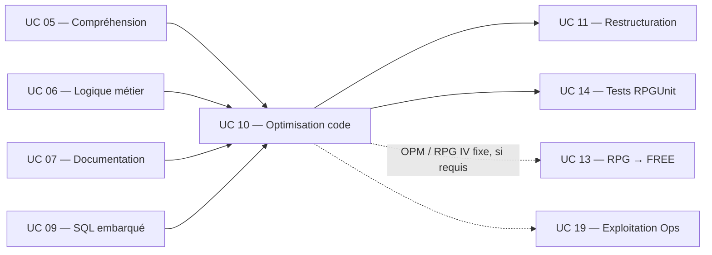

# UC 10 — Amélioration, optimisation de code

> **Catégorie :** Modernisation du code
>
> **Priorité dans le parcours :** 10 — premier UC de la Phase 3, suit UC 09 (accès SQL embarqué disponibles). Peut être mené en parallèle de UC 11 sur des programmes différents.
>
> **Mode Bob recommandé :** IBM i Developer (revue RPG, qualification, diffs, compilation) → IBM i Database (revue SQL, SQL Index Strategy Advisor). Les deux modes du Premium Package IBM i. Sans Premium Package : Ask pour l'analyse/génération, Agent pour la compilation et la sauvegarde.

> ⚠️ **UC 10 et UC 11 ne se lancent jamais dans la même session Bob, ni via la même demande en mode Plan.** UC 10 d'abord, compiler et valider fonctionnellement, puis ouvrir une **nouvelle conversation** pour UC 11. Si les deux sont demandés ensemble, Bob mélange les passes de renommage (UC 10) et d'extraction de modules (UC 11) dans un seul diff — les erreurs deviennent intraçables.

---

## ⭐ Premium Package IBM i utilisé

- **Slash Command : `/review_rpg`** → [Documentation officielle](https://bob.ibm.com/docs/ide/premium-packages/bob-for-i/slash-commands)
  Revue de code d'un membre source RPG (format fixe, libre ou mixte) : syntaxe, standards de codage, gestion des erreurs, sécurité, performances (RLA vs SQL embarqué), possibilités de modernisation. Résultat structuré : format détecté, synthèse, problèmes critiques / majeurs / mineurs, feuille de route de modernisation. **C'est l'entrée de UC 10** : elle remplace l'analyse manuelle de départ et alimente le Prompt 0.
  **Mode :** IBM i Developer.
- **Slash Command : `/review_SQL`** → [Documentation officielle](https://bob.ibm.com/docs/ide/premium-packages/bob-for-i/slash-commands)
  Revue d'une requête SQL ou d'un membre source contenant du SQL : syntaxe, lisibilité, sécurité (injection SQL, moindre privilège), performances SQE, refactorisation. Résultat structuré : synthèse, constats confirmés, recommandations conditionnelles, SQL révisé, explication des changements.
  **Mode :** IBM i Database.
- **Workflow : SQL Index Strategy Advisor** (partiel) → [Documentation officielle](https://bob.ibm.com/docs/ide/premium-packages/bob-for-i/workflows)
  Analyse les performances des requêtes Db2 for i (recommandations Index Advisor, MTI, statistiques d'exécution) et conseille — voire applique — une stratégie d'indexation. À utiliser pour la partie **performance SQL** de UC 10, après `/review_SQL`.
  **Lancement :** mode IBM i Database → bouton **Start Workflow** en haut du chat → workspace **Library List** (seul workspace supporté par ce workflow) → *SQL Index Strategy Advisor*. Détail : UC00 §1.2.
- **Understand Dashboard** → [Documentation officielle](https://bob.ibm.com/docs/ide/premium-packages/bob-for-i/understand)
  *Si Understand est installé* (mise en place et usage : UC00 §2). Sert à **prioriser** (objets morts : ne pas optimiser un programme inutilisé) et à **sécuriser les renommages partagés** (analyse d'impact : programmes et fichiers affectés).
- **Skills auto-activées :**
  - `rpg-code-review` — revue qualité : dette technique, performances, possibilités de modernisation
  - `rpg-indicators` — types d'indicateurs et modèles de remplacement par des variables booléennes
  - `rpg-refactor-legacy` — suppression des `GOTO`, conversion des routines en sous-procédures
  - `rpg-procedures-functions` — sous-procédures, prototypes, passage de paramètres
  - `rpg-free-format-fundamentals` — syntaxe et bonnes pratiques du RPGLE libre
  - `rpg-legacy-specs` — spécifications RPG historiques (RPG II/III) : limites de noms et de colonnes
  - `rpg-rla-to-sql` — conversion de l'accès RLA vers le SQL embarqué pour améliorer les performances
  - `db2-sql-optimization` — réécriture des requêtes, ordre des jointures, predicate pushdown, index
  - `db2-sql-performance-analysis` — Plan Cache, Visual Explain, Index Advisor
  - `db2-index-strategy` — index Binary Radix et EVI, syntaxe, sélection et maintenance
  - `db2-sql-stored-procedure-performance` — bonnes pratiques SQL PL haute performance dans les procédures stockées, fonctions et déclencheurs (si le périmètre contient des routines SQL)
  - `understand-impact-analysis` — dépendants directs et indirects, niveau de risque (si Understand installé)

> **Ce que le Premium ne couvre pas, et que cet UC conserve :** l'application *contrôlée* des corrections — renommage des variables et indicateurs, remplacement des opcodes obsolètes, extraction de procédures — pas à pas, avec compilation après chaque passe. `/review_rpg` **diagnostique** et propose une feuille de route ; les Prompts 1 à 4 **appliquent** cette feuille de route avec les garde-fous de non-régression.

---

## Objectif

Améliorer la **lisibilité, la maintenabilité et les performances** des programmes RPG et des requêtes SQL IBM i **sans modifier leur logique fonctionnelle**. On part d'un diagnostic outillé (`/review_rpg`, `/review_SQL`), on le transforme en plan d'optimisation, puis on applique les corrections par passes compilées et validées.

**Ce UC est le moins risqué de la Phase 3 — Modernisation du code.** Il ne change pas ce que fait le programme, seulement comment il le fait. Les résultats fonctionnels doivent être identiques avant et après : c'est le critère de succès principal, et celui qui distingue UC 10 de UC 11 (restructuration).

**Ce UC diffère de UC 09 (SQL embarqué) et de UC 11 (restructuration) :**
- UC 09 change le mécanisme d'accès aux données — les opcodes natifs deviennent du SQL.
- UC 10 change la forme interne du code — noms, lisibilité, opcodes obsolètes, performance des requêtes. Le mécanisme d'accès reste celui en place, la forme change.
- UC 11 change la structure du programme — décomposition, extraction de modules, avec un risque plus élevé.

> **Frontière UC 10 / UC 11 pour les extractions :** UC 10 n'autorise que l'optimisation **locale** — extraction d'une subroutine en procédure **interne, non exportée**, dans le **même source**, sans changer l'interface du programme (`*ENTRY PLIST` / `DCL-PI`), ni les appelants, ni la répartition en `*MODULE` / `*SRVPGM`. Toute extraction qui modifie une interface existante, crée un module ou un programme de service, factorise du code entre plusieurs programmes ou remet en cause le couplage par variables globales est de l'**architecture** : elle relève d'UC 11 (nouvelle session). Bob ne doit pas engager une extraction architecturale dans une passe d'optimisation.

**L'ordre recommandé sur un même programme : UC 10 d'abord, UC 11 ensuite.** Optimiser avant de restructurer évite de porter des noms cryptiques et des redondances dans la nouvelle architecture.

> **Dépendance conditionnelle UC 10 / UC 11 / UC 13 :** l'ordre par défaut (UC 10 puis UC 11) s'applique au code déjà en `**FREE` / ILE. Pour un source **RPG III OPM** ou **RPG IV format fixe**, UC 13 (conversion en `**FREE`) peut être un prérequis technique à certaines optimisations avancées d'UC 10 (conversions `EVAL`, extraction `DCL-PR`/`DCL-PROC`) : limiter alors UC 10 aux passes sûres (diagnostic, qualification, code mort, renommages sûrs), exécuter UC 13, puis reprendre les optimisations avancées d'UC 10. Chaque UC reste dans sa propre session Bob.

**Livrable attendu :** pour chaque programme : un rapport de revue (`review-rpg` / `review-sql`), un rapport de qualification, un fichier de diff documentant chaque modification, et pour un périmètre complet un plan d'optimisation.

---

## Prérequis

- **Phase :** Phase 3 — Modernisation du code
- **UC précédents requis :** UC 05 — Compréhension de code (obligatoire), UC 06 — Logique métier (obligatoire), UC 07 — Documentation complète (recommandé), UC 09 — SQL embarqué (recommandé : l'optimisation SQL porte sur les accès déjà convertis)
- **Livrables requis :**
  - `{appId}-comprehension-{composant}-report-{YYYYMMDD-HHmm}.md` — UC 05 : carte des subroutines, variables et appels (**obligatoire**)
  - `{appId}-logique-{composant}-regles-{YYYYMMDD-HHmm}.md` — UC 06 : règles métier du programme, garde-fou contre les régressions (**obligatoire**)
  - `{appId}-doc-spec-tech-{YYYYMMDD-HHmm}.md` — UC 07 : interfaces et paramètres (recommandé, indispensable si une extraction touche les interfaces)
  - `{appId}-doc-matrice-{YYYYMMDD-HHmm}.md` — UC 07 : si un renommage est partagé entre programmes (recommandé)
  - `{appId}-sql-{composant}-embarque-{YYYYMMDD-HHmm}.md` — UC 09 : source déjà converti, pour ne pas retoucher les accès convertis (si UC 09 appliqué)
- **Niveau Bob recommandé :** Intermédiaire à Avancé
- **Bob Coins estimés :** ⚠️ *À calibrer après le lab UC 10 sur FLGHT400.*

> ⚠️ **Un développeur RPG doit être disponible** pour valider la non-régression fonctionnelle. La compilation réussie par Bob ne garantit pas un comportement identique — les tests fonctionnels restent irréductibles.
>
> ⚠️ **Un DBA ou développeur Db2 senior doit être disponible** avant toute création d'index : Bob propose, l'humain décide de l'impact sur les écritures et l'espace disque.
>
> 💡 Si les fichiers de compréhension UC 05 ne sont pas disponibles, démarrer par une session rapide d'UC 05 sur le programme ciblé — 30 minutes de compréhension évitent de renommer une variable qui a deux sens selon la subroutine.

---

## Exemple concret — Lab FLGHT400

| Livrable | Fichier lab | Ce qu'il illustre |
|---|---|---|
| Revue SQL + analyse des goulots | [`../labs_FLGHT400_results/FLGHT403_sql-review-bottleneck-analysis.md`](../labs_FLGHT400_results/FLGHT403_sql-review-bottleneck-analysis.md) | Revue d'une requête multi-tables `FLIGHTS × ORDERS × AGENTS × CUSTOMERS` : 4 constats (dont un `ORDER BY` hors `GROUP BY` bloquant, SQLSTATE 42803, et une jointure `CUSTOMERS` inutilisée), SQL révisé, puis analyse de volumétrie : `ORDERS` (701 512 lignes) identifié comme goulot principal, aucun index SQL sur les 4 tables, index composite recommandé |
| Conversation associée | [`../labs_FLGHT400_results/FLGHT403_sql-review-bottleneck-analysis_conversation.md`](../labs_FLGHT400_results/FLGHT403_sql-review-bottleneck-analysis_conversation.md) | Déroulé de la session : validation des colonnes via le catalogue, puis constats |
| Audit des programmes (âge, usage) | [`../labs_FLGHT400_results/FLGHT403_cpu_jobs_programs_audit.md`](../labs_FLGHT400_results/FLGHT403_cpu_jobs_programs_audit.md) | 34/34 programmes non recompilés depuis plus de 5 ans, dont 25 programmes OPM RPG de 1997 (`FRS409`, `FRS403`…), tous encore utilisés — base typique pour construire le plan d'optimisation (Prompt 5) |
| Programme candidat | [`../labs_FLGHT400_results/FLGHT403_FRS409_explanation.md`](../labs_FLGHT400_results/FLGHT403_FRS409_explanation.md) | Explication de `FRS409`, petit programme interactif WORKSTN — bon premier candidat SIMPLE |

> 💡 Le lab FLGHT403 ne contient pas encore de sortie `/review_rpg` ni de lab UC 10 complet. Les livrables `*-optim-*` seront produits lors du lab UC 10.
>
> ⚠️ **Cas OPM :** les programmes de FLGHT403 sont majoritairement de l'OPM RPG (format fixe). Voir l'encadré « Programme OPM RPG III » plus bas — il conditionne les Prompts 3 et 4.

---

## Démarrer par un programme que vous connaissez

> **Recommandation forte avant d'aborder les programmes critiques de l'application.**

Commencer par un **programme dont un développeur de l'équipe connaît bien la logique** — idéalement avec des variables aux noms cryptiques connus de l'équipe, et un comportement attendu documenté ou testable rapidement.

Pourquoi ? La première optimisation sert à **calibrer deux choses** :
- La qualité du diagnostic de `/review_rpg` (les problèmes « critiques » le sont-ils vraiment pour l'équipe ?) et des renommages proposés (`WK01` renommé `wkNomClient` reflète-t-il ce que la variable contient ?)
- La capacité de l'équipe à valider la non-régression

> 💡 Pour chaque programme, **lancer `/review_rpg` puis le Prompt 0** — il donne la catégorie (SIMPLE / STANDARD / COMPLEXE) et la séquence exacte. Ne pas aller directement au Prompt 1.

| Étape | Programme à choisir | Catégorie attendue | Objectif |
|---|---|---|---|
| 1 | Programme court (< 200 lignes), renommages évidents, aucune performance critique | SIMPLE | Calibrer `/review_rpg` et les renommages ; vérifier que le Prompt 0 classe correctement |
| 2 | Programme avec plusieurs subroutines extractibles et du code dupliqué | STANDARD | Valider l'extraction de procédures |
| 3 | Programme avec opcodes obsolètes (`MOVE`, `MOVEL`, `SETON`, indicateurs) et performance identifiée | STANDARD à COMPLEXE | Valider la conversion des opcodes et les règles de décision sur les indicateurs |
| 4 | Programme critique de production, nomenclature opaque sur tout le source | COMPLEXE | Valider la gestion par passes et les garde-fous de non-régression |

---

## Impact de la taille du programme sur la stratégie d'optimisation

La complexité de UC 10 ne dépend pas du nombre de lignes, mais du **nombre de points d'optimisation**, de leur **nature** (renommage sans risque vs extraction avec impact sur les appelants) et du **niveau de documentation disponible**.

Les vrais facteurs de complexité :
- **Variables cryptiques partagées entre subroutines** — sans risque si locales, risqué si passées entre subroutines avec des usages différents
- **Opcodes obsolètes à effets de bord sur les indicateurs** (`SETON *IN50`) — parfois testés dans une autre branche du programme
- **Subroutines qui partagent des variables globales** — non extractibles sans adapter les paramètres
- **Code dupliqué entre plusieurs programmes** — l'extraction touche plusieurs programmes, dépasse le périmètre d'un programme unique
- **Optimisations de performance** — une boucle `READ` sur un gros fichier relève plutôt d'UC 09 (curseur SQL) ou de la stratégie d'index que d'un simple refactoring

| Catégorie | Critères | Séquence |
|---|---|---|
| **SIMPLE** | Renommages locaux, pas d'extraction, pas d'indicateurs pilotant la logique | `/review_rpg` → Prompt 0 → Prompt 1 → Prompt 2 → Prompt 2-bis → Prompt 3 si applicable |
| **STANDARD** | Renommages + 1 à 3 extractions, ou opcodes obsolètes limités | `/review_rpg` → Prompt 0 → Prompt 1 → Prompt 2 par passe → Prompt 2-bis → Prompt 3 → Prompt 3-bis → Prompt 4 → Prompt 2-bis |
| **COMPLEXE** | Indicateurs omniprésents, variables globales inter-subroutines, `GOTO`/`CABxx` | Évaluer UC 11 avant UC 10. Si décision d'optimiser sans restructurer : `/review_rpg` → Prompt 0 → Prompt 1 → Prompt 2 (renommages sûrs seulement, passe par passe) → Prompt 2-bis après chaque passe → Prompt 3 (opcodes isolés) → Prompt 3-bis |

> ⚠️ Sur un programme COMPLEXE, le Prompt 0 pose la question : **faut-il restructurer avant d'optimiser ?** Si la réponse est « restructuration recommandée », ne pas démarrer UC 10 en profondeur — ouvrir une tâche UC 11 d'abord, ou limiter UC 10 aux renommages sûrs.

### Programme OPM RPG III : ce que UC 10 peut et ne peut pas faire

Le Prompt 0 détecte le style du source (OPM RPG III, ILE RPG IV fixe, mixte, libre).

- **OPM RPG III** (`RPG` sans `RPGLE`, sans H-spec, typique des programmes de 1997 dans FLGHT403) : les conversions du Prompt 3 vers `EVAL` et l'extraction du Prompt 4 vers `DCL-PR`/`DCL-PROC` nécessitent de l'ILE RPG. Ne pas les appliquer sur un source OPM.
- **Règle opérationnelle d'enchaînement :**
  - **Sur source OPM / RPG III :** limiter UC 10 au diagnostic qualité (`/review_rpg`), à la qualification, au nettoyage de code mort et aux renommages sûrs. Si l'équipe souhaite restructurer en sous-procédures modulaires (`DCL-PROC`) ou convertir les expressions modernes, faire passer le programme par **UC 13** (*RPG Modernization* vers `**FREE`) avant d'achever l'optimisation avancée d'UC 10.
  - **Sur source ILE RPG IV colonné (format fixe) :** même dépendance conditionnelle — si l'équipe vise les optimisations avancées d'UC 10 (conversions `EVAL`, procédures), exécuter UC 13 (passage outillé en `**FREE`) avant ces passes permet à Bob d'exploiter pleinement la syntaxe libre sans générer de code hybride fixe/libre. Les passes sûres (renommages, nettoyage) restent possibles sans UC 13.
  - **Sur source déjà en `**FREE` :** UC 10 s'applique directement et intégralement (UC 13 sans objet).
- Les limites de noms sont plus strictes en RPG III qu'en RPG IV (la limite de longueur de nom en RPG III est à confirmer avec le skill `rpg-legacy-specs`).

---

## Démarrer une session Bob

> **À lire avant chaque session UC 10 — nouvelle conversation ou reprise.**

### 1. Nouvelle conversation Bob, espace de travail et mode

Chaque programme démarre dans une **nouvelle conversation Bob** (bouton `+`). Ne pas réutiliser la conversation d'un autre programme : les renommages et décisions précédents polluent les suggestions.

**Les trois espaces de travail** (détail : UC 02, section 3) :

| Espace | Contenu | Usage dans UC 10 |
|---|---|---|
| **Workspace local** (poste) | Fichiers `.md`, skills, rules, `bob-reports/` | Chargement des livrables des UC précédents, sauvegarde locale des rapports |
| **Librairies IBM i / QSYS** ⭐ | Sources RPG/CL/DDS, compilation, slash commands, workflows | **Espace par défaut de UC 10** : `/review_rpg`, `/review_SQL`, compilation, SQL Index Strategy Advisor |
| **`$HOME` IFS** | Livrables markdown de sortie, apps | Optionnel : copie des rapports côté IBM i |

**Procédure :** bouton `+` → **Library List** → choisir la bibliothèque applicative `{appId}`.

| Phase | Mode | Raison |
|---|---|---|
| Revue RPG, qualification, inventaire, diffs, compilation (`/review_rpg`, Prompts 0 à 5) | `IBM i Developer` | Lecture des membres (`read_member`), compilation (`execute_compile_action`), skills RPG |
| Revue SQL, optimisation SQL (`/review_SQL`, SQL Index Strategy Advisor) | `IBM i Database` | Exécution SQL (`execute_sql_statement`), catalogues QSYS2, skills Db2 |

**Quand basculer :** après la phase RPG d'un programme, démarrer une nouvelle conversation en `IBM i Database` pour la partie SQL, en y chargeant le rapport `review-rpg` et le rapport de qualification.

> 💡 Mode **Agent** : uniquement pour sauvegarder des fichiers **locaux** dans le workspace. Jamais pour des opérations IBM i (lecture de sources, compilation, SQL).
>
> 💡 **Avant la première session :** vérifier que la Library List (panneau Code for IBM i) inclut la bibliothèque source **et** celles des copybooks, pour éviter des scans globaux de plusieurs dizaines de minutes sur `*LIBL`.

### 2. Ouvrir les fichiers sources dans l'éditeur

Dans le panneau **IBM i — Object Browser** : clic droit sur le membre RPG → **Open in Editor**. Fichiers à ouvrir :
- Le programme RPG source (`[NOM_LIB]/QRPGSRC([NOM_PROGRAMME])` ou `QRPGLESRC`)
- Le rapport de compréhension (`*-comprehension-*-report-*.md`) et les règles métier (`*-logique-*-regles-*.md`)

### 3. Fichiers de contexte à charger

| Fichier | Produit par | Priorité |
|---|---|---|
| `{appId}-comprehension-{composant}-report-{date}.md` | UC 05 | **Obligatoire** — base du Prompt 1 |
| `{appId}-logique-{composant}-regles-{date}.md` | UC 06 | **Obligatoire** — garde-fou contre les régressions |
| `{appId}-doc-spec-tech-{date}.md` | UC 07 | **Recommandé** — interfaces et paramètres |
| `{appId}-doc-matrice-{date}.md` | UC 07 | **Recommandé** — renommages partagés entre programmes |
| `{appId}-sql-{composant}-embarque-{date}.md` | UC 09 | **Si UC 09 appliqué** |
| `{appId}-optim-{composant}-review-rpg-{date}.md` | UC 10 (étape Premium A) | **Obligatoire pour le Prompt 0** |
| `{appId}-optim-{composant}-qualification-{date}.md` | UC 10 (session précédente) | **Si reprise** — catégorie et stratégie déjà décidées |

> ⚠️ **Où Bob écrit.** En espace Librairies IBM i, Bob écrit **sur l'IBM i**, pas en local. Les rapports (`/review_rpg`, `/review_SQL`, fiches, diffs) sont produits **dans le chat**. Pour obtenir un fichier local dans `bob-reports/`, le demander explicitement à Bob (formulation donnée dans chaque prompt).
>
> ⚠️ **Risque de compression de contexte :** sur les programmes STANDARD ou COMPLEXE, sauvegarder le livrable en cours après chaque prompt majeur. À chaque reprise : « Le fichier [NOM_FICHIER] contient les décisions prises — continuer à partir de [ÉTAPE]. »

---

## Séquence Premium — à lancer avant les prompts

### Étape A — `/review_rpg` : diagnostiquer le programme

**Espace :** IBM i QSYS — mode IBM i Developer.
**Skills clés mobilisées :** `rpg-code-review`.

1. Ouvrir le membre RPG dans l'éditeur (Object Browser → *Open in Editor*).
2. Dans la zone de saisie du chat Bob, taper `/review_rpg` et désigner le membre `[NOM_LIB]/QRPGSRC([NOM_PROGRAMME])`.
3. Lire le résultat : **format détecté**, synthèse, problèmes **critiques / majeurs / mineurs**, feuille de route de modernisation.
4. Demander la sauvegarde locale :

```
Sauvegarde le rapport complet de ce /review_rpg dans le dossier bob-reports/
sous le nom {appId}-optim-{composant}-review-rpg-{YYYYMMDD-HHmm}.md
```

> 💡 **Invocation de `/review_rpg` :** la commande peut être lancée soit sans argument lorsque le membre cible est actif dans l'éditeur VS Code, soit en spécifiant le chemin complet du membre : `/review_rpg [NOM_LIB]/QRPGSRC([NOM_PROGRAMME])`.
>
> ⚠️ La « feuille de route de modernisation » peut suggérer la conversion en format libre ou le passage RLA → SQL. Ces sujets relèvent de **UC 13** et **UC 09** : ne pas les enchaîner dans la même session que les passes d'optimisation.

### Étape B — `/review_SQL` : diagnostiquer le SQL

**Espace :** IBM i QSYS — mode IBM i Database.
**Skills clés mobilisées :** `db2-sql-optimization`, `db2-sql-performance-analysis`.

1. Pour une requête isolée : taper `/review_SQL` puis coller la requête.
2. Pour un membre contenant du SQL embarqué (ex. source produit par UC 09) : `/review_SQL` en désignant le membre.
3. Lire les cinq sections : synthèse, constats confirmés, recommandations conditionnelles, SQL révisé, explication des changements.
4. Demander la sauvegarde locale sous `bob-reports/{appId}-optim-{composant}-review-sql-{YYYYMMDD-HHmm}.md`.

> 💡 **Exemple lab :** [`FLGHT403_sql-review-bottleneck-analysis.md`](../labs_FLGHT400_results/FLGHT403_sql-review-bottleneck-analysis.md) — un constat « bloquant » (`ORDER BY` hors `GROUP BY`) et un constat « mort-code » (jointure inutilisée) distinguent bien les corrections obligatoires des recommandations conditionnelles.

### Étape C — SQL Index Strategy Advisor : optimiser les index

**Espace :** IBM i QSYS — mode IBM i Database, workspace **Library List** (seul supporté). Bouton **Start Workflow** (haut du chat) → *SQL Index Strategy Advisor*.
**Skills clés mobilisées :** `db2-index-strategy`, `db2-sql-performance-analysis`.

- À lancer **après** `/review_SQL`, une fois le SQL corrigé : conseiller un index sur une requête fautive n'a pas de sens.
- Le workflow s'appuie sur les recommandations Index Advisor, les MTI et les statistiques d'exécution.
- **Ne laisser appliquer un index que sur l'IBM i de test**, après validation par un DBA.

> 💡 **Exemple lab :** sur FLGHT403, l'analyse a constaté qu'aucun index SQL n'existait sur `FLIGHTS`, `ORDERS`, `AGENTS`, `CUSTOMERS` (seuls des fichiers logiques DDS), et recommandé un index composite sur `ORDERS (DEPARTURE_DATE, FLIGHT_NUMBER, AGENT_NO)` **à condition** que Visual Explain confirme un scan complet.

### Étape D — Understand Dashboard : prioriser et sécuriser *(si installé)*

- **Objets morts** : écarter du plan d'optimisation les programmes inutilisés.
- **Analyse d'impact** (skill `understand-impact-analysis`) : avant un renommage de variable ou de paramètre partagé, lister les programmes et fichiers affectés.
- À utiliser pour construire le Prompt 5 (plan d'optimisation d'un périmètre).

---

## Prompts

### Prompt 0 — Qualification et choix de stratégie

> **Point d'entrée obligatoire de UC 10 pour chaque programme, après `/review_rpg`.** Il transforme le diagnostic en décision : catégorie et séquence exacte de prompts.

**Objectif :** produire un rapport de qualification avant toute modification. Identifie la catégorie (SIMPLE / STANDARD / COMPLEXE), le style RPG, les facteurs de complexité, et recommande la séquence.

**Quand l'utiliser :** en premier, pour chaque programme, une fois `/review_rpg` exécuté.

**Espace :** IBM i QSYS (lecture du source via `read_member`) — mode IBM i Developer.
**Skills clés mobilisées :** `rpg-code-review`, `rpg-indicators`, `rpg-legacy-specs`.

**Input requis :** programme RPG ouvert dans l'éditeur, rapport `*-review-rpg-*.md` et fichiers UC 05 / UC 06 chargés en contexte.

```
Le programme [NOM_PROGRAMME] se trouve dans [NOM_LIB]/QRPGSRC (ou QRPGLESRC).
Le rapport /review_rpg de ce programme est disponible dans [NOM_FICHIER_REVIEW].

En t'appuyant sur ce rapport et sur le source, produis en français, en markdown,
un rapport de qualification pour l'optimisation du code :

## Qualification UC 10 — [NOM_PROGRAMME]

### 1. Inventaire rapide
| Indicateur                                        | Valeur |
|---------------------------------------------------|--------|
| Nombre de lignes de source                        | ?      |
| Nombre de subroutines (BEGSR/ENDSR)               | ?      |
| Nombre de procédures (DCL-PROC / P...B / P...E)   | ?      |
| Nombre de variables avec noms cryptiques (< 4 car ou format WKxx/Lxx/Nxx) | ? |
| Nombre d'indicateurs (*INxx utilisés)             | ?      |
| Présence d'opcodes obsolètes (MOVE, MOVEL, SETON, SETOF, GOTO, CABxx) | OUI / NON |
| Présence de code dupliqué (blocs > 10 lignes répétés) | OUI / NON |
| Présence de subroutines extractibles en procédures | OUI / NON |
| Style RPG                                         | OPM RPG III / RPG IV fixe / Mixte / Free |

### 2. Facteurs de complexité
Réponds par OUI / NON / À CONFIRMER pour chaque facteur :
- [ ] Variables globales partagées entre plusieurs subroutines (renommage à impact large)
- [ ] Indicateurs (*INxx) utilisés pour piloter la logique applicative (SETON/SETOF/IF *INxx)
- [ ] Opcodes GOTO ou CABxx (logique de branchement non structurée)
- [ ] Paramètres de programme (*ENTRY PLIST) — toute extraction doit préserver l'interface
- [ ] Accès natifs aux fichiers encore présents (UC 09 non appliqué sur ce programme)
- [ ] Programme appelé par d'autres programmes (matrice UC 07 disponible ?)
- [ ] Programme en format fixe ou mixte — les renommages doivent respecter les limites de colonnes
- [ ] Programme OPM RPG III — Prompt 3 (EVAL) et Prompt 4 (procédures) non applicables avant UC 13

### 3. Reprise du /review_rpg
Liste les problèmes critiques et majeurs du rapport qui relèvent de UC 10
(renommage, opcodes, extraction, performance) et ceux qui relèvent d'un autre UC
(UC 09 accès SQL, UC 11 restructuration, UC 13 conversion en format libre).

### 4. Catégorie et stratégie recommandée
**Catégorie :**
- [ ] SIMPLE — renommages locaux, pas d'extraction, pas d'indicateurs pilotant la logique
- [ ] STANDARD — renommages + extraction de 1 à 3 procédures, ou opcodes obsolètes limités
- [ ] COMPLEXE — indicateurs omniprésents, variables globales inter-subroutines, ou GOTO/CABxx

**Recommandation :**
- SIMPLE   → Prompt 1 → Prompt 2 → Prompt 2-bis → Prompt 3 si applicable
- STANDARD → Prompt 1 → Prompt 2 passe par passe → Prompt 2-bis après chaque passe
             → Prompt 3 → Prompt 3-bis → Prompt 4 → Prompt 2-bis
- COMPLEXE → Évaluer UC 11 (restructuration) avant UC 10 en profondeur.
             Si décision de limiter à l'essentiel : Prompt 1 → Prompt 2 (renommages sûrs
             seulement) → Prompt 2-bis. Reporter les extractions à UC 11.
- OPM RPG III / RPG IV fixe → limiter à la revue, aux renommages sûrs ; UC 13 d'abord si les Prompts 3 et 4 sont visés (dépendance conditionnelle), puis reprendre UC 10.

**Si catégorie STANDARD ou COMPLEXE — zones de risque :**
| Zone | Nature du risque | Subroutine(s) concernée(s) | Précaution recommandée |

Signale clairement ce que tu ne peux pas déterminer sans exécuter le programme.
```

**Points clés :**
- `Facteurs de complexité OUI / NON / À CONFIRMER` — « À CONFIRMER » est délibéré : Bob peut voir qu'une variable sert dans trois subroutines sans pouvoir garantir qu'elle a la même sémantique partout.
- `Reprise du /review_rpg` — évite de traiter dans UC 10 ce qui relève d'UC 09, 11 ou 13.
- `Style RPG / OPM RPG III` — conditionne les Prompts 3 et 4 (voir encadré OPM plus haut).

**Livrable produit :** `{appId}-optim-{composant}-qualification-{YYYYMMDD-HHmm}.md`

```
Sauvegarde ce rapport de qualification dans le dossier bob-reports/
sous le nom {appId}-optim-{composant}-qualification-{YYYYMMDD-HHmm}.md
```

> ⚠️ **Piège évité :** sans le Prompt 0, l'équipe démarre les renommages sans savoir qu'un `*IN50` est testé à 8 endroits ou que le programme est en OPM RPG III. Le découvrir en milieu de passe oblige à tout réévaluer.

---

### Prompt 1 — Inventaire des points d'optimisation

`[Complément — non couvert par le workflow Premium]` — `/review_rpg` classe les problèmes par gravité mais ne produit pas la feuille de travail numérotée (variables, indicateurs, opcodes, subroutines, doublons) nécessaire aux passes suivantes.

**Objectif :** produire l'inventaire exhaustif et numéroté, avant toute génération de code.

**Espace :** IBM i QSYS (lecture RPG) — mode IBM i Developer.
**Skills clés mobilisées :** `rpg-indicators`, `rpg-legacy-specs`, `rpg-code-review`.

```
Le programme [NOM_PROGRAMME] se trouve dans [NOM_LIB]/QRPGSRC (ou QRPGLESRC).

Sur la base de la qualification UC 10 que nous venons de faire,
produis en français, en markdown, l'inventaire complet des points d'optimisation :

## Inventaire UC 10 — [NOM_PROGRAMME]

### 1. Variables à renommer
| N° | Nom actuel | Type | Portée (locale / globale) | Utilisations (nb) | Nom proposé | Justification |
Critères : nom < 4 caractères, format WKxx / Lxx / Nxx / Axx, abréviation opaque,
nom identique à un autre dans un contexte différent.

### 2. Indicateurs (*INxx) à évaluer
| N° | Indicateur | Où il est activé (SETON/SETOF) | Où il est testé (IF/DOW) | Usage identifié | Action recommandée |
Action : renommer en variable booléenne / conserver si système / supprimer si mort

### 3. Opcodes obsolètes à moderniser
| N° | Ligne | Opcode | Équivalent Free RPG recommandé | Risque de régression |
Opcodes à détecter : MOVE, MOVEL, SETON, SETOF, GOTO, CABxx, KLIST/KFLD,
SORTA, Z-ADD, Z-SUB, ADD, SUB, MULT, DIV, MVR, CASxx

### 4. Subroutines extractibles en procédures
| N° | Nom BEGSR | Lignes | Variables utilisées | Variables globales dépendantes | Extractible ? |
Extractible : OUI si aucune variable globale, ou si elles peuvent devenir des
              paramètres passés en valeur / référence
              NON si trop couplée à l'état global du programme

### 5. Code dupliqué détecté
| N° | Lignes occurrence 1 | Lignes occurrence 2 | Nature du bloc | Extractible en procédure ? |
(blocs de plus de 5 lignes répétés)

Signale clairement les cas où la décision nécessite une connaissance fonctionnelle
non visible dans le source.
Ne pas générer le code optimisé dans ce prompt.
```

**Points clés :**
- `Portée (locale / globale)` — donnée de décision principale : une variable globale partagée entre 5 subroutines doit être renommée partout en une seule passe.
- `Indicateurs` — un `*IN50` activé ici et testé ailleurs peut piloter une logique critique ; identifier tous les sites avant de recommander un renommage.
- `Risque de régression` (opcodes) — un `MOVE` vers un champ plus court (troncature) n'a pas le même risque qu'un `Z-ADD`.
- `Ne pas générer le code` — séparation inventaire / génération : l'équipe relit l'inventaire et retire les cas à ne pas toucher.

**Livrable produit :** complète le fichier `{appId}-optim-{composant}-qualification-{YYYYMMDD-HHmm}.md` (même fichier, section « Inventaire »).

> ⚠️ **Piège évité :** sans inventaire, Bob renomme au fil de la lecture et peut proposer deux noms différents pour la même variable.

---

### Prompt 2 — Renommage des variables et des indicateurs

`[Complément — non couvert par le workflow Premium]`

**Objectif :** appliquer, par passe, les renommages validés de l'inventaire.

**Espace :** IBM i QSYS (lecture) + génération du diff dans le chat — mode IBM i Developer. **Pas d'écriture à ce stade.**
**Skills clés mobilisées :** `rpg-indicators`, `rpg-free-format-fundamentals`.

```
Sur la base de l'inventaire UC 10 de [NOM_PROGRAMME] que nous venons de faire,
applique les renommages suivants :

[Lister ici les N° de variables du tableau Prompt 1, section 1, à renommer dans cette passe]
[Lister ici les N° d'indicateurs du tableau Prompt 1, section 2, à convertir]

Pour chaque variable renommée, produis le diff suivant :
// AVANT : [NOM_ACTUEL] — [JUSTIFICATION DU RENOMMAGE]
// APRÈS : [NOM_NOUVEAU]

Règles de renommage :
- Style camelCase : wkNomVariable (préfixe selon le rôle : wk = travail,
  li = ligne/itération, fl = flag/indicateur, nb = compteur, dt = date)
- Nommer selon l'usage, pas selon le type (wkMontantHT et non wkDecimal12v2)
- Format fixe ou mixte : respecter la longueur maximale de nom autorisée par le
  langage du source (10 caractères en RPG IV fixe). Si le style est Fixe ou Mixte
  (vérifié au Prompt 0), les noms proposés doivent la respecter :
  `wkMtHT` et non `wkMontantHorsTaxe`.
- Pour les indicateurs : créer une variable DCL-S [NOM_DESCRIPTIF] IND INZ(*OFF)
  et remplacer chaque occurrence de *INxx par cette variable
- Propager chaque renommage à toutes les occurrences — pas de renommage partiel
- Ne pas renommer les variables de paramètre *ENTRY PLIST sans validation explicite
- Ne pas renommer les champs de structures de données externes (EXTNAME) —
  ils référencent des colonnes de fichiers dont le nom est contraint
- Signaler toute occurrence où le renommage ne peut pas être fait en toute sécurité

Produis à la fin un récapitulatif :
| Nom avant | Nom après | Nb occurrences modifiées | Risque résiduel |
```

**Points clés :**
- `[Lister ici les N° ...]` — travailler sur un sous-ensemble numéroté empêche Bob de renommer hors périmètre de la passe.
- `Propager à toutes les occurrences` — un source avec `WK01` ici et `wkNomClient` là compile peut-être, mais il est illisible et incohérent.
- `Ne pas renommer EXTNAME` — le champ de la DS externe reste lié au nom de colonne du fichier. Si UC 09 a été appliqué, ces DS ont peut-être déjà été converties — vérifier.
- Renommage de variable **partagée entre programmes** : consulter d'abord `understand-impact-analysis` / la matrice UC 07.

**Livrable produit :** `{appId}-optim-{composant}-diff-{YYYYMMDD-HHmm}.md`

```
Sauvegarde ce diff de renommages dans le dossier bob-reports/
sous le nom {appId}-optim-{composant}-diff-{YYYYMMDD-HHmm}.md
```

> ⚠️ **Piège évité :** renommer une variable globale partiellement (celle qui lit, pas celle qui écrit) laisse deux noms pour une seule variable — le source peut compiler tout en étant incohérent.

---

### Prompt 2-bis — Test de compilation par Bob

> **Ce prompt s'exécute en mode IBM i Developer** — Bob lance la compilation via les outils IBM i (`execute_compile_action` ou `execute_cl_command`). Le mode IBM i Database n'a pas accès aux actions de compilation.
> **Ce que Bob peut faire :** compiler et rapporter les erreurs.
> **Ce que Bob ne peut pas faire :** valider que les renommages n'ont pas changé la sémantique — vérification humaine irréductible.
> **Quand l'utiliser :** après chaque passe de renommages (Prompt 2), d'opcodes (Prompt 3, via Prompt 3-bis) et après le Prompt 4.

**Espace :** IBM i QSYS (compilation sur IBM i de test) — mode IBM i Developer.
**Skills clés mobilisées :** `rpg-indicators`, `rpg-free-format-fundamentals`.

> ⚠️ **Écriture et compilation sur une copie.** Pour compiler, le source modifié doit exister sur l'IBM i. Après validation explicite de l'équipe, demander à Bob d'écrire le source modifié dans un **membre de test** (copie du membre d'origine, ex. suffixe `_T` comme dans l'intermédiaire de [`FLGHT403_FRS409_modernization_report.md`](../labs_FLGHT400_results/FLGHT403_FRS409_modernization_report.md)), jamais dans le membre d'origine. Le remplacement du membre d'origine est une décision humaine après tests fonctionnels.

```
Le source RPG de [NOM_PROGRAMME] modifié avec les renommages de cette passe
a été écrit dans le membre de test [NOM_LIB]/QRPGSRC([NOM_MEMBRE_TEST]).

Lance la compilation sur l'IBM i de test :
CRTBNDRPG PGM([NOM_LIB_TEST]/[NOM_PROGRAMME])
          SRCFILE([NOM_LIB]/QRPGSRC)
          SRCMBR([NOM_MEMBRE_TEST])
          OPTION(*EVENTF)
          OUTPUT(*PRINT)
          DBGVIEW(*SOURCE)

Analyse le résultat de la compilation et produis en français :

1. Statut : COMPILATION RÉUSSIE / ERREURS DE COMPILATION
2. Si erreurs : liste des erreurs avec numéro de ligne, code erreur IBM i et description
   | Ligne | Code erreur | Description | Cause probable |
   Causes probables à vérifier : renommage partiel (occurrence manquée),
   conflit de noms (nouveau nom déjà utilisé), DS externe modifiée par erreur
3. Si compilation réussie : confirmer que les [N] modifications de cette passe compilent
4. Rappeler que la compilation réussie ne garantit pas la non-régression fonctionnelle —
   le test fonctionnel sur l'IBM i de test reste obligatoire (vérification humaine)
```

> 💡 En cas d'erreur : ne pas passer à la passe suivante. Corriger dans le chat, relancer. La boucle « corriger → recompiler → valider » se fait entièrement dans Bob jusqu'à la compilation propre.
>
> 💡 Vérifier que l'utilisateur IBM i associé à la connexion a le droit d'utiliser `CRTBNDRPG` et d'écrire dans la bibliothèque de test.

> ⚠️ **Ce prompt ne remplace pas le test fonctionnel.** Obligatoires et non délégables à Bob :
> - exécuter le programme sur l'IBM i de test avec un jeu de données réel ;
> - comparer les résultats avec ceux du programme d'origine ;
> - vérifier les cas limites pilotés par des indicateurs renommés (cf. `*-logique-*-regles-*.md`).

---

### Prompt 3 — Remplacement des opcodes obsolètes

`[Complément — non couvert par le workflow Premium]`
**Prérequis :** source RPG IV (ILE). Sur OPM RPG III, ne pas appliquer avant UC 13.

**Objectif :** remplacer les opcodes obsolètes inventoriés par leur équivalent moderne, sans changer le comportement.

**Espace :** IBM i QSYS (lecture) + génération du diff dans le chat — mode IBM i Developer. Pas d'écriture à ce stade.
**Skills clés mobilisées :** `rpg-free-format-fundamentals`, `rpg-refactor-legacy`.

```
Sur la base de l'inventaire UC 10 de [NOM_PROGRAMME], section 3 (opcodes obsolètes),
remplace les opcodes suivants par leur équivalent Free RPG :

[Lister ici les N° d'opcodes du tableau Prompt 1, section 3, à remplacer dans cette passe]

Pour chaque remplacement, produis le diff :
// AVANT : [OPCODE_OBSOLETE avec ses facteurs]
// APRÈS  : [ÉQUIVALENT FREE RPG]

Table de conversion à respecter :
- MOVE  [SRC] [DEST]        → EVAL  dest = src     (attention : MOVE tronque à droite,
                                                     EVAL affecte en entier — vérifier les longueurs)
- MOVEL [SRC] [DEST]        → EVAL  dest = src     (MOVEL aligne à gauche — même remarque)
- Z-ADD [VAL] [DEST]        → EVAL  dest = val
- Z-SUB [VAL] [DEST]        → EVAL  dest = -val
- ADD   [A] [B] [RESULT]    → EVAL  result = a + b
- SUB   [A] [B] [RESULT]    → EVAL  result = a - b
- MULT  [A] [B] [RESULT]    → EVAL  result = a * b
- DIV   [A] [B] [RESULT]    → EVAL  result = a / b  +  MVR rem → EVAL rem = %REM(a:b)
- SETON *INxx               → EVAL  [NOM_INDICATEUR] = *ON   (après renommage Prompt 2)
- SETOF *INxx               → EVAL  [NOM_INDICATEUR] = *OFF
- GOTO  [LABEL]             → Analyser le flux : IF/ELSEIF/ELSE ou DO/LEAVE/ITER
                              Ne pas remplacer un GOTO sans analyser la logique de branchement
- CABxx [A] [B] [LABEL]     → IF [A] xx [B]; [suite]; ENDIF — mêmes précautions que GOTO
- KLIST/KFLD                → Remplacer par une structure de recherche avec %KDS ou variables hôtes
- SORTA [ARRAY]             → Utiliser %SORTA si Free RPG, ou conserver si usage ponctuel

Règles :
- Signaler les cas où MOVE / MOVEL avec des longueurs différentes peut changer le comportement
- Ne pas remplacer un GOTO sans analyser le flux de contrôle complet de la subroutine
- Conserver le code d'origine en commentaire (// AVANT) pendant la validation
- Ne pas inventer de logique non visible dans l'opcode d'origine
```

**Points clés :**
- `Table de conversion` — sans elle, Bob peut choisir des équivalents différents selon le contexte ; la table force la cohérence.
- `MOVE / MOVEL — longueurs` — le point le plus risqué : `MOVE` tronque silencieusement, `EVAL` affecte la valeur complète.
- `GOTO — ne pas remplacer sans analyse` — un `GOTO` peut servir de sortie de boucle ou de gestion d'erreur ; un `LEAVE` mécanique casse la suite.
- `Conserver // AVANT` — les commentaires sont retirés après validation, dans le même fichier de diff.

**Livrable produit :** complète `{appId}-optim-{composant}-diff-{YYYYMMDD-HHmm}.md`

```
Complète le fichier {appId}-optim-{composant}-diff-{YYYYMMDD-HHmm}.md dans bob-reports/
avec les remplacements d'opcodes de cette passe.
```

> ⚠️ **Piège évité :** remplacer `MOVE` par `EVAL` mécaniquement sans vérifier les longueurs est l'une des régressions les plus difficiles à détecter — le programme compile, les résultats sont presque corrects, une variable tronquée produit des montants faux dans un petit pourcentage des cas.

---

### Prompt 3-bis — Test de compilation (après remplacement des opcodes)

**Espace :** IBM i QSYS — mode IBM i Developer. Mêmes prérequis de droits et même règle de « membre de test » que le Prompt 2-bis.
**Skills clés mobilisées :** `rpg-free-format-fundamentals`, `rpg-refactor-legacy`.

```
Le source RPG de [NOM_PROGRAMME] modifié avec les remplacements d'opcodes
de cette passe a été écrit dans le membre de test [NOM_LIB]/QRPGSRC([NOM_MEMBRE_TEST]).

Lance la compilation sur l'IBM i de test :
CRTBNDRPG PGM([NOM_LIB_TEST]/[NOM_PROGRAMME])
          SRCFILE([NOM_LIB]/QRPGSRC)
          SRCMBR([NOM_MEMBRE_TEST])
          OPTION(*EVENTF)
          OUTPUT(*PRINT)
          DBGVIEW(*SOURCE)

Analyse le résultat et produis en français :

1. Statut : COMPILATION RÉUSSIE / ERREURS DE COMPILATION
2. Si erreurs : | Ligne | Code erreur | Description | Cause probable |
   Causes probables à vérifier : opcode partiellement converti (fin de bloc manquante),
   expression EVAL mal formée, indicateur non déclaré après remplacement SETON/SETOF
3. Si avertissements de troncature potentielle : les lister séparément
4. Si compilation réussie : confirmer que les [N] remplacements d'opcodes compilent
5. Rappeler que les cas MOVE/MOVEL avec longueurs différentes doivent faire l'objet
   d'une validation fonctionnelle spécifique — ce test ne la remplace pas
```

> ⚠️ **Ce prompt ne remplace pas le test fonctionnel.** À vérifier par l'humain : valeurs déclenchant les opcodes remplacés, conversions `MOVE`/`MOVEL` sur longueurs différentes, indicateurs devenus booléens testés dans tous les contextes.

---

### Prompt 4 — Extraction de procédures

`[Complément — non couvert par le workflow Premium]`
**Prérequis :** source RPG IV (ILE). Skills `rpg-procedures-functions` et `rpg-refactor-legacy` activées automatiquement.

**Objectif :** transformer les subroutines extractibles de l'inventaire en procédures **internes** autonomes (même source, non exportées — optimisation locale). Une extraction qui crée un `*MODULE` / `*SRVPGM`, exporte une procédure, modifie l'interface du programme ou factorise du code entre plusieurs programmes relève d'UC 11, pas de ce prompt.

**Espace :** IBM i QSYS (lecture) + génération du diff dans le chat — mode IBM i Developer. Pas d'écriture à ce stade.
**Skills clés mobilisées :** `rpg-procedures-functions`, `rpg-refactor-legacy`.

```
Sur la base de l'inventaire UC 10 de [NOM_PROGRAMME], section 4 (subroutines extractibles),
extrait les subroutines suivantes en procédures :

[Lister ici les N° de subroutines du tableau Prompt 1, section 4, à extraire dans cette passe]

Pour chaque extraction, produis :

1. La déclaration de la nouvelle procédure (prototype) :
   DCL-PR [NOM_PROCEDURE] [TYPE_RETOUR] ;
     [PARAM1] [TYPE] [OPTIONS] ;
   END-PR ;

2. La définition de la procédure (à placer en fin de source) :
   DCL-PROC [NOM_PROCEDURE] ;
     DCL-PI [NOM_PROCEDURE] [TYPE_RETOUR] ;
       [PARAM1] [TYPE] [OPTIONS] ;
     END-PI ;
     [CORPS — code de l'ancienne BEGSR]
     RETURN [VALEUR_SI_APPLICABLE] ;
   END-PROC ;

3. Le remplacement de l'appel EXSR :
   // AVANT : EXSR [NOM_BEGSR]
   CALLP [NOM_PROCEDURE]([PARAMS]) ;

4. La suppression du bloc BEGSR/ENDSR d'origine (en commentaire pendant la validation)

Règles :
- Les variables globales dépendantes identifiées dans l'inventaire deviennent des paramètres
  (VALUE pour les entrées, CONST si non modifiées, sans qualificatif si modifiées)
- Nommer la procédure selon son rôle fonctionnel, en camelCase : calculerMontantTTC,
  validerDateCommande, chargerClientParCode
- La procédure doit être autonome : ne pas accéder à des variables globales du programme
  principal sauf si c'est inévitable et documenté dans le commentaire de la procédure
- Ne pas extraire une subroutine marquée "NON" dans l'inventaire (trop couplée à l'état global) : la signaler comme candidate UC 11
- Rester dans le même source : ne pas exporter la procédure (pas de `EXPORT`), ne pas créer de module ni de programme de service, ne pas modifier `*ENTRY PLIST` / `DCL-PI` du programme
- Si la subroutine contient un retour conditionnel (GOTO vers la fin de la subroutine),
  remplacer par un RETURN anticipé dans la procédure
```

**Points clés :**
- `DCL-PR / DCL-PI` — les deux déclarations sont obligatoires : prototype (interface visible) et implémentation.
- `Variables globales → paramètres` — règle de conception centrale : une procédure liée à l'état global ne peut être ni testée isolément (cf. UC 14) ni réutilisée.
- `VALUE / CONST / sans qualificatif` — spécifier le mode évite que Bob choisisse systématiquement le défaut (référence modifiable).

**Livrable produit :** complète `{appId}-optim-{composant}-diff-{YYYYMMDD-HHmm}.md`

```
Complète le fichier {appId}-optim-{composant}-diff-{YYYYMMDD-HHmm}.md dans bob-reports/
avec les extractions de procédures de cette passe.
```

Relancer ensuite le **Prompt 2-bis** (compilation).

> ⚠️ **Piège évité :** extraire une subroutine qui utilise `RETURN` ou `*INLR = *ON` pour terminer le programme principal. Dans une procédure, `RETURN` ne termine que la procédure — le flux continue après le `CALLP`. Vérifier les instructions de fin de programme avant toute extraction.

---

### Prompt 5 — Plan d'optimisation pour un périmètre applicatif complet

**Objectif :** produire le document de pilotage de UC 10 sur l'ensemble des programmes d'une application.

**Espace :** Local (génération à partir des livrables UC 05, UC 06, UC 07 et des rapports `/review_rpg` / `/review_SQL`) + IBM i QSYS pour les requêtes QSYS2 — mode IBM i Developer, ou IBM i Database pour les requêtes. *Understand Dashboard (si installé) pour objets morts et dépendances.*
**Skills clés mobilisées :** `rpg-code-review`, `db2-sql-performance-analysis`, `understand-impact-analysis` (si Understand installé).

```
Sur la base des fichiers de compréhension ({appId}-comprehension-*-report-*.md),
des règles métier ({appId}-logique-*-regles-*.md), des spécifications techniques
({appId}-doc-spec-tech-*.md) et des rapports de revue disponibles
({appId}-optim-*-review-rpg-*.md, {appId}-optim-*-review-sql-*.md)
pour l'application [NOM_APPLICATION] dans [NOM_LIB],
génère un plan d'optimisation en français, en markdown.

## Plan d'optimisation UC 10 — [NOM_APPLICATION]

### 1. Périmètre des programmes à optimiser
| Programme | Style RPG | Nb lignes estimées | Nb variables cryptiques | Opcodes obsolètes | Problèmes critiques/majeurs (/review_rpg) | Catégorie (S/St/C) | Priorité |
Catégorie : S = SIMPLE / St = STANDARD / C = COMPLEXE (critères UC 10)
Priorité : décroissante selon la combinaison risque faible + bénéfice visible + utilisation réelle

### 2. Dépendances entre programmes
Programmes qui partagent des variables, structures de données ou subroutines identiques
(code dupliqué sur le périmètre) : noter les cas où l'optimisation d'un programme
affecte les autres. Lister les variables partagées et vérifier que les renommages
proposés sont cohérents sur tout le périmètre.

### 3. Programmes à reporter
- vers UC 11 : restructuration recommandée avant optimisation
- vers UC 13 : programmes OPM RPG III / RPG IV fixe à convertir avant les Prompts 3 et 4 (dépendance conditionnelle)
- vers UC 09 : accès natifs encore présents qui relèvent du SQL embarqué

### 4. Optimisation SQL
Requêtes à passer en /review_SQL, tables candidates au workflow SQL Index Strategy Advisor,
index SQL existants et leur utilisation.

### 5. Risques identifiés
Les 3 à 5 points d'optimisation les plus risqués : indicateurs à logique transversale,
variables globales inter-programmes, GOTO / CABxx complexes, MOVE avec troncature.

### 6. Estimation d'effort
| Programme | Prompts nécessaires | Durée estimée (avec Bob) | Gain lisibilité estimé |
Durée : « À calibrer après le lab UC 10 » tant qu'aucun lab n'a été réalisé.

Ne pas inventer de programmes ou de variables non visibles dans les sources disponibles.
```

**Livrable produit :** `{appId}-optim-{appId}-plan-{YYYYMMDD-HHmm}.md`

```
Sauvegarde ce plan d'optimisation dans le dossier bob-reports/
sous le nom {appId}-optim-{appId}-plan-{YYYYMMDD-HHmm}.md
```

> 💡 Ce plan est le document de pilotage de UC 10 : suivi programme par programme, identification des reports vers UC 09 / UC 11 / UC 13 avant de démarrer.
>
> 💡 **Exemple lab :** l'audit [`FLGHT403_cpu_jobs_programs_audit.md`](../labs_FLGHT400_results/FLGHT403_cpu_jobs_programs_audit.md) donne l'âge et l'utilisation des 34 programmes de la bibliothèque — c'est la base du tableau « Périmètre » (colonnes Style RPG et Priorité).

---

## Livrables de cet UC

> ⚠️ **Où écrit Bob ?** En espace Librairies IBM i, Bob écrit sur l'IBM i. Les rapports de revue, fiches et diffs sont produits dans le chat ; pour les conserver en local dans `bob-reports/`, demander explicitement la sauvegarde (formulation donnée dans chaque prompt). Le source modifié n'est écrit que dans un **membre de test** sur l'IBM i, après validation.

| Fichier produit | Pattern de nommage | Où il est créé | Consommé par |
|---|---|---|---|
| Rapport `/review_rpg` | `{appId}-optim-{composant}-review-rpg-{date}.md` | Local — `bob-reports/` (sur demande après `/review_rpg`) | Prompt 0, Prompt 5 |
| Rapport `/review_SQL` | `{appId}-optim-{composant}-review-sql-{date}.md` | Local — `bob-reports/` (sur demande après `/review_SQL`) | Prompt 5, SQL Index Strategy Advisor |
| Rapport index (SQL Index Strategy Advisor) | `{appId}-optim-{composant}-index-{date}.md` | Local — `bob-reports/` (sur demande) | Pilotage, DBA, UC 16 |
| Rapport de qualification + inventaire | `{appId}-optim-{composant}-qualification-{date}.md` | Local — `bob-reports/` | Reprise de session ; UC 11 (contexte) |
| Diff des optimisations | `{appId}-optim-{composant}-diff-{date}.md` | Local — `bob-reports/` | UC 11 (source optimisé en entrée), UC 14 (tests) |
| Plan d'optimisation périmètre | `{appId}-optim-{appId}-plan-{date}.md` | Local — `bob-reports/` | Pilotage du chantier UC 10 |
| Source modifié (membre de test) | membre `{PROGRAMME}_T` (ou équivalent) | IBM i — QSYS, bibliothèque de test | Test fonctionnel, puis décision de remplacement |

---

## Dépendances



> UC 10 et UC 19 partagent l'analyse de performance SQL et l'inventaire des programmes obsolètes via QSYS2.

---

## Requêtes QSYS2 utiles

```sql
-- Âge et utilisation des programmes d'une bibliothèque (priorisation du plan, Prompt 5)
SELECT OBJNAME, OBJATTRIBUTE, OBJCREATED, LAST_USED_TIMESTAMP
FROM TABLE(QSYS2.OBJECT_STATISTICS('[NOM_LIB]', '*PGM'))
ORDER BY LAST_USED_TIMESTAMP DESC;

-- Index temporaires (MTI) actifs sur les tables d'une bibliothèque
SELECT *
FROM TABLE(QSYS2.MTI_INFO(TABLE_SCHEMA => '[NOM_LIB]'))
WHERE TABLE_NAME IN ('[TABLE_1]', '[TABLE_2]');

-- Conseils d'index récents de l'optimiseur
SELECT TABLE_NAME, KEY_COLUMNS_ADVISED, TIMES_ADVISED, LAST_ADVISED
FROM QSYS2.SYSIXADV
WHERE TABLE_SCHEMA = '[NOM_LIB]'
ORDER BY TIMES_ADVISED DESC, LAST_ADVISED DESC;
```

> ⚠️ **Réserve sur `OBJCREATED` :** une date de création ancienne est un indicateur, pas une preuve de l'historique exact de recompilation. La croiser avec les autres colonnes de `QSYS2.OBJECT_STATISTICS` (`CHANGE_TIMESTAMP`, `SOURCE_TIMESTAMP`, `SOURCE_FILE` / `SOURCE_LIBRARY` / `SOURCE_MEMBER`, `SAVE_TIMESTAMP`, `RESTORE_TIMESTAMP`, `COMPILER_VERSION`) et avec l'historique de livraison.

> 💡 Ces trois requêtes sont celles utilisées dans le lab FLGHT403 ([`FLGHT403_cpu_jobs_programs_audit.md`](../labs_FLGHT400_results/FLGHT403_cpu_jobs_programs_audit.md) et [`FLGHT403_sql-review-bottleneck-analysis.md`](../labs_FLGHT400_results/FLGHT403_sql-review-bottleneck-analysis.md)). À exécuter en mode IBM i Database (`execute_sql_statement`).

---

## Pièges à éviter

| Piège | Ce qui se passe | Comment l'éviter |
|---|---|---|
| Sauter `/review_rpg` et le Prompt 0 sur un programme COMPLEXE | Indicateurs pilotant la logique et variables globales non identifiés — les renommages créent des incohérences | Toujours `/review_rpg` puis Prompt 0 — quelques minutes évitent des heures perdues |
| Enchaîner les suggestions de la « feuille de route » de `/review_rpg` dans la même session | Mélange d'optimisation (UC 10), de conversion en libre (UC 13) et de SQL (UC 09) dans un seul diff | Une session = un UC. Reporter les autres sujets dans le Prompt 0, section 3 |
| Appliquer les Prompts 3 et 4 sur un source OPM RPG III | `EVAL`, `DCL-PR`, `DCL-PROC` n'existent pas en RPG III — erreurs de compilation | Prompt 0 détecte le style ; passer par UC 13 d'abord |
| Renommer une variable partiellement | Deux noms pour la même variable — compile parfois, résultat fonctionnel pouvant différer | Prompt 2 exige la propagation complète ; Prompt 2-bis détecte les incohérences compilateur |
| Remplacer `MOVE` par `EVAL` sans vérifier les longueurs | Troncature silencieuse — montants incorrects, programme qui compile | Isoler les `MOVE` à longueurs différentes dans une passe dédiée et les tester fonctionnellement |
| Extraire une subroutine avec `GOTO` / `RETURN` de programme | Le `RETURN` ne termine plus le programme | Le Prompt 1 (section 4) marque ces subroutines « NON extractible » |
| Optimiser avant d'avoir les rapports UC 05 / UC 06 | Renommages basés sur des suppositions (`WK01` renommé `wkMontantTTC` alors que c'est un compteur) | Vérifier que `*-comprehension-*` et `*-regles-*` existent avant de démarrer |
| Autoriser l'écriture pendant l'analyse | Un renommage incorrect est dans le source avant relecture | Prompts 0 à 4 : sortie dans le chat uniquement ; écriture seulement vers un membre de test après validation |
| Écrire dans le membre d'origine | Perte de la référence pour comparer avant/après | Toujours travailler sur une copie (membre de test) |
| Créer un index sans validation DBA | Surcoût sur les écritures, espace disque, index inutilisé | SQL Index Strategy Advisor : application sur l'IBM i de test uniquement, validation DBA |
| Lancer SQL Index Strategy Advisor avant de corriger le SQL | Index conseillé pour une requête erronée ou inutile | `/review_SQL` d'abord, puis corriger, puis le workflow |
| Utiliser le mode Agent pour des opérations IBM i | Pas d'accès aux outils IBM i ; risque d'écriture hors périmètre | Agent = sauvegarde de fichiers locaux uniquement |
| Appliquer les optimisations sans test fonctionnel | Régression sur un cas limite découverte en production | Jeu de données réel incluant les cas limites de `*-regles-*.md` |

---

## Check-list de validation UC 10

Avant de passer à UC 11 ou de déclarer un programme optimisé, valider chaque point :

- [ ] **Pour chaque programme :** `/review_rpg` exécuté, rapport sauvegardé dans `{appId}-optim-{composant}-review-rpg-*.md`
- [ ] **Pour chaque programme :** le Prompt 0 a été exécuté — `{appId}-optim-{composant}-qualification-*.md` existe avec la catégorie (SIMPLE / STANDARD / COMPLEXE), le style RPG et la stratégie retenue
- [ ] Les programmes nécessitant UC 11 avant UC 10, ou UC 13 (OPM RPG III / RPG IV fixe, si requis pour les Prompts 3 et 4), ont été reportés — aucune optimisation profonde tentée sans cette étape
- [ ] Chaque variable renommée est propagée à toutes ses occurrences — le Prompt 2-bis ne retourne aucune erreur liée à un renommage partiel
- [ ] Chaque indicateur `*INxx` pilotant la logique applicative est converti en variable booléenne `IND`
- [ ] Chaque opcode obsolète est remplacé — les cas `MOVE`/`MOVEL` à longueurs différentes ont une validation fonctionnelle spécifique
- [ ] Les subroutines extractibles sont transformées en procédures autonomes, paramètres explicites (STANDARD / COMPLEXE avec validation explicite)
- [ ] Les requêtes SQL du périmètre ont passé `/review_SQL` ; le workflow SQL Index Strategy Advisor a été exécuté sur les tables concernées (si pertinent) et tout index créé a été validé par un DBA
- [ ] Chaque programme optimisé a été **compilé sans erreur** sur l'IBM i de test (Prompts 2-bis, 3-bis)
- [ ] Chaque programme optimisé a été **testé fonctionnellement** avec un jeu de données réel — résultats avant et après identiques
- [ ] Le plan d'optimisation (Prompt 5) est sauvegardé dans `{appId}-optim-{appId}-plan-*.md` — tous les programmes listés avec catégorie et statut
- [ ] Les diffs sont sauvegardés dans `bob-reports/` avec le pattern `{appId}-optim-{composant}-diff-{date}.md`
- [ ] Si l'équipe versionne les sources dans un gestionnaire de code externe : la réintégration des sources validés est faite manuellement (l'écriture de Bob se fait sur l'IBM i)

---

## Points à compléter avant passage en production

> Ces points ne bloquent pas le POC — ils concernent des cas avancés peu probables sur les programmes pilotes. Ils deviennent critiques dès que l'optimisation s'étend à l'ensemble du parc.

### Propagation des renommages entre programmes interdépendants

**Contexte :** lorsque deux programmes partagent une structure de données (`DS EXTNAME` commune) ou se passent des paramètres, un renommage dans l'un peut créer une divergence avec l'autre. Dans le POC, les programmes pilotes sont traités indépendamment.

**À faire avant production :** utiliser `understand-impact-analysis` (Understand Dashboard) et la matrice UC 07 pour lister les variables partagées ; définir une convention de nommage unifiée avant de démarrer un lot ; tester la recompilation de l'ensemble du périmètre (pas seulement programme par programme).

> ⚠️ **Signal d'alerte sur le terrain :** si plusieurs programmes partagent les mêmes noms de variables (matrice `*-doc-matrice-*.md`), figer la convention de nommage pour le lot avant la première passe.

### `GOTO` et `CABxx` avec logique non structurée

**Contexte :** certains programmes legacy utilisent `GOTO` pour des contrôles d'erreur ou des sorties anticipées. La conversion mécanique `GOTO → IF/LEAVE/ITER` peut nécessiter une refonte de la structure de contrôle, ce qui relève de UC 11 (et du skill `rpg-refactor-legacy`).

**À faire avant production :** ajouter dans le Prompt 0 une cartographie des `GOTO` (sortie simple, gestion d'erreur, remplacement de sous-programme) et décider programme par programme si la conversion appartient à UC 10 (pattern simple) ou UC 11.

> ⚠️ **Signal d'alerte sur le terrain :** plus de 3 `GOTO` dans un programme, ou un `GOTO` vers un label situé dans une autre subroutine → classer COMPLEXE et évaluer UC 11 avant de continuer UC 10.

---

## Référence complémentaire

> **Lab 104 — Convert RLA to SQL and Optimize**
> Fichier `lab104-premium-rla-to-sql.md` du dépôt GitHub « IBM-i-Application-Modernization-with-Bob » (référence externe, non reproduite ici).

Ce lab, déjà cité en UC 09, illustre l'optimisation SQL qui suit la conversion : stratégie d'index avec le skill `db2-index-strategy`, validation par le workflow **SQL Index Strategy Advisor**. Pour ce POC, remplacer les noms de bibliothèques de l'exemple par ceux de l'application cible — la logique de prompt est identique.

---

*UC 10 — Document évolutif à mettre à jour au fil du POC.*
