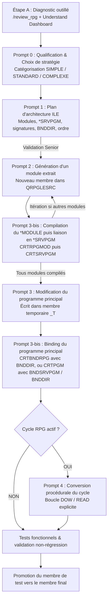
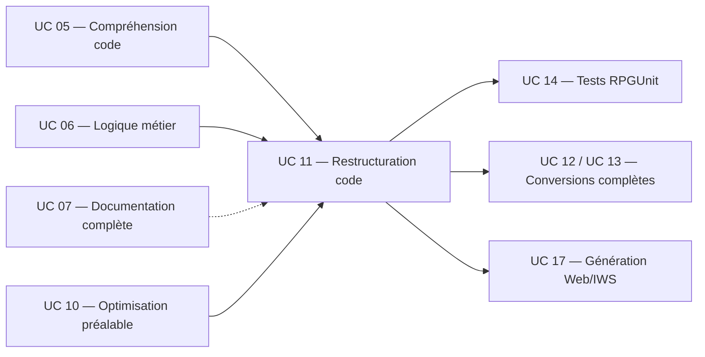

# UC 11 — Restructuration, transformation, conversion

> **Catégorie :** Modernisation du code
>
> **Priorité dans le parcours :** 11 — deuxième UC de la Phase 3, suit UC 10 (*Amélioration, optimisation de code*). S'exécute sur un code déjà optimisé et clarifié.
>
> **Mode Bob recommandé :** IBM i Developer (revue RPG, qualification, conception d'architecture, génération de modules, modification du programme principal, compilation) → IBM i Database (contrôle des objets et procédures dans les catalogues `QSYS2`). Sans Premium Package : Ask pour la conception, Agent pour la compilation et la sauvegarde.

> ⚠️ **UC 10 et UC 11 ne se lancent jamais dans la même session Bob, ni dans la même demande.**
> UC 10 d'abord (renommage des variables, suppression des opcodes obsolètes, clarification), compiler et valider fonctionnellement, puis ouvrir une **nouvelle conversation dédiée** pour UC 11. Si les deux sont mélangés, Bob fusionne le refactoring de surface et la refonte architecturale dans les mêmes diffs, rendant tout diagnostic d'erreur impossible.

> **Dépendance conditionnelle UC 10 / UC 11 / UC 13 :** l'ordre par défaut (UC 10 puis UC 11) s'applique au code déjà en `**FREE` / ILE. Pour un source **RPG III OPM** ou **RPG IV format fixe**, UC 13 (conversion en `**FREE`) peut être un prérequis technique à certaines optimisations avancées d'UC 10 (conversions `EVAL`, extraction `DCL-PR`/`DCL-PROC`) : limiter alors UC 10 aux passes sûres (diagnostic, qualification, code mort, renommages sûrs), exécuter UC 13, puis reprendre les optimisations avancées d'UC 10. Chaque UC reste dans sa propre session Bob.

---

## ⭐ Premium Package IBM i utilisé

- **Workflow : RPG Modernization** (partiel) → [Documentation officielle](https://bob.ibm.com/docs/ide/premium-packages/bob-for-i/workflows)
  Convertit et modernise le code source RPG existant (OPM RPG III ou ILE RPG IV au format fixe) vers du RPG libre (`**FREE`) en appliquant les standards modernes (`CTL-OPT`, suppression des `GOTO`, procédures intégrées). Dans UC 11, ce workflow intervient en support pour moderniser la syntaxe des blocs de code extraits lors de la découpe modulaire.
  **Lancement :** mode IBM i Developer → bouton **Start Workflow** en haut du chat → workspace **Local** ou **Library List** (workspaces supportés par ce workflow) → *RPG Modernization*. Détail : UC00 §1.1.
- **Slash Command : `/review_rpg`** → [Documentation officielle](https://bob.ibm.com/docs/ide/premium-packages/bob-for-i/slash-commands)
  Revue de code complète d'un membre source RPG (format fixe, libre ou mixte) : syntaxe, standards ILE, gestion des erreurs, couplage, dette technique et feuille de route de modernisation. **C'est le point d'entrée diagnostique de UC 11** pour identifier la complexité structurelle, le couplage des sous-routines et les opportunités d'extraction.
  **Mode :** IBM i Developer.
- **Understand Dashboard** → [Documentation officielle](https://bob.ibm.com/docs/ide/premium-packages/bob-for-i/understand)
  *Si Understand est installé* (mise en place, onglets et outils : UC00 §2). Analyse globale du parc applicatif :
  - **Cartographie et analyse d'impact :** identifier tous les programmes appelants avant de modifier une interface ou de scinder un programme.
  - **Détection des objets morts :** éviter de restructurer des composants orphelins ou décommissionnés.
  - **Visualisation de l'architecture ILE :** cartographier les modules liés, les programmes de service (`*SRVPGM`) et les répertoires de liage (`BNDDIR`).
  **Accès :** commande *Open Understand Dashboard* (`vscode-ibmi-bob.openUnderstandDashboard`) ou icône du Dashboard dans la barre de titre du chat Bob.
- **Skills auto-activées :**
  - `rpg-fixed-to-free` — conversion du format fixe vers le format libre (DCL-S, DCL-DS, DCL-PI, DCL-PR)
  - `rpg-refactor-legacy` — suppression des `GOTO`, élimination des sauts conditionnels et conversion des sous-routines en sous-procédures
  - `rpg-procedures-functions` — sous-procédures, prototypes, signatures de paramètres, exports et programmes de service
  - `rpg-ile-understanding` — concepts ILE : modules (`*MODULE`), programmes de service (`*SRVPGM`), répertoires de liage (`BNDDIR`), groupes d'activation (`ACTGRP`)
  - `rpg-opm-to-ile` — conversion du modèle OPM vers ILE : passage en modules et gestion de l'appel procédural
  - `rpg-cycle-explained` — cycle RPG historique, ruptures de contrôle (L1-L9), conversion vers boucles structurées explicites
  - `rpg-indicators` — élimination des indicateurs numérotés (`*INxx`) au profit de variables booléennes locales
  - `rpg-data-structures` — gestion des structures de données partagées vs passage explicite de paramètres
  - `rpg-file-operations` — gestion des déclarations de fichiers (`DCL-F`), règles de partage et isolation d'accès
  - `rpg-code-review` — évaluation de la cohésion, du couplage et de la complexité cyclomatique
  - `understand-impact-analysis` — matrice des dépendances directes et indirectes
  - `understand-program-explainer` — composition du programme, exports et fichiers utilisés
  - `db2-system-catalog` / `db2-services-catalog` — interrogation des catalogues `QSYS2` (`OBJECT_STATISTICS`, `SYSROUTINES`, `PROGRAM_INFO`)
  - *Si le périmètre contient des programmes COBOL for i (le workflow RPG Modernization ne traite que le RPG) :* `cobol-code-refactoring` — simplification de la logique, suppression des `GO TO` et du code mort, réduction de la duplication, en préservant la logique métier ; `cobol-module-service-program` — modules et programmes de service ILE COBOL (imports/exports, binder language, binding directories, groupes d'activation)

> **Ce que le Premium apporte et ce que cet UC conserve :**
> `/review_rpg` et Understand Dashboard établissent le diagnostic de couplage et la cartographie d'impact. Le workflow *RPG Modernization* gère la conversion syntaxique vers le format libre. **Cet UC conserve la méthode de refonte architecturale contrôlée** : qualification des responsabilités, élaboration du plan d'architecture ILE, découpe en modules indépendants avec membre de test, modification du programme principal avec préservation de l'interface publique, conversion du cycle RPG, et compilation pas à pas.

---

## Objectif

Transformer des programmes monolithiques RPG (procéduraux, OPM ou ILE denses) en une **architecture modulaire moderne et maintenable** (sous-procédures internes, modules `*MODULE`, programmes de service `*SRVPGM`, programmes `*PGM`), en isolant les responsabilités métier et en éliminant les variables globales partagées, **sans modifier le comportement fonctionnel externe ni casser les appelants**.

**C'est l'UC le plus engageant de la Phase 3 — Modernisation du code.**
Contrairement à UC 10 qui améliore la lisibilité de surface (renommages, opcodes) à structure constante, UC 11 modifie l'organisation physique et logique du code :
- Découpage des gros monolithes en composants spécialisés à responsabilité unique.
- Transformation des sous-routines spaghetti (`BEGSR`/`EXSR`/`GOTO`) en sous-procédures paramétrées ou modules réutilisables.
- Encapsulation des données (passage de paramètres typés au lieu de variables globales mutées à distance).
- Conversion du cycle RPG implicite en algorithme procédural explicite (`DOW`, `READ`, détection de rupture).
- Modularisation ILE avec programmes de service (`*SRVPGM`) et répertoires de liage (`BNDDIR`).

**Critère de succès principal :** Le programme restructuré et ses modules extraits compilent sans erreur, respectent les signatures attendues par les appelants existants, et produisent des résultats fonctionnels rigoureusement identiques à l'original sur un jeu de données réel.

---

## Prérequis

- **Phase :** Phase 3 — Modernisation du code
- **UC précédents requis :**
  - **UC 05 — Compréhension de code** (**obligatoire**) : indispensable pour connaître l'arborescence des sous-routines, la liste des variables et la logique globale.
  - **UC 06 — Logique métier** (**obligatoire**) : indispensable pour identifier les frontières des règles métier à extraire sans dénaturer les calculs ou validations.
  - **UC 07 — Documentation complète** (**recommandé**) : spécifications techniques et matrice de références croisées (appelants).
  - **UC 10 — Amélioration, optimisation de code** (**fortement recommandé**) : restructurer un code dont les variables sont déjà renommées et les opcodes clarifiés réduit considérablement le risque d'erreur.
- **Livrables requis :**
  - `{appId}-comprehension-{composant}-report-{YYYYMMDD-HHmm}.md` — UC 05 : cartographie des sous-routines et flux (**obligatoire**)
  - `{appId}-logique-{composant}-regles-{YYYYMMDD-HHmm}.md` — UC 06 : catalogue des règles métier et validations (**obligatoire**)
  - `{appId}-doc-spec-tech-{YYYYMMDD-HHmm}.md` — UC 07 : interfaces actuelles et structures de données (recommandé)
  - `{appId}-doc-matrice-{YYYYMMDD-HHmm}.md` — UC 07 : liste des programmes appelants à préserver (recommandé)
  - `{appId}-optim-{composant}-diff-{YYYYMMDD-HHmm}.md` — UC 10 : source déjà assaini (si UC 10 exécuté)
- **Niveau Bob recommandé :** Avancé
- **Bob Coins estimés :** ⚠️ *À calibrer après le lab UC 11 sur FLGHT400.*

> ⚠️ **Un développeur RPG senior doit être présent** pour valider le plan d'architecture ILE (Prompt 1) avant toute génération de module. La conception de l'architecture ILE (choix entre sous-procédures internes, `*MODULE` ou `*SRVPGM`) engage la maintenabilité future de l'application.
>
> ⚠️ **Règle absolue du membre de test :** Bob n'écrit JAMAIS directement dans le membre source d'origine. Les modules extraits sont créés dans de nouveaux membres dédiés, et le programme principal modifié est écrit dans un membre temporaire de test (ex. `[NOM_PGM]_T`).

---

## Exemple concret — Lab FLGHT400

| Livrable | Fichier lab | Ce qu'il illustre |
|---|---|---|
| Rapport de modernisation RPG | [`../labs_FLGHT400_results/FLGHT403_FRS409_modernization_report.md`](../labs_FLGHT400_results/FLGHT403_FRS409_modernization_report.md) | Modernisation de `FRS409` (OPM format fixe vers RPGLE Free) avec passage par un membre de test temporaire `FRS409_T` (compilé en `*PGM` de test, validé puis promu en membre final). Transformation du bloc de contrôle `CAS/ENDCS` en structure `IF/ELSEIF` moderne. |
| Audit du parc applicatif (candidats) | [`../labs_FLGHT400_results/FLGHT403_cpu_jobs_programs_audit.md`](../labs_FLGHT400_results/FLGHT403_cpu_jobs_programs_audit.md) | Inventaire de 34 programmes non recompilés depuis plus de 5 ans, dont 25 programmes OPM RPG de 1997. Identification des programmes batchs monolithiques candidats prioritaires à la restructuration ILE. |
| Explication fonctionnelle du pilote | [`../labs_FLGHT400_results/FLGHT403_FRS409_explanation.md`](../labs_FLGHT400_results/FLGHT403_FRS409_explanation.md) | Analyse détaillée des entrées/sorties et sous-routines de `FRS409`, servant de référence fonctionnelle avant toute découpe. |

> 💡 Le lab complet d'extraction multi-modules ILE (`*SRVPGM` + `BNDDIR`) sera exécuté lors de la session dédiée UC 11 sur FLGHT400.

---

## Impact de la complexité sur la stratégie de restructuration

Comme en UC 08, UC 09 et UC 10, le vocabulaire **SIMPLE / STANDARD / COMPLEXE** est unifié, mais calibré sur les critères structurels propres à UC 11 :

```
                  ┌─────────────────────────────────────────┐
                  │ Qualification du programme (Prompt 0)   │
                  │ (/review_rpg + Understand Dashboard)    │
                  └────────────────────┬────────────────────┘
                                       │
            ┌──────────────────────────┼──────────────────────────┐
            ▼                          ▼                          ▼
   ┌─────────────────┐        ┌─────────────────┐        ┌─────────────────┐
   │     SIMPLE      │        │    STANDARD     │        │    COMPLEXE     │
   │ 1-2 responsab.  │        │ 2-4 responsab.  │        │ >4 responsab.   │
   │ Peu de var. part│        │ Couplage moyen  │        │ Cycle RPG actif │
   │ Pas de cycle RPG│        │ Cycle simple    │        │ Écrans 5250     │
   └────────┬────────┘        └────────┬────────┘        └────────┬────────┘
            │                          │                          │
            ▼                          ▼                          ▼
   Extraction directe         Plan d'architecture        Périmètre restreint
   en sous-procédures         complet validé             pour le POC :
   ou 1 module *MODULE        Extraction par lot         isoler le bloc clé,
   (Prompt 1 → 2 → 3)         (Prompt 1 → 2 → 3bis → 3)  reporter le reste
```

### Programmes SIMPLE — 1 à 2 responsabilités séparables, faible couplage
- Moins de 500 lignes, sous-routines linéaires, pas de variables globales mutées dans tous les sens, pas de cycle RPG.
- **Stratégie :** Extraction directe en sous-procédures internes dans le même source ou création d'un unique module de service `*SRVPGM`.
- **Séquence :** Prompt 0 → Prompt 1 → Prompt 2 → Prompt 3-bis → Prompt 3 → Prompt 3-bis.

### Programmes STANDARD — 2 à 4 responsabilités, couplage moyen ou cycle simple
- 500 à 1 500 lignes, plusieurs sous-routines avec variables partagées, ou cycle RPG simple sans ruptures imbriquées.
- **Stratégie :** Plan d'architecture validé par un senior, découpe en 2 ou 3 modules ILE, compilation et test de chaque module individuellement avant de modifier le programme principal.
- **Séquence :** Prompt 0 → Prompt 1 (revue humaine) → Prompt 2 (module 1) → Prompt 3-bis → Prompt 2 (module 2) → Prompt 3-bis → Prompt 3 (programme principal) → Prompt 3-bis → Prompt 4 (si cycle).

### Programmes COMPLEXE — > 4 responsabilités, cycle RPG actif à ruptures multiples, écrans 5250 ou transactions
- Plus de 1 500 lignes, cycle RPG avec indicateurs L1-L9, logique métier entrelacée avec `EXFMT` d'écrans 5250 ou transactions `COMMIT`/`ROLLBACK`.
- **Stratégie :** Découpage par étapes. Pour le POC, isoler la responsabilité métier la plus indépendante (ex. calcul de tarification ou validation de règles) et la traiter en mode STANDARD. Reporter le reste du monolithe.

---

## Démarrer une session Bob

### 1. Choix de l'espace de travail

Dans Bob, trois espaces coexistent :
- **Librairies IBM i / QSYS ⭐ (Espace principal par défaut) :** Tous les membres sources (`QRPGLESRC`, `QRPGSRC`), les modules (`*MODULE`), les programmes de service (`*SRVPGM`), les répertoires de liage (`BNDDIR`) et les compilations s'exécutent directement dans cet espace.
- **Workspace local :** Contient la documentation markdown de pilotage, les plans d'architecture et les rapports d'analyse dans `bob-reports/`.
- **$HOME IFS :** Répertoire de travail sur l'IFS IBM i pour les fichiers temporaires ou scripts de build.

### 2. Ouvrir les sources dans l'éditeur (Open in Editor)

Avant d'exécuter les commandes Bob :
1. Dans l'extension **Code for IBM i** → navigateur d'objets QSYS.
2. Ouvrir le membre source à restructurer : ex. `FLGHT403/QRPGLESRC(FRS409)`.
3. S'assurer que le mode actif dans Bob est **IBM i Developer**.

### 3. Fichiers de contexte à charger

Pour que Bob conçoive une architecture cohérente, lui fournir en contexte :
- Le rapport de compréhension : `{appId}-comprehension-{composant}-report-*.md`
- Le rapport de règles métier : `{appId}-logique-{composant}-regles-*.md`
- La spécification technique et la matrice d'appelants (si disponibles) : `{appId}-doc-spec-tech-*.md`, `{appId}-doc-matrice-*.md`
- Le rapport d'optimisation préalable : `{appId}-optim-{composant}-diff-*.md`

---

## Séquence de restructuration Premium



---

## Prompts

### Étape A — Diagnostic outillé : `/review_rpg` et Understand Dashboard

Avant tout prompt libre, exécuter la slash command Premium dans le chat Bob :

```text
/review_rpg
```

**Espace :** IBM i QSYS (sur le membre source ouvert dans l'éditeur).
**Mode :** IBM i Developer.
**Skills clés mobilisées :** `rpg-code-review`, `understand-impact-analysis` (si Understand installé).

Bob analyse la structure du source, détecte le format, relève la dette technique et propose une feuille de route de modernisation.
Si Understand est disponible, ouvrir le tableau de bord (commande *Open Understand Dashboard*, voir UC00 §2) pour visualiser la liste des programmes appelants et les dépendances du composant.

---

### Prompt 0 — Qualification et choix de stratégie

> **Point d'entrée obligatoire pour chaque programme à restructurer.**
> Ce prompt analyse le source ouvert et les fichiers de compréhension pour déterminer la faisabilité, le niveau de couplage et la catégorie de restructuration.

**Objectif :** Produire le rapport de qualification identifiant les responsabilités extractibles, les variables partagées, le cycle RPG et la catégorie cible.

**Quand l'utiliser :** Dès le début de la session UC 11, après `/review_rpg`.

**Input requis :**
- Membre source ouvert dans l'éditeur : `[NOM_LIB]/[FICHIER_SOURCE]([NOM_PROGRAMME])`
- Fichiers de contexte UC 05, UC 06 et diagnostic `/review_rpg`.

**Espace :** IBM i QSYS + Local (lecture sur IBM i, sauvegarde du rapport en local).
**Mode :** IBM i Developer.
**Skills clés mobilisées :** `rpg-code-review`, `rpg-cycle-explained`, `rpg-indicators`, `understand-impact-analysis` (si Understand installé).

**Prompt :**

```text
Le programme [NOM_PROGRAMME] se trouve dans [NOM_LIB]/QRPGLESRC (ou QRPGSRC).
Le diagnostic /review_rpg et les fichiers de compréhension suivants sont disponibles :
  - bob-reports/{appId}-comprehension-[NOM_PROGRAMME]-report-{YYYYMMDD-HHmm}.md
  - bob-reports/{appId}-logique-[NOM_PROGRAMME]-regles-{YYYYMMDD-HHmm}.md
  - bob-reports/{appId}-doc-matrice-{YYYYMMDD-HHmm}.md (si disponible)

Analyse ce programme et produis en français, en markdown, un rapport de qualification
pour sa restructuration architecturale :

## Qualification UC 11 — [NOM_PROGRAMME]

### 1. Inventaire structurel
| Indicateur | Valeur | Commentaire |
|---|---|---|
| Nombre de lignes de source | ? | Taille totale |
| Nombre de sous-routines (BEGSR / ENDSR) | ? | Blocs procéduraux internes |
| Nombre de sous-procédures existantes (DCL-PROC) | ? | Procédures déjà isolées |
| Cycle RPG actif (*INLR seul, niveaux L1-L9, cycle implicite) | OUI / NON | Détection du cycle historique |
| Nombre de responsabilités fonctionnelles distinctes | ? | Blocs métier autonomes identifiés |
| Nombre de variables globales (portée globale du module) | ? | Variables déclarées hors procédure |
| Programmes appelants identifiés (matrice UC 07 ou Understand) | ? | Nombre d'appelants dont l'interface dépend |
| Programmes appelés directement (CALL / CALLP) | ? | Dépendances externes |
| Présence d'écrans 5250 (EXFMT / WRITE vers DSPF) | OUI / NON | Couplage présentation/métier |
| Présence de gestion transactionnelle (COMMIT / ROLLBACK) | OUI / NON | Risque de scission transactionnelle |

### 2. Cartographie des responsabilités fonctionnelles
Pour chaque responsabilité identifiée :
| N° | Responsabilité métier | Sous-routines associées | Variables exclusives | Variables partagées | Extractibilité |
|---|---|---|---|---|---|
| 1 | Ex: Calcul tarification | CALCTAR, APPLREDUC | wtTaux, wtBase | wtTotalHT, idClient | OUI / NON / PARTIELLE |

Légende Extractibilité :
- OUI : La responsabilité peut être extraite directement avec des interfaces claires.
- PARTIELLE : Extractible uniquement après un découplage préalable des variables partagées.
- NON : Couplage trop fort avec l'état global ou les écrans 5250 pour être isolée dans ce lot.

### 3. Facteurs de complexité et de risque
Évaluer par OUI / NON / À CONFIRMER :
- [ ] Cycle RPG actif avec niveaux de contrôle (L1-L9) ou lectures séquentielles implicites
- [ ] Variables globales partagées > 15 (fort couplage entre sous-routines)
- [ ] Interface publique appelée par > 3 programmes externes (impact large en cas de changement de signature)
- [ ] Logique transactionnelle imbriquée (COMMIT/ROLLBACK au milieu d'un calcul)
- [ ] Logique d'affichage 5250 entrelacée avec les calculs métier (EXFMT dans la sous-routine de calcul)
- [ ] Fichiers de données ouverts dans plusieurs sous-routines candidates à l'extraction
- [ ] Présence d'indicateurs numérotés (*IN01-*IN99) conditionnant des traitements partagés

### 4. Catégorie et feuille de route recommandée
Conclure sur la catégorie UC 11 :
- [ ] **SIMPLE** : 1 à 2 responsabilités, peu de variables partagées, pas de cycle RPG.
      → Feuille de route : Extraction directe en sous-procédures internes ou 1 module de service (Prompts 1 → 2 → 3bis → 3).
- [ ] **STANDARD** : 2 à 4 responsabilités, variables partagées gérables, cycle simple.
      → Feuille de route : Plan d'architecture complet (Prompt 1), validation senior, extraction par lot (Prompts 2 & 3bis), modification du programme principal (Prompt 3), conversion cycle si besoin (Prompt 4).
- [ ] **COMPLEXE** : > 4 responsabilités, cycle RPG à ruptures, présence d'écrans 5250 ou de transactions.
      → Feuille de route : Découpage ciblé pour le POC (isoler uniquement la responsabilité N°1 la plus autonome en STANDARD, reporter le reste).

Si la catégorie est COMPLEXE, précise explicitement le périmètre retenu pour le POC et ce qui est reporté.
```

**Livrable produit :**
- Dans l'espace local : `bob-reports/{appId}-restruct-[NOM_PROGRAMME]-qualification-{YYYYMMDD-HHmm}.md`
- Instruction de sauvegarde explicite à Bob :
  ```text
  Sauvegarde cette qualification dans le fichier local :
  bob-reports/{appId}-restruct-[NOM_PROGRAMME]-qualification-{YYYYMMDD-HHmm}.md
  ```

---

### Prompt 1 — Plan d'architecture de la restructuration

> **Étape de conception architecturale obligatoire.**
> Ce prompt formalise l'architecture cible ILE, le découpage en modules, les prototypes, le mode de partage des données et l'ordre d'extraction. **Aucun code source n'est généré à cette étape.**

**Objectif :** Concevoir et valider le plan d'architecture ILE avant toute modification physique de source.

**Quand l'utiliser :** Après validation du rapport de qualification (Prompt 0).

**Input requis :**
- Rapport de qualification : `bob-reports/{appId}-restruct-[NOM_PROGRAMME]-qualification-*.md`
- Rapport de règles métier : `bob-reports/{appId}-logique-[NOM_PROGRAMME]-regles-*.md`

**Espace :** IBM i QSYS + Local.
**Mode :** IBM i Developer.
**Skills clés mobilisées :** `rpg-ile-understanding`, `rpg-procedures-functions`, `rpg-data-structures`, `rpg-file-operations`.

**Prompt :**

```text
Sur la base du rapport de qualification de [NOM_PROGRAMME] et des règles métier documentées dans
bob-reports/{appId}-logique-[NOM_PROGRAMME]-regles-{YYYYMMDD-HHmm}.md :

Élabore en français, en markdown, le plan d'architecture ILE de la restructuration :

## Plan d'architecture ILE UC 11 — [NOM_PROGRAMME]

### 1. État des lieux architectural
- Organisation actuelle (monolithe OPM / ILE, sous-routines, flux principal)
- Données globales actuelles et points de couplage
- Interface d'entrée actuelle (*ENTRY PLIST ou DCL-PI existant)
- Fichiers accédés (mode natif RLA ou SQL embarqué issu de UC 09)

### 2. Architecture cible et découpage modulaire
Définir l'ensemble des composants cibles :
| Composant | Type IBM i (*PGM / *MODULE / *SRVPGM / Procédure interne) | Responsabilité métier exclusive | Fichiers accédés exclusivement | Répertoire de liage (BNDDIR) |
|---|---|---|---|---|
| [NOM_MODULE_1] | *MODULE (intégré à *SRVPGM) | Ex: Validation client | CUSTMAST | BND_VENTES |
| [NOM_MODULE_2] | *MODULE (intégré à *SRVPGM) | Ex: Calcul des remises | — (en mémoire) | BND_VENTES |
| [NOM_PROGRAMME] | *PGM (programme principal allégé) | Orchestration & navigation | ORDERS, ORDERDET | BND_VENTES |

### 3. Spécification des interfaces et prototypes (DCL-PR / DCL-PI)
Pour chaque module ou procédure extrait :
- Nom de la procédure / du module (convention : [NOM_ORIGINAL]_[SUFFIXE_ROLE], ex: `ORD400_CALC`)
- Type de retour (si fonction) ou void
- Liste ordonnée des paramètres avec :
  - Nom du paramètre (préfixe `p_`)
  - Type et longueur RPGLE (`CHAR(...)`, `PACKED(...)`, `IND`, `LIKEDS(...)`)
  - Sens du passage : `CONST` (entrée pure / IN), `VALUE` (valeur), par référence modifiable (OUT / INOUT)
  - Description fonctionnelle

### 4. Stratégie de partage des données
- Quelles variables globales deviennent des paramètres passés en argument ?
- Y a-t-il des structures de données (`QUALIFIED` / `LIKEDS`) à créer pour regrouper les paramètres liés ?
- Confirmer qu'aucune variable globale masquée ne subsiste entre composants.

### 5. Préservation de l'interface publique du programme principal
L'interface externe appelante du programme principal [NOM_PROGRAMME] doit-elle être modifiée ?
- **NON (cas nominal POC)** : Confirmer que la signature `*ENTRY PLIST` / `DCL-PI` reste 100% identique pour ne casser aucun des programmes appelants identifiés.
- **OUI** : Si une modification est indispensable, lister la totalité des appelants impactés et le plan de migration associé.

### 6. Déclaration et ouverture des fichiers (Règle d'isolation)
- Rappeler la règle d'isolation : Un fichier déclaré en `DCL-F` dans un module extrait NE DOIT PAS être ouvert simultanément par le programme principal sans gestion explicite du partage (`SHARE(*YES)` ou fermeture préalable), sous peine d'erreur d'exécution `MCH3401`.

### 7. Ordre d'extraction et de test progressif
Définir la séquence d'implémentation (du composant le plus indépendant vers le plus dépendant) :
1. Module 1 : [NOM_MODULE_1] (aucun appel externe) → Générer → Compiler en *MODULE → Tester
2. Module 2 : [NOM_MODULE_2] → Générer → Compiler en *MODULE → Lier dans le *SRVPGM (CRTSRVPGM) → Tester
3. Programme principal : [NOM_PROGRAMME]_T → Adapter les appels en CALLP → Binding vers le *SRVPGM (CRTBNDRPG avec BNDDIR, ou CRTPGM avec BNDSRVPGM) → Tester global

### 8. Risques identifiés et parades techniques
Lister les 3 points de vigilance majeurs (ex: groupe d'activation `ACTGRP`, gestion des erreurs d'appel, transactions ouvertes).

⚠️ Ne génère aucun code source complet dans ce prompt. Le plan doit être relu et validé par un développeur senior avant de lancer l'étape de génération.
```

**Livrable produit :**
- Dans l'espace local : `bob-reports/{appId}-restruct-[NOM_PROGRAMME]-plan-archi-{YYYYMMDD-HHmm}.md`
- Instruction de sauvegarde explicite :
  ```text
  Sauvegarde ce plan d'architecture dans le fichier local :
  bob-reports/{appId}-restruct-[NOM_PROGRAMME]-plan-archi-{YYYYMMDD-HHmm}.md
  ```

---

### Prompt 2 — Génération d'un module extrait (lot par lot)

> **Exécution par lot pour chaque module identifié au Prompt 1.**
> Génère le code source RPGLE entièrement libre (`**FREE`) du module extrait, en appliquant les règles d'isolation des variables et d'interface typée.

**Objectif :** Générer le code d'un module autonome à partir des sous-routines du programme d'origine.

**Quand l'utiliser :** Après validation humaine du plan d'architecture (Prompt 1), pour chaque module dans l'ordre défini.

**Input requis :**
- Plan d'architecture validé : `bob-reports/{appId}-restruct-[NOM_PROGRAMME]-plan-archi-*.md`
- Sous-routines sources identifiées dans le programme d'origine.

**Espace :** IBM i QSYS (création du membre dans `QRPGLESRC`).
**Mode :** IBM i Developer.
**Skills clés mobilisées :** `rpg-procedures-functions`, `rpg-refactor-legacy`, `rpg-free-format-fundamentals`, `rpg-indicators`.

**Prompt :**

```text
Sur la base du plan d'architecture ILE (bob-reports/{appId}-restruct-[NOM_PROGRAMME]-plan-archi-{YYYYMMDD-HHmm}.md),
génère le code source RPGLE entièrement libre (**FREE) pour le module suivant :

- Nom du module : [NOM_MODULE] (ex: ORD400_CALC)
- Responsabilité : [DESCRIPTION_RESPONSABILITE]
- Sous-routines d'origine extraites : [LISTE_SOUS_ROUTINES]
- Type IBM i cible : *MODULE (destiné à un *SRVPGM) ou sous-procédure exportée

Structure attendue du source RPGLE libre :

1. En-tête de contrôle (CTL-OPT) :
   **FREE
   CTL-OPT NOMAIN OPTION(*NODEBUGIO:*SRCSTMT); // Pour un module sans point d'entrée principal

2. Déclarations de fichiers (DCL-F) :
   Uniquement si le module nécessite un accès exclusif à un fichier de données.

3. Déclarations de types et constantes (DCL-C, DCL-DS) :
   Uniquement les structures et constantes requises pour cette responsabilité.

4. Interface de procédure (DCL-PROC / DCL-PI) :
   DCL-PROC [NOM_PROCEDURE] EXPORT;
     DCL-PI *N [TYPE_RETOUR];
       p_[PARAM1] [TYPE] CONST;  // IN
       p_[PARAM2] [TYPE];        // OUT / INOUT
     END-PI;

     // Variables locales à la procédure (DCL-S)
     ...

     // Corps de la logique métier extraite et adaptée
     ...

     RETURN [VALEUR];
   END-PROC;

Règles de génération :
- Remplacer toutes les anciennes variables globales par les paramètres d'interface ou des variables locales `DCL-S`.
- Éliminer tout opcode obsolète (`MOVE`, `GOTO`, `CABxx`) et remplacer par des affectations ou des structures conditionnelles modernes (`IF/ELSE`, `SELECT/WHEN`).
- Éliminer les indicateurs numérotés au profit de conditions explicites ou de variables booléennes `IND`.
- Insérer l'en-tête de traçabilité suivant :
  // ============================================================
  // MODULE : [NOM_MODULE]
  // Extrait de : [NOM_LIB]/QRPGLESRC([NOM_PROGRAMME])
  // Responsabilité : [DESCRIPTION_RESPONSABILITE]
  // Date de génération : [YYYY-MM-DD]
  // Statut : Module de test — à valider avant promotion
  // ============================================================

Écris ce code dans le membre source IBM i :
[NOM_LIB]/QRPGLESRC([NOM_MODULE])
```

**Livrable produit :**
- Sur l'IBM i : `[NOM_LIB]/QRPGLESRC([NOM_MODULE])`
- Dans l'espace local : `bob-reports/{appId}-restruct-[NOM_MODULE]-spec-module-{YYYYMMDD-HHmm}.md` (sauvegarde de la documentation de spécification du module).

---

### Prompt 3-bis — Test de compilation par Bob (après chaque module ou modification)

> **Exécution systématique après chaque génération de module (Prompt 2) et après modification du programme principal (Prompt 3).**
> Bob lance la commande de compilation ILE appropriée via le mode IBM i Developer et analyse le journal de compilation en cas d'erreur.

**Objectif :** Valider la conformité syntaxique et la création physique de l'objet sur l'IBM i de test, en distinguant trois étapes ILE différentes : **compilation** d'un `*MODULE` (`CRTRPGMOD`), **liaison** de modules dans un `*SRVPGM` (`CRTSRVPGM`), **binding** du programme principal (`CRTBNDRPG` ou `CRTPGM`). La compilation individuelle d'un module ne valide pas l'ensemble : les symboles externes ne sont résolus qu'aux étapes de liaison et de binding.

**Quand l'utiliser :** Immédiatement après avoir écrit un module ou le programme principal modifié.

**Input requis :** Nom du membre et type d'objet cible.

**Espace :** IBM i QSYS.
**Mode :** IBM i Developer.
**Skills clés mobilisées :** `rpg-ile-understanding`, `rpg-procedures-functions`.

**Prompt :**

```text
Le membre [NOM_MODULE_OU_PGM] a été écrit dans [NOM_LIB]/QRPGLESRC.

Lance la compilation sur l'environnement IBM i de test :

1. COMPILATION d'un module ILE (*MODULE) — compilation seule, sans liaison :
   CRTRPGMOD MODULE([NOM_LIB_TEST]/[NOM_MODULE])
             SRCFILE([NOM_LIB]/QRPGLESRC)
             SRCMBR([NOM_MODULE])
             OPTION(*EVENTF) OUTPUT(*PRINT)
             DBGVIEW(*SOURCE)

2. LIAISON des modules compilés dans un programme de service (*SRVPGM) — création ou mise à jour :
   CRTSRVPGM SRVPGM([NOM_LIB_TEST]/[NOM_SRVPGM])
              MODULE([NOM_LIB_TEST]/[NOM_MODULE_1] [NOM_LIB_TEST]/[NOM_MODULE_2])
              EXPORT(*ALL)
              ACTGRP(*CALLER)

3. BINDING du programme principal (*PGM) vers le *SRVPGM — deux voies, selon le plan d'architecture :
   a) Le programme principal est compilé et lié en une commande ; le *SRVPGM est résolu via le répertoire de liage (BNDDIR) :
   CRTBNDRPG PGM([NOM_LIB_TEST]/[NOM_PROGRAMME_TEST])
             SRCFILE([NOM_LIB]/QRPGLESRC)
             SRCMBR([NOM_PROGRAMME_TEST])
             BNDDIR([NOM_LIB_TEST]/[NOM_BNDDIR])
             OPTION(*EVENTF) OUTPUT(*PRINT)
             DBGVIEW(*SOURCE)
   b) Le programme principal a d'abord été compilé en *MODULE (CRTRPGMOD, comme au point 1) ; le binding est fait par CRTPGM :
   CRTPGM PGM([NOM_LIB_TEST]/[NOM_PROGRAMME_TEST])
          MODULE([NOM_LIB_TEST]/[NOM_MODULE_PRINCIPAL])
          BNDSRVPGM([NOM_LIB_TEST]/[NOM_SRVPGM])
          BNDDIR([NOM_LIB_TEST]/[NOM_BNDDIR])
          ACTGRP(*CALLER)

N'exécuter que l'étape correspondant au membre ou à l'objet concerné ; ne pas présenter la réussite d'une étape comme la validation des suivantes.
Cas du SQL embarqué : si le source contient `EXEC SQL` (membre SQLRPGLE), CRTRPGMOD et CRTBNDRPG ne conviennent pas (ils ne traitent pas EXEC SQL) ; utiliser CRTSQLRPGI avec OBJTYPE(*MODULE) pour un module (le binding du programme principal passe alors par CRTPGM, voie b) ou OBJTYPE(*PGM) pour un programme autonome :
   CRTSQLRPGI OBJ([NOM_LIB_TEST]/[NOM_OBJET])
              SRCFILE([NOM_LIB]/QRPGLESRC)
              SRCMBR([NOM_MEMBRE])
              OBJTYPE(*MODULE)
              OPTION(*EVENTF)
              OUTPUT(*PRINT)
              DBGVIEW(*SOURCE)
Le listing passe par OUTPUT(*PRINT) ; ne pas recopier OPTION(*LIST) pour CRTSQLRPGI (non valide pour cette commande).

Analyse le journal d'événements et produis le bilan en français :
- Statut : SUCCÈS ou ÉCHEC
- En cas d'erreur : Tableau détaillant (Ligne, Code erreur IBM i ex: RNFxxxx, Message, Cause probable et Action corrective proposée).
- Vérifications spécifiques UC 11 :
  * Incohérence de prototype (DCL-PR différent du DCL-PI)
  * Variable globale non déclarée dans le module extrait (symbole non résolu)
  * Conflit d'ouverture de fichier ou groupe d'activation incompatible
```

---

### Prompt 3 — Modification du programme principal

> **S'exécute une fois que tous les modules extraits ont été générés et compilés avec succès.**
> Adapte le programme principal en remplaçant les sous-routines extraites par des appels de procédures (`CALLP`), en intégrant les prototypes (`DCL-PR`), et en nettoyant les variables globales orphelines.

**Objectif :** Alléger le programme principal en déléguant les traitements aux nouveaux modules, tout en conservant scrupuleusement son interface externe.

**Quand l'utiliser :** Dès que tous les modules du Prompt 2 sont compilés sans erreur (Prompt 3-bis).

**Input requis :**
- Source original : `[NOM_LIB]/QRPGLESRC([NOM_PROGRAMME])`
- Plan d'architecture : `bob-reports/{appId}-restruct-[NOM_PROGRAMME]-plan-archi-*.md`
- Liste des prototypes des modules extraits.

**Espace :** IBM i QSYS (écriture dans le membre de test `[NOM_PROGRAMME]_T`).
**Mode :** IBM i Developer.
**Skills clés mobilisées :** `rpg-procedures-functions`, `rpg-ile-understanding`, `rpg-refactor-legacy`, `rpg-data-structures`.

**Prompt :**

```text
Sur la base du plan d'architecture ILE validé et des modules déjà compilés avec succès :
  - Module [NOM_MODULE_1] (procédure [NOM_PROC_1])
  - Module [NOM_MODULE_2] (procédure [NOM_PROC_2])

Génère la version modifiée du programme principal [NOM_PROGRAMME].
⚠️ RÈGLE DE SÉCURITÉ : Écris le résultat dans le membre de test [NOM_LIB]/QRPGLESRC([NOM_PROGRAMME]_T).
Ne jamais écraser le membre source original [NOM_PROGRAMME].

Modifications structurelles à opérer :

1. En-tête de contrôle (CTL-OPT) :
   Ajouter la référence au répertoire de liage ou au programme de service si nécessaire :
   CTL-OPT DFTACTGRP(*NO) ACTGRP(*CALLER) BNDDIR('[NOM_BNDDIR]') OPTION(*NODEBUGIO:*SRCSTMT);

2. Déclaration des prototypes (DCL-PR) :
   Insérer pour chaque module externe son prototype exact correspondant au DCL-PI généré :
   DCL-PR [NOM_PROCEDURE] [TYPE_RETOUR];
     p_[PARAM1] [TYPE] CONST;
     p_[PARAM2] [TYPE];
   END-PR;

3. Remplacement des appels de sous-routines :
   Pour chaque sous-routine extraite :
   - Remplacer l'instruction `EXSR [NOM_SOUS_ROUTINE]` par l'appel procédural typé `CALLP [NOM_PROCEDURE]([ARGS])`
     ou l'affectation `variable = [NOM_FONCTION]([ARGS])`.
   - Laisser l'ancien appel en commentaire pour faciliter la relecture :
     // ANCIEN : EXSR [NOM_SOUS_ROUTINE]
     CALLP [NOM_PROCEDURE]([ARGS]);

4. Suppression des blocs BEGSR / ENDSR extraits :
   - Retirer le corps des sous-routines déplacées dans les modules externes.
   - Conserver uniquement les sous-routines internes non extraites (ex: orchestration générale, gestion écran).

5. Nettoyage des variables :
   - Supprimer les déclarations `DCL-S` des variables devenues strictement locales aux modules extraits.
   - Conserver les variables nécessaires à l'orchestration et au passage des paramètres.

6. Garantie d'interface externe :
   - L'interface d'entrée du programme (*ENTRY PLIST ou DCL-PI principal) doit rester STRICTEMENT INCHANGÉE.

Produis également la table de concordance des modifications :
| Sous-routine extraite | Module cible | Procédure appelée | Paramètres passés (IN / OUT) |
```

**Livrable produit :**
- Sur l'IBM i : `[NOM_LIB]/QRPGLESRC([NOM_PROGRAMME]_T)`
- Dans l'espace local : `bob-reports/{appId}-restruct-[NOM_PROGRAMME]-diff-{YYYYMMDD-HHmm}.md` (journal des modifications apportées au programme principal).

---

### Prompt 4 — [Conditionnel] Conversion du cycle RPG en structure procédurale

> **Prompt conditionnel — à n'utiliser que si le Prompt 0 a confirmé : `Cycle RPG actif = OUI`.**
> Convertit le cycle historique implicite (`*GETIN`, `*DETC`, `*TOTC`, ruptures L1-L9, terminaison par `*INLR`) en une boucle procédurale explicite et maîtrisée.

**Objectif :** Remplacer le cycle RPG implicite par une boucle `DOW` explicite avec lecture ordonnée et détection programmatique des ruptures de niveau.

**Quand l'utiliser :** Uniquement sur les programmes dont le flux d'exécution repose sur le cycle RPG historique.

**Input requis :**
- Section "Cycle RPG actif" de la qualification (Prompt 0).
- Source du programme de test `[NOM_PROGRAMME]_T`.

**Espace :** IBM i QSYS (sur le membre `[NOM_PROGRAMME]_T`).
**Mode :** IBM i Developer.
**Skills clés mobilisées :** `rpg-cycle-explained`, `rpg-refactor-legacy`, `rpg-opm-to-ile`.

**Prompt :**

```text
Le programme [NOM_PROGRAMME]_T utilise le cycle RPG implicite identifié lors du Prompt 0 :
[Copier ici la synthèse du cycle : fichier primaire, indicateurs de niveau L1-L9, sous-routines de total].

Convertis ce cycle en une structure algorithmique procédurale explicite en RPGLE libre (**FREE) :

1. Tableau de correspondance du cycle :
| Mécanisme du cycle | Comportement historique | Équivalent procédural structuré |
|---|---|---|
| Fichier primaire (*GETIN) | Lecture automatique avant chaque cycle | Boucle explicite `DOW NOT %EOF(fichier)` ou `DOW SQLCODE = 0` |
| Ruptures de contrôle (L1-L9) | Détection automatique sur changement de clé | Variables de rupture `save_CleL1` + test conditionnel `IF cle <> save_CleL1` |
| Sous-routines de détail (*DETC) | Exécutées à chaque enregistrement | Corps principal de la boucle |
| Sous-routines de total (*TOTC) | Exécutées avant le détail du groupe suivant | Exécution conditionnelle lors du changement de clé + traitement final hors boucle |
| Fin de fichier / Terminaison | Déclenchée par EOF sur fichier primaire | Sortie de boucle `ENDDO`, exécution des derniers totaux, `*INLR = *ON`, `RETURN` |

2. Structure algorithmique à générer :

   // Initialisation lecture primaire
   READ FichierPrimaire;
   save_CleL1 = CleL1;

   DOW NOT %EOF(FichierPrimaire);
     // Détection de rupture de niveau (remplace L1)
     IF CleL1 <> save_CleL1;
       EXSR TotalL1; // ou appel procédure dédiée
       save_CleL1 = CleL1;
     ENDIF;

     // Traitement de détail
     EXSR TraiterDetail;

     // Lecture de l'enregistrement suivant
     READ FichierPrimaire;
   ENDDO;

   // Traitement des totaux de dernière rupture
   EXSR TotalL1;

   // Fermeture propre
   *INLR = *ON;
   RETURN;

3. Règles impératives :
   - Respecter scrupuleusement la chronologie du cycle : en RPG historique, les totaux de rupture s'exécutent avec les données du groupe précédent avant que le nouveau détail ne soit traité.
   - Ne pas modifier la logique interne des calculs de total, seulement leur condition de déclenchement.
```

**Livrable produit :**
- Mis à jour sur l'IBM i : `[NOM_LIB]/QRPGLESRC([NOM_PROGRAMME]_T)`
- Documenté dans : `bob-reports/{appId}-restruct-[NOM_PROGRAMME]-diff-{YYYYMMDD-HHmm}.md`.

---

### Prompt 5 — [Complément périmètre] Plan de restructuration applicative globale

> **Prompt de cadrage pour un ensemble de programmes au niveau d'une application complète.**
> Permet au chef de projet ou à l'architecte de planifier la trajectoire de restructuration, d'identifier les composants mutualisables dans des `*SRVPGM` partagés et d'ordonnancer les lots.

**Objectif :** Établir la feuille de route globale de restructuration pour un périmètre applicatif complet.

**Quand l'utiliser :** En phase de cadrage global ou après avoir validé un premier programme pilote.

**Input requis :**
- Rapports de compréhension globale (UC 05), matrice d'appels (UC 07) et audit du parc applicatif.

**Espace :** Local (sauvegarde du plan global dans `bob-reports/`).
**Mode :** IBM i Developer (ou Agent pour la rédaction).
**Skills clés mobilisées :** `rpg-code-review`, `understand-app-overview` (si Understand installé), `db2-system-catalog`.

**Prompt :**

```text
Sur la base de l'audit applicatif de [NOM_APPLICATION] dans [NOM_LIB], des matrices d'appelants
et des règles métier extraites :

Génère en français, en markdown, le plan de restructuration global de l'application :

## Plan de restructuration globale UC 11 — [NOM_APPLICATION]

### 1. Cartographie du périmètre et priorisation
| Programme | Lignes | Responsabilités | Cycle RPG | Nb Appelants | Catégorie (SIMPLE/STANDARD/COMPLEXE) | Priorité (P1 à P4) | Justification ROI / Risque |
|---|---|---|---|---|---|---|---|

### 2. Programmes exclus du périmètre POC
Lister les programmes trop complexes ou à fort risque transactionnel exclus du POC, avec la justification et les prérequis pour un traitement futur en production.

### 3. Schéma de modularisation cible (Architecture ILE cible)
- Quels programmes de service partagés (*SRVPGM) créer pour l'ensemble de l'application ?
  (Ex: `SRV_CLIENTS`, `SRV_TARIFS`, `SRV_UTILS`)
- Liste des répertoires de liage (`BNDDIR`) à mettre en place.
- Opportunités de factorisation de code dupliqué entre programmes.

### 4. Ordonnancement des chantiers et dépendances
Graphe d'ordre d'exécution pour ne jamais casser un programme appelant en cours de modernisation :
1. Lot 1 : Socle et modules de service partagés indépendants
2. Lot 2 : Programmes batchs métiers de catégorie SIMPLE et STANDARD
3. Lot 3 : Programmes principaux orchestrateurs

### 5. Estimation de charge et trajectoire
| Lot | Composants concernés | Durée estimée avec Bob | Points de contrôle clés |
```

**Livrable produit :**
- Dans l'espace local : `bob-reports/{appId}-restruct-app-plan-perimetre-{YYYYMMDD-HHmm}.md`.

---

## Livrables de cet UC

| Fichier produit | Pattern de nommage | Où Bob l'écrit | Consommé par |
|---|---|---|---|
| Rapport de qualification | `{appId}-restruct-[PGM]-qualification-{YYYYMMDD-HHmm}.md` | Workspace local (`bob-reports/`) | Prompt 1 (Plan d'architecture) |
| Plan d'architecture ILE | `{appId}-restruct-[PGM]-plan-archi-{YYYYMMDD-HHmm}.md` | Workspace local (`bob-reports/`) | Développeur Senior, Prompts 2 et 3 |
| Source du module extrait | `[NOM_LIB]/QRPGLESRC([NOM_MODULE])` | **IBM i QSYS** (membre source) | Compilateur ILE, `CRTSRVPGM` |
| Spécification du module | `{appId}-restruct-[MODULE]-spec-module-{YYYYMMDD-HHmm}.md` | Workspace local (`bob-reports/`) | Documentation technique, UC 14 (RPGUnit) |
| Source programme modifié | `[NOM_LIB]/QRPGLESRC([NOM_PGM]_T)` | **IBM i QSYS** (membre de test) | Compilateur ILE, Tests fonctionnels |
| Diff & traçabilité | `{appId}-restruct-[PGM]-diff-{YYYYMMDD-HHmm}.md` | Workspace local (`bob-reports/`) | Revue de code, promotion en production |
| Plan global périmètre | `{appId}-restruct-app-plan-perimetre-{YYYYMMDD-HHmm}.md` | Workspace local (`bob-reports/`) | Pilotage du projet, planification Phase 4 |

> 💡 **Rappel sur l'espace d'écriture :**
> - Les membres sources (`.RPGLE`) sont créés directement sur l'IBM i dans le fichier source spécifié (`QRPGLESRC`).
> - Les fichiers markdown (`.md`) sont rédigés dans le workspace local sous `bob-reports/`.

---

## Dépendances



---

## Requêtes SQL QSYS2 utiles pour la restructuration

Ces requêtes s'exécutent en mode **IBM i Database** pour auditer les objets créés et contrôler les liaisons ILE :

```sql
-- 1. Contrôler les modules et programmes de service créés dans la bibliothèque de test
SELECT OBJNAME, OBJTYPE, OBJATTRIBUTE, OBJSIZE, CREATION_TIMESTAMP, TEXT_DESCRIPTION
FROM QSYS2.OBJECT_STATISTICS
WHERE OBJLIBRARY = '[NOM_LIB_TEST]'
  AND OBJTYPE IN ('*PGM', '*SRVPGM', '*MODULE')
ORDER BY CREATION_TIMESTAMP DESC;

-- 2. Lister les procédures exportées par un programme de service (*SRVPGM)
SELECT ROUTINE_NAME, SPECIFIC_NAME, ROUTINE_TYPE, EXTERNAL_NAME, PARAMETER_COUNT
FROM QSYS2.SYSROUTINES
WHERE ROUTINE_SCHEMA = '[NOM_LIB_TEST]'
  AND EXTERNAL_NAME LIKE '[NOM_SRVPGM]%'
ORDER BY ROUTINE_NAME;

-- 3. Vérifier les informations de liaison et le répertoire de liage (BNDDIR) d'un programme
SELECT PROGRAM_NAME, PROGRAM_LIBRARY, MODULE_COUNT, SERVICE_PROGRAM_COUNT, ACTIVATION_GROUP
FROM QSYS2.PROGRAM_INFO
WHERE PROGRAM_LIBRARY = '[NOM_LIB_TEST]'
  AND PROGRAM_NAME = '[NOM_PROGRAMME]_T';
```

---

## Pièges à éviter

| Piège | Ce qui se passe | Comment l'éviter |
|---|---|---|
| **Lancer UC 10 et UC 11 dans la même session** | Les diffs mélangent renommage cosmétique et refonte d'architecture — erreurs insolubles en compilation | Traiter UC 10 d'abord, compiler et valider, puis ouvrir une nouvelle session Bob pour UC 11 |
| **Écraser directement le membre d'origine** | En cas d'échec ou de régression, le code source original fonctionnel est corrompu | Règle absolue du membre de test : Bob écrit toujours dans un membre temporaire `[NOM_PGM]_T` |
| **Générer du code sans valider le Prompt 1** | Modules mal dimensionnés, interfaces incohérentes entre appelant et appelé | Validation humaine obligatoire du plan d'architecture ILE par un développeur senior avant le Prompt 2 |
| **Modifier l'interface externe sans prévenir** | Tous les programmes appelants de l'application tombent en erreur `MCH3401` ou signature mismatch | Conserver strictement la signature `*ENTRY PLIST` / `DCL-PI` du programme principal |
| **Ouvrir le même fichier en `DCL-F` dans le module et le programme principal** | Conflit d'ouverture de fichier à l'exécution sur IBM i | Règle d'isolation : déclarer en `DCL-F` uniquement les fichiers accédés exclusivement par le module |
| **Supprimer le cycle RPG sans recréer la chronologie des totaux** | Les totaux de rupture s'exécutent avec des valeurs décalées, produisant des cumuls faux | Suivre le modèle du Prompt 4 qui garantit l'exécution des totaux avant le traitement du nouveau groupe |
| **Générer tous les modules d'un coup sans tester** | Cumul des erreurs d'interface, rendant le débogage complexe | Approche par lot : générer un module, compiler (Prompt 3-bis), tester, puis passer au suivant |
| **Assimiler la compilation d'un `*MODULE` à la validation de l'ensemble** | Un `CRTRPGMOD` réussi laisse les symboles externes non résolus ; l'erreur n'apparaît qu'à la liaison (`CRTSRVPGM`) ou au binding (`CRTBNDRPG` / `CRTPGM`) | Enchaîner et valider séparément compilation du module, liaison du `*SRVPGM`, puis binding du programme principal (Prompt 3-bis) |
| **Oublier la binding directory (`BNDDIR`) à la compilation** | Erreur de liage `CPD5D84` (définition introuvable pour le symbole exporté) | Créer le `BNDDIR` et l'inclure dans les `CTL-OPT` du programme principal ou dans la commande `CRTBNDRPG` |

---

## Check-list de validation UC 11

Avant de clore la restructuration d'un programme et de passer aux tests unitaires (UC 14) :

- [ ] **Diagnostic outillé exécuté :** `/review_rpg` lancé et analysé ; Understand Dashboard consulté pour identifier les appelants.
- [ ] **Qualification réalisée (Prompt 0) :** Rapport `{appId}-restruct-[PGM]-qualification-*.md` enregistré avec la catégorie (SIMPLE / STANDARD / COMPLEXE).
- [ ] **Plan d'architecture ILE validé (Prompt 1) :** Plan `{appId}-restruct-[PGM]-plan-archi-*.md` formellement approuvé par un développeur RPG senior.
- [ ] **Règle du membre de test respectée :** Le membre d'origine est intact ; toutes les modifications sont dans `[NOM_PGM]_T` et les nouveaux membres de modules.
- [ ] **Modules extraits générés et documentés (Prompt 2) :** Chaque module dispose de son source RPGLE libre et de sa fiche `{appId}-restruct-[MODULE]-spec-module-*.md`.
- [ ] **Compilation des modules réussie (Prompt 3-bis, étape 1) :** Chaque `*MODULE` compile (`CRTRPGMOD`) sans aucun warning bloquant. Ce contrôle ne valide pas l'ensemble.
- [ ] **Liaison des `*SRVPGM` réussie (Prompt 3-bis, étape 2) :** Chaque programme de service est créé par `CRTSRVPGM` à partir des modules compilés, sans symbole non résolu.
- [ ] **Programme principal adapté (Prompt 3) :** Sous-routines extraites remplacées par `CALLP`, prototypes `DCL-PR` insérés, interface externe strictement inchangée.
- [ ] **Cycle RPG converti si applicable (Prompt 4) :** Aucune instruction de cycle implicite orpheline ; boucles procédurales explicites testées.
- [ ] **Binding du programme principal réussi (Prompt 3-bis, étape 3) :** Le programme `[NOM_PGM]_T` est créé (`CRTBNDRPG` avec son `BNDDIR`, ou `CRTPGM` avec `BNDSRVPGM` / `BNDDIR`) et ses symboles externes sont résolus.
- [ ] **Non-régression fonctionnelle validée sur IBM i :** Exécution avec un jeu de données réel et vérification de la stricte identité des résultats avant/après.
- [ ] **Journal de diff sauvegardé :** Fichier `{appId}-restruct-[PGM]-diff-*.md` documentant chaque changement pour la traçabilité.

---

## Points à compléter avant passage en production

> Ces aspects concernent des architectures avancées non critiques pour les pilotes de base du POC, mais indispensables lors du déploiement généralisé en production.

### 1. Programmes interactifs avec écrans 5250 (`EXFMT`)
- **Contexte :** Dans les programmes 5250 legacy, la logique métier et la manipulation d'écran (`EXFMT`, gestion des indicateurs d'affichage) sont souvent entremêlées dans les mêmes sous-routines.
- **Approche cible :** Séparer d'abord la logique métier pure dans des modules `*SRVPGM` (UC 11) en lui passant les structures de données écran en paramètres, avant d'envisager la modernisation de l'interface utilisateur (UC 17).

### 2. Gestion de la cohérence transactionnelle (`COMMIT` / `ROLLBACK`)
- **Contexte :** Si une transaction englobe plusieurs écritures réparties entre le programme principal et des modules extraits, une scission mal maîtrisée peut laisser des transactions orphelines.
- **Approche cible :** Centraliser impérativement le contrôle transactionnel (`COMMIT` / `ROLLBACK`) dans le programme orchestrateur principal. Les modules de service doivent signaler les succès/échecs via leur code retour sans émettre de `COMMIT` autonome.

### 3. Stratégie des groupes d'activation ILE (`ACTGRP`)
- **Contexte :** Un mauvais paramétrage des groupes d'activation entre programmes appelants et programmes de service peut provoquer des fuites mémoire ou des fermetures inopinées de curseurs.
- **Approche cible :** Standardiser les `*SRVPGM` en `ACTGRP(*CALLER)` et définir une politique claire pour les programmes racines (`ACTGRP('NOM_APPLI')` ou `ACTGRP(*NEW)`).

---

*Fiche UC 11 — Document de référence du POC Bob × IBM i (Package Premium)*
