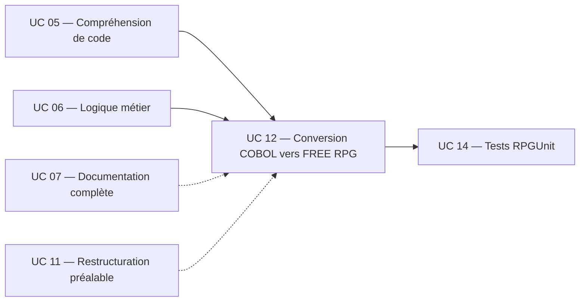

# UC 12 — Conversion COBOL → FREE RPG ILE

> **Catégorie :** Modernisation du code — Conversion de langages (Track A)
>
> **Priorité dans le parcours :** 12 — premier UC de la Phase 4 (Track A), suit UC 11 (*Restructuration, transformation, conversion*).
>
> **Mode Bob recommandé :** IBM i Developer (analyse de structures, revue de code, transposition, génération des membres RPGLE, compilation `CRTBNDRPG` / `CRTSQLRPGI`) → IBM i Database (contrôle des tables et fichiers DDS dans les catalogues `QSYS2`). Sans Premium Package : Ask pour la conception, Agent pour la compilation et l'écriture.

---

## ⭐ Premium Package IBM i utilisé

- **Précision importante sur les Workflows Premium :** Il n'existe **pas de workflow automatisé en 1 clic « COBOL to RPG »** dans le Premium Package IBM i. Le workflow *RPG Modernization* est exclusivement dédié à la conversion de code source RPG (OPM RPG III ou ILE RPG IV fixe) vers le format fully free-form (`**FREE`).
- **Workflow : RPG Modernization** (workflow de référence pour les standards cibles) → [Documentation officielle](https://bob.ibm.com/docs/ide/premium-packages/bob-for-i/workflows)
  Définit les standards modernes de code RPGLE cible (`CTL-OPT`, sous-procédures intégrées, absence de `GOTO`, structure en free-form total).
  **Lancement :** bouton **Start Workflow** en haut du chat → choisir le workspace → **Start**. **Workspaces supportés :** Local, Library List ([UC 00 §1](UC00-premium-package-ibmi-fr.md)).
- **Slash Command : `/review_rpg`** → [Documentation officielle](https://bob.ibm.com/docs/ide/premium-packages/bob-for-i/slash-commands)
  Revue de code complète d'un membre source RPG : détection du format, conformité ILE, gestion des erreurs, sécurité et feuille de route de modernisation. Utilisée pour auditer le code RPG généré à chaque passe. **Elle refuse les sources non RPG (dont COBOL)** : pour le COBOL d'origine, voir la skill `cobol-code-review` (Étape A).
  **Mode :** IBM i Developer.
- **Understand Dashboard** (optionnel, non coché pour cet UC dans [UC 00 §6](UC00-premium-package-ibmi-fr.md) ; mise en place et outils : [UC 00 §2](UC00-premium-package-ibmi-fr.md)) → [Documentation officielle](https://bob.ibm.com/docs/ide/premium-packages/bob-for-i/understand)
  *Si Understand est installé.* Analyse globale du parc applicatif :
  - **Cartographie et analyse d'impact :** identifier tous les programmes appelants (RPG, CL, COBOL) avant de transposer une interface `LINKAGE SECTION`.
  - **Détection des objets morts :** repérer les membres COBOL obsolètes ou orphelins avant d'engager une conversion.
  - **Visualisation d'architecture :** cartographier les interactions hybrides COBOL / RPG et les répertoires de liage.
  **Accès :** Commande `vscode-ibmi-bob.openUnderstandDashboard`.
- **Skills auto-activées mobilisées (22 skills) :**
  - **Socle COBOL for i (12 skills) :** `cobol-primer-basics`, `cobol-data-division`, `cobol-procedure-division`, `cobol-embedded-sql`, `cobol-ile-understanding`, `cobol-ile-intrinsic-functions`, `cobol-opm-understanding`, `cobol-file-io`, `cobol-source-debugging`, `cobol-code-refactoring`, `cobol-code-review`, `cobol-module-service-program`.
  - **Socle RPG ILE moderne (7 skills) :** `rpg-opm-to-ile`, `rpg-free-format-fundamentals`, `rpg-procedures-functions`, `rpg-data-structures`, `rpg-file-operations`, `rpg-indicators`, `rpg-refactor-legacy`.
  - **Cartographie & Données (3 skills) :** `understand-impact-analysis`, `understand-program-explainer`, `db2-system-catalog`.

> **Pourquoi cet UC 12 apporte une valeur méthodologique unique :**
> Puisqu'aucun workflow automatique natif ne convertit de COBOL en RPG sur IBM i, **c'est la combinaison des skills COBOL + RPG de Bob, orchestrée par la séquence de prompts structurés de cet UC (Prompts 0 à 5)**, qui réalise la conversion. Cet UC apporte le cadre rigoureux indispensable : analyse des 4 divisions, options de compilation `COMPASBIN`, transposition fine des `REDEFINES` via `OVERLAY`, niveaux 88, `READ(E)` conditionnel, gestion de fin de programme `STOP RUN` vs `GOBACK`, validation Golden Master et architecture hybride.

---

## Objectif

Convertir un programme COBOL existant (OPM COBOL/400 ou ILE COBOL) vers du **RPGLE moderne fully free-form (`**FREE`)**, en préservant fidèlement la logique métier, les structures de données, les accès fichiers et l'interface d'appel externe (`LINKAGE SECTION` → `DCL-PI`), tout en produisant un code RPG ILE propre, maintenable et compilable.

**Ce que cet UC permet :**
- Transposer exhaustivement la `DATA DIVISION` (`WORKING-STORAGE`, `FILE SECTION`, `LINKAGE SECTION`) en déclarations RPG modernes (`DCL-S`, `DCL-DS`, `DCL-F`, `DCL-PI`).
- Gérer les subtilités mémoire critiques : calcul précis des offsets `OVERLAY` pour les `REDEFINES`, transposition des conditions nommées de niveau 88 en constantes `DCL-C` ou prédicats composés, et respect des types numériques (`ZONED` par défaut vs `PACKED` / `INT`).
- Transposer la `PROCEDURE DIVISION` en sous-routines (`BEGSR`) ou sous-procédures (`DCL-PROC`), avec gestion explicite des structures de contrôle (`EVALUATE` → `SELECT`, `PERFORM UNTIL` → `DOW`/`DOU`).
- Compiler et valider immédiatement le membre RPG cible sur l'IBM i de test via un membre temporaire dédié.

**Critère de succès principal :** Le membre RPG généré (`QRPGLESRC`) compile sans erreur sur l'IBM i (`CRTBNDRPG` ou `CRTSQLRPGI`), respecte rigoureusement la signature des paramètres d'origine, et produit des résultats d'exécution strictement identiques au programme COBOL de référence sur un jeu de données réel.

---

## Prérequis

- **Phase :** Phase 4 — Modernisation avancée (Track A : Langages)
- **UC précédents requis :**
  - **UC 05 — Compréhension de code** (**obligatoire**) : indispensable pour comprendre l'architecture des paragraphes COBOL, les fichiers manipulés et le flux d'exécution.
  - **UC 06 — Logique métier** (**obligatoire**) : indispensable pour cartographier les règles métier, validations et formules de calcul. Pour du COBOL, passer par les prompts manuels et les skills `cobol-*` : le workflow *Business Rules Extraction* est limité au RPG.
  - **UC 07 — Documentation complète** (**recommandé**) : spécifications techniques et matrice d'appels pour sécuriser l'interface `LINKAGE SECTION`.
  - **UC 11 — Restructuration de code** (**recommandé**) : maîtrise des concepts ILE (modules, procédures, répertoires de liage).
- **Livrables requis :**
  - `{appId}-comprehension-{composant}-report-{YYYYMMDD-HHmm}.md` — UC 05 (**obligatoire**)
  - `{appId}-logique-{composant}-regles-{YYYYMMDD-HHmm}.md` — UC 06 (**obligatoire**)
  - `{appId}-doc-spec-tech-{YYYYMMDD-HHmm}.md` — UC 07 (recommandé)
  - `{appId}-doc-matrice-{YYYYMMDD-HHmm}.md` — UC 07 (recommandé)
- **Niveau Bob recommandé :** Intermédiaire à Avancé
- **Bob Coins estimés :** ⚠️ *À calibrer après le lab UC 12 sur FLGHT400.*

> ⚠️ **Règle absolue du membre de test :** Bob n'écrit JAMAIS directement dans le membre source de production. Le code converti est écrit dans un membre temporaire de test (ex. `[NOM_PGM]_T` ou dans une bibliothèque de test `[NOM_LIB_TEST]`).
>
> ⚠️ **Présence d'un expert COBOL + RPG :** Une validation humaine est requise pour trancher les constructs sans équivalence mécanique directe (`PERFORM THRU`, `ALTER GO TO`, `OCCURS DEPENDING ON`, `COMP` sans option de compilation connue).

---

## Exemple concret — Lab FLGHT400

| Livrable | Fichier lab | Ce qu'il illustre |
|---|---|---|
| Rapport de modernisation RPG | [`../labs_FLGHT400_results/FLGHT403_FRS409_modernization_report.md`](../labs_FLGHT400_results/FLGHT403_FRS409_modernization_report.md) | Démarche de modernisation vers RPGLE Free avec passage par membre temporaire `FRS409_T`, compilation et validation du comportement fonctionnel. |
| Explication fonctionnelle du composant | [`../labs_FLGHT400_results/FLGHT403_FRS409_explanation.md`](../labs_FLGHT400_results/FLGHT403_FRS409_explanation.md) | Analyse détaillée des flux d'entrées/sorties et sous-routines servant de baseline fonctionnelle. |
| Règles métier extraites | [`../labs_FLGHT400_results/FRS401-business-rules-FR.md`](../labs_FLGHT400_results/FRS401-business-rules-FR.md) | Extraction de la logique décisionnelle préalable à toute conversion. |
| Audit du parc applicatif | [`../labs_FLGHT400_results/FLGHT403_cpu_jobs_programs_audit.md`](../labs_FLGHT400_results/FLGHT403_cpu_jobs_programs_audit.md) | Identification des programmes non maintenus éligibles à la modernisation de langage. |

---

## Démarrer une session Bob

### Les trois espaces de travail

Pour exécuter UC 12, positionner clairement les trois espaces :

1. **Workspace local (poste de travail) :**
   - Stockage des livrables de suivi, analyses de conversion et diffs sous `bob-reports/`.
   - Conservation des règles et skills du projet.
2. **Librairies IBM i / QSYS (⭐ Espace principal) :**
   - Lecture du membre source COBOL dans `[NOM_LIB]/QCBLSRC([NOM_PROGRAMME])`.
   - Écriture du membre RPG cible dans `[NOM_LIB_TEST]/QRPGLESRC([NOM_PROGRAMME]_T)` via `write_member`.
   - Exécution des commandes de compilation `CRTBNDRPG` ou `CRTSQLRPGI`.
3. **IFS Working Directory :**
   - Stockage éventuel des listings de compilation (`.splf` exportés) ou logs d'analyse d'erreurs.

> Pour lancer le workflow *RPG Modernization*, les workspaces supportés sont **Local** et **Library List** (voir [UC 00 §1](UC00-premium-package-ibmi-fr.md)).

---

## Impact de la complexité sur la stratégie de conversion

Comme dans l'ensemble des UCs de modernisation, la complexité est catégorisée en **SIMPLE / STANDARD / COMPLEXE** :

```
                  ┌─────────────────────────────────────────┐
                  │ Qualification du programme (Prompt 0)   │
                  │   - Analyse des 4 divisions COBOL       │
                  │   - Détection des constructs spéciaux   │
                  └────────────────────┬────────────────────┘
                                       │
         ┌─────────────────────────────┼─────────────────────────────┐
         ▼                             ▼                             ▼
  ┌──────────────┐              ┌──────────────┐              ┌──────────────┐
  │   SIMPLE     │              │   STANDARD   │              │   COMPLEXE   │
  │ • Proc. lin. │              │ • REDEFINES  │              │ • PERF. THRU │
  │ • Pas THRU   │              │ • Niveaux 88 │              │ • ALTER GOTO │
  │ • Pas REDEF. │              │ • CALL ext.  │              │ • OCCURS DEP │
  └──────┬───────┘              └──────┬───────┘              └──────┬───────┘
         │                             │                             │
         ▼                             ▼                             ▼
  Conversion en                 Conversion par                Périmètre POC
  une seule passe               passes séparées               restreint +
  (Prompts 1 à 4)               (Validation à                 Architecture
                                chaque étape)                 hybride
```

### 1. Programmes SIMPLE
- `PROCEDURE DIVISION` linéaire, paragraphes exécutés séquentiellement ou par `PERFORM` simples.
- Pas de `PERFORM THRU`, pas de `ALTER GO TO`, pas de `GO TO` croisés.
- `WORKING-STORAGE` simple : types scalaires, pas de `REDEFINES` multi-niveaux ni de tables dynamiques.
- **Stratégie :** Traitement complet direct (Étape 0-bis → Prompt 1 → Prompt 2 → Prompt 3 → Prompt 3-bis → Prompt 4 → Prompt 4-bis).

### 2. Programmes STANDARD
- Présence de clauses `REDEFINES` simples, niveaux 88 (valeurs discrètes ou plages `THRU`).
- Paragraphes appelés depuis plusieurs `PERFORM` (candidats à l'extraction en sous-procédures).
- Appels externes `CALL ... USING` avec `LINKAGE SECTION`.
- **Stratégie :** Conversion par lots avec points d'arrêt et validation explicite des offsets de données avant génération de la procédure.

### 3. Programmes COMPLEXE
- Présence de `PERFORM THRU` sur des blocs étendus, `ALTER GO TO`, `OCCURS DEPENDING ON`.
- `FILE SECTION` dense avec enregistrements à longueur variable (`RECORD CONTAINS VARYING`).
- Logique intriquée avec sauts conditionnels multiples non hiérarchisés.
- **Stratégie :** Délimitation d'un sous-ensemble convertible pour le POC ; isolation des blocs résiduels dans un programme COBOL autonome callable depuis le RPG (**Architecture hybride COBOL + RPG**).

---

## Étape A — Diagnostic outillé préalable

Avant de lancer les prompts de transposition, exécuter le diagnostic outillé en mode **IBM i Developer** :

1. **Revue préliminaire du source COBOL avec la skill `cobol-code-review` :**
   `/review_rpg` refuse les sources non RPG (dont COBOL) : pour auditer le COBOL d'origine, demander à Bob une revue COBOL (défauts, dette technique, opportunités de modernisation). Réserver `/review_rpg` aux membres RPG (membre de transition existant, puis membre `_T` généré).
2. **Understand Dashboard (si disponible, voir [UC 00 §2](UC00-premium-package-ibmi-fr.md)) :**
   Ouvrir le tableau de bord (`vscode-ibmi-bob.openUnderstandDashboard`) :
   - Identifier tous les programmes appelant le programme COBOL pour figer la signature de la `LINKAGE SECTION`.
   - Vérifier la liste des fichiers accédés (`SELECT / ASSIGN`) et contrôler leur présence dans le catalogue `QSYS2.SYSTABLES`.

---

## Prompts

### Prompt 0 — Qualification et choix de stratégie

> **Point d'entrée obligatoire de UC 12 pour chaque programme COBOL.**
> Analyse les 4 divisions, vérifie les options de compilation (`COMPASBIN`), détecte les constructs critiques et recommande le périmètre exact.

**Objectif :** Classifier le programme COBOL, identifier les facteurs de complexité et sécuriser la trajectoire de conversion.

**Quand l'utiliser :** En ouverture de session, avant tout travail de transposition de code.

**Input requis :**
- Membre source COBOL dans `[NOM_LIB]/QCBLSRC([NOM_PROGRAMME])`.
- Rapports de compréhension (UC 05) et spécification technique (UC 07) si disponibles.

**Espace :** Local (`bob-reports/`) pour le livrable d'analyse.
**Mode :** IBM i Developer.
**Skills clés mobilisées :** `cobol-primer-basics`, `cobol-opm-understanding`, `cobol-file-io`, `cobol-code-review`, `understand-program-explainer`.

**Prompt :**

```text
Le programme COBOL [NOM_PROGRAMME] se trouve dans [NOM_LIB]/QCBLSRC.
[Si disponible : Le fichier de compréhension {appId}-comprehension-[NOM_PROGRAMME]-report-{YYYYMMDD-HHmm}.md est disponible.]
[Si disponible : La spécification technique {appId}-doc-spec-tech-{YYYYMMDD-HHmm}.md est disponible.]

Analyse ce programme COBOL et produis en français, en markdown, un rapport de qualification de conversion COBOL → RPG ILE Free :

## Analyse de conversion UC 12 — [NOM_PROGRAMME]

### 0. Vérification des prérequis
Avant toute analyse, vérifier la disponibilité des éléments obligatoires :
| Élément attendu | Présent dans le contexte ? | Action si absent |
|---|---|---|
| Rapport de compréhension (UC 05) | OUI / NON | ⛔ ARRÊTER — lancer UC 05 sur ce programme avant de continuer |
| Spécification technique / Matrice (UC 07) | OUI / NON | ⚠️ RECOMMANDÉ — nécessaire pour figer l'interface LINKAGE et les fichiers |

### 1. Inventaire rapide des divisions COBOL
| Division / Section | Contenu détecté | Impact sur la conversion RPG |
|---|---|---|
| IDENTIFICATION DIVISION | Nom programme, auteur, date | Transposition en commentaires d'en-tête RPG |
| ENVIRONMENT DIVISION | SELECT / ASSIGN des fichiers | Transposition en déclarations DCL-F |
| DATA DIVISION / FILE SECTION | FD et descriptions 01 | Transposition en DCL-DS (LIKEREC ou manuelle) |
| DATA DIVISION / WORKING-STORAGE | Nombre de niveaux 01 / REDEFINES / Niveaux 88 | Transposition en DCL-S, DCL-DS et constantes DCL-C |
| DATA DIVISION / LINKAGE SECTION | Présente (OUI/NON) — Paramètres USING | Transposition en DCL-PI (signature externe) |
| PROCEDURE DIVISION | Nombre de paragraphes / PERFORM THRU | Transposition en sous-routines (BEGSR) ou procédures |

### 2. Options de compilation à déterminer
Rechercher dans cet ordre :
1. Directive PROCESS dans le source COBOL ou COPY member
2. Commande ou script de compilation existant
3. Listing de compilation historique
4. Valeurs par défaut IBM i

| Option | Valeur trouvée | Source de l'information | Règle de conversion associée |
|---|---|---|---|
| COMPASBIN / NOCOMPASBIN | ? | ? | Si NOCOMPASBIN (défaut IBM i) : COMP = PACKED. Si COMPASBIN : COMP = INT/UNS. |
| TRUNC | ? | ? | Règles de troncature arithmétique |
| SQL précompilé (EXEC SQL) | OUI / NON | Source | Si OUI : compilation CRTSQLRPGI obligatoire (pas CRTBNDRPG) |

⚠️ Si COMPASBIN / NOCOMPASBIN est inconnu : tout champ COMP sans suffixe numérique sera marqué "À CONFIRMER".

### 3. Facteurs de complexité détectés
Réponds par OUI / NON / À CONFIRMER pour chaque facteur :
- [ ] PERFORM THRU (séquence de paragraphes consécutifs)
- [ ] ALTER GO TO (modification dynamique de cible GO TO — obsolète)
- [ ] REDEFINES multi-niveaux (transposition en DCL-DS avec OVERLAY)
- [ ] Niveaux 88 COBOL avec valeurs multiples ou plages THRU
- [ ] OCCURS DEPENDING ON (tableaux à dimension dynamique en runtime)
- [ ] CALL externe avec USING BY REFERENCE / BY CONTENT
- [ ] EXEC SQL embarqué (nécessite précompilation SQL)
- [ ] Paragraphes appelés par plusieurs PERFORM distincts (candidat DCL-PROC)
- [ ] COPY members COBOL (COPY NOM_MEMBRE)
- [ ] PERFORM ... WITH TEST AFTER (équivalent DOU, pas DOW)
- [ ] Clauses ROUNDED ou ON SIZE ERROR sur les calculs
- [ ] STOP RUN / GOBACK / EXIT PROGRAM (gestion de fin de programme)

### 4. Catégorie et périmètre recommandé
- **Catégorie retenue :** SIMPLE / STANDARD / COMPLEXE
- **Périmètre de conversion pour le POC :**
  - Paragraphes convertibles directement : [liste]
  - Paragraphes nécessitant une décision de conception : [liste + question à trancher]
  - Paragraphes exclus / reportés en architecture hybride : [liste + justification]

Sauvegarde cette analyse dans bob-reports/{appId}-conv-cobol-[NOM_PROGRAMME]-analyse-{YYYYMMDD-HHmm}.md.
```

**Livrable produit :**
- `bob-reports/{appId}-conv-cobol-[NOM_PROGRAMME]-analyse-{YYYYMMDD-HHmm}.md`.

---

### Étape 0-bis — Référence comportementale minimale (Golden Master)

> **À exécuter avant toute modification ou génération de code.**
> Capture l'état de référence comportemental du programme COBOL original sur l'IBM i de test pour garantir la non-régression.

**Check-list de capture :**
1. **Cas nominal :** Exécuter le programme COBOL d'origine avec un jeu de paramètres connu ; consigner les paramètres modifiés et les enregistrements créés/mis à jour dans la base.
2. **Cas limites :** Tester au moins une branche conditionnelle complexe (niveau 88, `REDEFINES`, indicateur de fin de fichier `AT END`).
3. **Statut d'exécution :** Relever le code retour ou les messages émis dans la job log.
4. **Consignation :** Ajouter ces résultats dans le fichier d'analyse sous la section `## Référence comportementale (Baseline)`.

**Skills utiles :** `cobol-source-debugging` (débogueur source ILE, analyse du job log et des dumps du programme COBOL d'origine).

> ⚠️ Si le programme COBOL ne peut pas être exécuté dans l'environnement de test, inscrire explicitement : `NON-RÉGRESSION COMPORTEMENTALE NON DÉMONTRABLE DANS LE POC` et faire valider par le chef de projet.

---

### Prompt 1 — Inventaire des structures à transposer

> Établit la matrice de correspondance détaillée entre les structures COBOL et les déclarations RPG ILE Free.
> **Aucun code RPG n'est généré dans ce prompt** — il sert de contrat technique de conversion.

**Objectif :** Détailler le plan de transposition des données, fichiers, paragraphes et cas particuliers.

**Quand l'utiliser :** Après validation du Prompt 0 et de l'Étape 0-bis.

**Input requis :** Analyse produite au Prompt 0.

**Espace :** Local (`bob-reports/`).
**Mode :** IBM i Developer.
**Skills clés mobilisées :** `cobol-data-division`, `cobol-file-io`, `rpg-data-structures`, `rpg-file-operations`, `db2-system-catalog`.

**Prompt :**

```text
Sur la base de l'analyse de conversion de [NOM_PROGRAMME], produis en français, en markdown,
l'inventaire complet des structures à transposer vers RPG ILE Free :

## Inventaire de transposition UC 12 — [NOM_PROGRAMME]

### 1. Structures WORKING-STORAGE (Types et variables)
Pour chaque niveau 01 et sous-champs :
| N° | Niveau COBOL | Nom COBOL | PIC / USAGE | Déclaration RPG Free cible | Règle / Décision appliquée |
|---|---|---|---|---|---|

Règles de correspondance des types à appliquer :
- PIC X(n) ou A(n)                → DCL-S NomVar CHAR(n)
- PIC 9(n) ou S9(n) DISPLAY       → DCL-S NomVar ZONED(n:d)  (par défaut)
  *Note : PACKED(n:d) autorisé uniquement si le champ est 100% interne à WORKING-STORAGE,
  non inclus dans un REDEFINES, non passé par paramètre et non écrit dans un fichier format plat.*
- PIC S9(n) COMP-3                → DCL-S NomVar PACKED(n:d)
- PIC S9(1-4) COMP-4 / BINARY     → DCL-S NomVar INT(5)
- PIC S9(5-9) COMP-4 / BINARY     → DCL-S NomVar INT(10)
- PIC S9(10-18) COMP-4 / BINARY   → DCL-S NomVar INT(20)
- PIC 9(1-4) COMP-4 / BINARY      → DCL-S NomVar UNS(5)
- Constantes figuratives :
  * SPACES / SPACE                → *BLANKS
  * ZEROS / ZEROES                → *ZEROS
  * LOW-VALUES                    → *LOVAL
  * HIGH-VALUES                   → *HIVAL
  * ALL 'x'                       → %REPEAT('x' : longueur) ou constante DCL-C

### 2. REDEFINES et structures de superposition (OVERLAY)
Pour chaque clause REDEFINES détectée :
| N° | Zone d'origine (01) | Zone REDEFINES | Offset (octets) | Longueur | Déclaration DCL-DS RPG Free |
|---|---|---|---|---|---|

Règle impérative RPG :
  DCL-DS wsZonePartagee ;
    champBase   CHAR(totalBytes) ;
    vueFormat1  CHAR(len1)    OVERLAY(champBase : 1) ;
    vueFormat2  PACKED(p:s)   OVERLAY(champBase : offset2) ;
  END-DS ;
⚠️ Vérifier systématiquement que %SIZE(wsZonePartagee) correspond exactement à la taille COBOL.

### 3. Niveaux 88 (Conditions nommées)
Pour chaque niveau 88 :
| N° | Variable parent | Nom niveau 88 | Valeur(s) / Plage THRU | Forme (SINGLE/MULTI/RANGE) | Équivalent RPG proposé |
|---|---|---|---|---|---|
- SINGLE → DCL-C C_[NOM_88] [VALEUR] + IF var = C_[NOM_88]
- MULTI  → Prédicat composé direct : IF var = 'A' OR var = 'B'
- RANGE  → Prédicat composé direct : IF var >= min AND var <= max

### 4. FILE SECTION et descriptions de fichiers (FD)
Pour chaque FD :
| N° | Nom FD COBOL | Mode d'accès | Fichier physique/logique associé | Déclaration DCL-F | Structure DCL-DS associée |
|---|---|---|---|---|---|
Syntaxe attendue :
- Fichier décrit en externe :
  DCL-F NomFich DISK(*EXT) KEYED USAGE(*INPUT/*OUTPUT/*UPDATE) ;
  DCL-DS dsNomFormat LIKEREC(NomFormat : *INPUT) END-DS ;
- Fichier décrit par programme : DCL-F + DCL-DS manuelle avec sous-champs.

### 5. PROCEDURE DIVISION (Paragraphes et flux)
Pour chaque paragraphe :
| N° | Nom paragraphe COBOL | Appelé par (PERFORM) | Présence PERFORM THRU | Équivalent RPG (BEGSR / DCL-PROC) |
|---|---|---|---|---|

### 6. Constructs sans équivalence directe (Points de décision)
Pour chaque construct complexe (PERFORM THRU, ALTER GO TO, OCCURS DEPENDING ON, STRING/UNSTRING) :
| N° | Construct COBOL | Ligne source | Risque identifié | Option recommandée |

Ne génère aucun code RPG exécutable dans ce prompt.
Complète le fichier bob-reports/{appId}-conv-cobol-[NOM_PROGRAMME]-analyse-{YYYYMMDD-HHmm}.md avec cet inventaire.
```

---

### Prompt 2 — Transposition des structures de données (DATA DIVISION → DCL)

> Génère l'intégralité des déclarations de données RPG ILE Free (`**FREE`) à partir de l'inventaire validé.

**Objectif :** Produire le bloc de déclarations RPG (`CTL-OPT`, `DCL-F`, `DCL-S`, `DCL-DS`, `DCL-C`, `DCL-PR`, `DCL-PI`).

**Quand l'utiliser :** Après validation humaine de l'inventaire Prompt 1.

**Input requis :** Inventaire des structures (Prompt 1).

**Espace :** Local pour le diff / IBM i pour le membre temporaire.
**Mode :** IBM i Developer.
**Skills clés mobilisées :** `cobol-data-division`, `rpg-free-format-fundamentals`, `rpg-data-structures`, `rpg-procedures-functions`, `rpg-file-operations`.

**Prompt :**

```text
Sur la base de l'inventaire validé de [NOM_PROGRAMME], génère le bloc complet des déclarations
RPG ILE Free en respectant scrupuleusement la norme fully free-form.

Le code généré doit débuter en première ligne par :
**FREE

Pour chaque structure, produis le diff commenté :
// COBOL : [Extrait original]
// RPG ILE Free : [Équivalent DCL]

Règles de génération :
1. En-tête du programme :
   // ============================================================
   // PROGRAMME : [NOM_PROGRAMME]
   // Converti depuis COBOL [NOM_LIB]/QCBLSRC([NOM_PROGRAMME])
   // Date de conversion : [DATE]
   // Statut : Membre converti temporaire — Validation experte requise
   // ============================================================
   CTL-OPT OPTION(*SRCSTMT : *NODEBUGIO) MAIN(MainProcedure) ; // ou cycle libre

2. Déclarations des fichiers (DCL-F) issues des FD.
3. Déclarations des constantes (DCL-C) issues des niveaux 88 (SINGLE) et littéraux récurrents.
4. Déclarations des variables simples (DCL-S) issues de WORKING-STORAGE (ZONED par défaut, PACKED si optimisé).
5. Déclarations des structures complexes (DCL-DS) avec OVERLAY pour les REDEFINES.
6. Déclaration de l'interface de procédure (DCL-PI) issue de la LINKAGE SECTION :
   DCL-PI *N ;
     pParam1 CHAR(10) ;
     pParam2 ZONED(7:2) ;
   END-PI ;
   (⚠️ Les types et longueurs doivent correspondre rigoureusement à la LINKAGE SECTION).
7. Déclaration des prototypes (DCL-PR) pour chaque programme externe appelé par CALL.

Sauvegarde ce diff dans bob-reports/{appId}-conv-cobol-[NOM_PROGRAMME]-diff-{YYYYMMDD-HHmm}.md.
```

---

### Prompt 3 — Transposition de la PROCEDURE DIVISION

> Transpose les paragraphes, verbes, calculs et opérations d'entrées/sorties COBOL vers les instructions RPG Free correspondantes.

**Objectif :** Transformer le corps algorithmique du programme en sous-routines ou sous-procédures RPG.

**Quand l'utiliser :** Dès que le Prompt 2 est validé.

**Input requis :** Diff des déclarations (Prompt 2) + Inventaire des paragraphes (Prompt 1).

**Espace :** Local (`bob-reports/`) pour le diff complet.
**Mode :** IBM i Developer.
**Skills clés mobilisées :** `cobol-procedure-division`, `cobol-embedded-sql`, `cobol-ile-intrinsic-functions`, `rpg-free-format-fundamentals`, `rpg-file-operations`, `rpg-indicators`, `rpg-refactor-legacy`.

**Table de correspondance des verbes COBOL → RPG ILE Free :**

| Verbe COBOL | Syntaxe RPG ILE Free (`**FREE`) | Remarques et points de vigilance |
|---|---|---|
| `MOVE src TO dest` | `dest = src ;` | Valide si types et longueurs identiques. Si longueurs différentes : utiliser `%SUBST` ou conversion explicite. |
| `COMPUTE c = expr` | `c = expr ;` | Adapter les opérateurs arithmétiques. |
| `ADD a TO b` | `b += a ;` | Ou `b = b + a ;` |
| `SUBTRACT a FROM b` | `b -= a ;` | Ou `b = b - a ;` |
| `MULTIPLY a BY b GIVING c` | `c = a * b ;` | Gérer la précision et `ROUNDED` si présent. |
| `DIVIDE a INTO b GIVING c REMAINDER r` | `c = %DIV(b:a) ; r = %REM(b:a) ;` | ⚠️ Valide pour opérandes entiers. Si décimaux : calcul explicite requis. |
| `IF cond THEN ... ELSE ... END-IF` | `IF cond ; ... ELSE ; ... ENDIF ;` | Adapter les opérateurs relationnels (`EQUAL` → `=`, `NOT =` → `<>`). |
| `EVALUATE expr WHEN v1 ...` | `SELECT ; WHEN expr = v1 ; ... ENDSL ;` | Évaluation de valeur scalaire. |
| `EVALUATE TRUE WHEN cond1 ...` | `SELECT ; WHEN cond1 ; ... ENDSL ;` | ⚠️ `EVALUATE TRUE` évalue des conditions booléennes indépendantes. |
| `PERFORM para` | `EXSR srPara ;` | Transposition standard en sous-routine. |
| `PERFORM para UNTIL cond` | `DOW NOT cond ; EXSR srPara ; ENDDO ;` | `TEST BEFORE` par défaut en COBOL. |
| `PERFORM para WITH TEST AFTER UNTIL cond` | `DOU cond ; EXSR srPara ; ENDDO ;` | `TEST AFTER` correspond exactement à `DOU`. |
| `PERFORM n TIMES` | `FOR i = 1 TO n ; EXSR srPara ; ENDFOR ;` | Boucle à compteur fini. |
| `READ Fich INTO dsRecord AT END ...` | `READ Fich dsRecord ; IF %EOF(Fich) ; ... ENDIF ;` | Si traitement d'erreur explicite dans le COBOL d'origine : utiliser `READ(E)` + `IF %ERROR ; ... ELSEIF %EOF(Fich) ; ... ENDIF ;`. |
| `READ Fich NEXT RECORD` | `READ Fich ; IF %EOF(Fich) ; ... ENDIF ;` | Lecture séquentielle sans filtre de clé. |
| `WRITE Enreg FROM dsRecord` | `WRITE Enreg dsRecord ;` | Ajouter `(E)` uniquement si gestion d'erreur présente dans le source COBOL. |
| `REWRITE Enreg FROM dsRecord` | `UPDATE Enreg dsRecord ;` | En RPG, `REWRITE` devient `UPDATE`. |
| `DELETE Fich RECORD` | `DELETE Fich ;` | Suppression d'enregistrement. |
| `START Fich KEY = cle` | `SETLL cle Fich ; IF NOT %EQUAL(Fich) ; ... ENDIF ;` | Positionnement sur fichier indexé. |
| `START Fich KEY > cle` | `SETGT cle Fich ;` | Positionnement strict supérieur. |
| `CALL 'PGM' USING BY REFERENCE p1` | `CALLP Pgm(p1) ;` | Nécessite le prototype `DCL-PR EXTPGM('PGM')`. |
| `CALL 'PGM' USING BY CONTENT p1` | `wkCopie = p1 ; CALLP Pgm(wkCopie) ;` | ⚠️ `BY CONTENT` exige le passage d'une copie locale non mutable. |
| `GOBACK` / `EXIT PROGRAM` | `RETURN ;` | Retour normal à l'appelant. |
| `STOP RUN` | `*INLR = *ON ; RETURN ;` | ⚠️ À confirmer selon le rôle du programme (fermeture de l'activation group). |

**Prompt :**

```text
Sur la base de l'inventaire section 5 et des déclarations Prompt 2 pour [NOM_PROGRAMME],
transpose la PROCEDURE DIVISION en RPG ILE Free :

Pour chaque paragraphe COBOL, génère le code RPG sous forme de sous-routine (BEGSR) ou procédure :
// Paragraphe COBOL d'origine : [NOM-PARAGRAPHE]
BEGSR sr[NomCamelCase] ;
  [Corps transposé selon la table de correspondance]
ENDSR ;

Règles impératives :
1. Préfixer le nom des sous-routines par 'sr' suivi du nom en camelCase (ex: CALCUL-SOLDE → srCalculSolde).
2. Conserver les noms originaux en commentaires au-dessus de chaque bloc.
3. Règle READ(E) : Ne pas ajouter l'extender (E) mécaniquement. L'ajouter UNIQUEMENT si le source COBOL
   comportait un traitement d'erreur explicite à reproduire avec %ERROR.
4. Règle STOP RUN : Utiliser *INLR = *ON ; RETURN ; uniquement pour le programme principal.
5. Marquer clairement les cas ambigus par // ⚠️ DÉCISION REQUISE.

Complète le fichier bob-reports/{appId}-conv-cobol-[NOM_PROGRAMME]-diff-{YYYYMMDD-HHmm}.md avec la PROCEDURE DIVISION.
```

---

### Prompt 3-bis — Test de compilation par Bob sur membre temporaire

> **Écrit le membre source RPG converti sur l'IBM i et lance la compilation réelle.**

**Objectif :** Valider la syntaxe et obtenir le rapport des erreurs du compilateur ILE.

**Quand l'utiliser :** Dès que les déclarations (Prompt 2) et la procédure (Prompt 3) sont assemblées.

**Input requis :** Code RPG assemblé.

**Espace :** **IBM i QSYS** (écriture du membre et compilation) + Local (rapport d'erreurs).
**Mode :** IBM i Developer.
**Skills clés mobilisées :** `rpg-opm-to-ile`, `rpg-debugging-techniques`.

**Prompt :**

```text
Le source RPG ILE Free de [NOM_PROGRAMME] est prêt pour le premier test de compilation.
Exécute les deux étapes suivantes :

Étape 1 — Écrire le source RPG sur l'IBM i :
Écris le source complet dans [NOM_LIB_TEST]/QRPGLESRC([NOM_PROGRAMME]_T) via write_member.
(Membre temporaire avec suffixe _T pour ne jamais écraser l'existant).

Étape 2 — Lancer la compilation :
Si pas de SQL dans le COBOL :
CRTBNDRPG PGM([NOM_LIB_TEST]/[NOM_PROGRAMME]_T)
          SRCFILE([NOM_LIB_TEST]/QRPGLESRC)
          SRCMBR([NOM_PROGRAMME]_T)
          OPTION(*EVENTF) OUTPUT(*PRINT)
          DBGVIEW(*SOURCE)

Si EXEC SQL présent :
CRTSQLRPGI OBJ([NOM_LIB_TEST]/[NOM_PROGRAMME]_T)
           SRCFILE([NOM_LIB_TEST]/QRPGLESRC)
           SRCMBR([NOM_PROGRAMME]_T)
           OBJTYPE(*PGM)
           OPTION(*EVENTF)
           OUTPUT(*PRINT)
           DBGVIEW(*SOURCE)

Analyse le résultat de la compilation et produis en français :
1. Statut : COMPILATION RÉUSSIE ou ERREURS DÉTECTÉES.
2. Tableau des erreurs éventuelles :
   | Ligne | Code erreur | Description du compilateur | Cause probable COBOL → RPG | Correction proposée |
3. Si compilation réussie : confirmer la création de l'objet *PGM dans [NOM_LIB_TEST].
```

---

### Prompt 4 — Constructs spéciaux, validation des interfaces et nettoyage

> Traite les points complexes mis en attente (`PERFORM THRU`, validation stricte de la `DCL-PI`, nettoyage des commentaires temporaires).

**Objectif :** Finaliser le code RPG, résoudre les constructs complexes et nettoyer le source.

**Quand l'utiliser :** Après correction des premières erreurs de compilation.

**Input requis :** Code RPG issu du Prompt 3 / 3-bis.

**Espace :** Local (`bob-reports/`) et IBM i (`QRPGLESRC`).
**Mode :** IBM i Developer.
**Skills clés mobilisées :** `cobol-procedure-division`, `cobol-code-refactoring`, `rpg-procedures-functions`, `rpg-refactor-legacy`, `rpg-indicators`.

**Prompt :**

```text
Sur la base de l'inventaire section 6 et du résultat de compilation Prompt 3-bis pour [NOM_PROGRAMME] :

1. Vérification de l'interface publique (DCL-PI) :
   - Contrôler que chaque paramètre de la DCL-PI correspond au type et à la longueur exacte de la LINKAGE SECTION.
   - S'assurer qu'aucun décalage mémoire n'est introduit pour les programmes appelants.

2. Résolution des PERFORM THRU :
   Pour chaque PERFORM THRU identifié :
   - Option retenue : [Option A : regroupement dans une sous-routine unique ordonnée / Option B : séquence d'appels EXSR distincts].
   - Générer le bloc résolu.

3. Finalisation des niveaux 88 complexes :
   - Vérifier que toutes les conditions nommées sont correctement substituées par des constantes DCL-C ou des prédicats composés.

4. Nettoyage :
   - Retirer les blocs de commentaires intermédiaires obsolètes.
   - Conserver les marqueurs // ⚠️ DÉCISION REQUISE pour les points soumis à arbitrage humain.

Mets à jour le membre [NOM_LIB_TEST]/QRPGLESRC([NOM_PROGRAMME]_T) avec le source finalisé.
```

---

### Prompt 4-bis — Test de compilation final et rapport de qualification

> Lance la compilation finale du membre achevé et consigne le statut d'éligibilité aux tests fonctionnels.

**Objectif :** Valider la conformité complète du compilateur sur le membre finalisé.

**Quand l'utiliser :** Après exécution du Prompt 4.

**Input requis :** Membre source finalisé dans `[NOM_LIB_TEST]/QRPGLESRC([NOM_PROGRAMME]_T)`.

**Espace :** **IBM i QSYS** (compilation) + Local (rapport final).
**Mode :** IBM i Developer.
**Skills clés mobilisées :** `rpg-debugging-techniques`, `rpg-opm-to-ile`.

**Prompt :**

```text
Lance la compilation finale du membre [NOM_LIB_TEST]/QRPGLESRC([NOM_PROGRAMME]_T) :

Si pas de SQL dans le COBOL :
CRTBNDRPG PGM([NOM_LIB_TEST]/[NOM_PROGRAMME]_T)
          SRCFILE([NOM_LIB_TEST]/QRPGLESRC)
          SRCMBR([NOM_PROGRAMME]_T)
          OPTION(*EVENTF) OUTPUT(*PRINT)
          DBGVIEW(*SOURCE)

Si EXEC SQL présent :
CRTSQLRPGI OBJ([NOM_LIB_TEST]/[NOM_PROGRAMME]_T)
           SRCFILE([NOM_LIB_TEST]/QRPGLESRC)
           SRCMBR([NOM_PROGRAMME]_T)
           OBJTYPE(*PGM)
           OPTION(*EVENTF)
           OUTPUT(*PRINT)
           DBGVIEW(*SOURCE)

Produis le rapport de qualification finale en français :
1. Statut final de compilation : OK / KO.
2. Synthèse des métriques :
   - Nombre de lignes COBOL d'origine vs lignes RPGLE Free générées.
   - Nombre de sous-routines / procédures créées.
   - Nombre de fichiers DCL-F et structures DCL-DS.
3. Rappel des 3 étapes de validation humaine obligatoires avant promotion en production :
   - [ ] Revue de code par un développeur senior (validation des OVERLAY et niveaux 88).
   - [ ] Exécution des tests fonctionnels de non-régression comparés à la baseline Golden Master (Étape 0-bis).
   - [ ] Exécution des tests unitaires RPGUnit (UC 14).
```

---

### Prompt 5 — Plan de conversion pour un périmètre applicatif COBOL complet

> Permet au chef de projet ou à l'architecte de planifier la trajectoire de conversion de tout un portefeuille applicatif COBOL.

**Objectif :** Structurer la feuille de route globale de conversion COBOL → RPG ILE.

**Quand l'utiliser :** Lors du cadrage initial ou après la validation d'un premier pilote.

**Input requis :** Liste des membres COBOL (`QCBLSRC`), matrice d'appels et statistiques du catalogue.

**Espace :** Local (`bob-reports/`).
**Mode :** IBM i Developer (ou Agent).
**Skills clés mobilisées :** `understand-app-overview`, `understand-impact-analysis`, `db2-system-catalog`, `cobol-module-service-program`.

**Prompt :**

```text
Sur la base de l'inventaire des membres COBOL de l'application [NOM_APPLICATION] dans [NOM_LIB_COBOL] :

Génère en français, en markdown, le plan global de conversion COBOL → RPG ILE Free :

## Plan global de conversion COBOL → RPG — [NOM_APPLICATION]

### 1. Cartographie du parc COBOL et catégorisation
| Membre | Nb Lignes | Nb FD | REDEFINES | Niveaux 88 | PERFORM THRU | Catégorie (SIMPLE/STANDARD/COMPLEXE) | Priorité |
|---|---|---|---|---|---|---|---|

### 2. Stratégie de lotissement
- **Lot 1 — Pilotes SIMPLE :** Programmes autonomes sans LINKAGE complexe ni PERFORM THRU (validation du processus).
- **Lot 2 — Programmes STANDARD :** Batchs avec structures de données denses et fichiers multiples.
- **Lot 3 — Programmes COMPLEXE & Architecture hybride :** Découpage en sous-programmes COBOL autonomes et conversion partielle.

### 3. Matrice de dépendances et risques
- Identifier les programmes COBOL appelés par du RPG existant ou appelant d'autres modules.
- Lister les 3 risques techniques majeurs (ex: `OCCURS DEPENDING ON`, options de compilation divergentes).

### 4. Estimation de charge globale
| Lot | Nombre de programmes | Estimation durée avec Bob | Charge de validation experte |

Sauvegarde ce plan dans bob-reports/{appId}-conv-cobol-app-plan-perimetre-{YYYYMMDD-HHmm}.md.
```

---

## Add-ons Bob à activer

| Extension | Rôle dans cet UC |
|---|---|
| **Code for IBM i** | Navigation dans les membres COBOL (`QCBLSRC`) et RPG (`QRPGLESRC`), lancement des actions de compilation et affichage des erreurs inline. |
| **IBM i Languages** | Coloration syntaxique et validation structurelle du code COBOL et RPGLE Free (`**FREE`). |
| **Markdown All in One** | Prévisualisation et validation des rapports d'analyse et diffs de conversion. |

---

## Outils à utiliser

> Outils IBM i, recherche documentaire (RAG) et garde-fous : voir [UC 00 §5](UC00-premium-package-ibmi-fr.md).

| Outil | Usage dans cet UC |
|---|---|
| **Outils natifs IBM i — mode IBM i Developer** | Lecture des membres sources COBOL via `read_member`, écriture des membres RPG via `write_member`, exécution des commandes de compilation `CRTBNDRPG` / `CRTSQLRPGI` via `execute_cl_command` ou `execute_compile_action`. |
| **Outils natifs IBM i — mode IBM i Database** | Interrogation des métadonnées du catalogue `QSYS2` (`SYSTABLES`, `SYSCOLUMNS`, `OBJECT_STATISTICS`) pour valider les descriptions de fichiers accédés par les `FD`. |
| **Confluence MCP** *(si disponible)* | Publication des rapports de qualification et du plan global de conversion pour partage avec les équipes projet. |

---

## Requêtes SQL QSYS2 utiles pour la conversion COBOL

Ces requêtes s'exécutent en mode **IBM i Database** pour auditer les sources et objets :

```sql
-- 1. Lister tous les membres COBOL d'un fichier source avec leur dernière date de modification
SELECT SYSTEM_TABLE_MEMBER AS MEMBRE,
       SOURCE_TYPE AS TYPE_SOURCE,
       LAST_SOURCE_UPDATE_TIMESTAMP AS DERNIERE_MODIF,
       TEXT_DESCRIPTION AS DESCRIPTION
FROM QSYS2.SYSPARTITIONSTAT
WHERE SYSTEM_TABLE_SCHEMA = '[NOM_LIB_COBOL]'
  AND SYSTEM_TABLE_NAME = 'QCBLSRC'
ORDER BY SYSTEM_TABLE_MEMBER;

-- 2. Contrôler les fichiers référencés dans les FD COBOL pour construire les DCL-DS LIKEREC
SELECT TABLE_NAME, TABLE_SCHEMA, TABLE_TYPE, SYSTEM_TABLE_NAME, TEXT_DESCRIPTION
FROM QSYS2.SYSTABLES
WHERE TABLE_SCHEMA = '[NOM_LIB]'
  AND TABLE_NAME IN ('[FICHIER_1]', '[FICHIER_2]')
ORDER BY TABLE_NAME;

-- 3. Vérifier les objets programmes compilés dans la bibliothèque de test
SELECT OBJNAME, OBJTYPE, OBJATTRIBUTE, OBJSIZE, CREATION_TIMESTAMP, TEXT_DESCRIPTION
FROM QSYS2.OBJECT_STATISTICS
WHERE OBJLIBRARY = '[NOM_LIB_TEST]'
  AND OBJTYPE = '*PGM'
  AND OBJNAME LIKE '%_T'
ORDER BY CREATION_TIMESTAMP DESC;
```

---

## Pièges à éviter

| Piège | Conséquence | Comment l'éviter |
|---|---|---|
| **Sauter le Prompt 0 de qualification** | Découverte tardive de constructs bloquants (`PERFORM THRU`, `OCCURS DEPENDING ON`), source généré incomplet. | Toujours exécuter le Prompt 0 pour qualifier le programme et délimiter le périmètre avant de coder. |
| **Convertir `COMP` sans vérifier `COMPASBIN`** | Incohérence binaire/décimale silencieuse : avec `NOCOMPASBIN` (défaut), `COMP` est packed (`PACKED`) ; avec `COMPASBIN`, c'est du binaire (`INT`). | Vérifier la directive `PROCESS` ou marquer le champ "À CONFIRMER" dans l'inventaire. |
| **Erreur d'offset sur les `REDEFINES`** | Décalage mémoire dans la `DCL-DS` `OVERLAY`, corruption silencieuse des données lues ou écrites. | Calculer explicitement les offsets au Prompt 1 et vérifier que `%SIZE(DS)` égale la taille COBOL originale. |
| **Oublier la transposition des niveaux 88** | Perte des règles métier portées par les conditions nommées COBOL. | Inventorier systématiquement chaque niveau 88 et le transposer en constante `DCL-C` ou prédicat composé. |
| **Altérer la signature `LINKAGE SECTION`** | Incompatibilité de passage de paramètres avec les programmes appelants existants. | Figer la `DCL-PI` avec les types et longueurs exacts de la `LINKAGE SECTION`. |
| **Ajouter `(E)` mécaniquement sur tous les I/O** | Les erreurs graves deviennent silencieuses si `%ERROR` n'est pas testé explicitement. | N'ajouter l'extender `(E)` que si le code COBOL gérait explicitement un statut d'erreur d'I/O. |
| **Écraser le source de production** | Perte du code original ou écrasement prématuré. | Toujours écrire dans un membre temporaire de test (`_T`) dans `[NOM_LIB_TEST]`. |
| **Valider sans test Golden Master** | Programme compilé sans erreur mais comportement fonctionnel divergent sur les cas limites. | Exécuter la baseline comportementale (Étape 0-bis) et comparer les résultats d'exécution. |

---

## Check-list de validation UC 12

Avant de déclarer un programme converti et prêt pour les tests unitaires (UC 14) :

- [ ] **Prompt 0 exécuté :** Analyse enregistrée dans `bob-reports/{appId}-conv-cobol-[PGM]-analyse-{date}.md` avec catégorie et périmètre validés.
- [ ] **Baseline Golden Master établie (Étape 0-bis) :** Résultats du programme COBOL original consignés pour les cas nominaux et limites.
- [ ] **Inventaire technique complet (Prompt 1) :** `WORKING-STORAGE`, `REDEFINES`, niveaux 88, `FD` et `LINKAGE SECTION` documentés.
- [ ] **Offsets `OVERLAY` vérifiés :** Les structures redéfinies respectent la taille physique exacte de la mémoire COBOL.
- [ ] **Niveaux 88 transposés :** Aucune condition nommée omise ou convertie en valeur magique non documentée.
- [ ] **Signature `DCL-PI` conforme :** Les types et longueurs de paramètres correspondent fidèlement à la `LINKAGE SECTION`.
- [ ] **Source `**FREE` généré dans un membre temporaire :** Présent dans `[NOM_LIB_TEST]/QRPGLESRC([PGM]_T)`.
- [ ] **Compilation réussie sans avertissement critique :** `CRTBNDRPG` ou `CRTSQLRPGI` exécuté avec succès.
- [ ] **Revue de code par un expert senior :** Arbitrage et validation de tous les marqueurs `⚠️ DÉCISION REQUISE`.
- [ ] **Tests de non-régression concluants :** Exécution du programme RPG `_T` avec résultats identiques à la baseline COBOL.
- [ ] **Livrables sauvegardés :** Rapports de qualification, diffs et plans archivés sous `bob-reports/`.

---

## Points à compléter avant passage en production

### 1. Programmes COBOL avec `OCCURS DEPENDING ON`
- **Problématique :** Tableaux à dimensionnement dynamique en runtime. En RPG, les dimensions sont fixes à la compilation sauf allocation dynamique explicite (`%ALLOC`).
- **En production :** Définir la norme cible du projet (dimensionnement à la borne maximale tolérée, allocation dynamique via pointeurs ou conservation dans un sous-programme COBOL autonome).

### 2. Architecture hybride COBOL + RPG pour programmes COMPLEXE
- **Problématique :** Certains programmes OPM très anciens contiennent des sauts `ALTER GO TO` ou des intriquations non convertibles mécaniquement dans le cadre d'un sprint court.
- **En production :** Mettre en œuvre le pattern d'architecture hybride : isoler la portion complexe résiduelle dans un sous-programme COBOL autonome avec interface propre, appelé via `CALLP` depuis le programme RPG modernisé.

---

## Livrables de cet UC

| Fichier produit | Pattern de nommage | Où Bob l'écrit | Consommé par |
|---|---|---|---|
| Rapport de qualification | `{appId}-conv-cobol-[PGM]-analyse-{YYYYMMDD-HHmm}.md` | Workspace local (`bob-reports/`) | Prompt 1 (Inventaire), Développeur Senior |
| Inventaire technique de transposition | Inclus dans `{appId}-conv-cobol-[PGM]-analyse-{date}.md` | Workspace local (`bob-reports/`) | Prompts 2 et 3 (Génération) |
| Diff de conversion et déclarations | `{appId}-conv-cobol-[PGM]-diff-{YYYYMMDD-HHmm}.md` | Workspace local (`bob-reports/`) | Revue de code, Audit de conversion |
| Membre source RPGLE temporaire | `[NOM_LIB_TEST]/QRPGLESRC([PGM]_T)` | **IBM i QSYS** (membre source) | Compilateur ILE, Tests fonctionnels |
| Plan global de conversion portefeuille | `{appId}-conv-cobol-app-plan-perimetre-{YYYYMMDD-HHmm}.md` | Workspace local (`bob-reports/`) | Pilotage de projet, Planification des vagues |

> 💡 **Rappel sur l'espace d'écriture :**
> - Les membres sources (`.RPGLE`) sont créés directement sur l'IBM i dans le fichier source spécifié (`QRPGLESRC`).
> - Les fichiers markdown (`.md`) sont rédigés dans le workspace local sous `bob-reports/`.

---

## Dépendances


