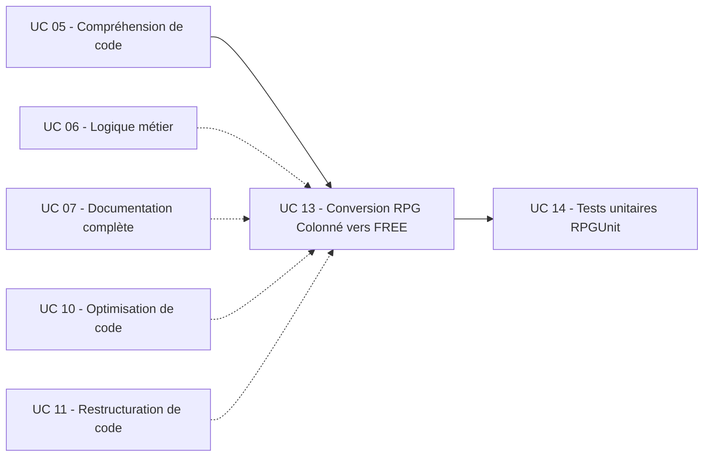

# UC 13 — Conversion RPG Colonné / RPG III → FREE RPG ILE

> **Catégorie :** Modernisation du code — Conversion de langages (Track A)
>
> **Priorité dans le parcours :** 13 — suit UC 12 (*Conversion COBOL → FREE RPG ILE*), Phase 4 (Track A).
>
> **Mode Bob recommandé :** IBM i Developer (analyse des spécifications fixes, revue `/review_rpg`, transposition syntaxique, génération des membres RPGLE fully free, compilation `CRTBNDRPG` / `CRTSQLRPGI`) → IBM i Database (contrôle des accès fichiers et catalogues `QSYS2`). Sans Premium Package : Ask pour l'analyse/génération, Agent pour la compilation et l'écriture.

---

## ⭐ Premium Package IBM i utilisé

- **Workflow : RPG Modernization** (workflow prime pour la modernisation RPG) → [Documentation officielle](https://bob.ibm.com/docs/ide/premium-packages/bob-for-i/workflows)
  Automatise la conversion d'un membre source RPG (OPM RPG III ou ILE RPG IV format fixe) vers du RPGLE fully free-format (`**FREE`).
  - Pipeline automatisé : détection du type source (OPM vs ILE fixe) → conversion OPM vers ILE si nécessaire → transformation en format libre (`CTL-OPT`, `DCL-*`, `EVAL`, structures de contrôle modernes) → compilation de test avec boucle d'auto-correction (*self-heal*) en cas d'erreurs → rapport de synthèse.
  - Gère automatiquement : `TAG`, `CAS/ENDCS`, `MOVE`, `PLIST`, indicateurs applicatifs, aiguillages `DOUEQ`/`CASEQ` vers `IF`/`ELSEIF`, et interfaces de sous-procédures.
  - **Lancement :** bouton **Start Workflow** en haut du chat → choisir le workspace → **Start**. **Workspaces supportés :** Local, Library List ([UC 00 §1](UC00-premium-package-ibmi-fr.md)).
- **Slash Command : `/review_rpg`** → [Documentation officielle](https://bob.ibm.com/docs/ide/premium-packages/bob-for-i/slash-commands)
  Revue de code complète d'un membre source RPG (fixe, mixte ou libre) :
  - Détection du format exact (RPG III OPM, RPG IV fixe, mode mixte).
  - Identification des opcodes obsolètes, indicateurs résultants, constructions à risque (`MOVE`/`MOVEL`, `GOTO`, `CABxx`).
  - Feuille de route de modernisation priorisée.
  - **Mode :** IBM i Developer.
- **Understand Dashboard** (optionnel, non coché pour cet UC dans [UC 00 §6](UC00-premium-package-ibmi-fr.md) ; mise en place et outils : [UC 00 §2](UC00-premium-package-ibmi-fr.md)) → [Documentation officielle](https://bob.ibm.com/docs/ide/premium-packages/bob-for-i/understand)
  *Si Understand est installé.* Analyse globale du parc applicatif :
  - **Cartographie et analyse d'impact :** identifier tous les programmes appelants avant de convertir un `*ENTRY PLIST` en prototype `DCL-PI` ou de modifier les signatures d'appel.
  - **Détection des objets morts :** repérer les membres RPG III / RPG IV obsolètes ou orphelins avant de planifier une conversion.
  - **Visualisation d'architecture :** visualiser les graphes de dépendances et les liaisons inter-programmes.
  - **Accès :** Commande `vscode-ibmi-bob.openUnderstandDashboard`.
- **Skills auto-activées mobilisées (16 skills) :**
  - **Socle de conversion RPG fixe → libre (7 skills) :** `rpg-fixed-to-free`, `rpg-legacy-specs`, `rpgle-specs`, `rpg-opm-to-ile`, `rpg-pgmdb-conversion`, `rpg-ospec-conversion`, `rpg-refactor-legacy`.
  - **Sémantique et constructs complexes (4 skills) :** `rpg-cycle-explained`, `rpg-indicators`, `rpg-file-operations`, `rpg-data-structures`.
  - **RPGLE moderne & cartographie (4 skills) :** `rpg-free-format-fundamentals`, `rpg-procedures-functions`, `understand-impact-analysis`, `understand-app-overview`.
  - **Compilation & diagnostic (1 skill) :** `rpg-debugging-techniques`.

> **Pourquoi cet UC 13 apporte une valeur méthodologique unique :**
> Le workflow Premium *RPG Modernization* constitue l'accélérateur direct recommandé pour convertir automatiquement les programmes RPG. Cet UC 13 apporte le cadre de qualification, de sécurisation et de gouvernance indispensable pour les sources sensibles :
> 1. Diagnostic préalable structuré (Sous-cas A RPG IV fixe vs Sous-cas B RPG III OPM, détection du mode mixte).
> 2. Sécurisation des pièges d'exécution silencieux : risque de troncature sur `MOVE` (alignement à droite) et `MOVEL` (alignement à gauche) avec longueurs de champs différentes.
> 3. Règle stricte de séparation entre indicateurs applicatifs (convertibles en `IND` nommées) et indicateurs d'écrans `INDARA` (DSPF/PRTF) à ne jamais modifier en local.
> 4. Gestion explicite du cycle RPG historique (niveaux de contrôle `L1-L9`, `*INLR`) ou conversion préalable de structure.
> 5. Établissement d'une référence comportementale (*Golden Master*) et règle absolue du membre temporaire de test (`[PGM]_T`).

---

## Objectif

Convertir le code source RPG historique écrit en **format fixe colonné** (spécifications H, F, D, C, I, O) ou en **RPG III (OPM)** vers du **RPGLE moderne fully free-form (`**FREE`)**, en préservant fidèlement la logique métier, la sémantique d'exécution, les accès aux données et les signatures d'appel.

**Ce que cet UC permet :**
- Qualifier avec précision le style de code source : Sous-cas A (RPG IV fixe) vs Sous-cas B (RPG III OPM), et détecter les sources partiellement modernisés (mode mixte).
- Transposer l'intégralité des spécifications déclaratives en syntaxe moderne :
  - `H-spec` → `CTL-OPT`
  - `F-spec` → `DCL-F` (avec gestion des mots-clés `USAGE`, `KEYED`, `WORKSTN`, `INFDS`)
  - `D-spec` → `DCL-S`, `DCL-DS`, `DCL-PR`, `DCL-PI`
  - `*ENTRY PLIST` → bloc d'interface `DCL-PI *N; ... END-PI;`
- Transposer les spécifications de calcul (`C-specs`) en instructions fully free-form :
  - Opcodes d'accès fichier (`CHAIN`, `READ`, `SETLL`, `WRITE`, etc.) avec transposition des indicateurs résultants vers les BIFs natives (`%FOUND`, `%EOF`, `%EQUAL`, `%ERROR`).
  - Opcodes arithmétiques et d'affectation (`Z-ADD`, `ADD`, `SUB`, `MULT`, `DIV`) vers des expressions `EVAL`.
  - Opcodes de déplacement mémoire (`MOVE`, `MOVEL`) avec analyse de troncature et d'alignement.
- Convertir les indicateurs applicatifs (`*IN01`–`*IN99`) en variables booléennes `IND` explicites et documentées, tout en préservant les indicateurs `INDARA` liés aux fichiers écrans (DSPF) et états (PRTF).
- Valider la syntaxe et la compilabilité du code converti sur un membre temporaire de test via `CRTBNDRPG` ou `CRTSQLRPGI`.

**Critère de succès principal :** Le membre RPGLE généré compile sans erreur sur l'IBM i (`CRTBNDRPG`, ou `CRTSQLRPGI` si le programme contient du SQL embarqué), respecte les standards modernisés (`**FREE`, `CTL-OPT`), préserve l'interface d'appel, et restitue un comportement fonctionnel strictement identique au programme d'origine sur les jeux de tests.

---

## Prérequis

- **Phase :** Phase 4 — Modernisation avancée (Track A : Langages)
- **UC précédents requis :**
  - **UC 05 — Compréhension de code** (**obligatoire**) : identification du style RPG (IV fixe / III), cartographie des sous-routines, fichiers et flux d'appels.
  - **UC 06 — Logique métier** (**recommandé**) : inventaire des règles de calcul et conditions décisionnelles (le workflow *Business Rules Extraction*, limité au RPG, s'applique ici).
  - **UC 07 — Documentation complète** (**recommandé**) : spécifications techniques des interfaces et matrices d'appels.
  - **UC 10 — Optimisation de code** (**recommandé si applicable**) : si le programme d'origine a été optimisé (renommage de variables, élimination des opcodes morts), le diff d'optimisation constitue le point de départ de la conversion.
- **Livrables requis :**
  - `{appId}-comprehension-{composant}-report-{YYYYMMDD-HHmm}.md` — UC 05 (**obligatoire**)
  - `{appId}-logique-{composant}-regles-{YYYYMMDD-HHmm}.md` — UC 06 (recommandé)
  - `{appId}-doc-spec-tech-{YYYYMMDD-HHmm}.md` — UC 07 (recommandé)
  - `{appId}-optim-{composant}-diff-{YYYYMMDD-HHmm}.md` — UC 10 (si optimisation préalable)
- **Niveau Bob recommandé :** Intermédiaire à Avancé
- **Bob Coins estimés :** ⚠️ *À calibrer après le lab UC 13 sur FLGHT400.*

> ⚠️ **Règle absolue du membre de test :** Bob n'écrit JAMAIS directement dans le membre source de production. Le code converti est écrit dans un membre temporaire de test (ex. `[NOM_PGM]_T` dans `QRPGLESRC` ou dans une bibliothèque de test `[NOM_LIB_TEST]`).
>
> ⚠️ **Prérequis critique sur les programmes RPG III denses :** Les programmes RPG III avec I-specs/O-specs décrites par programme denses ou cycle multi-niveaux (`L1-L9`) doivent faire l'objet d'une pré-conversion via `CVTRPGSRC` ou d'un traitement structurel via UC 11 (Prompt 4) avant la finalisation en RPG Free.
>
> **Dépendance conditionnelle UC 10 / UC 11 / UC 13 :** l'ordre par défaut (UC 10 puis UC 11) s'applique au code déjà en `**FREE` / ILE. Pour un source **RPG III OPM** ou **RPG IV format fixe**, UC 13 (conversion en `**FREE`) peut être un prérequis technique à certaines optimisations avancées d'UC 10 (conversions `EVAL`, extraction `DCL-PR`/`DCL-PROC`) : limiter alors UC 10 aux passes sûres (diagnostic, qualification, code mort, renommages sûrs), exécuter UC 13, puis reprendre les optimisations avancées d'UC 10. Chaque UC reste dans sa propre session Bob.

---

## Exemple concret — Lab FLGHT400

| Livrable | Fichier lab | Ce qu'il illustre |
|---|---|---|
| Rapport de modernisation RPG | [`../labs_FLGHT400_results/FLGHT403_FRS409_modernization_report.md`](../labs_FLGHT400_results/FLGHT403_FRS409_modernization_report.md) | Modernisation complète d'un programme OPM RPG III format fixe (`FRS409.RPG`) vers RPGLE Free (`FRS409.RPGLE`) avec passage par membre temporaire `FRS409_T`, conversion `WORKSTN`, `DCL-PI *N`, et structure `IF/ELSEIF`. |
| Session de modernisation RPG | [`../labs_FLGHT400_results/FLGHT403_FRS409_modernization_session.md`](../labs_FLGHT400_results/FLGHT403_FRS409_modernization_session.md) | Trace de la session de conversion avec application des standards Premium et validation de compilation. |
| Explication fonctionnelle | [`../labs_FLGHT400_results/FLGHT403_FRS409_explanation.md`](../labs_FLGHT400_results/FLGHT403_FRS409_explanation.md) | Analyse structurelle et fonctionnelle du programme `FRS409` servant de baseline de non-régression. |

---

## Démarrer une session Bob

### Les trois espaces de travail

Pour exécuter UC 13, positionner clairement les trois espaces :
- **Workspace local** (poste) — rapports de qualification, inventaires, plans de conversion et rapports au format Markdown (`.md`).
- **Librairies IBM i / QSYS** ⭐ — **espace d'exécution principal** : membres sources RPG (`QRPGSRC`, `QRPGLESRC`), fichiers d'écrans (`QDDSSRC`), tables et fichiers logiques, commandes de compilation (`CRTBNDRPG`, `CRTSQLRPGI`) et workflows Premium.
- **IFS Working Directory** — logs de compilation, scripts ou rapports d'analyse.

> Le workflow *RPG Modernization* se lance depuis les workspaces **Local** ou **Library List** (voir [UC 00 §1](UC00-premium-package-ibmi-fr.md)).

### Configuration de la session

1. **Nouvelle conversation Bob** : Cliquer sur `+` dans le panneau Chat Bob. Ne pas mélanger les conversions de plusieurs programmes distincts dans une même session.
2. **Mode à sélectionner :** `IBM i Developer` (Premium Package IBM i).
3. **Scope à sélectionner :** `Library List` → sélectionner la bibliothèque applicative contenant les sources et leurs copybooks.
4. **Ouverture du membre dans l'éditeur (*Open in Editor*) :** Dans l'explorateur Code for IBM i, ouvrir le membre RPG à moderniser (`[NOM_LIB]/QRPGSRC([NOM_PROGRAMME])` ou `QRPGLESRC`).
5. **Fichiers de contexte à charger :**
   - Rapport de compréhension UC 05 (`*-comprehension-*.md`).
   - Diff d'optimisation UC 10 (`*-optim-*.md`) si une passe d'optimisation a été réalisée au préalable.

---

## Démarche de conversion : Approche Premium et Prompts structurés

```
┌─────────────────────────────────────────────────────────────────────────────┐
│                      APPROCHE PREMIUM RECOMMANDÉE                           │
│                                                                             │
│  1. Revue initiale : Slash Command /review_rpg                              │
│  2. Modernisation automatisée : Workflow RPG Modernization                  │
│     (Détection OPM/ILE -> Conversion **FREE -> Compilation Self-Heal)       │
└──────────────────────────────────────┬──────────────────────────────────────┘
                                       │ Si programme standard/complexe
                                       │ ou contrôle pas-à-pas requis
                                       ▼
┌─────────────────────────────────────────────────────────────────────────────┐
│                     DÉMARCHE DE CONVERSION GUIDÉE                           │
│                                                                             │
│  Étape A      : Diagnostic et audit outillé (/review_rpg + Understand)      │
│  Prompt 0     : Qualification et choix de stratégie (Sous-cas A/B, S/St/C)  │
│  Étape 0-bis  : Référence comportementale minimale (Golden Master)          │
│  Prompt 1     : Inventaire exhaustif des structures à convertir             │
│  Prompt 2     : Conversion des spécifications déclaratives (H, F, D, PI)    │
│  Prompt 3     : Conversion des C-specs et opcodes de calcul                 │
│  Prompt 3-bis : Test de compilation intermédiaire sur [PGM]_T (SIMPLE)      │
│  Prompt 4     : Nettoyage, indicateurs applicatifs, P-specs, interfaces     │
│  Prompt 4-bis : Test de compilation final sur [PGM]_T et qualification      │
│  Prompt 5     : Plan de conversion d'un portefeuille applicatif complet     │
└─────────────────────────────────────────────────────────────────────────────┘
```

---

## Prompts

### Étape A — Diagnostic et qualification outillée

Avant de démarrer la conversion détaillée, utiliser les accélérateurs Premium pour établir un bilan immédiat du membre source :

1. **Exécuter la Slash Command `/review_rpg` dans le chat Bob :**
   ```text
   /review_rpg
   ```
   *Bob analyse le membre ouvert dans l'éditeur, qualifie le format (OPM, ILE fixe, mixte), identifie les opcodes obsolètes, les indicateurs et les axes de modernisation.*

2. **Consulter l'analyse d'impact dans Understand Dashboard (*si installé*) :**
   Vérifier si le programme est appelé par d'autres composants et si son interface d'appel (`*ENTRY PLIST`) requiert un soin particulier.

---

### Prompt 0 — Qualification et choix de stratégie

**Objectif :** Détecter le style RPG (Sous-cas A RPG IV fixe vs Sous-cas B RPG III), évaluer les facteurs de complexité, classifier le programme (SIMPLE, STANDARD, COMPLEXE, Mixte) et établir la feuille de route exacte.

**Quand l'utiliser :** Point d'entrée obligatoire avant toute manipulation de code.

**Input requis :** Membre source RPG ouvert dans l'éditeur, rapport de compréhension UC 05.

**Skills clés mobilisées :** `rpg-legacy-specs`, `rpgle-specs`, `rpg-cycle-explained`, `rpg-indicators`

**Prompt :**

```
Le programme [NOM_PROGRAMME] se trouve dans [NOM_LIB]/[FICHIER_SOURCE] (ex. QRPGSRC ou QRPGLESRC).
[Si disponible : Le fichier de compréhension {appId}-comprehension-{composant}-report-{date}.md est chargé en contexte.]

Analyse ce programme RPG et produis en français, en markdown, un rapport de qualification détaillé pour la conversion vers du FREE RPG ILE :

## Qualification UC 13 — [NOM_PROGRAMME]

### 1. Inventaire rapide
| Indicateur | Valeur |
|---|---|
| Style RPG détecté | RPG III (OPM) / RPG IV colonné / Mixte |
| Nombre de lignes de code | ? |
| Nombre de specs H (CTL-OPT) | ? |
| Nombre de specs F (DCL-F) | ? |
| Nombre de specs D (DCL-S / DCL-DS / DCL-PR / DCL-PI) | ? |
| Nombre de specs C en format fixe restantes | ? |
| Nombre d'indicateurs (*IN01 à *IN99) utilisés | ? |
| Indicateurs appartenant à une zone INDARA (DSPF/PRTF) | OUI / NON / AUCUN |
| Cycle RPG actif (*INLR, niveaux L1-L9, sous-routines de total) | OUI / NON |
| Présence de P-specs RPG IV (PB / PE — sous-procédures en format fixe) | OUI / NON |
| Présence de MOVE / MOVEL avec longueurs de champs différentes | OUI / NON / À CONFIRMER |
| Présence de GOTO / CABxx / TAG | OUI / NON |
| Optimisation UC 10 déjà appliquée sur ce programme | OUI / NON |

### 2. Facteurs de complexité et risques détectés
Réponds par OUI / NON / À CONFIRMER pour chaque facteur :
- [ ] Indicateurs applicatifs (*INxx) pilotant des conditions logiques (IF, DOW, DOU)
- [ ] Indicateurs d'écrans ou d'états (INDARA) à maintenir distincts des variables locales
- [ ] Indicateurs de niveau de contrôle (*INL1 à *INL9) — cycle RPG de rupture
- [ ] MOVE / MOVEL avec source et destination de longueurs ou types différents (risque de troncature)
- [ ] Cycle RPG actif — dépendance implicite au cycle ou *INLR comme seul arrêt
- [ ] P-specs RPG IV (PB/PE) à convertir en blocs DCL-PROC / END-PROC
- [ ] Branchements non structurés (GOTO, CABxx, ITER/LEAVE mal positionnés)
- [ ] Interface d'entrée *ENTRY PLIST à transposer en DCL-PI stricte
- [ ] Code en mode mixte (mélange de format libre partiel et de format fixe)

### 3. Sous-cas et catégorie retenue
**Sous-cas :**
- [ ] **Sous-cas A — RPG IV colonné → FREE :** déclarations et calculs en format fixe ILE, pas de cycle RPG.
- [ ] **Sous-cas B — RPG III (OPM) → FREE :** code OPM historique, sans D-specs ni P-specs, possible présence de cycle ou de constructs obsolètes.
- [ ] **Mixte :** programme partiellement converti présentant des blocs libres et des blocs fixes juxtaposés.

**Catégorie de complexité :**
- [ ] **SIMPLE :** < 200 lignes fixes, pas d'indicateurs applicatifs complexes, pas de cycle, pas de MOVE à risque.
- [ ] **STANDARD :** indicateurs applicatifs présents, MOVE/MOVEL avec longueurs variables, ou P-specs RPG IV sans cycle.
- [ ] **COMPLEXE :** cycle RPG actif avec ruptures L1-L9, GOTO/CABxx extensifs, ou RPG III dense avec I-specs/O-specs programme-décrites.

### 4. Séquence de conversion recommandée
- **Si SIMPLE :** Prompt 1 → Prompt 2 (specs H/F/D/PI) → Prompt 3 (C-specs) → Prompt 3-bis (compilation test) → Prompt 4 (nettoyage) → Prompt 4-bis.
- **Si STANDARD :** Prompt 1 → Prompt 2 → Prompt 3 → Prompt 4 (indicateurs applicatifs + P-specs) → Prompt 4-bis (compilation finale). *(Pas de compilation intermédiaire Prompt 3-bis car les SETON/SETOF restent transitoires jusqu'au Prompt 4).*
- **Si COMPLEXE :** Évaluer si le cycle doit être converti (via UC 11 Prompt 4). Séquence : Prompt 1 → Prompt 2 → Prompt 3 → Prompt 4 → Prompt 4-bis.
- **Si Mixte :** Isoler d'abord les blocs déjà en free-form avant de lancer le Prompt 2 sur les sections fixes uniquement.

### 5. Zones de vigilance identifiées
| Zone / Routine | Nature du risque | Lignes concernées | Mesure de prévention |
```

**Livrable produit :** `{appId}-conv-rpg-{composant}-qualification-conv-{YYYYMMDD-HHmm}.md`

---

### Étape 0-bis — Référence comportementale minimale (*Golden Master*)

**Objectif :** Consigner le comportement réel du programme avant toute modification afin de disposer d'une base de comparaison absolue pour la non-régression.

**Actions à réaliser sur l'IBM i de test :**
1. Exécuter le programme original avec au moins un jeu de données nominal et un jeu de données limite.
2. Capturer :
   - Les paramètres en sortie (si programme callable via `*ENTRY PLIST`).
   - Les enregistrements créés, modifiés ou supprimés dans les tables/fichiers physiques.
   - Les codes retours, messages de fin ou états de fichiers (`INFDS`).
3. Consigner ces observations dans le rapport de qualification sous la section `## Référence comportementale`.

---

### Prompt 1 — Inventaire exhaustif des structures à convertir

**Objectif :** Établir la cartographie complète des spécifications déclaratives, calculs, clés composites, déplacements mémoire et indicateurs à transposer.

**Quand l'utiliser :** Immédiatement après la qualification (Prompt 0).

**Input requis :** Source RPG d'origine, rapport de qualification.

**Skills clés mobilisées :** `rpgle-specs`, `rpg-legacy-specs`, `rpg-file-operations`, `rpg-data-structures`, `rpg-indicators`

**Prompt :**

```
Sur la base de la qualification UC 13 de [NOM_PROGRAMME], produis en français, en markdown, l'inventaire exhaustif des structures à convertir vers le RPG ILE Free :

## Inventaire UC 13 — [NOM_PROGRAMME]

### 1. Spécifications déclaratives (H / F / D)
| N° | Spec fixe originale | Équivalent Free RPG | Mots-clés requis | Risque / Remarque |
Règles d'équivalence :
- H-spec → CTL-OPT DFTACTGRP(*NO) ACTGRP(...) OPTION(...) ;
- F-spec DISK → DCL-F NomFichier DISK(*EXT) KEYED USAGE(*INPUT/*OUTPUT/*UPDATE/*DELETE) ;
- F-spec WORKSTN → DCL-F NomEcran WORKSTN [INFDS(...)] ;
- F-spec PRINTER → DCL-F NomEtat PRINTER [OFLIND(...)] ;
- D-spec DCL-S → DCL-S NomVar Type(Longueur:Decimales) [INZ(...)] ;
- D-spec DCL-DS → DCL-DS NomDs [QUALIFIED / EXTNAME(...)] ; ... END-DS ;
- D-spec PR/PI → DCL-PR / DCL-PI ... END-PR / END-PI ;

### 2. Spécifications de calcul (C-specs) regroupées par sous-routine
Pour chaque routine ou bloc de calcul :
| Routine / Lignes | Opcode fixe | Facteur 1 | Facteur 2 | Résultat | Indicateurs résultants (HI/LO/EQ/ERR) | Équivalent Free RPG |

### 3. Indicateurs résultants des opcodes (colonnes 54-59)
| Opcode | Colonne (HI/LO/EQ/ERR) | Indicateur | Rôle exact | Équivalent Free RPG obligatoire |
Règles de transposition :
- CHAIN (non trouvé) → IF NOT %FOUND(Fichier) ;
- READ / READE (fin de fichier) → IF %EOF(Fichier) ;
- SETLL (égalité trouvée) → IF %EQUAL(Fichier) ;
- Opcode(E) (erreur I/O) → IF %ERROR ;
- Comparaison (COMP, CABxx, etc.) → IF Var1 = Var2 ;

### 4. Clés composites (KLIST / KFLD)
| Nom KLIST | Champs KFLD ordonnés | Utilisé par | Équivalent Free (%KDS ou liste de clés) |

### 5. Analyse des opcodes MOVE et MOVEL (Risque de troncature)
Pour chaque déplacement de données :
| N° | Opcode | Source (Type:Lg) | Dest (Type:Lg) | Différence de longueur | Comportement requis | Équivalence Free sécurisée |
Règles :
- MOVE (justifié à droite) : si longueurs égales → dest = src ; si src plus longue → %SUBST(src : ...) ; si src plus courte avec reste conservé → %REPLACE(src : dest : ...) ;
- MOVEL (justifié à gauche) : si longueurs égales → dest = src ; si src plus longue → %SUBST(src : 1 : %LEN(dest)) ; si src plus courte avec reste conservé → %REPLACE(src : dest : 1) ;

### 6. Indicateurs applicatifs vs Indicateurs INDARA
| Indicateur | Nature (Applicatif / INDARA écran / Système) | Rôle dans le programme | Action recommandée (Nom variable IND / Maintien *INxx) |

### 7. Interface externe (*ENTRY PLIST)
| Paramètre | Nom | Type & Longueur déduits | Déclaration dans DCL-PI *N |

Ne pas générer le code converti complet dans ce prompt.
```

**Livrable produit :** `{appId}-conv-rpg-{composant}-inventaire-{YYYYMMDD-HHmm}.md`

---

### Prompt 2 — Conversion des spécifications déclaratives (H / F / D / PI)

**Objectif :** Générer le bloc d'en-tête, les déclarations de fichiers, les structures de données, variables et l'interface d'entrée en syntaxe `**FREE`.

**Quand l'utiliser :** Après validation de l'inventaire.

**Input requis :** Inventaire Prompt 1 (sections 1, 6 et 7).

**Skills clés mobilisées :** `rpg-fixed-to-free`, `rpg-opm-to-ile`, `rpg-data-structures`, `rpg-free-format-fundamentals`

**Prompt :**

```
Sur la base de l'inventaire UC 13 de [NOM_PROGRAMME], convertis les spécifications déclaratives en RPGLE fully free-form.

Règles de génération :
1. La toute première ligne du membre doit être la directive en colonne 1 :
   **FREE
2. Générer le bloc CTL-OPT avec les options de compilation ILE modernes :
   CTL-OPT DFTACTGRP(*NO) ACTGRP(*CALLER) OPTION(*NODEBUGIO:*SRCSTMT);
3. Générer les déclarations de fichiers DCL-F en préservant les attributs USAGE, KEYED, WORKSTN et INFDS.
4. Générer les constantes DCL-C, structures de données DCL-DS et variables DCL-S.
5. Si un *ENTRY PLIST est présent dans le source d'origine, générer ici l'interface d'entrée principale DCL-PI :
   DCL-PI *N;
     param1 TYPE;
     param2 TYPE;
   END-PI;

Pour chaque groupe de spécifications, fournis le diff structuré :
// AVANT (format fixe) :
[spécification originale]
// APRÈS (Free RPG) :
[déclaration en Free RPG]

Termine par le bloc complet des déclarations assemblées prêt à être inséré en tête de membre.
```

**Livrable produit :** `{appId}-conv-rpg-{composant}-diff-specs-{YYYYMMDD-HHmm}.md`

---

### Prompt 3 — Conversion des C-specs et des opcodes de calcul

**Objectif :** Transposer la logique de calcul, les accès fichiers RLA, les structures de contrôle et les opérations arithmétiques en syntaxe libre.

**Quand l'utiliser :** Après validation des déclarations (Prompt 2).

**Input requis :** Inventaire Prompt 1 (sections 2, 3, 4 et 5).

**Skills clés mobilisées :** `rpg-fixed-to-free`, `rpg-file-operations`, `rpg-indicators`, `rpg-refactor-legacy`

**Prompt :**

```
Sur la base de l'inventaire UC 13 de [NOM_PROGRAMME], convertis les spécifications de calcul (C-specs) en syntaxe RPGLE Free.

Table d'équivalences strictes à appliquer :
- BEGSR / ENDSR :
    BEGSR NomSr;
      ...
    ENDSR;
- EXSR : EXSR NomSr;
- CHAIN / CHAIN(E) :
    CHAIN(E) CleFichier NomFichier;
    IF %ERROR;
      // Traitement erreur I/O
    ELSEIF NOT %FOUND(NomFichier);
      // Traitement enregistrement non trouvé
    ENDIF;
- READ / READE :
    READ(E) NomFichier;
    IF %ERROR;
      // Traitement erreur I/O
    ELSEIF %EOF(NomFichier);
      // Traitement fin de fichier
    ENDIF;
- SETLL / SETGT :
    SETLL CleFichier NomFichier;
    IF %EQUAL(NomFichier);
      // Égalité trouvée
    ENDIF;
- WRITE / UPDATE / DELETE :
    WRITE(E) NomFormat;
- Opcodes arithmétiques :
    Z-ADD → dest = src;
    ADD   → dest = dest + src;  (ou dest = A + B;)
    SUB   → dest = dest - src;
    MULT  → dest = A * B;
    DIV   → dest = A / B;
- Opcodes MOVE / MOVEL :
    Appliquer strictement la règle d'alignement et de troncature identifiée dans l'inventaire section 5.
    Si longueurs identiques : dest = src;
    Si gestion de sous-chaîne : utiliser %SUBST ou %REPLACE.
- Structures conditionnelles :
    IF ... ; ELSE ; ... ENDIF ;
    SELECT ; WHEN ... ; ... OTHER ; ... ENDSL ;
    DOU ... ; ... ENDDO ;
    DOW ... ; ... ENDDO ;
- Opcodes obsolètes :
    Remplacer les boucles CAS/ENDCS par IF / ELSEIF / ELSE / ENDIF.
    Supprimer les TAG et étiquettes inutilisées.

Règles de sécurité :
- Conserver les commentaires de traçabilité // AVANT pendant la phase de validation.
- Tester systématiquement %ERROR avant %FOUND ou %EOF après les opcodes avec extender (E).
- Ne pas inventer de logique métier absente du source d'origine.

Génère la conversion sous-routine par sous-routine avec le diff avant/après.
```

**Livrable produit :** `{appId}-conv-rpg-{composant}-diff-calc-{YYYYMMDD-HHmm}.md`

---

### Prompt 3-bis — Test de compilation intermédiaire par Bob (*Programmes SIMPLE uniquement*)

**Objectif :** Écrire le source converti dans un membre temporaire de test sur l'IBM i et exécuter une première compilation de contrôle.

**Quand l'utiliser :** Uniquement pour les programmes classés **SIMPLE** (sans indicateurs applicatifs complexes ni `SETON`/`SETOF` résiduels). Pour les programmes STANDARD et COMPLEXE, passer directement au Prompt 4.

**Input requis :** Code des Prompts 2 et 3 assemblé.

**Skills clés mobilisées :** `rpg-debugging-techniques`

**Prompt :**

```
Nous allons tester la compilation du code RPG Free converti pour [NOM_PROGRAMME] sur l'IBM i.

Étape 1 — Écriture sur membre temporaire de test :
Écris le code converti dans le membre temporaire de test [NOM_LIB_TEST]/QRPGLESRC([NOM_PROGRAMME]_T) via write_member.
(Ne jamais écraser le membre source de production).

Étape 2 — Compilation :
Lance la commande de compilation correspondant au type de source :

Si le source converti ne contient pas de SQL embarqué (RPGLE) :
CRTBNDRPG PGM([NOM_LIB_TEST]/[NOM_PROGRAMME]_T)
          SRCFILE([NOM_LIB_TEST]/QRPGLESRC)
          SRCMBR([NOM_PROGRAMME]_T)
          OPTION(*EVENTF) OUTPUT(*PRINT)
          DBGVIEW(*SOURCE)

Si le source contient EXEC SQL (SQLRPGLE) — CRTBNDRPG ne traite pas EXEC SQL :
CRTSQLRPGI OBJ([NOM_LIB_TEST]/[NOM_PROGRAMME]_T)
           SRCFILE([NOM_LIB_TEST]/QRPGLESRC)
           SRCMBR([NOM_PROGRAMME]_T)
           OBJTYPE(*PGM)
           OPTION(*EVENTF)
           OUTPUT(*PRINT)
           DBGVIEW(*SOURCE)

Analyse le journal de compilation et produis :
1. Statut : ✅ COMPILATION RÉUSSIE ou ❌ ÉCHEC DE COMPILATION.
2. Liste des erreurs ou avertissements éventuels (Ligne, Code, Message, Cause probable).
3. Actions correctives si nécessaire.
```

---

### Prompt 4 — Nettoyage, indicateurs applicatifs, P-specs et interfaces

**Objectif :** Finaliser la modernisation du source en convertissant les indicateurs applicatifs en variables `IND` nommées, en transformant les P-specs en `DCL-PROC`, et en nettoyant les commentaires temporaires.

**Quand l'utiliser :** Après la conversion des C-specs (Prompt 3).

**Input requis :** Code issu des Prompts 2 et 3, inventaire section 6.

**Skills clés mobilisées :** `rpg-indicators`, `rpg-procedures-functions`, `rpg-refactor-legacy`, `rpg-cycle-explained`

**Prompt :**

```
Sur la base du code converti de [NOM_PROGRAMME], réalise les opérations de finalisation et de nettoyage :

1. Conversion des indicateurs applicatifs (*IN01 à *IN99) :
   - Pour chaque indicateur applicatif validé dans l'inventaire section 6 :
     a. Déclarer la variable booléenne en en-tête : DCL-S flNomIndicateur IND INZ(*OFF);
     b. Remplacer les SETON / SETOF par : flNomIndicateur = *ON; / flNomIndicateur = *OFF;
     c. Remplacer les tests conditionnels IF *INxx par : IF flNomIndicateur;
   - ⚠️ RÈGLE INDARA ABSOLUE : Si un indicateur est lié à un fichier écran (DSPF) ou d'impression (PRTF) sous INDARA, MAINTENIR impérativement la syntaxe *INxx (ou la DS d'indicateurs écran associée) et NE PAS le convertir en variable locale.

2. Conversion des P-specs RPG IV (Sous-cas A avec procédures) :
   - Transposer chaque bloc de sous-procédure PB/PE :
     // AVANT :
     P NomProc       B
     D NomProc       PI
     D   pParam1                10A   CONST
     P NomProc       E
     // APRÈS :
     DCL-PROC NomProc;
       DCL-PI NomProc;
         pParam1 CHAR(10) CONST;
       END-PI;
       // Corps de la procédure
     END-PROC;

3. Vérification de l'interface d'entrée DCL-PI :
   - Vérifier que la DCL-PI *N reflète fidèlement la signature d'origine (*ENTRY PLIST).

4. Nettoyage du code :
   - Supprimer les commentaires // AVANT validés.
   - Vérifier l'indentation uniforme (2 ou 4 espaces par niveau de bloc).
   - S'assurer que le membre débute strictement par **FREE en première ligne.

Produis le source RPGLE Free complet et définitif.
```

**Livrable produit :** `{appId}-conv-rpg-{composant}-rpg-converti-{YYYYMMDD-HHmm}.md`

---

### Prompt 4-bis — Test de compilation final et rapport de qualification

**Objectif :** Compiler le source final complet sur l'IBM i de test et valider la conformité technique avant les tests fonctionnels humains.

**Quand l'utiliser :** Après le Prompt 4.

**Input requis :** Source final complet issu du Prompt 4.

**Skills clés mobilisées :** `rpg-debugging-techniques`

**Prompt :**

```
Exécute la validation finale de compilation pour [NOM_PROGRAMME] :

Étape 1 — Écriture du source final sur l'IBM i :
Écris le source RPGLE Free final dans le membre temporaire [NOM_LIB_TEST]/QRPGLESRC([NOM_PROGRAMME]_T) via write_member.

Étape 2 — Compilation finale :
Exécute la commande correspondant au type de source :

Si pas de SQL embarqué (RPGLE) :
CRTBNDRPG PGM([NOM_LIB_TEST]/[NOM_PROGRAMME]_T)
          SRCFILE([NOM_LIB_TEST]/QRPGLESRC)
          SRCMBR([NOM_PROGRAMME]_T)
          OPTION(*EVENTF) OUTPUT(*PRINT)
          DBGVIEW(*SOURCE)

Si EXEC SQL présent (SQLRPGLE) — CRTBNDRPG ne traite pas EXEC SQL :
CRTSQLRPGI OBJ([NOM_LIB_TEST]/[NOM_PROGRAMME]_T)
           SRCFILE([NOM_LIB_TEST]/QRPGLESRC)
           SRCMBR([NOM_PROGRAMME]_T)
           OBJTYPE(*PGM)
           OPTION(*EVENTF)
           OUTPUT(*PRINT)
           DBGVIEW(*SOURCE)

Produis le rapport de qualification final :
1. Statut de compilation : ✅ RÉUSSIE / ❌ ÉCHEC
2. Bilan des transformations réalisées (Specs H/F/D, C-specs, indicateurs, procédures).
3. Rappel des 3 vérifications fonctionnelles indispensables à exécuter par l'équipe :
   - Exécution avec les jeux de données du Golden Master (Étape 0-bis).
   - Contrôle des zones d'affectation MOVE/MOVEL à risque.
   - Validation de l'intégrité des écrans 5250 (touches de fonction, sous-fichiers) et des états d'impression.
```

**Livrable produit :** `{appId}-conv-rpg-{composant}-rapport-final-{YYYYMMDD-HHmm}.md`

---

### Prompt 5 — Plan de conversion d'un portefeuille applicatif complet

**Objectif :** Établir une feuille de route macroscopique et priorisée pour moderniser un ensemble de programmes RPG historiques au sein d'une application ou d'une bibliothèque.

**Quand l'utiliser :** Dans le cadre d'un cadrage de projet ou d'un lot de modernisation globale.

**Input requis :** Rapports de compréhension UC 05 et rapports de qualification UC 13 du portefeuille.

**Skills clés mobilisées :** `understand-app-overview`, `understand-impact-analysis`

**Prompt :**

```
Sur la base des analyses et rapports de qualification réalisés sur l'application [NOM_APPLICATION] dans [NOM_LIB], produis en français, en markdown, le plan de conversion global du portefeuille RPG vers le Free RPG :

## Plan de conversion RPG Free — [NOM_APPLICATION]

### 1. Synthèse du parc de programmes
| Programme | Type source (RPG III / RPG IV fixe) | Lignes | Catégorie (SIMPLE / STANDARD / COMPLEXE) | Cycle RPG | MOVE à risque | Priorité |
*Priorisation recommandée : démarrer par les programmes SIMPLE/STANDARD isolés pour calibrer l'outillage avant d'aborder les programmes batch avec cycle ou fortes dépendances.*

### 2. Programmes nécessitant une étape préalable
- Programmes éligibles à une optimisation préalable UC 10 (renommage de variables, nettoyage d'opcodes obsolètes).
- Programmes RPG III denses avec cycle complexe nécessitant un découpage structurel préalable via UC 11.

### 3. Matrice des risques et points de vigilance majeurs
- Liste des 3 à 5 risques structurants identifiés sur le parc (troncature MOVE, indicateurs INDARA, dépendances d'appels inter-programmes).

### 4. Estimation de charge et trajectoire de déploiement
| Lot / Phase | Programmes inclus | Effort estimé avec Bob | Effort estimé traditionnel | Gain attendu |
```

**Livrable produit :** `{appId}-conv-rpg-global-plan-conv-rpg-{YYYYMMDD-HHmm}.md`

---

## Livrables de cet UC

| Fichier produit | Pattern de nommage | Consommé par |
|---|---|---|
| Rapport de qualification | `{appId}-conv-rpg-{composant}-qualification-conv-{date}.md` | Prompts 1 à 4, Plan global |
| Inventaire des structures | `{appId}-conv-rpg-{composant}-inventaire-{date}.md` | Prompts 2 et 3 |
| Diff des spécifications déclaratives | `{appId}-conv-rpg-{composant}-diff-specs-{date}.md` | Prompt 4, Assemblage final |
| Diff des calculs et C-specs | `{appId}-conv-rpg-{composant}-diff-calc-{date}.md` | Prompt 4, Assemblage final |
| Source RPG Free complet converti | `{appId}-conv-rpg-{composant}-rpg-converti-{date}.md` | UC 14 (Tests RPGUnit), Recette |
| Rapport final de qualification | `{appId}-conv-rpg-{composant}-rapport-final-{date}.md` | Clôture de conversion, Équipe |
| Plan de conversion global | `{appId}-conv-rpg-global-plan-conv-rpg-{date}.md` | Pilotage projet, Décideurs |

> 📍 **Localisation des fichiers générés :**
> - **Workspace local :** Les fichiers markdown d'inventaire, de qualification et de plan sont enregistrés dans le workspace local (`bob-reports/`).
> - **Librairies IBM i (QSYS) :** Le code RPGLE converti est écrit sur l'IBM i dans un membre temporaire de test (`[NOM_LIB_TEST]/QRPGLESRC([NOM_PGM]_T)`).

---

## Dépendances



---

## Pièges à éviter

| Piège | Conséquence | Mesure de prévention |
|---|---|---|
| Remplacer `MOVE` par `dest = src` sans vérifier les longueurs | Troncature silencieuse ou décalage de données : `MOVE` justifie à droite alors que `EVAL` affecte l'intégralité ou tronque à gauche. | Toujours vérifier les longueurs et types dans l'inventaire section 5. Utiliser `%SUBST` ou `%REPLACE` pour reproduire l'alignement à droite si les tailles diffèrent. |
| Convertir des indicateurs liés à une `INDARA` (DSPF/PRTF) en variables `IND` | Rupture de la liaison avec le fichier écran : les touches de fonction et le masquage de zones d'écran cessent de fonctionner. | Identifier systématiquement si l'indicateur appartient à la zone d'indicateurs de l'écran. Maintenir `*INxx` pour les fichiers sous `INDARA`. |
| Oublier la directive `**FREE` en colonne 1 | Erreur de compilation immédiate : le compilateur traite le membre en RPG fixe ou en free-form partiel. | S'assurer que `**FREE` est la toute première ligne du membre en colonne 1 sans espace préalable. |
| Supprimer les colonnes d'indicateurs résultants sans générer les BIFs équivalentes | Chemins logiques ignorés : un `CHAIN` sans test de `%FOUND` ou un `READ` sans `%EOF` provoque des anomalies de traitement. | Transposer systématiquement les colonnes d'indicateurs vers `IF NOT %FOUND(...)`, `IF %EOF(...)` ou `IF %EQUAL(...)`. |
| Écraser directement le membre de production | Perte du source d'origine et impossibilité de comparer le comportement lors des tests de non-régression. | Écrire systématiquement dans un membre temporaire `[PGM]_T` jusqu'à validation complète de la recette fonctionnelle. |
| Tenter de convertir un cycle RPG multi-niveaux (`L1-L9`) sans restructuration | Code compilé dysfonctionnel car le mécanisme implicite de lecture et de rupture du cycle n'a pas d'équivalent en Free RPG direct. | Isoler les programmes avec cycle actif et appliquer la démarche structurelle UC 11 (Prompt 4) pour transformer le cycle en boucle `DOW/READ/ENDDO` explicite. |

---

## Check-list de validation UC 13

Avant de déclarer un programme RPG converti ou de passer à l'UC 14 (Tests RPGUnit), vérifier chaque point :

- [ ] **Prompt 0 exécuté :** Le rapport de qualification est généré et le sous-cas (A ou B) ainsi que la catégorie de complexité sont clairement établis.
- [ ] **Golden Master consigné :** Les résultats d'exécution du programme original sont enregistrés comme référence de non-régression.
- [ ] **Inventaire complet :** Toutes les spécifications H/F/D/C, indicateurs, déplacements `MOVE/MOVEL` et interfaces `*ENTRY PLIST` sont documentés.
- [ ] **Directive `**FREE` :** Le code commence par `**FREE` en colonne 1 et le bloc `CTL-OPT` est correctement configuré (`DFTACTGRP(*NO)`).
- [ ] **Déplacements sécurisés :** Aucun `MOVE`/`MOVEL` avec différence de longueur n'a été converti en simple affectation directe sans vérification de troncature.
- [ ] **Indicateurs d'écrans préservés :** Aucun indicateur appartenant à une zone `INDARA` d'écran ou d'état n'a été transformé en variable locale.
- [ ] **Compilation réussie sur membre temporaire :** Le membre `[PGM]_T` compile sans erreur ni avertissement critique sur l'IBM i (`CRTBNDRPG` ou `CRTSQLRPGI`).
- [ ] **Tests de non-régression validés :** L'exécution du programme converti sur un jeu de données réel produit des résultats rigoureusement identiques à la référence.
- [ ] **Livrables sauvegardés :** Les rapports Markdown et le code converti sont archivés selon les conventions de nommage du projet.
