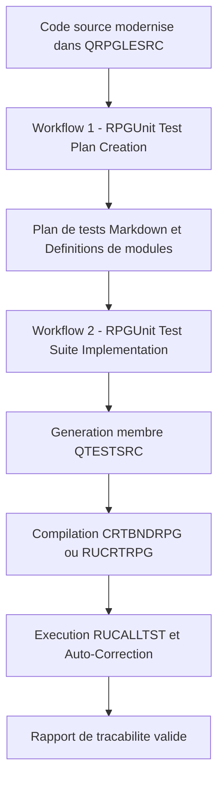
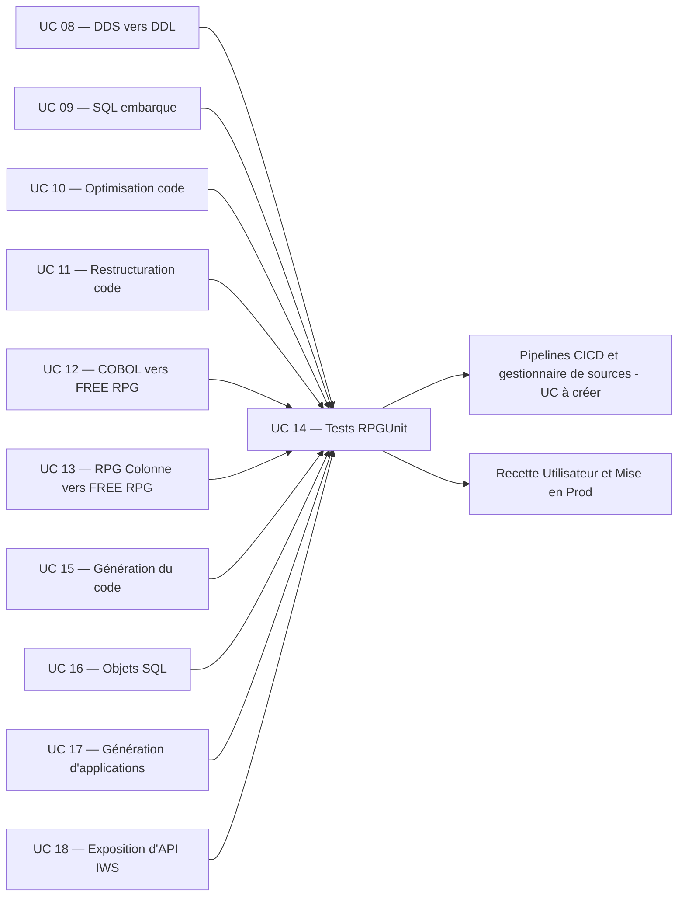

# UC 14 — Création de procédures de test (RPGUnit)

> **Catégorie :** Tests & Assurance Qualité — Non-régression
>
> **Priorité dans le parcours :** 14 — mécanisme de validation réutilisable après chaque chantier (UC 08 à UC 13, mais aussi UC 15 à UC 17), et non étape unique dans l'ordre numérique ; ancrage principal en Phase 5 (Validation & Non-régression).
>
> **Mode Bob recommandé :** IBM i Developer (analyse des programmes, exécution des workflows Premium RPGUnit, génération des suites de tests en `**FREE`, compilation `CRTBNDRPG` / `RUCRTRPG`, exécution `RUCALLTST`) → IBM i Database (contrôle des catalogues `QSYS2`, gestion des spools via `SYSTOOLS.SPOOLED_FILE_DATA`, préparation des données de test SQL). Sans Premium Package : Ask pour l'analyse/génération, Agent pour la compilation, l'exécution et l'écriture.

---

## ⭐ Premium Package IBM i utilisé

- **Workflow : RPGUnit Test Plan Creation** (`ibmi_create_rpgunit_test_plan`) → [Documentation officielle](https://bob.ibm.com/docs/ide/premium-packages/bob-for-i/workflows)
  Analyse les membres sources RPGLE / SQLRPGLE d'une bibliothèque, localise les points d'entrée et procédures exportées, et génère un ensemble structuré de documents de plan de tests (définition de modules, suites de tests, scénarios et utilitaires de test partagés).
  - **Lancement :** bouton **Start Workflow** en haut du chat → choisir le workspace → **Start**. **Workspaces supportés :** Local, Library List ([UC 00 §1.3](UC00-premium-package-ibmi-fr.md)). **Mode :** IBM i Developer.
- **Workflow : RPGUnit Test Suite Implementation** (`ibmi_implement_rpgunit_test_plan`) → [Documentation officielle](https://bob.ibm.com/docs/ide/premium-packages/bob-for-i/workflows)
  Implémente les suites de tests unitaires planifiées : génère le code source RPGUnit en `**FREE`, intègre les assertions et les hooks de cycle de vie (`setUp`, `tearDown`), compile sur l'IBM i cible et exécute les tests avec boucle de correction des erreurs détectées.
  - **Lancement :** bouton **Start Workflow** → **RPGUnit Test Suite Implementation**, après le workflow *Test Plan Creation* (prérequis). **Workspaces supportés :** Local, Library List ([UC 00 §1.4](UC00-premium-package-ibmi-fr.md)). **Mode :** IBM i Developer.
- **Understand Dashboard** (optionnel, non coché pour cet UC dans [UC 00 §6](UC00-premium-package-ibmi-fr.md) ; mise en place et outils : [UC 00 §2](UC00-premium-package-ibmi-fr.md)) → [Documentation officielle](https://bob.ibm.com/docs/ide/premium-packages/bob-for-i/understand)
  *Si Understand est installé.* Analyse structurelle globale du périmètre applicatif :
  - **Cartographie et analyse d'impact :** identifier les dépendances d'appels entre programmes pour ordonnancer les tests de bas en haut (tester les modules de service avant les programmes appelants).
  - **Accès :** Commande `vscode-ibmi-bob.openUnderstandDashboard`.
- **Skills auto-activées mobilisées (7 skills) :**
  - **Tests unitaires (1 skill) :** `rpgunit-testing` (structure d'une suite RPGUnit, nommage des cas, `setup`/`teardown`, API d'assertion, configuration des tests).
  - **Diagnostic & débogage (2 skills) :** `rpg-debugging-techniques`, `understand-impact-analysis`.
  - **RPGLE moderne & structures (4 skills) :** `rpg-procedures-functions`, `rpg-file-operations`, `rpg-indicators`, `rpg-data-structures`.

> **Pourquoi cet UC 14 apporte une valeur méthodologique unique :**
> Les deux workflows Premium *RPGUnit Test Plan Creation* et *RPGUnit Test Suite Implementation* constituent les accélérateurs directs pour automatiser la conception et l'implémentation des tests. Cet UC 14 apporte le cadre méthodologique, la gouvernance et les garde-fous indispensables pour fiabiliser l'exécution sur plateforme IBM i :
> 1. Grille de qualification et de découpage des programmes : SIMPLE (< 5 sorties directes), STANDARD (5–15 cas, état BD), COMPLEXE (> 15 cas, modules de service `*SRVPGM`), SQL (procédures & triggers) et BATCH (`SBMJOB`).
> 2. Stratégie d'isolation transactionnelle conditionnelle : `SAVEPOINT` / `ROLLBACK TO SAVEPOINT` (pris en charge lorsque le contrôle d'engagement (commitment control) est actif pour l'activation group ; tables journalisées et même activation group) vs `DELETE` ciblé par clé de corrélation unique (préfixe horodaté) si le programme testé exécute un `COMMIT` interne, si le contrôle d'engagement n'est pas actif ou si la bibliothèque de test n'est pas journalisée. Ce nettoyage est une mesure de réduction du risque, non une garantie d'isolation de tous les effets de bord du programme testé : il reste partiel en cas d'effets sur plusieurs tables ou de traitement batch (voir « Pièges à éviter »).
> 3. Gestion explicite des sorties non déterministes : asserter la forme (longueur, format date YYYYMMDD, non vide) plutôt qu'une valeur fixe fluctuante.
> 4. Manifeste de traçabilité complet dans chaque rapport d'exécution (identification de l'objet compilé, date de création, version RPGUnit, job d'exécution, spool exact) pour conformité aux audits et intégration future en pipeline CI/CD (UC à créer).
> 5. Protocole robuste de lecture des résultats de tests en spool via `QSYS2.JOB_NAME`, `QSYS2.OUTPUT_QUEUE_ENTRIES` et `SYSTOOLS.SPOOLED_FILE_DATA`.
> 6. Règle stricte d'isolation des sources : les membres de test sont créés exclusivement dans `QTESTSRC` au sein d'une bibliothèque de test dédiée (ex. `[NOM_LIB_TEST]`), sans polluer les fichiers sources de production gérés par le gestionnaire de sources (ex. Git).

---

## Objectif

Générer, compiler, exécuter et analyser des **tests unitaires automatisés sous RPGUnit** pour les programmes IBM i modernisés au cours du projet : programmes optimisés (UC 10), restructurés (UC 11), convertis (UC 12 COBOL, UC 13 RPG Colonné), ou générés (UC 15, UC 16, UC 17). Cet UC se rejoue après chaque chantier : il n'est pas conditionné à l'achèvement de tous les autres.

Ce filet de non-régression démontre formellement que la modernisation n'a altéré ni la logique métier, ni les calculs décisionnels, ni la gestion des erreurs.

**Ce que cet UC permet :**
- Classifier la testabilité des programmes et sélectionner la stratégie adaptée selon la nature des composants.
- Utiliser les workflows Premium *RPGUnit Test Plan Creation* et *RPGUnit Test Suite Implementation* pour orchestrer la production des tests.
- Générer des suites de tests RPGUnit en ILE RPGLE fully free (`**FREE`) conformes aux standards de l'installation cible (`CRTBNDRPG` ou `RUCRTRPG` / iRPGUnit).
- Définir des procédures de test exhaustives (`testNomCas`) couvrant les cas nominaux, les cas limites et les rejets d'erreurs.
- Gérer l'isolation des données via les hooks de cycle de vie (`setUp`, `tearDown`, `setUpSuite`, `tearDownSuite`).
- Automatiser l'exécution des tests en batch via un programme CL dédié (`[APP]TST`) et extraire les rapports d'exécution détaillés depuis les spools IBM i.

**Critère de succès principal :** Le programme de test compile sans erreur dans `QTESTSRC`, s'exécute via `RUCALLTST`, valide l'intégralité des assertions en limitant les données résiduelles (nettoyage vérifié selon le type de test : unitaire pur, avec base de données, ou intégration avec effets de bord), et produit un rapport de traçabilité horodaté attestant de la conformité du code modernisé.

---

## Prérequis

- **Phase :** Phase 5 — Validation & Non-régression (mécanisme transverse, réutilisable après chaque chantier, y compris UC 15 à UC 17 de la Phase 4)
- **UC précédents requis :**
  - **UC 01 — Connecter Bob à l'IBM i** (**obligatoire**) : profil de connexion actif, accès aux bibliothèques applicatives et de test.
  - **UC 02 — Maîtrise de Bob** (**obligatoire**) : utilisation du mode IBM i Developer.
  - **Au moins un UC de modernisation complété** : UC 10 (Optimisation), UC 11 (Restructuration), UC 12 (COBOL→FREE), UC 13 (RPG→FREE), ou UC 16 (Objets SQL).
  - **UC 05 / UC 06** (**recommandé**) : spécifications de compréhension et règles métier servant de référence pour les assertions.
- **Livrables requis :**
  - `{appId}-restruct-{composant}-diff-{YYYYMMDD-HHmm}.md` — UC 11 (si programme restructuré)
  - `{appId}-optim-{composant}-diff-{YYYYMMDD-HHmm}.md` — UC 10 (si programme optimisé)
  - `{appId}-conv-rpg-{composant}-diff-specs-{YYYYMMDD-HHmm}.md` et `{appId}-conv-rpg-{composant}-diff-calc-{YYYYMMDD-HHmm}.md` — UC 13 (si RPG converti)
  - `{appId}-conv-cobol-{composant}-diff-{YYYYMMDD-HHmm}.md` — UC 12 (si COBOL converti)
  - `{appId}-sql-{composant}-{procedure|fonction|trigger}-{YYYYMMDD-HHmm}.md` — UC 16 (si procédure/fonction/trigger SQL)
  - `{appId}-comprehension-{composant}-report-{YYYYMMDD-HHmm}.md` — UC 05 (recommandé)
  - `{appId}-logique-{composant}-regles-{YYYYMMDD-HHmm}.md` — UC 06 (recommandé)
- **Prérequis système IBM i :**
  - Le framework **RPGUnit / iRPGUnit** est installé sur le système IBM i (`RPGUNIT` et `QDEVTOOLS` présents dans la Library List).
  - La bibliothèque de test (ex. `[NOM_LIB_TEST]`, `FLGHT403` ou `ACMETEST`) est créée et accessible avec autorité de compilation.
  - Le fichier source `QTESTSRC` existe dans la bibliothèque de test (distinct de `QRPGSRC` / `QRPGLESRC`).
- **Niveau Bob recommandé :** Intermédiaire à Avancé
- **Bob Coins estimés :** ⚠️ *À calibrer après le lab UC 14 sur FLGHT400.*

---

## Exemple concret — Lab FLGHT400

| Livrable | Fichier lab | Ce qu'il illustre |
|---|---|---|
| Rapport de tests RPGUnit | [`../labs_FLGHT400_results/FLGHT403_tests_RPGUnit.md`](../labs_FLGHT400_results/FLGHT403_tests_RPGUnit.md) | Synthèse de la mise en place de tests unitaires sur l'application `FLGHT403` : utilisation des workflows `ibmi_create_rpgunit_test_plan` et `ibmi_implement_rpgunit_test_plan`, détection des programmes candidats dans `QRPGLESRC`, vérification des bibliothèques `RPGUNIT` et `QDEVTOOLS`, et prise en compte de l'absence de `*SRVPGM` (programmes liés `CRTBNDRPG`). |
| Session conversationnelle RPGUnit | [`../labs_FLGHT400_results/FLGHT403_tests_RPGUnit_conversation.md`](../labs_FLGHT400_results/FLGHT403_tests_RPGUnit_conversation.md) | Déroulement pas à pas de l'exécution des deux workflows Premium de test, configuration des templates, et génération des livrables de traçabilité. |

---

## Démarrer une session Bob

### Les trois espaces de travail

Pour exécuter UC 14, positionner clairement les trois espaces :
- **Workspace local** (poste) — rapports de qualification, plans de tests périmètre, manifests de traçabilité et rapports d'exécution au format Markdown (`.md`).
- **Librairies IBM i / QSYS** ⭐ — **espace d'exécution principal** : membres sources du programme testé (`QRPGLESRC`), membres sources des tests unitaires (`QTESTSRC`), objets programmes de test (`*PGM` ou `*SRVPGM`), commandes de compilation (`CRTBNDRPG`, `RUCRTRPG`), commande d'exécution `RUCALLTST`, et tables de test.
- **IFS Working Directory** — spools de résultats, documents de configuration de plan de test et rapports d'exécution exportés.

> 💡 **Scope Library List :** Dans Code for IBM i, vérifier que la Library List contient la bibliothèque applicative, la bibliothèque de test (`[NOM_LIB_TEST]`), ainsi que `RPGUNIT` et `QDEVTOOLS`.

---

## Accélérateur Premium Package — Workflows RPGUnit (Voie recommandée)

Le Premium Package IBM i intègre deux workflows chaînés dédiés à l'automatisation des tests RPGUnit. **Cette voie outillée est la méthode recommandée** :



### Étape 1 : Création du plan de tests (`ibmi_create_rpgunit_test_plan`)
1. Lancer le workflow via le bouton **Start Workflow** (workspace Local ou Library List), puis **RPGUnit Test Plan Creation** (identifiant observé dans le lab FLGHT400 : `ibmi_create_rpgunit_test_plan`). Sélectionner la bibliothèque cible et saisir le dossier IFS de sortie.
2. Bob scanne la bibliothèque source active, inspecte les membres RPGLE / SQLRPGLE, extrait les prototypes et procédures exportées.
3. Sélectionner les programmes ou procédures à couvrir.
4. Bob génère la structure documentaire du plan de test : spécification des modules, cas de test associés et utilitaires de test partagés.

### Étape 2 : Implémentation et exécution de la suite (`ibmi_implement_rpgunit_test_plan`)
1. Lancer le workflow **RPGUnit Test Suite Implementation** (identifiant observé dans le lab FLGHT400 : `ibmi_implement_rpgunit_test_plan`) en sélectionnant les documents de plan générés à l'étape 1, puis confirmer la bibliothèque et le dossier IFS et valider l'environnement.
2. Bob crée le squelette du programme de test dans `QTESTSRC` avec les copybooks adéquats, crée ou met à jour le fichier de configuration RPGUnit `testing.json`, implémente les assertions et les routines d'isolation.
3. Bob compile le programme de test (`CRTBNDRPG` ou `RUCRTRPG`), exécute la commande `RUCALLTST` sur l'IBM i, et analyse le résultat.
4. En cas d'échec d'assertion ou d'erreur de compilation, Bob active sa boucle de correction (*self-healing*) pour ajuster le code de test ou signaler la régression dans le programme testé.

---

## Démarche structurée et Prompts complémentaires

Lorsque les workflows Premium doivent être complétés par une démarche sur-mesure (programmes complexes avec dépendances d'état, procédures stockées SQL, triggers, ordonnancement global d'une application ou exécution batch personnalisée), utiliser la séquence de prompts ci-dessous.

### Progression recommandée selon la catégorie du programme

| Étape | Type de programme | Catégorie | Séquence recommandée |
|---|---|---|---|
| **1** | Programme optimisé simple (UC 10), calculs directs, < 5 sorties | **SIMPLE** | Prompt 0 → Prompt 1 → Prompt 1-bis (compilation) → Prompt 4 (exécution) |
| **2** | Programme converti (UC 12 COBOL / UC 13 RPG), règles métier multiples | **STANDARD** | Prompt 0 → Prompt 1 par groupe de cas → Prompt 1-bis → Prompt 4 après chaque groupe |
| **3** | Programme restructuré en modules de service (UC 11, `*SRVPGM`) | **COMPLEXE** | Prompt 0 → Prompt 1 par procédure exportée → Prompt 1-bis → Prompt 4 par procédure → Prompt 1 flux complet → Prompt 4 |
| **4** | Procédure stockée ou trigger SQL (UC 16) | **SQL** | Prompt 0 → Prompt 2 (tests SQL) → Prompt 1-bis → Prompt 4 |
| **5** | Portefeuille applicatif complet / Automatisation batch | **SUITE** | Prompt 3 (plan global) → Prompt 5 (script CL `[APP]TST`) |

---

### Prompt 0 — Qualification et inventaire des cas de test

**Objectif :** Examiner le programme modernisé, vérifier l'environnement d'exécution RPGUnit réel sur l'IBM i, classifier le composant et inventorier tous les cas de test nécessaires.

**Quand l'utiliser :** Avant toute rédaction ou implémentation de test unitaire.

**Input requis :**
- Source du programme modernisé dans `[NOM_LIB]/QRPGLESRC([NOM_PGM])`.
- Livrable de diff de modernisation (`*-restruct-*-diff-*`, `*-conv-rpg-*-diff-*`, `*-conv-cobol-*-diff-*` ou `*-optim-*-diff-*`).
- Rapports de compréhension UC 05 et règles métier UC 06 (si disponibles).

**Espace :** Local (`bob-reports/`) pour le rapport de qualification, IBM i QSYS pour la consultation des catalogues.
**Mode :** IBM i Developer.
**Skills clés mobilisées :** `rpgunit-testing`, `rpg-debugging-techniques`, `rpg-procedures-functions`, `rpg-data-structures`, `understand-impact-analysis`.

**Prompt :**

```text
Le programme [NOM_PROGRAMME] dans [NOM_LIB]/QRPGLESRC a été modernisé dans le cadre du projet
(UC [N_UC] — [TYPE_MODERNISATION]).
[Charger le livrable de diff *-diff-*.md et les rapports UC 05 / UC 06 dans le contexte]

Analyse ce programme et produis en français, en markdown, un rapport de qualification
pour la création de tests unitaires RPGUnit :

## Qualification UC 14 — [NOM_PROGRAMME]

### 1. Identification du programme et de l'environnement d'exécution
| Indicateur | Valeur |
|---|---|
| Type d'objet IBM i | *PGM / *SRVPGM |
| Modèle de programme | ILE (ou OPM résiduel) |
| Activation group | Nommé / *CALLER / *NEW / DFTACTGRP(*NO) |
| Gestion de *INLR | *INLR = *ON en sortie / Persistance d'état mémoire |
| Procédures exportées (si *SRVPGM ou ILE) | Liste exhaustive des procédures ou AUCUNE (*ENTRY seul) |
| Programme interactif (EXFMT) | OUI (logique métier isolable dans procédures) / NON (batch pur ou service) |
| Déclenchement de jobs batch (SBMJOB) | OUI / NON |

Interroger QSYS2.OBJECT_STATISTICS et QSYS2.PROGRAM_INFO pour confirmer ces caractéristiques.

### 2. Vérification de l'environnement RPGUnit cible
Identifier la distribution et l'interface RPGUnit installées en interrogeant l'IBM i :
- [ ] Commande RUCALLTST disponible dans la Library List
- [ ] Copybook d'assertions : nom exact de l'include (ex. QRPGLESRC,CBRPGUNIT ou RUTESTCASE)
- [ ] Commande de compilation requise : CRTBNDRPG ou RUCRTRPG ; si le source de test contient EXEC SQL, membre de type SQLRPGLE et précompilation SQL obligatoire (CRTSQLRPGI, ou RUCRTRPG avec ses options de précompilation POPTION / COMPILEOPT) — à confirmer sur l'installation cible
- [ ] Type d'objet généré pour le test : *PGM ou *SRVPGM
- [ ] Fichier source [NOM_LIB_TEST]/QTESTSRC accessible avec autorité de création
- [ ] Journalisation active sur les tables de [NOM_LIB_TEST] et contrôle d'engagement (commitment control) actif pour l'activation group (nécessaires pour SAVEPOINT/ROLLBACK TO SAVEPOINT)
- [ ] Périmètre de commitment control partagé : Même job / Même groupe d'activation

### 3. Interface de cycle de vie RPGUnit confirmée
| Hook | Nom conventionnel | Rôle | Disponible ? |
|---|---|---|---|
| Avant toute la suite | setUpSuite | Initialisation globale / Vérification environnement | OUI / NON / À VÉRIFIER |
| Avant chaque test | setUp | Préparation données de test / SAVEPOINT | OUI / NON |
| Après chaque test | tearDown | Nettoyage / ROLLBACK TO SAVEPOINT ou DELETE ciblé | OUI / NON |
| Après toute la suite | tearDownSuite | Nettoyage final de sécurité | OUI / NON / À VÉRIFIER |

### 4. Sorties observables et déterminisme
| Sortie | Nature (Paramètre retourné, table mise à jour, spool, message) | Déterministe ? | Stratégie d'assertion |
|---|---|---|---|
| [Nom sortie] | [Nature] | OUI / NON | [Valeur exacte si OUI / Asserter la forme, le format ou le code retour si NON] |

### 5. Inventaire des cas de test identifiables
| N° cas | Scénario de test | Données en entrée | Sortie attendue | Règle métier source |
|---|---|---|---|---|
| 01 | Cas nominal principal | [Entrées] | [Sortie attendue] | [Règle UC 06] |
| 02 | Cas limite / Borne | [Entrées limites] | [Sortie attendue] | [Règle UC 06] |
| 03 | Cas d'erreur / Rejet | [Entrées invalides] | [Code erreur / Rejet] | [Règle UC 06] |

### 6. Catégorisation et séquence recommandée
- [ ] SIMPLE (< 5 sorties directes, sans état DB persistant)
- [ ] STANDARD (5 à 15 cas, données DB à injecter)
- [ ] COMPLEXE (> 15 cas, *SRVPGM multi-procédures)
- [ ] SQL (procédures stockées ou triggers)

Séquence recommandée :
- SIMPLE   → Prompt 1 → Prompt 1-bis (compilation) → Prompt 4 (exécution)
- STANDARD → Prompt 1 par groupe de cas → Prompt 1-bis → Prompt 4 par groupe
- COMPLEXE → Prompt 1 par procédure exportée → Prompt 1-bis → Prompt 4 par procédure → Prompt 1 flux complet → Prompt 4
```

**Livrable produit :** `{appId}-test-{composant}-analyse-{YYYYMMDD-HHmm}.md` (dans `bob-reports/`).

---

### Prompt 1 — Génération du programme de test RPGUnit (Programmes RPG)

**Objectif :** Générer le code source complet d'un programme de test RPGUnit en format `**FREE` pour un programme ou module RPG.

**Quand l'utiliser :** Après validation du rapport de qualification (Prompt 0).

**Input requis :**
- Rapport de qualification `{appId}-test-{composant}-analyse-{YYYYMMDD-HHmm}.md`.
- Code source du programme modernisé.

**Espace :** Local (`bob-reports/`) pour la version documentée, puis IBM i QSYS (`QTESTSRC`) lors de la compilation.
**Mode :** IBM i Developer.
**Skills clés mobilisées :** `rpgunit-testing`, `rpg-procedures-functions`, `rpg-file-operations`, `rpg-indicators`, `rpg-debugging-techniques`.

**Prompt :**

```text
Sur la base du rapport de qualification [NOM_FICHIER_ANALYSE_TEST]
pour le programme [NOM_PROGRAMME] dans [NOM_LIB]/QRPGLESRC,

L'environnement RPGUnit confirmé est :
- Copybook d'assertions : [NOM_COPYBOOK validé au Prompt 0]
- Type de compilation cible : [*PGM via CRTBNDRPG / *SRVPGM via RUCRTRPG / SQL embarqué (EXEC SQL) : membre SQLRPGLE précompilé via CRTSQLRPGI (OBJTYPE *PGM ou *MODULE) ou RUCRTRPG avec POPTION / COMPILEOPT — validé au Prompt 0]
- Stratégie d'isolation : [SAVEPOINT/ROLLBACK TO SAVEPOINT si journalisé et contrôle d'engagement actif / DELETE par clé de corrélation unique horodatée sinon]
- Type de test : [unitaire pur sans base de données / avec base de données / intégration avec effets de bord — le nettoyage ci-dessous n'est garanti que pour le périmètre transactionnel journalisé]

Génère en fully free RPGLE (`**FREE`) le programme de test RPGUnit [NOM_PROGRAMME]T couvrant les cas de test [LISTE_DES_CAS_OU_GROUPE].

Structure obligatoire du membre source de test :

1. Directives de contrôle et En-tête
**FREE
CTL-OPT DFTACTGRP(*NO) ACTGRP('RPGUNIT') OPTION(*SRCSTMT : *NODEBUGIO);
/INCLUDE [BIBLIO_RPGUNIT]/QRPGLESRC,[NOM_COPYBOOK]

2. Prototypes
- Prototype du programme ou de la procédure à tester (DCL-PR).
- Prototypes des hooks de cycle de vie (setUpSuite, setUp, tearDown, tearDownSuite) et des procédures de test (DCL-PR test... EXPOBJ ou exportées).

3. Hook avant suite (setUpSuite — si supporté)
- Contrôle de la présence de la bibliothèque de test [NOM_LIB_TEST].
- Initialisation du préfixe de clé de corrélation unique (ex. horodatage format 'TEST_' + timestamp).

4. Hook avant chaque test (setUp)
- Insertion des données de test nécessaires au cas courant.
- Si journalisation active, contrôle d'engagement actif et même activation group : EXEC SQL SAVEPOINT sp_rpgunit ON ROLLBACK RETAIN CURSORS;

5. Procédures de test unitaires (une sous-procédure DCL-PROC par cas de test)
Pour chaque cas :
- Nom : test[NomDuCas] (ex. testCalculRemiseClient, testCodeArticleInconnu).
- Initialisation des paramètres d'entrée.
- Appel du programme testé : CALLP ou appel de fonction.
- Assertions RPGUnit rigoureuses (ex. aEqual, aTrue, assert, aFailSiErreur selon l'API confirmée).
- Pour les sorties non déterministes (date courante, numérotation) : asserter la non-vacuité et le format structurel.

6. Hook après chaque test (tearDown)
- Nettoyage conditionnel (efficace seulement si le programme testé n'exécute pas de COMMIT interne et reste dans le même périmètre de commitment control) :
  a) Si SAVEPOINT actif : EXEC SQL ROLLBACK TO SAVEPOINT sp_rpgunit;
  b) Sinon : EXEC SQL DELETE FROM [TABLE_TEST] WHERE CLE_TEST LIKE :gClePrefixe;
- Si le programme testé écrit dans plusieurs tables ou en traitement batch (SBMJOB) : nettoyer chaque table touchée et contrôler explicitement l'absence de verrou ou d'enregistrement résiduel (aucune garantie automatique).

7. Hook après suite (tearDownSuite — si supporté)
- Purge de sécurité finale des données portant la clé de corrélation de la session de test.

Règles de génération :
- Code entièrement écrit en **FREE, indenté de 2 espaces.
- Commentaires explicatifs en français au-dessus de chaque procédure de test.
- Ne pas regrouper d'assertions non liées dans un même cas de test.
- Ne pas inventer de BIF ou de fonction RPGUnit non attestée dans le copybook.
```

**Livrable produit :** `{appId}-test-{composant}-code-{YYYYMMDD-HHmm}.md` (dans `bob-reports/`).

---

### Prompt 1-bis — Test de compilation du programme de test RPGUnit

**Objectif :** Écrire le membre source généré dans le fichier source de test `QTESTSRC` et exécuter la compilation sur l'IBM i sans lancer les tests.

**Quand l'utiliser :** Immédiatement après la génération du code de test (Prompt 1 ou Prompt 2).

**Input requis :**
- Code source généré au Prompt 1.
- Bibliothèque de test cible `[NOM_LIB_TEST]`.

**Espace :** IBM i QSYS (`[NOM_LIB_TEST]/QTESTSRC([NOM_PGM]T)`).
**Mode :** IBM i Developer (ou Agent).
**Skills clés mobilisées :** `rpgunit-testing`, `rpg-procedures-functions`, `rpg-debugging-techniques`.

**Prompt :**

```text
Le programme de test RPGUnit [NOM_PROGRAMME]T vient d'être validé.
La commande de compilation confirmée est [CRTBNDRPG / RUCRTRPG / CRTSQLRPGI si le source contient EXEC SQL].

1. Crée ou remplace le membre source dans [NOM_LIB_TEST]/QTESTSRC, membre [NOM_PROGRAMME]T, avec le code RPGLE généré.
(Veiller à cibler QTESTSRC et jamais le fichier source de production QRPGLESRC).

2. Exécute la commande de compilation appropriée :

[SI CRTBNDRPG — Programme de test autonome]
CRTBNDRPG PGM([NOM_LIB_TEST]/[NOM_PROGRAMME]T)
          SRCFILE([NOM_LIB_TEST]/QTESTSRC)
          SRCMBR([NOM_PROGRAMME]T)
          OPTION(*EVENTF)
          OUTPUT(*PRINT)
          DBGVIEW(*SOURCE)
          DFTACTGRP(*NO)
          ACTGRP(RPGUNIT)

[SI RUCRTRPG — Framework iRPGUnit / *SRVPGM]
RUCRTRPG TSTPGM([NOM_LIB_TEST]/[NOM_PROGRAMME]T)
         SRCFILE([NOM_LIB_TEST]/QTESTSRC)
         SRCMBR([NOM_PROGRAMME]T)

[SI SQL embarqué (EXEC SQL) — membre de type SQLRPGLE, précompilation SQL obligatoire]
CRTBNDRPG ne précompile pas le SQL : utiliser CRTSQLRPGI au lieu de CRTBNDRPG
CRTSQLRPGI OBJ([NOM_LIB_TEST]/[NOM_PROGRAMME]T)
           SRCFILE([NOM_LIB_TEST]/QTESTSRC)
           SRCMBR([NOM_PROGRAMME]T)
           OBJTYPE(*PGM)
           OPTION(*EVENTF)
           OUTPUT(*PRINT)
           DBGVIEW(*SOURCE)
ou, en framework iRPGUnit, RUCRTRPG en passant les options de précompilation (POPTION) et de compilation (COMPILEOPT) ; options à confirmer au Prompt 0 sur l'installation cible.

3. Analyse le résultat de la compilation et produis en français :
- Statut global : COMPILATION RÉUSSIE ou ERREURS DE COMPILATION.
- Si erreurs : tableau des anomalies (Ligne, Code message, Description, Cause probable).
  Vérifier en priorité :
  - L'accessibilité du copybook RPGUnit dans la Library List.
  - La conformité des paramètres du prototype DCL-PR avec le programme testé.
  - La déclaration de toutes les variables hôtes SQL (DCL-S).
  - Pour un source avec EXEC SQL : type de membre SQLRPGLE et précompilation SQL effectivement exécutée (pas de compilation directe par CRTBNDRPG).
- Si succès : confirmer la création de l'objet ([NOM_LIB_TEST]/[NOM_PROGRAMME]T de type *PGM ou *SRVPGM).
```

**Livrable produit :** Rapport de compilation dans le chat et mise à jour de l'état de test.

---

### Prompt 2 — Génération des tests pour procédures stockées et triggers SQL (UC 16)

**Objectif :** Générer un programme de test RPGUnit intégrant du SQL embarqué pour valider une procédure stockée SQL PL ou un trigger Db2 for i.

**Quand l'utiliser :** Pour valider les objets SQL issus d'UC 16.

**Input requis :**
- Livrables UC 16 (`*-sql-*-procedure-*.md`, `*-sql-*-fonction-*.md` ou `*-sql-*-trigger-*.md`).
- Catalogue système Db2 (`QSYS2.SYSROUTINES` ou `QSYS2.SYSTRIGGERS`).

**Espace :** Local (`bob-reports/`) pour la trace, IBM i QSYS pour la cible.
**Mode :** IBM i Developer.
**Skills clés mobilisées :** `rpgunit-testing`, `db2-stored-procedures`, `rpg-procedures-functions`, `rpg-debugging-techniques`.

**Prompt :**

```text
Sur la base des spécifications SQL de l'objet [NOM_OBJET_SQL] dans [NOM_LIB]
(fichiers livrables de l'UC 16),
et selon l'environnement RPGUnit confirmé en Prompt 0 :

Génère en fully free RPGLE avec SQL embarqué (`**FREE`) le programme de test RPGUnit [NOM_OBJET_SQL]T.

Le programme de test doit couvrir :
1. Déclarations
- Copybook RPGUnit standard.
- Variables hôtes SQL (DCL-S) correspondant exactement aux paramètres IN, OUT et INOUT de la procédure.
- Variables de contrôle SQL : SQLCODE, SQLSTATE.

2. Hook avant chaque test (setUp)
- Insertion des jeux d'enregistrements requis dans [NOM_LIB_TEST].
- Initialisation des paramètres de la procédure SQL.
- Définition d'un SAVEPOINT si journalisé, ou attribution d'une clé de corrélation unique.

3. Scénarios de test
- Cas nominal : Exécution de l'instruction `EXEC SQL CALL [NOM_LIB].[NOM_OBJET_SQL](:param1, :param2, ...);`
  - Assertion SQLCODE = 0 (succès).
  - Assertions sur les valeurs retournées dans les paramètres OUT / INOUT.
- Cas d'erreur géré : Appel avec données invalides
  - Assertion sur le code retour attendu (ex. SQLCODE = -803 pour violation de clé ou SQLSTATE spécifique).
- Cas des triggers (si applicable) :
  - Exécution de l'opération DML (INSERT/UPDATE/DELETE) déclenchante.
  - Vérification de l'effet de bord (mise à jour de colonne calculée, insertion dans table d'audit, etc.).

4. Hook après chaque test (tearDown)
- Nettoyage conditionnel via ROLLBACK TO SAVEPOINT ou DELETE ciblé par clé (partiel si COMMIT interne, plusieurs tables ou traitement batch : nettoyer chaque table touchée et le vérifier).

Produis le code source complet (membre de type SQLRPGLE, précompilation SQL requise) prêt à être compilé via CRTSQLRPGI, ou via RUCRTRPG avec ses options de précompilation (POPTION / COMPILEOPT) selon l'environnement confirmé au Prompt 0.
```

**Livrable produit :** `{appId}-test-{composant}-sql-code-{YYYYMMDD-HHmm}.md`.

---

### Prompt 3 — Plan de tests pour un périmètre applicatif complet

**Objectif :** Établir une matrice ordonnancée de l'ensemble des tests unitaires à réaliser sur une application complète, en tenant compte des dépendances d'appels.

**Quand l'utiliser :** Lors de la préparation de la phase de non-régression globale d'un projet.

**Input requis :**
- Cartographie applicative Understand Dashboard ou rapport d'architecture UC 07.
- Livrables de diff de tous les programmes modernisés du périmètre.

**Espace :** Local (`bob-reports/`).
**Mode :** IBM i Developer.
**Skills clés mobilisées :** `rpgunit-testing`, `understand-impact-analysis`, `rpg-debugging-techniques`.

**Prompt :**

```text
Sur la base de l'ensemble des livrables de modernisation de l'application [NOM_APPLICATION] dans [NOM_LIB]
(fichiers de diff UC 10, UC 11, UC 12, UC 13 et objets SQL UC 16 disponibles),

Génère en français, en markdown, le plan de tests d'intégration et de non-régression global :

## Plan de Tests Unitaires — Application [NOM_APPLICATION]

### 1. Matrice des programmes à tester et ordonnancement
| Ordre d'exécution | Programme / Module | Type (*PGM, *SRVPGM, SQL) | UC d'origine | Nb cas de test | Dépendances amont | Priorité |
(Règle d'ordonnancement : tester en premier les modules de service et sous-programmes indépendants, puis remonter vers les programmes orchestrateurs et les flux batch).

### 2. Stratégie de données de test et isolation
Pour chaque groupe fonctionnel :
- Tables Db2 impactées.
- Mode d'isolation retenu (SAVEPOINT transactionnel / DELETE par clé de corrélation horodatée).
- Sensibilité des données (nécessité d'anonymisation préalable si extraction depuis la production).

### 3. Programmes exclus ou soumis à conditions
Identifier les programmes interactifs (5250) non testables en mode headless dont la logique n'a pas été extraite, ou les programmes dépendant de matériels externes, avec la justification.

### 4. Calendrier d'automatisation
Planification de l'exécution de la suite batch [NOM_APPLICATION]TST et critères de validation globale.
```

**Livrable produit :** `{appId}-test-{appId}-plan-{YYYYMMDD-HHmm}.md` (dans `bob-reports/`).

---

### Prompt 4 — Exécution des tests et rapport de résultats

**Objectif :** Exécuter la suite de tests RPGUnit sur l'IBM i, capturer les résultats réels depuis le spool du job via les services SQL Db2 for i, et dresser le bilan d'exécution.

**Quand l'utiliser :** Après compilation réussie du programme de test (Prompt 1-bis).

**Input requis :**
- Programme de test compilé `[NOM_LIB_TEST]/[NOM_PGM]T`.
- Rapport de qualification du test.

**Espace :** IBM i QSYS pour l'exécution, puis Workspace local (`bob-reports/`) pour le rapport de test.
**Mode :** IBM i Developer.
**Skills clés mobilisées :** `rpgunit-testing`, `rpg-debugging-techniques`, `rpg-procedures-functions`.

**Prompt :**

```text
Le programme de test RPGUnit [NOM_PROGRAMME]T est compilé dans la bibliothèque [NOM_LIB_TEST].

Étape A — Préparation de la traçabilité (mémorisation du contexte d'exécution) :
Exécute les requêtes suivantes pour enregistrer le job courant et l'horodatage initial :
VALUES QSYS2.JOB_NAME;
VALUES CURRENT_TIMESTAMP;

Étape B — Lancement de l'exécution RPGUnit :
Exécute la commande de test :
RUCALLTST TSTPGM([NOM_LIB_TEST]/[NOM_PROGRAMME]T)
          OUTPUT(*SYSOUT)
          DETAIL(*ALL)

Étape C — Localisation précise du spool de rapport :
Interroge la file de sortie du job pour identifier le spool créé postérieurement à l'horodatage initial :
SELECT SPOOLED_FILE_NAME, FILE_NUMBER, CREATE_TIMESTAMP
FROM QSYS2.OUTPUT_QUEUE_ENTRIES
WHERE JOB_NAME = '[NOM_JOB_QUALIFIÉ]'
  AND CREATE_TIMESTAMP >= [HORODATAGE_INITIAL]
ORDER BY CREATE_TIMESTAMP DESC;

Étape D — Extraction du contenu du rapport de test :
SELECT SPOOL_DATA
FROM TABLE(SYSTOOLS.SPOOLED_FILE_DATA(
  JOB_NAME            => '[NOM_JOB_QUALIFIÉ]',
  SPOOLED_FILE_NAME   => '[NOM_SPOOL_TROUVÉ]',
  SPOOLED_FILE_NUMBER => [NUMERO_SPOOL]
)) AS T;

Étape E — Analyse et rédaction du livrable :
Analyse les lignes du rapport et génère en français, en markdown, le rapport d'exécution :

# Rapport d'Exécution RPGUnit — [NOM_PROGRAMME]

## 1. Synthèse globale
- Résultat : [TOTAL] tests | [PASSED] succès | [FAILED] échecs | [ERROR] erreurs
- Statut global : [VALIDÉ / NON VALIDÉ / PARTIELLEMENT VALIDÉ]

## 2. Détail des cas de test
| N° | Procédure de test | Statut | Résultat obtenu vs attendu | Diagnostic / Règle métier |
|---|---|---|---|---|
| 01 | testNomCas | PASSED / FAILED | ... | ... |

## 3. Analyse des échecs (si applicable)
Pour chaque FAILED ou ERROR :
- Description précise de l'écart.
- Localisation (régression dans le code modernisé ou défaut dans les assertions du test).
- Recommandation d'action corrective (retour à l'UC de modernisation source).

## 4. Manifeste de traçabilité (Obligatoire)
- Objet testé : [NOM_LIB]/[NOM_PROGRAMME] (*PGM / *SRVPGM)
- Source du programme testé : [NOM_LIB]/QRPGLESRC([NOM_PROGRAMME])
- Source de test : [NOM_LIB_TEST]/QTESTSRC([NOM_PROGRAMME]T)
- Job d'exécution : [NOM_JOB_QUALIFIÉ]
- Fichier Spool : [NOM_SPOOL] (N° [NUMERO_SPOOL])
- Horodatage d'exécution : [CURRENT_TIMESTAMP]
- Version RPGUnit : [Version identifiée]
- Livrable de diff de référence : [*-diff-*.md utilisé]
```

**Livrable produit :** `{appId}-test-{composant}-rapport-{YYYYMMDD-HHmm}.md` (dans `bob-reports/`).

---

### Prompt 5 — Automatisation de la suite de tests (Script CL de régression batch)

**Objectif :** Générer un programme CL batch orchestrant l'exécution séquentielle de l'ensemble des programmes de test RPGUnit d'une application et consignant le statut final.

**Quand l'utiliser :** Lorsque tous les programmes de test individuels d'un périmètre applicatif sont validés.

**Input requis :**
- Plan de tests périmètre `{appId}-test-{appId}-plan-{YYYYMMDD-HHmm}.md`.
- Liste des programmes de test compilés `[NOM_PGM]T`.

**Espace :** IBM i QSYS (`[NOM_LIB_TEST]/QCLSRC([NOM_APP]TST)`).
**Mode :** IBM i Developer.
**Skills clés mobilisées :** `cl-programming`, `cl-best-practices`, `rpg-debugging-techniques`.

**Prompt :**

```text
Sur la base du plan de tests [NOM_FICHIER_PLAN_TEST] pour l'application [NOM_APPLICATION] dans [NOM_LIB_TEST],

Génère en langage CL IBM i moderne (ILE CLLE) le programme d'automatisation de suite de tests [NOM_APPLICATION]TST.

Le programme CL doit :
1. En-tête et Déclarations
- Déclaration des variables de contrôle (DCL VAR(&NB_FAIL) TYPE(*DEC) LEN(5 0) VALUE(0)).
- Configuration de la Library List d'exécution (ADDLIBLE pour [NOM_LIB], [NOM_LIB_TEST], RPGUNIT, QDEVTOOLS avec MONMSG CPF2103).

2. Exécution séquentielle des tests
Pour chaque programme de test de la suite ([PGM1]T, [PGM2]T, ...) :
- Envoi d'un message d'information : SNDPGMMSG MSG('Exécution des tests pour [PGM1]...').
- Appel RPGUnit :
  RUCALLTST TSTPGM([NOM_LIB_TEST]/[PGM1]T) OUTPUT(*SYSOUT) DETAIL(*ALL)
  MONMSG MSGID(RUC0000 CPF0000) EXEC(DO)
    CHGVAR VAR(&NB_FAIL) VALUE(&NB_FAIL + 1)
    SNDPGMMSG MSGID(CPF9898) MSGF(QCPFMSG) MSGDTA('Échec détecté sur ' *CAT '[PGM1]T') MSGTYPE(*DIAG)
  ENDDO

3. Bilan d'exécution et notification
- Si &NB_FAIL = 0 : Envoi du message d'achèvement normal (*COMP) 'SUITE DE TESTS VALIDÉE AVEC SUCCÈS'.
- Si &NB_FAIL > 0 : Envoi d'un message d'échappement (*ESCAPE) signalant le nombre d'échecs détectés.

Génère le source CL complet prêt à être écrit dans [NOM_LIB_TEST]/QCLSRC([NOM_APPLICATION]TST) et compilé via CRTBNDCL.
```

**Livrable produit :** `{appId}-test-{appId}-suite-cl-{YYYYMMDD-HHmm}.md` (dans `bob-reports/`).

---

## Livrables de cet UC

| Fichier produit | Pattern de nommage | Espace de stockage | Consommé par |
|---|---|---|---|
| Rapport de qualification | `{appId}-test-{composant}-analyse-{YYYYMMDD-HHmm}.md` | `bob-reports/` (Local) | Prompts 1, 2, 4 |
| Source RPGUnit documenté | `{appId}-test-{composant}-code-{YYYYMMDD-HHmm}.md` | `bob-reports/` (Local) | Prompt 1-bis, Revue |
| Membre source RPGUnit compilé | `[NOM_PGM]T` | `[NOM_LIB_TEST]/QTESTSRC` (IBM i QSYS) | Prompt 4, Prompt 5, CI/CD |
| Plan de tests périmètre | `{appId}-test-{appId}-plan-{YYYYMMDD-HHmm}.md` | `bob-reports/` (Local) | Prompt 5, Pilotage projet |
| Rapport d'exécution & traçabilité | `{appId}-test-{composant}-rapport-{YYYYMMDD-HHmm}.md` | `bob-reports/` (Local) | Pipeline CI/CD (UC à créer), Validation |
| Programme CL de suite batch | `[NOM_APP]TST` | `[NOM_LIB_TEST]/QCLSRC` (IBM i QSYS) | Automatisation batch, CI/CD |

---

## Dépendances



---

## Pièges à éviter

| Piège | Conséquence | Mesure de prévention |
|---|---|---|
| Supposer le nom des copybooks ou des macros d'assertions depuis sa mémoire | Erreurs de compilation immédiates (`RNF7030` symbole non défini) : les versions classique, iRPGUnit et distributions custom utilisent des copybooks distincts (`CBRPGUNIT`, `RUTESTCASE`, etc.). | Exécuter impérativement le Prompt 0 pour inspecter les membres installés dans la bibliothèque RPGUnit réelle avant de générer le code. |
| Générer des noms de hooks non supportés par la distribution installée | Le programme compile sans erreur, mais les procédures `setUpSuite`/`tearDownSuite` ne s'exécutent jamais, laissant des données résiduelles silencieuses. | Vérifier la table des hooks au Prompt 0. Si le hook de suite n'est pas supporté, déplacer la logique d'initialisation dans le `setUp` individuel. |
| Utiliser `SAVEPOINT` / `ROLLBACK TO SAVEPOINT` sans contrôle d'engagement actif, sur des tables non journalisées ou avec groupes d'activation distincts | `SAVEPOINT` non autorisé (contrôle d'engagement inactif), échec du `ROLLBACK` ou exception `SQL7008` : les tables de test ne sont pas réinitialisées et les tests suivants sont pollués. | Vérifier l'activation de la journalisation et du contrôle d'engagement au Prompt 0. Si l'un des deux est absent, basculer impérativement sur la stratégie B (`DELETE` par clé de corrélation unique horodatée). |
| Asserter une valeur exacte sur des sorties non déterministes | Échecs intermittents et faux positifs : un champ contenant la date du jour ou un numéro incrémenté change à chaque exécution. | Asserter la structure et la forme (champ non vide, longueur conforme, format date valide `YYYYMMDD`) plutôt qu'une valeur constante. |
| Déclarer un programme avec `COMMIT` interne comme « non testable » | Blocage injustifié de l'automatisation des tests sur les programmes batch IBM i. | Adopter la stratégie B : le `COMMIT` interne rend le `SAVEPOINT` inopérant au-delà ; le `DELETE` ciblé avec clé de session limite les résidus mais ne les exclut pas (effets sur plusieurs tables, batch) : nettoyer chaque table touchée et vérifier l'absence de résidus ; traiter ces cas comme des tests d'intégration à effets de bord. |
| Récupérer le spool de résultat sans filtrage strict par job qualifié et horodatage | Analyse erronée d'un rapport de test obsolète ou provenant d'un autre utilisateur en session concurrente. | Capturer systématiquement `QSYS2.JOB_NAME` et `CURRENT_TIMESTAMP` avant `RUCALLTST`, puis filtrer `QSYS2.OUTPUT_QUEUE_ENTRIES` par ces critères stricts. |
| Écrire les membres de test dans `QRPGLESRC` en bibliothèque de production | Pollution des référentiels sources de production et interférences avec le gestionnaire de sources (ex. Git). | Écrire exclusivement dans le fichier source `QTESTSRC` au sein de la bibliothèque de test dédiée (`[NOM_LIB_TEST]`). |

---

## Check-list de validation UC 14

Avant de déclarer une suite de tests unitaires RPGUnit validée ou de promouvoir le code modernisé en intégration, vérifier chaque point :

- [ ] **Environnement audité (Prompt 0) :** Les bibliothèques `RPGUNIT` et `QDEVTOOLS` sont présentes dans la `*LIBL`, le copybook et les commandes de compilation (`CRTBNDRPG` / `RUCRTRPG`) sont confirmés.
- [ ] **Séparation stricte des bibliothèques :** Le source de test est écrit dans `[NOM_LIB_TEST]/QTESTSRC([PGM]T)` et jamais dans les bibliothèques source de production.
- [ ] **Stratégie d'isolation appliquée :** Les hooks `setUp` et `tearDown` visent la remise à blanc des tables de test (via `SAVEPOINT` / `ROLLBACK TO SAVEPOINT` si le contrôle d'engagement est actif, ou `DELETE` par clé de corrélation unique), à contrôler selon le type de test (unitaire pur, avec base de données, intégration à effets de bord) et en cas de `COMMIT` interne, de plusieurs tables ou de batch.
- [ ] **Sorties non déterministes sécurisées :** Les champs calculés dynamiquement (dates, compteurs) font l'objet d'assertions sur la forme et non sur des valeurs figées.
- [ ] **Compilation réussie (Prompt 1-bis) :** Le programme de test compile sans erreur ni avertissement bloquant (`*PGM` ou `*SRVPGM` créé dans `[NOM_LIB_TEST]`).
- [ ] **Exécution validée (Prompt 4) :** Tous les cas de test passent (`0 FAILED`, `0 ERROR`) lors de l'appel `RUCALLTST`.
- [ ] **Traçabilité complète :** Le rapport d'exécution consigne le manifeste complet (objet testé, source de compilation, job qualifié, numéro de spool, horodatage).
- [ ] **Automatisation batch prête (Prompt 5) :** Le script CL `[APP]TST` est généré et testé pour rejouer l'ensemble des suites en batch sans intervention interactive.
