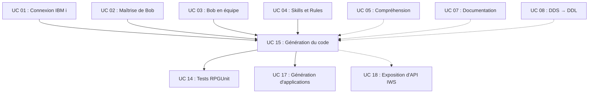

# UC 15 — Génération du code

> **Catégorie :** Développement — Génération de code (Track B)
>
> **Priorité dans le parcours :** 15 — Phase 4 (Track B), parallélisable avec UC 16 (Objets SQL) sur des objets différents, après les UC de compréhension et de documentation (UC 05 à UC 07) sur le même périmètre.
>
> **Mode Bob recommandé :** IBM i Developer (qualification, génération `**FREE`, écriture du membre, compilation `CRTBNDRPG` / `CRTSQLRPGI`, revue `/review_rpg`) → IBM i Database (vérification des tables et colonnes via `QSYS2` avant génération des `DCL-F` / `DCL-DS`). Sans Premium Package : Ask pour la qualification et la génération, Agent pour l'écriture et la compilation.

---

## ⭐ Premium Package IBM i utilisé

Il n'existe **pas de workflow Premium en un clic** pour la génération de code *ex nihilo* (UC00 §6 ne liste, pour cet UC, ni workflow ni slash command : `/init` et `/review_rpg` ci-dessous sont des compléments d'usage propres à cette fiche). Les 71 skills IBM i sont activées automatiquement selon le contexte ; les éléments Premium ci-dessous accélèrent la génération sans la remplacer. Outils IBM i, recherche documentaire (RAG) et garde-fous : voir UC00 §5.

- **Skills auto-activées mobilisées (9 skills) :**
  - **RPGLE moderne (4 skills) :** `rpg-free-format-fundamentals`, `rpg-procedures-functions`, `rpg-data-structures`, `rpg-file-operations`.
  - **ILE et API système (2 skills) :** `rpg-ile-understanding` (modules, programmes de service, binding), `rpg-api`.
  - **CL et DDS (2 skills) :** `cl-programming`, `dds-physical-files`.
  - **SQL embarqué (1 skill, si le programme contient du SQL) :** `rpg-embedded-sql`.
- **Slash Command : `/init`** → [Documentation officielle](https://bob.ibm.com/docs/ide/premium-packages/bob-for-i/slash-commands)
  Génère l'`AGENTS.md` de l'application (architecture ILE, conventions de nommage observées, standards) ; emplacements officiels : `{BIBLIO}/QBOBSRC/AGENTS.MD` (workspace QSYS) ou `{répertoire IFS}/.bob/AGENTS.md` (workspace IFS) — voir UC00 §0 et §3.1. Cet `AGENTS.md` est la **source de référence des conventions** que Bob applique à chaque génération (voir UC 02 / UC 03).
- **Slash Command : `/review_rpg`** → [Documentation officielle](https://bob.ibm.com/docs/ide/premium-packages/bob-for-i/slash-commands)
  Contrôle qualité **complémentaire après génération** (opcodes obsolètes, gestion d'erreurs, sécurité, performances). Ne remplace ni la validation humaine ni le test fonctionnel.
- **Understand (optionnel)** → [Documentation officielle](https://bob.ibm.com/docs/ide/premium-packages/bob-for-i/understand)
  *Si Understand est installé* (mise en place, outils `understand_*` et skills `understand-*` : voir UC00 §2). Utile pour identifier les appelants/appelés avant de figer une interface (signature d'un module de service, Prompt 5). Cet UC n'est pas marqué ✅ Understand dans UC00 §6.

> **Pourquoi cet UC 15 apporte une valeur méthodologique unique :**
> Générer du code neuf n'a pas de comportement antérieur à préserver, mais le risque fonctionnel, transactionnel et d'intégrité des données reste entier. Bob ne connaît pas les normes de l'entreprise : sans cadrage, il applique ses conventions par défaut. Cet UC apporte :
> 1. **Les normes de codage d'entreprise rendues exécutables** : conventions de nommage, header, `CTL-OPT`, types de données, opcodes interdits, injectées dans Bob via les *rules* du mode IBM i Developer et l'`AGENTS.md` (Prompt 1).
> 2. **Une qualification anti-hallucination** : aucun fichier, table, colonne, copybook ou commande n'est supposé — tout est vérifié sur l'IBM i avant la première ligne générée (Prompt 0).
> 3. **Une génération en deux passes** (squelette puis logique) validées par l'équipe avant toute écriture sur l'IBM i (Prompts 2 et 3).
> 4. **La génération de modules de service ILE** avec prototypes et copybooks partagés, pour mettre fin aux prototypes recopiés programme par programme (Prompt 5).
> 5. **Un garde-fou d'écriture** : vérification de non-existence du membre avant écriture, compilation, puis revue (Prompt 4).

> ⚠️ **Mode personnalisé "ACME Developer" vs IBM i Developer :** la position du POC (UC 03, UC 04) est de **ne pas créer de mode concurrent à IBM i Developer** — un mode personnalisé ne reprend pas automatiquement les outils Premium — mais d'y **injecter les normes ACME par des rules** (`.bob/rules-ibm-i-developer/`) et par l'`AGENTS.md`. Le Prompt 1 applique cette approche ; la variante « mode personnalisé » est conservée en option dans ce même prompt.

---

## Objectif

Générer des **programmes RPG ILE `**FREE`, des procédures et des modules de service ILE** conformes aux normes de développement de l'entreprise, à partir d'une description fonctionnelle — sans source à migrer ni à moderniser.

**Ce que cet UC permet :**
- Qualifier le besoin et l'environnement réel (bibliothèques, fichiers sources, objets existants, commandes de compilation) sans aucune supposition.
- Transformer les normes de codage de l'entreprise en consignes actionnables par Bob (rules + `AGENTS.md`).
- Générer des programmes SIMPLE et STANDARD, puis des modules de service ILE avec prototypes et copybooks partagés.
- Écrire le membre source et compiler sur l'IBM i sous contrôle de l'équipe, sans écraser un membre existant.
- Piloter un périmètre applicatif par un plan de génération priorisé.

**Critère de succès principal :** chaque programme généré respecte les normes de l'entreprise (validé par un développeur), n'utilise que des objets vérifiés sur l'IBM i, compile sans erreur dans la bibliothèque de développement et a été exécuté sur un cas nominal avec des données représentatives.

---

## Prérequis

- **Phase :** Phase 4 — Track B (Génération)
- **UC précédents requis :**
  - **UC 01 — Connecter Bob à l'IBM i** (**obligatoire**) : connexion active, droits de création de membres et de compilation sur la bibliothèque de développement.
  - **UC 02 — Maîtrise de Bob** (**obligatoire**) : mode IBM i Developer, `/init`.
  - **UC 03 — Bob en équipe** et **UC 04 — Stratégie Skills et Rules** (**obligatoires**) : emplacement et structure des rules (`.bob/rules-ibm-i-developer/`), `AGENTS.md` partagé.
  - **UC 05 / UC 07** (**recommandés**) : compréhension et spécifications de l'application dans laquelle s'insère le programme.
  - **UC 08 — DDS → DDL** (**recommandé**) : DDL à jour pour générer des `DCL-F` / `DCL-DS` cohérents.
- **Livrables requis :**
  - Normes de développement de l'entreprise, **au minimum** : conventions de nommage, header standard, types de données préférés, options de compilation. À défaut, le Prompt 1 les extrait de programmes existants.
  - `{appId}-doc-spec-fonc-{composant}-{YYYYMMDD-HHmm}.md` et `{appId}-doc-spec-tech-{composant}-{YYYYMMDD-HHmm}.md` — UC 07 (recommandés).
  - `{appId}-ddl-{appId}-complet-{YYYYMMDD-HHmm}.md` — UC 08 (recommandé si le programme accède à des tables).
- **Prérequis système IBM i :**
  - Bibliothèque de développement identifiée (ex. `[NOM_LIB]`) et fichiers sources existants (ex. `QRPGLESRC`, `QSRVSRC`, `QCLSRC`) — **à confirmer au Prompt 0**, jamais supposés.
- **Niveau Bob recommandé :** Intermédiaire
- **Bob Coins estimés :** ⚠️ *À calibrer après le lab UC 15 sur FLGHT400.*

---

## Exemple concret — Lab FLGHT400

> ⚠️ Le lab FLGHT400 ne contient pas encore de résultat de génération *ex nihilo*. Les deux livrables ci-dessous illustrent les deux ingrédients de cet UC : les **conventions à injecter** et la **propagation de code neuf dans une application existante**. Un exemple de génération complète reste à produire lors du lab UC 15.

| Livrable | Fichier lab | Ce qu'il illustre |
|---|---|---|
| `AGENTS.md` généré par `/init` | [`../labs_FLGHT400_results/FLGHT403_AGENTS.md`](../labs_FLGHT400_results/FLGHT403_AGENTS.md) | Conventions réellement observées sur `FLGHT403` : membres modernisés en `**FREE`, `CTL-OPT DFTACTGRP(*NO)` et `OPTION(*NODEBUGIO:*SRCSTMT)`, DS d'information programme `QUALIFIED`, indicateurs remplacés par des variables `IND`. Il met aussi en évidence l'**absence de copybook partagé** (constantes de touches de fonction et prototypes d'API redéclarés par programme) — exactement ce que les rules et le Prompt 5 de cet UC corrigent pour le code neuf. |
| Rapport d'évolution cross-couches | [`../labs_FLGHT400_results/FLGHT403_Change_Total_Flight_Hours.md`](../labs_FLGHT400_results/FLGHT403_Change_Total_Flight_Hours.md) | Ajout du champ `FLHRS` à travers PF, LF, DSPF et programme RPG, avec ordre de compilation strict et validation par couche. Référence du « Cas avancé » de cet UC. |

---

## Démarrer une session Bob

### Les trois espaces de travail

- **Workspace local** (poste) — rapports de qualification, source documenté, plan de génération (`bob-reports/`), **rules ACME** (`.bob/rules-ibm-i-developer/`).
- **Librairies IBM i / QSYS** ⭐ — **espace d'exécution principal** : membres sources générés (`QRPGLESRC`, `QSRVSRC`), objets compilés, tables consultées pour vérifier les interfaces. L'`AGENTS.md` du projet (`{BIBLIO}/QBOBSRC/AGENTS.MD`) y est injecté automatiquement.
- **$HOME IFS** — copies de livrables ou sources d'API si le projet est structuré en IFS.

> ⚠️ **Rules et espace QSYS :** quand l'espace actif est *Librairies IBM i* seul, le workspace local et son `.bob/` ne sont **pas chargés** (voir UC 03). Pour que les normes s'appliquent dans tous les cas, les déclarer **aussi** dans l'`AGENTS.md` de l'application (section « Normes de codage ») — c'est ce que fait le Prompt 1.

### Règles de session

- **Une nouvelle conversation Bob par programme** : évite que les structures et conventions d'un programme contaminent le suivant. Exception : enchaîner deux programmes du même domaine partageant les mêmes structures de données.
- **Charger le contexte avant le Prompt 0** : `AGENTS.md` (généré par `/init`), spécifications UC 07, DDL UC 08.
- **Reprise de session** : recharger le dernier `{appId}-gen-{composant}-code-*.md` et indiquer « le source en cours est dans [FICHIER] — reprendre au Prompt [N] ».
- **Règle d'or :** pendant les Prompts 0 à 3, Bob produit **dans le chat uniquement**. L'écriture sur l'IBM i n'est autorisée qu'au Prompt 4, après validation explicite de l'équipe.

---

## Démarche structurée et Prompts

### Progression recommandée selon la catégorie

La complexité se mesure en **type de programme et nombre d'interfaces** (fichiers, paramètres, appels externes), pas en lignes de code. Commencer par un **programme utilitaire simple** (< 100 lignes) dont un développeur peut valider immédiatement le respect des normes : cette première génération sert à calibrer la fidélité des rules.

| Étape | Type de programme | Catégorie | Séquence recommandée |
|---|---|---|---|
| **1** | Utilitaire ou service sans état, 1 à 3 paramètres, aucun fichier | **SIMPLE** | Prompt 0 → (Prompt 1 si normes absentes) → Prompt 2 → Prompt 3 → Prompt 4 |
| **2** | Batch avec 1 à 3 fichiers, logique CRUD, validation de paramètres | **STANDARD** | Prompt 0 → Prompt 2 (header, DCL) → Prompt 3 (logique) → Prompt 4 |
| **3** | Logique réutilisable appelée par plusieurs programmes | **SERVICE** | Prompt 0 → Prompt 5 (module + prototypes + copybook) → Prompt 4 |
| **4** | Programme interactif 5250 / web, plusieurs fichiers liés | **COMPLEXE** | Prompt 0 → logique métier en procédures (Prompts 2-3) ; interface écran/web → **UC 17** |
| **5** | Périmètre applicatif complet | **PLAN** | Prompt 6 (plan de génération) |

---

### Prompt 0 — Qualification de l'environnement et du programme à générer

**Objectif :** Traduire le besoin fonctionnel en catégorie technique, vérifier l'environnement réel et les interfaces sur l'IBM i, et recenser les normes disponibles.

**Quand l'utiliser :** Avant toute génération, pour chaque programme. Son résultat conditionne la séquence suivante.

**Input requis :**
- `AGENTS.md` du projet (via `/init`) et normes de développement si disponibles.
- Spécifications UC 07 et DDL UC 08 (si disponibles).
- Description du besoin en termes métier.

**Espace :** Local (`bob-reports/`) pour le rapport, IBM i QSYS pour les vérifications.
**Mode :** IBM i Developer (IBM i Database pour les requêtes catalogue).
**Skills clés mobilisées :** `rpg-free-format-fundamentals`, `rpg-ile-understanding`, `rpg-file-operations`, `rpg-data-structures`.

**Prompt :**

```text
Je dois générer un nouveau programme pour [NOM_LIB].

Besoin fonctionnel (en termes métier, pas techniques) : [DESCRIPTION_METIER]
[Charger dans le contexte : AGENTS.md du projet, spécifications UC 07, DDL UC 08 si disponibles]

N'invente aucun objet. Tout fichier, table, colonne, programme, copybook, fichier source
ou commande cité doit être vérifié sur l'IBM i (QSYS2, outils IBM i) avant d'apparaître dans le rapport.
Si un élément n'est pas vérifiable, écris « NON VÉRIFIÉ » — ne le déduis pas.

Produis en français, en markdown, un rapport de qualification :

## Qualification UC 15 — [NOM_PROGRAMME_CIBLE]

### 1. Environnement vérifié
| Élément | Valeur vérifiée | Méthode de vérification |
|---|---|---|
| Bibliothèque de développement | ? | |
| Fichier source RPG (QRPGLESRC ou autre) | ? | |
| Fichier source de modules / binder (QSRVSRC) | ? / AUCUN | |
| Un objet portant le nom cible existe-t-il déjà (source ou objet) ? | OUI / NON | |
| Commande de compilation à utiliser (CRTBNDRPG / CRTSQLRPGI / CRTRPGMOD) | ? | |
| Copybooks partagés existants (prototypes, constantes) | liste / AUCUN | |
| Binding directory / service programs existants | liste / AUCUN | |

### 2. Normes de codage disponibles
| Domaine | Source de la norme (AGENTS.md / rules / document / AUCUNE) | Valeur |
|---|---|---|
| Nommage (variables, DS, procédures, paramètres, programmes) | | |
| Header documentaire | | |
| CTL-OPT / groupe d'activation | | |
| Types de données préférés | | |
| Gestion d'erreurs | | |
| Accès fichiers (RLA / SQL embarqué) | | |
| Opcodes interdits | | |
Si une ligne est « AUCUNE » : recommander le Prompt 1 avant toute génération.

### 3. Analyse du besoin
| Critère | Valeur détectée |
|---|---|
| Type (utilitaire / service / batch / interactif) | ? |
| Paramètres d'entrée et de sortie (type, longueur) | ? |
| Fichiers ou tables accédés (noms vérifiés) | ? |
| Appels externes (CALLP vers d'autres programmes ou API) | OUI / NON — lesquels |
| Interface utilisateur (écran, web) | OUI / NON |

### 4. Interfaces vérifiées
Pour chaque table ou fichier : colonnes, types, longueurs réellement lus dans QSYS2.SYSCOLUMNS.
Liste ensuite les DCL-F et DCL-DS que le programme nécessitera.

### 5. Catégorie recommandée
- [ ] SIMPLE   — utilitaire / service sans état, 1-3 paramètres, aucun fichier
- [ ] STANDARD — batch avec 1-3 fichiers, logique CRUD, validation de paramètres
- [ ] SERVICE  — module ILE réutilisable (prototypes + copybook partagé)
- [ ] COMPLEXE — interactif ou plusieurs fichiers liés : logique ici, interface → UC 17

### 6. Séquence recommandée
Indique la séquence de prompts adaptée à la catégorie retenue.
```

**Livrable produit :** `{appId}-gen-{composant}-analyse-{YYYYMMDD-HHmm}.md` (dans `bob-reports/`).

> 💡 **Requêtes de vérification utiles** (IBM i Database / `execute_sql_statement`) :
> ```sql
> -- Colonnes réelles d'une table avant de générer les DCL-F / DCL-DS
> SELECT COLUMN_NAME, DATA_TYPE, LENGTH, NUMERIC_SCALE, IS_NULLABLE
> FROM QSYS2.SYSCOLUMNS
> WHERE TABLE_SCHEMA = '[NOM_LIB]' AND TABLE_NAME = '[NOM_TABLE]'
> ORDER BY ORDINAL_POSITION;
>
> -- Un membre source du même nom existe-t-il déjà ?
> SELECT COUNT(*) AS MEMBER_COUNT
> FROM QSYS2.SYSPARTITIONSTAT
> WHERE SYSTEM_TABLE_SCHEMA = '[NOM_LIB]'
>   AND SYSTEM_TABLE_NAME   = '[SRCFILE_RPG]'
>   AND SYSTEM_TABLE_MEMBER = '[NOM_PROGRAMME_CIBLE]';
>
> -- Un objet programme du même nom existe-t-il déjà ?
> SELECT OBJNAME, OBJTYPE, OBJTEXT
> FROM TABLE(QSYS2.OBJECT_STATISTICS(OBJECT_SCHEMA => '[NOM_LIB]', OBJECT_TYPE_LIST => '*PGM *SRVPGM *MODULE'))
> WHERE OBJNAME = '[NOM_PROGRAMME_CIBLE]';
> ```

> ⚠️ **Piège évité :** sans qualification, Bob génère des `DCL-F` avec des noms de fichiers inventés ou des `DCL-DS` qui ne correspondent pas aux tables réelles — le source compile parfois, mais accède aux mauvaises données.

---

### Prompt 1 — Constitution du socle de normes de codage (rules + AGENTS.md)

**Objectif :** Rendre les normes de codage de l'entreprise exécutables par Bob : rules du mode IBM i Developer et section « Normes de codage » de l'`AGENTS.md`.

**Quand l'utiliser :** Une fois, avant la première génération (ou en mise à jour quand les normes évoluent), dès que le Prompt 0 signale une norme « AUCUNE ».

**Input requis :**
- Soit un document de normes de l'entreprise.
- Soit 2 à 3 programmes RPG représentatifs existants (via `[NOM_LIB]/[SRCFILE_RPG]`) dont Bob extrait les conventions réellement pratiquées.

**Espace :** Workspace local (`.bob/rules-ibm-i-developer/`) + IBM i QSYS (`QBOBSRC/AGENTS.MD`).
**Mode :** IBM i Developer.
**Skills clés mobilisées :** `rpg-free-format-fundamentals`, `rpg-procedures-functions`, `rpg-data-structures`.

**Prompt :**

```text
[Si les normes sont documentées :]
Sur la base des normes de développement fournies dans [DOCUMENT_NORMES],
[Sinon :]
Sur la base des programmes [LISTE_2_A_3_PROGRAMMES] dans [NOM_LIB]/[SRCFILE_RPG],
analyse uniquement ce qui est réellement pratiqué (header, nommage, types, CTL-OPT, gestion d'erreurs, opcodes)
et signale toute pratique incohérente d'un programme à l'autre sans trancher à ma place.

Produis, en français :

1. Un fichier de rule `.bob/rules-ibm-i-developer/01-normes-codage-[ENTREPRISE].md`
   - Instructions courtes et impératives (max 80 lignes), pas de la documentation.
   - Sections : nommage (tableau élément / convention / exemple), header documentaire exact,
     CTL-OPT standard, types de données, gestion d'erreurs, accès fichiers,
     opcodes interdits (MOVE, MOVEL, SETON, GOTO, etc. — à confirmer par les normes).

2. Une section « Normes de codage » prête à être ajoutée à l'AGENTS.md du projet
   (même contenu, version condensée), car les rules locales ne sont pas chargées
   quand l'espace actif est Librairies IBM i.

Marque chaque règle inférée « À VALIDER PAR LE RÉFÉRENT TECHNIQUE ».
N'invente aucune règle absente des sources.
Ne sauvegarde rien à ce stade : affiche le contenu dans le chat. Les fichiers ne seront créés qu'après ma validation explicite.
```

**Livrable produit :** `.bob/rules-ibm-i-developer/01-normes-codage-[ENTREPRISE].md` (local) + section ajoutée à `{BIBLIO}/QBOBSRC/AGENTS.MD` (IBM i). Ces fichiers ne sont créés/modifiés qu'**après validation explicite** du contenu affiché dans le chat (le prompt lui-même n'écrit rien). Copie documentaire : `{appId}-gen-{appId}-rules-{YYYYMMDD-HHmm}.md`.

> 💡 **Variante « mode personnalisé » [Complément — non couvert par le workflow Premium] :** si l'équipe souhaite malgré tout un mode dédié (par exemple pour restreindre les droits d'écriture à certains fichiers), Bob peut générer un `.bob/custom_modes.yaml` (clés `slug`, `name`, `roleDefinition`, `whenToUse`, `customInstructions`, `groups`) — les modes IBM i sont personnalisables comme tout mode Bob (voir [Modes](https://bob.ibm.com/docs/ide/premium-packages/bob-for-i/modes) et UC00 §0). Le POC recommande de ne pas le faire par défaut (voir l'avertissement en tête de fiche) ; si le mode est créé, le nommer avec une version (« ACME Developer v1.0 ») et le valider sur au moins 2 programmes représentatifs avant distribution.

> ⚠️ **Piège évité :** distribuer des normes jamais testées. Une rule incorrecte fait générer du mauvais code à toute l'équipe — la valider sur 2 programmes représentatifs (Prompts 2 à 4) avant de la partager via Git.

---

### Prompt 2 — Génération du squelette (header, CTL-OPT, DCL)

**Objectif :** Générer le squelette du programme — `CTL-OPT`, header, `DCL-F`, `DCL-DS`, `DCL-S`, `DCL-PI` — pour validation avant la logique.

**Quand l'utiliser :** Après validation du rapport de qualification (Prompt 0).

**Input requis :**
- Rapport `{appId}-gen-{composant}-analyse-{YYYYMMDD-HHmm}.md`.
- Normes chargées (rules et/ou `AGENTS.md`).

**Espace :** Dans le chat (aucune écriture).
**Mode :** IBM i Developer.
**Skills clés mobilisées :** `rpg-free-format-fundamentals`, `rpg-data-structures`, `rpg-file-operations`, `rpg-procedures-functions`.

**Prompt :**

```text
Sur la base du rapport de qualification [NOM_FICHIER_ANALYSE] pour [NOM_PROGRAMME_CIBLE],
génère en **FREE le squelette du programme, en appliquant les normes chargées dans le contexte.

Contenu attendu, dans cet ordre :
1. Header documentaire exact défini par les normes.
2. CTL-OPT (options de compilation et groupe d'activation tels que définis par les normes).
3. DCL-F : uniquement les fichiers listés et vérifiés dans le rapport (USAGE, KEYED selon l'accès).
4. DCL-DS : structures liées aux colonnes vérifiées (externes quand c'est possible).
5. DCL-S / DCL-C : variables de travail et constantes, nommées selon les normes.
6. DCL-PR / DCL-PI : prototype et interface, avec types et longueurs du rapport.

Règles :
- Ne référence aucun fichier, colonne ou copybook absent du rapport.
- N'écris pas encore la logique métier.
- Pour tout point sur lequel les normes sont silencieuses, pose la question au lieu de choisir.
- Ajoute en commentaire de header : « ⚠️ Réintégration gestionnaire de sources — à effectuer manuellement après validation »
  si l'entreprise utilise un gestionnaire de sources.
```

**Livrable produit :** `{appId}-gen-{composant}-code-{YYYYMMDD-HHmm}.md` (dans `bob-reports/`, à la demande — sauvegarde du squelette).

> 💡 **Sauvegarder le squelette** avant le Prompt 3 : « Sauvegarde ce squelette dans bob-reports/ sous le nom {appId}-gen-{composant}-code-{YYYYMMDD-HHmm}.md ».

---

### Prompt 3 — Génération de la logique métier

**Objectif :** Compléter le squelette validé par la procédure principale et les sous-procédures, avec gestion d'erreurs et explication des choix de conception.

**Quand l'utiliser :** Après validation du squelette (Prompt 2).

**Input requis :**
- Squelette validé (`{appId}-gen-{composant}-code-*.md`).
- Règles métier (UC 06) ou spécification fonctionnelle (UC 07), si disponibles.

**Espace :** Dans le chat (aucune écriture).
**Mode :** IBM i Developer.
**Skills clés mobilisées :** `rpg-procedures-functions`, `rpg-file-operations`, `rpg-free-format-fundamentals`, `rpg-api`.

**Prompt :**

```text
Sur la base du squelette validé de [NOM_PROGRAMME_CIBLE] et du rapport de qualification,
génère la logique métier en **FREE.

Structure :
- Procédure principale : logique de haut niveau (boucle, appels de procédures).
- Une sous-procédure par responsabilité (DCL-PROC / DCL-PI / END-PROC), nommée selon les normes.

Règles de génération :
- Accès fichiers : conforme aux normes (RLA ou SQL embarqué). Si RLA :
  CHAIN pour accès par clé, READ pour accès séquentiel ; UPDATE uniquement après lecture
  de l'enregistrement courant (CHAIN/READ/READE sur fichier déclaré en update) ; DELETE après CHAIN.
- Gestion d'erreurs : extender (E) sur chaque opération fichier susceptible d'échouer, puis test
  immédiat de %ERROR ; sans extender, ne pas utiliser %ERROR pour cette opération.
  Sinon bloc MONITOR / ON-ERROR ou mécanisme défini par les normes.
- Validation des paramètres obligatoires en entrée de la procédure principale.
- Sous commitment control, rappeler explicitement où se situent COMMIT et ROLLBACK.
- Opcodes interdits par les normes : ne pas les utiliser.
- Pour toute API système, utiliser un prototype conforme à la skill rpg-api ; ne pas inventer de paramètre.

Après le code, explique en 5 à 10 lignes les choix de conception et les hypothèses faites,
afin que le développeur puisse les contester avant compilation.
```

**Livrable produit :** `{appId}-gen-{composant}-code-{YYYYMMDD-HHmm}.md` (complété, dans `bob-reports/`).

> ⚠️ **Piège évité :** générer la logique sans avoir chargé le DDL (UC 08) ni vérifié les colonnes (Prompt 0). Bob invente des noms de colonnes — le source compile parfois avec des noms génériques, mais la logique accède aux mauvaises données.

---

### Prompt 4 — Écriture du membre source, compilation et revue

**Objectif :** Écrire le membre validé sur l'IBM i sans écraser un membre existant, compiler, puis passer une revue qualité.

**Quand l'utiliser :** Uniquement après validation explicite du squelette et de la logique par l'équipe.

**Input requis :**
- Source validé (Prompts 2 et 3).
- Droits `*CHANGE` sur la bibliothèque de développement.
- Commande de compilation confirmée au Prompt 0.

**Espace :** IBM i QSYS (`[NOM_LIB]/[SRCFILE_RPG]([NOM_PROGRAMME_CIBLE])`).
**Mode :** IBM i Developer (ou Agent).
**Skills clés mobilisées :** `rpg-free-format-fundamentals`, `rpg-procedures-functions`, `rpg-debugging-techniques`.

**Prompt :**

```text
Le programme [NOM_PROGRAMME_CIBLE] est validé par l'équipe et prêt à être écrit.

Étape 1 — Vérifier que le membre n'existe pas :
Interroge QSYS2.SYSPARTITIONSTAT pour [NOM_LIB]/[SRCFILE_RPG], membre [NOM_PROGRAMME_CIBLE].
Si le membre existe : arrête-toi, signale-le, n'écrase rien sans ma confirmation explicite.

Étape 2 — Écrire le source :
Écris uniquement le code **FREE (sans balises markdown ni texte explicatif)
dans [NOM_LIB]/[SRCFILE_RPG]([NOM_PROGRAMME_CIBLE]). N'écris dans aucun autre fichier source.

Étape 3 — Compiler :
Utilise la commande confirmée au Prompt 0 ([CRTBNDRPG / CRTSQLRPGI] : `CRTSQLRPGI` si le source contient `EXEC SQL`) sur ce membre,
avec les options définies par les normes. Rapporte :
- Statut : COMPILATION RÉUSSIE / ERREURS.
- En cas d'erreurs : tableau (ligne, code message, description, correction proposée,
  mécanique ou décision du développeur). Ne corrige pas sans me montrer le diff.
- Avertissements : liste avec sévérité.

Étape 4 — Revue :
Si la compilation réussit, exécute /review_rpg sur le membre et résume les constats
critiques et majeurs.

Rappelle que la compilation ne valide pas le comportement : un cas nominal doit être exécuté
avec des données représentatives avant de déclarer le programme validé.
```

**Livrable produit :** membre `[NOM_LIB]/[SRCFILE_RPG]([NOM_PROGRAMME_CIBLE])` et objet compilé `[NOM_LIB]/[NOM_PROGRAMME_CIBLE]` (IBM i QSYS) ; rapport optionnel `{appId}-gen-{composant}-rapport-{YYYYMMDD-HHmm}.md` (dans `bob-reports/`, à la demande).

> ⚠️ **Ce prompt ne remplace pas le test fonctionnel.** Pour automatiser la non-régression des programmes générés, enchaîner avec **UC 14** (tests RPGUnit).

---

### Prompt 5 — Génération d'un module de service ILE (prototypes et copybook partagés)

**Objectif :** Générer un module de service ILE réutilisable avec ses prototypes dans un copybook partagé, pour supprimer la redéclaration des prototypes dans chaque appelant.

**Quand l'utiliser :** Pour une catégorie SERVICE, ou quand le Prompt 0 constate la même logique ou les mêmes prototypes recopiés dans plusieurs programmes.

**Input requis :**
- Rapport de qualification (catégorie SERVICE).
- Liste des procédures à exporter avec signatures (types, longueurs, valeur de retour).
- Résultat de l'analyse d'impact si des appelants existent (Understand Dashboard).

**Espace :** Dans le chat pour la génération, puis IBM i QSYS pour l'écriture (Prompt 4).
**Mode :** IBM i Developer.
**Skills clés mobilisées :** `rpg-procedures-functions`, `rpg-ile-understanding`, `rpg-data-structures`, `rpg-api`.

**Prompt :**

```text
Sur la base du rapport de qualification [NOM_FICHIER_ANALYSE] (catégorie SERVICE),
génère un module de service ILE [NOM_MODULE] exportant les procédures suivantes :
[LISTE_PROCEDURES — nom, paramètres, type de retour]

Produis, en appliquant les normes chargées :

1. Le copybook de prototypes [NOM_COPYBOOK] (dans [NOM_LIB]/[SRCFILE_RPG]) :
   - un DCL-PR par procédure exportée (EXTPROC si nécessaire), constantes et DS partagées associées ;
   - protégé contre la double inclusion si les normes l'exigent.
2. Le source du module [NOM_MODULE] : NOMAIN, /INCLUDE du copybook, une DCL-PROC EXPORT par procédure,
   gestion d'erreurs conforme aux normes. Aucun état global non documenté.
3. Si le binding par service program est retenu : le source binder (QSRVSRC) avec signature
   et les commandes de création (CRTRPGMOD, CRTSRVPGM, binding directory).
4. Un exemple d'appelant de 10 lignes utilisant le copybook.

Règles :
- N'exporte que les procédures demandées.
- Précise l'activation group et son impact sur l'état statique du service.
- Signale toute modification de signature qui obligerait à recompiler les appelants existants.
- Ne crée aucun objet : génération dans le chat uniquement.
```

**Livrable produit :** `{appId}-gen-{composant}-code-{YYYYMMDD-HHmm}.md` (dans `bob-reports/`) ; après Prompt 4 : membres module, copybook et binder dans `[NOM_LIB]` (IBM i QSYS).

> 💡 **Signature d'un service program :** une fois publiée, la signature conditionne la compatibilité des appelants. La figer avec l'équipe avant la première mise à disposition.

---

### Prompt 6 — Plan de génération et gouvernance des normes

**Objectif :** Produire le backlog priorisé des programmes à générer sur un périmètre, et le plan de maintenance des normes.

**Quand l'utiliser :** Pour piloter un périmètre applicatif, après au moins deux programmes générés et validés.

**Input requis :**
- Rapports UC 05 / UC 07 du périmètre.
- Rapports de qualification déjà produits.

**Espace :** Local (`bob-reports/`).
**Mode :** IBM i Developer.
**Skills clés mobilisées :** `rpg-ile-understanding`, `rpg-procedures-functions`.

**Prompt :**

```text
Sur la base des rapports de compréhension et des spécifications disponibles pour [NOM_APPLICATION]
et des rapports de qualification UC 15 déjà produits, génère en français, en markdown,
le plan de génération.

## Plan de génération UC 15 — [NOM_APPLICATION]

### Angle 1 — Backlog des programmes à générer
| Programme | Besoin fonctionnel | Catégorie (SIMPLE / STANDARD / SERVICE / COMPLEXE) | Dépendances | Priorité | Statut |

### Angle 2 — Gouvernance des normes
| Sujet | Décision à prendre | Responsable | Échéance |
| Validation des rules | Tester sur 2 programmes représentatifs avant partage | | |
| Distribution | Partage via le dépôt Git des rules | | |
| Mise à jour | Qui peut modifier les normes, comment les versionner | | |

N'invente aucun programme ni structure absent des sources disponibles.
```

**Livrable produit :** `{appId}-gen-{appId}-plan-{YYYYMMDD-HHmm}.md` (dans `bob-reports/`).

---

## Cas avancé — Propagation d'un champ end-to-end (feature cross-couches) [Complément — non couvert par le workflow Premium]

Ce cas n'est pas la création d'un programme neuf : il s'agit de **propager une modification** à travers plusieurs objets liés (PF, LF, DSPF, programme). Il est illustré par [`FLGHT403_Change_Total_Flight_Hours.md`](../labs_FLGHT400_results/FLGHT403_Change_Total_Flight_Hours.md). Démarrer par un périmètre explicite : lister les objets impactés avant toute génération.

| Étape | Objet | Opération | Risque principal |
|---|---|---|---|
| 1 | Fichier physique (PF) | Ajouter le champ | Ne pas toucher aux clés ni aux champs existants |
| 2 | Fichier logique (LF) | Ajouter le champ (`RENAME` si besoin) | La spécification de clé doit rester intacte |
| 3 | Display file (DSPF) | Ajouter le champ écran (position, étiquette, validation) | Chevauchement de positions ; pas de `COLHDG` en DSPF |
| 4 | Programme RPG | Propager le champ (specs F/I/C/O en colonné, ou DS/logique en free) | Alignement de colonnes sur les O-specs d'un programme OPM |
| 5 | Compilation | PF → LF → DSPF → programme, dans cet ordre | Un échec bloque les étapes suivantes : s'arrêter et corriger |

**Prompt :**

```text
Je dois ajouter le champ [NOM_CHAMP] (type [TYPE], longueur [LG]) aux objets de [NOM_LIB] :
1. PF : [NOM_PF]   2. LF : [NOM_LF]   3. DSPF : [NOM_DSPF]   4. Programme : [NOM_PGM]

Pour chaque objet, montre uniquement le diff (lignes ajoutées ou modifiées), attends ma validation,
puis sauvegarde le membre sans compiler. Compile ensuite dans l'ordre PF → LF → DSPF → programme.
Pour les O-specs d'un programme colonné, copie l'alignement exact de la ligne d'un champ voisin
et ne change que le nom du champ et la position de fin. Après compilation,
liste les autres objets dépendants qui devront être recompilés (DSPDBR / DSPPGMREF).
```

**Skills clés mobilisées :** `dds-physical-files`, `rpg-file-operations`, `rpg-fixed-to-free` (si le programme est encore en format fixe).

> 💡 Sur un programme OPM dense, scinder la modification en trois diffs successifs (F/I-specs, C-specs, O-specs) pour localiser immédiatement une erreur d'alignement.

---

## Livrables de cet UC

> ⚠️ **Où écrit Bob ?** En espace *Librairies IBM i*, Bob écrit les sources et les objets **sur l'IBM i**, pas en local. Pour conserver une trace locale (rapport, source documenté, plan), demander explicitement à Bob de sauvegarder dans `bob-reports/`.

| Fichier produit | Pattern de nommage | Espace de stockage | Consommé par |
|---|---|---|---|
| Rapport de qualification | `{appId}-gen-{composant}-analyse-{YYYYMMDD-HHmm}.md` | `bob-reports/` (Local) | Prompts 2, 3, 5 |
| Normes de codage (rule) | `.bob/rules-ibm-i-developer/01-normes-codage-[ENTREPRISE].md` | `.bob/` (Local, versionné Git) | Toutes les sessions Bob |
| Normes de codage (AGENTS.md) | Section « Normes de codage » de `AGENTS.md` | `{BIBLIO}/QBOBSRC/AGENTS.MD` (IBM i QSYS) | Toutes les sessions Bob |
| Source documenté | `{appId}-gen-{composant}-code-{YYYYMMDD-HHmm}.md` | `bob-reports/` (Local) | Prompt 4, revue, reprise de session |
| Membre source généré | `[NOM_PROGRAMME_CIBLE]` | `[NOM_LIB]/[SRCFILE_RPG]` (IBM i QSYS) | UC 14 (tests), UC 17 |
| Module, copybook et binder | `[NOM_MODULE]`, `[NOM_COPYBOOK]`, binder | `[NOM_LIB]/QRPGLESRC` et `QSRVSRC` (IBM i QSYS) | Programmes appelants, UC 17 |
| Plan de génération | `{appId}-gen-{appId}-plan-{YYYYMMDD-HHmm}.md` | `bob-reports/` (Local) | Pilotage du périmètre |
| Rapport de compilation et revue *(optionnel)* | `{appId}-gen-{composant}-rapport-{YYYYMMDD-HHmm}.md` | `bob-reports/` (Local) | Revue, traçabilité |

---

## Pièges à éviter

| Piège | Ce qui se passe | Comment l'éviter |
|---|---|---|
| Générer sans normes chargées | Bob applique ses conventions par défaut (noms anglais, header minimal, `CTL-OPT` générique) | Charger rules et `AGENTS.md` ; si absentes, exécuter le Prompt 1 d'abord |
| Rules non chargées en espace QSYS | Les normes locales ne s'appliquent pas quand seul l'espace Librairies IBM i est actif | Doubler les normes dans l'`AGENTS.md` de l'application (Prompt 1) |
| Créer un mode concurrent à IBM i Developer | Perte des workflows, slash commands et skills Premium | Injecter les normes par rules ; si un mode est créé, le valider et le versionner |
| Hallucination de fichiers et de champs | `DCL-F` / `DCL-DS` avec des noms inventés ; le source compile, la logique est fausse | Prompt 0 : tout objet vérifié via `QSYS2` ; « NON VÉRIFIÉ » sinon |
| Écraser un membre existant | Perte d'un source existant | Vérification `QSYS2.SYSPARTITIONSTAT` au Prompt 4, étape 1 |
| Écrire avant validation | Source intermédiaire non validé dans la bibliothèque de développement | Prompts 0 à 3 dans le chat uniquement ; écriture au Prompt 4 seulement |
| Confondre UC 15 et UC 17 | Un programme interactif complet généré d'un seul bloc, interface comprise | UC 15 pour la logique RPG, UC 17 pour l'écran / le web |
| Considérer « compile » comme « valide » | Un programme qui compile mais lit la mauvaise donnée ou verrouille un enregistrement | Test d'un cas nominal ; automatiser avec UC 14 |
| Opcodes obsolètes réintroduits | `MOVE`, `SETON`, `GOTO` si le code de référence en contient | Les interdire explicitement dans la rule et dans chaque prompt de logique |
| Modifier plusieurs couches en un seul diff | Une erreur d'alignement est masquée par les autres | Un diff par objet, compilation dans l'ordre (Cas avancé) |

---

## Check-list de validation UC 15

- [ ] Le Prompt 0 a été exécuté pour chaque programme ; la catégorie et les interfaces vérifiées sont documentées.
- [ ] Les normes de codage sont en place : rule dans `.bob/rules-ibm-i-developer/` **et** section dans l'`AGENTS.md` IBM i.
- [ ] Les normes ont été validées sur **au moins 2 programmes représentatifs** avant d'être partagées à l'équipe.
- [ ] Les conventions (nommage, header, `CTL-OPT`, types) sont respectées dans chaque source généré, validées par un développeur.
- [ ] Aucun nom de fichier ou de colonne n'est inventé : tout a été vérifié via `QSYS2`.
- [ ] Chaque membre a été écrit **après** vérification de non-existence (Prompt 4, étape 1) et compilé sans erreur.
- [ ] `/review_rpg` a été exécuté sur chaque membre compilé ; les constats critiques sont traités.
- [ ] Un **cas nominal** a été exécuté sur l'IBM i de test avec des données représentatives.
- [ ] Pour un module de service : copybook de prototypes partagé créé, signature figée, appelants existants identifiés.
- [ ] Le plan de génération (Prompt 6) est sauvegardé et liste tous les programmes du périmètre.
- [ ] Aucun mode personnalisé concurrent à IBM i Developer n'a été créé sans décision explicite de l'équipe.

---

## Dépendances



> UC 15 fournit les normes et patterns de génération RPG pour UC 17 (applications) et UC 18 (wrappers d'API IWS).

---

*Fiche UC 15 — Document évolutif à mettre à jour au fil du POC.*
