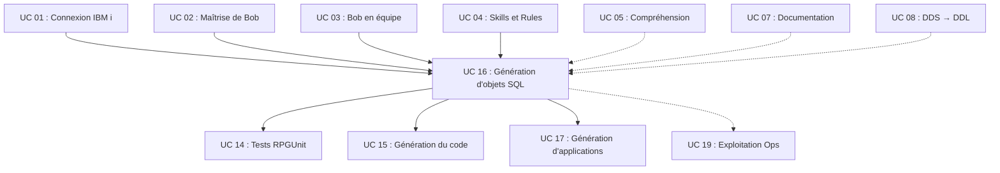

# UC 16 — Génération d'objets SQL

> **Catégorie :** Développement — Génération d'objets Db2 for i (Track B)
>
> **Priorité dans le parcours :** 16 — Phase 4 (Track B), parallélisable avec UC 15 (Génération du code) sur des objets différents ; complémentaire de UC 08 (conversion DDS → DDL).
>
> **Mode Bob recommandé :** **IBM i Database** (mode dédié Db2 for i : qualification par `QSYS2`, génération des DDL, création sur l'IBM i de test via `execute_sql_statement`, `/review_SQL`). Bascule vers **IBM i Developer** uniquement pour (a) lire un source RPG dont la logique migre vers une procédure, (b) soumettre un script long par `RUNSQLSTM` (commande CL). Sans Premium Package : Ask pour la qualification et la génération, Agent pour la création et la sauvegarde.

---

## ⭐ Premium Package IBM i utilisé

Il n'existe **pas de workflow Premium en un clic** pour la génération d'objets SQL *ex nihilo*. Un workflow Premium couvre **partiellement** le volet index ; les 71 skills IBM i sont activées automatiquement selon le contexte.

- **Workflow : SQL Index Strategy Advisor (partiel — index uniquement)** → [Documentation officielle](https://bob.ibm.com/docs/ide/premium-packages/bob-for-i/workflows)
  Analyse les performances des requêtes (recommandations d'Index Advisor, utilisation des MTI, statistiques d'exécution) et conseille une stratégie d'indexation. **Il s'appuie sur une charge de travail existante** : sur une table qui vient d'être créée, il n'a rien à analyser. À lancer *après* mise en service pour valider ou ajuster les index créés au Prompt 1I.
  **Lancement :** mode IBM i Database → bouton **Start Workflow** en haut du chat → workspace **Library List** (seul workspace supporté par ce workflow) → *SQL Index Strategy Advisor*. Détail : UC00 §1.2.
- **Slash Command : `/review_SQL`** → [Documentation officielle](https://bob.ibm.com/docs/ide/premium-packages/bob-for-i/slash-commands)
  Revue complète d'une requête SQL ou d'un membre contenant du SQL (syntaxe, lisibilité, sécurité, performances SQE, refactorisation). Contrôle **complémentaire après génération** (Prompt 5), notamment sur les requêtes des vues et les corps de procédures, fonctions et triggers. Ne remplace ni la validation par un DBA ni le test fonctionnel.
- **Slash Command : `/erd`** *(complément, UC 08)* → [Documentation officielle](https://bob.ibm.com/docs/ide/premium-packages/bob-for-i/slash-commands)
  Après création des tables, génère le diagramme de relations (PK, FK, UQ) depuis `QSYS2.SYSTABLES`, `SYSCOLUMNS`, `SYSCST`, `SYSREFCST` : confirme que les contraintes créées apparaissent bien dans le catalogue.
- **Skills auto-activées mobilisées :**
  - **Socle (5 skills) :** `db2-ddl-generation`, `db2-stored-procedures`, `db2-functions-udfs`, `db2-index-strategy`, `db2-sql-primer`.
  - **Selon le sujet (7 skills) :** `db2-security-best-practices` (GRANT, moindre privilège), `db2-journaling-commitment` (triggers et procédures qui modifient des données), `db2-sql-debugging` (erreurs `SQLCODE` / `SQLSTATE` à la création), `db2-system-catalog` (vérifications `QSYS2`), `db2-sqlpl-performance` et `db2-sql-stored-procedure-performance` (bonnes pratiques SQL PL haute performance pour procédures, fonctions et déclencheurs), `db2-temporal-tables` (table avec versioning de lignes).
  - **Tests des routines :** le skill `rpgunit-testing` (IBM i Developer) et le plan de tests de UC 14 prennent le relais pour automatiser les tests des procédures et triggers créés (Prompt 5).
  → [Skills Db2 for i & SQL](https://bob.ibm.com/docs/ide/premium-packages/bob-for-i/skills#db2-for-i--sql)
- **Understand Dashboard** → [Documentation officielle](https://bob.ibm.com/docs/ide/premium-packages/bob-for-i/understand)
  *Si Understand est installé* (mise en place et usage : UC00 §2). Il cartographie les triggers, contraintes et dépendances de fichiers : l'utiliser pour repérer les triggers et programmes déjà liés à une table avant d'y ajouter un trigger, et les appelants avant de figer la signature d'une procédure ou d'une fonction.
  - **Accès :** commande *Open Understand Dashboard* (`vscode-ibmi-bob.openUnderstandDashboard`) ou icône du Dashboard dans la barre de titre du chat Bob.

> **Pourquoi cet UC 16 apporte une valeur méthodologique unique :**
> Créer un objet SQL neuf n'a pas de comportement antérieur à préserver, mais un `CREATE` mal cadré peut remplacer un objet existant, casser des dépendants ou laisser des droits trop larges. Bob ne connaît pas votre catalogue : sans cadrage, il suppose des tables, des colonnes et des conventions. Cet UC apporte :
> 1. **Une qualification anti-hallucination** : version IBM i, schéma, noms déjà pris, tables et colonnes cibles, contraintes — tout est vérifié par requête réelle (`QSYS2`, `SYSIBMADM`), « NON VÉRIFIÉ » sinon (Prompt 0).
> 2. **Une génération dans le chat uniquement**, par type d'objet, validée par l'équipe avant toute exécution (Prompts 1 à 4).
> 3. **Un garde-fou d'écriture** : non-existence vérifiée avant chaque `CREATE`, exécution après validation explicite, contrôle du catalogue, test nominal sur données de test (Prompt 5).
> 4. **Un ordre de création et des droits explicites** : plan de périmètre, puis script de déploiement ordonné avec `GRANT` au moindre privilège (Prompts 6 et 7).

> ⚠️ **Distinction avec UC 08 (règle de routage) :** UC 08 **convertit** un DDS existant (PF/LF) en DDL ; UC 16 **crée** un objet SQL neuf à partir d'un besoin fonctionnel. Si un fichier DDS existe déjà pour l'objet → **UC 08**. Si l'objet n'existe pas et répond à un nouveau besoin → **UC 16**.

---

## Périmètre

**Six types d'objets couverts :**

| Type | Instruction | Usage |
|---|---|---|
| Table | `CREATE TABLE` | Modèle de données neuf (PK, FK, CHECK, DEFAULT) |
| Vue | `CREATE OR REPLACE VIEW` | Lecture simplifiée ou sécurisée d'une ou plusieurs tables |
| Index | `CREATE [UNIQUE] INDEX` | Performance d'accès ou unicité |
| Procédure stockée | `CREATE OR REPLACE PROCEDURE` | Logique métier encapsulée côté base |
| Trigger | `CREATE [OR REPLACE] TRIGGER` | Automatisation sur événement DML |
| Fonction | `CREATE OR REPLACE FUNCTION` | Fonction scalaire ou de table utilisable dans un `SELECT` |

---

## Objectif

Générer des **objets Db2 for i neufs** — tables, vues, index, procédures stockées, triggers, fonctions — à partir d'un besoin fonctionnel, en n'utilisant que des objets et des interfaces **vérifiés sur l'IBM i**, et en créant sur l'IBM i de test uniquement après validation explicite de l'équipe.

**Ce que cet UC permet :**
- Qualifier le besoin et l'environnement réel (version, schéma, collisions de noms, dépendances) sans aucune supposition.
- Choisir le bon type d'objet (un trigger complexe est souvent le symptôme d'une logique qui appartient au programme appelant).
- Générer un DDL conforme aux normes SQL de l'entreprise, relu avant exécution.
- Créer, contrôler dans le catalogue et tester l'objet sur l'IBM i de test, sans écraser un objet existant.
- Piloter un périmètre par un plan ordonné et un script de déploiement avec droits au moindre privilège.

**Critère de succès principal :** chaque objet généré respecte les normes de l'entreprise (validé par un DBA ou un développeur), ne référence que des objets vérifiés, se crée sans erreur sur l'IBM i de test, apparaît correctement dans le catalogue et a été exercé sur un cas nominal avec des données de test.

---

## Prérequis

- **Phase :** Phase 4 — Track B (Génération)
- **UC précédents requis :**
  - **UC 01 — Connecter Bob à l'IBM i** (**obligatoire**) : connexion active, accès SQL (`execute_sql_statement`) opérationnel.
  - **UC 02 — Maîtrise de Bob** (**obligatoire**) : modes IBM i Database / IBM i Developer, `/init`.
  - **UC 03 — Bob en équipe** et **UC 04 — Stratégie Skills et Rules** (**obligatoires**) : emplacement des rules, `AGENTS.md` partagé (pour y porter les normes SQL).
  - **UC 08 — DDS → DDL** (**recommandé**, **obligatoire si une FK ou une vue référence une table convertie**) : DDL à jour, noms et types réels des colonnes.
  - **UC 05 / UC 07** (**recommandés**) : compréhension et spécifications de l'application dans laquelle s'insère l'objet.
- **Livrables requis :**
  - Normes SQL de l'entreprise, **au minimum** : schéma cible, conventions de nommage (tables, colonnes, contraintes, routines), types préférés, règles de commentaire / `LABEL`. À défaut, le Prompt 0 les signale « AUCUNE » et propose de les extraire d'objets existants (à faire valider).
  - `{appId}-ddl-{appId}-complet-{YYYYMMDD-HHmm}.md` — UC 08 (si l'objet référence des tables converties).
  - `{appId}-doc-spec-tech-{composant}-{YYYYMMDD-HHmm}.md` — UC 07 (recommandé).
- **Prérequis système IBM i :**
  - Schéma / bibliothèque de test identifié (ex. `[NOM_LIB_TEST]`) — **à confirmer au Prompt 0**, jamais supposé.
  - Droits DDL de l'utilisateur associé à la connexion IBM i native sur ce schéma. **Ils ne sont pas fiablement vérifiables par catalogue** (les droits peuvent venir d'un profil de groupe ou d'une autorité spéciale) : ils sont confirmés par le premier essai de création (Prompt 5). Pour un trigger, la documentation `CREATE TRIGGER` exige notamment les privilèges `ALTER` et `SELECT` sur la table concernée et l'autorité système `*USE` sur les commandes `ADDPFTRG` et `CRTPGM`.
- **Niveau Bob recommandé :** Intermédiaire
- **Bob Coins estimés :** ⚠️ *À calibrer après le lab UC 16 sur FLGHT400.*

---

## Exemple concret — Lab FLGHT400

> ⚠️ Le lab FLGHT400 ne contient pas encore de résultat de génération d'objets SQL *ex nihilo* (aucune procédure, fonction ni trigger créé). Les livrables ci-dessous illustrent l'**état de départ réel** sur lequel UC 16 s'appuie et le **seul `CREATE INDEX` proposé** dans le lab. Un exemple de génération complète reste à produire lors du lab UC 16.

| Livrable | Fichier lab | Ce qu'il illustre |
|---|---|---|
| Rapport `/erd` de `FLGHT403` | [`../labs_FLGHT400_results/FLGHT403_erd_report.md`](../labs_FLGHT400_results/FLGHT403_erd_report.md) | État réel du catalogue : tables applicatives issues de PF DDS, **aucune contrainte SQL formelle** (`QSYS2.SYSCST` et `SYSREFCST` vides), colonnes et types lus dans le catalogue (ex. `ORDERS` : `ORDER_NUMBER`, `AGENT_NO`, `CUSTOMER_NO`, `FLIGHT_NUMBER`, `DEPARTURE_DATE`…). Montre pourquoi le Prompt 0 vérifie toute cible de FK : une table sans contrainte n'offre pas de clé parente. |
| Revue SQL et analyse de goulots | [`../labs_FLGHT400_results/FLGHT403_sql-review-bottleneck-analysis.md`](../labs_FLGHT400_results/FLGHT403_sql-review-bottleneck-analysis.md) | Aucun index SQL sur `FLIGHTS`, `ORDERS`, `AGENTS`, `CUSTOMERS` (seuls des fichiers logiques DDS). Propose `CREATE INDEX FLGHT403/ORDIDX01 ON FLGHT403/ORDERS (DEPARTURE_DATE, FLIGHT_NUMBER, AGENT_NO) FOR SYSTEM NAME ORDIDX01`, **conditionné à une confirmation par Visual Explain** et non exécuté dans le lab. Illustre le Prompt 1I et la place du workflow *SQL Index Strategy Advisor*. Illustre aussi l'intérêt d'imposer des noms système lisibles : la requête du lab manipule des noms générés (`FLIGH00001`, `DEPAR00002`, `CUSTO00001`). |

**Scénario de lab proposé (à produire, non réalisé) :** sur une **copie** de `FLGHT403` (jamais sur l'original), créer une table d'audit des commandes (colonnes alignées sur `ORDERS`), un trigger `AFTER UPDATE` d'audit, une procédure d'insertion de commande avec `SQLSTATE` en paramètre `OUT`, et une fonction scalaire utilitaire ; enchaîner Prompts 0 → 5, puis plan (6) et déploiement (7).

---

## Démarrer une session Bob

### Les trois espaces de travail

- **Workspace local** (poste) — rapports de qualification, scripts DDL documentés, plan de génération (`bob-reports/`), normes SQL (rule `.bob/rules-ibm-i-database/` ou section de l'`AGENTS.md`, voir UC 03 / UC 04).
- **Librairies IBM i / QSYS** ⭐ — **espace d'exécution principal** : objets SQL créés dans le schéma de test, tables consultées via `QSYS2`. L'`AGENTS.md` du projet (`{BIBLIO}/QBOBSRC/AGENTS.MD` en workspace QSYS, `{répertoire IFS}/.bob/AGENTS.md` en workspace IFS ; voir UC00 §0) y est injecté automatiquement.
- **$HOME IFS** — fichiers `.sql` exécutables (`RUNSQLSTM SRCSTMF`) et scripts versionnés si le projet est structuré en IFS.

> ⚠️ **Normes et espace QSYS :** quand l'espace actif est *Librairies IBM i* seul, le workspace local et son `.bob/` ne sont **pas chargés** (voir UC 03). Pour que les normes SQL s'appliquent dans tous les cas, les déclarer **aussi** dans l'`AGENTS.md` de l'application.

### Règles de session

- **Une nouvelle conversation Bob par type d'objet** (bouton `+` du panneau Chat) : le contexte d'un trigger et celui d'une procédure se contrarient. Exception : enchaîner une table et la procédure qui l'accède dans la même session — la table est déjà dans le contexte.
- **Charger le contexte avant le Prompt 0** : `AGENTS.md`, DDL UC 08, spécifications UC 07.
- **Reprise de session** : recharger le dernier `{appId}-sql-{composant}-*.md` et indiquer « l'objet en cours est décrit dans [FICHIER] — reprendre au Prompt [N] ». Si Bob semble oublier une décision du Prompt 0, sauvegarder le livrable en cours et ouvrir une nouvelle conversation.
- **Règle d'or :** pendant les Prompts 0 à 4, Bob **ne lit que le catalogue et produit dans le chat** (aucun `CREATE`, `ALTER`, `DROP`, `GRANT`). La création sur l'IBM i n'est autorisée qu'au Prompt 5, les droits qu'au Prompt 7, **après validation explicite** de l'équipe.

---

## Démarche structurée et Prompts

### Progression recommandée selon la catégorie

Commencer par un **objet que l'équipe connaît** : une table simple (moins de 10 colonnes, PK évidente, pas de FK) qu'un DBA valide d'un coup d'œil. Les tables sont la fondation des autres objets : valider les types et les conventions sur une table simple calibre toutes les générations suivantes.

| Étape | Objet | Catégorie | Séquence recommandée |
|---|---|---|---|
| **1** | Table simple (< 15 colonnes, pas de FK) | **SIMPLE** | Prompt 0 → Prompt 1 → Prompt 5 |
| **2** | Table avec FK / CHECK / DEFAULT, vue, index | **STANDARD** | Prompt 0 → Prompt 1 / 1V / 1I → Prompt 5 |
| **3** | Procédure CRUD (1 à 3 paramètres IN, sans curseur) | **SIMPLE** | Prompt 0 → Prompt 2 → Prompt 5 |
| **4** | Trigger d'audit (1 événement, 1 timing) | **SIMPLE** | Prompt 0 → Prompt 3 → Prompt 5 |
| **5** | Fonction scalaire utilitaire | **STANDARD** | Prompt 0 → Prompt 4 → Prompt 5 |
| **6** | Procédure à curseurs, trigger à logique métier, fonction de table | **COMPLEXE** | Prompt 0 (arbitrage couche base / couche applicative) → Prompts 2-4 → Prompt 5 |
| **7** | Périmètre applicatif complet | **PLAN** | Prompt 6 → Prompt 7 |

### Impact de la complexité par type d'objet

| Type | SIMPLE | STANDARD | COMPLEXE |
|---|---|---|---|
| **Table** | < 15 colonnes, pas de FK, types directs | FK vers table existante, `CHECK` / `DEFAULT`, colonne `GENERATED` | Partitionnement, colonnes calculées, versioning de lignes (`db2-temporal-tables`), plusieurs FK imbriquées |
| **Procédure** | 1 à 3 paramètres IN, logique linéaire | IN/OUT, 1 curseur, `DECLARE HANDLER` | Curseurs imbriqués, tables temporaires, appels de procédures, plusieurs tables |
| **Trigger** | 1 événement, 1 timing, audit simple | — | Logique métier conditionnelle, appel de procédure, plusieurs événements |
| **Fonction** | Scalaire sans accès table | Scalaire avec accès à 1 table | Fonction de table, sous-requêtes, usage dans un `WHERE` sur grand volume |

> ⚠️ Un trigger COMPLEXE à logique métier est souvent le symptôme d'une logique qui appartient au programme appelant (UC 15) : plus difficile à tester et à déboguer. Le Prompt 0 force cet arbitrage.

---

### Prompt 0 — Qualification de l'environnement et de l'objet SQL à générer

**Objectif :** Traduire le besoin fonctionnel en type d'objet et catégorie, vérifier l'environnement et les dépendances sur l'IBM i, et recenser les normes disponibles — sans rien créer.

**Quand l'utiliser :** Avant toute génération, pour chaque objet. Son résultat conditionne la séquence suivante.

**Input requis :**
- `AGENTS.md` du projet et normes SQL si disponibles.
- DDL UC 08 et spécifications UC 07 (si disponibles).
- Description du besoin en termes métier.

**Espace :** Local (`bob-reports/`) pour le rapport, IBM i QSYS pour les vérifications (lecture seule).
**Mode :** IBM i Database.
**Skills clés mobilisées :** `db2-system-catalog`, `db2-ddl-generation`, `db2-sql-primer`.

**Prompt :**

```text
Je dois créer un nouvel objet SQL dans le schéma [NOM_LIB] sur IBM i.

Besoin fonctionnel (en termes métier, pas en syntaxe SQL) : [DESCRIPTION_METIER]
[Charger dans le contexte : AGENTS.md du projet, DDL UC 08, spécifications UC 07 si disponibles]

N'invente aucun objet. Tout schéma, table, colonne, contrainte, routine, trigger, droit
ou version cité doit être vérifié par une requête réelle sur l'IBM i (QSYS2, SYSIBMADM)
avant d'apparaître dans le rapport. Si un élément n'est pas vérifiable, écris « NON VÉRIFIÉ »
— ne le déduis pas. Cette étape est en lecture seule : aucun CREATE, ALTER, DROP ni GRANT.

Produis en français, en markdown, un rapport de qualification :

## Qualification UC 16 — [NOM_OBJET_CIBLE]

### 1. Environnement vérifié
| Élément | Valeur vérifiée | Requête utilisée |
|---|---|---|
| Version IBM i (OS_NAME, OS_VERSION, OS_RELEASE) | ? | |
| Schéma cible existant | OUI / NON | |
| Un objet portant ce nom existe-t-il déjà (table, vue, index, routine, trigger) ? | OUI / NON | |
| Triggers déjà définis sur la table concernée | liste / AUCUN | |

### 2. Normes SQL disponibles
| Domaine | Source (AGENTS.md / rules / document / AUCUNE) | Valeur |
|---|---|---|
| Nommage (tables, colonnes, contraintes, routines, paramètres) | | |
| Schéma cible et nom système (FOR SYSTEM NAME / FOR COLUMN) | | |
| Types de données préférés | | |
| Gestion d'erreurs (SQLSTATE, handlers) | | |
| Commentaires / LABEL ON | | |
Si une ligne est « AUCUNE » : proposer de dériver les conventions d'objets existants du schéma,
en les marquant « À VALIDER PAR LE RÉFÉRENT TECHNIQUE ».

### 3. Type d'objet recommandé (question ouverte, justifie ton choix)
- [ ] Table   - [ ] Vue   - [ ] Index   - [ ] Procédure stockée   - [ ] Trigger   - [ ] Fonction

### 4. Catégorie
- [ ] SIMPLE   - [ ] STANDARD   - [ ] COMPLEXE

### 5. Dépendances vérifiées
| Dépendance | Objet | Existe ? | Détail vérifié (colonnes, types, clé parente PK/UNIQUE pour une FK) |
|---|---|---|---|

### 6. Points d'attention
- [ ] Trigger à logique métier complexe → la logique appartient-elle au programme appelant ?
- [ ] Trigger récursif possible (le corps écrit dans la table déclencheuse) ?
- [ ] Mise à jour de masse prévue sur la table (impact d'un trigger) ?
- [ ] Fonction dans un prédicat WHERE → impact sur les performances à vérifier au plan d'accès
- [ ] Procédure à curseurs imbriqués → plan de gestion des SQLSTATE
- [ ] Fonctionnalité SQL dépendante de la version IBM i retournée (§1) → NON VÉRIFIÉ si non confirmée
- [ ] Contraintes de trigger : pas de trigger DELETE sur une table avec FK ON DELETE CASCADE,
      pas de trigger UPDATE avec FK ON DELETE SET NULL / SET DEFAULT (à vérifier sur la table)

### 7. Droits
Droits DDL de l'utilisateur courant : NON VÉRIFIÉ (confirmés par l'essai de création, Prompt 5).
Profil applicatif cible : [PROFIL] — existe-t-il ? (NON VÉRIFIÉ si non contrôlable)

### 8. Séquence recommandée
Indique les prompts à enchaîner selon le type et la catégorie.
```

**Livrable produit :** `{appId}-sql-{composant}-analyse-{YYYYMMDD-HHmm}.md` (dans `bob-reports/`).

> 💡 **Requêtes de vérification utiles** (IBM i Database / `execute_sql_statement`) :
> ```sql
> -- Version IBM i (vue SYSIBMADM.ENV_SYS_INFO)
> SELECT OS_NAME, OS_VERSION, OS_RELEASE FROM SYSIBMADM.ENV_SYS_INFO;
>
> -- Le nom (SQL ou système) est-il déjà pris par une table, une vue ou un fichier logique ?
> SELECT TABLE_SCHEMA, TABLE_NAME, SYSTEM_TABLE_NAME, TABLE_TYPE
> FROM QSYS2.SYSTABLES
> WHERE TABLE_SCHEMA = '[NOM_LIB]'
>   AND (TABLE_NAME = '[NOM_OBJET]' OR SYSTEM_TABLE_NAME = '[NOM_SYSTEME]');
>
> -- Index existants sur la table
> SELECT INDEX_SCHEMA, INDEX_NAME, TABLE_SCHEMA, TABLE_NAME
> FROM QSYS2.SYSINDEXES
> WHERE TABLE_SCHEMA = '[NOM_LIB]' AND TABLE_NAME = '[NOM_TABLE]';
>
> -- Colonnes réelles d'une table (cible de FK, paramètres de routines)
> SELECT COLUMN_NAME, DATA_TYPE, LENGTH, NUMERIC_SCALE, IS_NULLABLE
> FROM QSYS2.SYSCOLUMNS
> WHERE TABLE_SCHEMA = '[NOM_LIB]' AND TABLE_NAME = '[NOM_TABLE]'
> ORDER BY ORDINAL_POSITION;
>
> -- Contraintes de la table (une FK exige une clé parente PK ou UNIQUE)
> SELECT CONSTRAINT_NAME, CONSTRAINT_TYPE, TABLE_SCHEMA, TABLE_NAME
> FROM QSYS2.SYSCST
> WHERE TABLE_SCHEMA = '[NOM_LIB]' AND TABLE_NAME = '[NOM_TABLE]';
>
> -- Procédures et fonctions existantes (éviter les conflits de noms)
> SELECT ROUTINE_SCHEMA, ROUTINE_NAME, ROUTINE_TYPE, SPECIFIC_NAME
> FROM QSYS2.SYSROUTINES
> WHERE ROUTINE_SCHEMA = '[NOM_LIB]'
> ORDER BY ROUTINE_NAME;
>
> -- Triggers existants sur une table (ACTION_STATEMENT volontairement omis : texte long)
> SELECT TRIGGER_NAME, EVENT_MANIPULATION, ACTION_TIMING, ACTION_ORIENTATION, ENABLED, OPERATIVE
> FROM QSYS2.SYSTRIGGERS
> WHERE EVENT_OBJECT_SCHEMA = '[NOM_LIB]' AND EVENT_OBJECT_TABLE = '[NOM_TABLE]';
> ```

> ⚠️ **Piège évité :** sans qualification, Bob génère une FK vers une table inexistante, une procédure sur des colonnes inventées, ou un objet dont le nom écrase un objet existant. Le Prompt 0 déplace cette découverte au tout début.

---

### Prompt 1 — Génération d'une table (`CREATE TABLE`)

**Objectif :** Générer, dans le chat, le DDL d'une table neuve conforme aux normes et aux dépendances vérifiées.

**Quand l'utiliser :** Après validation du rapport de qualification (Prompt 0), pour une table.

**Input requis :**
- Rapport `{appId}-sql-{composant}-analyse-{YYYYMMDD-HHmm}.md`.
- Normes SQL chargées (rules et/ou `AGENTS.md`).

**Espace :** Dans le chat (aucune écriture).
**Mode :** IBM i Database.
**Skills clés mobilisées :** `db2-ddl-generation`, `db2-sql-primer` (et `db2-temporal-tables` si la table est versionnée).

**Prompt :**

```text
Sur la base du rapport de qualification [NOM_FICHIER_ANALYSE] pour [NOM_TABLE],
génère dans le chat, en français et en markdown, le script DDL Db2 for i, en appliquant
les normes chargées dans le contexte.

Contenu attendu, dans cet ordre :
1. En-tête de commentaires : objet, besoin fonctionnel (1 ligne), date, statut
   « À valider et tester sur IBM i de test avant tout usage ».
2. CREATE TABLE [NOM_LIB].[NOM_TABLE] (colonnes + contraintes nommées).
3. LABEL ON COLUMN pour chaque colonne (libellé métier) — COLUMN_TEXT du catalogue
   est alimenté par LABEL ON, pas par les commentaires « -- ».

Règles :
- CREATE TABLE (jamais CREATE OR REPLACE sur une table) : si l'objet existe, le script
  doit échouer (SQL0601) et demander une décision. ALTER TABLE pour faire évoluer une table existante.
- Types SQL Db2 for i natifs uniquement ; valeurs par défaut des types selon les normes.
  À défaut de norme : CHAR(n) si n <= 30, VARCHAR(n) sinon ; DECIMAL(n,d) pour les montants ;
  DATE / TIME / TIMESTAMP pour les dates (pas CHAR(8) sauf si des données existantes l'imposent).
- Contraintes nommées {TABLE}_PK, {TABLE}_FK_{COLONNE}, {TABLE}_CHK_{COLONNE}.
- ON DELETE explicite sur chaque FK (RESTRICT par défaut ; CASCADE seulement sur décision écrite).
  Chaque FK ne référence que des colonnes dont la clé parente (PK ou UNIQUE) a été vérifiée dans le rapport.
- Si les noms SQL dépassent 10 caractères et que des programmes RPG ou des fichiers DDS accéderont
  à la table : propose des noms système lisibles (FOR SYSTEM NAME pour la table, FOR COLUMN
  pour les colonnes) au lieu de laisser le système générer des noms tronqués.
- N'invente aucune contrainte, colonne ou valeur par défaut absente du besoin ou des normes.
  Pour un point sur lequel les normes sont silencieuses, pose la question.
- Ne génère aucune instruction GRANT à ce stade.
Ne sauvegarde rien et n'exécute rien.
```

**Livrable produit :** `{appId}-sql-{composant}-table-{YYYYMMDD-HHmm}.md` (dans `bob-reports/`, à la demande après validation).

> 💡 **Sauvegarder le script** avant le Prompt 5 : « Sauvegarde ce script dans bob-reports/ sous le nom {appId}-sql-{composant}-table-{YYYYMMDD-HHmm}.md ».

> ⚠️ **Piège évité :** distribuer un `CREATE TABLE` aux types non réfléchis (`CHAR(200)` pour du texte libre) ou aux noms générés illisibles (cf. `FLIGH00001` dans le lab).

---

### Prompt 1V — Génération d'une vue (`CREATE OR REPLACE VIEW`)

**Objectif :** Générer, dans le chat, le DDL d'une vue de lecture sur des tables vérifiées.

**Quand l'utiliser :** Après le Prompt 0, pour une vue.

**Input requis :** Rapport de qualification ; colonnes des tables sources lues au Prompt 0.

**Espace :** Dans le chat (aucune écriture).
**Mode :** IBM i Database.
**Skills clés mobilisées :** `db2-ddl-generation`, `db2-sql-primer`, `db2-sql-optimization`.

**Prompt :**

```text
Sur la base du rapport de qualification [NOM_FICHIER_ANALYSE] pour [NOM_VUE],
génère dans le chat le DDL de la vue :

CREATE OR REPLACE VIEW [NOM_LIB].[NOM_VUE] AS SELECT ... FROM [NOM_LIB].[NOM_TABLE1] ...

Règles :
- Uniquement les colonnes nécessaires, nommées explicitement : pas de SELECT *
  (le contrat de colonnes dériverait silencieusement si la table source évolue).
- Préfixer les colonnes par l'alias de table ; documenter le filtre WHERE s'il n'est pas évident.
- WITH READ ONLY si la vue est destinée à la lecture seule.
- Toutes les tables et colonnes référencées doivent figurer dans le rapport de qualification.
- Rappelle que CREATE OR REPLACE VIEW remplace la définition existante et peut casser des objets
  ou programmes dépendants si le contrat de colonnes change : ne le proposer qu'après le
  contrôle de non-existence du Prompt 5, ou sur une vue créée dans cette session.
Ne sauvegarde rien et n'exécute rien.
```

**Livrable produit :** `{appId}-sql-{composant}-vue-{YYYYMMDD-HHmm}.md` (dans `bob-reports/`, à la demande).

> ⚠️ **Piège évité :** une vue sur une table absente échoue avec `SQL0204` ; une vue `SELECT *` dérive silencieusement.

---

### Prompt 1I — Génération d'un index (`CREATE INDEX`) [Complément — non couvert par le workflow Premium]

**Objectif :** Générer, dans le chat, le DDL d'un index justifié par un besoin documenté (unicité ou accès identifié).

**Quand l'utiliser :** Pour un besoin d'unicité, ou un accès connu dès la conception. **Pour optimiser des requêtes déjà en production**, privilégier le workflow Premium *SQL Index Strategy Advisor* (voir ⭐ ci-dessus) : il s'appuie sur les données d'exécution réelles, qu'une table neuve n'a pas encore.

**Input requis :** Rapport de qualification ; index existants lus au Prompt 0 (`QSYS2.SYSINDEXES`) ; requête ou programme qui bénéficiera de l'index.

**Espace :** Dans le chat (aucune écriture).
**Mode :** IBM i Database.
**Skills clés mobilisées :** `db2-index-strategy`, `db2-ddl-generation`.

**Prompt :**

```text
Sur la base du rapport de qualification [NOM_FICHIER_ANALYSE] pour [NOM_INDEX],
génère dans le chat le DDL de l'index :

CREATE [UNIQUE] INDEX [NOM_LIB].[NOM_INDEX] ON [NOM_LIB].[NOM_TABLE] ([COL1] [ASC|DESC], ...)
[FOR SYSTEM NAME [NOM_SYSTEME] si le nom SQL dépasse 10 caractères]

Règles :
- Documente en commentaire la requête ou le programme qui bénéficie de l'index. Sans bénéficiaire
  identifié, ne propose pas l'index.
- UNIQUE seulement si l'unicité est une règle fonctionnelle. Avant un index UNIQUE sur une table
  peuplée, fournis la requête de détection de doublons
  (SELECT col, COUNT(*) ... GROUP BY col HAVING COUNT(*) > 1) : sinon la création échoue (SQL0603).
- Avant de proposer un index sur des colonnes de FK, vérifie dans QSYS2.SYSINDEXES et QSYS2.SYSCST
  si l'accès est déjà couvert ; écris « NON VÉRIFIÉ » si tu ne peux pas le confirmer.
- Ne présume pas du gain : recommande de le confirmer par Visual Explain, ou par le workflow
  SQL Index Strategy Advisor une fois la charge réelle disponible.
Ne sauvegarde rien et n'exécute rien.
```

**Livrable produit :** `{appId}-sql-{composant}-index-{YYYYMMDD-HHmm}.md` (dans `bob-reports/`, à la demande).

> 💡 **Exemple lab :** l'index `ORDIDX01` proposé sur `ORDERS` dans [`FLGHT403_sql-review-bottleneck-analysis.md`](../labs_FLGHT400_results/FLGHT403_sql-review-bottleneck-analysis.md) est explicitement conditionné à un scan confirmé par Visual Explain — la même discipline s'applique ici.

---

### Prompt 2 — Génération d'une procédure stockée (`CREATE OR REPLACE PROCEDURE`)

**Objectif :** Générer, dans le chat, une procédure SQL PL avec gestion d'erreurs explicite.

**Quand l'utiliser :** Après le Prompt 0, pour une procédure.

**Input requis :** Rapport de qualification ; colonnes et types réels des tables accédées ; règles métier (UC 06) si disponibles.

**Espace :** Dans le chat (aucune écriture).
**Mode :** IBM i Database.
**Skills clés mobilisées :** `db2-stored-procedures`, `db2-sqlpl-performance`, `db2-sql-stored-procedure-performance`, `db2-journaling-commitment`, `db2-sql-debugging`.

**Prompt :**

```text
Sur la base du rapport de qualification [NOM_FICHIER_ANALYSE] pour [NOM_PROCEDURE],
génère dans le chat le DDL de la procédure stockée Db2 for i :

CREATE OR REPLACE PROCEDURE [NOM_LIB].[NOM_PROCEDURE] (IN ..., OUT p_sqlstate CHAR(5))
LANGUAGE SQL
SPECIFIC [NOM_SPECIFIQUE]
BEGIN
  -- 1. variables  2. curseurs  3. handlers  4. corps
END

Règles :
- Ordre SQL PL imposé : variables -> curseurs -> handlers (une inversion provoque une erreur de création).
- DECLARE CONTINUE HANDLER FOR NOT FOUND pour la fin de curseur (condition normale).
- DECLARE EXIT HANDLER FOR SQLEXCEPTION avec GET DIAGNOSTICS (RETURNED_SQLSTATE, MESSAGE_TEXT),
  puis renvoi du SQLSTATE dans le paramètre OUT. Pas de CONTINUE HANDLER générique sur SQLEXCEPTION
  pour une procédure qui modifie des données.
- Privilégier SQLSTATE (5 caractères) à SQLCODE pour les nouveaux développements.
- SPECIFIC explicite et distinct pour chaque signature en cas de surcharge.
- Modification de données : indique explicitement où se situent COMMIT et ROLLBACK et ce qui se passe
  si la table n'est pas journalisée (ne présume pas ; marque « NON VÉRIFIÉ » si tu n'as pas contrôlé
  la journalisation).
- Chaque table et colonne référencée doit figurer dans le rapport de qualification.
Après le code, explique en 5 à 10 lignes les choix de conception et les hypothèses,
afin que l'équipe puisse les contester avant exécution.
Ne sauvegarde rien et n'exécute rien.
```

**Livrable produit :** `{appId}-sql-{composant}-procedure-{YYYYMMDD-HHmm}.md` (dans `bob-reports/`, à la demande).

> ⚠️ **Piège évité :** une procédure sans handler peut laisser un curseur ouvert après une erreur (le prochain appel échoue sur « curseur déjà ouvert ») et masque la cause réelle.

---

### Prompt 3 — Génération d'un trigger (`CREATE TRIGGER`)

**Objectif :** Générer, dans le chat, un trigger limité à son rôle (audit, validation) et signaler ses risques.

**Quand l'utiliser :** Après le Prompt 0, **uniquement si le Prompt 0 a validé que la logique appartient à la base** (et non au programme appelant).

**Input requis :** Rapport de qualification ; triggers existants sur la table (Prompt 0) ; table de log cible vérifiée pour un audit.

**Espace :** Dans le chat (aucune écriture).
**Mode :** IBM i Database.
**Skills clés mobilisées :** `db2-stored-procedures`, `db2-sql-stored-procedure-performance`, `db2-journaling-commitment`, `db2-security-best-practices`.

**Prompt :**

```text
Sur la base du rapport de qualification [NOM_FICHIER_ANALYSE] pour [NOM_TRIGGER],
génère dans le chat le DDL du trigger Db2 for i :

CREATE OR REPLACE TRIGGER [NOM_LIB].[NOM_TRIGGER]
  [BEFORE | AFTER] [INSERT | UPDATE [OF colonnes] | DELETE]
  ON [NOM_LIB].[NOM_TABLE]
  REFERENCING [NEW AS new_row] [OLD AS old_row]
  FOR EACH ROW
  [MODE selon les normes ; à défaut DB2ROW, marqué « À VALIDER PAR LE DBA »]
  [WHEN (condition)]
BEGIN ATOMIC
  ...
END

Règles :
- BEFORE pour valider ou ajuster NEW (SET sur la variable de transition) ; le corps d'un trigger
  BEFORE ne peut pas contenir de mises à jour de données : pour écrire dans une table de log, AFTER.
- Inclure uniquement les clauses applicables : OLD n'existe pas sur INSERT, NEW n'existe pas sur DELETE.
- Signale tout risque de récursivité (le corps modifie la table déclencheuse) et propose une
  condition d'arrêt. Une cascade excessive de triggers est rejetée par Db2 for i
  (SQL0724, SQLSTATE 54038, profondeur maximale documentée de 200).
- Signale l'impact d'une mise à jour de masse : le trigger se déclenche à chaque ligne.
  Propose une clause WHEN ou une désactivation contrôlée, à décider avec le métier.
- Vérifie, d'après le rapport, les contraintes de la documentation CREATE TRIGGER : pas de trigger
  DELETE sur une table avec FK ON DELETE CASCADE, pas de trigger UPDATE sur une table avec FK
  ON DELETE SET NULL / SET DEFAULT.
- Pas de logique métier complexe dans le trigger en catégorie COMPLEXE : écris un TODO
  et oriente vers le programme appelant.
Ne sauvegarde rien et n'exécute rien.
```

**Livrable produit :** `{appId}-sql-{composant}-trigger-{YYYYMMDD-HHmm}.md` (dans `bob-reports/`, à la demande).

> ⚠️ **Piège évité :** un trigger `AFTER UPDATE` qui met à jour sa propre table se redéclenche jusqu'au rejet par Db2 for i (SQL0724).

> 💡 **Cas limites à valider avec le métier avant production :** un `UPDATE` de masse (ex. recalcul de prix sur 500 000 lignes) déclenche le trigger 500 000 fois. Un import batch doit-il le déclencher ? Si non : clause `WHEN` ou désactivation temporaire, décidées explicitement.

---

### Prompt 4 — Génération d'une fonction (`CREATE OR REPLACE FUNCTION`)

**Objectif :** Générer, dans le chat, une fonction SQL scalaire ou de table, avec déterminisme justifié.

**Quand l'utiliser :** Après le Prompt 0, pour une fonction.

**Input requis :** Rapport de qualification ; colonnes réelles des tables accédées.

**Espace :** Dans le chat (aucune écriture).
**Mode :** IBM i Database.
**Skills clés mobilisées :** `db2-functions-udfs`, `db2-sqlpl-performance`, `db2-sql-stored-procedure-performance`, `db2-sql-optimization`.

**Prompt :**

```text
Sur la base du rapport de qualification [NOM_FICHIER_ANALYSE] pour [NOM_FONCTION],
génère dans le chat le DDL de la fonction Db2 for i :

[Scalaire]  CREATE OR REPLACE FUNCTION [NOM_LIB].[NOM_FONCTION] (params)
            RETURNS [TYPE] LANGUAGE SQL [DETERMINISTIC | NOT DETERMINISTIC] SPECIFIC [NOM_SPECIFIQUE]
            BEGIN ... RETURN ...; END
[Table]     ... RETURNS TABLE (col TYPE, ...) LANGUAGE SQL ... BEGIN RETURN SELECT ... END

Règles :
- DETERMINISTIC seulement si les mêmes paramètres donnent toujours le même résultat quel que soit
  l'état de la base. Justifie le choix : le déterminisme est distinct de la classe d'accès SQL
  (READS SQL DATA, MODIFIES SQL DATA...).
- Si la fonction sera utilisée dans un WHERE, signale le risque de performance et recommande de
  vérifier le plan d'accès (Visual Explain) plutôt que de présumer l'impact.
- Chaque table et colonne référencée doit figurer dans le rapport de qualification.
Après le code, explique en 5 lignes les choix et hypothèses.
Ne sauvegarde rien et n'exécute rien.
```

**Livrable produit :** `{appId}-sql-{composant}-fonction-{YYYYMMDD-HHmm}.md` (dans `bob-reports/`, à la demande).

---

### Prompt 5 — Création sur l'IBM i de test, contrôle du catalogue, revue et test nominal

**Objectif :** Créer l'objet validé sans écraser un objet existant, contrôler le résultat dans le catalogue, passer la revue `/review_SQL`, puis exercer l'objet sur des données de test.

**Quand l'utiliser :** Uniquement après validation explicite du script par l'équipe, après chacun des Prompts 1 à 4.

**Input requis :**
- Script validé (Prompts 1 à 4) et rapport de qualification.
- Schéma de test confirmé au Prompt 0 ; droits DDL (confirmés par l'essai).

**Espace :** IBM i QSYS (objet créé dans `[NOM_LIB_TEST]`).
**Mode :** IBM i Database (instruction par instruction via `execute_sql_statement`). Un script long peut être soumis par `RUNSQLSTM SRCSTMF('[CHEMIN_IFS]') COMMIT(*NONE) NAMING(*SQL)` en mode IBM i Developer ; `COMMIT(*NONE)` est réservé au schéma POC, à valider avec le DBA pour tout autre schéma.
**Skills clés mobilisées :** `db2-ddl-generation`, `db2-system-catalog`, `db2-sql-debugging`, `db2-security-best-practices`.

**Prompt :**

```text
Le script [CREATE TABLE | VIEW | INDEX | PROCEDURE | TRIGGER | FUNCTION] [NOM_OBJET] est validé
par l'équipe. Schéma de test : [NOM_LIB_TEST].

Étape 1 — Vérifier la non-existence :
Interroge le catalogue adapté (QSYS2.SYSTABLES / SYSINDEXES / SYSROUTINES / SYSTRIGGERS).
Si un objet de ce nom existe : arrête-toi, signale-le, ne crée et ne remplace rien sans ma
confirmation explicite. CREATE OR REPLACE n'est admis que sur un objet créé dans cette session.

Étape 2 — Vérifier les dépendances :
Re-contrôle que chaque table, colonne, routine ou clé parente référencée existe toujours.

Étape 3 — Créer :
Exécute le script sur [NOM_LIB_TEST], une instruction à la fois. Ne modifie aucune donnée existante :
création de structure uniquement. Rapporte :
- Statut : CRÉATION RÉUSSIE / ERREURS SQL.
- En cas d'erreur : tableau (code SQL, description, objet concerné, cause probable, correction proposée).
  Ne corrige pas sans me montrer le diff.

Étape 4 — Contrôler dans le catalogue :
- Table ou vue : QSYS2.SYSCOLUMNS (colonnes, types, COLUMN_TEXT) ; contraintes : QSYS2.SYSCST.
- Index : QSYS2.SYSINDEXES.
- Procédure ou fonction : QSYS2.SYSROUTINES (nom SPECIFIC, paramètres).
- Trigger : QSYS2.SYSTRIGGERS (événement, timing, ENABLED = 'Y', OPERATIVE = 'Y').
Compare avec le script et signale tout écart.

Étape 5 — Revue :
Exécute /review_SQL sur le corps SQL de la procédure, de la fonction ou du trigger, ou sur la requête
de la vue, et résume les constats critiques et majeurs.

Étape 6 — Test nominal (uniquement après ma confirmation séparée) :
Propose un cas nominal sur des données de test marquées par une clé de corrélation unique
(procédure : CALL avec paramètre OUT SQLSTATE attendu '00000' ; trigger : effet de bord visible ;
fonction : SELECT avec valeurs connues). Indique comment nettoyer ces données après le test.
Ne touche à aucune donnée existante.

Ne crée aucun GRANT à cette étape. Rappelle que la création sans erreur ne valide pas le comportement.
```

**Livrable produit :** objet SQL créé dans `[NOM_LIB_TEST]` (IBM i QSYS) ; rapport optionnel `{appId}-sql-{composant}-rapport-{YYYYMMDD-HHmm}.md` (dans `bob-reports/`, à la demande).

> 💡 Codes courants à la création : `SQL0601` (objet déjà existant), `SQL0204` (objet introuvable), `SQL0104` (syntaxe), `SQL0551` (droits insuffisants), `SQL0603` (doublons à la création d'un index unique), `SQL0724` (cascade de triggers excessive). Pour les automatiser et prévenir les régressions, enchaîner avec **UC 14** (tests de procédures et triggers).

> ⚠️ **Ce prompt ne remplace pas la validation d'un DBA.** `/review_SQL` est un contrôle complémentaire ; il ne vérifie pas que l'objet répond au besoin.

---

### Prompt 6 — Plan de génération du périmètre SQL

**Objectif :** Produire l'inventaire ordonné des objets SQL d'un périmètre, avec dépendances et suivi.

**Quand l'utiliser :** Pour piloter un périmètre applicatif, après au moins deux objets générés et validés.

**Input requis :** Rapports de qualification déjà produits ; rapports UC 05 / UC 07 du périmètre.

**Espace :** Local (`bob-reports/`).
**Mode :** IBM i Database.
**Skills clés mobilisées :** `db2-ddl-generation`, `db2-system-catalog`.

**Prompt :**

```text
Sur la base des besoins identifiés pour [NOM_APPLICATION] et des rapports de qualification UC 16
déjà produits, génère en français, en markdown, le plan de génération SQL.

## Plan de génération SQL — [NOM_APPLICATION]

### Inventaire des objets
| Objet | Type | Catégorie | Dépendances (vérifiées) | Priorité | Statut (À générer / Généré / Créé / Testé / Validé) |

### Ordre de création obligatoire
1. Tables sans FK  2. Tables avec FK (cibles existantes)  3. Vues  4. Index
5. Fonctions et procédures (les objets référencés doivent exister)
6. Triggers (table cible et routines appelées doivent exister)
Indique pour chaque dépendance si elle est vérifiée ou NON VÉRIFIÉE.

### Compléments après mise en service
- /erd sur le schéma pour confirmer les contraintes créées.
- Workflow SQL Index Strategy Advisor une fois la charge réelle disponible.

N'invente aucun objet absent des rapports ou du catalogue.
```

**Livrable produit :** `{appId}-sql-{appId}-plan-{YYYYMMDD-HHmm}.md` (dans `bob-reports/`).

> 💡 Le plan est un document vivant : chaque objet passe de « À générer » à « Validé ». Il est l'entrée du plan de tests UC 14 pour les objets SQL.

---

### Prompt 7 — Droits (`GRANT`) et script de déploiement ordonné

**Objectif :** Produire les `GRANT` au moindre privilège et assembler un script de déploiement ordonné, sans rien exécuter.

**Quand l'utiliser :** Une fois les objets du plan créés et validés sur l'IBM i de test.

**Input requis :** Plan de génération (Prompt 6) ; profil applicatif cible confirmé avec l'équipe sécurité.

**Espace :** Local (`bob-reports/`) ; exécution des `GRANT` sur IBM i QSYS seulement après validation.
**Mode :** IBM i Database.
**Skills clés mobilisées :** `db2-security-best-practices`, `db2-ddl-generation`.

**Prompt :**

```text
Sur la base du plan [NOM_FICHIER_PLAN], génère dans le chat, sans rien exécuter :

1. Les GRANT au moindre privilège par objet, pour le profil [PROFIL_APPLICATIF] uniquement :
   - Table : seulement les privilèges requis par le besoin (SELECT, INSERT, UPDATE, DELETE).
   - Vue : SELECT par défaut ; privilèges DML seulement si la vue est modifiable et le besoin l'exige.
   - Procédure ou fonction : GRANT EXECUTE ON SPECIFIC PROCEDURE | FUNCTION [schéma].[spécifique].
   - Index : aucun GRANT. Trigger : aucun GRANT.
   Aucun GRANT à PUBLIC. Chaque GRANT est justifié par le besoin.
2. Le script de déploiement ordonné (ordre du plan, Prompt 6) regroupant les DDL validés et les GRANT.
3. La requête de contrôle des privilèges explicitement accordés (QSYS2.SYSTABAUTH pour les tables
   et vues, QSYS2.SYSROUTINEAUTH pour les routines). Rappelle que ces vues listent les privilèges
   accordés mais ne permettent pas de conclure qu'un profil est autorisé (profil de groupe,
   autorité spéciale comme *ALLOBJ).
4. La section « Versioning » : emplacement des scripts (IFS, source physique, Git, outil de gestion
   des sources de l'entreprise), à décider avec l'équipe — ne choisis pas à ma place.
```

**Application et vérification des droits (après validation humaine explicite) :**

1. L'équipe sécurité valide le script (revue de chaque `GRANT`, aucun `PUBLIC` non justifié) ; sans cette validation, rien n'est exécuté.
2. Sur demande explicite, exécuter le script de déploiement sur l'IBM i de test (par Bob en espace *Librairies IBM i*, ou par l'équipe) et consigner le résultat de chaque `GRANT` (succès ou `SQLSTATE` / `SQLCODE`).
3. Exécuter la requête de contrôle du point 3 (`QSYS2.SYSTABAUTH`, `QSYS2.SYSROUTINEAUTH` ; `QSYS2.OBJECT_PRIVILEGES` pour une vue d'ensemble des autorités objet, `*PUBLIC` compris) et comparer le résultat aux `GRANT` attendus.
4. Confirmer l'accès effectif par un test avec le profil applicatif : les vues de catalogue ne suffisent pas à conclure qu'il est autorisé.
5. Consigner le résultat dans le livrable de déploiement.

**Livrable produit :** `{appId}-sql-{appId}-deploiement-{YYYYMMDD-HHmm}.md` (dans `bob-reports/`).

> 💡 **Sources :** si l'entreprise gère ses sources dans un gestionnaire de sources, la réintégration des scripts créés est manuelle après validation ; ajouter alors en en-tête de chaque script « ⚠️ Réintégration gestionnaire de sources — à effectuer manuellement après validation ». Le choix d'un gestionnaire de migrations SQL est **hors périmètre Premium** et n'est pas évalué dans ce POC.

> ⚠️ **Piège évité :** un objet créé par un administrateur n'est pas accessible aux profils applicatifs ; l'oubli des `GRANT` se découvre en production (`SQL0551`). À l'inverse, des droits trop larges (`PUBLIC`, `ALL`) contournent le moindre privilège.

---

## Livrables de cet UC

> ⚠️ **Où écrit Bob ?** En espace *Librairies IBM i*, Bob crée les objets **sur l'IBM i** (schéma de test), pas en local. Pour conserver une trace locale (rapport, script documenté, plan), demander explicitement à Bob de sauvegarder dans `bob-reports/`.

| Fichier / objet produit | Pattern de nommage | Espace de stockage | Consommé par |
|---|---|---|---|
| Rapport de qualification | `{appId}-sql-{composant}-analyse-{YYYYMMDD-HHmm}.md` | `bob-reports/` (Local) | Prompts 1 à 4, 6 |
| Normes SQL (rule / AGENTS.md) | `.bob/rules-ibm-i-database/…` + section de `AGENTS.md` | Local + `{BIBLIO}/QBOBSRC/AGENTS.MD` (QSYS) ou `{répertoire IFS}/.bob/AGENTS.md` (IFS) | Toutes les sessions Bob |
| Script table / vue / index | `{appId}-sql-{composant}-{table\|vue\|index}-{YYYYMMDD-HHmm}.md` | `bob-reports/` (Local) | Prompt 5, 7 |
| Script procédure / fonction / trigger | `{appId}-sql-{composant}-{procedure\|fonction\|trigger}-{YYYYMMDD-HHmm}.md` | `bob-reports/` (Local) | Prompt 5, 7, **UC 14** (tests) |
| Objet SQL créé | `[NOM_OBJET]` | `[NOM_LIB_TEST]` (IBM i QSYS) | UC 14, UC 15 (programmes appelants), UC 17 |
| Plan de génération SQL | `{appId}-sql-{appId}-plan-{YYYYMMDD-HHmm}.md` | `bob-reports/` (Local) | Pilotage du périmètre, UC 14 |
| Script de déploiement et droits | `{appId}-sql-{appId}-deploiement-{YYYYMMDD-HHmm}.md` | `bob-reports/` (Local) ; `.sql` exécutable en IFS (optionnel) | Mise en production |
| Rapport de création et revue *(optionnel)* | `{appId}-sql-{composant}-rapport-{YYYYMMDD-HHmm}.md` | `bob-reports/` (Local) | Revue, traçabilité |

---

## Pièges à éviter

| Piège | Ce qui se passe | Comment l'éviter |
|---|---|---|
| Confondre UC 16 et UC 08 | Un objet créé duplique une table déjà convertie depuis un DDS | Si un DDS existe pour l'objet → UC 08 ; UC 16 pour les objets sans source DDS |
| Générer sans qualification | Noms, colonnes ou FK inventés ; collision avec un objet existant | Prompt 0 : tout vérifié via `QSYS2` / `SYSIBMADM`, « NON VÉRIFIÉ » sinon |
| FK vers une table sans clé parente | Création refusée ou contrainte invalide (les tables du lab n'ont aucune contrainte formelle) | Vérifier la PK / UNIQUE de la cible dans `QSYS2.SYSCST` au Prompt 0 ; si absente, la créer d'abord (décision explicite) |
| `CREATE OR REPLACE` sur un objet existant | Remplacement silencieux ; dépendants cassés si le contrat change | Non-existence vérifiée au Prompt 5, étape 1 ; `OR REPLACE` seulement sur un objet créé dans la session |
| Fonctionnalité SQL dépendante de la version | Erreur de syntaxe ou comportement différent | Lire la version au Prompt 0 (`SYSIBMADM.ENV_SYS_INFO`) et vérifier la fonctionnalité dans la documentation de cette version |
| Écrire avant validation | Objet intermédiaire non validé dans le schéma de test | Prompts 0 à 4 en lecture seule / chat ; création au Prompt 5 seulement |
| Trigger récursif ou de masse | Cascade rejetée (`SQL0724`) ou blocage lors d'un `UPDATE` de masse | Signaler la récursivité au Prompt 3 ; `WHEN` ou désactivation décidés avec le métier |
| Trigger sur une table avec FK en cascade | Création refusée (DELETE avec `ON DELETE CASCADE`, UPDATE avec `SET NULL` / `SET DEFAULT`) | Contrôler les contraintes de la table au Prompt 0 |
| Procédure sans handler | Curseur resté ouvert, erreurs masquées, verrous | `CONTINUE HANDLER FOR NOT FOUND` + `EXIT HANDLER FOR SQLEXCEPTION` avec `GET DIAGNOSTICS` |
| Noms système illisibles | Noms tronqués générés (`FLIGH00001`) que RPG et DDS doivent manipuler | `FOR SYSTEM NAME` / `FOR COLUMN` explicites (Prompt 1) |
| Présumer l'effet d'un index | Index inutile, coût de maintenance | Visual Explain, puis workflow SQL Index Strategy Advisor sur charge réelle |
| Oublier les `GRANT` ou les accorder à `PUBLIC` | `SQL0551` en production, ou droits trop larges | Prompt 7 : moindre privilège, contrôle des privilèges explicites |
| Considérer « se crée » comme « valide » | Un objet créé sans erreur mais au comportement faux | Test nominal (Prompt 5, étape 6) ; automatiser avec UC 14 |

---

## Check-list de validation UC 16

- [ ] Le Prompt 0 a été exécuté pour chaque objet ; type, catégorie et dépendances vérifiées sont documentés.
- [ ] Les normes SQL sont en place (rule et/ou section de l'`AGENTS.md`) ou « AUCUNE » a été traité explicitement.
- [ ] Aucun schéma, table, colonne ou contrainte n'est inventé : tout a été vérifié via `QSYS2` / `SYSIBMADM`.
- [ ] Chaque FK pointe vers une clé parente (PK ou UNIQUE) vérifiée.
- [ ] Chaque script a été validé par un DBA ou un développeur avant exécution.
- [ ] Chaque objet a été créé **après** vérification de non-existence (Prompt 5, étape 1), sans erreur SQL.
- [ ] Chaque objet créé a été contrôlé dans le catalogue approprié et correspond au script.
- [ ] Pour chaque table : `LABEL ON COLUMN` exécuté, `COLUMN_TEXT` vérifié dans `QSYS2.SYSCOLUMNS`.
- [ ] `/review_SQL` exécuté sur chaque routine, trigger et vue ; constats critiques traités.
- [ ] Pour chaque procédure, fonction et trigger : un cas nominal exécuté sur des données de test ; données de test nettoyées.
- [ ] Pour chaque trigger : récursivité et mise à jour de masse analysées avec le métier.
- [ ] Le plan de génération (Prompt 6) est sauvegardé et liste tous les objets du périmètre.
- [ ] Les `GRANT` ont été revus par l'équipe sécurité, puis appliqués après validation humaine au moindre privilège (Prompt 7) ; aucun `PUBLIC` non justifié.
- [ ] Les privilèges accordés ont été vérifiés (`QSYS2.SYSTABAUTH`, `QSYS2.SYSROUTINEAUTH`, `QSYS2.OBJECT_PRIVILEGES`) et l'accès confirmé par un test avec le profil applicatif.
- [ ] L'emplacement et le versioning des scripts DDL sont décidés avec l'équipe.
- [ ] Les objets sont transmis à UC 14 (tests) et, si nécessaire, à UC 15 (programmes appelants).

---

## Dépendances



> UC 16 et UC 19 partagent les compétences Db2 for i et l'interrogation du catalogue QSYS2.

---

*Fiche UC 16 — Document évolutif à mettre à jour au fil du POC.*
