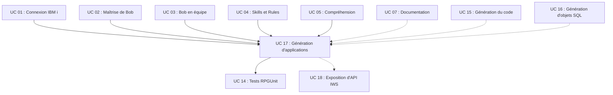

# UC 17 — Génération d'applications

> **Catégorie :** Développement — Génération d'interfaces applicatives (Track B)
>
> **Priorité dans le parcours :** 17 — Phase 4 (Track B), dernier UC de la track ; après UC 15 (Génération du code) et UC 16 (Génération d'objets SQL) recommandés ; dépend de UC 05 (et idéalement UC 07) pour les sous-cas B/C.
>
> **Mode Bob recommandé :** **IBM i Developer** (mode unique pour toute la session : lecture des sources DDS/RPG, génération, écriture de membres et compilation `CRTDSPF` / `CRTBNDRPG` après validation). Bascule vers **IBM i Database** uniquement pour vérifier les interfaces des objets SQL appelés par le composant Web (`QSYS2.SYSROUTINES`, voir UC 16). Sans Premium Package : Ask pour l'analyse et la génération, Agent pour l'écriture et la compilation.

---

## ⭐ Premium Package IBM i utilisé

Il n'existe **pas de workflow Premium en un clic** pour la génération d'applications (écrans 5250 ou composants Web) : UC00 §6 ne liste, pour cet UC, ni workflow, ni slash command, ni usage d'Understand ; les slash commands et Understand ci-dessous sont des **compléments d'usage** propres à cette fiche. Les 71 skills IBM i sont activées automatiquement selon le contexte ; deux familles couvrent le socle de cet UC. La **conversion 5250 → Web** et la **génération de composants Web** ne sont couvertes par aucune skill Premium : c'est la valeur propre du POC.

- **Skills auto-activées mobilisées :**
  - **DDS display files :** `dds-display-files` (formats d'enregistrement, indicateurs, sous-fichiers, conception d'écrans) — socle des sous-cas A, B et C. → [Skills DDS](https://bob.ibm.com/docs/ide/premium-packages/bob-for-i/skills#dds)
  - **Services web IWS :** `iws-service-ops` (lister, installer, démarrer, configurer des services web), `iws-server-config` (propriétés des serveurs IWS) — pertinentes pour la couche d'exposition d'un back-end RPG au Web (Prompt 2c). → [Skills IWS](https://bob.ibm.com/docs/ide/premium-packages/bob-for-i/skills#ibm-i-iws)
  - **En complément :** `rpg-free-format-fundamentals`, `rpg-procedures-functions`, `rpg-file-operations`, `rpg-indicators` (programme de gestion d'écran, sous-cas A) ; `dds-physical-files` (fichiers sous-jacents à l'écran).
- **Slash Command : `/init`** → [Documentation officielle](https://bob.ibm.com/docs/ide/premium-packages/bob-for-i/slash-commands)
  Génère l'`AGENTS.md` de l'application : à exécuter avant les premières générations pour que les normes (nommage, indicateurs, structure RPG) s'appliquent à chaque session. Emplacements officiels : `{BIBLIO}/QBOBSRC/AGENTS.MD` (workspace QSYS) ou `{répertoire IFS}/.bob/AGENTS.md` (workspace IFS) — voir UC00 §0 et §3.1.
- **Slash Command : `/review_rpg`** → [Documentation officielle](https://bob.ibm.com/docs/ide/premium-packages/bob-for-i/slash-commands)
  Revue du programme RPG de gestion d'écran généré (sous-cas A, Prompt 2a-bis). Contrôle **complémentaire**, qui ne remplace pas le test sur terminal 5250.
- **Slash Command : `/review_SQL`** *(à arbitrer, selon le composant)* → [Documentation officielle](https://bob.ibm.com/docs/ide/premium-packages/bob-for-i/slash-commands)
  Uniquement si le composant Web appelle des procédures ou vues SQL créées en UC 16 : la revue porte alors sur ces objets (voir UC 16), pas sur le code Web.
- **Understand (optionnel)** → [Documentation officielle](https://bob.ibm.com/docs/ide/premium-packages/bob-for-i/understand)
  *Si Understand est installé* (mise en place, outils `understand_*` et skills `understand-*` : voir UC00 §2). Il cartographie appelants et appelés d'un programme interactif : utile pour repérer les programmes appelés depuis un écran avant de concevoir le contrat d'exposition (sous-cas B/C). Cet UC n'est pas marqué ✅ Understand dans UC00 §6.
- **Outil `generate_dds`** (sous-cas A) : génération de DDS pour DSPF avec validation de mise en page — voir UC00 §5.1. Autres outils IBM i, recherche documentaire (RAG) et garde-fous : voir UC00 §5.

> **Pourquoi cet UC 17 apporte une valeur méthodologique unique :**
> Générer une interface n'est pas seulement produire des champs : un écran 5250 porte de la logique implicite (indicateurs, touches de fonction, chargement de sous-fichier) qui n'a pas d'équivalent direct en Web. Cet UC apporte :
> 1. **Une qualification obligatoire par écran** : sous-cas (A/B/C), catégorie (SIMPLE/STANDARD/COMPLEXE), points d'attention, éligibilité du back-end pour le sous-cas C (Prompt 0).
> 2. **Une génération dans le chat uniquement**, validée par l'équipe avant toute écriture ou compilation (Prompts 1a à 4).
> 3. **Un traitement en plusieurs passes des sous-fichiers**, parce que la logique de chargement est dans le programme RPG et non dans le DDS (Prompts 2A-SFL et 2b).
> 4. **Un garde-fou d'écriture et de compilation** : non-existence du membre vérifiée, `REPLACE(*NO)`, décision humaine en cas d'objet existant (Prompts 1a-bis et 2a-bis).
> 5. **Un cadrage explicite de la couche d'exposition et du niveau de prototype** (mock ou API réelle) avant de générer un composant Web (Prompts 2c et 3b).

> ⚠️ **Distinctions avec les autres UC de la Track B (règle de routage) :**
> - **UC 15** génère la **logique RPG** (programmes batch, procédures, CRUD) ; **UC 17** génère l'**interface** (display file DDS ou composant Web) et le programme RPG qui pilote l'écran. Pour une application interactive complète : UC 15 pour la logique de traitement, UC 17 pour l'écran.
> - **UC 16** crée les **objets SQL** (tables, procédures, triggers) ; les composants Web de UC 17 peuvent interroger des procédures ou vues créées en UC 16.
> - **Modification d'un display file existant** (ajout d'un champ, par exemple) : ce n'est pas de la génération *ex nihilo* — voir UC 15 (modification de code existant) ; UC 17 couvre la création d'une interface neuve ou sa conversion.

---

## Périmètre

**Trois sous-cas, à traiter comme trois niveaux d'ambition de modernisation de l'interface** (le Prompt 0 détermine le sous-cas pour chaque écran ou groupe d'écrans) :

| Sous-cas | Description | Contrainte |
|---|---|---|
| **A — Nouvelle application 5250** | Génération *ex nihilo* d'un display file DDS (`*DSPF`) et du programme RPG de gestion d'écran | Maquette ou description fonctionnelle requise |
| **B — Conversion 5250 → Web** | Analyse d'un display file existant et génération de composants Web équivalents (React / Vue / Angular selon le choix de l'entreprise) | UC 05 obligatoire ; réflexion UX requise — pas de copier-coller de l'écran 5250 |
| **C — Web UI sur back-end existant** | Variante de B : le programme RPG back-end **ne doit pas être modifié** | Éligibilité du programme vérifiée au Prompt 0 ; confirmation écrite de l'équipe |

> ⚠️ **UC 17 est l'UC le plus long et le plus consommateur en cadrage de la Track B.** Ne pas démarrer sans avoir défini le périmètre exact : quel sous-cas, combien d'écrans, quel écran pilote. Envoyer toute une application au Prompt 0 produit un résultat générique sans valeur.

---

## Objectif

Générer des **interfaces applicatives** IBM i — nouveaux écrans 5250, composants Web, ou conversions d'écrans 5250 existants vers le Web — à partir de sources et de spécifications **vérifiés**, en n'écrivant et ne compilant sur l'IBM i de test qu'après validation explicite de l'équipe.

**Ce que cet UC permet :**
- Qualifier chaque écran (sous-cas, catégorie, points d'attention) avant toute génération.
- Générer un display file DDS et le programme RPG de gestion d'écran conformes aux normes, avec compilation contrôlée (sous-cas A).
- Inventorier les écrans 5250 existants et convertir chaque écran, y compris les sous-fichiers, en composant Web (sous-cas B/C).
- Traduire validations DDS, touches de fonction et indicateurs en équivalents Web.
- Cadrer la couche d'exposition (IWS, adaptateur Node/Toolkit, CGI, API existante) et le niveau de sécurité du prototype.
- Piloter un périmètre applicatif complet par un plan de conversion des écrans.

**Critère de succès principal :** pour chaque écran du périmètre, le sous-cas et la catégorie sont documentés ; le source généré (DDS, RPG ou composant Web) a été relu par un développeur (RPG ou Front-End selon le cas) ; le DDS et le RPG compilent sans erreur sur l'IBM i de test (sous-cas A) et ont été testés sur un terminal 5250 ou via le DDS Previewer ; le composant Web a été revu par un développeur Front-End ; la contrainte « RPG non modifié » est confirmée par écrit (sous-cas C).

---

## Prérequis

- **Phase :** Phase 4 — Track B (Génération)
- **UC précédents requis :**
  - **UC 01 — Connecter Bob à l'IBM i** (**obligatoire**) : connexion active, accès aux sources (`QDDSSRC…`, `QRPGSRC…`).
  - **UC 02 — Maîtrise de Bob**, **UC 03 — Bob en équipe** et **UC 04 — Stratégie Skills et Rules** (**obligatoires**) : modes IBM i Developer / IBM i Database, `/init`, emplacement des rules et `AGENTS.md` partagé (pour y porter les normes d'écran et de nommage).
  - **UC 05 — Compréhension du code** (**obligatoire pour les sous-cas B/C**) : carte du programme interactif (écrans, indicateurs, logique de navigation).
  - **UC 07 — Documentation complète** (**recommandé**) : spécification fonctionnelle des écrans à convertir ou à créer.
  - **UC 15 — Génération du code** et **UC 16 — Génération d'objets SQL** (**recommandés** si l'écran s'appuie sur des procédures RPG ou des objets SQL générés).
- **Livrables requis :**
  - `{appId}-comprehension-{composant}-report-{YYYYMMDD-HHmm}.md` — UC 05 (**obligatoire pour B/C**).
  - `{appId}-doc-spec-fonc-{composant}-{YYYYMMDD-HHmm}.md` — UC 07 (recommandé).
  - Normes d'écran et de nommage (préfixes de champs, plage d'indicateurs, structure RPG) dans l'`AGENTS.md` ou les rules. À défaut, le Prompt 0 les signale « AUCUNE ».
  - **Sous-cas A :** maquettes ou description fonctionnelle (champs, validations, navigation). Sans maquette, le Prompt 1a produit un écran générique.
  - **Sous-cas B/C :** maquettes ou wireframes de l'équipe Front-End (recommandé) — sans maquette, Bob génère une mise en page par défaut sans valeur UX.
  - **Sous-cas B/C :** le **framework Web** retenu (React / Vue / Angular) décidé et documenté **avant** de démarrer ; sinon Bob génère du React par défaut.
  - **Sous-cas C :** confirmation explicite et écrite de l'équipe que le programme RPG back-end ne sera pas modifié, consignée dans le fichier d'analyse.
- **Prérequis système IBM i :**
  - Bibliothèque de test et fichiers source identifiés (ex. `[NOM_LIB]`, `[SRCFILE_DDS]`, `[SRCFILE_RPG]`) — **à confirmer au Prompt 0**, jamais supposés.
  - Droits `*CHANGE` sur la bibliothèque cible pour écrire un membre et compiler (sous-cas A).
- **Niveau Bob recommandé :** Intermédiaire à Avancé
- **Bob Coins estimés :** ⚠️ *À calibrer après le lab UC 17 sur FLGHT400.* À titre de prudence : traiter **1 écran pilote (ou 1 groupe d'écrans liés) par session**.

---

## Exemple concret — Lab FLGHT400

> ⚠️ Le lab FLGHT400 ne contient **aucun résultat du sous-cas A** (nouvelle application 5250 générée *ex nihilo*). Il contient deux prototypes Web de type **conversion (sous-cas B)** à **données mockées** : aucune API IBM i réelle n'a été branchée (l'exposition IWS est citée comme étape suivante, non réalisée). Un exemple de génération complète reste à produire lors du lab UC 17.

| Livrable | Fichier lab | Ce qu'il illustre |
|---|---|---|
| Écran « Create Order » en React | [`../labs_FLGHT400_results/FLGHT403_App_React.md`](../labs_FLGHT400_results/FLGHT403_App_React.md) (+ [`_conversation`](../labs_FLGHT400_results/FLGHT403_App_React_conversation.md), [`.png`](../labs_FLGHT400_results/FLGHT403_App_React.png)) | Composant React 18.2 + Vite 4.4.5 + `@carbon/react` (Carbon 11, thème g100) + Sass, exécuté sur IBM i (PASE, Node v22). 10 contrôles Carbon (Select, RadioButtonGroup, NumberInput) à **listes statiques**, calcul de prix en direct (taxe 8,75 %) et bouton « F10 – Make Reservation » avec notification — illustration du mapping champ DDS → contrôle Web et PF → bouton (Prompt 3b). Pièges d'environnement résolus : wrapper `node` avec `LIBPATH=/QOpenSys/pkgs/lib`, script de patch d'esbuild (pas de binaire os400 ppc64) à relancer après chaque `npm install`, `npm create vite` non interactif qui se bloque, ordre SCSS (`@use theme` avant `components`). Accès par tunnel SSH. **Niveau de prototype : mock** (voir tableau de sécurité du Prompt 3b). |
| Prototype 5250 émulé en Web | [`../labs_FLGHT400_results/FLGHT403_App_5250_web.md`](../labs_FLGHT400_results/FLGHT403_App_5250_web.md) (+ [`_conversation`](../labs_FLGHT400_results/FLGHT403_App_5250_web_conversation.md), [`web1.png`](../labs_FLGHT400_results/FLGHT403_App_5250_web1.png), [`web2.png`](../labs_FLGHT400_results/FLGHT403_App_5250_web2.png)) | Prototype HTML/CSS/JS sans framework émulant 4 écrans (FRS000DF LOGON, FRS001DF Create Order, FRS002DF Modify Order, FRS003DF Display Order), construits à partir des sources `FLGHT403/QDDSSRCD`, déployés sur le serveur Apache `QICCQXML`. Contraintes respectées : **aucun objet FLGHT403 modifié (lecture seule)**, aucun nouveau serveur. Illustre la lecture du DDS existant (Prompt 1b) et le principe « ne pas modifier l'existant ». Suites suggérées par le lab : écrans FRS004–024 (sous-fichiers) et connexion à une API REST IWS — **non réalisées**. |
| Contexte applicatif | [`../labs_FLGHT400_results/FLGHT403_architecture.md`](../labs_FLGHT400_results/FLGHT403_architecture.md), [`FLGHT403_functional_areas.md`](../labs_FLGHT400_results/FLGHT403_functional_areas.md) | Cartographie de l'application dont proviennent les écrans (entrée du Prompt 0). |
| *(Apparenté, hors génération)* Modification d'un DSPF existant | [`../labs_FLGHT400_results/FLGHT403_Change_Total_Flight_Hours.md`](../labs_FLGHT400_results/FLGHT403_Change_Total_Flight_Hours.md) | Ajout du champ `SFLHRS` (ligne 16, colonne 35, `4D 0B`) à `FRS021DF` puis `CRTDSPF … AUT(*EXCLUDE)` (résultat `CPC7301`). C'est une **modification** d'un écran existant, pas une génération : cité pour la chaîne champ fichier → champ écran. Le type de donnée `D` y est utilisé et le display file compile : ne pas affirmer qu'un type de champ est « invalide » sans l'avoir compilé. |

**Scénario de lab proposé (à produire, non réalisé) :** sur une **copie** de `FLGHT403` (jamais sur l'original), (A) générer un petit écran de consultation avec son DDS et son programme RPG, compilés (Prompts 0 → 1a → 1a-bis → 2a → 2a-bis) ; (B) convertir un écran avec sous-fichier (ex. FRS004–024) en deux passes (Prompts 0 → 1b → 2b → 3b) ; documenter le contrat d'exposition (Prompt 2c) puis établir le plan des écrans restants (Prompt 4).

---

## Démarrer une session Bob

### Les trois espaces de travail

- **Workspace local** (poste) — rapports de qualification, sources DDS/RPG documentés, composants Web générés, plan de conversion (`bob-reports/`), normes (rule `.bob/rules-ibm-i-developer/` ou section de l'`AGENTS.md`, voir UC 03 / UC 04). Le **code Web** du projet Front-End vit dans son propre dépôt, décidé avec l'équipe.
- **Librairies IBM i / QSYS** ⭐ — **espace d'exécution du sous-cas A** : membres sources DDS/RPG écrits dans `[SRCFILE_DDS]` / `[SRCFILE_RPG]`, objets `*DSPF` et `*PGM` compilés. L'`AGENTS.md` du projet (`{BIBLIO}/QBOBSRC/AGENTS.MD`) y est injecté automatiquement. **Le code Web n'est jamais compilé sur l'IBM i.**
- **IFS (`$HOME`)** — éventuel hébergement d'un prototype Web (comme dans le lab, sous le répertoire personnel PASE) ; à décider avec l'équipe.

> ⚠️ **Normes et espace QSYS :** quand l'espace actif est *Librairies IBM i* seul, le workspace local et son `.bob/` ne sont **pas chargés** (voir UC 03). Pour que les normes d'écran s'appliquent dans tous les cas, les déclarer **aussi** dans l'`AGENTS.md` de l'application.

### Règles de session

- **Une nouvelle conversation Bob par écran ou groupe d'écrans fonctionnellement liés** (bouton `+` du panneau Chat). Exception : enchaîner plusieurs écrans dans la même session si la navigation entre eux est documentée et si les structures de données sont partagées. Ne pas réutiliser la conversation d'un autre écran : indicateurs et noms de champs polluent la génération.
- **Ouvrir les sources dans l'éditeur** avant le Prompt 0 (Object Browser de Code for IBM i → clic droit sur le membre → *Open in Editor*) : display file `[NOM_LIB]/[SRCFILE_DDS]([NOM_DSPF])`, programme RPG de gestion d'écran `[NOM_LIB]/[SRCFILE_RPG]([NOM_PROGRAMME])`, copybooks éventuels. Pour le sous-cas A : la maquette ou la description fonctionnelle.
- **Charger le contexte** : `AGENTS.md`, `{appId}-comprehension-…` (UC 05), `{appId}-doc-spec-fonc-…` (UC 07), maquettes.
- **Règle de sauvegarde intermédiaire :** UC 17 est long. Au-delà de 4 à 5 prompts consécutifs, Bob peut compresser les premiers tours et perdre les points d'attention du Prompt 0 (sous-fichiers identifiés, indicateurs de navigation, contrainte « RPG non modifié »). **Sauvegarder dans `bob-reports/` après chaque prompt majeur** (Prompts 0, 1b, 2b), pas seulement en fin de session.
- **Reprise de session :** recharger le dernier `{appId}-app-{composant}-analyse-ecrans-*.md` et indiquer « l'analyse des écrans est dans [FICHIER] — le sous-cas retenu est [A/B/C], la catégorie [SIMPLE/STANDARD/COMPLEXE] — reprendre au Prompt [N] ».
- **Règle d'or :** pendant les Prompts 0 à 4, Bob **lit les sources et produit dans le chat** ; aucun `write_member`, aucune compilation, **sauf pour les seuls Prompts 1a-bis et 2a-bis** (sous-cas A), où l'écriture et la compilation ne sont autorisées qu'**après validation explicite** de l'équipe. Jamais d'écriture pendant l'analyse d'un display file existant (risque de modification de l'existant). **Pas de `CRTDSPF` pour les sous-cas B/C.**

---

## Démarche structurée et Prompts

### Progression recommandée : démarrer par un écran connu

Commencer par un **écran simple dont l'équipe connaît le comportement** — consultation ou saisie, sans sous-fichier ni navigation multi-niveaux, dont le rendu 5250 se vérifie immédiatement. La première génération sert à calibrer la qualité de Bob sur le style de l'entreprise (libellés, nommage des champs, validations) et la capacité de l'équipe à valider le résultat.

**Sous-cas A — nouvelle application 5250 :**

| Étape | Écran | Catégorie | Objectif |
|---|---|---|---|
| 1 | Consultation, < 15 champs, sans sous-fichier ni navigation | SIMPLE | Calibrer la génération DDS : types de champs, validations, mise en page |
| 2 | Saisie avec validation (`VALUES`, `RANGE`), 1 ou 2 touches de fonction | SIMPLE à STANDARD | Valider indicateurs de contrôle et validation côté DDS |
| 3 | 2 à 5 écrans liés avec navigation par touches de fonction | STANDARD | Valider la cohérence de la navigation et des indicateurs partagés |
| 4 | Écran avec sous-fichier | COMPLEXE | Appliquer la stratégie en trois passes (Prompt 2A-SFL) |

**Sous-cas B/C — conversion 5250 → Web :**

| Étape | Écran | Catégorie | Objectif |
|---|---|---|---|
| 1 | Écran simple, sans sous-fichier, programme RPG documenté (UC 05 complété) | SIMPLE | Calibrer la structure du composant et les validations côté client |
| 2 | Écran avec validations DDS (`CHECK`, `VALUES`, `RANGE`) et touches de fonction | SIMPLE à STANDARD | Valider la traduction des validations DDS et des PF |
| 3 | Écran avec 1 sous-fichier simple | STANDARD | Appliquer la stratégie en deux passes sur un cas simple |
| 4 | Multi-écrans, navigation dynamique, sous-fichiers imbriqués, indicateurs RPG pilotant l'affichage | COMPLEXE | Identifier les limites de Bob et les écrans nécessitant un atelier UX |

### Impact de la complexité sur la stratégie

La complexité ne se mesure pas en lignes de DDS mais en **facteurs structurels** : présence de sous-fichier (logique de chargement dans le RPG, sans équivalent HTML direct), navigation implicite dans le programme RPG (touches de fonction, indicateurs de niveau), validations DDS embarquées (à recréer côté client avec une autre sémantique), appels de programmes imbriqués depuis un écran, et — sous-cas C — contrainte de ne pas modifier le RPG.

**Sous-cas A**

| Catégorie | Critères | Séquence |
|---|---|---|
| **SIMPLE** | 1 écran, < 15 champs, pas de sous-fichier, validations simples | Prompt 0 → 1a → 1a-bis → 2a → 2a-bis |
| **STANDARD** | 2 à 5 écrans liés, navigation par PF, pas de sous-fichier | Prompt 0 → 1a par écran → 1a-bis → 2a avec navigation → 2a-bis |
| **COMPLEXE** | Sous-fichier, navigation multi-niveaux, RPG couplé à l'affichage | Prompt 0 (délimiter) → 1a par écran sans sous-fichier → **2A-SFL** → 2a → 2a-bis |

**Sous-cas B/C**

| Catégorie | Critères | Séquence |
|---|---|---|
| **SIMPLE** | 1 à 2 écrans sans sous-fichier, validations directes, RPG documenté | Prompt 0 → 1b → (2c) → 3b |
| **STANDARD** | 3 à 6 écrans, 1 sous-fichier, navigation par PF | Prompt 0 → 1b → 2b (deux passes) → (2c) → 3b par écran |
| **COMPLEXE** | Sous-fichiers imbriqués, navigation dynamique, état piloté par indicateurs RPG, appels imbriqués | Prompt 0 (périmètre + atelier UX requis avant génération) → stratégie écran par écran |

> 💡 Sur un COMPLEXE B/C, le Prompt 0 peut conclure qu'un **atelier UX** avec l'équipe Front-End est nécessaire avant toute génération. Dans ce cas, ne pas passer au Prompt 1b : attendre maquettes ou wireframes.

---

### Prompt 0 — Qualification : quel sous-cas, quelle catégorie ?

**Objectif :** Déterminer le sous-cas (A/B/C) et la catégorie pour un écran ou un groupe d'écrans, recenser les normes et les points d'attention, et recommander la séquence de prompts — sans rien écrire.

**Quand l'utiliser :** Point d'entrée **obligatoire**, avant toute génération, pour chaque écran ou groupe d'écrans. Ne jamais le sauter sur un écran qui semble simple : un écran à peu de champs peut avoir une navigation complexe pilotée par des indicateurs RPG.

**Input requis :**
- `AGENTS.md` du projet et normes d'écran si disponibles.
- **B/C :** display file `[NOM_DSPF]` et programme RPG ouverts dans l'éditeur ; `{appId}-comprehension-…` (UC 05) ; `{appId}-doc-spec-fonc-…` (UC 07) si disponible.
- **A :** description fonctionnelle de l'écran (objectif UX, champs, validations, touches de fonction) ou maquette.

**Espace :** Local (`bob-reports/`) pour le rapport, IBM i QSYS pour les lectures (lecture seule).
**Mode :** IBM i Developer.
**Skills clés mobilisées :** `dds-display-files`, `rpg-indicators` (et `iws-service-ops` pour la lecture de la couche d'exposition existante).

**Prompt :**

```text
[B/C : le display file DDS [NOM_DSPF] se trouve dans [NOM_LIB]/[SRCFILE_DDS] ; le programme RPG
d'écran est [NOM_PROGRAMME]. Le fichier de compréhension [FICHIER_UC05] est disponible.]
[A : description du besoin, en termes d'objectif UX : [DESCRIPTION]]
[Charger dans le contexte : AGENTS.md, spécification UC 07 si disponible]

N'invente aucun objet. Tout membre source, record, champ, indicateur ou programme cité doit
provenir d'une lecture réelle des sources ; sinon écris « NON VÉRIFIÉ ». Cette étape est en
lecture seule : aucun write_member, aucune compilation.

Produis en français, en markdown, un rapport de qualification :

## Qualification UC 17 — [NOM_ECRAN ou NOM_DSPF]

### 1. Sous-cas retenu
A (nouvelle 5250), B (conversion 5250 → Web) ou C (Web UI sur back-end existant sans modification
RPG). Justification en 1 à 2 phrases.

### 2. Catégorie
SIMPLE / STANDARD / COMPLEXE, justifiée selon les critères du rapport (sous-fichier, nombre
d'écrans, validations, navigation).

### 3. Normes disponibles
| Domaine | Source (AGENTS.md / rules / AUCUNE) | Valeur |
|---|---|---|
| Nommage des records et champs | | |
| Plage d'indicateurs | | |
| Structure RPG (CTL-OPT, DCL-F, INDDS) | | |
| Framework Web retenu (B/C) | | |
Si « AUCUNE » : proposer de dériver les conventions d'objets existants, marquées « À VALIDER ».

### 4. Points d'attention détectés
- Sous-fichier présent ? (OUI/NON ; si OUI : page-at-a-time ou load-all, d'après le RPG)
- Validations DDS (CHECK, VALUES, RANGE) ?
- Logique de navigation implicite dans le RPG (touches de fonction, indicateurs d'option) ?
- Appels de programmes imbriqués depuis l'écran ?
- Champs affichés/masqués selon des indicateurs dynamiques ?
- [Sous-cas C] Le programme [NOM_PROGRAMME] est-il appelable hors 5250 (pas de fichier WORKSTN,
  pas d'EXFMT, pas d'état interactif non exposé) ?

### 5. Éligibilité au sous-cas C (sous-cas C uniquement)
Conclusion exacte : « ÉLIGIBLE AU SOUS-CAS C » ou « NON ÉLIGIBLE AU SOUS-CAS C — raison : … ».
Si NON ÉLIGIBLE : ne pas passer au Prompt 1b ; stratégie alternative à décider avec l'équipe.

### 6. Niveau de prototype (B/C)
Données mockées ou API IBM i réelle ? (voir le tableau de sécurité avant le Prompt 3b)

### 7. Séquence de prompts recommandée
Liste ordonnée selon le sous-cas et la catégorie.

### 8. Périmètre
Recommandation si le périmètre est trop large : réduire à 1 écran pilote.
```

**Livrable produit :** `{appId}-app-{composant}-analyse-ecrans-{YYYYMMDD-HHmm}.md` (dans `bob-reports/`).

> 💡 Bob détecte un sous-fichier en cherchant les mots-clés `SFL`, `SFLCTL` et `SFLPAG` dans les R-specs du DDS.

> ⚠️ **Piège évité :** un Prompt 0 sauté sur un COMPLEXE conduit à un composant Web qui affiche les champs mais ne gère ni pagination ni navigation. Le Prompt 0 prend quelques minutes et évite des heures de génération dans le mauvais sens.

---

## — SOUS-CAS A : nouvelle application 5250 —

### Prompt 1a — Génération du display file DDS

**Objectif :** Générer dans le chat le source DDS d'un écran, conforme aux normes.

**Quand l'utiliser :** Après le Prompt 0 (catégorie SIMPLE ou STANDARD confirmée). Pour un sous-fichier : voir d'abord le Prompt 2A-SFL.

**Input requis :**
- Rapport de qualification `{appId}-app-{composant}-analyse-ecrans-{YYYYMMDD-HHmm}.md`.
- Description des écrans (champs, types, longueurs, validations, touches de fonction) ou maquette.
- Normes chargées (nommage, plage d'indicateurs).

**Espace :** Dans le chat (aucune écriture).
**Mode :** IBM i Developer.
**Skills clés mobilisées :** `dds-display-files`, `dds-physical-files` (si l'écran référence des champs de fichier).

**Prompt :**

```text
Sur la base du rapport de qualification [NOM_FICHIER_ANALYSE], génère dans le chat, en français
et en markdown, le display file DDS de l'écran [NOM_ECRAN], en appliquant les normes chargées.
[Maquette disponible : [NOM_FICHIER].]

Contenu attendu :

### 1. En-tête DDS
Commentaires : nom d'écran, date, auteur, programme appelant, statut « À valider ».
Ajoute un placeholder de traçabilité du gestionnaire de sources dans l'en-tête si l'équipe le demande.

### 2. Spécifications de fichier
DSPSIZ, INDARA et paramètres globaux nécessaires.

### 3. Enregistrements et champs
Pour chaque RECORD : nom (selon les normes), champs (nom, type, longueur, position, libellé),
validations (CHECK, VALUES, RANGE), attributs (DSPATR, COLOR) pilotés par indicateurs.
Types de champ : utiliser les types cohérents avec les types SQL ou les champs de fichier
(par exemple alphanumérique, zoned, date, heure, timestamp). Pour toute valeur de position 35
dont tu n'es pas certain, écris « À VÉRIFIER À LA COMPILATION » plutôt que de l'affirmer.
Le formatage d'affichage numérique se règle par EDTCDE ou EDTWRD.

### 4. Touches de fonction
- CAxx : retour au programme sans retransmettre les saisies (ex. CA03 = Quitter).
- CFxx : retour au programme en retransmettant les saisies (ex. CF06 = Ajouter, CF12 = Annuler).
- VLDCMDKEY valide l'usage d'une touche de commande ; il ne définit pas les touches.
Documente la plage d'indicateurs utilisée et la correspondance indicateur ↔ touche.

N'invente aucun champ, fichier ni indicateur absent du besoin ou des normes. Pour un point sur lequel
les normes sont silencieuses, pose la question. Ne sauvegarde rien et ne compile rien.
```

**Livrable produit :** `{appId}-app-{composant}-dspf-genere-{YYYYMMDD-HHmm}.md` (dans `bob-reports/`, section DDS).

> 💡 `DSPATR(HI)` met un champ en surbrillance, `DSPATR(PR)` le protège, `DSPATR(ND)` le masque : ces attributs sont pilotés par les numéros d'indicateurs RPG (01-99) — fixer la plage d'indicateurs en début de session.

### Prompt 1a-bis — Écriture du membre et compilation `CRTDSPF`

**Objectif :** Écrire le DDS validé sans écraser un membre existant, puis compiler le display file.

**Quand l'utiliser :** Uniquement après validation explicite du DDS par l'équipe.

**Input requis :**
- Source DDS validé (Prompt 1a).
- `[NOM_LIB]`, `[SRCFILE_DDS]`, `[NOM_DSPF]` confirmés au Prompt 0.

**Espace :** IBM i QSYS (membre `[NOM_LIB]/[SRCFILE_DDS]([NOM_DSPF])` et objet `*DSPF`).
**Mode :** IBM i Developer (mode Agent si le Premium n'est pas disponible).
**Skills clés mobilisées :** `dds-display-files`.

**Prompt :**

```text
Le DDS [NOM_DSPF] est validé par l'équipe.

Étape 0 — Vérifier que le membre n'existe pas :
SELECT COUNT(*) AS MEMBER_COUNT
FROM QSYS2.SYSPARTITIONSTAT
WHERE SYSTEM_TABLE_SCHEMA = '[NOM_LIB]'
  AND SYSTEM_TABLE_NAME   = '[SRCFILE_DDS]'
  AND SYSTEM_TABLE_MEMBER = '[NOM_DSPF]';
Si MEMBER_COUNT > 0 : arrête-toi et signale-le ; n'écrase rien sans ma confirmation explicite.

Étape 1 — Écrire le source DDS validé (sans balises Markdown) dans
[NOM_LIB]/[SRCFILE_DDS]([NOM_DSPF]).

Étape 2 — Compiler :
CRTDSPF FILE([NOM_LIB]/[NOM_DSPF]) SRCFILE([NOM_LIB]/[SRCFILE_DDS]) SRCMBR([NOM_DSPF]) REPLACE(*NO)

Si le message est CPF5813 (objet déjà existant) : affiche-le et arrête-toi. NE RELANCE PAS avec
REPLACE(*YES) automatiquement ; demande une décision explicite (conserver ou remplacer).

Si la compilation échoue : liste les messages avec le numéro de ligne source, propose la correction
DDS pour chaque erreur et montre-moi le diff avant de corriger le membre.

Rappelle que la compilation réussie ne valide ni le rendu visuel ni la navigation : test obligatoire
sur terminal 5250 ou avec le DDS Previewer de Code for IBM i.
```

**Livrable produit :** membre DDS et `*DSPF` dans `[NOM_LIB]` (IBM i QSYS).

> ⚠️ Bob peut corriger des erreurs de syntaxe DDS (mot-clé mal orthographié, champ mal positionné), mais ne peut pas valider le rendu visuel : chevauchements et libellés tronqués ne sont détectables que sur terminal 5250 ou DDS Previewer.

### Prompt 2a — Programme RPG de gestion d'écran

**Objectif :** Générer dans le chat le programme RPG ILE free-format qui pilote l'écran (affichage, lecture des touches, validation de saisie).

**Quand l'utiliser :** Après compilation du display file (Prompt 1a-bis).

**Input requis :**
- Display file compilé `[NOM_DSPF]` dans `[NOM_LIB]`.
- Normes RPG chargées ; procédures de traitement générées en UC 15 si disponibles.

**Espace :** Dans le chat (aucune écriture).
**Mode :** IBM i Developer.
**Skills clés mobilisées :** `rpg-free-format-fundamentals`, `rpg-indicators`, `rpg-file-operations`, `rpg-procedures-functions`, `dds-display-files`.

**Prompt :**

```text
Le display file [NOM_DSPF] est compilé et disponible dans [NOM_LIB]. Génère dans le chat, en
français et en markdown, le programme RPG ILE free-format de gestion d'écran pour [NOM_ECRAN],
en appliquant les normes chargées :

### 1. En-tête et CTL-OPT (selon les normes)

### 2. Déclarations
DCL-F pour le display file, DCL-S / DCL-DS pour les champs d'écran.
Le DDS utilise INDARA : ne lis pas les indicateurs par *INxx. Utilise INDDS et une structure :
  DCL-F [NOM_DSPF] WORKSTN INDDS(dsIndicateurs);
  DCL-DS dsIndicateurs;
    quitter  IND POS(3);
    ajouter  IND POS(6);
    annuler  IND POS(12);
  END-DS;
Les numéros de position correspondent aux indicateurs réellement définis dans le DDS.

### 3. Boucle d'affichage
EXFMT, puis test des indicateurs dsIndicateurs.xxx après chaque EXFMT.

### 4. Validation côté programme
Contrôle des champs obligatoires ; appels aux procédures de service existantes.

### 5. Appels métier
CALLP vers les programmes ou procédures de traitement. N'écris pas de logique métier dans le
programme d'écran (CRUD, calculs, règles de gestion) : elle relève de UC 15.

N'invente aucune procédure, aucun fichier ni aucun indicateur. Ne sauvegarde rien et ne compile rien.
```

**Livrable produit :** `{appId}-app-{composant}-dspf-genere-{YYYYMMDD-HHmm}.md` (section Programme RPG, dans `bob-reports/`).

> 💡 Si la demande porte surtout sur la logique de traitement (« génère la logique de traitement de commande »), utiliser UC 15 ; UC 17 reste focalisé sur l'interface.

### Prompt 2a-bis — Écriture du membre RPG et compilation `CRTBNDRPG`

**Objectif :** Écrire le RPG validé sans écraser un membre existant, le compiler et rapporter le résultat.

**Quand l'utiliser :** Après validation du RPG (Prompt 2a) **et** après compilation du display file (Prompt 1a-bis).

**Input requis :**
- Source RPG validé, display file `*DSPF` existant dans `[NOM_LIB]`.
- Droits `*CHANGE` sur la bibliothèque cible.

**Espace :** IBM i QSYS (membre `[NOM_LIB]/[SRCFILE_RPG]([NOM_PROGRAMME])` et objet `*PGM`).
**Mode :** IBM i Developer.
**Skills clés mobilisées :** `rpg-free-format-fundamentals`, `rpg-file-operations`.

**Prompt :**

```text
Le programme RPG [NOM_PROGRAMME] est validé. Le display file [NOM_DSPF] est compilé dans [NOM_LIB].

Étape 1 — Vérifier que le membre n'existe pas :
SELECT COUNT(*) AS MEMBER_COUNT
FROM QSYS2.SYSPARTITIONSTAT
WHERE SYSTEM_TABLE_SCHEMA = '[NOM_LIB]'
  AND SYSTEM_TABLE_NAME   = '[SRCFILE_RPG]'
  AND SYSTEM_TABLE_MEMBER = '[NOM_PROGRAMME]';
Si MEMBER_COUNT > 0 : arrête-toi et signale-le ; n'écrase rien sans ma confirmation.

Étape 2 — Écrire le source RPG (sans balises Markdown) dans [NOM_LIB]/[SRCFILE_RPG]([NOM_PROGRAMME]).

Étape 3 — Compiler avec CRTBNDRPG sur [NOM_LIB] (REPLACE(*NO) pour le premier essai) et rapporte :
- Succès sans erreur ni avertissement : confirme.
- Erreurs : tableau (code, ligne, description), correction proposée, précision « mécanique » ou
  « décision du développeur ». Montre le diff avant de corriger.
- Avertissements : liste avec niveau de sévérité.

Étape 4 — Exécute /review_rpg sur le programme et résume les constats critiques et majeurs.

Rappelle que la compilation réussie ne valide pas le comportement de l'écran : test obligatoire sur
terminal 5250 ou DDS Previewer.
```

**Livrable produit :** membre RPG et `*PGM` dans `[NOM_LIB]` (IBM i QSYS) ; rapport optionnel `{appId}-app-{composant}-rapport-{YYYYMMDD-HHmm}.md` (dans `bob-reports/`, à la demande).

> ⚠️ **Ordre obligatoire : `CRTDSPF` (Prompt 1a-bis) avant `CRTBNDRPG` (Prompt 2a-bis).** Le RPG contient une `DCL-F` qui référence le display file : si le `*DSPF` n'existe pas encore, la compilation échoue avec `RNF7031`.

### Prompt 2A-SFL — Sous-fichier 5250 (sous-cas A COMPLEXE, trois passes)

**Objectif :** Générer un sous-fichier (SFL / SFLCTL) et la stratégie de chargement associée, en trois passes validées indépendamment.

**Quand l'utiliser :** Sous-cas A COMPLEXE. **Ne jamais générer un sous-fichier en une seule passe** : le DDS SFL, le SFLCTL et la logique RPG de chargement sont des entités séparées.

**Input requis :**
- Rapport de qualification (Prompt 0) ; display file principal `[NOM_DSPF]` existant ou en cours.
- Besoin : colonnes, volumétrie, pagination, champ d'option.

**Espace :** Passes 1 et 2 : dans le chat. Passe 3 : IBM i QSYS (compilation).
**Mode :** Passes 1 et 2 : IBM i Developer, sans écriture ; passe 3 : IBM i Developer avec écriture/compilation autorisées après validation.
**Skills clés mobilisées :** `dds-display-files`, `rpg-file-operations`, `rpg-indicators`.

**Passe 1 — Qualification du sous-fichier (chat) :**

```text
Je dois créer un sous-fichier 5250 pour [NOM_ECRAN]. Produis en français, en markdown :

## Qualification SUBFILE — [NOM_SFL]

### 1. Structure
- Colonnes affichées (nom, type, longueur, position).
- SFLPAG : nombre de lignes visibles par page.
- SFLSIZ : stratégie retenue :
  • page-at-a-time : SFLSIZ = SFLPAG — le sous-fichier ne contient qu'une page ; le programme
    recharge à chaque navigation ;
  • load-all (expanding) : SFLSIZ > SFLPAG — plusieurs pages chargées ; la pagination peut se faire
    parmi les enregistrements présents.
- Champ RRN (SFLRCDNBR dans le SFLCTL) : positionne la page affichée ; avec CURSOR, positionne aussi
  le curseur. Il ne détermine pas la stratégie de chargement.

### 2. SFLCTL
- Indicateurs SFLDSP, SFLDSPCTL, SFLCLR, SFLEND : choisis un pattern cohérent et documenté
  (les numéros peuvent être distincts selon les besoins).
- Touches de fonction (CAxx / CFxx).

### 3. Chargement (programme RPG)
- Page-at-a-time : boucle de chargement, un WRITE par ligne visible, touches de pagination.
- Load-all : chargement complet avant affichage.
- Lecture de la ligne sélectionnée : READC (prochain enregistrement modifié, champ option) ; ne pas
  le confondre avec SFLRCDNBR (page affichée).

### 4. Risques et décisions
Nombre maximal d'enregistrements, pagination ou chargement complet, champ d'option présent ou non.
```

**Passe 2 — Génération du DDS du sous-fichier (chat) :**

```text
La qualification [NOM_SFL] est disponible. Génère en français, en markdown, les A-specs / R-specs
complètes :
- SFL : record avec le mot-clé SFL, un champ par colonne, champ d'option si nécessaire.
- SFLCTL([NOM_SFL]) : SFLPAG, SFLSIZ (égaux pour page-at-a-time, SFLSIZ > SFLPAG pour load-all),
  SFLRCDNBR si repositionnement requis, indicateurs de contrôle avec justification des numéros.
- Touches de fonction associées (règle CAxx / CFxx du Prompt 1a).
Ne sauvegarde rien et ne compile rien.
```

**Passe 3 — Compilation (après validation) :**

```text
Le DDS du sous-fichier [NOM_SFL] / [NOM_SFLCTL] a été ajouté dans [NOM_LIB]/[SRCFILE_DDS]([NOM_DSPF]).
Compile le display file complet :
CRTDSPF FILE([NOM_LIB]/[NOM_DSPF]) SRCFILE([NOM_LIB]/[SRCFILE_DDS]) SRCMBR([NOM_DSPF]) REPLACE(*NO)
Applique la règle du Prompt 1a-bis (CPF5813, décision humaine avant REPLACE(*YES)). En cas d'erreur
sur le sous-fichier (ordre des mots-clés, SFLSIZ, type de champ) : identifie la ligne et le mot-clé,
propose la correction précise et montre le diff avant de corriger.
```

**Livrable produit :** `{appId}-app-{composant}-dspf-genere-{YYYYMMDD-HHmm}.md` (sections SFL / SFLCTL, dans `bob-reports/`) ; display file compilé dans `[NOM_LIB]` (IBM i QSYS).

> ⚠️ **Après la passe 3 : Prompt 2a.** La logique de chargement du sous-fichier (WRITE en boucle, SFLDSP, READC) doit être incluse dans le programme RPG.

---

## — SOUS-CAS B/C : conversion 5250 → Web —

### Prompt 1b — Analyse des écrans 5250 existants [Complément — non couvert par le workflow Premium]

**Objectif :** Inventorier tous les écrans d'un display file avant toute génération Web.

**Quand l'utiliser :** Après le Prompt 0 (catégorie confirmée, sous-cas C éligible si applicable). Le display file source doit être ouvert dans l'éditeur.

**Input requis :**
- Display file `[NOM_DSPF]` ; fichier de compréhension UC 05.

**Espace :** Dans le chat (lecture seule), puis sauvegarde locale.
**Mode :** IBM i Developer.
**Skills clés mobilisées :** `dds-display-files`, `rpg-indicators`.

**Prompt :**

```text
Le display file [NOM_DSPF] se trouve dans [NOM_LIB]/[SRCFILE_DDS]. Le fichier de compréhension
[FICHIER_UC05] est disponible. Lis le display file et produis en français, en markdown :

## Analyse des écrans 5250 — [NOM_DSPF]

### Tableau des enregistrements
| Nom RECORD | Nb champs | Type (écran / SFL / SFLCTL / message) | Validations DDS | Sous-fichier (O/N) | Touches utilisées |
(une ligne par RECORD, y compris les enregistrements de message d'erreur et les enregistrements cachés)

### Points d'attention par écran
Pour chaque RECORD complexe : indicateurs de condition, DSPATR conditionnels, champs affichés ou
masqués selon les indicateurs RPG.

### Séquence de génération recommandée
Écrans sans sous-fichier en premier, sous-fichiers en dernier.

Lecture seule : aucun write_member. N'invente aucun record ni champ ; « NON VÉRIFIÉ » sinon.
```

**Livrable produit :** `{appId}-app-{composant}-analyse-ecrans-{YYYYMMDD-HHmm}.md` (dans `bob-reports/`, à ajouter au rapport du Prompt 0).

> 💡 Un champ affiché seulement si un indicateur est actif (par exemple `30 DSPATR(ND)`) devient une propriété booléenne du composant Web : Bob doit documenter ces conditions pour le développeur Front-End.

### Prompt 2b — Analyse et conversion d'un sous-fichier (deux passes) [Complément — non couvert par le workflow Premium]

**Objectif :** Convertir un sous-fichier existant en composant Web de liste, après analyse de sa logique de chargement dans le RPG.

**Quand l'utiliser :** Obligatoire dès qu'un sous-fichier est présent. **Ne jamais convertir un sous-fichier en une seule passe** : la logique de chargement est en partie dans le programme RPG, pas dans le DDS.

**Input requis :**
- Display file et programme RPG pilotant le sous-fichier, ouverts dans l'éditeur.
- Framework Web retenu ; rapport de qualification.

**Espace :** Dans le chat (aucune écriture) ; sauvegarde locale après chaque passe.
**Mode :** IBM i Developer.
**Skills clés mobilisées :** `dds-display-files`, `rpg-file-operations`, `rpg-indicators`.

**Passe 1 — Analyse du sous-fichier :**

```text
Le display file [NOM_DSPF] contient le sous-fichier [NOM_SFL] et son SFLCTL [NOM_SFLCTL].
Le programme RPG [NOM_PROGRAMME] qui le pilote est ouvert dans l'éditeur.
Produis en français, en markdown :

## Analyse SUBFILE — [NOM_SFL]
1. Structure DDS : colonnes, SFLPAG, SFLSIZ.
2. Logique de chargement : page par page ou complet ; quand SFLDSP, SFLDSPCTL, SFLCLR et SFLEND
   sont activés ; touches de navigation.
3. Sélection de ligne : effet des valeurs saisies dans le champ option.
4. Sections du programme RPG qui chargent, effacent ou naviguent dans le sous-fichier.
Lecture seule. [Sous-cas C : le programme [NOM_PROGRAMME] ne doit PAS être modifié.]
```

**Passe 2 — Génération du composant équivalent :**

```text
L'analyse du sous-fichier [NOM_SFL] est dans [NOM_FICHIER]. Framework retenu : [React / Vue / Angular].
Génère en français, en markdown, le composant Web équivalent :
1. Structure : props, état, interface de données (équivalent des colonnes du SFL).
2. Pagination : chargement paginé côté serveur (paramètres de page à l'appel du back-end), indicateur
   de fin de liste (équivalent SFLEND). Ne pagine pas côté client sur l'ensemble des enregistrements
   si le sous-fichier d'origine était chargé page par page.
3. Sélection de ligne : boutons d'action ou menu contextuel (équivalent du champ option).
4. Intégration avec le back-end : interface d'appel du programme RPG (paramètres IN/OUT).
[Sous-cas C : rappel — le programme RPG [NOM_PROGRAMME] ne doit PAS être modifié ; l'API d'appel
préserve l'interface existante.]
N'écris rien ; génère dans le chat.
```

**Livrable produit :** `{appId}-app-{composant}-web-genere-{YYYYMMDD-HHmm}.md` (composant de liste, dans `bob-reports/`).

### Prompt 2c — Contrat d'exposition du back-end [Complément — non couvert par le workflow Premium]

**Objectif :** Documenter comment le composant Web appellera le back-end IBM i, avant de générer le composant. Un navigateur ne peut pas appeler directement un `*PGM`.

**Quand l'utiliser :** Avant le Prompt 3b, dès que le composant doit appeler IBM i autrement que par des données mockées.

**Input requis :**
- Rapport de qualification ; interface du programme ou des objets SQL appelés (paramètres IN/OUT) ; décision de l'équipe sur la couche d'exposition.

**Espace :** Dans le chat (aucune écriture ; aucun service créé ni démarré).
**Mode :** IBM i Developer (IBM i Database pour vérifier les routines SQL de UC 16 via `QSYS2.SYSROUTINES`).
**Skills clés mobilisées :** `iws-service-ops`, `iws-server-config` (lecture de l'existant uniquement).

**Prompt :**

```text
Le composant Web [NOM_COMPOSANT] doit appeler [NOM_PROGRAMME ou NOM_PROCEDURE_SQL]. Produis en
français, en markdown, le contrat d'exposition :

## Contrat d'exposition — [NOM_COMPOSANT]
| Élément | Valeur | Source |
|---|---|---|
| Couche d'exposition retenue | IWS / adaptateur Node (Toolkit) / CGI / API existante | décision équipe |
| URL et méthode HTTP | | |
| Paramètres IN/OUT et sérialisation | | lecture du programme ou de QSYS2.SYSROUTINES |
| Authentification et autorisation | | |
| Gestion de session / d'état | | |
| Niveau de prototype | mock / API réelle | |

Si la couche d'exposition n'est pas décidée, écris « À DÉCIDER AVEC L'ÉQUIPE » et ne choisis pas à
sa place. Ne crée, n'installe et ne démarre aucun service IWS. [Sous-cas C : le programme
[NOM_PROGRAMME] ne doit PAS être modifié ; le contrat préserve son interface.]
```

**Livrable produit :** section « Contrat d'exposition » ajoutée à `{appId}-app-{composant}-analyse-ecrans-{YYYYMMDD-HHmm}.md` (dans `bob-reports/`).

> ⚠️ **Non réalisé dans le lab FLGHT400** : l'exposition IWS y est citée comme étape suivante. Ce prompt cadre la décision ; la mise en place du service relève d'une opération distincte, validée par l'équipe.

> ⚠️ **Avant de lancer le Prompt 3b : définir le niveau de prototype**
>
> | Type de prototype | Exigences de sécurité |
> |---|---|
> | **Données mockées, aucune API IBM i réelle** | Sécurité détaillée différable (aucun secret ni donnée de production). Consigner ce choix dans le fichier d'analyse. |
> | **API IBM i réelle** | Authentification, autorisation côté serveur, validation des données reçues, gestion des secrets (aucun identifiant en dur), profil IBM i applicatif dédié : **obligatoires avant tout test avec des données réelles**. Les validations JavaScript côté client ne sont pas des contrôles de sécurité. |
>
> Si le prototype passe de mock à API réelle en cours de session, appliquer les exigences de la seconde ligne avant de continuer. Un prototype Web qui compile ou s'exécute avec des données mockées ne démontre pas, à lui seul, une intégration fonctionnelle avec le back-end IBM i.

### Prompt 3b — Composant Web par écran 5250 [Complément — non couvert par le workflow Premium]

**Objectif :** Générer dans le chat le composant Web d'un écran, avec validations, touches de fonction et appel du back-end.

**Quand l'utiliser :** Après le Prompt 1b (et 2b pour un sous-fichier, 2c pour une API réelle). **Un prompt par écran**, sauf écrans partageant le même composant de base.

**Input requis :**
- Rapport de qualification ; composant de liste du Prompt 2b si sous-fichier ; contrat d'exposition (Prompt 2c) ; framework Web ; maquettes.

**Espace :** Dans le chat (aucune écriture) ; sauvegarde locale après validation.
**Mode :** IBM i Developer.
**Skills clés mobilisées :** `dds-display-files`, `rpg-indicators` (traduction des indicateurs en propriétés), `iws-service-ops` (contrat d'appel).

**Prompt :**

```text
L'analyse des écrans est dans [NOM_FICHIER]. Framework retenu : [React / Vue / Angular].
[Sous-fichier : le composant [NOM_SFL] a été généré en Prompt 2b.]
[Sous-cas C : le programme RPG [NOM_PROGRAMME] ne doit PAS être modifié ; préserve l'interface
d'appel existante.]
Génère en français, en markdown, le composant Web de l'écran [NOM_RECORD] :

1. Structure : props, état, événements du framework retenu.
2. Formulaire : un contrôle par champ DDS (type HTML équivalent, libellé DDS, contraintes).
3. Validations côté client :
   - CHECK(ER) → required
   - VALUES('A' 'B' 'C') → select ou boutons radio avec les valeurs autorisées
   - RANGE(1 999) → min/max sur un champ numérique
4. Touches de fonction : mapping PF → boutons ou raccourcis (ex. F3 → bouton « Quitter »/Échap).
5. Indicateurs conditionnels : chaque champ affiché ou masqué selon un indicateur → propriété
   réactive documentée avec sa condition métier.
6. Appel du back-end : conformément au contrat d'exposition [NOM_FICHIER_CONTRAT] ; si le
   prototype est mocké, indique-le explicitement dans le code.

Bob génère la structure et la logique du composant ; la mise en forme et la charte graphique sont à
la charge de l'équipe Front-End. N'invente aucune URL, aucun paramètre ni aucun champ. Ne sauvegarde
rien à ce stade.
```

**Livrable produit :** `{appId}-app-{composant}-web-genere-{YYYYMMDD-HHmm}.md` (dans `bob-reports/`) ; le code final rejoint le dépôt Front-End après revue.

> 💡 Les validations DDS sont exécutées côté IBM i ; leur équivalent Web s'exécute côté navigateur, à la soumission ou à la saisie : la sémantique diffère (par exemple, `VALUES` bloque l'entrée en DDS).

### Prompt 4 — Plan de conversion des écrans (périmètre applicatif complet) [Complément — non couvert par le workflow Premium]

**Objectif :** Produire l'inventaire priorisé des écrans d'un périmètre, avec dépendances et besoin UX.

**Quand l'utiliser :** Après l'analyse et les composants pilotes, pour piloter les écrans restants.

**Input requis :**
- Rapport de qualification ; liste des composants déjà générés.

**Espace :** Dans le chat, puis sauvegarde locale.
**Mode :** IBM i Developer.
**Skills clés mobilisées :** `dds-display-files`.

**Prompt :**

```text
L'analyse des écrans est dans [NOM_FICHIER]. Composants pilotes déjà générés : [LISTE].
Produis en français, en markdown :

## Plan de conversion des écrans — [NOM_APP]
| Écran (RECORD) | Sous-cas | Catégorie | Sous-fichier (O/N) | Réflexion UX préalable (O/N) | Effort estimé | Priorité |
(une ligne par écran)

### Points de synchronisation
Écrans interdépendants, à traiter dans la même session.

### Écrans nécessitant un atelier UX préalable
Écrans COMPLEXE dont la conversion ne doit pas démarrer sans maquettes ou wireframes.

Sauvegarde le plan dans bob-reports/ avec le nom {appId}-app-{appId}-plan-ecrans-{YYYYMMDD-HHmm}.md.
```

**Livrable produit :** `{appId}-app-{appId}-plan-ecrans-{YYYYMMDD-HHmm}.md` (dans `bob-reports/`).

> 💡 Ce plan est l'entrée de **UC 14** pour définir quels écrans générés tester en priorité.

---

## Livrables de cet UC

> ⚠️ **Où écrit Bob ?** Pour le sous-cas A, Bob écrit les membres sources et crée les objets **sur l'IBM i** (`[NOM_LIB]`), pas en local ; pour les sous-cas B/C, tout reste en local (aucune compilation IBM i). Pour conserver une trace locale des sources et des analyses, demander explicitement à Bob de sauvegarder dans `bob-reports/`.

| Fichier / objet produit | Pattern de nommage | Espace de stockage | Consommé par |
|---|---|---|---|
| Rapport de qualification et analyse des écrans | `{appId}-app-{composant}-analyse-ecrans-{YYYYMMDD-HHmm}.md` | `bob-reports/` (Local) | Tous les prompts suivants, reprise de session, UC 18 (contrat d'exposition) |
| Normes d'écran (rule / AGENTS.md) | `.bob/rules-ibm-i-developer/…` + section de `AGENTS.md` | Local + `{BIBLIO}/QBOBSRC/AGENTS.MD` | Toutes les sessions Bob |
| DDS et RPG générés (sous-cas A) | `{appId}-app-{composant}-dspf-genere-{YYYYMMDD-HHmm}.md` | `bob-reports/` (Local) | Prompts 1a-bis, 2a-bis, UC 14 |
| Membres sources et objets compilés (sous-cas A) | `[NOM_DSPF]`, `[NOM_PROGRAMME]` | `[NOM_LIB]` (IBM i QSYS) | UC 14 (tests), mise en production |
| Composants Web générés (sous-cas B/C) | `{appId}-app-{composant}-web-genere-{YYYYMMDD-HHmm}.md` | `bob-reports/` (Local) ; code final dans le dépôt Front-End | Revue Front-End, UC 14 |
| Plan de conversion des écrans | `{appId}-app-{appId}-plan-ecrans-{YYYYMMDD-HHmm}.md` | `bob-reports/` (Local) | Pilotage du périmètre, UC 14 |
| Rapport de compilation et revue *(optionnel)* | `{appId}-app-{composant}-rapport-{YYYYMMDD-HHmm}.md` | `bob-reports/` (Local) | Revue, traçabilité |

> ⚠️ **Gestionnaire de sources :** si l'entreprise gère ses sources dans un gestionnaire de sources, la réintégration des membres/scripts créés est manuelle après validation. Les membres DDS/RPG créés (sous-cas A) sont de nouveaux objets à **réintégrer manuellement dans le gestionnaire de sources** après validation ; pour le sous-cas B/C, marquer manuellement le display file d'origine comme « remplacé » si l'équipe le décide. Les sources Web sont versionnés via Git, indépendamment du gestionnaire de sources.

---

## Pièges à éviter

| Piège | Ce qui se passe | Comment l'éviter |
|---|---|---|
| Sauter le Prompt 0 sur un COMPLEXE avec sous-fichier | Composant Web incomplet : logique de chargement et indicateurs de navigation non documentés | Toujours exécuter le Prompt 0 pour chaque écran |
| Envoyer toute l'application au Prompt 0 | Saturation du contexte, inventaire générique, Bob Coins consommés sans valeur | 1 écran (ou groupe lié) par session ; Prompt 4 pour le plan global |
| Convertir un sous-fichier en une seule passe | Le composant affiche les colonnes mais ne gère ni pagination ni sélection de ligne | Prompt 2b en deux passes : analyse du DDS + RPG, puis génération |
| Générer un sous-fichier DDS en une passe | SFL, SFLCTL et logique de chargement non validés séparément | Prompt 2A-SFL en trois passes |
| Sous-cas C : Bob propose de modifier le RPG back-end | Violation de la contrainte ; risque de régression | Rappeler « le programme RPG ne doit PAS être modifié » dans chaque prompt 2b/2c/3b ; vérifier les modifications proposées |
| Sous-cas C sans test d'éligibilité | Le programme dépend de `EXFMT` / `WORKSTN` et n'est pas appelable hors 5250 | Conclusion ÉLIGIBLE / NON ÉLIGIBLE au Prompt 0 avant tout |
| Compiler le RPG avant le DSPF | `RNF7031` : le `*DSPF` référencé est introuvable | `CRTDSPF` (1a-bis) avant `CRTBNDRPG` (2a-bis) |
| Écraser un membre ou un objet existant | Perte de l'existant | Non-existence vérifiée (`SYSPARTITIONSTAT`), `REPLACE(*NO)`, décision humaine sur `CPF5813` |
| Lire les indicateurs par `*INxx` alors que le DDS utilise `INDARA` | Indicateurs mal lus | `INDDS` + structure d'indicateurs (`IND POS(n)`) |
| Affirmer un type de champ DDS « invalide » sans compiler | Faux rejets ou fausses certitudes (le lab utilise `4D 0B` dans `FRS021DF`) | Valider à la compilation (`CRTDSPF`), marquer « À VÉRIFIER » sinon |
| Valider le rendu uniquement sur la sortie texte de Bob | Champs chevauchés, libellés tronqués | Terminal 5250 ou DDS Previewer après le Prompt 1a-bis |
| Démarrer B/C sans framework Web décidé | Code généré en React par défaut, à réécrire | Décider et documenter le framework, le rappeler dans chaque prompt |
| Confondre prototype mocké et API réelle | Exigences de sécurité omises à la bascule | Tableau de sécurité avant le Prompt 3b ; rappel à chaque changement de niveau |
| Enchaîner 5 écrans d'un coup | Contexte surchargé, qualité dégradée | 1 écran pilote → validation → suivants ; sauvegarde intermédiaire |
| Écrire de la logique métier dans le programme d'écran | Programme difficile à tester et à maintenir | Logique métier en UC 15 ; le programme d'écran appelle des procédures |

---

## Check-list de validation UC 17

- [ ] **Pour chaque écran : le Prompt 0 a été exécuté** ; sous-cas et catégorie sont documentés dans `{appId}-app-{composant}-analyse-ecrans-*.md`.
- [ ] Aucun membre, record, champ ou indicateur n'est inventé : tout provient d'une lecture réelle (« NON VÉRIFIÉ » sinon).
- [ ] **[Sous-cas A]** Le DDS et le RPG ont été écrits **après** vérification de non-existence du membre (`QSYS2.SYSPARTITIONSTAT`).
- [ ] **[Sous-cas A]** Le display file compile sans erreur (`CRTDSPF`, `REPLACE(*NO)`) et a été testé sur terminal 5250 ou DDS Previewer.
- [ ] **[Sous-cas A]** Le programme RPG compile sans erreur (`CRTBNDRPG`), `/review_rpg` a été exécuté, et l'écran a été testé fonctionnellement sur l'IBM i de test (ordre : `CRTDSPF` avant `CRTBNDRPG`).
- [ ] **[Sous-cas A]** Les indicateurs sont lus par `INDDS` ; la correspondance indicateur ↔ touche est documentée.
- [ ] **[Sous-cas A]** Chaque sous-fichier a été traité en trois passes (Prompt 2A-SFL).
- [ ] **[Sous-cas C]** L'éligibilité (ÉLIGIBLE / NON ÉLIGIBLE) est documentée ; la confirmation écrite « RPG non modifié » est consignée ; les paramètres d'appel du composant correspondent à l'interface RPG existante.
- [ ] **[Sous-cas B/C]** Chaque sous-fichier a été traité en deux passes (Prompt 2b).
- [ ] **[Sous-cas B/C]** Le framework Web est documenté et rappelé dans chaque prompt de génération.
- [ ] **[Sous-cas B/C]** Les validations DDS ont été traduites en validations côté client ; revue par un développeur Front-End.
- [ ] **[Sous-cas B/C]** La couche d'exposition est définie (Prompt 2c) et le niveau de prototype (mock / API réelle) est consigné ; les exigences de sécurité de l'API réelle sont appliquées le cas échéant.
- [ ] Le plan de conversion des écrans (Prompt 4) est produit et validé avec l'équipe ; il est transmis à UC 14.
- [ ] Les sources générés sont sauvegardés avec la convention de nommage (`analyse-ecrans`, `dspf-genere`, `web-genere`, `plan-ecrans`).
- [ ] Les membres DDS/RPG créés (sous-cas A) sont réintégrés manuellement dans le gestionnaire de sources après validation.
- [ ] Les points « à compléter avant production » (ci-dessous) ont été revus.

---

## Points à compléter avant passage en production

> Ces points ne bloquent pas le POC : ils concernent des cas avancés à traiter avant d'industrialiser la génération d'interfaces.

- **Écrans COMPLEXE à navigation dynamique :** certains écrans affichent ou masquent des champs selon des indicateurs RPG pilotés par la logique métier ; la cartographie complète n'est pas dans le DDS mais dans le programme RPG. Avant production, cartographier les indicateurs conditionnels (`DSPATR`, `COLOR`) et les traduire en propriétés réactives avec leurs conditions métier.
- **Accessibilité (RGAA / WCAG) :** les composants générés ne sont pas conformes par défaut (libellés, contrastes, navigation au clavier non vérifiés). Prévoir une revue d'accessibilité par l'équipe Front-End après chaque génération : au minimum `aria-label` sur les champs sans libellé visible, contrastes de couleur, ordre de tabulation et focus visible.
- **Internationalisation :** les libellés DDS sont souvent en dur dans la langue du source ; les composants générés les reprennent tels quels. Externaliser les libellés dans des fichiers de traduction et décider avec l'équipe si le multilingue est requis avant toute génération en masse.
- **Bob Coins :** le coût réel par écran sera mesuré au lab UC 17 ; d'ici là, limiter le périmètre à un écran pilote par session.

---

## Dépendances



> UC 05 est obligatoire pour les sous-cas B/C (trait plein) ; UC 07, UC 15 et UC 16 sont recommandés (traits pointillés). UC 17 alimente UC 18 (contrat d'exposition).

---

*Fiche UC 17 — Document évolutif à mettre à jour au fil du POC.*
