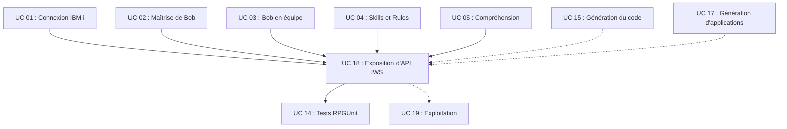

# UC 18 — Exposition de services RPG en API REST (IWS)

> **Catégorie :** Développement — Intégration et exposition d'API (Track B)
>
> **Priorité dans le parcours :** 18 — Phase 4 (Track B), après UC 17 (Génération d'applications) qui cadre la couche d'exposition (Prompt 2c) sans la mettre en place ; UC 15 (Génération du code) recommandé pour produire le wrapper RPG ; dépend de UC 05 pour comprendre le programme à exposer.
>
> **Mode Bob recommandé :** **IBM i Developer** (mode unique pour toute la session : les cinq skills IWS ne sont disponibles que dans ce mode). Bascule vers **IBM i Database** uniquement pour vérifier un objet SQL ou le catalogue (`QSYS2`). Sans Premium Package : Ask pour l'analyse, Agent pour l'écriture et la compilation — les skills IWS n'existent alors pas et le déploiement reste manuel (Web Administration for i).

---

## ⭐ Premium Package IBM i utilisé

Il n'existe **pas de workflow Premium** ni de slash command dédiés à l'exposition d'API : UC00 §6 ne liste pas cet UC. Les 71 skills IBM i sont activées automatiquement selon le contexte ; une famille est au cœur de cet UC, les **5 skills IWS** (Integrated Web Services for i). La documentation officielle indique qu'elles couvrent « le cycle de vie complet du service » (création, déploiement, démarrage, arrêt, installation, désinstallation) en langage naturel. **Leur usage a été démontré sur FLGHT400** : Bob, en mode IBM i Developer et avec le skill `iws-admin`, compile les services `FRSWS01` à `FRSWS06`, les déploie et les vérifie sur le serveur IWS `WSERVICE`, puis relie une application React à ces API REST (voir « Exemple concret »).

- **Skills auto-activées mobilisées :**
  - **Services web IWS (mode IBM i Developer uniquement) :** → [Skills IWS](https://bob.ibm.com/docs/ide/premium-packages/bob-for-i/skills#ibm-i-iws)
    - `iws-admin` — administration IWS : opérations serveur, opérations service, configuration, déploiement REST, sauvegarde.
    - `iws-server-ops` — lister, créer, supprimer, démarrer, arrêter des serveurs IWS (scripts QShell).
    - `iws-server-config` — lire et modifier les propriétés d'un serveur IWS.
    - `iws-service-ops` — lister, installer, désinstaller, démarrer, arrêter, configurer un service web ; déploiement REST d'ILE/SQLRPGLE ; résolution d'erreurs.
    - `iws-backup` — sauvegarder et restaurer serveurs et services IWS dans des save files de l'IFS.
  - **Compréhension et génération RPG :** `rpg-procedures-functions`, `rpg-free-format-fundamentals`, `rpg-code-review` (le wrapper à exposer), `rpg-embedded-sql` (si le service est un `SQLRPGLE`). → [Skills RPG](https://bob.ibm.com/docs/ide/premium-packages/bob-for-i/skills#rpg)
  - **Catalogue Db2 (lecture) :** `db2-system-catalog`, `db2-services-catalog` (inventaire des objets, jobs et services `QSYS2`). → [Skills Db2 for i & SQL](https://bob.ibm.com/docs/ide/premium-packages/bob-for-i/skills#db2-for-i--sql)
- **Slash Command : `/init`** → [Documentation officielle](https://bob.ibm.com/docs/ide/premium-packages/bob-for-i/slash-commands)
  Génère l'`AGENTS.md` de l'application. À exécuter avant les premières générations pour que les normes (nommage, groupe d'activation, `PGMINFO`) s'appliquent à chaque session. Emplacements officiels : `{BIBLIO}/QBOBSRC/AGENTS.MD` (workspace QSYS) ou `{répertoire IFS}/.bob/AGENTS.md` (workspace IFS) — voir UC00 §0 et §3.1.
- **Slash Command : `/review_rpg`** → [Documentation officielle](https://bob.ibm.com/docs/ide/premium-packages/bob-for-i/slash-commands)
  Revue du wrapper RPG généré (Prompt 4-bis). Contrôle **complémentaire**, qui ne remplace pas le test d'appel du service.
- **Outils d'exécution** → [Documentation officielle](https://bob.ibm.com/docs/ide/premium-packages/bob-for-i/tools) : `execute_sql_statement`, `execute_cl_command`, `execute_pase_command` (scripts QShell/PASE d'IWS), `write_stream_file`/`read_stream_file` (IFS), `write_member` (sources). Voir UC00 §5.1.
- **Recherche documentaire (RAG) :** `search_ibm_i_docs_with_rag` — à demander explicitement pour les prérequis et les messages d'erreur IWS (« Search the IBM i docs for… »). → [RAG](https://bob.ibm.com/docs/ide/premium-packages/bob-for-i/retrieval-augmented-generation)
- **Garde-fous :** `enforceQualifiedCLCommands` (défaut `true`), `deniedSQLStatementTypes` (défaut : `CALL`, `UPDATE`, `DROP`, `GRANT`… exigent une approbation explicite ; `INSERT`, `DELETE`, `CREATE`, `ALTER` n'y figurent pas par défaut — **vérifier la valeur sur l'instance**), `maxRowsToFetch` (100). → [Settings](https://bob.ibm.com/docs/ide/premium-packages/bob-for-i/settings)
- **Understand (optionnel)** → [Documentation officielle](https://bob.ibm.com/docs/ide/premium-packages/bob-for-i/understand)
  *Si Understand est installé* : appelants et appelés du programme à exposer (UC00 §2). Cet UC n'est pas marqué ✅ Understand dans UC00 §6.

> **Pourquoi cet UC 18 apporte une valeur méthodologique unique :**
> Exposer un programme RPG en API n'est pas « cliquer sur Deploy » : c'est décider **quoi** exposer, **comment** (contrat), **avec quels droits**, et ne rien modifier sur le serveur sans accord. Cet UC apporte :
> 1. **Une qualification obligatoire** (Prompt 0) : prérequis du système, présence réelle d'un serveur IWS, sous-cas retenu — sans jamais supposer qu'un service existe.
> 2. **Une éligibilité vérifiée** du programme (Prompt 2) : type d'objet, langage ILE, types de paramètres, PCML — avant toute écriture.
> 3. **Un contrat d'API écrit avant le code** (Prompt 3), repris du contrat d'exposition d'UC 17.
> 4. **Un garde-fou en écriture** : wrapper écrit dans un membre de test, compilation, déploiement sur un serveur de test uniquement après approbation explicite (Prompts 4-bis et 5).
> 5. **Une séparation lecture / modification** : inventaire et diagnostic (sous-cas A) sans écriture ; exploitation du serveur (sous-cas C) toujours validée par l'humain.

> ⚠️ **Distinctions avec les autres UC (règle de routage) :**
> - **UC 17** décide *quel* composant Web appelle *quel* back-end (Prompt 2c : « contrat d'exposition ») et ne met aucun service en place ; **UC 18** met le service en place.
> - **UC 15** génère la **logique RPG** ; **UC 18** n'écrit que le **wrapper d'exposition** nécessaire (pas de logique métier).
> - **UC 16** crée des objets SQL ; la fiche n'a pas trouvé de source documentant l'exposition directe de procédures SQL par les skills IWS — hors périmètre tant que non validé.
> - **UC 19** (Exploitation) surveille la partition ; cet UC n'exploite que le serveur IWS lui-même.

---

## Périmètre

**Trois sous-cas, à traiter dans cet ordre** (le Prompt 0 détermine celui de la session) :

| Sous-cas | Description | Écriture sur l'IBM i |
|---|---|---|
| **A — Diagnostic et inventaire** | Lister serveurs et services IWS existants, vérifier les prérequis, lire la configuration | **Aucune** (lecture seule) |
| **B — Exposer un programme ou une procédure** | Qualifier un `*SRVPGM`/`*PGM`, produire le contrat, générer le wrapper, le compiler, déployer le service sur un serveur **de test** | Membre de test + objets compilés + service déployé, **après approbation explicite** |
| **C — Exploiter le serveur** | Démarrer, arrêter, configurer, sauvegarder, restaurer un serveur ou un service | Modification d'état du serveur, **après approbation explicite** |

> ⚠️ **Hors périmètre :** SOAP (les sources lues ne documentent que le REST pour les skills), exposition de services Java (impossible dans IWS — passer par l'Integrated Application Server), IWS 3.0 / Jakarta EE tant qu'il n'est pas confirmé que les skills le gèrent, et création de serveur en production.

---

## Objectif

Mettre à disposition d'applications tierces (Web, mobile, Node.js, Java) la logique RPG existante sous forme de **services REST IWS**, en qualifiant d'abord l'existant, en écrivant le contrat d'API, puis en déployant sur l'IBM i de test uniquement après validation de l'équipe.

**Ce que cet UC permet :**
- Vérifier les prérequis IWS et inventorier les serveurs et services existants, sans rien modifier.
- Déterminer si un programme est exposable tel quel, ou s'il exige un wrapper ILE.
- Produire un contrat d'API (URL, méthode, paramètres, codes HTTP, authentification) avant tout code.
- Générer, compiler et déployer un service REST sur un serveur IWS de test.
- Tester l'appel, diagnostiquer les erreurs de déploiement et exploiter le serveur (arrêt, démarrage, sauvegarde).
- Piloter l'exposition d'un périmètre applicatif complet par un plan d'exposition.

**Critère de succès principal :** pour chaque programme du périmètre, le sous-cas, l'éligibilité et le contrat d'API sont documentés ; le wrapper a été relu par un développeur RPG, compile sans erreur dans un membre de test ; le service est déployé **sur un serveur de test** après approbation écrite, appelé avec succès (code HTTP attendu) et le niveau de sécurité du service (mock / API réelle) est consigné.

---

## Prérequis

- **Phase :** Phase 4 — Track B (Génération)
- **UC précédents requis :**
  - **UC 01 — Connecter Bob à l'IBM i** (**obligatoire**) : connexion SSH active, mode IBM i Developer.
  - **UC 02 — Maîtrise de Bob**, **UC 03 — Bob en équipe** et **UC 04 — Stratégie Skills et Rules** (**obligatoires**) : modes, `/init`, `AGENTS.md` partagé (pour y porter les normes d'exposition).
  - **UC 05 — Compréhension du code** (**obligatoire pour le sous-cas B**) : paramètres, appelants et effets de bord du programme à exposer.
  - **UC 17 — Génération d'applications** (**recommandé**) : le contrat d'exposition (Prompt 2c) fournit les besoins du consommateur.
  - **UC 15 — Génération du code** (**recommandé**) : normes de génération du wrapper RPG.
- **Livrables requis :**
  - `{appId}-comprehension-{composant}-report-{YYYYMMDD-HHmm}.md` — UC 05 (**obligatoire pour B**).
  - `{appId}-app-{composant}-analyse-ecrans-{YYYYMMDD-HHmm}.md` — UC 17, section « Contrat d'exposition » (recommandé).
  - Décision écrite de l'équipe sur le **serveur IWS cible** (nom, port, profil d'exécution) et sur le fait qu'il s'agit d'un serveur **de test**.
- **Prérequis système IBM i (à confirmer au Prompt 0, jamais supposés) :**
  - IBM i 7.4 ou supérieur (IWS 2.6 et 3.0 sont supportés sur 7.4, 7.5 et 7.6 — [Support Statement IWS](https://www.ibm.com/support/pages/node/687889)).
  - IBM HTTP Server for i (5770-DG1) et dernier **groupe PTF HTTP**. Pour IWS 3.0 : SF99962 niveau 6+ (7.6), SF99952 niveau 25+ (7.5), SF99662 niveau 47+ (7.4) — [IWS 3.0](https://www.ibm.com/support/pages/node/7248102).
  - **JDK :** IWS 2.6 : JDK 8 ou plus récent ; IWS 3.0 : JDK 17. JDK 11 n'est pas supporté en 7.6 ; JDK 21 l'est en 7.6 — [Support Statement IWS](https://www.ibm.com/support/pages/node/687889).
  - Profil d'exécution du service (par défaut `QWSERVICE`) **activé** et avec un mot de passe différent de `*NONE`.
  - Pour **créer** un serveur IWS : autorités spéciales `*ALLOBJ` et `*IOSYSCFG` (tutoriel IWS, partie 2). **Les droits exacts requis par les skills IWS pour déployer ou exploiter un service ne sont pas documentés** — à tester au Prompt 0 avec le profil de la session.
- **Niveau Bob recommandé :** Intermédiaire à Avancé (traiter **un programme ou une procédure par session**)

> ⚠️ **Un administrateur IBM i et un développeur RPG doivent être disponibles** : le premier valide la création ou le démarrage du serveur, le second relit le wrapper. La conformité sécurité (profil, HTTPS, authentification) relève de l'équipe, pas de Bob.

---

## Exemple concret — Lab FLGHT400

**Démonstration validée : moderniser l'interface par l'apéisation, en trois temps** (mode IBM i Developer ; chaque commande PASE passe par une approbation explicite) :

1. **Une application React construite depuis un écran 5250.** À partir d'une capture de l'écran 5250 « Create Order » de la réservation de vols FLGHT400, Bob génère une application React 18 + Vite avec `@carbon/react` (thème sombre) sur l'IBM i (PASE). Il vérifie Node.js, crée le projet, installe les dépendances, applique l'ajustement nécessaire sur IBM i, construit et lance le serveur de développement, puis donne l'URL. Les listes de valeurs (compagnies, villes, clients, vols) sont alimentées par des requêtes Db2.
2. **Des API REST via IWS.** Bob analyse les données et la logique de la réservation, puis propose un plan en quatre étapes : compiler les services ILE, déployer et vérifier sur le serveur IWS actif `WSERVICE` (skill `iws-admin`, lecture de l'`AGENTS.MD` de `FLGHT400/QBOBSRC`), configurer le proxy de développement et le CORS, relier l'application. Après validation du plan, il compile les services `FRSWS01` à `FRSWS06`, vérifie les points d'accès (`getAirlines`, `getCities`, `getCustomers`, `getFlights`, `getOrderPricing`, `createOrder`) et connecte les composants React. L'écran affiche alors des données réelles issues d'IWS ; la touche F10 (réservation) appelle `createOrder` (`FRSWS05`) et affiche l'identifiant de commande généré.
3. **Un serveur MCP IBM i.** Bob décrit dans un fichier YAML d'outils les requêtes de réservation (`list_flight_orders`, `get_flight_order_by_id`, `search_flights`, `get_flight_pricing`), le serveur MCP IBM i est démarré comme service (port 3010, point d'accès `/mcp`) et Bob configure sa connexion dans `.bob/mcp.json`. Tout agent IA connecté à ce serveur peut alors consulter les commandes, vérifier les tarifs et rechercher des itinéraires sur Db2.

> 💡 Les outils MCP exposent des données et des actions de l'application : ils relèvent des mêmes règles de moindre privilège et d'approbation que les services REST. Le serveur MCP IBM i n'est pas une fonction du Premium Package : il s'ajoute à la démonstration.

Les livrables suivants du lab complètent cette démonstration (rappels de l'existant, cas d'éligibilité) :

| Livrable | Fichier lab | Ce qu'il illustre |
|---|---|---|
| Rapport `/init` de FLGHT403 | [`../labs_FLGHT400_results/FLGHT403_init_report.md`](../labs_FLGHT400_results/FLGHT403_init_report.md) | Absence de `*SRVPGM`/`*BNDDIR` dans FLGHT403 ; `EVFTEMPF01` = fichier temporaire RDi/Bob ; `FRS022` est du RPG `**FREE` avec SQL embarqué à compiler par `CRTSQLRPGI` (règle à reprendre pour tout service `SQLRPGLE`) ; dépendance codée en dur à `FLGHT400` (`FRSMSGF`) : la bibliothèque doit être dans la liste de bibliothèques du service. |
| Audit CPU et jobs | [`../labs_FLGHT400_results/FLGHT403_cpu_jobs_programs_audit.md`](../labs_FLGHT400_results/FLGHT403_cpu_jobs_programs_audit.md) (+ [`_conversation`](../labs_FLGHT400_results/FLGHT403_cpu_jobs_programs_audit_conversation.md)) | Jobs `QWEBADMIN/ADMIN*` et `QLWISVR/ADMIN*` en tête du CPU cumulé, interprétés dans le lab comme des serveurs IWS/JVM. **Interprétation à confirmer** par le Prompt 1 : le lab ne l'a pas vérifiée serveur par serveur. Illustre aussi la requête `QSYS2.ACTIVE_JOB_INFO`. |
| Explication de `FRS409` | [`../labs_FLGHT400_results/FLGHT403_FRS409_explanation.md`](../labs_FLGHT400_results/FLGHT403_FRS409_explanation.md) | Cas **contre-exemple** : programme OPM RPG interactif (`WORKSTN`) avec `*ENTRY PLIST` (`ORDER#` 9, `ENDYN` 1). Il illustre pourquoi un programme d'écran n'est pas exposable (Prompt 2) — il faudrait en extraire la logique. |
| Modernisation de `FRS409` | [`../labs_FLGHT400_results/FLGHT403_FRS409_modernization_report.md`](../labs_FLGHT400_results/FLGHT403_FRS409_modernization_report.md) | Passage de `*ENTRY PLIST` à `DCL-PI` : base du wrapper ILE à exposer (Prompt 4). |
| Prototypes Web (données mockées) | [`../labs_FLGHT400_results/FLGHT403_App_React.md`](../labs_FLGHT400_results/FLGHT403_App_React.md), [`FLGHT403_App_5250_web.md`](../labs_FLGHT400_results/FLGHT403_App_5250_web.md) | Premiers consommateurs du lab, sur données mockées : la démonstration validée ci-dessus les relie à de vraies API REST IWS. |

**Scénario de lab pour rejouer l'UC pas à pas :** sur une **copie** de la bibliothèque (jamais sur l'original) — (A) Prompts 0 → 1 : vérifier le serveur IWS et les `*SRVPGM` présents (`FRSWS01` à `FRSWS06`) ; (B) choisir un programme **non interactif** à faible risque (par exemple un utilitaire de date ou de tirage aléatoire, `RTRAND`, `RTDOFW`, `JTOGCV`, `GTOJCV` d'après `FLGHT403_functional_areas.md` — **interface et éligibilité à vérifier** au Prompt 2) et dérouler les Prompts 2 → 6 sur un serveur de test.

---

## Démarrer une session Bob

### Les trois espaces de travail

- **Workspace local** (poste) — rapports de qualification, contrat d'API, plan d'exposition (`bob-reports/`), normes (rule `.bob/rules-ibm-i-developer/` ou section de l'`AGENTS.md`, voir UC 03 / UC 04).
- **Librairies IBM i / QSYS** ⭐ — **espace par défaut de cet UC** : membres sources du wrapper dans `[SRCFILE_RPG]`, compilation, appels IWS via les outils d'exécution. L'`AGENTS.md` du projet (`{BIBLIO}/QBOBSRC/AGENTS.MD`) y est injecté automatiquement.
- **IFS (`$HOME`)** — scripts QShell/PASE utilisés par IWS (répertoire `/QIBM/ProdData/OS/WebServices/bin`), save files de sauvegarde (`iws-backup`), éventuels journaux de test.

> ⚠️ **Normes et espace QSYS :** quand l'espace actif est *Librairies IBM i* seul, le workspace local, son `.bob/` et ses skills ne sont **pas chargés** (voir UC 03 / UC 04). Déclarer aussi les normes d'exposition dans l'`AGENTS.md` de l'application.

### Règles de session

- **Une nouvelle conversation Bob par programme ou procédure exposé** (bouton `+`). Ne pas réutiliser la conversation d'un autre service : noms de paramètres et choix de contrat polluent la génération.
- **Ouvrir les sources dans l'éditeur** avant le Prompt 0 (Object Browser de Code for IBM i → *Open in Editor*) : programme ou service program cible, copybooks éventuels.
- **Charger le contexte** : `AGENTS.md`, `{appId}-comprehension-…` (UC 05), contrat d'exposition d'UC 17 si disponible.
- **Règle de sauvegarde intermédiaire :** sauvegarder dans `bob-reports/` après chaque prompt majeur (Prompts 0, 2, 3), pas seulement en fin de session.
- **Reprise de session :** recharger le dernier `{appId}-iws-{composant}-qualification-*.md` et indiquer « la qualification est dans [FICHIER] — sous-cas [A/B/C], serveur cible [NOM] — reprendre au Prompt [N] ».
- **Règle d'or :** pendant les Prompts 0 à 3, Bob **lit et produit dans le chat** ; aucune écriture, aucune compilation, aucun appel IWS modifiant l'état. L'écriture (Prompt 4-bis), le déploiement (Prompt 5) et toute action de sous-cas C ne sont autorisés qu'**après validation explicite** de l'équipe, **sur un serveur de test uniquement**.

---

## Démarche structurée et Prompts

### Progression recommandée : démarrer par un programme simple et non interactif

Commencer par un programme **batch, sans écran, avec peu de paramètres de types simples** (caractère, numérique). Ne pas commencer par un programme qui lit un display file, ouvre des fichiers avec verrouillage ou dépend d'indicateurs de navigation.

| Complexité | Critères | Séquence |
|---|---|---|
| **SIMPLE** | `*PGM` ou procédure ILE, paramètres primitifs, aucun écran, aucune dépendance de bibliothèque particulière | Prompts 0 → 1 *(si le serveur cible n'est pas qualifié)* → 2 → 3 → 4 → 4-bis → 5 → 6 |
| **STANDARD** | Structures en paramètre, tableaux, ou dépendance de la liste de bibliothèques | Idem + attention aux types (Prompt 2) |
| **COMPLEXE** | OPM RPG, `WORKSTN`, état en mémoire entre appels, droits adoptés | **Ne pas exposer en l'état** : traiter d'abord par UC 11 / UC 13, ou extraire la logique (UC 15) |

> ⚠️ **Raccourci Prompt 3 → Prompt 5 :** possible uniquement si un `*SRVPGM` **existant** est déjà exposable tel quel et validé (existence, exports, PCML — Prompts 0 et 2). Un wrapper **nouvellement** généré exige d'abord une compilation réussie au Prompt 4-bis avant le Prompt 5. Le Prompt 1 (inventaire) s'inclut dès que le serveur IWS cible n'est pas qualifié : le déploiement dépend du choix d'un serveur existant.

### Prompt 0 — Qualification : prérequis, serveur IWS, sous-cas

**Objectif :** Établir l'état réel du système avant toute action : version, prérequis, serveurs IWS présents, sous-cas à traiter.

**Quand l'utiliser :** Premier prompt de **chaque** session, sans exception.

**Input requis :** nom de la bibliothèque de test, programme ou service program ciblé, nom du serveur IWS cible (s'il est déjà connu).

**Espace :** Dans le chat (lecture seule ; aucune écriture).
**Mode :** IBM i Developer.
**Skills clés mobilisées :** `iws-admin`, `db2-system-catalog`, `db2-services-catalog`.

**Prompt :**

```text
Qualifie l'exposition IWS pour la bibliothèque [NOM_LIB], programme [NOM_PROGRAMME]. Lecture seule :
n'écris rien, ne crée, ne démarre et n'arrête aucun serveur ou service. Produis en français, en
markdown :

## Qualification UC 18 — [NOM_PROGRAMME]
### 1. Système
Version de l'IBM i, présence du produit 5770-DG1 et du groupe PTF HTTP, JDK installés (versions et
options). Chaque ligne indique sa source (service QSYS2, commande, fichier lu) ou « NON VÉRIFIÉ ».
### 2. Serveurs IWS existants
Liste des serveurs IWS (nom, port, état, version, profil d'exécution) et jobs associés. Si aucun n'est
trouvé, écris « AUCUN SERVEUR IWS TROUVÉ » — n'en suppose pas.
### 3. Objets de la bibliothèque
Présence de *SRVPGM, *BNDDIR et du programme cible (type d'objet, attribut, date de création), à partir
de QSYS2.OBJECT_STATISTICS. N'affirme pas qu'un service program existe sans l'avoir vu.
### 4. Droits du profil de la session
Autorités spéciales du profil connecté (QSYS2.USER_INFO) et ce qu'elles permettent pour IWS. Les
droits exigés par les skills IWS ne sont pas documentés : écris « À TESTER ».
### 5. Sous-cas retenu
A (diagnostic), B (exposer un programme) ou C (exploiter le serveur), avec la justification.
### 6. Points d'attention
Écarts avec les prérequis (JDK non supporté, groupe PTF absent, profil QWSERVICE désactivé…).

Ne modifie rien. Si une information ne peut pas être obtenue avec les droits de la session, dis-le.
```

**Livrable produit :** `{appId}-iws-{composant}-qualification-{YYYYMMDD-HHmm}.md` (sauvegarde locale demandée explicitement dans `bob-reports/`).

> ⚠️ Si « AUCUN SERVEUR IWS TROUVÉ » : ne pas créer de serveur dans cette session. La création d'un serveur (autorités `*ALLOBJ` et `*IOSYSCFG`) est une opération d'administration distincte, à valider par l'administrateur.

### Prompt 1 — Inventaire des serveurs et services IWS existants

**Objectif :** Lister précisément ce qui existe (serveurs, services déployés, état, URL) pour décider si l'on réutilise un serveur de test.

**Quand l'utiliser :** Après le Prompt 0, sous-cas A ou B (avant de choisir le serveur cible).

**Input requis :** rapport de qualification (Prompt 0).

**Espace :** Dans le chat (lecture seule).
**Mode :** IBM i Developer.
**Skills clés mobilisées :** `iws-server-ops`, `iws-service-ops`, `iws-server-config`.

**Prompt :**

```text
La qualification est dans [NOM_FICHIER]. Pour chaque serveur IWS trouvé, produis en français :

| Serveur | Port | État | Version IWS | Profil d'exécution | Context root | Services déployés (nom, état, URL) |

Puis, pour le serveur [NOM_SERVEUR_TEST] uniquement, liste ses propriétés de configuration. Lecture
seule : ne démarre, n'arrête, n'installe et ne modifie rien. Si un service est listé comme actif,
indique-le sans l'appeler. N'invente aucun nom de serveur, de port ni d'URL : écris « NON VÉRIFIÉ »
si la lecture échoue, avec le message d'erreur exact.
```

**Livrable produit :** section « Inventaire IWS » ajoutée à `{appId}-iws-{composant}-qualification-{YYYYMMDD-HHmm}.md`.

> 💡 Dans le lab FLGHT403, les jobs `QWEBADMIN/ADMIN*` et `QLWISVR/ADMIN*` dominent le CPU cumulé : ce prompt permet de confirmer s'il s'agit bien de serveurs IWS et lesquels.

### Prompt 2 — Éligibilité du programme ou de la procédure à exposer

**Objectif :** Déterminer, sur preuves, si le programme est exposable tel quel, après wrapper, ou pas du tout.

**Quand l'utiliser :** Avant de rédiger le contrat. Obligatoire pour le sous-cas B.

**Input requis :** source du programme (ouvert dans l'éditeur), rapport UC 05.

**Espace :** Dans le chat (lecture seule).
**Mode :** IBM i Developer.
**Skills clés mobilisées :** `rpg-code-review`, `rpg-procedures-functions`, `iws-service-ops`.

**Prompt :**

```text
Analyse l'éligibilité de [NOM_PROGRAMME] (ou de la procédure [NOM_PROCEDURE] du service program
[NOM_SRVPGM]) à une exposition REST par IWS. Lis le source et le rapport [NOM_FICHIER_UC05]. Produis
en français :

| Critère | Constat | Source (ligne de code ou objet) |
|---|---|---|
| Type d'objet (*PGM / *SRVPGM) et langage (OPM RPG / ILE RPG / SQLRPGLE / COBOL) | | |
| Écran (WORKSTN) ou E/S interactive | | |
| Paramètres : nom, type, longueur, entrée/sortie | | |
| Types non adaptés (date, heure, timestamp, pointeur, entier non signé 8 octets, entier 1 octet) | | |
| Structures ou tableaux en paramètre | | |
| Dépendances de liste de bibliothèques (ex. objets codés en dur) | | |
| Effets de bord (écriture de fichier, COMMIT, appels à d'autres programmes) | | |
| Droits adoptés (USRPRF *OWNER) | | |

Conclus par : EXPOSABLE TEL QUEL / EXPOSABLE APRÈS WRAPPER ILE / NON EXPOSABLE EN L'ÉTAT, avec la
raison. N'invente aucun paramètre. Si le programme est OPM RPG, indique que le déploiement IWS décrit
par la documentation s'appuie sur un document PCML produit à la compilation ILE (PGMINFO) et
recommande un wrapper ILE ou une conversion préalable (UC 13). Ne modifie rien.
```

**Livrable produit :** section « Éligibilité » ajoutée au rapport de qualification.

> ⚠️ D'après la FAQ IWS (document de 2021), plusieurs types ne sont pas pris en charge par PCML (date, heure, timestamp, pointeur, entiers 1 octet et entiers non signés 8 octets). Ces limites n'ont pas été revérifiées sur 7.6 : marquer « À VÉRIFIER » plutôt que d'affirmer un rejet.

### Prompt 3 — Contrat d'API (URL, méthodes, paramètres, erreurs, sécurité)

**Objectif :** Écrire le contrat de l'API avant tout code, en complément du « contrat d'exposition » d'UC 17.

**Quand l'utiliser :** Après le Prompt 2 (conclusion exposable ou exposable après wrapper).

**Input requis :** rapport de qualification et d'éligibilité ; besoins du consommateur (UC 17, équipe Web) ; niveau de prototype (mock / API réelle).

**Espace :** Dans le chat (aucune écriture).
**Mode :** IBM i Developer.
**Skills clés mobilisées :** `iws-service-ops`, `iws-server-config`.

**Prompt :**

```text
La qualification est dans [NOM_FICHIER]. Rédige en français, en markdown, le contrat d'API :

## Contrat d'API — [NOM_SERVICE]
| Élément | Valeur | Source / décision |
|---|---|---|
| Serveur IWS cible et context root | | décision équipe |
| Ressource et « URI path template » | | |
| Méthode HTTP par procédure (GET/POST/PUT/DELETE/PATCH) | | |
| Paramètres : source d'injection (chemin, requête, en-tête, corps), entrée/sortie | | |
| Corps et format (JSON/XML), mode « wrapped » ou « unwrapped » | | |
| Paramètres de code HTTP et d'en-têtes de retour | | |
| Codes HTTP par cas (succès, doublon, absent, erreur interne) | | |
| Profil d'exécution et liste de bibliothèques | | |
| Authentification et HTTPS | | À DÉCIDER AVEC L'ÉQUIPE si non décidé |
| Niveau de prototype | mock / API réelle | |

Une procédure de lecture simple sans effet de bord est candidate à GET ; une écriture à POST ou PUT.
N'invente aucune URL ni aucun code HTTP. Si une décision manque, écris « À DÉCIDER AVEC L'ÉQUIPE » et
ne choisis pas à sa place. Ne crée, n'installe et ne démarre rien.
```

**Livrable produit :** `{appId}-iws-{composant}-contrat-api-{YYYYMMDD-HHmm}.md` (sauvegarde locale demandée explicitement dans `bob-reports/`).

> ⚠️ **Avant le Prompt 5 : définir le niveau de sécurité**
>
> | Type de service | Exigences de sécurité |
> |---|---|
> | **Test sans donnée de production, usage interne** | Profil d'exécution dédié à moindre privilège, accès réseau restreint ; consigner le choix dans le contrat. |
> | **API réelle sur données de production** | HTTPS, authentification, autorisation côté serveur, validation des entrées, gestion des secrets (aucun identifiant en dur), profil IBM i applicatif dédié : **obligatoires avant tout appel avec des données réelles**. |

### Prompt 4 — Préparation du wrapper ILE (dans le chat)

**Objectif :** Générer, dans le chat, le source ILE RPG qui expose le programme avec les options PCML nécessaires.

**Quand l'utiliser :** Conclusion « EXPOSABLE APRÈS WRAPPER ILE » du Prompt 2. Si l'objet est déjà un `*SRVPGM` ILE **existant** exposable tel quel et validé (existence, exports, PCML — Prompts 0 et 2), passer directement au Prompt 5. Un wrapper **nouvellement** généré passe d'abord par le Prompt 4-bis (compilation réussie) avant le Prompt 5.

**Input requis :** contrat d'API (Prompt 3), normes de l'`AGENTS.md`.

**Espace :** Dans le chat (aucune écriture).
**Mode :** IBM i Developer.
**Skills clés mobilisées :** `rpg-procedures-functions`, `rpg-free-format-fundamentals`, `rpg-embedded-sql`.

**Prompt :**

```text
Le contrat d'API est dans [NOM_FICHIER_CONTRAT]. Génère en français, en markdown, le source ILE RPG
free-format du wrapper qui expose [NOM_PROGRAMME] :

1. En-tête de contrôle conforme aux normes de l'AGENTS.md, avec l'option de génération du document PCML
   dans le module (PGMINFO).
2. Une procédure exportée par opération du contrat, avec les paramètres exactement tels que définis
   (types simples recommandés).
3. Appel du programme existant, sans modifier ce dernier, et renvoi des codes HTTP prévus au contrat
   via les paramètres de retour (ce renvoi dépend de la configuration des paramètres de réponse IWS,
   à vérifier au déploiement — Prompt 5).
4. Aucune logique métier nouvelle : le wrapper adapte les paramètres et renvoie le résultat.
5. Si le source contient du SQL embarqué : indique que la compilation passe par CRTSQLRPGI.

Le programme [NOM_PROGRAMME] ne doit PAS être modifié. N'invente aucun paramètre. Ne sauvegarde rien à
ce stade.
```

**Livrable produit :** `{appId}-iws-{composant}-wrapper-genere-{YYYYMMDD-HHmm}.md` (sauvegarde locale demandée explicitement dans `bob-reports/`).

### Prompt 4-bis — Écriture du membre de test et compilation

**Objectif :** Écrire le wrapper dans un membre de test, compiler le module RPG puis créer le `*SRVPGM` (deux étapes distinctes), sans toucher aux objets existants.

**Quand l'utiliser :** Après relecture et validation du Prompt 4 par un développeur RPG. **Après validation explicite de l'équipe.**

**Input requis :** source validé ; bibliothèque de test ; droits `*CHANGE` sur la bibliothèque.

**Espace :** IBM i QSYS (écriture d'un membre et création d'objets dans `[NOM_LIB]`).
**Mode :** IBM i Developer.
**Skills clés mobilisées :** `rpg-free-format-fundamentals`, `rpg-code-review`.

**Prompt :**

```text
Le source du wrapper est validé par l'équipe (voir [NOM_FICHIER_WRAPPER]). Avant d'écrire :
1. Vérifie via QSYS2.SYSPARTITIONSTAT que le membre [NOM_MEMBRE_T] n'existe pas dans
   [NOM_LIB]/[SRCFILE_RPG], et que les objets [NOM_MODULE] / [NOM_SRVPGM] n'existent pas.
2. Si l'un existe, arrête-toi et demande-moi quoi faire : ne l'écrase pas.
Puis écris le source dans le membre [NOM_MEMBRE_T] (copie de test, jamais dans un membre existant),
procède ensuite en deux étapes distinctes. Affiche chaque commande qualifiée avant de l'exécuter et
rapporte le résultat exact (messages d'erreur compris) :
A. Compile le module RPG [NOM_MODULE] (CRTRPGMOD, ou CRTSQLRPGI avec OBJTYPE(*MODULE) si SQL embarqué),
   REPLACE(*NO), option PGMINFO conservée (par exemple PGMINFO(*PCML *MODULE) avec CRTRPGMOD ; pour
   CRTSQLRPGI, indique comment elle est transmise au compilateur RPG, sans l'inventer).
B. Crée le programme de service [NOM_SRVPGM] à partir de ce module (CRTSRVPGM), REPLACE(*NO), avec les
   exports décrits par un source de binder language (EXPORT(*SRCFILE), SRCFILE, SRCMBR) ou EXPORT(*ALL).
   Vérifie ensuite les procédures exportées (DSPSRVPGM DETAIL(*PROCEXP)) et compare-les à celles du
   contrat ; vérifie que le PCML est présent.
En cas d'erreur, corrige dans le chat et recommence l'étape concernée ; ne passe pas à autre chose.
Lance ensuite /review_rpg sur le membre.
```

**Livrable produit :** membre et objets compilés dans `[NOM_LIB]` (IBM i QSYS) ; `{appId}-iws-{composant}-rapport-{YYYYMMDD-HHmm}.md` (optionnel, sauvegarde locale demandée explicitement).

> ⚠️ **La compilation réussie ne prouve pas que l'exposition fonctionne.** Le Prompt 6 (test d'appel) est obligatoire. `REPLACE(*NO)` évite seulement d'écraser un objet existant : il ne démontre pas que le binding, les exports et le déploiement sont corrects. Le remplacement d'un objet existant est une décision humaine.

### Prompt 5 — Déploiement du service sur le serveur de test

**Objectif :** Déployer le service sur le serveur IWS de test, conformément au contrat, après approbation explicite.

**Quand l'utiliser :** Après compilation propre (4-bis) d'un wrapper nouvellement généré, ou après validation d'un `*SRVPGM` existant exposable tel quel (Prompts 0 et 2) ; dans les deux cas, accord écrit de l'administrateur et du développeur.

**Input requis :** contrat d'API ; objet compilé ou `*SRVPGM` existant validé ; serveur de test (Prompt 1) ; confirmation « serveur de test ».

**Espace :** IBM i QSYS / IFS (modification de l'état du serveur IWS).
**Mode :** IBM i Developer.
**Skills clés mobilisées :** `iws-service-ops`, `iws-server-ops`, `iws-admin`.

**Prompt :**

```text
Le contrat d'API est dans [NOM_FICHIER_CONTRAT] et l'objet [NOM_SRVPGM] est compilé dans [NOM_LIB].
Déploie le service sur le serveur IWS de TEST [NOM_SERVEUR_TEST] (jamais sur un autre serveur).

Avant toute action : affiche le plan exact (commande, script ou action de la skill, paramètres) et
attends mon accord explicite. Après accord :
1. Vérifie que le service n'existe pas déjà sur ce serveur ; sinon arrête-toi et demande-moi.
2. Déploie le service avec la configuration du contrat (ressource, méthodes, paramètres, profil
   d'exécution, liste de bibliothèques) et démarre-le.
3. Vérifie explicitement la configuration des paramètres de réponse IWS : mapping des paramètres de
   retour vers le code HTTP et les en-têtes, conforme au contrat (Prompt 3). Ne le déduis pas du seul
   code RPG ; écris « NON VÉRIFIÉ » si la lecture échoue.
4. Rapporte l'état obtenu et l'URL du service. En cas d'erreur, donne le message exact (par exemple
   IWS00230E) et la piste de résolution, sans retenter automatiquement.
Ne modifie aucun autre service ni la configuration du serveur. Ne crée pas de serveur.
```

**Livrable produit :** service déployé sur le serveur de test ; compte rendu ajouté à `{appId}-iws-{composant}-rapport-{YYYYMMDD-HHmm}.md`.

> ⚠️ Les sources consultées documentent le déploiement via **Web Administration for i** (« Deploy New Service ») et des scripts QShell d'administration de serveur ; **aucun script de déploiement de service REST équivalent n'a été trouvé dans la documentation lue**. Le mécanisme exact utilisé par `iws-service-ops` est donc à observer et consigner lors du lab (action de la skill, commande réellement exécutée).

### Prompt 6 — Test d'appel et diagnostic

**Objectif :** Vérifier que le service répond comme le contrat l'annonce, et diagnostiquer les écarts.

**Quand l'utiliser :** Immédiatement après le Prompt 5.

**Input requis :** URL du service ; contrat d'API ; jeu de données de test.

**Espace :** Dans le chat (lecture, appels de test) ; aucune modification du serveur, mais les appels POST/PUT/DELETE peuvent modifier les données métier.
**Mode :** IBM i Developer.
**Skills clés mobilisées :** `iws-service-ops`, `db2-services-catalog`.

**Prompt :**

```text
Le service est déployé à l'adresse [URL]. Teste-le selon le contrat [NOM_FICHIER_CONTRAT], uniquement
avec le jeu de test suivant : [DONNEES_TEST]. Avant tout appel, confirme que l'environnement est un
environnement de test et que les données sont jetables ou restaurables. Commence par les appels GET ;
pour tout POST/PUT/DELETE (par exemple createOrder), affiche la requête et attends mon accord explicite
avant de l'exécuter. Pour chaque cas du contrat (succès, doublon, absent, erreur) :
| Cas | Requête (méthode, URL, entrée) | Code HTTP attendu | Code HTTP obtenu | Corps obtenu |
Utilise l'outil de test disponible dans la session (par exemple une commande PASE si l'outil client est
installé — vérifie sa présence ; n'en installe aucun sans mon accord). En cas d'écart, lis le journal
du job du serveur (QSYS2.JOBLOG_INFO) et l'état du service, puis propose une cause probable sans rien
modifier. Distingue les faits des hypothèses.
```

**Livrable produit :** tableau de tests ajouté à `{appId}-iws-{composant}-rapport-{YYYYMMDD-HHmm}.md`.

> 💡 Les validations côté consommateur (JavaScript) ne sont pas des contrôles de sécurité ; le service IWS doit valider ses entrées.

> ⚠️ **Lecture seule du serveur IWS ≠ appels sans effet de bord.** Les tests nominal, doublon et erreur peuvent modifier des données métier (`createOrder`…). Garde-fous : environnement de test uniquement, données jetables ou restaurables, appels GET d'abord, validation explicite avant tout POST/PUT/DELETE.

### Prompt 7 — Exploitation du serveur : démarrer, arrêter, configurer, sauvegarder *(sous-cas C)*

**Objectif :** Exécuter une opération d'exploitation précise sur un serveur ou un service IWS, avec sauvegarde préalable.

**Quand l'utiliser :** Pour une opération planifiée (arrêt/redémarrage, changement de propriété, sauvegarde avant migration). **Après validation explicite.**

**Input requis :** nom du serveur ; opération voulue ; fenêtre de maintenance.

**Espace :** IBM i QSYS / IFS (save file dans l'IFS pour la sauvegarde).
**Mode :** IBM i Developer.
**Skills clés mobilisées :** `iws-backup`, `iws-server-ops`, `iws-server-config`.

**Prompt :**

```text
Opération demandée sur le serveur IWS [NOM_SERVEUR] : [SAUVEGARDER / ARRÊTER / DÉMARRER / MODIFIER LA
PROPRIÉTÉ X].
1. Affiche le plan exact (actions, commandes, impact : services affectés, utilisateurs connectés) et
   attends mon accord explicite.
2. Avant toute modification ou arrêt, sauvegarde le serveur et ses services dans un save file de l'IFS
   [CHEMIN_IFS] ; ne reste pas sans sauvegarde valide. Indique si la restauration de cette sauvegarde
   a déjà été testée sur un serveur de test ; sinon, signale-le comme risque.
3. Exécute uniquement l'opération demandée, puis rapporte l'état avant/après.
Ne touche à aucun autre serveur. Ne supprime rien. En cas d'erreur, arrête-toi et rapporte le message
exact.
```

**Livrable produit :** compte rendu dans `{appId}-iws-{composant}-rapport-{YYYYMMDD-HHmm}.md` ; save file dans l'IFS.

> ⚠️ Cette étape modifie l'état d'un serveur : jamais en production dans le cadre du POC. La restauration (`iws-backup`) n'a pas été éprouvée dans le lab : **sauvegarder n'est pas avoir une restauration validée**. Critère d'acceptation : la restauration de la sauvegarde a été testée sur un serveur de test avant de s'y fier.

### Prompt 8 — Plan d'exposition (périmètre applicatif complet) [Complément — non couvert par le workflow Premium]

**Objectif :** Produire l'inventaire priorisé des programmes à exposer, avec dépendances et risques.

**Quand l'utiliser :** Après un premier service pilote validé, pour piloter la suite.

**Input requis :** rapports de qualification, rapport UC 05 de l'application, liste des consommateurs.

**Espace :** Dans le chat, puis sauvegarde locale.
**Mode :** IBM i Developer.
**Skills clés mobilisées :** `rpg-code-review`, `iws-service-ops`.

**Prompt :**

```text
Les qualifications sont dans [LISTE_FICHIERS]. Produis en français, en markdown :

## Plan d'exposition — [NOM_APP]
| Programme | Éligibilité (Prompt 2) | Consommateur | Wrapper nécessaire (O/N) | Effet de bord (O/N) | Risque | Priorité |
(une ligne par programme)
### Dépendances
Programmes appelés ou partageant des fichiers, à exposer ensemble.
### Programmes à reporter
Programmes interactifs, OPM, ou à droits adoptés : à traiter d'abord par UC 11 / UC 13 / UC 15.
Sauvegarde le plan dans bob-reports/ avec le nom {appId}-iws-{appId}-plan-exposition-{YYYYMMDD-HHmm}.md.
```

**Livrable produit :** `{appId}-iws-{appId}-plan-exposition-{YYYYMMDD-HHmm}.md` (dans `bob-reports/`).

> 💡 Ce plan est l'entrée de **UC 14** pour définir quels services tester en priorité.

---

## Livrables de cet UC

> ⚠️ **Où écrit Bob ?** Pour le sous-cas B, Bob écrit le membre source, crée les objets et déploie le service **sur l'IBM i** (`[NOM_LIB]`, serveur IWS), pas en local ; pour les sous-cas A et pour les analyses, tout est produit dans le chat. Pour conserver une trace locale, demander explicitement à Bob de sauvegarder dans `bob-reports/`.

| Fichier / objet produit | Pattern de nommage | Espace de stockage | Consommé par |
|---|---|---|---|
| Qualification, inventaire IWS et éligibilité | `{appId}-iws-{composant}-qualification-{YYYYMMDD-HHmm}.md` | `bob-reports/` (Local) | Tous les prompts suivants, reprise de session |
| Contrat d'API | `{appId}-iws-{composant}-contrat-api-{YYYYMMDD-HHmm}.md` | `bob-reports/` (Local) | Prompts 4 à 6, UC 17 (composant Web), UC 14 |
| Wrapper ILE généré | `{appId}-iws-{composant}-wrapper-genere-{YYYYMMDD-HHmm}.md` | `bob-reports/` (Local) | Prompt 4-bis, revue RPG |
| Membre source et objets compilés | `[NOM_MEMBRE_T]`, `[NOM_SRVPGM]` | `[NOM_LIB]` (IBM i QSYS) | Prompt 5, UC 14 |
| Service déployé | `[NOM_SERVICE]` sur `[NOM_SERVEUR_TEST]` | Serveur IWS (IBM i) | Prompt 6, consommateurs |
| Rapport de déploiement, tests et exploitation | `{appId}-iws-{composant}-rapport-{YYYYMMDD-HHmm}.md` | `bob-reports/` (Local) | Revue, traçabilité, UC 14 |
| Sauvegarde du serveur *(sous-cas C)* | save file `[CHEMIN_IFS]` | IFS (`$HOME` ou dossier désigné) | Restauration |
| Plan d'exposition | `{appId}-iws-{appId}-plan-exposition-{YYYYMMDD-HHmm}.md` | `bob-reports/` (Local) | Pilotage du périmètre, UC 14 |

> ⚠️ **Gestionnaire de sources :** si l'entreprise gère ses sources dans un gestionnaire de sources, la réintégration des membres/scripts créés est manuelle après validation. Les membres et objets créés sont de nouveaux objets à **réintégrer manuellement dans le gestionnaire de sources** après validation.

---

## Pièges à éviter

| Piège | Ce qui se passe | Comment l'éviter |
|---|---|---|
| Supposer que les services REST existent dans la bibliothèque de l'environnement | Démonstration bloquée : `FRSWS01` à `FRSWS06` à compiler (absents de la copie FLGHT403) | Prompt 0 : vérifier par `QSYS2.OBJECT_STATISTICS` sur la LPAR, compiler si besoin |
| Exposer un programme interactif (`WORKSTN`) | Le service ne peut pas gérer `EXFMT` | Éligibilité (Prompt 2) ; extraire la logique (UC 15) |
| Supposer qu'un OPM RPG est exposable | Pas de document PCML produit à la compilation | Wrapper ILE ou conversion préalable (UC 13) |
| Types de paramètres non pris en charge (date, heure, pointeur…) | Déploiement refusé ou comportement inattendu | Types simples dans le wrapper ; marquer « À VÉRIFIER » |
| Compiler du SQL embarqué avec `CRTBNDRPG` | Erreur de compilation | `CRTSQLRPGI` (comme `FRS022` dans le lab) |
| Bibliothèque de dépendance absente de la liste de bibliothèques du service | Échec à l'exécution (le lab a une dépendance codée en dur à `FLGHT400`) | Déclarer la liste de bibliothèques du service dans le contrat |
| Profil d'exécution désactivé ou sans mot de passe | Service inopérant | Vérifier le profil (`QWSERVICE` ou autre) au Prompt 0 |
| Déployer sur un serveur de production | Impact sur les utilisateurs | Serveur de test uniquement, confirmé par écrit |
| Écraser un service ou un objet existant | Perte de l'existant | Vérification de non-existence, `REPLACE(*NO)`, décision humaine |
| Considérer un jeu de PTF/JDK de tutoriel de 7.1/7.2 comme valide | Mauvais prérequis | Utiliser le Support Statement IWS à jour, niveaux ci-dessus |
| Confondre test mocké et API réelle | Exigences de sécurité omises | Tableau de sécurité avant le Prompt 5 |
| Retenter un déploiement en boucle après erreur | État du serveur incohérent | Arrêt sur erreur, message exact, décision humaine |
| Tester l'API avec des appels d'écriture sur des données réelles (`createOrder`…) | Données métier modifiées : la lecture seule du serveur IWS n'implique pas des appels sans effet de bord | Environnement de test, données jetables, GET d'abord, validation avant POST/PUT/DELETE (Prompt 6) |

---

## Check-list de validation UC 18

- [ ] **Le Prompt 0 a été exécuté** ; version, prérequis, serveurs IWS et droits du profil sont documentés (ou « NON VÉRIFIÉ »).
- [ ] Aucune existence de serveur, service, `*SRVPGM`, paramètre ou URL n'est affirmée sans lecture réelle.
- [ ] L'éligibilité du programme (Prompt 2) est documentée avec sa source.
- [ ] Le contrat d'API (Prompt 3) est écrit, avec les décisions « À DÉCIDER AVEC L'ÉQUIPE » levées.
- [ ] Le niveau de sécurité (test / API réelle) est consigné ; les exigences de la seconde ligne sont appliquées le cas échéant.
- [ ] **[Sous-cas B]** Le wrapper a été relu par un développeur RPG, écrit dans un membre de test après vérification de non-existence, compilé en module sans erreur (`REPLACE(*NO)`, `PGMINFO` conservé, `CRTSQLRPGI` si SQL embarqué), puis le `*SRVPGM` a été créé séparément et ses exports vérifiés ; `/review_rpg` a été exécuté. Pour un `*SRVPGM` existant réutilisé tel quel (sans Prompts 4 et 4-bis), existence, exports et PCML ont été validés aux Prompts 0 et 2.
- [ ] **[Sous-cas B]** Le programme d'origine n'a pas été modifié.
- [ ] **[Sous-cas B]** Le déploiement a eu lieu sur un **serveur de test**, après accord explicite ; le mécanisme réellement utilisé est consigné.
- [ ] **[Sous-cas B]** Le mapping paramètres de réponse IWS / codes HTTP / en-têtes a été vérifié au déploiement par rapport au contrat (Prompt 3).
- [ ] **[Sous-cas B]** Chaque cas du contrat a été testé (code HTTP attendu et obtenu), sur un environnement de test et des données jetables, en commençant par les appels en lecture (GET) ; chaque POST/PUT/DELETE a été validé avant exécution.
- [ ] **[Sous-cas C]** Une sauvegarde valide précède toute modification du serveur ; sa restauration a été testée sur un serveur de test (une sauvegarde non restaurée n'est pas validée).
- [ ] Les livrables sont sauvegardés avec la convention de nommage (`qualification`, `contrat-api`, `wrapper-genere`, `rapport`, `plan-exposition`).
- [ ] Les membres et objets créés sont réintégrés manuellement dans le gestionnaire de sources après validation.
- [ ] Les points « à compléter avant production » (ci-dessous) ont été revus.

---

## Points à compléter avant passage en production

> Ces points ne bloquent pas le POC : ils concernent des cas avancés à traiter avant d'industrialiser l'exposition d'API.

- **Droits des skills IWS :** les autorités IBM i (`*IOSYSCFG`, rôle HTTP Admin) requises par les skills ne sont documentées par aucune page lue. Les établir en lab et les consigner dans une rule.
- **Mécanisme de déploiement :** la démonstration utilise le script QShell `installWebService.sh` (`/QIBM/ProdData/OS/WebServices/V1/server/bin/`) ; consigner son comportement en cas d'erreur.
- **IWS 3.0 (Jakarta EE) :** la prise en charge par les skills n'est pas documentée. Les serveurs 3.0 exigent JDK 17 et un groupe PTF HTTP minimal ; OpenAPI UI y est activée par défaut. À tester avant de choisir la version du serveur.
- **SOAP :** non couvert par les skills d'après les sources lues (REST seul cité).
- **Sécurité :** HTTPS, authentification de base ou TAI, profil dédié à moindre privilège, rotation des secrets, journalisation des appels. WS-Security n'est pas supportée par IWS.
- **Gouvernance :** versionnage des contrats, gestion des changements de signature, passage en production par le processus de l'entreprise.
- **Restauration :** tester la restauration d'une sauvegarde `iws-backup` sur un serveur de test.
- **Serveur MCP IBM i :** authentification, outils exposés et profil d'exécution à définir avant tout usage au-delà du lab.

---

## Dépendances



> UC 05 est obligatoire pour le sous-cas B (trait plein) ; UC 15 et UC 17 sont recommandés (traits pointillés). UC 19 réutilise l'inventaire des jobs IWS.
>
> **Voir aussi :** UC 19 n'est pas un prérequis d'UC 18, et ses audits (exploitation, jobs, CPU) ne remplacent pas les tests fonctionnels et de sécurité des API déployées (Prompt 6 et tableau de sécurité du Prompt 3).

---

*Fiche UC 18 — Document évolutif à mettre à jour au fil du POC.*
