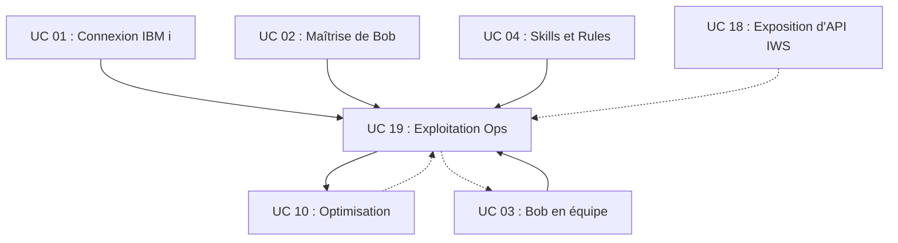

# UC 19 — Exploitation et administration IBM i avec Bob (Ops)

> **Catégorie :** Exploitation et administration système
>
> **Priorité dans le parcours :** 19 — Phase 5 (Exploitation) ; **indépendant du code applicatif** : seuls UC 01 à UC 04 sont requis. Complète UC 10 (performance SQL, objets non recompilés) et UC 18 (jobs et serveurs IWS) ; ne remplace pas la supervision de production.
>
> **Mode Bob recommandé :** **IBM i Developer** (espace Librairies IBM i : outils d'exécution `execute_sql_statement`, `execute_cl_command`, `execute_pase_command`, `write_stream_file`). Bascule vers **IBM i Database** uniquement pour l'analyse de performance SQL (plan cache, index). Sans Premium Package : Agent avec une connexion SQL/SSH configurée à la main — les skills Db2, le RAG et les garde-fous du Premium n'existent pas.

---

## ⭐ Premium Package IBM i utilisé

Il n'existe **pas de workflow Premium dédié à l'exploitation** : UC00 §6 ne liste pas cet UC. Le seul workflow qui écrit sur le système, **SQL Index Strategy Advisor**, relève de la performance SQL (UC 10 / UC 16) et n'est pas le cœur d'UC 19. Ce que le Premium apporte à l'exploitation, ce sont les **outils d'exécution** (SQL, CL, PASE), les **skills de catalogue et de sécurité Db2**, la **recherche documentaire (RAG)** et les **garde-fous** ; l'interrogation du système repose sur les **services SQL IBM i** (`QSYS2`, `SYSTOOLS`).

- **Outils d'exécution** → [Documentation officielle](https://bob.ibm.com/docs/ide/premium-packages/bob-for-i/tools) :
  - `execute_sql_statement` (modes IBM i Developer et IBM i Database) — requêtes sur les services `QSYS2` / `SYSTOOLS`. Certains types d'instruction exigent une approbation explicite.
  - `execute_cl_command` et `execute_pase_command` (IBM i Developer) — commandes CL qualifiées par défaut ; commandes PASE.
  - `write_stream_file` / `read_stream_file` (IBM i Developer) — écriture des rapports Markdown et HTML dans l'IFS.
- **Skills auto-activées mobilisées** → [Skills Db2 for i & SQL](https://bob.ibm.com/docs/ide/premium-packages/bob-for-i/skills#db2-for-i--sql) :
  - `db2-security-best-practices` (IBM i Developer, IBM i Database) — audit de sécurité.
  - **Skill personnalisé complémentaire (hors Premium) :** `ibm-i-security-ppi` — skill de sécurité IBM i, disponible sur demande, utilisé dans la démonstration d'audit de sécurité (Prompt 4) en complément des skills du Premium.
  - `db2-system-catalog`, `db2-services-catalog` (IBM i Developer, IBM i Database) — catalogue et services système.
  - `db2-sql-performance-analysis`, `db2-sql-stored-procedure-performance`, `db2-sql-optimization` (IBM i Developer, IBM i Database) ; `db2-sql-find-performance-data`, `db2-index-strategy` (IBM i Database) — performance et index.
- **Recherche documentaire (RAG) :** `search_ibm_i_docs_with_rag` — interroge la documentation IBM i et les Redbooks indexés au lieu de s'en remettre au seul modèle. À demander explicitement (« Search the IBM i docs for… »). → [RAG](https://bob.ibm.com/docs/ide/premium-packages/bob-for-i/retrieval-augmented-generation)
- **Garde-fous** → [Settings](https://bob.ibm.com/docs/ide/premium-packages/bob-for-i/settings) :
  - `deniedSQLStatementTypes` — valeur par défaut `ALLOCATE, CALL, COMMIT, CONNECT, DISCONNECT, DROP, EXECUTE, GRANT, LOCK, MERGE, PREPARE, RENAME, REVOKE, ROLLBACK, SAVEPOINT, TRUNCATE, UPDATE` (approbation explicite requise). `INSERT`, `DELETE`, `CREATE` et `ALTER` n'y figurent pas : **vérifier la valeur sur l'instance**.
  - `maxRowsToFetch` — défaut 100 lignes ; `enforceQualifiedCLCommands` — défaut `true`.
- **Sécurité et traçabilité** → [Security guidelines](https://bob.ibm.com/docs/ide/premium-packages/bob-for-i/security-guidelines) : Bob agit avec **les droits du profil IBM i connecté** (« any operation the user profile is permitted to perform … Bob will also be able to perform ») ; il positionne le registre `CLIENT_APPLNAME`, ce qui permet de repérer ses requêtes. Moindre privilège obligatoire.
- **Slash Command : `/init`** → [Documentation officielle](https://bob.ibm.com/docs/ide/premium-packages/bob-for-i/slash-commands) — `AGENTS.md` de la partition (règles d'exploitation, dossier de sortie des rapports). Voir UC00 §3.1.
- **Dépannage** → [Troubleshooting](https://bob.ibm.com/docs/ide/premium-packages/bob-for-i/troubleshooting) : canal de sortie « IBM Bob Premium Package for i » (chaque appel d'outil, avec durée ; avertissement si un outil dépasse 30 secondes).
- **Hors Premium (fonctions de Bob) :** création d'un *skill* à partir d'un résultat et appel par `/nom-du-skill` ; voir UC 04 pour l'emplacement et le partage des skills.

> **Pourquoi cet UC 19 apporte une valeur méthodologique unique :**
> L'exploitation est le domaine où une IA connectée au système est la plus utile et la plus risquée : tout ce que le profil peut faire, Bob peut le faire. Cet UC apporte :
> 1. **Une séparation stricte lecture / écriture** : les audits (sous-cas A) sont en lecture seule, propriété assurée par l'environnement (profil à autorisations strictement limitées) et pas seulement par le prompt ; l'écriture des rapports (B) et toute modification du système (C) sont explicitées et approuvées.
> 2. **Une qualification obligatoire des droits et des garde-fous** (Prompt 0) avant la première requête.
> 3. **Des constats sourcés, jamais déduits** : chaque valeur issue d'un service SQL, sinon « NON VÉRIFIÉ » ; les recommandations sont séparées des faits et **jamais appliquées**.
> 4. **Un passage de la question ponctuelle à l'actif réutilisable** : le résultat devient un skill, puis un enchaînement, avec une procédure d'exécution réutilisable et standardisée (un skill reste une instruction interprétée par le modèle : il n'élimine pas son raisonnement et ne garantit pas une exécution déterministe, sauf exécution confiée à des scripts déterministes).
> 5. **Un cadre pour l'automatisation hors Bob** (Ansible, `JOBSCDE`) traitée comme un **changement de système** à approuver.

> ⚠️ **Distinctions avec les autres UC (règle de routage) :**
> - **UC 10 / UC 16** traitent la performance **SQL** et les index d'une application ; **UC 19** observe la **partition** (jobs, PTF, sécurité, santé). Les deux partagent le plan cache — voir UC 10 pour l'analyse.
> - **UC 18** exploite les **serveurs IWS** ; **UC 19** ne s'en sert que pour repérer leurs jobs. **Voir aussi :** UC 19 n'est pas un prérequis d'UC 18, et ses audits ne remplacent pas les tests fonctionnels et de sécurité des API déployées.
> - **UC 03** (Bob en équipe) porte les règles communes ; UC 19 y renvoie pour le profil, les rules et les skills partagés.

---

## Périmètre

**Trois sous-cas, à parcourir dans cet ordre** (le Prompt 0 détermine celui de la session) :

| Sous-cas | Description | Écriture |
|---|---|---|
| **A — Diagnostic (lecture)** | Jobs actifs, journal de job, objets non recompilés, état des PTF/CVE, audit de sécurité, santé de la partition | **Aucune** sur le système ; rapport dans le chat |
| **B — Industrialisation** | Rapports Markdown/HTML dans l'IFS ; création de skills appelables par `/nom` ; skill d'enchaînement « audit complet » | Fichiers dans l'IFS et skills de Bob, **après accord** |
| **C — Automatisation hors Bob** | Playbook Ansible exécutant l'enchaînement sans VS Code ; entrée de planification `JOBSCDE` | **Modification du système** (objets, planification), approbation explicite |

> ⚠️ **Non couvert (aucune source trouvée) :** sous-systèmes, spools, jobs en erreur, **vérification des sauvegardes** avec Bob. Les messages en attente dans `QSYSOPR` et l'occupation disque (ASP) ont été **cités à l'oral** lors du webinaire du 5 novembre 2026 mais **non démontrés** : le Prompt 5-bis les traite comme des prompts d'essai, sans résultat attendu.

---

## Objectif

Permettre à un administrateur IBM i d'obtenir, en langage naturel, un **état documenté de sa partition** (jobs, PTF et CVE, sécurité, santé) à partir des services SQL IBM i, de transformer ces demandes en **actifs réutilisables** (skills), et de cadrer leur **automatisation** — sans jamais laisser Bob modifier le système sans approbation.

**Ce que cet UC permet :**
- Qualifier les droits du profil, les garde-fous et le dossier de sortie avant tout audit.
- Identifier les jobs actifs les plus consommateurs, lire un journal de job et lister les objets anciens (lab FLGHT400).
- Produire un rapport PTF/CVE, un audit de sécurité avec plan de remédiation **proposé** et un état de santé de partition, en Markdown puis HTML.
- Transformer un résultat en skill appelable par `/nom`, puis assembler un skill d'« audit complet ».
- Cadrer l'exécution hors Bob (Ansible, `JOBSCDE`) et l'hygiène des rapports (rétention).

**Critère de succès principal :** les droits et garde-fous de la session sont documentés ; chaque constat des rapports est rattaché à une requête sur un service IBM i (sinon « NON VÉRIFIÉ ») ; les recommandations sont séparées des faits et **aucune n'a été appliquée** ; toute écriture (IFS, skills, planification) a été approuvée explicitement et est tracée.

---

## Prérequis

- **Phase :** Phase 5 — Exploitation
- **UC précédents requis :**
  - **UC 01 — Connecter Bob à l'IBM i** (**obligatoire**) : connexion SSH active (`STRTCPSVR *SSHD`, 5733-SC1, utilisateur `QSSHD` activé), IBM i 7.4 ou supérieur.
  - **UC 02 — Maîtrise de Bob**, **UC 03 — Bob en équipe** et **UC 04 — Stratégie Skills et Rules** (**obligatoires**) : modes, `/init`, emplacement et partage des skills.
  - **UC 10 — Optimisation du code** (**recommandé**) : requêtes `QSYS2` déjà utilisées pour les jobs et les objets.
- **Livrables requis :** aucun. Décision écrite de l'équipe sur : le **dossier IFS de sortie** des rapports, le **profil IBM i dédié** de la session et la politique de rétention.
- **Prérequis système IBM i (à confirmer au Prompt 0, jamais supposés) :**
  - Profil de la session à **moindre privilège** ; pour un audit complet, droits de lecture sur les services concernés (`USER_INFO`, `SECURITY_INFO`, etc.) — **les droits requis service par service sont à établir en lab**.
  - Pour `SYSTOOLS.CVE_INFO` : IBM i 7.5 (SF99950 niveau 12) ou 7.6 (SF99960 niveau 3 / TR2) ; le service interroge l'API IBM Security Bulletins, donc **un accès réseau sortant** — [IBM i 7.6 TR2 Enhancements](https://www.ibm.com/support/pages/node/7271857).
  - Sous-cas C : serveur Ansible et accès SSH (dans la démonstration, installés sur la partition elle-même) ; droits de création d'objets de planification.
- **Niveau Bob recommandé :** Intermédiaire (sous-cas A et B) ; Avancé (sous-cas C)

> ⚠️ **Un administrateur IBM i doit valider** les recommandations de Bob (plan de remédiation sécurité, application de PTF). Dans le webinaire : « le PPI est un assistant, en aucun cas il ne prend de décisions pour vous ».

---

## Exemple concret — Lab FLGHT400

**Démonstration validée : l'audit de sécurité de la partition à l'ère de Mythos.** Les attaquants utilisent désormais l'IA pour détecter des vulnérabilités, les enchaîner et attaquer les systèmes : la défense doit disposer du même niveau d'assistance. Sur une partition IBM i (IBM i 7.5, 66 profils), Bob, en mode IBM i Developer avec le skill personnalisé `ibm-i-security-ppi` (disponible sur demande) en complément des skills du Premium, reçoit la demande « réaliser un audit de sécurité rapide de mon IBM i et générer un rapport HTML ». Après connexion à la partition, il établit une liste de **10 domaines de contrôle**, tous en lecture seule, suivis d'un **rapport de synthèse HTML** (11 lignes au total) :

| # | Contrôle | Apport en sécurité |
|---|---|---|
| 1 | Identité du système (serveur, profil, release, partition) | Périmètre et version à auditer |
| 2 | Valeurs système de sécurité | Politique de la partition : mots de passe, verrouillage, restauration d'objets |
| 3 | Profils à autorités spéciales | Comptes à fort pouvoir, première cible d'un attaquant |
| 4 | Hygiène des profils (dormants, jamais connectés, mots de passe sans expiration) | Comptes oubliés exploitables |
| 5 | Journal d'audit (`QAUDJRN`) | Capacité à détecter et à reconstituer une intrusion |
| 6 | Exposition réseau (ports en écoute, partages NetServer) | Surface d'attaque visible de l'extérieur |
| 7 | Exit programs | Contrôle des accès par les serveurs hôtes (FTP, Telnet, DDM, ODBC) |
| 8 | Programmes à autorité adoptée | Chemins d'élévation de privilèges |
| 9 | `QCRTAUT` et autorité publique des bibliothèques utilisateur | Données lisibles ou modifiables par tous |
| 10 | Adoption de l'authentification multifacteur (TOTP) sur les profils privilégiés | Protection contre le vol de mot de passe |
| 11 | *Rapport de synthèse* — génération du rapport HTML (`ibmi-security-report.html`), qui n'est pas un domaine de contrôle | Constats priorisés, partageables avec la sécurité et la direction |

Le rapport HTML ne modifie rien sur le système (seul son fichier de sortie est écrit, après autorisation d'écriture). Il met en évidence, par exemple : 44 bibliothèques utilisateur ouvertes en `*PUBLIC *CHANGE` (`QCRTAUT = *CHANGE`) ; une adoption d'autorité non restreinte (`QUSEADPAUT = *NONE`) permettant à tout développeur de compiler un programme d'élévation de privilèges ; l'absence d'exit programs sur les serveurs hôtes (FTP 21, Telnet 23, DDM 446-449, ODBC 8471-8479 ouverts sans contrôle). Les points positifs sont aussi relevés : `QMAXSIGN = 3` et `QMAXSGNACN = 3` (verrouillage anti-force brute), `QRMTSIGN = *FRCSIGNON`. Cinq premières actions sont **proposées**, dans cet ordre : créer `QAUDJRN` et activer `QAUDCTL` ; fixer `QPWDEXPITV = 90` et `QPWDRQDDIF = 8` ; fixer `QALWOBJRST = *NONE` ; désactiver un profil `*SECOFR` complet jamais connecté et pourvu d'un mot de passe ; planifier une fenêtre d'IPL pour passer `QPWDLVL` à 3. Le rapport signale enfin que le profil qui conduit l'évaluation détient `*ALLOBJ` (« Authority Notice ») : ce constat rejoint la règle du profil à moindre privilège de cet UC.

> 💡 Cette démonstration porte sur une partition de démonstration, non sur le lab FLGHT400 : la liste des constats dépend de chaque partition.

> ⚠️ **Le lab FLGHT400 couvre les jobs actifs par CPU et les programmes non recompilés** (tableau ci-dessous). Les scénarios PTF/CVE, santé de partition, skills, Ansible et `JOBSCDE` proviennent d'une démonstration IBM pré-enregistrée (webinaire du 5 novembre 2026), **sur une instance personnelle** (IBM i 7.6, serveur Ansible) — à rejouer et valider sur la LPAR TechZone avant présentation.

| Livrable | Fichier lab | Ce qu'il illustre |
|---|---|---|
| Audit CPU et programmes non recompilés | [`../labs_FLGHT400_results/FLGHT403_cpu_jobs_programs_audit.md`](../labs_FLGHT400_results/FLGHT403_cpu_jobs_programs_audit.md) (+ [`_conversation`](../labs_FLGHT400_results/FLGHT403_cpu_jobs_programs_audit_conversation.md)) | Top 20 des jobs actifs par `CPU_TIME` (`QSYS2.ACTIVE_JOB_INFO`) avec distinction CPU cumulé / `ELAPSED_CPU_PERCENTAGE` (0 pour tous : système au repos) ; 34 programmes sur 34 non recompilés depuis plus de 5 ans (`QSYS2.OBJECT_STATISTICS`), dont 25 OPM RPG de 1997. Illustre les Prompts 1 et 2. |
| Rapport `/init` | [`../labs_FLGHT400_results/FLGHT403_init_report.md`](../labs_FLGHT400_results/FLGHT403_init_report.md) | Contexte applicatif de la partition (dépendance codée en dur à `FLGHT400`) — utile pour interpréter les jobs et objets du Prompt 1 et 2. |

**Prompts d'origine du lab (Exercice 5, README `bmarolleau/flight400-demo`, environ 10 minutes, mode IBM i Developer)** — repris en anglais dans le dépôt : (1) *« Which active jobs have accumulated the most CPU time? For the top jobs, distinguish cumulative CPU time from their current elapsed CPU percentage. »* ; (2, optionnel) inspecter le job classé premier, son journal de job et **une** mesure de CPU écoulé fraîche, en distinguant faits et inférences, avec au plus deux recommandations ; (3) *« Which programs in the FLGHT4nn library have not been recompiled in the last 5 years? »*. Le README ne contient **aucune consigne « lecture seule »** pour cet exercice : les Prompts 1 et 2 ci-dessous l'ajoutent explicitement.

**Scénario de lab pour rejouer l'UC pas à pas :** sur la LPAR TechZone — A : Prompts 0 → 1 → 2 → 3 → 4 → 5 ; B : Prompts 6 → 7 ; C (optionnel, hors LPAR partagée) : Prompts 8 → 9.

---

## Démarrer une session Bob

### Les trois espaces de travail

- **Workspace local** (poste) — rapports sauvegardés (`bob-reports/`), `AGENTS.md`/rules (voir UC 03 / UC 04).
- **Librairies IBM i / QSYS** ⭐ — **espace par défaut de cet UC** : exécution des requêtes `QSYS2` / `SYSTOOLS`, des commandes CL et PASE ; `AGENTS.md` de la partition injecté.
- **IFS (`$HOME` ou dossier désigné)** — **rapports Markdown et HTML de sortie** (un sous-dossier par jour recommandé), playbook Ansible, éventuelles sauvegardes.

> ⚠️ **Skills et espace QSYS :** quand l'espace actif est *Librairies IBM i* seul, seul `~/.bob/skills/` (global poste) est chargé ; les skills du dépôt ne le sont pas (voir UC 04). Un skill créé pour les audits est donc à placer là où la session le verra, et **partagé via Git** pour l'équipe (UC 03).

### Règles de session

- **Une nouvelle conversation Bob par audit** (bouton `+`). Ne pas réutiliser la conversation d'un audit précédent : les constats anciens polluent les nouveaux.
- **Profil dédié** : ne pas utiliser un profil `*ALLOBJ` pour un audit ; un profil à moindre privilège limite à la fois les erreurs et l'étendue des actions possibles de Bob.
- **Toujours demander les faits avant les recommandations** : *« Distingue les faits (avec la requête) des inférences »*.
- **Date dans chaque rapport et chaque nom de fichier** (format `YYYYMMDD-HHmm`) : les audits se comparent dans le temps.
- **Règle d'or :** pendant les Prompts 0 à 5, Bob **ne lit que** sur le système. L'écriture dans l'IFS (Prompts 3 à 6), la création de skills (Prompts 6 et 7) et toute modification du système (Prompts 8 et 9) exigent un **accord explicite et distinct**.
- **Autorisation d'écriture (étape distincte, après la lecture) :** l'accord de principe sur le dossier de sortie recueilli au Prompt 0 ne vaut pas autorisation d'écrire ; avant la première écriture dans l'IFS, vérifier le chemin exact et les droits (autorités du profil sur le dossier, `QSYS2.IFS_OBJECT_PRIVILEGES`), puis donner un accord explicite pour cette écriture seule (outil `write_stream_file`). Le vrai test d'écriture n'a lieu qu'à ce moment.
- **Lecture seule = propriété de l'environnement :** la consigne du prompt ne suffit pas ; la lecture seule repose sur un profil aux autorisations strictement limitées et sur les garde-fous techniques (`deniedSQLStatementTypes` ne bloque pas toutes les instructions modifiant des données : voir Pièges).

---

## Démarche structurée et Prompts

### Progression recommandée : démarrer par la lecture la plus simple

Commencer par les Prompts 1 et 2 (lab FLGHT400, lecture seule, valeurs vérifiables par l'administrateur) avant les audits PTF/CVE et sécurité. Un résultat que l'administrateur peut recouper (un job qu'il connaît) valide la méthode avant des constats plus lourds.

| Sous-cas | Niveau de risque | Séquence |
|---|---|---|
| **A** (diagnostic) | Faible (lecture) | Prompts 0 → 1 → 2 → 3 → 4 → 5 |
| **B** (industrialisation) | Moyen (écriture IFS, skills) | Prompts 6 → 7 |
| **C** (automatisation) | **Élevé (modification du système)** | Prompts 8 → 9, jamais sur une LPAR partagée sans accord de l'administrateur |

### Prompt 0 — Qualification : droits, garde-fous, périmètre, dossier de sortie

**Objectif :** Établir l'état de la session avant la première requête : profil, droits, garde-fous Bob, version, dossier de sortie, sous-cas.

**Quand l'utiliser :** Premier prompt de **chaque** session.

**Input requis :** dossier IFS de sortie envisagé ; sous-cas visé ; politique de rétention.

**Espace :** Dans le chat (lecture seule ; aucune écriture).
**Mode :** IBM i Developer.
**Skills clés mobilisées :** `db2-security-best-practices`, `db2-system-catalog`, `db2-services-catalog`.

**Prompt :**

```text
Qualifie la session d'exploitation. Lecture seule : n'écris aucun fichier, ne modifie aucun objet ni
aucune valeur système, ne démarre ni n'arrête aucun job. Produis en français, en markdown :

## Qualification UC 19
### 1. Système et profil
Version de l'IBM i, modèle, profil connecté, autorités spéciales (QSYS2.USER_INFO) et classe
d'utilisateur. Chaque ligne indique sa source ou « NON VÉRIFIÉ ».
### 2. Garde-fous de Bob
Valeurs effectives de deniedSQLStatementTypes, maxRowsToFetch et enforceQualifiedCLCommands, si tu peux
les lire ; sinon « NON VÉRIFIÉ ». Indique si INSERT, DELETE, CREATE et ALTER sont soumis à approbation.
### 3. Services disponibles
Pour chacun des services QSYS2.ACTIVE_JOB_INFO, QSYS2.JOBLOG_INFO, QSYS2.OBJECT_STATISTICS,
QSYS2.PTF_INFO, SYSTOOLS.GROUP_PTF_CURRENCY, SYSTOOLS.CVE_INFO, QSYS2.SECURITY_INFO,
QSYS2.SYSTEM_VALUE_INFO, QSYS2.USER_INFO, QSYS2.SYSTEM_STATUS_INFO, QSYS2.MEMORY_POOL_INFO,
QSYS2.SYSDISKSTAT : présence sur cette version et droit de lecture du profil (test de lecture minimal,
une ligne). Un service absent ou refusé est noté tel quel, sans contournement.
### 4. Dossier de sortie
Le dossier IFS [DOSSIER_SORTIE] existe-t-il, et que disent les autorités déclarées du profil sur ce
dossier (lecture seule des métadonnées) ? Aucun test d'écriture : le vrai test n'est réalisé qu'après
accord explicite.
### 5. Sous-cas retenu
A, B ou C, avec la justification et les prompts de la séquence.

Ne corrige rien. Si une vérification échoue, donne le message exact.
```

**Livrable produit :** `{appId}-ops-partition-qualification-{YYYYMMDD-HHmm}.md` (sauvegarde locale demandée explicitement dans `bob-reports/`).

> ⚠️ Si le profil possède `*ALLOBJ` ou des droits d'administration étendus : le signaler à l'administrateur et envisager un profil dédié avant de poursuivre.

### Prompt 1 — Jobs actifs par CPU et journal du job principal *(lab Exercice 5)*

**Objectif :** Identifier les jobs les plus consommateurs et déterminer si le premier est réellement limité par le CPU.

**Quand l'utiliser :** Premier audit de lecture ; reproduit les prompts 1 et 2 du lab FLGHT400.

**Input requis :** rapport de qualification (Prompt 0).

**Espace :** Dans le chat (lecture seule).
**Mode :** IBM i Developer.
**Skills clés mobilisées :** `db2-services-catalog`, `db2-sql-find-performance-data`.

**Prompt :**

```text
La qualification est dans [NOM_FICHIER]. Lecture seule : n'écris rien, ne modifie aucun job.

1. Quels jobs actifs ont accumulé le plus de temps CPU ? Pour les 10 premiers, distingue le CPU cumulé
   (CPU_TIME) du pourcentage de CPU écoulé courant (ELAPSED_CPU_PERCENTAGE), via
   QSYS2.ACTIVE_JOB_INFO. Affiche la requête utilisée.
2. Pour le job classé premier : consulte son journal (QSYS2.JOBLOG_INFO) et prends UNE mesure fraîche de
   CPU écoulé. Si le journal est vide et que c'est un processus PASE, lis ses informations IFS
   (exécutable, répertoire courant, fichiers ouverts) sans les modifier. Arrête-toi après cette
   investigation.

Distingue les faits (avec la requête ou la valeur lue) des inférences. Fournis au plus deux
recommandations, sans les appliquer. N'invente aucun job ni aucune valeur.
```

**Livrable produit :** `{appId}-ops-jobs-cpu-report-{YYYYMMDD-HHmm}.md` (sauvegarde locale demandée explicitement dans `bob-reports/`).

> 💡 **Lab FLGHT403 :** tous les `ELAPSED_CPU_PERCENTAGE` valaient 0 (système au repos) ; l'ordre du CPU cumulé est dominé par des jobs serveur (`QWEBADMIN/ADMIN*`, `QLWISVR/ADMIN*`, `QBRMS`). Un CPU cumulé élevé n'implique pas une consommation actuelle — d'où la distinction demandée.

### Prompt 2 — Objets non recompilés *(lab Exercice 5)*

**Objectif :** Lister les programmes d'une bibliothèque qui n'ont pas été recompilés depuis un seuil donné.

**Quand l'utiliser :** Après le Prompt 1, pour préparer une fenêtre de modernisation ou un audit de dette.

**Input requis :** bibliothèque cible ; seuil (par défaut 5 ans).

**Espace :** Dans le chat (lecture seule).
**Mode :** IBM i Developer.
**Skills clés mobilisées :** `db2-system-catalog`, `db2-services-catalog`.

**Prompt :**

```text
Quels programmes de la bibliothèque [NOM_LIB] n'ont pas été recompilés depuis [SEUIL, ex. 5 ans] ?
Utilise QSYS2.OBJECT_STATISTICS sur les objets *PGM. Précise la colonne retenue pour la date
(OBJCREATED ou LAST_USED_TIMESTAMP) et pourquoi. Pour chaque programme : nom, attribut, date de
création, dernière utilisation. Conclus par le nombre de programmes concernés sur le total. Précise
qu'une date de création ancienne ne prouve pas l'absence de recompilation. Lecture
seule. N'invente aucun programme ; ne tire aucune conclusion sur l'utilité d'un programme sans la
dernière utilisation.
```

**Livrable produit :** `{appId}-ops-objets-anciens-report-{YYYYMMDD-HHmm}.md` (sauvegarde locale demandée explicitement dans `bob-reports/`).

> 💡 **Lab FLGHT403 :** 34 programmes sur 34, dont 25 OPM RPG de 1997. `FLGHT400` joue le rôle de bibliothèque figée : l'absence de recompilation n'est pas une anomalie en soi, mais un indicateur de dette à croiser avec la dernière utilisation. Une date de création ancienne (`OBJCREATED`) n'est pas une preuve d'absence de recompilation : à recouper avec l'historique de compilation et la dernière utilisation (`LAST_USED_TIMESTAMP`).

### Prompt 3 — État des PTF et des CVE

**Objectif :** Produire un état des correctifs (groupes PTF, PTF défectueuses ou en attente) et des vulnérabilités publiées, avec recommandations.

**Quand l'utiliser :** Avant une fenêtre de maintenance, ou à fréquence régulière.

**Input requis :** rapport de qualification ; dossier de sortie validé.

**Espace :** Dans le chat (lecture) ; rapport dans l'IFS **après accord** (sous-cas B).
**Mode :** IBM i Developer.
**Skills clés mobilisées :** `db2-services-catalog`, `db2-system-catalog`.

**Prompt :**

```text
La qualification est dans [NOM_FICHIER]. Produis, en français, l'état des PTF et des CVE de la partition.
Lecture seule sur le système. Utilise les services disponibles de la qualification, par exemple :
 - les groupes PTF installés et leur niveau, comparés au niveau courant (SYSTOOLS.GROUP_PTF_CURRENCY ou
   QSYS2.GROUP_PTF_INFO selon la disponibilité) ;
 - les PTF et leur état (QSYS2.PTF_INFO) : défectueuses, en attente d'application, appliquées
   temporairement ou en permanence ;
 - les CVE publiées récemment (SYSTOOLS.CVE_INFO, si disponible sur cette version).
Pour chaque section : la requête utilisée, les chiffres, puis les recommandations, séparées des faits.
Si un service est indisponible ou si l'accès réseau sortant manque, écris « NON VÉRIFIÉ » et la cause ;
ne complète rien de mémoire. N'applique, ne charge et ne retire aucune PTF.

Rédige d'abord le rapport dans le chat. Ne crée aucun fichier à ce stade.
```

**Livrable produit :** `{appId}-ops-ptf-cve-report-{YYYYMMDD-HHmm}.md` (sauvegarde locale demandée explicitement dans `bob-reports/`).

> 💡 **Rapport HTML :** une fois le contenu validé, demander à Bob de l'écrire en Markdown puis en HTML dans `[DOSSIER_SORTIE]/{date}/`. Dans la démonstration, le HTML met en couleur les PTF défectueuses et les PTF « en action ». Accord explicite requis pour l'écriture (outil `write_stream_file`).

> ⚠️ `SYSTOOLS.CVE_INFO` interroge un service externe : le résultat dépend de l'accès réseau de la partition. La liste de CVE n'est pas une preuve d'exposition — un correctif peut ne pas s'appliquer à la configuration.

### Prompt 4 — Audit de sécurité et plan de remédiation proposé

**Objectif :** Produire un audit de sécurité complet de la partition — 10 domaines de contrôle et 1 rapport de synthèse HTML — et un **plan de remédiation proposé**, sans l'appliquer. À l'ère de Mythos, où les attaquants utilisent l'IA pour détecter et enchaîner les vulnérabilités, cet audit régulier réduit la surface d'attaque avant qu'elle ne soit exploitée.

**Quand l'utiliser :** Après le Prompt 3 ; périodiquement.

**Input requis :** rapport de qualification ; liste de bibliothèques ou profils à examiner en détail (optionnel).

**Espace :** Dans le chat (lecture) ; rapport dans l'IFS après accord.
**Mode :** IBM i Developer.
**Skills clés mobilisées :** `db2-security-best-practices`, `db2-services-catalog` ; skill personnalisé `ibm-i-security-ppi` (disponible sur demande) pour l'audit complet.

**Prompt :**

```text
La qualification est dans [NOM_FICHIER]. Réalise un audit de sécurité de la partition, en lecture seule,
en 10 domaines de contrôle, puis un rapport de synthèse :
1. Identité du système (serveur, profil, release, partition).
2. Valeurs système de sécurité (par exemple QSECURITY, QPWDLVL, QPWDEXPITV, QMAXSIGN, QALWOBJRST,
   QCRTAUT, QUSEADPAUT, QAUDCTL, QAUDLVL) via QSYS2.SYSTEM_VALUE_INFO et QSYS2.SECURITY_INFO.
3. Profils à autorités spéciales (*ALLOBJ, *SECADM…), via QSYS2.USER_INFO.
4. Hygiène des profils : dormants, jamais connectés, mots de passe sans expiration. Pas de liste de mots
   de passe ni d'identifiants.
5. État du journal d'audit QAUDJRN.
6. Exposition réseau : ports en écoute, partages NetServer.
7. Exit programs enregistrés sur les serveurs hôtes.
8. Programmes à autorité adoptée.
9. QCRTAUT et autorité publique des bibliothèques utilisateur.
10. Adoption de l'authentification multifacteur (TOTP) sur les profils privilégiés.
11. Rapport de synthèse HTML (n'est pas un contrôle) : constats priorisés, points positifs et plan de remédiation.
Pour chaque constat : la requête, le chiffre, le niveau de risque proposé et la source. Termine par un plan
de remédiation PROPOSÉ (étapes ordonnées, impact, prérequis ; les changements nécessitant un IPL sont
signalés). Ne modifie aucune valeur système, aucun profil, aucune autorité. Distingue faits et
recommandations ; écris « NON VÉRIFIÉ » si une information est inaccessible avec les droits de la
session. Rédige d'abord la synthèse dans le chat ; n'écris le rapport HTML qu'après mon accord.
```

**Livrable produit :** `{appId}-ops-securite-report-{YYYYMMDD-HHmm}.md` et son rapport HTML (sauvegarde locale demandée explicitement dans `bob-reports/`).

> ⚠️ Dans la démonstration validée, l'audit relève notamment 44 bibliothèques utilisateur en `*PUBLIC *CHANGE`, une adoption d'autorité non restreinte et l'absence d'exit programs sur les serveurs hôtes, et propose cinq premières actions (journal d'audit, politique de mots de passe, restauration d'objets, profil `*SECOFR` inutilisé, niveau de mot de passe). **La remédiation est proposée, jamais appliquée** par Bob dans cet UC.

> 💡 Le rapport contient des informations sensibles (noms de profils, autorités). Stocker le dossier de sortie avec des droits restreints et l'exclure des dépôts partagés.

### Prompt 5 — État de santé de la partition

**Objectif :** Synthétiser l'état de la partition (version, modèle, CPU, mémoire, disques, jobs actifs) avec un indicateur par domaine.

**Quand l'utiliser :** Quand des temps de réponse se dégradent, ou à fréquence régulière.

**Input requis :** rapport de qualification.

**Espace :** Dans le chat (lecture) ; rapport dans l'IFS après accord.
**Mode :** IBM i Developer.
**Skills clés mobilisées :** `db2-services-catalog`, `db2-sql-find-performance-data`.

**Prompt :**

```text
La qualification est dans [NOM_FICHIER]. Produis, en français, un état de santé de la partition :
version et modèle, CPU (utilisation, cœurs), mémoire (QSYS2.MEMORY_POOL_INFO, QSYS2.SYSTEM_STATUS_INFO),
disques (QSYS2.SYSDISKSTAT : occupation par ASP et par unité), nombre de jobs actifs. Pour chaque domaine :
la requête, les valeurs, un indicateur (vert / jaune / rouge) AVEC le seuil retenu et sa justification
— si aucun seuil n'est défini par l'équipe, propose-en un et marque-le « SEUIL PROPOSÉ ». Lecture seule.
Ne tire aucune conclusion sur un goulot d'étranglement sans mesure. N'invente aucune valeur ; écris
« NON VÉRIFIÉ » si un service est indisponible. Ne crée aucun fichier à ce stade.
```

**Livrable produit :** `{appId}-ops-sante-report-{YYYYMMDD-HHmm}.md` (sauvegarde locale demandée explicitement dans `bob-reports/`).

> ⚠️ Un indicateur vert/jaune/rouge dépend du seuil : il ne dispense pas du jugement de l'administrateur. Les seuils validés rejoignent l'`AGENTS.md` de la partition.

### Prompt 5-bis — Essais : messages en attente (`QSYSOPR`) et occupation disque *(non démontré)*

**Objectif :** Tester ce que Bob peut faire sur deux demandes **citées dans le webinaire mais non montrées**.

**Quand l'utiliser :** Uniquement en lab exploratoire ; **ne pas présenter comme capacité démontrée**.

**Input requis :** rapport de qualification.

**Espace :** Dans le chat (lecture seule).
**Mode :** IBM i Developer.
**Skills clés mobilisées :** `db2-services-catalog`.

**Prompt :**

```text
Lecture seule. 1) Y a-t-il des messages en attente de réponse dans la file QSYSOPR ? Pour chacun : le
job concerné, le texte et le niveau de gravité (QSYS2.MESSAGE_QUEUE_INFO). 2) Quelle est l'occupation
disque de chaque ASP (QSYS2.SYSDISKSTAT) ? N'envoie aucune réponse à un message, ne libère aucun job.
Distingue faits et hypothèses ; « NON VÉRIFIÉ » si le service est indisponible. Propose au plus deux
pistes d'analyse, sans les exécuter.
```

**Livrable produit :** résultat dans le chat (sauvegarde locale optionnelle, `{appId}-ops-essais-report-{YYYYMMDD-HHmm}.md`).

> ⚠️ **Jamais de réponse automatique à un message `QSYSOPR`** par Bob : répondre à un message modifie le comportement d'un job en cours (décision d'exploitation).

### Prompt 6 — Créer un skill à partir d'un résultat *(sous-cas B)*

**Objectif :** Transformer un audit validé en skill appelable par `/nom`, afin de ne pas payer à chaque fois le raisonnement du modèle.

**Quand l'utiliser :** Après qu'un audit (Prompts 3 à 5) a été validé par l'administrateur et recoupé.

**Input requis :** rapport validé ; requêtes utilisées ; règles de présentation ; dossier de sortie.

**Espace :** Local / skills de Bob (création de fichiers de skill) ; le skill, lui, écrira dans l'IFS à chaque exécution.
**Mode :** IBM i Developer.
**Skills clés mobilisées :** `db2-services-catalog`, `db2-security-best-practices`.

**Prompt :**

```text
À partir de l'audit validé [NOM_FICHIER_RAPPORT] et des requêtes que tu y as utilisées, crée un skill
nommé [NOM_SKILL] qui, lorsqu'il est invoqué, exécute ces mêmes requêtes en LECTURE SEULE, produit le
rapport (Markdown puis HTML) dans [DOSSIER_SORTIE]/{date}/ et sépare faits et recommandations.
Contraintes : le skill ne modifie aucun objet ni aucune valeur système ; il écrit uniquement dans le
dossier de sortie ; il affiche « NON VÉRIFIÉ » plutôt que d'inventer ; le texte du skill reste court
(sous 150 lignes) et pointe vers cette fiche pour les règles. Avant d'écrire le skill, affiche son
contenu et son emplacement, et attends mon accord. Indique comment l'appeler (/[NOM_SKILL]).
```

**Livrable produit :** skill `[NOM_SKILL]` (SKILL.md) à l'emplacement validé ; compte rendu dans `{appId}-ops-skills-rapport-{YYYYMMDD-HHmm}.md` (optionnel).

> 💡 Dans la démonstration, trois skills ont été créés (CVE, sécurité, santé) ; leurs noms exacts sont **à confirmer** — la transcription automatique ne les restitue pas avec certitude. Appel : `/` suivi du nom du skill.

> ⚠️ Un skill peut contenir des requêtes SQL qui s'exécutent avec les droits du profil connecté : il est relu par l'administrateur avant partage (UC 04).

### Prompt 7 — Skill d'enchaînement « audit complet » *(sous-cas B)*

**Objectif :** Assembler les skills d'audit en un enchaînement qui produit une synthèse unique.

**Quand l'utiliser :** Après qu'au moins deux skills d'audit fonctionnent individuellement.

**Input requis :** noms des skills ; format de la synthèse.

**Espace :** Local / skills de Bob (création) ; IFS à l'exécution.
**Mode :** IBM i Developer.
**Skills clés mobilisées :** skills d'audit créés au Prompt 6 ; `db2-security-best-practices`.

**Prompt :**

```text
Crée un skill nommé [NOM_SKILL_AUDIT_COMPLET] qui exécute successivement les skills [LISTE_SKILLS], puis
produit une synthèse unique (page HTML + Markdown) dans [DOSSIER_SORTIE]/{date}/ : un tableau récapitulatif
(domaine, indicateur, constat principal, lien vers le rapport détaillé). Lecture seule sur le système ;
écriture uniquement dans le dossier de sortie. Si un skill échoue, la synthèse l'indique et continue
avec les autres sans masquer l'erreur. Affiche le contenu du skill et attends mon accord avant de
l'écrire.
```

**Livrable produit :** skill `[NOM_SKILL_AUDIT_COMPLET]` ; synthèse dans l'IFS à chaque exécution.

### Prompt 8 — Playbook Ansible d'exécution hors Bob *(sous-cas C, optionnel)*

**Objectif :** Exécuter l'enchaînement d'audit depuis l'IBM i, sans VS Code ni Bob.

**Quand l'utiliser :** Sur une partition dédiée, avec un serveur Ansible déjà en place ; **jamais sur une LPAR partagée sans accord**.

**Input requis :** serveur Ansible et accès SSH validés ; skills ou requêtes d'audit ; dossier de sortie.

**Espace :** Génération de fichiers dans le chat ; exécution = **modification du système**, après accord.
**Mode :** IBM i Developer.
**Skills clés mobilisées :** `db2-services-catalog`.

**Prompt :**

```text
Crée un playbook Ansible [NOM_PLAYBOOK] qui exécute les requêtes de lecture de l'audit complet
([LISTE_REQUETES]) via SSH sur la partition et écrit les rapports HTML/Markdown dans
[DOSSIER_SORTIE]/{date}/. Lecture seule sur le système ; écriture uniquement dans le dossier de sortie.
Aucun mot de passe en clair dans le playbook : utilise le mécanisme de secrets de l'entreprise (à
préciser : [MECANISME]). N'exécute pas le playbook : affiche son contenu, le profil qu'il utilisera et
son impact, et attends mon accord. Précise comment le tester sur un seul domaine d'abord.
```

**Livrable produit :** `{appId}-ops-audit-complet-playbook-{YYYYMMDD-HHmm}.yml` (dans le dossier IFS validé, avec copie locale sur demande).

> ⚠️ Dans la démonstration, le serveur Ansible était installé sur la partition ; ce n'est pas le cas de la LPAR TechZone du lab. Les alternatives citées (CL, RPG, Java) n'ont pas été montrées.

### Prompt 9 — Planification `JOBSCDE` hebdomadaire *(sous-cas C, optionnel)*

**Objectif :** Cadrer, puis créer sur approbation, une entrée de planification qui lance l'audit à intervalle régulier.

**Quand l'utiliser :** Après un playbook testé manuellement ; **modification du système**.

**Input requis :** commande à lancer ; jour et heure (exemple de la démonstration : lundi 06h00) ; profil d'exécution ; file de travaux ; **résultat du contrôle de l'ordonnancement existant** (`QSYS2.SCHEDULED_JOB_INFO`).

**Espace :** IBM i QSYS (création d'une entrée de planification) — **après approbation explicite**.
**Mode :** IBM i Developer.
**Skills clés mobilisées :** `db2-services-catalog`.

**Prompt :**

```text
Je veux planifier l'audit complet chaque [JOUR] à [HEURE] avec le profil [PROFIL]. Avant toute action :
1. Contrôle l'ordonnancement existant (lecture) : vue QSYS2.SCHEDULED_JOB_INFO (ou WRKJOBSCDE) ; si une
   entrée nommée [NOM_ENTREE] ou lançant la même commande existe déjà, arrête-toi et demande-moi.
2. Affiche la commande qualifiée exacte que tu vas exécuter (ADDJOBSCDE : entrée, commande lancée,
   profil, file de travaux), l'impact (qui lance quoi, quand) et la manière d'annuler.
Attends mon accord explicite. Après accord : crée uniquement cette entrée, puis affiche-la pour
vérification. Ne modifie aucune autre entrée, aucun autre job planifié.
```

**Livrable produit :** entrée de planification sur l'IBM i ; compte rendu dans `{appId}-ops-planification-rapport-{YYYYMMDD-HHmm}.md` (optionnel).

> ⚠️ Cette étape **crée un objet de planification** : elle sort du cadre « Bob lit ». Elle suppose un profil avec les droits adaptés, une validation de l'administrateur et un suivi des exécutions. La **rétention** des rapports quotidiens (suppression au-delà de N jours) n'est pas gérée par Bob : prévoir un nettoyage planifié (dans la démonstration, évoqué comme possible).

---

## Livrables de cet UC

> ⚠️ **Où écrit Bob ?** Les audits (sous-cas A) sont produits **dans le chat**. L'écriture des rapports se fait **dans l'IFS de l'IBM i** (`write_stream_file`), pas en local ; les skills sont écrits dans les skills de Bob ; la planification et le playbook modifient le système (sous-cas C). Pour conserver une trace locale, demander explicitement à Bob de sauvegarder dans `bob-reports/`.

| Fichier / objet produit | Pattern de nommage | Espace de stockage | Consommé par |
|---|---|---|---|
| Qualification de session | `{appId}-ops-partition-qualification-{YYYYMMDD-HHmm}.md` | `bob-reports/` (Local) | Tous les prompts suivants, reprise de session |
| Jobs actifs par CPU | `{appId}-ops-jobs-cpu-report-{YYYYMMDD-HHmm}.md` | `bob-reports/` (Local) | UC 10, UC 18 |
| Objets anciens | `{appId}-ops-objets-anciens-report-{YYYYMMDD-HHmm}.md` | `bob-reports/` (Local) | UC 10, UC 11, UC 13 |
| État PTF/CVE | `{appId}-ops-ptf-cve-report-{YYYYMMDD-HHmm}.md` (+ HTML) | Chat / IFS `[DOSSIER_SORTIE]/{date}/` | Fenêtres de maintenance |
| Audit de sécurité et plan proposé | `{appId}-ops-securite-report-{YYYYMMDD-HHmm}.md` (+ HTML) | Chat / IFS (accès restreint) | Revue sécurité |
| État de santé de la partition | `{appId}-ops-sante-report-{YYYYMMDD-HHmm}.md` (+ HTML) | Chat / IFS | Suivi de performance |
| Skills d'audit et d'enchaînement | `[NOM_SKILL]`, `[NOM_SKILL_AUDIT_COMPLET]` | Skills de Bob (à partager via Git, UC 04) | Audits suivants |
| Playbook Ansible *(optionnel)* | `{appId}-ops-audit-complet-playbook-{YYYYMMDD-HHmm}.yml` | IFS | Exécution hors Bob |
| Entrée de planification *(optionnel)* | `[NOM_ENTREE]` | IBM i QSYS | Exécutions planifiées |

---

## Pièges à éviter

| Piège | Ce qui se passe | Comment l'éviter |
|---|---|---|
| Utiliser un profil `*ALLOBJ` pour un audit | Tout ce que le profil peut faire, Bob peut le faire | Profil dédié à moindre privilège (Prompt 0) |
| Se fier à `deniedSQLStatementTypes` pour la lecture seule | `INSERT`, `DELETE`, `CREATE`, `ALTER` ne sont pas dans la liste par défaut | Consigne « lecture seule » dans chaque prompt **et** vérification de la valeur sur l'instance |
| Considérer la consigne dans le prompt comme une règle technique | Le prompt n'est pas un contrôle d'accès | Droits du profil, garde-fous, relecture des requêtes |
| Appliquer une recommandation sans l'administrateur | Changement de configuration non maîtrisé | Recommandations séparées des faits ; décision humaine |
| Répondre à un message `QSYSOPR` ou relancer un job via Bob | Modification du comportement d'un traitement en cours | Lecture seule au Prompt 5-bis ; aucune action |
| Confondre CPU cumulé et CPU courant | Mauvais diagnostic (lab : tous à 0 %) | Distinguer `CPU_TIME` et `ELAPSED_CPU_PERCENTAGE` |
| Présenter un indicateur vert/jaune/rouge sans seuil | Faux sentiment de sécurité | Seuils explicites, marqués « SEUIL PROPOSÉ » tant que non validés |
| Présenter la liste de CVE comme preuve d'exposition | Alerte injustifiée ou fausse assurance | Croiser avec la configuration ; décision de sécurité humaine |
| Reposer la même question au modèle chaque semaine | Raisonnement refait à chaque audit, résultats peu comparables | Skill (Prompt 6), à relire avant partage |
| Skill qui contient une requête modifiante | Écriture non souhaitée à chaque appel | Relecture par l'administrateur ; skills en lecture seule |
| Présenter ce qui n'a pas été démontré (sous-systèmes, spools, sauvegardes) | Promesse non tenue | Section « Non couvert » du Périmètre |
| Stocker les rapports de sécurité sans protection | Fuite d'informations sensibles | Dossier IFS à droits restreints, hors dépôts partagés |
| Planifier un audit sans rétention | Accumulation de rapports dans l'IFS | Nettoyage planifié (au-delà de N jours) |
| Rejouer la démonstration du webinaire telle quelle | Environnement différent (instance personnelle, Ansible) | Tester chaque demande sur la LPAR avant la présentation |

---

## Check-list de validation UC 19

- [ ] **Le Prompt 0 a été exécuté** ; profil, autorités, garde-fous et services disponibles sont documentés (ou « NON VÉRIFIÉ »).
- [ ] La session utilise un profil à **moindre privilège** (pas `*ALLOBJ`).
- [ ] Chaque constat des rapports est rattaché à une requête ; sinon « NON VÉRIFIÉ ».
- [ ] Les recommandations sont séparées des faits et **aucune n'a été appliquée** par Bob.
- [ ] **[Sous-cas A]** Les Prompts 1 et 2 ont été recoupés par l'administrateur sur des valeurs connues.
- [ ] **[Sous-cas A]** `SYSTOOLS.CVE_INFO` : disponibilité (version, PTF) et accès réseau vérifiés ; sinon documentés.
- [ ] **[Sous-cas A]** Les seuils de santé sont validés ou marqués « SEUIL PROPOSÉ ».
- [ ] **[Sous-cas B]** Toute écriture dans l'IFS et tout skill créé ont été approuvés avant écriture ; le contenu a été relu.
- [ ] **[Sous-cas B]** Les skills sont en lecture seule et partagés via Git après relecture.
- [ ] **[Sous-cas C]** L'approbation de l'administrateur est tracée avant le playbook ou la planification ; l'annulation est documentée.
- [ ] Les rapports sensibles sont stockés avec accès restreint ; une rétention est définie.
- [ ] Les livrables sont sauvegardés avec la convention de nommage (`ops-…`).
- [ ] Les capacités non démontrées (sous-systèmes, spools, sauvegardes, `QSYSOPR`, ASP) ne sont pas présentées comme acquises.
- [ ] Les points « à compléter avant production » (ci-dessous) ont été revus.

---

## Points à compléter avant passage en production

> Ces points ne bloquent pas le POC : ils concernent les cas avancés à traiter avant d'industrialiser l'exploitation assistée.

- **Reproductibilité :** les scénarios PTF/CVE, santé, skills, Ansible et `JOBSCDE` n'ont été vus qu'en démonstration pré-enregistrée sur une instance personnelle. Les rejouer sur la LPAR TechZone et consigner les écarts. L'audit de sécurité validé est à rejouer avec un profil à moindre privilège.
- **Droits par service :** établir quels droits sont nécessaires pour chaque service interrogé, puis définir le profil d'audit correspondant.
- **Garde-fous :** durcir `deniedSQLStatementTypes` pour les sessions d'audit (ajouter les instructions d'écriture) ; documenter la valeur retenue.
- **Traçabilité :** exploiter `CLIENT_APPLNAME` pour distinguer les requêtes de Bob des autres.
- **Hors périmètre à instruire :** sous-systèmes, spools, jobs en erreur, vérification des sauvegardes — aucune source ne les documente avec Bob ; à évaluer en lab avant de les promettre.
- **Feuille de route IBM :** l'intégration de Bob à la supervision et au déploiement (DevOps) est annoncée comme une orientation du produit ; elle ne fait pas partie des capacités mesurées ici.
- **Rétention et sécurité des rapports :** durée de conservation, droits d'accès, chiffrement éventuel.
- **Skill de sécurité personnalisé :** `ibm-i-security-ppi` est disponible sur demande ; le placer dans les skills partagés (UC 04) et le faire relire par l'administrateur avant usage.

---

## Dépendances



> UC 01 à UC 04 sont obligatoires (traits pleins). UC 10 et UC 18 sont recommandés (traits pointillés) ; UC 19 alimente UC 10 (objets anciens, jobs) et enrichit les règles d'équipe d'UC 03 (profil, skills partagés).

---

*Fiche UC 19 — Document évolutif à mettre à jour au fil du POC.*
